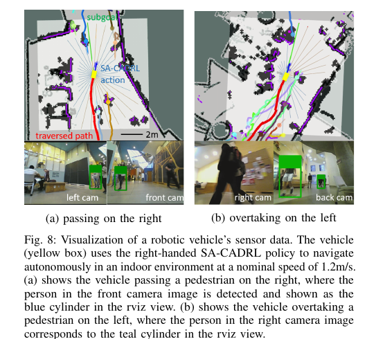

사람끼리 마주 걸을 때는 서로 어느 쪽으로 비킬지 빨리 합의해야 해요. 오른쪽으로 지나가는 지역도 있고 왼쪽으로 지나가는 지역도 있습니다. 어느 쪽이든 둘이 같은 규칙을 기대하면 진로 충돌을 일찍 풀 수 있어요. 문제는 “몇 m 앞에서 몇 도를 틀어야 우측 통행인가”를 하나의 공식으로 쓰기 어렵다는 데 있습니다. 사람마다 속도와 체격이 다르고, 복도 폭과 접근 각도도 매번 달라지기 때문이에요.

2017년 <abbr title="사회 규범을 고려하도록 확장한 충돌 회피 심층 강화학습">SA-CADRL</abbr>은 모범 궤적을 세밀하게 정의하는 대신, 원치 않는 쪽에 들어가는 상태를 벌점으로 표시했습니다. 원 논문 *Socially Aware Motion Planning with Deep Reinforcement Learning*의 주장은 단순하면서도 영향력이 커요. “해야 할 움직임” 전체를 쓰기는 어렵지만, “하지 말아야 할 쪽”은 비교적 거칠게 표시할 수 있다는 생각입니다.

이 논문은 [[2026-10-17_socialnav_cadrl|CADRL이 충돌 회피를 가치함수로 바꾼 출발점]]을 출발점으로 삼아요. 기존 정책도 대칭 교차에서 한쪽을 택하는 관습 같은 행동을 보였지만, 그 방향은 초기 학습자료와 무작위 사례에 따라 달라졌습니다. 체격과 속도가 달라지면 같은 정책이 반대쪽을 택하기도 했어요. 자연스럽게 생긴 관습은 제어할 수 있는 사회 규범이 아니었던 셈입니다.

## 좌우를 가르는 작은 벌점

SA-CADRL의 기본 보상은 목적지 도달, 충돌 회피, 이동 시간으로 구성된 CADRL 보상입니다. 여기에 규범 위반 벌점이 더해져요. 우측 통행 정책을 만들 때 논문은 세 종류의 상대 배치를 지정합니다. 마주 오는 사람을 왼쪽으로 통과하려는 배치, 느린 사람을 오른쪽으로 추월하려는 배치, 교차하는 사람의 진행 앞쪽을 가로지르는 배치예요. 로봇 중심 좌표에서 이런 영역에 상대가 들어오면 작은 음의 보상을 줍니다.

핵심은 벌점 영역 안의 모든 올바른 경로를 가르치지 않는다는 점이에요. 나쁜 쪽의 상태만 낮게 평가하면 시간 효율과 충돌 회피 보상이 나머지 경로를 정합니다. 통로가 넓으면 일찍 완만하게 비킬 수 있고, 좁으면 늦게 작은 각도로 비킬 수 있어요. 특정 궤적을 복제하는 대신 대칭을 깨는 방향만 주는 셈입니다.

논문은 우측 통행과 좌측 통행 정책을 같은 초기 가치망에서 따로 학습했습니다. 우측 통행 벌점의 부호와 영역을 뒤집으면 왼쪽으로 지나가고 오른쪽으로 추월하는 정책도 만들 수 있어요. 규범이 자연 법칙이 아니라 학습 설정임을 구조가 드러냅니다. 어느 문화권에서나 우측 정책이 정답이라고 주장하는 연구가 아니에요.

상태 입력도 구분해서 읽어야 합니다. 로봇은 목적지까지 거리, 선호 속도, 자신의 속도, 방향, 반경을 알고 있어요. 사람 쪽에서는 상대 위치·속도·반경·거리·진행 방향과 가상 이웃 여부를 사용합니다. 사람의 비공개 목적지를 필수 센서 입력으로 두지 않습니다. 실물 시스템에서는 카메라와 라이다가 사람의 위치·속도·크기를 추정해 이 상태를 만들지만, 학습식 안의 사람 상태와 원시 센서 프레임은 별개의 단계예요.

## 사람 수가 바뀌어도 같은 출력을 내는 망

초기 CADRL은 두 에이전트 가치망을 여러 사람에게 적용할 때 로봇과 각 이웃을 쌍으로 평가하고 가장 나쁜 값을 골랐습니다. 이 방식은 가장 가까운 한 사람을 피하는 데는 효과적이지만, 세 번째 사람 쪽으로 밀려나는 행동을 놓칠 수 있어요. SA-CADRL은 네 에이전트 장면을 학습하도록 대칭 신경망을 설계했습니다.

각 이웃 상태에 같은 가중치를 공유하는 층을 적용하고, 이웃 순서를 바꿔도 결과가 같도록 최대 풀링으로 특징을 합칩니다. 검출 목록에서 사람 1과 사람 2의 순서가 바뀌었다고 행동 가치가 바뀌면 안 되기 때문이에요. 네트워크는 로봇 상태와 여러 사람 특징을 함께 보고 하나의 가치값을 냅니다.

이 구조는 순서 불변성을 주지만 관계 자체를 모두 표현하지는 않습니다. 나란히 걷는 두 사람의 집단 관계나 서로 마주 보는 대화 상태는 각 사람의 위치·속도 특징을 합치는 과정에서 간접적으로만 나타나요. 논문도 향후 과제로 함께 걷는 사람의 관계를 언급합니다. 이후 [[2026-10-17_socialnav_sarl|SARL이 군중 속 중요한 사람을 골라 본 방법]]과 [[2026-10-17_socialnav_rgl|RGL이 사람 사이 관계를 그래프로 읽은 주행 정책]]이 이 한계를 다른 표현으로 다룹니다.

## 학습이 한쪽 관습에 갇히지 않게 한 장치

좌측과 우측은 경로 모양이 완전히 다른 해예요. 무작위 행동을 조금 섞는 것만으로는 현재 우측 경로에서 멀리 떨어진 좌측 경로를 발견하기 어렵습니다. 수백 단계 궤적의 중간에서 몇 번 방향을 바꿔도 다른 쪽 통과로 이어지지 않을 수 있어요. 논문은 현재 장면을 좌우로 뒤집은 자료를 별도 경험 집합에 넣어 반대 위상의 경로를 학습에 노출합니다.

규범 벌점 영역의 크기는 수렴 속도에 영향을 줬습니다. 논문에 제시된 영역에서는 검증 사례 모두가 원하는 우측 행동을 보이기까지 700회 이내에 수렴했고, 벌점 영역을 30% 줄이면 약 1,250회가 필요했어요. 반대로 영역을 너무 크게 잡으면 불안정하거나 발산할 수 있다고 보고합니다. “대충 나쁜 쪽만 표시하면 된다”는 말이 아무 사각형이나 그려도 된다는 뜻은 아니에요.

설명용 가정으로, 정면에서 오는 사람과의 상대 위치를 로봇 좌표 `(앞 2.0m, 오른쪽 0.4m)`라고 해 볼게요. 우측 통행을 원하는데 이 상태가 왼쪽 통과 위반 영역에 포함되면 규범 벌점 -0.1을 받는다고 합시다. 두 후보의 충돌·시간 보상이 각각 0.42와 0.37이라면 벌점 전에는 첫 후보가 선택됩니다. 첫 후보만 위반 영역이면 값은 `0.42 - 0.1 = 0.32`가 되어 두 번째 후보 0.37이 선택돼요. 작은 벌점이 대칭에 가까운 선택을 뒤집지만, 우회 비용이 0.2처럼 훨씬 크면 시간 효율 보상이 다시 더 짧은 쪽을 선택할 수 있습니다.

이 절충 때문에 정책은 규범을 기계적으로 따르지 않아요. 접근 오프셋이 충분히 크면 반대쪽이 훨씬 짧고 매끄러울 수 있고, 이때 시간 효율이 규범 선호를 이길 수 있습니다. 논문이 말하는 사회 규범은 절대 제약이 아니라 보상 항 사이의 선호예요. 안전 구역이나 법적 통행 규칙처럼 반드시 지켜야 하는 조건은 별도 제약으로 다뤄야 합니다.

## 200개 무작위 사례에서 보인 차이

논문은 두 사람과 네 사람 조건에서 각각 200개의 무작위 사례를 평가합니다. 사람 반경은 0.2–0.5m, 선호 속도는 0.3–1.8m/s 범위에서 생성했고, 충돌 보상에는 원하는 최소 분리 거리 0.2m가 들어갔어요. 비교 지표는 목적지까지 추가 시간, 최소 분리 거리, 통과·교차·추월의 좌우 선택 비율입니다.

두 사람 조건에서 우측 SA-CADRL은 통과 98%, 교차 85%, 추월 83%가 우측 규범과 맞는 선택으로 보고됐습니다. 좌측 정책은 각각 98%, 85%, 86%가 좌측 규범을 따랐어요. 기본 CADRL보다 평균 추가 시간이 조금 늘었는데, 사회 규범을 지키려면 때로 더 긴 경로를 택하기 때문입니다. 논문은 이 손해를 숨기지 않고 효율과 규범 선호를 함께 표에 둡니다.

네 사람 조건에서는 우측 정책이 통과 88%, 교차 71%, 추월 70%로 낮아집니다. 여러 상호작용이 겹치면 한 가지 좌우 규칙만으로 모든 갈등을 풀 수 없다는 증거예요. 그래도 네 사람 장면으로 학습한 SA-CADRL 정책은 두 사람 가치망을 최악값으로 확장한 CADRL보다 평균 분리 거리를 더 크게 유지했습니다. 가장 가까운 사람을 피한 뒤 다른 사람에게 붙는 실패를 줄인 효과로 설명됩니다.

이 비율을 “사람 98%가 편안하다고 답했다”로 읽으면 안 돼요. 사람 대상 설문 비율이 아니라 시뮬레이션 궤적이 미리 정의한 좌·우 위상을 얼마나 택했는지 센 수치입니다. 오른쪽으로 지나갔다고 해서 속도 변화가 자연스럽거나 사람이 안심했다는 뜻도 아닙니다. 사회 규범의 한 부분을 기하학적 분류로 측정한 결과예요.

## 실물 로봇에서 무엇을 확인했나

원 논문은 차동구동 차량에 우측 통행 정책을 배치했습니다. 라이다는 위치 추정에, 세 대의 Intel RealSense는 자유 공간 검출에, 네 대의 웹캠은 보행자 검출에 사용됐어요. 사람 위치·속도·반경은 라이다 점군과 카메라 영상을 결합해 추정했고, 반경에는 편안함 여유도 포함했습니다. 정적 장애물은 차량 중심 10m×10m 점유 지도로 만들었습니다.

전역 계층은 5m 계획 지평 안의 부분 목표를 정하고, SA-CADRL은 검출된 사람과 가능한 진행 방향을 받아 지역 속도를 골랐어요. 센서-계획-실행 주기는 탑재 Gigabyte Brix에서 10Hz로 동작했다고 보고합니다. 원문 그림 8은 우측으로 마주 지나가는 장면과 왼쪽으로 추월하는 장면에서 카메라 사람 검출, 점유 지도, 이동 경로, 선택 행동을 나란히 보여 줍니다.

<figure class="fig"><figcaption>실물 실험의 센서 해석과 정책 행동을 한 화면에서 연결한 원논문 그림 8 부분이에요. 왼쪽은 마주 오는 사람을 오른쪽으로 통과하고, 오른쪽은 앞선 사람을 왼쪽으로 추월합니다. (출처: Chen et al., <a href="https://dspace.mit.edu/entities/publication/40cc27c7-f893-423d-a4c4-8672688b430b">MIT DSpace</a>, CC BY-NC-SA 4.0)</figcaption></figure>

차량은 평균 50m가 넘는 무작위 목표 사이를 열 번 주행했습니다. 분당 평균 10.2명이 2m 안으로 들어왔고, 명목 속도는 1.2m/s였어요. 약 5m 뒤에서 안전 운전자가 따라갔지만 열 번 동안 개입하지 않았다고 논문은 보고합니다. 시험 참가자를 배치한 통제 실험이 아니라 건물의 일상 통행자 사이에서 수행된 실행이에요.

이 결과는 실물 로봇이 해당 건물에서 정책을 실행할 수 있었음을 보여 줍니다. 여러 문화와 통로 폭, 연령, 이동 보조기구, 낮은 조도, 가림을 포괄한 사람 평가를 뜻하지는 않아요. 안전 운전자 무개입은 중요한 운영 증거지만 충돌 확률의 통계적 최대 한계이나 안전 인증도 아닙니다. 열 번의 긴 실행과 수천 개의 독립 사람 상호작용은 같은 표본 단위가 아니므로 분리해 읽어야 해요.

## 문화 규범을 보상에 넣을 때 생기는 책임

논문은 북미의 우측 통행 관습을 실물 정책에 사용했습니다. 같은 규칙을 다른 장소에 옮기기 전에는 현장 관습을 확인해야 해요. 역, 병원, 학교, 전시장처럼 같은 도시 안에서도 흐름을 유도하는 표지와 시설 배치가 다릅니다. 에스컬레이터 한쪽을 비우는 관습과 복도에서 마주 지나는 관습도 같다고 볼 수 없어요.

더 어려운 문제는 규범이 하나로 고정되지 않는다는 점입니다. 휠체어, 유모차, 시각장애인 안내견, 물건을 옮기는 사람은 넓은 회전 공간이나 다른 양보가 필요할 수 있어요. 모두에게 같은 우측 벌점을 적용하면 다수의 보행 패턴을 “정상”으로 만들고 예외를 비효율로 취급할 수 있습니다. 보상 설계자는 어느 행동을 벌점으로 정했는지, 그 근거가 어느 장소와 사람 집단에서 왔는지 기록해야 합니다.

위반 영역도 센서 오차에 민감합니다. 경계 바로 안쪽과 바깥쪽에서 벌점이 갑자기 달라지는 표시 함수를 쓰면 위치 오차가 행동을 흔들 수 있어요. 설명용으로 경계가 오른쪽 0m이고 사람의 횡방향 위치 추정 표준편차가 0.15m라면, 평균이 경계에서 0.05m밖에 떨어지지 않은 관측은 어느 쪽인지 확신하기 어렵습니다. 실제 구현에서는 부드러운 벌점, 불확실성에 따른 속도 제한, 몇 프레임 동안의 일관성 확인을 시험할 필요가 있어요.

추적 식별자가 바뀌면 더 큰 문제가 생깁니다. 앞서 걷던 사람 A와 마주 오는 사람 B의 상태가 한 순간 바뀌면 추월 벌점과 통과 벌점의 문맥도 뒤집혀요. 논문의 상태는 매 시점 정돈된 사람별 위치·속도를 받지만, 센서 기반 구현은 검출과 추적의 실패를 함께 안고 갑니다. 정책 정확도만 비교하기 전에 사람 상태 생성기의 누락률, 식별 교환률, 속도 지연을 따로 측정해야 해요.

## 가정이 깨지는 시험을 먼저 설계해요

우측 정책 검증은 정면 통과 한 장면으로 끝내기 어렵습니다. 마주 통과, 같은 방향 추월, 사선 교차를 각각 만들고 접근 오프셋, 속도 차, 복도 폭을 바꿔야 해요. 사람 수를 둘에서 넷으로 늘렸을 때 좌우 선택률이 낮아진 원문 결과도 재현 대상입니다. 각 장면에서 도달 시간, 최소 거리, 근접 상대 속도, 규범 방향, 정지 시간, 행동 전환 횟수를 함께 기록하면 규범과 효율의 교환을 볼 수 있어요.

관측 오류 시험은 정확한 상태를 주는 경우와 분리합니다. 위치 잡음, 0.2–0.5초 속도 지연, 한 사람의 일시 누락, 두 사람 식별 교환을 한 번에 하나씩 넣어요. 규범 방향이 얼마나 자주 뒤집히는지와 충돌 감시가 개입한 횟수를 기록합니다. 입력이 불확실할 때 높은 확신으로 좌우를 강제하기보다 감속하고 다시 관측하는 상태로 내려가는 것이 안전합니다.

보상 벌점의 세기도 범위로 시험해야 해요. 너무 약하면 방향 선호가 흔들리고, 너무 강하면 짧고 안전한 반대쪽 통로가 있어도 긴 우회를 고집할 수 있습니다. 좁은 통로에서는 양쪽 모두 통행 규범을 만족할 공간이 없을 수 있어요. 이때 정책이 멈추는지, 후퇴하는지, 낮은 속도로 협상하는지 관찰해야 합니다. 학습 때 없던 막다른 상태에서 가치망이 높은 값을 낼 가능성도 점검해요.

좌우 선택을 판정하는 기준도 미리 고정해야 합니다. 최종 궤적의 어느 구간을 보고 통과 방향을 정할지, 교차 전에 잠깐 반대쪽으로 움직인 경우를 어떻게 분류할지에 따라 비율이 달라져요. 설명용으로 로봇이 처음 0.3초 왼쪽으로 0.1m 움직였다가 오른쪽으로 통과했다면, 첫 행동만 보는 판정과 전체 위상을 보는 판정이 반대 결과를 냅니다. 원문 표와 비교하려면 단순 프레임별 방향이 아니라 궤적 위상을 일관되게 분류해야 해요.

사람에게 로봇이 보이는 정도도 따로 바꿔 볼 수 있습니다. 사람이 로봇을 보고 먼저 오른쪽으로 비키는 장면과 휴대전화를 보느라 반응하지 않는 장면은 같은 초기 기하에서도 결과가 달라요. SA-CADRL의 학습 에이전트들은 같은 정책을 공유하는 상호성 가정을 갖습니다. 실제 시험에서는 협력, 무반응, 뒤늦은 반응을 구분해 규범 선호와 최소 거리 변화를 기록해야 합니다.

실물에서 10Hz가 유지되는지도 평균만 보지 않습니다. 사람 검출이 몰리는 프레임에서 처리시간이 100ms를 넘으면 정책은 오래된 위치로 행동을 고릅니다. 50·90·99백분위 지연과 누락 프레임을 기록하고, 지연이 길 때 속도를 낮추는 규칙을 함께 시험하면 논문의 실시간 실행 조건을 현재 시스템에서 다시 확인할 수 있어요.

마지막으로 지역 정책 바깥의 충돌 감시는 유지해야 합니다. SA-CADRL의 규범 벌점은 어느 쪽으로 지나갈지 고르는 선호이고, 짧은 거리에서 제동을 보장하는 장치가 아니에요. 센서가 사람을 놓치거나 정책이 분포 밖 값을 낼 때도 별도 거리 센서가 감속·정지를 맡아야 합니다. 사회적 행동과 물리적 마지막 방어를 나누면 어느 계층이 실패했는지도 기록할 수 있어요.

SA-CADRL이 남긴 핵심은 “사회 규범을 학습했다”는 넓은 문장보다 더 구체적입니다. 시간 효율적 협력 회피가 여러 대칭 해를 만들 때, 원치 않는 상태에 작은 벌점을 주어 원하는 통행 관습을 선택할 수 있음을 보였어요. 동시에 그 관습은 설계자가 고른 영역, 문화, 센서 상태, 학습 장면에 묶입니다. 규범을 코드에 넣는 순간 기술 문제가 책임과 검증의 문제로 넓어진다는 점까지 함께 읽을 가치가 있습니다.

---

<!-- src-block -->
출처 — https://arxiv.org/abs/1703.08862
