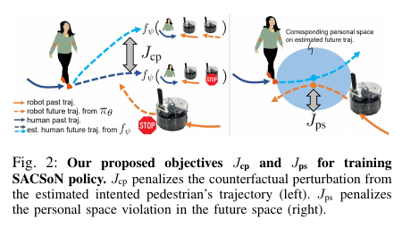
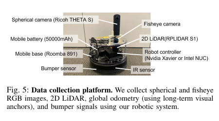

충돌하지 않았다는 사실만으로 로봇이 사람을 방해하지 않았다고 말할 수는 없습니다. 사람이 로봇을 피해 멈추거나 크게 돌아갔다면 안전 책임을 사람에게 넘긴 셈이에요. 로봇의 성공률과 사람의 자연스러운 이동은 다른 평가 축입니다.

<abbr title="사람의 원래 움직임을 덜 바꾸도록 반사실 사람 궤적을 학습 신호로 쓰는 시각 주행 정책">SACSoN</abbr>은 “로봇이 그 자리에 멈춰 양보했다면 사람은 어떻게 걸었을까?”를 기준으로 삼습니다. 실제 후보 로봇 행동 아래 예측한 사람 미래와, 로봇이 멈췄다고 가정한 사람 미래의 차이를 줄여요. 개인공간 침범 벌점과 목표 진행도 함께 최적화합니다.

이 학습에는 로봇 행동에 사람이 어떻게 반응하는지 보여 주는 자료가 필요합니다. 저자들은 HuRoN이라는 자율 수집 체계를 만들어 사무실 건물에서 75시간, 약 58.7킬로미터, 4천 건이 넘는 사람-로봇 상호작용을 기록했습니다. 수집 정책은 학습에 유용한 근접 상호작용을 일부러 늘리고, 최종 SACSoN 정책은 사람 방해를 줄이도록 학습합니다. 두 정책의 목적은 반대이므로 혼동하면 안 됩니다.

## 방해를 최소거리 하나로 정의하지 않아요

개인공간 벌점은 로봇과 사람 사이 거리를 확보합니다. 그러나 사람이 먼저 옆으로 크게 비키면 로봇은 충분한 거리를 유지하면서도 사람을 방해할 수 있어요. 최소거리만 측정하면 양보 부담이 보이지 않습니다.

SACSoN의 반사실 교란은 같은 사람의 두 미래를 비교합니다. 하나는 후보 로봇 행동을 실행할 때의 예측 궤적이고, 다른 하나는 로봇이 현재 위치에 멈춰 양보한다고 가정했을 때의 예측 궤적입니다. 두 궤적이 비슷할수록 로봇 행동이 사람의 의도된 이동을 덜 바꾼다고 봅니다.

<figure class="fig"><figcaption>왼쪽 교란 비용은 움직이는 로봇과 정지한 로봇 아래의 예측 사람 궤적 차이를 줄이고, 오른쪽 비용은 미래 개인공간 침범을 벌점화합니다. 사람 부담과 거리 안전을 서로 다른 항으로 둔 구조입니다. (출처: Hirose et al., <a href="https://arxiv.org/pdf/2306.01874">SACSoN: Scalable Autonomous Data Collection for Social Navigation</a>, Fig. 2)</figcaption></figure>

정지한 로봇을 기준으로 택한 것은 계산 가능한 근사입니다. 로봇이 완전히 사라진 세계나 더 일찍 다른 길을 택한 세계가 사람의 원래 행동에 더 가까울 수 있어요. 좁은 복도에서는 멈춘 로봇 자체가 길을 막아 사람이 돌아가야 합니다. 이때 정지 기준은 “방해 없음”이 아닙니다.

사람이 로봇을 보고도 원래 경로를 유지하는 것이 항상 바람직하지도 않습니다. 로봇이 우선 통행해야 하는 응급 장면, 사람이 잘못된 방향으로 접근하는 장면에서는 상호 조정이 필요해요. 반사실 교란은 사회적 부담의 유용한 대리값이지 모든 규범의 정답이 아닙니다.

[[2026-10-17_socialnav_scand|실물 원격조종 시연으로 사회적 주행을 배우는 데이터셋]]가 사람이 고른 로봇 명령을 정답으로 저장했다면, HuRoN은 자율 정책이 만든 상호작용을 모아 사람 반응 모델과 제어 정책을 함께 개선합니다. 시연 모방과 반사실 최적화의 차이가 여기서 드러납니다.

## 사람 예측 모델이 학습 목적의 기준을 만들어요

반사실 교란을 계산하려면 사람의 과거 궤적과 로봇의 과거·미래 궤적을 받아 사람 미래를 예측하는 모델이 필요합니다. 후보 속도 명령을 적분해 로봇 미래를 만들고, 같은 사람 과거에 서로 다른 로봇 미래를 넣어 두 사람 궤적을 예측해요.

정지 반사실에는 로봇 미래를 0으로 넣습니다. 실제 후보에는 정책이 만든 속도열을 넣습니다. 두 예측의 제곱거리 평균이 작아지도록 정책을 갱신합니다. 예측 모델은 고정한 채 그 모델을 통과해 정책으로 기울기를 전달해요.

이 구조는 예측 모델의 편향을 학습 목적에 그대로 넣습니다. 모델이 “사람은 언제나 로봇에게 양보한다”고 배웠다면 공격적인 행동 아래 사람의 큰 회피를 자연스러운 미래로 예측할 수 있어요. 교란 비용이 낮아도 실제 사람은 불편할 수 있습니다.

설명용으로 정지 기준 사람 위치가 1초 뒤 `(1.0, 0.0)`, 후보 행동 아래 예측이 `(1.0, 0.4)`라고 하겠습니다. 한 시점 제곱차는 `0²+0.4²=0.16제곱미터`입니다. 다섯 시점 차이가 각각 0.1, 0.2, 0.3, 0.4, 0.5미터이고 방향이 같다면 평균 제곱 교란은 `(0.01+0.04+0.09+0.16+0.25)/5=0.11제곱미터`예요. 이는 손실 의미를 설명하는 자체 계산입니다.

제곱 손실은 큰 이탈에 더 큰 벌점을 줍니다. 하지만 작은 이탈이 오래 지속되는 경우와 짧은 큰 이탈의 사회적 영향은 다를 수 있어요. 최대 변위, 누적 추가 거리, 감속량을 함께 평가하면 한 손실에 가려진 행동을 볼 수 있습니다.

예측 모델은 가까운 움직이는 한 사람을 중심으로 학습합니다. 여러 사람이 서로 다른 방향에서 접근하거나 대화 집단이 길을 막는 장면에서는 쌍별 기준을 합치는 방식이 필요해요. 한 사람의 방해를 줄이려다 다른 사람의 경로를 막을 수 있습니다.

## 데이터 수집 정책과 배포 정책의 목적이 반대예요

좋은 사람 반응 모델을 만들려면 로봇이 사람과 상호작용한 사례가 필요합니다. 기존 안전한 정책이 사람을 멀리 피하면 중요한 근접 데이터가 적어요. HuRoN 수집 정책은 사람과의 미래 거리를 줄이는 항을 넣어 상호작용을 더 자주 만듭니다.

최종 SACSoN 정책은 그 자료를 이용해 사람 방해와 개인공간 침범을 줄입니다. 수집 정책의 “가까이 가기”와 배포 정책의 “덜 방해하기”를 같은 행동 원리로 설명하면 모순처럼 보이지만, 하나는 자료 탐색이고 다른 하나는 실제 목적입니다.

이 수집 방식에는 안전 관리가 필요합니다. 시스템은 범퍼 충돌 신호, 충돌 회복, 원격 도움 요청을 포함합니다. 복잡한 장애물에서 복구할 수 없으면 사람 조작자가 개입해요. ‘자율 수집’은 인간 개입이 전혀 없다는 뜻이 아닙니다.

설명용으로 무작위 시간 100분 동안 사람 근접 사례가 기존 정책 10건, 상호작용 수집 정책 30건이라고 해보겠습니다. 자료 효율은 세 배지만 근접 위험 노출도 함께 늘 수 있어요. 개입 3회와 충돌 1회가 있었다면 사례 수만으로 좋은 수집 정책이라 평가할 수 없습니다. 상호작용당 개입률과 최소거리 분포를 같이 기록해야 합니다.

사람에게 연구 참여를 고지하지 않은 공공 수집과 통제된 인간 대상 실험은 윤리·평가 구조가 다릅니다. 데이터 공개 시 얼굴·위치·일상 동선의 개인정보 처리도 필요해요. 논문의 기술적 수집 규모가 모든 장소의 수집 허가를 대신하지 않습니다.

## HuRoN은 사무실에서 자율로 쌓은 자료예요

수집 로봇은 Roomba 기반 이동체에 구면 카메라, 어안 카메라, 2차원 LiDAR, 적외선 센서, 범퍼, 배터리와 온보드 컴퓨터를 얹었습니다. 두 대의 동일한 로봇이 NVIDIA Jetson Xavier AGX 또는 Intel i5 NUC를 사용하고 연산은 로봇 위에서 수행됐습니다.

<figure class="fig"><figcaption>HuRoN 수집 플랫폼은 전방 한 장면만 보는 로봇이 아니라 구면·어안 영상과 2D LiDAR, 오도메트리, 범퍼 신호를 함께 기록합니다. 온보드 컴퓨터가 달린 실물 자율 수집 장치의 범위를 보여 줍니다. (출처: Hirose et al., <a href="https://arxiv.org/pdf/2306.01874">SACSoN: Scalable Autonomous Data Collection for Social Navigation</a>, Fig. 5)</figcaption></figure>

세 대학 건물의 다섯 환경에서 24일 동안 75시간, 약 58킬로미터를 주행했습니다. 4천 건이 넘는 사람 상호작용을 포함하고, 상호작용을 장려한 자료와 그렇지 않은 자료를 절반씩 구성합니다. 환경에는 약 10미터 간격의 AR 태그를 두어 장기 경로의 기준점으로 썼어요.

이는 자연스러운 실물 센서와 장기 운용 실패를 포함한다는 강점이 있습니다. 시간대에 따른 조명과 사람 밀도, 반복 경로의 외형 변화, 충돌 회복과 원격 개입이 데이터에 들어갑니다. 시뮬레이션의 완벽한 사람 상태와 다릅니다.

반면 환경은 사무실 건물에 제한됩니다. 넓은 쇼핑몰, 병원 침대 이동, 야외 비와 경사, 어린이 군중, 카트와 휠체어는 자료 범위 밖일 수 있어요. 논문도 여러 보행자 집단이 있는 복잡 장면이 부족하다고 밝힙니다.

AR 태그는 장기 자율 수집을 가능하게 하지만 배포 전제입니다. 태그 없는 건물에서 같은 복구와 위치 기준이 작동한다는 보장은 없어요. 정책 자체와 수집 인프라의 성능을 분리해야 합니다.

## RGB 정책이라도 훈련 때는 사람 추적을 사용해요

배포 제어 정책은 과거 이미지와 목표 이미지를 받아 속도 명령을 냅니다. 추론 때 명시적 사람 검출과 궤적 예측 없이 원시 시각 입력에서 행동할 수 있다는 점이 특징이에요. 하지만 반사실 손실을 만들고 예측 모델을 학습하는 과정에는 사람 검출·추적과 3차원 위치 복원이 필요합니다.

논문은 구면 영상을 파노라마로 처리하고 YOLO와 DeepSORT로 사람을 검출·추적한 뒤 깊이 추정으로 상대 위치를 구합니다. 자동 추적 오차가 사람 미래 모델의 훈련값에 들어가요. 가림에서 ID가 바뀌면 한 사람의 과거가 다른 사람 미래에 붙을 수 있습니다.

“추론 때 검출기 없음”은 지각 문제가 사라졌다는 뜻이 아닙니다. 정책의 시각 인코더가 사람과 공간을 내부 표현으로 구분해야 합니다. 검출기처럼 오류를 관찰하기 어려워져 실패 진단이 더 어려울 수 있어요.

RGB 정책은 외형 변화에 민감합니다. 옷 색, 조명, 카메라 얼룩, 렌즈 높이, 어안 왜곡이 달라지면 사람 반응 신호와 배경 단서를 혼동할 수 있습니다. LiDAR와 범퍼가 수집에 있어도 최종 정책의 안전 권한이 어디에 있는지 확인해야 합니다.

센서 가림 시험에서는 사람을 영상에서 가리되 LiDAR 장애물은 남기는 조건, 반대로 영상 사람은 보이되 깊이가 틀린 조건을 나눌 수 있어요. 시각 사회 행동과 물리 충돌 회피가 같은 실패에 묶이지 않는지 확인합니다.

## 실제 로봇 평가는 자료 수집과 별도예요

저자들은 세 실환경에서 며칠에 걸쳐 열다섯 번의 로봇 주행을 비교했습니다. 상호작용을 장려한 자료와 반사실·개인공간 목적을 함께 쓴 정책이 목표 도달, 경로 효율, 시간 효율, 사람 충돌, 장애물 충돌, 개인공간 침범에서 더 나은 결과를 보였다고 보고합니다.

사람 평가는 17명이 세 정책을 각각 경험해 모두 51회가 됐습니다. 참가자는 어떤 정책인지 모른 채 로봇 주변을 걸었고, 사회적 배려와 안전 관련 네 질문에 답했습니다. 제안 정책이 네 항목에서 더 높은 평균 평점을 얻었어요.

이 근거는 실물 정책 실행과 사람 평가가 있다는 뜻입니다. 단지 데이터셋을 공개한 논문으로 축소하면 안 됩니다. 동시에 실제 사무실 장기 무감독 배포에서 충돌이 없었다는 인증도 아닙니다. 평가 주행 수와 참가자 수, 장면 범위에 묶인 결과예요.

수집 중 원격 개입 감소 실험은 자율 운용 개선을 보여 주지만 사회적 상호작용 성능을 바로 측정하지 않습니다. 하루 경험을 계속 학습해 개입이 줄어든 것과 사람을 덜 방해한 것은 다른 질문입니다. 저자도 이 구분을 적습니다.

사람 평가에서는 참가자에게 로봇 주변을 걸어 달라고 요청했습니다. 자연스럽게 목적지로 이동하는 공공 보행과는 과업 동기가 달라요. 참가자가 로봇을 관찰하는 실험이라는 사실을 알면 주의와 양보가 늘 수 있습니다.

## ‘사람이 원래 갔을 길’은 관측할 수 없는 값이에요

한 순간에 로봇이 움직인 세계와 멈춘 세계를 둘 다 실제로 관측할 수는 없습니다. 반사실 기준은 예측 모델이 만든 값입니다. 그래서 교란 손실이 작아도 실제 사람의 미관측 원래 경로와 다를 수 있어요.

예측 모델 검증은 기록된 실제 미래를 맞히는 일반 오차만으로 부족합니다. 로봇 행동을 바꿨을 때 사람 예측이 올바르게 변하는지 확인해야 해요. 관측 분포 안의 예측 정확도와 반사실 민감도는 다른 성질입니다.

통제 실험에서는 같은 참가자가 비슷한 시작점에서 로봇 정지·서행·진행 세 조건을 여러 번 경험하게 할 수 있습니다. 반복 학습을 줄이려면 조건 순서와 경로를 바꾸고, 참가자별 차이를 모형에 넣어요. 실제 두 세계를 완전히 같게 만들 수는 없지만 반사실 모델을 검증할 근거가 됩니다.

사람 행동의 확률성도 표현해야 합니다. 정지 로봇 아래 미래 하나와 후보 행동 아래 미래 하나만 비교하면 가능한 여러 통과 쪽을 평균낼 수 있어요. 분포 간 거리나 여러 표본의 최악·기대 교란을 사용하면 다중 미래를 보존할 수 있습니다.

설명용으로 정지 조건에서 좌우 두 미래가 각각 0.5이고, 후보 로봇 행동이 오른쪽 미래 확률을 0.9로 바꾼다고 하겠습니다. 평균 좌표가 비슷해도 선택 분포는 크게 변했습니다. 경로 평균 오차만 보면 사람이 통과 결정을 바꾼 사회적 부담을 놓칠 수 있어요.

## Pi급 장치에서 된다고 말할 측정은 없어요

논문과 공개 구현은 구면 영상 처리, 시간 이미지 입력, 사람 예측 모델 훈련, 온보드 제어를 포함합니다. 수집 장치는 Jetson Xavier AGX와 Intel i5 NUC를 사용했고 공개 운용 설정에는 낮은 프레임 주기의 정책 실행과 GPU·NUC 환경이 등장합니다. 이 조건을 Raspberry Pi의 실시간 성능으로 바꿔 말할 수 없습니다.

평균 프레임 속도만으로도 부족합니다. 카메라 디코딩, 파노라마 변환, 정책 추론, 지도 탐색, 충돌 감시를 동시에 돌릴 때 최악 지연과 메모리, 온도 제한을 측정해야 해요. 3헤르츠라면 한 결정 간격은 약 `1/3=0.333초`입니다.

설명용으로 사람이 1.4미터/초로 걷고 새 명령까지 0.333초가 걸리면 `1.4×0.333≈0.47미터`를 이동합니다. 정책이 저주기로 사회적 방향을 정하더라도 더 빠른 로컬 안전 계층이 그 사이의 접근을 감시해야 합니다.

모델을 경량화하면 원본 결과를 그대로 유지한다고 가정할 수 없습니다. 입력 해상도 축소와 양자화가 사람 윤곽과 작은 거리 단서를 먼저 잃을 수 있어요. 목표 도달뿐 아니라 사람 충돌과 개인공간 침범, 반사실 교란 대리값을 다시 측정해야 합니다.

Pi 적합성은 평균·95백분위·최악 추론 지연, RAM, CPU·가속기 사용률, 전력, 온도, throttling, 센서와 안전 노드 동시 부하로 판정해야 합니다. 해당 실측 전에는 가능과 불가능 어느 쪽도 단정하지 않는 편이 정확합니다.

## 재현은 예측기와 정책을 따로 깨뜨려 봐야 해요

첫 단계는 사람 예측 모델입니다. 실제 로봇 행동 아래 미래 오차, 정지 반사실의 반복 실험 오차, 다중 사람·가림·ID 전환에서의 신뢰도를 나눠 봅니다. 상호작용 수집 자료와 일반 자료로 훈련했을 때 차이도 비교해요.

둘째는 오프라인 정책입니다. 같은 이미지에서 반사실 항과 개인공간 항을 하나씩 제거하고 목표 진행·회전·정지 분포를 봅니다. 손실을 더했을 때 단지 느려져서 안전해진 것인지, 같은 진행률에서 사람 부담이 줄었는지 확인해야 합니다.

셋째는 닫힌 고리 시뮬레이션과 기록 재생입니다. 사람 정책을 협조형, 직진형, 늦은 반응형으로 바꾸고 카메라 지연과 검출 누락을 넣습니다. 학습 예측기의 자신감이 낮을 때 독립 안전 계층으로 후퇴하는지 봐요.

넷째는 실물 사람 평가입니다. 정면 통과, 추월, 좁은 문, 정지 사람, 두 사람 집단, 가림 후 출현을 포함합니다. 로봇 성공률·시간 외에 사람 추가 이동, 감속, 멈춤, 최소거리, 편안함과 예측 가능성을 기록해요.

SACSoN의 중요한 변화는 사회적 배려를 로봇 주변 거리 하나가 아니라 사람이 바꿔야 했던 행동으로 본 점입니다. HuRoN의 장기 자율 수집은 실제 센서와 사람 반응으로 그 예측 모델을 학습할 자료를 만들고, 실물 정책 비교와 17명 평가까지 이어집니다.

그 성과는 사무실, 가까운 한 사람, 정지 로봇 반사실, 특정 시각 주행 체계에 묶여 있습니다. 수집 정책이 일부러 상호작용을 늘린다는 사실, 예측 편향이 정책 목적이 된다는 위험, 온보드 장치와 Pi 사이의 측정 공백을 남겨야 해요. 반사실 예측과 고주기 충돌 감시를 분리하고 사람 부담을 실측할 때, ‘방해하지 않음’은 좋은 문구가 아니라 검증 가능한 주행 목표가 됩니다.

---

<!-- src-block -->
출처 — https://arxiv.org/abs/2306.01874
