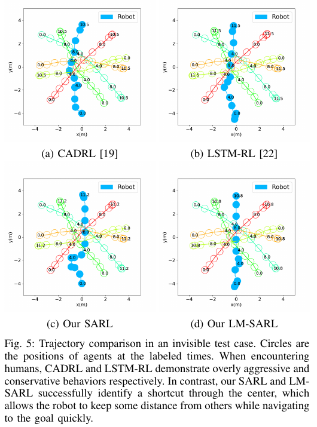
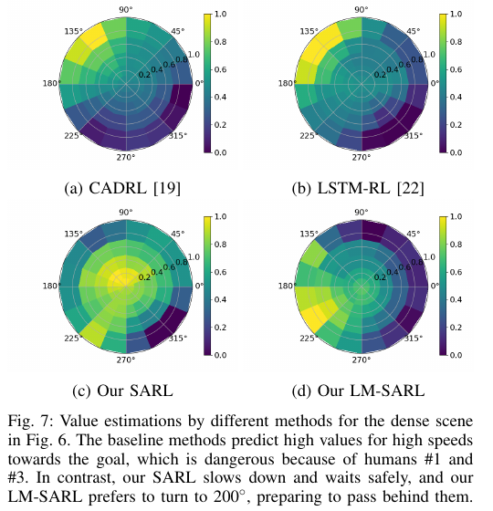

로봇과 가장 가까운 사람이 항상 가장 중요한 사람은 아니에요. 바로 옆 사람이 같은 방향으로 걷고 있다면 충돌 위험은 작을 수 있고, 조금 먼 사람이 빠르게 진로를 가로지를 수 있습니다. 거리순으로 사람을 읽거나 가장 위험해 보이는 한 쌍만 고르면 군중 전체의 흐름을 놓치기 쉬워요.

2019년 ICRA에 발표된 <abbr title="사회적 주의집중을 이용한 강화학습 군중 주행 모델">SARL</abbr>은 사람마다 로봇과의 상호작용 특징을 만든 뒤, 학습된 중요도로 가중해 하나의 군중 표현으로 합쳤습니다. 원 논문 *Crowd-Robot Interaction: Crowd-Aware Robot Navigation with Attention-Based Deep Reinforcement Learning*은 가까운 순서를 규칙으로 고정하는 대신 어느 사람이 목표 도달에 더 영향을 주는지 데이터에서 배우려 했어요.

이름에 사회적 주의집중이 들어가지만, 사람의 감정이나 예절을 읽는 모델은 아닙니다. 입력은 로봇과 사람의 위치·속도·반경 같은 운동 상태예요. 주의집중은 그중 어떤 사람의 운동 관계가 현재 가치 추정에 중요한지 정하는 계산입니다. 사회 규범을 보장한다는 뜻으로 넓히면 안 돼요.

## 입력은 사람의 목표가 아니라 관측 가능한 움직임이에요

좌표는 로봇을 원점에 두고 x축을 목적지 방향으로 맞춥니다. 로봇 상태에는 목적지까지 거리, 선호 속도, 자신의 평면 속도, 반경이 들어가요. 사람 상태에는 로봇 기준 위치, 평면 속도, 반경, 로봇과의 거리, 두 반경의 합이 들어갑니다. 사람의 비공개 목적지는 필수 입력이 아닙니다.

이 상태는 카메라 영상이나 라이다 거리열과도 달라요. 센서에서 사람을 찾고, 같은 사람을 시간에 걸쳐 연결하고, 로봇 좌표로 바꾸고, 속도를 추정한 뒤에야 사람별 벡터가 생깁니다. 논문 시뮬레이션은 이 상태가 제공되는 조건을 평가합니다. 센서부터 정책까지 한 덩어리로 이해하면 인식 실패와 의사결정 실패를 구분할 수 없어요.

보상은 이전 CADRL 계열을 따릅니다. 충돌은 -0.25, 충돌은 아니지만 최소 간격이 0.2m보다 작으면 거리에 따른 음의 보상, 목적지 도달은 +1, 그 밖에는 0이에요. 할인율이 빠른 도달을 유도합니다. 이 보상만으로 우측 통행이나 대화 집단 우회가 자동 보장되지는 않습니다.

## 상호작용, 합치기, 계획의 세 부분

SARL의 신경망은 세 부분으로 나뉩니다. 첫째, 상호작용 모듈은 로봇과 사람 한 명의 결합 특징을 만듭니다. 둘째, 합치기 모듈은 사람별 특징에 가중치를 주어 고정 길이 군중 표현을 만듭니다. 셋째, 계획 모듈은 로봇 상태와 군중 표현에서 현재 상태의 가치를 예측해요.

사람별 특징을 단순 평균하지 않는 이유는 영향이 다르기 때문입니다. 각 사람의 임베딩과 전체 사람 임베딩의 평균을 함께 작은 신경망에 넣어 점수를 구하고, <abbr title="여러 점수를 합이 1인 양수 비율로 바꾸는 함수">소프트맥스</abbr>로 가중치를 만듭니다. 마지막 군중 벡터는 사람별 상호작용 특징의 가중합이에요. 사람이 늘어나도 출력 크기는 같습니다.

이 구조는 GA3C-CADRL의 거리순 LSTM과 대비됩니다. [GA3C-CADRL이 여러 사람을 기억해 피한 방법](https://arxiv.org/abs/1805.01956)은 가까운 사람이 마지막 기억에 강하게 남도록 먼 사람부터 상태를 읽었어요. SARL은 거리 외에 속도와 방향까지 보고 중요도를 계산합니다. 가까움은 위험의 한 단서일 뿐이라는 문제의식입니다.

설명용 가정으로 세 사람의 가중치가 각각 0.15, 0.70, 0.15라고 합시다. 두 번째 사람은 2.5m 떨어져 있지만 로봇 진로를 가로지르고, 첫 번째 사람은 1m 옆에서 같은 방향으로 걷습니다. 단순 거리순은 첫 번째 사람을 가장 중요하게 볼 수 있지만 주의집중은 두 번째 사람의 교차 속도를 반영해 큰 가중치를 줄 수 있어요. 이 숫자는 논문 측정값이 아니라 가중합을 설명하는 예입니다.

## 사람과 사람 관계를 넣은 LM-SARL

기본 SARL은 로봇과 각 사람의 쌍을 중심으로 봅니다. 논문은 한 걸음 더 나아가 각 사람 주변의 지역 지도를 만들어 사람-사람 관계를 거칠게 표현한 <abbr title="지역 지도를 추가한 사회적 주의집중 강화학습 모델">LM-SARL</abbr>도 제안해요. 각 사람을 중심으로 4×4 격자를 두고 셀 크기를 1m로 설정합니다. 주변 사람이 어느 셀에 있고 어떤 속도로 움직이는지 누적해 세 채널 지도로 만듭니다.

이 지역 지도는 모든 사람 쌍을 명시적으로 계산하는 제곱 복잡도를 피하면서 주변 흐름을 넣는 절충입니다. 두 사람이 같은 방향으로 가까이 걷는지, 서로 반대 방향으로 접근하는지가 사람별 로컬 패턴에 나타날 수 있어요. 하지만 격자 안에서 위치가 양자화되고, 4m 범위 바깥 관계는 표현되지 않습니다. 집단 정체성이나 시선, 대화 상태도 입력에 없어요.

지역 지도가 사람-사람 상호작용의 진실값은 아닙니다. 사람 위치와 속도를 격자에 넣은 운동 요약이에요. 같은 배치라도 친구가 함께 걷는지 우연히 스치는지는 구분하지 못할 수 있습니다. LM-SARL이 사람 관계를 고려한다고 쓸 때는 이 표현 범위를 함께 밝혀야 해요.

## 모방학습으로 시작하고 강화학습으로 다듬어요

가치망은 ORCA 시연 3,000회로 먼저 초기화됩니다. 모방학습은 50회 반복, 학습률 0.01로 수행됐어요. 이후 강화학습은 학습률 0.001, 할인율 0.9를 쓰고, 무작위 행동 비율을 처음 5,000회에서 0.5에서 0.1로 낮춘 뒤 다음 5,000회 동안 0.1로 유지합니다. i7-8700 중앙처리장치에서 강화학습에 약 10시간이 걸렸다고 보고해요.

행동 공간은 자유로운 평면 이동을 가정합니다. 선호 속도 이하의 다섯 속도와 16개 방향을 조합한 80개 이산 행동이에요. 어느 방향으로도 바로 움직일 수 있는 홀로노믹 운동을 전제로 하므로 차동구동 로봇에 그대로 실행하면 안 됩니다. 방향 후보를 바퀴 속도로 바꾸는 제어와 가속도·회전 제한이 필요해요.

학습 때 다음 상태는 환경의 참값을 조회합니다. 원문은 이전 연구의 선형 이동 근사 문제를 줄이기 위해 이 방식을 썼다고 설명해요. 배치 때는 실제 다음 상태를 미리 알 수 없으므로 별도의 궤적 예측 모델로 근사할 수 있다고 적습니다. 학습에서 참 다음 상태를 본 모델의 성능과 센서 기반 온라인 예측 성능 사이에는 간극이 남아요.

이 지점은 특히 중요합니다. 현재 사람 상태만 입력한다고 해서 미래를 보지 않는 모델은 아니에요. 가치학습 표적을 만들 때 환경이 준 다음 상태가 사용됐습니다. 실제 로봇에서 그 정보는 지연과 오차가 있는 추적·예측으로 대체됩니다. 시뮬레이션 표를 센서 시스템 성능으로 옮기기 전에 이 차이를 시험해야 해요.

## 보이지 않는 로봇 시험이 드러낸 것

논문은 원 위에 사람을 배치하고 반대편을 목표로 하는 교차 장면을 사용합니다. 사람은 ORCA로 움직이며 매개변수를 분포에서 뽑아 다양성을 줘요. 평가는 로봇이 사람에게 보이는 조건과 보이지 않는 조건으로 나뉩니다. 보이지 않는 조건에서는 사람이 로봇을 피하지 않고 사람끼리만 반응합니다.

보이지 않는 로봇은 현실 그대로를 흉내 낸 장면이라기보다 상호작용 모델의 압박 시험이에요. 사람의 협력을 기대하는 ORCA는 이 조건에서 성공 0.43, 충돌 0.57로 크게 실패했습니다. CADRL은 성공 0.78, LSTM-RL은 0.95였고, SARL과 LM-SARL은 500개 시험에서 모두 성공했다고 보고합니다. 평균 시간도 LM-SARL 10.46초, SARL 10.55초로 기준선보다 짧았어요.

500회 무충돌이 실제 충돌 확률 0이라는 뜻은 아닙니다. 특정 원형 교차 분포와 완전 상태 입력에서 관측된 결과예요. 사람 수, 속도 분포, 장면 크기, 행동 후보가 달라지면 결과도 달라집니다. 사람 참여 안전 시험이나 형식 안전 증명으로 읽을 수 없습니다.

로봇이 보이는 조건에서는 사람들이 로봇에도 반응합니다. LM-SARL은 성공 1.00, 충돌 0.00, 평균 시간 10.59초를 보고했고 SARL은 성공 0.99, 충돌 0.01이었어요. 불편 빈도는 분리 거리가 0.2m보다 작은 시간 비율로 정의됩니다. ORCA는 가상 반경을 0.1m 더해 공정 비교를 시도했지만, 이 지표 역시 사람의 주관적 불편 설문이 아니라 거리 기반 대리값입니다.

## 원 그림은 주의집중과 행동이 항상 같지 않음을 보여 줘요

원 논문 그림 5는 같은 보이지 않는 로봇 장면에서 CADRL, LSTM-RL, SARL, LM-SARL 궤적을 비교합니다. CADRL은 중심을 공격적으로 지나고, LSTM-RL은 오래 감속하며, SARL은 잠시 망설인 뒤 중앙의 짧은 통로를 찾습니다. LM-SARL은 더 일찍 그 흐름을 골라요.

그림 6은 한 시점에서 사람별 주의 가중치를 보여 줍니다. 가장 멀리 있는 사람에게 가장 낮은 점수를 준 것이 아니라, 미래에 로봇과 가까워질 가능성이 큰 사람에게 높은 점수가 갑니다. 그림 7의 방향별 가치 지도에서는 SARL이 위험 방향의 고속 행동을 낮게 평가하고, LM-SARL은 사람-사람 흐름을 반영해 두 사람 뒤쪽으로 통과할 방향을 선호해요.

<figure class="fig"><figcaption>같은 교차 장면에서도 모델이 고른 경로와 통과 시간이 달라집니다. 원논문 그림 5의 네 패널과 온전한 캡션입니다. (출처: Chen·Liu·Kreiss·Alahi, <a href="https://arxiv.org/abs/1809.08835">원논문 Figure 5</a>; arXiv 비독점 배포 라이선스·별도 CC 재이용 허가는 확인되지 않음)</figcaption></figure>

<figure class="fig"><figcaption>그림 7은 방향과 속도에 따른 가치 평가를 보여 줘요. 궤적 비교 그림과 분리해 각 패널의 라벨과 값이 읽히도록 했습니다. (출처: Chen·Liu·Kreiss·Alahi, <a href="https://arxiv.org/abs/1809.08835">원논문 Figure 7</a>; 원논문 부분 인용, 별도 CC 재이용 허가는 확인되지 않음)</figcaption></figure>

주의 가중치를 설명으로 사용할 때도 조심해야 합니다. 높은 가중치는 가치망 계산에서 큰 영향을 줬다는 뜻이지, 모델이 그 사람을 “위험하다”고 인간과 같은 개념으로 판단했다는 뜻은 아니에요. 입력 특징과 학습 보상에 맞춰 생긴 내부 비율입니다. 다른 장면에서 같은 가중치가 같은 의미를 갖는다는 보장도 없습니다.

## 실제 로봇 증거의 범위

논문은 학습 정책을 Segway 로봇 플랫폼에서 실행한 영상을 언급합니다. 그러나 본문에 실물 시험의 표본 수, 충돌률, 사람 설문, 처리 지연 표는 제시되지 않아요. 핵심 정량 표는 시뮬레이션 500개 시험에서 나온 것입니다. 실물 영상은 배치 가능성을 보여 주는 보조 증거로 읽어야 합니다.

따라서 SARL이 실제 군중에서 100% 성공했다고 쓰면 잘못이에요. 100%는 보이지 않는 로봇 시뮬레이션에서 500개 원형 교차 사례의 성공률입니다. 실물 플랫폼을 사용했다는 사실과 실물 성능 통계를 구분해야 합니다. 사람 편안함이 개선됐다는 주장도 거리 대리 지표와 궤적 해석 범위에 머뭅니다.

## 센서 오차는 가중치 전체를 바꿀 수 있어요

주의집중은 한 사람의 점수만 바꾸는 데서 끝나지 않습니다. 소프트맥스 가중치의 합이 1이므로 한 사람 점수가 커지면 나머지 비율이 함께 줄어요. 설명용으로 점수가 `[1, 1, 1]`이면 각 가중치는 약 0.333입니다. 첫 사람 점수가 위치 오차 때문에 2로 바뀌면 가중치는 대략 `[0.576, 0.212, 0.212]`가 돼요. 한 입력 오류가 군중 표현 전체의 균형을 바꿉니다.

사람을 한 명 놓치면 평균 임베딩도 달라지고, 남은 모든 사람의 주의 점수가 다시 계산됩니다. 목록에서 빠진 사람의 영향만 0이 되는 구조가 아니에요. 검출 누락이 짧게 반복되면 행동 가치가 프레임마다 흔들릴 수 있습니다. 정책 출력의 방향 변화량과 사람 목록 변화량을 함께 기록해야 원인을 찾을 수 있어요.

LM-SARL의 지역 지도는 좌표 오차에 또 다른 경계를 만듭니다. 셀 크기가 1m이므로 사람이 셀 경계 근처에 있을 때 10cm 오차로 이웃 셀이 바뀔 수 있어요. 지도 값이 불연속적으로 이동하면 사람-사람 관계 특징도 바뀝니다. 부드러운 점유 분배나 여러 프레임 누적을 쓰는 대안이 있지만, 원 논문과 같은 결과인지 별도 비교해야 합니다.

속도 지연도 위험해요. 10Hz 추적에서 0.3초 늦은 속도를 사용하고 사람이 1.5m/s로 방향을 바꿨다면 현재 위치와 속도 조합이 실제 운동과 맞지 않을 수 있습니다. 이 상태를 중요한 교차자로 해석할지, 지나간 사람으로 해석할지가 바뀌어요. 위치 정확도만 좋다고 충분하지 않습니다.

## 실패 가정을 나누어 시험해요

먼저 논문과 같은 완전 상태 입력으로 보이는·보이지 않는 조건을 재현합니다. 사람 수, 원 반경, ORCA 매개변수, 500개 고정 난수 씨앗을 기록해요. 성공·충돌·시간·할인 보상·0.2m 근접 비율을 계산하고 SARL과 LM-SARL 차이를 확인합니다. 원문처럼 사람-사람 관계 효과가 전체 평균에서 작고 특정 장면에서 크게 보이는지도 살펴봐요.

그다음 사람 상태에 오류를 하나씩 넣습니다. 검출 누락, 유령 검출, 위치 잡음, 속도 지연, 두 사람 ID 교환, 로봇 좌표 변환 지연을 분리해요. 각 오류에서 가중치 엔트로피, 최대 가중치 대상, 선택 행동, 최소 거리, 정지 시간을 기록합니다. 주의 대상이 자주 바뀌는데 행동이 안정적인지, 작은 오류가 큰 방향 전환으로 이어지는지 확인할 수 있습니다.

운동 제약 시험도 필요해요. 80개 홀로노믹 행동을 차동구동 명령으로 바꿀 때 회전 속도와 가속도 제한을 넣고, 계획 상태와 실제 0.5초 뒤 상태의 차이를 측정합니다. 그 차이가 커지면 학습 가치가 가정한 다음 상태가 틀어져요. 좁은 복도와 문 앞에서는 옆걸음 같은 후보가 실행 불가능하므로 별도 재학습이나 실행 가능 후보 필터가 필요합니다.

주의 가중치의 안정성은 순위만 아니라 크기로도 봐야 해요. 가장 높은 사람이 계속 같더라도 가중치가 0.35에서 0.90으로 급변하면 나머지 군중 정보가 거의 사라질 수 있습니다. 프레임 사이 가중치의 절대 변화량, 최대값, 엔트로피를 기록하면 정책이 한 사람에게 과도하게 쏠리는 순간을 찾을 수 있어요. 이때 실제 최소 거리와 행동 각도가 함께 변하는지 연결해 봅니다.

지역 지도 비교에서는 SARL과 LM-SARL의 평균 성공률만 보지 않습니다. 두 사람이 나란히 걷기, 서로 교차하기, 한 사람이 다른 사람 뒤를 따르기, 정지 집단 옆을 지나기처럼 사람-사람 관계가 다른 장면을 고정해요. 기본 SARL과 LM-SARL의 행동 차이가 기대한 관계 장면에서만 나타나는지 봐야 지역 지도가 실제로 보탠 정보를 해석할 수 있습니다.

사람 수가 0명인 장면도 필요합니다. 평균 임베딩과 소프트맥스 계산이 빈 목록을 어떻게 처리하는지, 정적 장애물만 있을 때 정책이 목표로 곧장 가는지 확인해요. 센서 누락으로 잠깐 0명이 된 프레임과 실제 빈 공간을 구분하지 못하면 빠른 가속이 생길 수 있으므로, 추적 상태의 신선도를 별도 입력이나 안전 계층에서 사용해야 합니다.

마지막으로 학습 정책과 독립된 충돌 감시를 둡니다. 주의집중이 특정 사람을 낮게 평가했더라도 가까운 장애물은 감속시켜야 해요. 추적 신뢰도가 낮을 때 정책 입력에서 사람을 지우기만 하면 주변이 비었다고 오해할 수 있으므로 속도를 제한하는 별도 상태가 필요합니다. 사회적 가치 선택과 물리적 제동은 같은 신경망 출력에 맡기지 않는 편이 좋습니다.

SARL의 공헌은 “주의집중을 썼다”보다 구체적입니다. 거리순이나 최악 한 쌍이라는 고정 규칙을 버리고, 속도와 방향을 포함한 사람별 영향의 상대적 중요도를 학습했습니다. LM-SARL은 주변 격자로 사람-사람 운동 관계까지 더했어요. 그러나 높은 주의 점수는 사회적 이해의 증명이 아니고, 정돈된 상태와 참 다음 상태에 기대는 학습 조건도 남습니다. 이 모델을 현실에서 평가하려면 신경망 성능과 사람 상태 생성 품질을 반드시 나눠 봐야 합니다.

---

<!-- src-block -->
출처 — https://arxiv.org/abs/1809.08835
