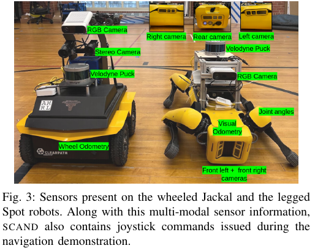
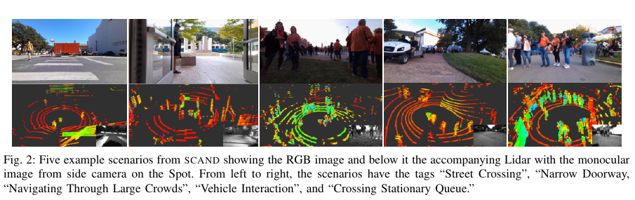

사람이 많은 길에서 로봇을 능숙하게 조종한 기록은 사회적 주행을 배우는 강한 재료입니다. 그런데 카메라 영상만 있으면 조종자가 왜 감속했는지 알기 어렵고, 로봇 궤적만 있으면 그 순간 무엇을 보았는지 잃습니다. 센서와 속도 명령, 로봇 자세, 상황 설명을 같은 시간축에 묶어야 시연 학습이 가능해져요.

<abbr title="사회적으로 적절한 로봇 주행 시연을 여러 센서와 조종 명령으로 기록한 데이터셋">SCAND</abbr>는 Clearpath Jackal과 Boston Dynamics Spot을 사람이 조이스틱으로 운전한 실물 자료입니다. 대학 캠퍼스의 실내외에서 네 명의 시연자가 138개 궤적, 8.7시간, 약 25마일을 기록했습니다. 3차원 LiDAR, 카메라, 관성 정보, 오도메트리, 조이스틱 속도 명령을 포함하고 각 궤적에 관찰된 사회 상황 태그를 붙였어요.

이 데이터셋을 “사람을 이해하는 정답 데이터”로 부르면 범위를 넘습니다. 보행자 검출 상자, 추적 ID, 사람 목표와 의도 라벨은 제공하지 않습니다. 핵심은 로봇 시점의 감각 입력과 사람이 선택한 주행 명령이에요. 논문은 간단한 행동복제 정책을 학습하고 열네 명의 실물 평가도 제시하지만, 데이터셋 전체가 정책의 안전 인증이나 모든 문화권의 사회 규칙을 보장하지는 않습니다.

## 두 로봇이 같은 장소를 다르게 통과해요

Jackal은 바퀴로 움직이고 Spot은 다리로 움직입니다. 낮은 바퀴 로봇은 경사로를 택할 수 있지만 다리 로봇은 계단을 이용할 수 있어요. 같은 목표와 군중이라도 몸체 높이, 회전 반경, 센서 배치, 이동 가능한 지형이 다르면 좋은 시연 경로가 달라집니다.

<figure class="fig"><figcaption>SCAND의 두 수집 플랫폼은 형태와 센서 구성이 다릅니다. 공통 LiDAR·전면 RGB·관성 정보 위에 Jackal은 스테레오와 바퀴 오도메트리, Spot은 여러 몸체 카메라와 관절·시각 오도메트리를 더합니다. (출처: Karnan et al., <a href="https://arxiv.org/pdf/2203.15041">SCAND: Socially Aware Robot Navigation Dataset</a>, Fig. 3, <a href="https://creativecommons.org/licenses/by/4.0/">CC BY 4.0</a>, 원문에서 그림 영역 발췌)</figcaption></figure>

공통 센서가 있다고 두 플랫폼 자료를 그대로 한 분포로 합칠 수는 없습니다. 카메라 높이와 시야, LiDAR 가림, 진동, 몸체 좌표 변환이 달라요. Spot의 계단 시연을 Jackal 정책에 넣으면 실행할 수 없는 경로를 정답으로 배울 수 있습니다. 플랫폼 ID와 동역학 한계를 조건으로 주거나 플랫폼별 평가를 나눠야 합니다.

시연자는 로봇 뒤 약 2미터에서 따라가며 조이스틱을 움직였습니다. 로봇 카메라에는 보이지 않는 주변을 사람이 자신의 눈으로 볼 수 있고, 로봇이 아직 감지하지 못한 상황을 미리 반영할 수 있어요. 이 시연 명령을 온보드 센서만으로 예측하려면 입력에 없는 정보가 정답에 섞이는 문제가 생깁니다.

반대로 시연자가 뒤에 있다는 사실도 군중 반응을 바꿀 수 있습니다. 사람들은 로봇을 자율 이동체가 아니라 누군가 조종하는 장치로 알아차릴 수 있고, 뒤따르는 사람까지 한 단위로 피해 갈 수 있어요. 시연 정책을 자율 로봇에 옮겼을 때 같은 양보를 받는다고 가정하면 안 됩니다.

[[2026-10-17_socialnav_trajectory-feature-prediction|사람 사이 상호작용으로 다음 궤적을 예측한 방법]]이 정밀한 모션 캡처에서 공동 보행 특징을 학습했다면, SCAND는 자연스러운 공공장소의 로봇 시점과 조작 명령을 보존합니다. 하나는 사람 궤적의 구조가 강하고, 다른 하나는 배포 센서와 행동의 연결이 강합니다.

## 한 궤적에는 여러 센서 주기가 함께 들어 있어요

두 로봇은 10헤르츠 VLP-16 LiDAR, 16헤르츠 관성 센서, 20헤르츠 전면 Azure Kinect RGB 카메라를 공통으로 사용합니다. Jackal은 20헤르츠 전면 스테레오와 30헤르츠 바퀴 오도메트리를 더하고, Spot은 몸체 카메라 다섯 대와 시각 오도메트리, 관절 각도를 기록합니다. 조이스틱의 선속도와 각속도 명령도 rosbag에 함께 저장됩니다.

서로 다른 주기를 학습 프레임 하나로 만들 때 시간 정렬이 필요합니다. 20헤르츠 RGB 한 장에 가장 가까운 10헤르츠 LiDAR를 붙이면 최대 0.05초 정도 차이가 생길 수 있어요. 사람이 1.5미터/초로 움직인다는 설명용 가정에서는 `1.5×0.05=0.075미터` 차이입니다. 좁은 통과에서 7.5센티미터는 특징 라벨을 바꿀 수 있습니다.

명령 시각과 실제 몸체 반응도 같지 않습니다. 조이스틱 명령이 기록된 뒤 구동기 지연과 미끄럼을 거쳐 속도가 변합니다. 행동복제 입력을 명령과 같은 타임스탬프에 맞추면 정책이 아직 결과를 보지 못한 상태와 이미 움직인 상태를 섞을 수 있어요. 명령 지연을 추정하고 여러 오프셋에서 검증해야 합니다.

좌표 변환은 센서 융합의 일부입니다. LiDAR의 앞쪽과 카메라 영상의 중앙이 같은 공간을 가리키려면 외부 파라미터와 몸체 자세가 맞아야 해요. Spot은 보행 중 몸체가 흔들리고 관절이 움직이므로 고정된 평면 로봇 가정보다 변환이 복잡합니다.

데이터셋이 풍부하다는 말은 모든 센서가 모든 학습에 필수라는 뜻이 아닙니다. RGB만 쓰는 정책, LiDAR 조감도와 속도를 쓰는 정책, 멀티모달 정책을 같은 분할에서 비교할 수 있어요. 센서를 늘릴수록 배포 하드웨어와 동기화 실패 조건도 늘어납니다.

## 열두 태그는 장면을 찾게 하지만 프레임 정답은 아니에요

각 궤적에는 역방향·순방향 통행, 길 건너기, 추월, 보도, 대화 집단 통과, 사각 모서리, 좁은 문, 정지 대기열 횡단, 계단, 차량 상호작용, 큰 군중 같은 상황 태그가 붙습니다. 한 궤적에 여러 태그가 함께 있을 수 있어요.

<figure class="fig"><figcaption>RGB 장면과 같은 시점의 LiDAR를 위아래로 배치해 다섯 사회 상황의 센서 모습을 보여 줍니다. 태그는 궤적 수준의 상황 설명이며 사람별 위치·의도 정답은 아닙니다. (출처: Karnan et al., <a href="https://arxiv.org/pdf/2203.15041">SCAND: Socially Aware Robot Navigation Dataset</a>, Fig. 2, <a href="https://creativecommons.org/licenses/by/4.0/">CC BY 4.0</a>, 원문에서 그림 영역 발췌)</figcaption></figure>

태그는 특정 실패 사례를 골라내는 데 유용합니다. 좁은 문 태그만 모아 로봇이 기다린 구간을 분석하거나, 대화 집단 통과에서 경로가 공동 중심을 피했는지 볼 수 있어요. 전체 평균보다 장면별 성능을 비교하는 색인이 됩니다.

하지만 태그가 언제 시작하고 끝났는지는 제공 범위를 확인해야 합니다. 궤적 수준 태그를 모든 프레임에 붙이면 길 건너기 전후의 평범한 주행까지 양성으로 학습될 수 있어요. “대화 집단” 태그도 어떤 사람이 집단 구성원인지 알려 주지 않습니다.

열두 태그의 빈도도 고르지 않습니다. 예를 들어 논문 표에서는 순방향 통행이 74회인 반면 사각 모서리와 정지 대기열 횡단은 각각 6회입니다. 무작위 배치에서는 흔한 장면이 손실을 지배하고 드문 위험 장면이 사라질 수 있어요. 장면 균형 샘플링과 별도 시험 집합이 필요합니다.

설명용으로 흔한 태그 74개와 드문 태그 6개를 같은 비중의 궤적으로 학습한다고 하겠습니다. 무작위 한 개를 뽑을 때 드문 태그 비율은 `6/(74+6)=7.5%`입니다. 미니배치 32개에서 기대 개수는 2.4개지만 여러 태그 중복과 시퀀스 길이 차이를 넣으면 더 줄 수 있어요. 궤적 수가 아니라 유효 시간과 독립 장면 수를 함께 세야 합니다.

## 사람을 검출하고 추적하는 라벨은 없어요

SCAND는 카메라와 LiDAR를 담지만 사람별 검출 상자나 3차원 위치, 추적 ID, 미래 목표를 주석하지 않습니다. 이 제한은 데이터셋의 목적과 맞습니다. 저자들은 지각 벤치마크보다 사회적 조종 시연을 제공하려 했어요.

따라서 사람 추적기를 학습하려면 다른 라벨 자료나 별도 주석이 필요합니다. 자동 검출기로 의사 라벨을 만들 수 있지만 검출 실패가 정책 정답처럼 섞일 수 있어요. 특히 큰 군중과 가림 장면에서 누락률이 높으면 사회적 행동 학습이 쉬운 프레임에 치우칩니다.

사람 목표와 의도를 정답으로 제공한다고 말해서도 안 됩니다. 조이스틱 명령은 시연자의 선택이지 주변 사람의 숨은 목표 라벨이 아닙니다. 사람의 다음 움직임을 연구하려면 영상·LiDAR에서 추적을 복원하고 불확실성을 기록해야 해요.

SCAND와 JRDB 같은 사람 지각 자료를 결합할 때 센서와 장소 차이를 확인해야 합니다. 사람 검출기를 JRDB에서 학습하고 SCAND에 적용해도 카메라 높이, 해상도, LiDAR 배치가 다르면 성능이 떨어질 수 있어요. 정책 평가는 정답 트랙, 자동 트랙, 누락·ID 전환을 주입한 트랙을 분리하는 편이 좋습니다.

원시 센서 정책은 사람 라벨 없이도 행동복제를 할 수 있습니다. 하지만 정책이 사람을 본 것인지 도로 가장자리나 캠퍼스 배경을 외운 것인지 설명하기 어렵습니다. 사람을 가린 영상, 배경만 바꾼 장면, 센서 한 종류를 제거한 입력으로 민감도를 확인해야 합니다.

## 시연자마다 다른 사회적 스타일이 남아 있어요

논문은 같은 길을 운전한 두 시연자의 10초 관측을 분류하는 실험을 제시합니다. LiDAR 조감도, 로봇 이동, 미래 시연 궤적, 관성, 조이스틱 값을 넣은 분류기가 보류 궤적에서 시연자를 74.48% 맞혔다고 보고해요.

이는 사회적으로 적절한 행동이 한 가지가 아닐 수 있다는 단서입니다. 어떤 시연자는 일찍 넓게 비키고, 다른 사람은 속도를 줄인 뒤 가까이 통과할 수 있어요. 두 행동 모두 해당 장면에서 받아들여질 수 있습니다.

동시에 분류기가 사회적 스타일을 배웠다고 단정할 수 없습니다. 시연자마다 속도 습관, 조이스틱 미세 조작, 수집 시간대, 센서 상태가 다를 수 있어요. 미래 궤적과 조이스틱을 입력에 넣었으므로 행동 서명 자체가 분류 단서가 됩니다.

분류 실험은 16개 궤적과 두 시연자라는 좁은 조건입니다. 네 명 전체와 새로운 길, 플랫폼 교차 조건에서 같은 구분이 유지되는지 별도 검증이 필요해요. 시연자 스타일을 정책 다양성으로 쓰려면 배경과 속도 규모를 제거해도 남는지 확인해야 합니다.

설명용으로 두 시연자의 평균 선속도가 0.8과 1.0미터/초이고 표준편차가 작다면, 장면 이해 없이 평균 속도만으로도 분류가 가능할 수 있습니다. 속도를 정규화한 뒤 정확도가 크게 떨어지면 사회적 경로보다 운전 속도를 배운 것입니다. 정확도 수치 하나보다 교란 제거 실험이 중요합니다.

## 행동복제는 시연과 닮을 뿐 안전을 증명하지 않아요

논문은 LiDAR 조감도와 과거 자세, 관성, 기존 move_base 경로와 목표 속도를 입력으로 받아 전역 경로와 미래 속도 명령을 함께 예측하는 행동복제 예를 만듭니다. 보류 자료에서 예측 경로가 시연 경로에 더 가까워졌고, 사람이 가로지르는 예에서 기존 경로보다 시연 우회를 따랐습니다.

행동복제는 관측된 상태에서 사람이 한 행동을 회귀합니다. 정책이 조금 잘못 움직이면 다음 입력은 훈련 시연에 없던 상태가 되고 오류가 누적돼요. 좁은 문에서 10센티미터 벗어난 한 번의 예측이 다음 프레임의 가림과 경로를 바꿀 수 있습니다.

시연자는 로봇 밖 시야를 사용했으므로 같은 센서 입력에 다른 명령이 존재할 수도 있습니다. 정책은 이를 평균내어 어느 쪽에도 충분히 양보하지 않는 속도를 낼 수 있어요. 다중 모드 행동 분포나 불확실도 기반 감속이 필요합니다.

학습 손실이 낮다고 충돌률이 낮은 것은 아닙니다. 선속도 오차 0.1미터/초가 평소에는 작아 보여도 2초 동안 0.2미터 차이를 만들어요. 사람 가까이에서는 독립 충돌 감시와 최대 허용 속도이 정책 출력보다 우선해야 합니다.

데이터셋의 25마일을 모두 연속 독립 사례로 세어서도 안 됩니다. 같은 캠퍼스 길을 반복하고 인접 프레임은 거의 같은 장면입니다. 분할은 프레임이 아니라 날짜, 경로, 시연자, 플랫폼 단위로 해야 누수를 줄일 수 있어요.

## 실물 평가가 있었지만 장면은 두 가지예요

저자들은 Spot에 행동복제 지역 계획기를 실행하고 열네 명과 정적·동적 두 장면을 평가했습니다. 정적 장면에서는 사람 뒤 목표로 가며 멈춰 있는 사람을 피하고, 동적 장면에서는 사람과 로봇이 서로의 시작 위치로 이동했습니다. 참가자는 정책과 move_base를 모두 본 뒤 사회적 배려와 안전 체감을 5점 척도로 평가했어요.

행동복제 정책은 두 문항에서 move_base보다 높은 평균을 받았습니다. 이는 SCAND 시연에서 배운 정책이 간단한 실물 상호작용에서 더 배려 있고 안전하게 느껴졌다는 근거입니다. 데이터 수집만 있고 정책 실행이 없다고 말하면 이 실험을 놓칩니다.

반대로 이를 캠퍼스 군중 전체의 실물 배포 증명으로 확대하면 안 됩니다. 정책 평가는 실내 두 장면, 열네 명, Spot 한 플랫폼입니다. 수집 자료에 있던 큰 군중, 차량, 계단, 좁은 문을 학습 정책으로 전부 통제 평가한 것은 아니에요.

비교 기준인 move_base는 사회적 행동을 목표로 설계되지 않았습니다. 더 강한 사회적 계획기와 비교하면 차이가 달라질 수 있어요. 참가자 순서를 무작위화했지만 로봇 행동을 반복해 본 학습 효과와 연구 목적 추정도 고려해야 합니다.

안전 체감 점수는 물리 안전 인증이 아닙니다. 최소거리, 비상 정지, 충돌, 제동 여유와 함께 보고해야 해요. 사람이 안전하다고 느낀 부드러운 접근이 센서 실패에서 위험할 수도 있습니다.

## 장소와 문화의 편향은 태그보다 깊게 들어 있어요

자료는 미국 텍사스 오스틴의 한 대학 캠퍼스에서 모였습니다. 오른쪽 통행과 왼쪽 추월 같은 지역 관습, 학생 중심 인구, 경기일 군중, 건물 구조가 시연에 들어 있어요. 데이터셋 태그에 문화가 명시되지 않아도 조종 명령과 경로에 남습니다.

다른 나라의 왼쪽 통행 환경에 정책을 옮기면 카메라 장면뿐 아니라 행동 규범이 반대일 수 있습니다. 좌우 반사 증강은 영상과 LiDAR를 뒤집을 수 있지만 도로 표지, 글자, 로봇 회전 부호까지 일관되게 바꿔야 해요. 문화 적응을 단순 영상 증강으로 끝낼 수 없습니다.

날씨와 시간도 분포를 바꿉니다. 비 오는 날 우산은 사람 폭과 LiDAR 반사를 바꾸고, 야간 조명은 RGB 정책에 영향을 줍니다. 데이터에 없는 조건에서는 정책 신뢰도를 낮추고 보수적인 계획기로 후퇴해야 합니다.

플랫폼 이전은 문화 이전과 별개입니다. Spot에서 배운 회전이 Jackal의 미끄럼과 회전 반경에서 같은 결과를 내지 않을 수 있어요. 공통 잠재 행동을 학습하더라도 마지막 제어 계층은 각 플랫폼 동역학과 발자국을 반영해야 합니다.

## 재현은 데이터 분할과 닫힌 고리를 먼저 잠가야 해요

첫 단계에서는 원시 rosbag 무결성과 타임스탬프를 확인합니다. 센서별 누락률, 주기 분포, 명령과 오도메트리 지연, 좌표 변환 불연속을 궤적별로 기록해요. 총 시간보다 유효하게 동기화된 구간이 얼마나 되는지가 중요합니다.

둘째는 누수 없는 분할입니다. 같은 길과 날짜를 훈련·시험에 나누지 않고, 시연자와 플랫폼을 하나씩 통째로 보류합니다. 무작위 프레임 분할과 경로 보류 분할의 차이가 크면 배경 암기가 성능을 부풀렸다는 신호예요.

셋째는 열린 고리 예측과 닫힌 고리 실행을 분리합니다. 기록된 입력에서 다음 명령 오차와 경로 거리를 재고, 시뮬레이션에서는 정책 출력이 다음 관측을 바꾸는 누적 오류를 봅니다. 실물에서는 독립 충돌 감시 아래 저속으로 장면별 성공률과 개입 횟수를 기록해요.

넷째는 사람 평가입니다. 정면 교차, 추월, 좁은 문, 대화 집단, 대기열, 검출 실패를 나눠 최소거리와 사람 우회량, 로봇 정지 시간, 예측 가능성, 불편을 함께 측정합니다. 데이터셋의 태그를 시험 장면 목록으로 쓰되 태그가 정답 사람 상태를 주지는 않는다는 점을 유지해야 합니다.

SCAND의 가치는 자연스러운 캠퍼스에서 두 형태의 로봇이 본 센서와 사람이 내린 명령을 같은 기록으로 남긴 데 있습니다. 8.7시간과 25마일은 시뮬레이션 상태 벡터가 놓치는 가림, 배경, 흔들림, 지역 관습을 담습니다. 열네 명의 두 장면 평가도 시연 정책이 실물에서 작동할 수 있음을 보여 줍니다.

그 자료를 제대로 쓰려면 사람 추적·의도 라벨과 구분하고, 뒤따르는 시연자의 외부 시야, 센서 비동기, 플랫폼 차이, 지역 편향을 모델링해야 합니다. 행동복제 출력 위에는 별도 충돌 감시를 두고, 경로·날짜·시연자·플랫폼을 보류한 닫힌 고리 평가를 거쳐야 해요. 그러면 SCAND는 “사회성을 이미 해결한 정책”이 아니라 실물 시연에서 무엇을 배울 수 있고 무엇을 추가로 측정해야 하는지 보여 주는 기반 자료가 됩니다.

---

<!-- src-block -->
출처 — https://arxiv.org/abs/2203.15041
