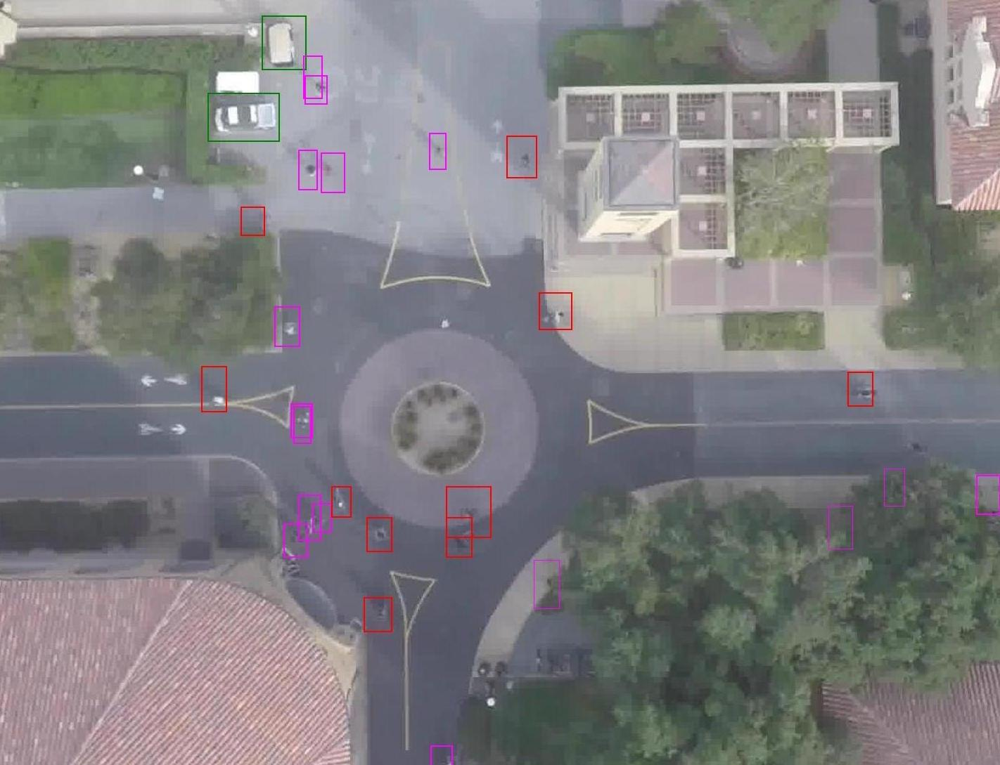
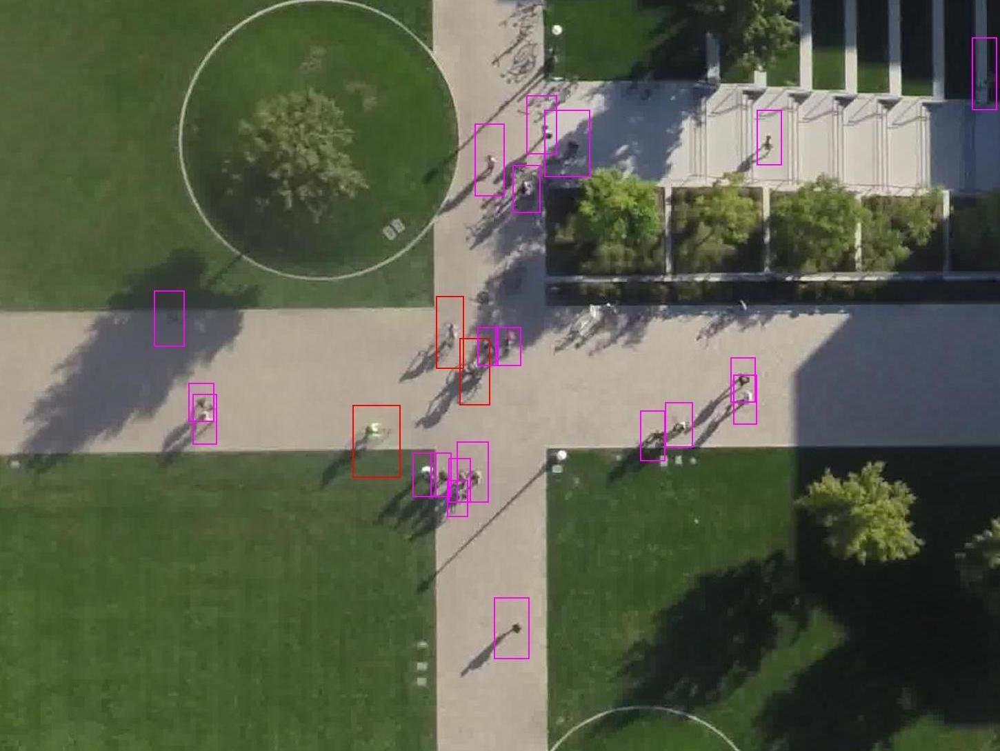

보행 공간에는 사람만 움직이지 않습니다. 자전거와 스케이트보드, 자동차, 버스, 카트가 서로 다른 속도와 회전 반경으로 같은 길을 나눠 써요. <abbr title="드론으로 스탠퍼드 캠퍼스의 여러 이동체 궤적을 촬영한 공개 데이터셋">SDD</abbr>는 이런 혼합 장면을 공중에서 기록한 자료입니다. 정식 이름은 Stanford Drone Dataset이에요.

공식 페이지는 보행자, 자전거, 스케이트보더, 자동차, 버스, 골프 카트를 포함한다고 설명합니다. 여덟 장소에서 촬영한 영상은 모두 합쳐 60개이고, 장면마다 이동체 구성 비율이 크게 달라요. 캠퍼스의 넓은 공간을 높은 시점에서 오래 보므로 사람끼리의 회피뿐 아니라 속도가 다른 이동체가 합류하고 교차하는 상황을 분석할 수 있습니다.

<figure class="fig"><figcaption>원형 교차 공간은 여러 진입 방향과 이동체 범주가 한 장면에 섞이는 모습을 보여 줍니다. 색상 상자는 범주를 구분하지만, 로봇과 상호작용했다는 의미는 아닙니다. (출처: Stanford CVGL, <a href="https://cvgl.stanford.edu/projects/uav_data/">Stanford Drone Dataset</a>, `deathCircle.jpg`)</figcaption></figure>

## 조감 영상이 예측 질문을 넓혀요

ETH와 UCY의 고전 벤치마크는 주로 보행자 좌표에 초점을 맞춥니다. SDD는 이동 속도와 동역학이 다른 여러 범주를 한 장면에 넣었어요. 보행자는 급하게 방향을 바꿀 수 있고, 자전거는 더 빠르며, 자동차는 차체 크기와 회전 제약이 큽니다. 같은 거리의 이웃이라도 미래에 미치는 영향이 다릅니다.

예측기는 사람 수만 세는 대신 상대의 범주, 크기, 속도, 진행 가능한 영역을 함께 봐야 합니다. 자동차와 마주친 보행자가 보도 쪽으로 물러나는 행동과 두 보행자가 서로 비키는 행동은 같은 대칭 회피가 아니에요. 도로와 보행로의 의미도 중요해집니다.

드론 시점은 넓은 공간을 한 번에 보여 줍니다. 화면 밖에서 갑자기 들어오는 사람이 줄고, 여러 이동체의 전후 관계를 길게 추적하기 쉬워요. 반면 지상 로봇이 겪는 가림, 센서 흔들림, 자기 움직임은 약해집니다. 예측 알고리즘의 상호작용 표현을 시험하기에는 좋지만 로봇 지각 전체를 검증하지는 않습니다.

[[2026-10-17_socialnav_ucy-dataset|UCY 군중 궤적 데이터가 상호작용 예측에 남긴 기준]]이 보행 군중의 여러 장면을 보여 준다면, SDD는 같은 캠퍼스 공간에서 사람과 비인간 이동체의 규칙이 어떻게 겹치는지 묻게 합니다. 두 자료의 점수를 같은 표에 놓을 때 입력 범주와 장면 규모가 다르다는 점을 잊으면 안 됩니다.

## 여덟 장소는 이름만 다른 복사본이 아니에요

공식 통계는 gates, little, nexus, coupa, bookstore, deathCircle, quad, hyang의 여덟 장면을 구분합니다. 영상 수는 각각 9, 4, 12, 4, 7, 5, 4, 15개로 합계 60개예요. 장소마다 보행자와 자전거, 자동차의 비율이 다릅니다.

예를 들어 coupa는 공식 표에서 보행자가 80.61%로 큰 비중을 차지하고, gates는 자전거 51.94%와 보행자 43.36%가 비슷합니다. nexus는 자동차가 29.51%이고 보행자는 64.02%예요. 전체 평균 하나는 이런 장면 차이를 가립니다.

범주 불균형은 모델이 어떤 상호작용을 자주 보는지 결정합니다. 보행자가 많은 장면에서 학습한 모델은 자동차 접근에 대한 긴 예측 거리를 충분히 배우지 못할 수 있어요. 자동차 비율이 높은 장면만 시험하면 범주 일반화와 장소 일반화가 동시에 바뀝니다.

설명용으로 보행자 창 8,000개와 버스 창 80개를 같은 손실로 학습한다고 하겠습니다. 버스 비율은 `80/(8000+80)≈0.99%`입니다. 배치 128개의 기대 버스 창은 약 1.27개예요. 무작위 배치 일부에는 버스가 하나도 없을 수 있으므로 범주 균형 표집이나 손실 가중치가 필요합니다.

## 상자 중심이 바닥의 이동점은 아니에요

공식 표본은 이동체를 색상 경계 상자로 표시합니다. 영상 상자는 객체를 찾는 데 유용하지만, 궤적 예측에 쓸 대표점을 어디로 잡을지 선택해야 해요. 보행자는 상자 아래 중앙이 바닥 접점에 가깝고, 자동차는 상자 중심이 차체 중심과 더 가까울 수 있습니다.

모든 범주에서 상자 중심을 쓰면 키가 큰 보행자의 영상 위치가 실제 발 위치와 어긋날 수 있어요. 카메라가 완전한 수직이 아니면 머리 쪽과 발 쪽의 바닥 투영 차이가 생깁니다. 차체가 회전할 때 축 정렬 상자의 중심과 크기도 달라져 궤적에 흔들림이 들어갈 수 있습니다.

설명용으로 보행자 상자 높이가 40픽셀이고 기울어진 시점 때문에 중심과 발점의 바닥 환산 차이가 0.6미터라고 하겠습니다. 모델이 상자 중심을 사람 위치로 배우면 통로 경계와 사람 간 간격이 그만큼 밀려요. 가까운 통과 판단에서 0.6미터는 큰 오차입니다.

대표점 규칙은 범주별로 정의하고, 원 영상 위에 다시 그려야 합니다. 보행자의 발점, 자전거와 차량의 바닥 중심, 스케이트보더의 사람 상자와 보드 위치가 일관되는지 확인해요. 하나의 좌표 규칙이 모든 범주에 물리적으로 같은 의미를 주지 않을 수 있습니다.

## 드론 영상에도 카메라 운동과 렌즈 오차가 있어요

공중에서 촬영했다고 카메라가 완전히 고정된 것은 아닙니다. 바람과 자세 제어, 미세한 위치 변화가 배경을 움직일 수 있어요. 영상 좌표의 변화에는 객체 이동과 카메라 이동이 함께 들어갑니다. 바닥의 고정 점을 이용해 프레임 간 변환을 추정하고 안정화해야 합니다.

높은 곳에서 내려다보면 원근 변화는 줄지만 렌즈 왜곡과 지형 높이 차이는 남습니다. 화면 가장자리의 직선이 휘거나, 건물 계단과 잔디 경사가 하나의 바닥 평면에서 벗어날 수 있어요. 장면별 보정 행렬과 유효 영역을 따로 관리해야 합니다.

설명용으로 카메라가 프레임 사이에 영상에서 2픽셀 흔들리고, 그 위치의 환산값이 픽셀당 6센티미터라면 정지 물체도 `2×0.06=0.12미터` 움직인 것처럼 보입니다. 0.4초 간격에서는 0.3미터/초의 가짜 속도예요. 느린 보행자의 정지·출발 판단을 바꿀 수 있습니다.

안정화를 모든 프레임에 독립 적용하면 변환 잡음이 좌표를 흔들 수도 있습니다. 고정 배경 점의 재투영 오차와 이동체 궤적의 가속도 분포를 함께 보고, 원 변환과 평활 변환의 차이를 검증해야 해요.

## 픽셀·세계 좌표와 영상 샘플링을 함께 기록해야 해요

궤적 파일을 공통 형식으로 바꾸는 과정에서 픽셀 좌표를 미터로 변환하거나 프레임을 일정 간격으로 줄입니다. 이때 호모그래피, 원본 프레임률, 샘플링 단계, 보간 규칙이 결과를 정의해요. 파일 이름만 SDD라고 같아도 전처리가 다르면 점수를 바로 비교할 수 없습니다.

속도가 빠른 자전거와 자동차는 샘플링 간격에 더 민감합니다. 설명용으로 자전거가 5미터/초로 달리고 좌표를 0.4초마다 남기면 점 사이 간격은 `5×0.4=2미터`입니다. 그 사이의 곡선 회전을 직선으로 잇는다면 장애물과의 실제 최소거리를 놓칠 수 있어요.

반대로 원본의 가까운 프레임을 모두 학습 창으로 만들면 이웃 창이 거의 같은 장면을 공유합니다. 표본 수는 커져도 독립 사건 수가 늘지 않아요. 영상 단위로 분할하기 전에 창을 만들고 무작위로 나누면 같은 이동체와 배경이 훈련과 시험에 들어갑니다.

변환 검증은 세 단계로 할 수 있습니다. 영상 상자의 대표점을 표시하고, 세계 좌표를 다시 영상에 투영하며, 속도와 가속도를 범주별로 확인해요. 보행자와 자동차에 같은 속도 이상치 기준을 적용하면 한쪽의 오류를 놓치거나 정상 움직임을 지울 수 있습니다.

## 범주 라벨은 동역학을 완전히 설명하지 않아요

같은 자전거 범주 안에서도 천천히 끌고 가는 사람과 빠르게 주행하는 사람이 다릅니다. 스케이트보더도 서 있거나 발로 차며 가속할 수 있어요. 자동차와 카트의 크기·속도 범위도 겹칠 수 있습니다. 범주 하나를 고정 운동 모델로 바꾸면 내부 다양성을 놓칩니다.

속도와 방향, 상자 크기, 과거 곡률을 함께 보면 현재 운동 상태를 더 잘 구분할 수 있어요. 하지만 영상만으로 브레이크 의도나 다음 목적지를 확정할 수는 없습니다. 예측은 여러 가능성과 불확실도를 남겨야 합니다.

설명용으로 같은 자전거 두 대가 현재 3미터/초와 6미터/초라고 하겠습니다. 3초 뒤 등속 위치는 각각 9미터와 18미터 앞입니다. 범주 평균 4.5미터/초를 둘 다 적용하면 두 경우 모두 4.5미터의 끝점 편향이 생겨요. 범주 라벨은 운동 상태를 대신하지 않습니다.

반대로 범주를 완전히 무시하면 사람과 차량에 같은 회전 가능성을 줍니다. 자동차가 보행자처럼 옆으로 한 걸음 이동하는 미래를 만들 수 있어요. 모델 출력에 범주별 동역학 제약이나 실행 가능성 검사를 두는 편이 좋습니다.

## 장면 맥락은 강하지만 지름길이 될 수 있어요

SDD 영상은 잔디, 보도, 도로, 건물, 원형 교차 구역을 선명하게 보여 줍니다. 이동체는 이런 구조를 따라가므로 장면 의미를 넣으면 예측이 좋아질 수 있어요. deathCircle의 진입로 방향이나 hyang의 십자 보행로는 강한 경로 힌트입니다.

<figure class="fig"><figcaption>hyang 장면의 보행로는 가능한 경로를 강하게 제한합니다. 모델이 사람 간 상호작용을 배웠는지, 이 고정 배경의 흐름을 외웠는지 분리해 평가해야 해요. (출처: Stanford CVGL, <a href="https://cvgl.stanford.edu/projects/uav_data/">Stanford Drone Dataset</a>, `hyang.jpg`)</figcaption></figure>

배경을 쓰는 것 자체가 문제는 아닙니다. 문제는 같은 장소의 프레임을 훈련과 시험에 나눠 배경 기억을 일반화처럼 보고하는 것입니다. 영상 단위 분할도 동일 장소의 다른 촬영이 양쪽에 들어가면 장소 지름길이 남아요. 장소 전체 보류가 필요합니다.

장면 의미를 제거한 좌표 전용 조건, 배경을 더한 조건, 처음 보는 장소 조건을 비교하면 이득의 출처를 볼 수 있습니다. 사람과 주변 이동체를 가린 배경만으로도 미래 방향을 상당히 맞힌다면 상호작용 모델의 기여를 과장하면 안 됩니다.

지도 오분류에도 민감합니다. 그림자를 도로 경계로 보거나 잔디 위 임시 통로를 막힌 곳으로 보면 가능한 미래를 잘못 줄여요. 원 영상과 의미 지도의 시점이 맞지 않는 경우도 별도 교란 시험이 필요합니다.

## 평균 위치 오차만으로 혼합 이동체를 비교하기 어려워요

같은 1미터 끝점 오차라도 보행자와 자동차에서 의미가 다릅니다. 보행자는 한 걸음 정도 방향을 바꿀 수 있지만 자동차는 제동 거리와 차체 크기가 커요. 속도가 빠른 범주는 절대 오차가 커지기 쉬우므로 전체 평균은 범주 구성에 좌우됩니다.

범주별 평균과 상대 오차를 함께 볼 수 있습니다. 설명용으로 5초 동안 25미터 이동한 자전거의 끝점 오차가 1.5미터라면 이동거리 대비 6%입니다. 같은 시간 6미터 이동한 보행자의 1.0미터 오차는 약 16.7%예요. 절대 안전 여유에는 1.5미터가 중요하고 운동 예측 비율에는 16.7%가 큽니다.

충돌 위험은 예측 중심점뿐 아니라 객체 크기를 반영해야 합니다. 차량 상자 중심이 사람 경로에서 1미터 떨어져도 차체 반폭이 0.9미터라면 여유는 0.1미터뿐이에요. 범주별 발자국과 방향을 넣지 않은 점 거리로는 안전을 평가하기 어렵습니다.

드문 버스와 카트의 평균은 표본이 적어 크게 흔들릴 수 있습니다. 부트스트랩을 할 때도 인접 창이 아니라 원 궤적이나 영상 단위로 다시 뽑아야 해요. 그렇지 않으면 강하게 중복된 창이 신뢰구간을 지나치게 좁힙니다.

## 기록된 궤적은 로봇 행동에 반응하지 않아요

SDD는 캠퍼스의 자연 교통을 관측한 자료입니다. 로봇이 경로를 바꿨을 때 사람과 자전거가 어떻게 반응하는지 측정한 닫힌 고리 실험이 아니에요. 기록 재생 속에서 가상의 로봇이 사람 앞을 막아도 사람 궤적은 원래대로 지나갑니다.

이 자료로 예측기를 학습해 로봇 계획기에 넣을 수는 있습니다. 다만 예측된 사람 미래와 로봇의 행동이 독립이라는 가정이 생겨요. 실제로는 로봇이 먼저 감속하면 사람이 그대로 걷고, 로봇이 진입하면 사람이 양보할 수 있습니다. 상호 조건부 예측이나 닫힌 고리 사람 모델이 필요합니다.

공중 시점과 로봇 시점의 차이도 큽니다. 로봇은 차량 뒤 보행자를 못 보고, 지면 가까운 센서에서 자전거 바퀴와 사람 다리를 부분 관측해요. SDD의 정답 궤적을 로봇 입력처럼 사용하면 지각 실패가 없는 최적 조건의 성능에 가깝습니다.

실물 평가에서는 자동 검출·추적 입력을 연결하고, 독립 충돌 감시를 둔 뒤 교차·추월·혼합 통행 장면을 낮은 속도에서 시험해야 합니다. 최소거리, 충돌 예상 시간, 불필요한 정지, 사람과 자전거의 추가 우회량을 범주별로 기록해요.

## 라이선스와 69기가바이트도 실험 설계의 일부예요

공식 페이지는 전체 데이터 크기를 약 69기가바이트로 안내합니다. 이 크기는 영상 전체를 반복 복사하기보다 원본을 한 곳에 두고, 해시와 매니페스트로 파생 파일을 추적해야 한다는 뜻이에요. 작은 표본만 쓴 실험은 어떤 장면과 영상을 제외했는지 밝혀야 합니다.

데이터는 Creative Commons Attribution-NonCommercial-ShareAlike 3.0으로 공개돼 있습니다. 출처 표시, 비상업 조건, 변경·파생물의 동일 조건 공유 요구를 확인해야 해요. 모델 가중치와 전처리 좌표가 라이선스상 어떤 파생물인지 배포 전에 별도 검토가 필요합니다.

페이지의 색상 상자 이미지는 데이터 구성을 이해하기 좋은 미디어입니다. 하지만 공개 라이선스가 있다고 사람을 재식별하거나 민감한 행동을 추론해도 된다는 뜻은 아니에요. 원거리 영상이라도 연구 목적과 필요한 범위에 맞춰 처리하고 원본 접근을 관리해야 합니다.

## 재현과 로봇 이전을 위한 점검 순서

첫째, 공식 페이지의 장면 통계와 받은 파일 목록을 대조합니다. 여덟 장소와 60개 영상, 범주 표가 전처리 매니페스트와 맞는지 확인하고 파일 해시를 남겨요. 일부 장면만 썼다면 이유와 제외 기준을 기록합니다.

둘째, 영상 안정화와 좌표 변환을 검증합니다. 고정 배경점의 프레임 간 이동, 호모그래피 재투영 오차, 범주별 대표점 위치를 시각화해요. 원본 상자와 변환 좌표가 사람 발점과 차량 바닥 중심에 맞는지 봅니다.

셋째, 분할을 장소와 영상 단위로 먼저 고정한 뒤 창을 만듭니다. 같은 객체와 배경이 양쪽에 들어가지 않도록 하고, 장면별·범주별 독립 궤적 수를 보고해요. 정규화 통계는 훈련 분할에서만 계산합니다.

넷째, 범주별 동역학과 위험 지표를 함께 평가합니다. 평균·최종 위치 오차 외에 객체 크기를 반영한 최소거리, 충돌 시간, 지도 위반, 다중 미래의 보정을 봐요. 드문 범주의 신뢰구간은 궤적 단위로 계산합니다.

다섯째, 로봇 센서 조건과 사람 반응을 새로 검증합니다. 가림과 검출 누락, 자기 위치 오차를 넣고, 닫힌 고리 시뮬레이션에서 로봇 행동이 주변 이동체에 영향을 주게 합니다. 마지막에는 안전 장치가 있는 실물 장면에서 사람과 자전거의 반응을 측정해요.

SDD는 보행자 좌표 문제를 캠퍼스의 혼합 이동체 문제로 넓혔습니다. 여덟 장소와 60개 영상, 여섯 범주는 사람끼리만 보는 모델이 놓치는 속도·크기·통행 공간의 차이를 드러냅니다. 공식 표본의 넓은 항공 시점은 장면 기하와 상호작용을 함께 읽게 해요.

동시에 항공 영상의 깨끗한 전역 관측은 지상 로봇의 가림과 센서 오류를 제거하고, 기록된 이동체는 로봇의 행동에 반응하지 않습니다. 장소 누수를 막고, 카메라 운동과 대표점 기하를 확인하며, 범주별 위험과 실제 상호 반응을 추가로 평가해야 해요. 그 과정을 거치면 SDD는 큰 데이터셋이라는 수식보다 다양한 이동체와 공간 규칙을 어떻게 예측·계획에 연결할지 묻는 기준이 됩니다.

---

<!-- src-block -->
출처 — https://cvgl.stanford.edu/projects/uav_data/
