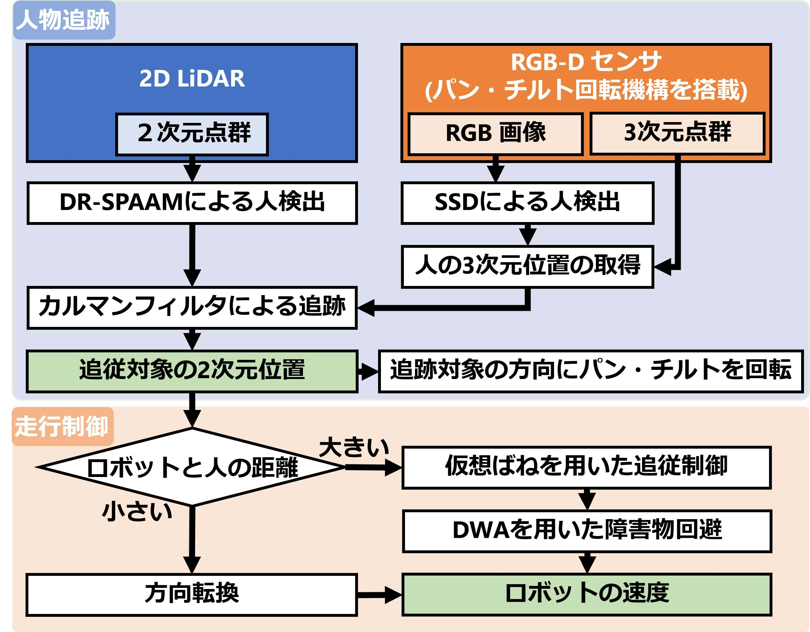
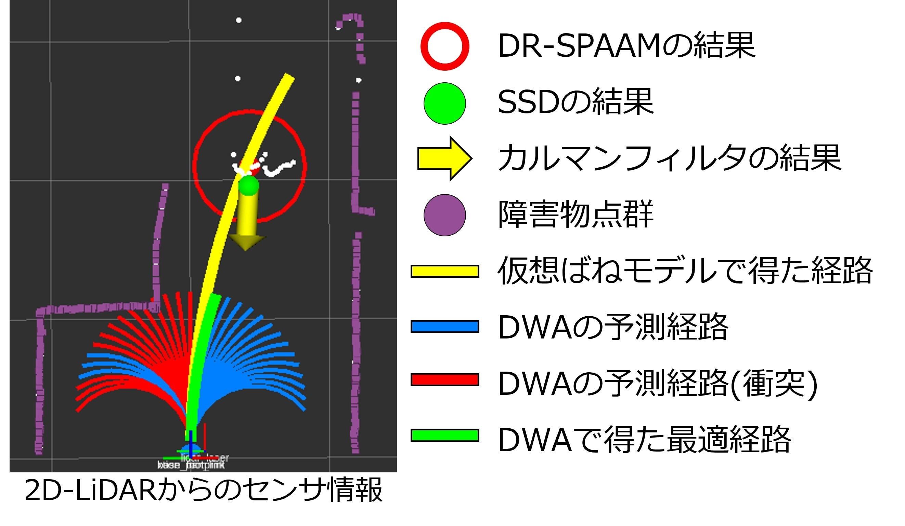

사람을 따라가는 로봇은 목적지가 고정돼 있지 않아요. 목표 사람이 움직일 때마다 로봇이 유지할 거리와 방향이 바뀌고, 그 사이에 벽이나 다른 사람이 들어오면 속도를 다시 골라야 해요. SOBITS Follower는 <abbr title="컬러 영상과 각 화소까지의 거리를 함께 얻는 방식">RGB-D</abbr> 센서와 2차원 라이다의 사람 관측을 합쳐 목표 위치를 추정하고, 가상 스프링 모형과 <abbr title="현재 속도 주변의 후보 명령을 짧게 예측해 장애물과 목표를 함께 평가하는 방법">DWA</abbr>로 추종 속도를 만드는 <abbr title="로봇의 센서 정보와 제어 명령을 여러 프로그램 사이에서 주고받는 소프트웨어 체계">ROS 2</abbr> 패키지예요.

이 과제는 일반 사회적 길찾기와 달라요. 일반 길찾기는 지도 위 목표점까지 가며 여러 사람과 상호작용하지만, 추종은 특정 사람 자체가 계속 움직이는 목표예요. 대상이 멈추면 로봇도 정한 거리에서 멈춰야 하고, 다른 사람이 더 가까이 지나가도 목표를 바꾸지 않아야 해요. 편안한 군중 통과, 집단 보존, 양보 판단 전체를 해결하는 계획기로 확대해서 보면 안 돼요.

이 글은 TeamSOBITS 저장소의 `jazzy-devel` 분기와 2026년 6월 23일 커밋을 기준으로 읽어요. 저장소는 Jazzy용 통합 실행 파일, 사람 추적, 칼만 필터, 추종 제어, 속도 평활화, 로봇별 설정을 포함해요. 모델 가중치는 저장소 밖에서 받아야 하는 항목이 있어 소스만 복제했다고 바로 전체 인지가 실행되는 구조는 아니에요. 공식 구조도의 <abbr title="현재와 과거의 라이다 거리 특징을 결합해 사람의 위치를 찾는 검출 방법">DR-SPAAM</abbr>은 다리 관측을, <abbr title="영상 한 번의 처리로 물체 종류와 위치 상자를 함께 찾는 검출 방법">SSD</abbr>는 영상 속 몸 관측을 맡아요.

<figure class="fig"><figcaption>공식 구조도는 2차원 라이다의 다리 검출과 RGB-D의 몸 검출을 칼만 필터에 넣고, 목표 거리에 따라 가상 스프링 추종·회전·DWA 장애물 회피로 나누는 흐름을 보여줘요. (출처: TeamSOBITS/sobits_follower 공식 README 자산 · <a href="../assets/socialnav_sobits-follower_LICENSE.txt">BSD 3-Clause License 원문</a>)</figcaption></figure>

## 다리와 몸 관측을 하나의 목표 상태로 합쳐요

기본 구조는 2차원 라이다 거리 신호에서 DR-SPAAM으로 다리 위치를 찾고, RGB-D 영상에서는 SSD 또는 Jazzy 실행 설정의 <abbr title="영상에서 사람 같은 물체의 종류와 위치 상자를 한 번에 찾는 검출 모델 계열">YOLO</abbr> 계열 검출기로 사람 몸을 찾는 방식이에요. RGB-D의 깊이 점으로 몸 검출 상자의 3차원 위치를 만들고, 두 관측을 로봇 기준 좌표계로 변환해요.

추적기는 `body`, `leg`, `body_leg` 세 검출 모드를 제공해요. `body_leg`에서는 다리와 몸 관측을 모두 쓰고, 하나만 들어오면 단일 관측으로 상태를 갱신해요. 둘 다 없으면 등속 모형으로 예측만 이어가다가 `target_change_tolerance` 시간이 지나면 목표가 없다고 발행해요.

처음 목표를 고를 때는 로봇에 가장 가까운 검출을 찾고, 추적 중에는 이전 목표 위치에 가장 가까운 검출을 골라요. SOBIT EDU 기본 설정은 새 목표 탐색 거리 3.0m, 다리 연결 거리 0.7m, 몸 연결 거리 0.35m, 목표 변경 허용 시간 1.0초예요. 가까운 이웃 규칙이라 두 사람이 교차하면 식별자가 바뀔 수 있어요.

설명용으로 이전 목표가 `(2.0, 0.2)m`이고 새 몸 검출이 A `(2.1, 0.25)m`, B `(1.8, 0.0)m`라고 가정해요. 이전 목표와의 거리는 각각 약 0.112m와 0.283m라 A가 선택돼요. 하지만 실제 목표가 B로 급회전했고 A가 다른 사람이라면 가까운 이웃 규칙이 잘못된 식별자를 유지할 수 있어요. 이 좌표는 구현 동작을 설명하는 가정이에요.

목표 사람 재식별 기능은 별도 선택 항목이에요. 저장소는 온라인 특징 선택 방식과 OSNet 특징·릿지 회귀 분류 방식의 추가 패키지를 안내해요. 기본 사람 위치 추적만으로 옷차림과 얼굴을 식별하는 것은 아니에요. 재식별을 쓰려면 별도 설치와 모형, 개인정보 처리, 가림 후 재등장 시험이 필요해요.

## 칼만 필터는 등속 운동을 가정해요

`multiple_observation_kalman_filter`는 상태를 2차원 위치와 속도로 두는 등속 모형을 사용해요. 다리·몸 두 관측이 들어오면 순서대로 보정하고, 하나만 들어오면 그 관측으로 보정해요. 관측이 없으면 이전 상태와 속도로 예측만 수행해요. 호출 시점 차이인 `dt`를 계산하지만, 그 값이 필터의 모든 시간 계산에 적용되지는 않아요.

검토한 Jazzy 추적기는 필터를 시간 간격 0.033초, 과정 잡음 1000, 관측 잡음 1.0으로 고정 생성해요. 설정 파일의 `process_noise` 50.0과 `system_noise` 1.0을 읽어 이 생성값을 바꾸는 경로는 없어요. 콜백에서 계산한 `dt`는 과정 잡음의 공분산에만 반영되고, 위치를 속도로 전진시키는 상태전이행렬의 시간 간격은 생성 때의 0.033초로 남아요. 설정 파일 기록과 실행에 쓰이는 값을 구분해야 해요.

등속 모형은 사람이 일정한 방향과 속도로 걷는 짧은 구간에는 유용하지만 급정지·급회전·뒤로 걷기를 정확히 예측하지 못해요. 팬·틸트 장치가 몸을 향해 돌 때 생기는 영상 지연과 라이다 검출 시각의 차이도 있어요. 두 관측을 같은 시각의 위치처럼 순차 보정하면 움직이는 사람의 위치가 편향될 수 있어요.

설명용으로 추정 속도가 1.2m/s이고 관측 공백이 0.4초라고 가정해요. 공백 전체를 반영하는 이상적인 등속 예측 이동은 0.48m지만, 이 구현의 한 번 예측은 0.033초를 써서 0.0396m를 전진시켜요. 공백 동안 몇 번 호출됐는지에 따라 누적 이동이 달라져요. 두 계산은 저장소 실측이 아닌 시간 간격 적용 차이의 예예요. 관측 누락 시험에는 콜백 횟수도 함께 남겨야 해요.

검증에서는 직선 보행만 보지 말고 급정지, 직각 회전, 두 사람 교차, 몸만 보임, 다리만 보임, 둘 다 연속 누락을 나눠야 해요. 위치 평균 오차와 함께 식별자 유지율, 목표 없음 전환 지연, 잘못된 목표로 명령을 낸 시간을 기록해야 해요.

## 팬·틸트는 목표를 보는 방향을 유지해요

RGB-D 센서는 팬·틸트 회전 장치에 올라가고, 추적기가 낸 목표 방향을 따라 회전해요. 라이다가 다리를 발견했지만 몸 검출이 없을 때 가까운 다리 후보 쪽으로 카메라를 돌려 몸을 찾는 흐름도 코드에 있어요. 후보가 여러 개면 주의를 둘 다리에 순서를 두고 일정 시간마다 바꿔요.

이 구조는 고정 카메라 시야 밖으로 사람이 나가는 문제를 줄일 수 있어요. 동시에 센서 방향 자체가 움직이므로 RGB-D 외부 보정과 시간 동기화가 중요해요. 회전 중 오래된 변환을 쓰면 몸의 3차원 위치가 로봇 좌표계에서 흔들릴 수 있어요. 라이다와 카메라 관측을 합칠 때 두 좌표가 같은 시점에 같은 사람을 가리키는지 확인해야 해요.

팬·틸트 제한 각도, 사람 머리 높이, 평활 이득은 로봇별 설정에 있어요. 센서가 목표를 바라보는 기능과 로봇 본체가 목표를 따라 회전하는 기능을 분리해 시험해야 해요. 센서 회전이 늦어도 라이다 관측은 계속될 수 있고, 몸 검출만 사용하는 모드에서는 시야 이탈이 곧 추적 손실이 될 수 있어요.

설명용으로 카메라 수평 시야가 70도이고 목표 방위가 초당 45도 변하지만 팬 구동이 초당 30도만 따라간다고 가정해요. 방위 오차는 초당 15도씩 커져 약 2.33초 뒤 반시야 35도를 넘을 수 있어요. 실제 장치 제원이나 저장소 실측이 아니라 시야·구동 속도 관계를 확인하는 예예요.

## 가상 스프링은 목표 거리의 오차를 속도로 바꿔요

추종 제어는 목표 사람과 로봇 사이에 가상 스프링이 연결됐다고 봐요. 현재 거리가 설정한 추종 거리보다 길면 당기는 힘을 만들고, 목표가 옆에 있으면 회전 성분을 만들어요. 로봇 질량·관성·점성 마찰 매개변수로 힘을 속도 성분으로 바꿔요.

SOBIT EDU 설정의 추종 거리는 1.0m예요. 제어기는 가상 스프링의 자연 길이에 이 값에서 0.4m를 뺀 0.6m를 넘겨요. 설정된 거리에서 멈추는 문턱과 스프링 힘이 0이 되는 기준 길이가 달라요. 병진 스프링 계수는 30.0N/m, 회전 스프링 계수는 1.0N·m/rad, 명목 로봇 질량은 30.0kg, 관성 모멘트는 15.0kg·m²예요. 이 값은 제어 모형의 매개변수이며 실제 로봇 질량을 정확히 재현했다는 증거가 아니에요.

가상 스프링만 쓰면 목표를 향해 자연스럽게 따라갈 수 있지만 장애물을 안전하게 피하는 후보를 비교하지 않아요. 목표 사람이 벽 반대편에 있거나 좁은 통로 모서리를 돌면 당기는 방향이 장애물을 가로지를 수 있어요. 그래서 기본 방식은 가상 스프링 속도를 DWA 후보 평가에 결합해요.

설명용으로 목표가 로봇 정면 1.6m에 있고 설정된 추종 거리가 1.0m라고 해볼게요. 구현이 넘긴 자연 길이는 0.6m이므로 늘어난 길이는 1.0m예요. 병진 계수 30N/m를 적용한 탄성력은 30N이고, 질량 30kg으로 나눈 가속도 성분은 1.0m/s²예요. 점성·각도·속도 제한과 정지 분기를 적용하기 전의 한 항 계산이며 실제 명령이나 측정값은 아니에요.

## DWA는 짧은 후보 중 장애물을 피하는 속도를 골라요

DWA는 현재 속도와 로봇 운동 제약에서 가능한 선속도·각속도 후보를 만들고, 짧은 시간 동안의 궤적을 예측해요. 기본 DWA는 목표 방향, 장애물 거리, 전진 속도를 평가해요. 가상 스프링 결합형은 가상 스프링이 낸 선속도·각속도와 후보가 얼마나 비슷한지도 점수에 넣어요.

SOBIT EDU 설정은 선속도 0.10에서 0.50m/s, 각속도 -50에서 50deg/s, 예측 30단계, 단계 간격 0.08초예요. 예측 구간은 `30×0.08=2.4초`예요. 선속도 후보 단계는 4, 각속도 후보 단계는 20이고 장애물 비용 반경은 0.4m예요.

가중치는 방향 1.5, 장애물 2.0, 속도 1.5예요. 결합형에서는 방향 1.5, 장애물 2.5, 가상 스프링 선속도 1.0, 각속도 0.2가 설정돼요. 코드와 설정에 이전 값 주석과 FIXME가 남아 있어 이 숫자를 검증된 보편값으로 보면 안 돼요. 로봇별 주행 시험에서 충돌 여유, 추종 거리 오차, 진동을 함께 조정해야 해요.

<figure class="fig"><figcaption>공식 제어 그림은 사람 관측과 칼만 필터 방향, 가상 스프링 경로, DWA 후보 중 충돌 경로와 선택 경로를 한 화면에 표시해요. 이 장면은 구성 요소의 관계를 보여주며 정량 성능 비교표는 아니에요. (출처: TeamSOBITS/sobits_follower 공식 README 자산 · <a href="../assets/socialnav_sobits-follower_LICENSE.txt">BSD 3-Clause License 원문</a>)</figcaption></figure>

설명용으로 선속도 4개와 각속도 20개를 모두 조합하면 한 주기에 최대 80개 후보예요. 후보마다 30단계를 검사하면 최대 2,400개 상태를 평가해요. 실제 구현의 경계 포함 방식과 가지치기에 따라 수는 달라질 수 있어요. 장애물 점군이 많아질 때 제어 주기와 최악 지연을 재야 해요.

## 목표 손실 때 멈추지만 오래된 상태 검사는 주의가 필요해요

제어 코드는 추적 상태가 `NO_EXISTS`이거나 목표 위치가 `(0,0)`이면 선속도와 각속도를 0으로 발행해요. DWA 계열 방식은 주행거리계와 장애물 메시지가 들어오기 전에는 제어를 계산하지 않아요. 생명주기 비활성화 때도 정지 명령을 내는 경로가 있어요.

하지만 추종 위치 메시지가 오래됐는지 검사해 멈추는 코드가 현재 주석 처리돼 있어요. 마지막 정상 메시지가 끊긴 뒤 새 콜백이 없으면 어떤 명령이 얼마나 유지되는지 실제 실행 흐름에서 확인해야 해요. 속도 평활화 노드와 아래쪽 구동기가 명령 유효 시간을 별도로 갖는지도 봐야 해요.

센서·변환 실패의 처리도 경로별로 달라요. 라이다 좌표 변환 실패는 목표 없음 상태를 발행하지만, 카메라 검출 지연이나 장애물 점군 정지는 다른 콜백 흐름에 묶여요. 각 입력을 하나씩 멈추고 최종 `/cmd_vel`이 정해진 시간 안에 0이 되는지 검증해야 해요.

설명용으로 마지막 명령이 0.4m/s이고 구동기가 새 명령 없이 1초 유지한다고 가정하면 로봇은 0.4m 더 갈 수 있어요. 목표 사람과 1.0m 거리를 유지하던 상황에서 사람이 급정지했다면 여유가 크게 줄어요. 이 수치는 저장소 실험이 아니라 명령 만료 시험의 필요성을 보여줘요.

## 모델 파일과 Jazzy 이식 상태를 함께 고정해야 해요

README는 DR-SPAAM 가중치가 없으면 별도 Google Drive에서 내려받아 지정 경로에 놓으라고 안내해요. YOLO를 쓰는 경우에도 `yolo11n.pt`나 `yolo26n.pt` 같은 가중치가 필요해요. 소스 저장소의 BSD 3-Clause License가 외부 모형 파일의 권리까지 자동으로 덮지 않아요. 각 가중치의 출처·라이선스·해시를 따로 기록해야 해요.

`jazzy-devel` 통합 실행은 `ros2 launch`와 구성 요소 컨테이너, 생명주기 관리자를 사용해요. 지원 로봇 설정은 `hsrb`, `sobit_pro`, `sobit_edu`, `sobit_home` 경로로 나뉘어요. 기본 로봇 형식은 현재 실행 파일에서 `sobit_home`이에요. 로봇 형식을 바꾸면 주제·좌표계·속도 제한·센서 경로가 함께 바뀌어요.

통합 실행은 추적 설정의 검출 모드를 먼저 읽어요. 몸만 쓰면 다리 검출 실행을 올리지 않고, 다리만 쓰면 몸 검출기를 올리지 않아요. 둘을 함께 쓰는 모드에서만 두 인지 경로가 동시에 시작돼요. 몸 검출기는 실행 인자로 SSD와 YOLO 중 하나를 고르며, 값이 지원 목록에 없을 때 별도 대체 검출기가 자동으로 생기지 않아요. 시작 로그에서 실제로 올라온 노드와 구독 주제를 확인해야 설정 파일을 바꿨다고 생각했지만 이전 경로가 계속 도는 일을 막을 수 있어요.

생명주기 관리자는 추적기·센서 회전기·추종 제어기를 함께 활성화해요. 인지 노드가 준비되기 전에 제어기만 명령을 내지 않도록 상태 전이를 확인해야 해요. 속도 평활화를 쓰면 제어기의 원시 명령 주제와 최종 구동 주제가 달라져요. 정지 시험에서는 두 주제를 모두 기록해 제어기는 멈췄지만 평활화 출력이 남는지, 반대로 평활화가 너무 늦게 반응하는지 살펴야 해요.

일부 하위 README에는 `roslaunch`, nodelet, 과거 XML 실행 파일 같은 <abbr title="프로그램 사이에서 센서 정보와 명령을 주고받는 로봇 소프트웨어의 이전 세대">ROS 1</abbr> 표현이 남아 있어요. 최상위 Jazzy 안내와 실제 Python 실행 파일을 우선해 확인해야 해요. 문서의 모든 명령이 현재 분기에서 검증됐다고 가정하면 안 돼요. 이 글은 설치나 실행을 수행하지 않았고 소스·설정·공식 그림을 읽은 결과예요.

## 사람 추종과 사회적 길찾기의 경계를 유지해야 해요

SOBITS Follower의 성공 조건은 목표 사람을 놓치지 않고 일정 거리에서 따라가며 가까운 장애물을 피하는 데 있어요. 목적지가 지도 좌표로 주어지지 않고 목표 사람 뒤쪽이 계속 갱신돼요. 여러 사람 사이에서 누구에게 양보할지, 대화 집단을 가르지 않을지, 사람의 진행권을 예측할지는 기본 목적 함수에 없어요.

다른 사람이 목표와 로봇 사이에 들어오면 DWA는 장애물로 피할 수 있지만 그 사람의 의도나 불편을 평가하지 않아요. 목표 사람이 군중 속으로 들어가면 추적 식별자와 충돌 회피의 우선순위가 충돌할 수 있어요. 추종 거리 오차만 줄이면 로봇이 다른 사람 가까이 지나가는 행동을 놓칠 수 있어요.

낮은 기존 라이다를 주행·충돌 감시에만 쓰는 구성에서는 이 패키지의 DR-SPAAM 사람 검출 경로를 그대로 채택하면 역할 경계가 바뀌어요. 그 조건을 유지하려면 `body` 모드와 RGB-D 추적을 검토하고, 라이다 신호는 장애물 점군과 정지 감시에만 쓰도록 입출력을 분리해야 해요. 다만 `body` 모드에서 카메라 가림과 시야 이탈이 커지므로 팬·틸트와 목표 손실 정지를 더 엄격히 시험해야 해요.

[[2026-10-17_socialnav_dr-spaam|DR-SPAAM이 과거 라이다 특징을 누적해 사람을 찾은 방식]]은 이 패키지가 다리 관측에 쓰는 인지 방법을 설명해요. 그 검출 성능과 SOBITS의 추종 성능은 다른 층이에요. 검출기가 사람을 잘 찾는지, 칼만 필터가 같은 식별자를 유지하는지, 제어기가 안전하게 따르는지 각각 따로 검증해야 해요.

실물 평가는 직선 추종만으로 부족해요. 목표의 급정지·급회전, 두 사람 교차, 좁은 문, 반사 유리, 카메라 가림, 라이다 누락, 좌표 변환 끊김, 장애물 메시지 정지, 무선 명령 지연을 나눠야 해요. 목표 거리 평균뿐 아니라 최소 거리, 식별자 교체, 잘못된 사람 추종 시간, 정지 거리, 제어 주기 지연을 함께 기록해야 이 시스템의 실제 범위를 말할 수 있어요.

---

<!-- src-block -->
출처 — https://github.com/TeamSOBITS/sobits_follower/blob/jazzy-devel/README.en.md
