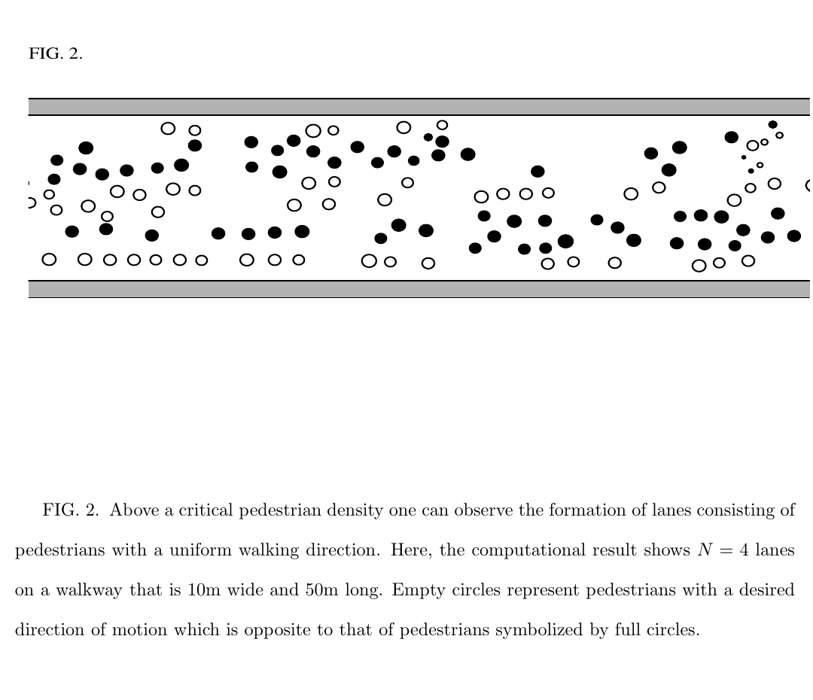
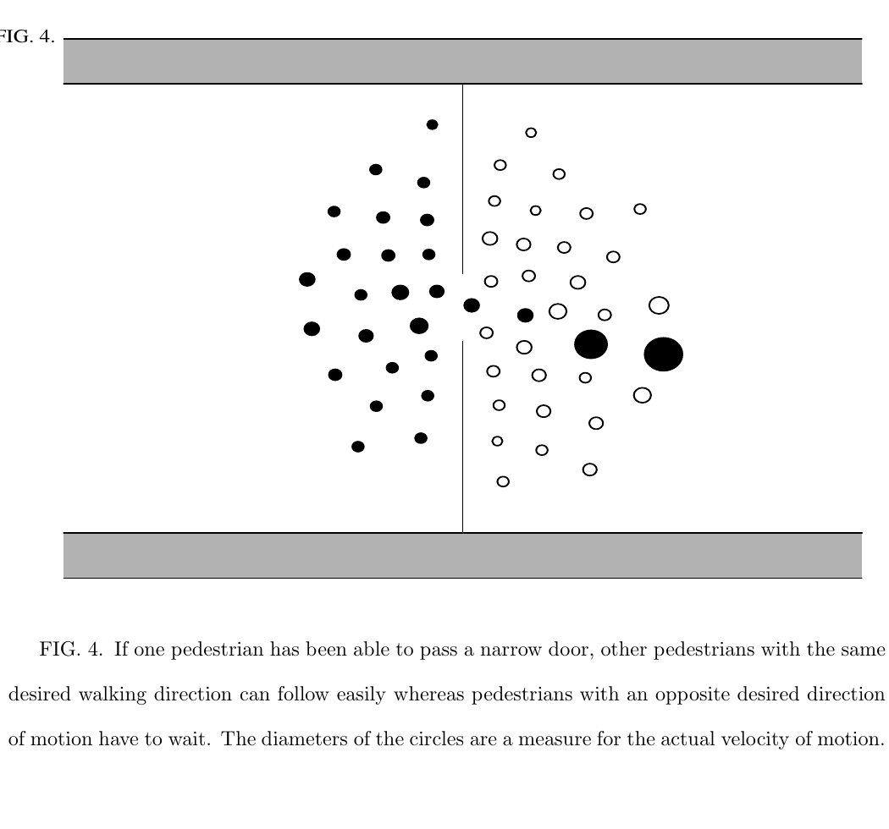

사람이 많은 복도를 시뮬레이션하려면 각 보행자에게 완성된 경로를 하나씩 계획해 줄 수도 있고, 지금 주변에서 받는 영향만 계산해 다음 속도를 정할 수도 있어요. Dirk Helbing과 Péter Molnár의 1995년 논문 「Social force model for pedestrian dynamics」는 두 번째 접근을 정식화했습니다. <abbr title="사람이 원하는 움직임과 주변 사람·벽에서 느끼는 회피 성향을 힘처럼 합쳐 다음 운동을 계산하는 보행자 모델">사회력 모델</abbr>에서 힘은 사람 몸에 작용하는 물리력이 아니라 행동 동기를 수치로 표현한 양입니다.

이 구분을 놓치면 모델을 잘못 읽게 됩니다. 사람을 입자처럼 그린다고 해서 사람이 물리 법칙만 따른다는 주장은 아니에요. 논문은 비교적 단순하고 익숙한 보행 장면에서 원하는 속도 회복, 타인과 경계 회피, 일부 대상에 대한 끌림을 합쳐 집단 패턴을 계산합니다. 복잡한 목적 선택과 낯선 상황의 판단은 같은 모델로 모두 설명하지 않습니다.

## 세 종류의 항이 다음 움직임을 정해요

첫 번째 항은 희망 속도입니다. 보행자 α가 가고 싶은 방향과 속도를 가지고 있는데, 회피나 감속 때문에 실제 속도가 달라지면 일정한 완화 시간에 걸쳐 희망 속도로 돌아가려 합니다. 현재 속도가 목표보다 느리면 전진 가속이 생기고, 빠르면 줄어드는 구조예요. 완화 시간이 짧으면 목표 속도를 더 급하게 회복하므로 움직임이 공격적으로 보일 수 있습니다.

두 번째 항은 다른 사람과 벽에서 멀어지려는 반응입니다. 가까울수록 비용이 커지는 형태를 쓰고, 보행자가 다음 발을 내디딜 공간까지 생각해 상호작용 모양을 잡습니다. 뒤쪽 자극은 앞쪽보다 약하게 반영해 시야의 방향성도 넣었어요. 사람 주위에 원형 반발만 놓은 모델보다 한 단계 더 많은 문맥을 포함하지만, 시선과 사회 관계를 정교하게 읽는 모델은 아닙니다.

세 번째 항은 끌림입니다. 친구나 가게, 관심 대상처럼 가까이 가려는 동기를 표현합니다. 논문의 군중 실험에서 중심 역할을 하는 것은 희망 속도와 반발 항이지만, 사회력이라는 틀이 회피만 뜻하지 않는다는 점을 보여 줍니다. 서로 반대 방향으로 걷는 사람에게도 각자의 희망 속도가 있고, 가까이 마주치면 반발이 생기며, 그 결과가 매 순간 속도로 나타납니다.

전체 운동은 이 항들과 변동 항을 합친 비선형 연립식으로 계산됩니다. 각 사람의 다음 상태가 다른 사람의 상태에 달려 있으므로 한 사람만 따로 풀 수 없어요. 작은 회피가 이웃의 회피를 바꾸고, 바뀐 이웃이 다시 주변에 영향을 줍니다. 이 되먹임 때문에 개별 규칙에는 없던 군중의 줄무늬와 통과 순서가 나타납니다.

## 차선은 누가 명령하지 않아도 생겨요

논문의 시뮬레이션은 반대 방향으로 걷는 보행자들을 같은 보행로에 넣었습니다. 같은 방향으로 걷는 사람끼리 줄을 이루면 정면 회피 횟수가 줄어들어요. 저자들은 이 차선 형성이 초기 배치에 미리 심어 둔 결과가 아니라 보행자 사이 상호작용에서 생긴다고 설명합니다.

<figure class="fig"><figcaption>반대 방향의 두 집단이 국소 회피를 반복하자 같은 방향끼리 차선을 이룹니다. 그림의 10m 폭·50m 길이·네 차선은 이 시뮬레이션 조건의 결과입니다. (출처: Helbing & Molnár, Social force model for pedestrian dynamics, Fig. 2, https://doi.org/10.1103/PhysRevE.51.4282; 원 논문 그림 인용, 별도 CC 라이선스 미확인)</figcaption></figure>

저자 원고에 적힌 한 설정에서는 희망 속도를 평균 초당 1.34미터, 표준편차 초당 0.26미터인 분포로 두고, 완화 시간을 0.5초로 잡았습니다. 보행로 폭은 10미터, 유효 시야각은 200도였습니다. 그림 2는 10미터 폭과 50미터 길이에서 네 차선이 생긴 계산 결과예요. 이 값들은 보행자 모델을 설명한 당시 시뮬레이션 조건이지, 서비스 로봇의 기본값이나 현대 보행 속도 규격이 아닙니다.

차선 수와 보행로 폭 사이의 관계도 제시하지만 이를 물리 법칙처럼 옮기면 안 됩니다. 사람 밀도, 경계 조건, 진입 위치, 희망 속도 분포가 달라지면 패턴도 달라져요. 특히 양끝에서 새 사람이 무작위로 들어오면 형성된 차선이 깨질 수 있다고 논문은 적습니다. 차선이 보인다는 사실보다 어떤 경계 조건에서 유지되는지가 더 중요합니다.

로봇 관점에서는 차선 형성을 두 가지로 읽을 수 있어요. 하나는 진행 방향이 비슷한 사람 흐름을 따라가면 정면 상호작용이 줄어든다는 힌트입니다. 다른 하나는 로봇이 흐름 가운데 새 장애물로 들어가면 이미 만들어진 질서를 깨뜨릴 수 있다는 경고예요. 보행자 모델만 재생하고 로봇에 대한 사람의 반응을 넣지 않으면 두 번째 효과를 평가할 수 없습니다.

## 좁은 문에서는 통과 방향이 번갈아 바뀌어요

반대쪽 집단이 좁은 문을 함께 통과하려는 시뮬레이션에서는 한 방향의 사람이 먼저 틈을 만들면 같은 방향 사람들이 뒤따릅니다. 시간이 지나 반대쪽 압력이 커지면 흐름이 멈추고, 문을 차지한 방향이 바뀌어요. 중앙 통제기가 어느 쪽 차례인지 정하지 않아도 국소 상호작용이 통과 교대를 만듭니다.

<figure class="fig"><figcaption>한 사람이 문을 넘은 뒤 같은 방향 집단이 뒤따르는 순간입니다. 이후 반대쪽 집단이 문을 차지하면서 통과 방향이 바뀝니다. (출처: Helbing & Molnár, Social force model for pedestrian dynamics, Fig. 4, https://doi.org/10.1103/PhysRevE.51.4282; 원 논문 그림 인용, 별도 CC 라이선스 미확인)</figcaption></figure>

이 현상은 로봇의 좁은 통로 양보와 연결됩니다. 로봇이 현재 빈틈만 보고 진입하면 반대쪽에서 형성되는 흐름을 끊을 수 있어요. 반대로 모든 사람을 독립 장애물로 보고 멈추기만 하면 자기 차례가 와도 들어가지 못합니다. 어느 쪽 흐름이 이어지는지, 로봇 진입이 흐름을 강화하는지 끊는지 관측해야 합니다.

문 통과를 상태로 표현하면 `대기`, `한 방향 흐름`, `전환`, `반대 방향 흐름` 정도로 나눌 수 있습니다. 사회력 모델은 이런 상태 이름 없이 연속 반응만으로 패턴을 만들지만, 로봇 제어기는 상태를 명시하면 안전 규칙을 걸기 쉬워요. 예를 들어 전환 구간에서는 속도를 낮추고, 같은 방향 흐름이 안정되면 제한 속도 안에서 따라가는 방식입니다.

## 설명용 계산으로 완화 시간을 읽기

다음 계산은 논문 실험을 재현한 결과가 아니라 완화 시간의 뜻을 설명하기 위한 가정입니다. 로봇이 사람 모델의 현재 속도를 초당 0.4미터, 희망 속도를 초당 1.2미터로 추정했다고 해볼게요. 완화 시간이 0.5초라면 희망 속도 항의 가속도 크기는 대략 `(1.2 - 0.4) / 0.5 = 1.6m/s²`가 됩니다. 같은 속도 차이에서 완화 시간이 1초면 `0.8m/s²`예요.

완화 시간이 반으로 줄었다고 실제 사람이 항상 두 배 세게 가속하는 것은 아닙니다. 모델 내부에서 희망 속도를 회복하려는 성향이 커진다는 뜻이에요. 여기에 사람과 벽의 반발 항이 더해지면 최종 가속도 방향은 달라집니다. 한 매개변수만 떼어 사람의 공격성이나 성격으로 부르는 것은 과도한 해석입니다.

거리 반발도 설명용 수치로 볼 수 있습니다. 사람 A와 B의 간격이 1.2미터에서 0.8미터로 줄어들 때 반발 함수가 지수적으로 증가한다고 가정하면, 작은 거리 차이가 큰 조향 차이를 만들 수 있어요. 센서 잡음으로 거리가 0.8과 0.9미터 사이에서 흔들리면 명령도 흔들릴 수 있습니다. 실제 제어에서는 관측 필터, 가속도 제한, 비용 변화율 제한이 함께 필요합니다.

두 항의 합이 언제나 좋은 경로를 만드는 것도 아닙니다. 목표 방향 항이 강하면 사람 사이를 비집고 들어가고, 반발 항이 강하면 좁은 문 앞에서 멈춥니다. 둘 사이의 가중치를 바꿔 한 장면을 맞추면 다른 밀도에서 실패할 수 있어요. 매개변수는 전체 성공률만으로 조정하지 말고 최소거리, 정지시간, 방향 전환 횟수, 통과 흐름 파괴를 나눠 봐야 합니다.

## 군중 시뮬레이션과 사람을 고려한 주행은 달라요

사회력 모델은 관찰 가능한 집단 패턴을 작은 수의 연속 항으로 설명한다는 장점이 있습니다. 계산이 비교적 가볍고, 시뮬레이터에서 많은 보행자를 움직이는 기준선으로 쓰기 좋아요. 그러나 자연스러운 군중 영상을 만들었다고 로봇 행동이 사회적으로 적절하다는 결론이 따라오지는 않습니다.

첫 번째 간극은 목표입니다. 시뮬레이터는 각 보행자의 희망 방향과 속도를 알고 시작할 수 있어요. 실제 로봇은 위치와 짧은 궤적을 보고 목표를 추정합니다. 사람의 목적지가 벽 뒤인지, 잠깐 멈출 것인지 알 수 없어요. 참값 목표를 넣은 보행자와 센서 추정 목표를 넣은 보행자는 서로 다른 문제입니다.

두 번째 간극은 상호 반응입니다. 고전 모델 속 보행자는 같은 힘 규칙에 따라 서로 반응하지만, 실제 사람은 로봇을 사람처럼 대하지 않을 수 있어요. 로봇이 양보할 것이라 믿고 계속 걷거나, 반대로 예측하기 어려워 먼저 멈출 수 있습니다. 로봇에게 사회력 항을 적용했다고 사람이 같은 정책으로 반응한다고 가정할 근거는 없습니다.

세 번째 간극은 몸의 형태와 동역학입니다. 원이나 타원으로 표현한 보행자는 옆걸음, 상체 회전, 짐, 유모차를 충분히 표현하지 못합니다. 로봇도 즉시 원하는 속도로 바꿀 수 없고 회전 반경과 제동 거리가 있어요. 희망 속도만 계산한 뒤 기구 한계를 나중에 자르면 원래 예측한 상호작용이 깨집니다.

네 번째 간극은 사회 의미입니다. 가까이 서 있는 두 사람이 대화 집단인지 우연히 겹친 것인지, 줄을 선 것인지 모델 항만으로 구분하기 어렵습니다. 사회력은 흐름과 거리 유지에는 강하지만 대화 사이를 가르면 안 된다는 규칙을 자동으로 얻지 못해요. [[2026-10-17_socialnav_hall-proxemics|근접학은 개인공간을 고정 반경으로 만들지 않는다]]이나 집단 추정이 별도 계층으로 필요합니다.

## 실제 배포에서는 관측 오차가 힘으로 증폭돼요

사람 위치가 한 프레임 사라지면 반발 항도 갑자기 사라질 수 있습니다. 다음 프레임에 트랙이 돌아오면 큰 반발이 다시 생겨 로봇이 좌우로 흔들려요. 시뮬레이션 참값에서는 보기 어려운 실패입니다. 트랙 나이, 위치 공분산, 식별자 전환을 모델 입력과 함께 기록해야 합니다.

사람 방향 추정도 시야 가중치를 바꿉니다. 몸 방향이 180도 뒤집히면 앞쪽과 뒤쪽 영향이 교환돼요. 정지한 사람은 속도 방향으로 몸 방향을 대신할 수도 없으므로 오류가 더 큽니다. 방향 신뢰도가 낮을 때는 방향성 항을 약하게 만들고, 물리 충돌 감시는 독립적으로 유지하는 편이 안전합니다.

계산 주기가 느리면 반발이 이미 늦습니다. 사람과 로봇이 서로 다가오는데 0.5초 전 위치로 힘을 계산하면 현재 간격보다 넓게 보고 속도를 유지할 수 있어요. 모델의 수식보다 센서 시각, 변환 지연, 제어 주기가 전체 반응 시간을 결정할 수 있습니다. 평균 주기만 보지 말고 늦은 프레임의 상위 백분위 지연을 확인해야 해요.

가림 뒤에서 사람이 나타나는 장면도 취약합니다. 관측되기 전에는 힘이 없고, 나타난 순간 큰 반발이 생깁니다. 벽과 코너의 구조를 써서 보이지 않는 사람 가능성을 최대 허용 속도으로 처리하지 않으면 사회력 항만으로는 선제 감속이 어렵습니다. 충돌 감시는 모델 출력과 별개로 로봇 명령의 마지막 단계에 남아 있어야 합니다.

## 비교선으로 쓸 때 지켜야 할 평가 계약

사회력 모델을 현대 학습 정책과 비교할 때는 입력 특권부터 맞춰야 합니다. 한쪽에는 사람의 실제 목표와 정확한 속도를 주고 다른 쪽에는 누락되는 센서 트랙을 주면 알고리즘 비교가 아닙니다. 시뮬레이터 참값 조건과 센서 유래 조건을 따로 실행해 관측 비용을 분리해야 해요.

장면도 최소한 네 종류가 필요합니다. 반대 방향 복도는 차선 형성을 보고, 좁은 문은 통과 교대와 정지를 봅니다. 교차 보행은 방향 전환과 예측 가능성을 보고, 정지 집단은 흐름 모델이 없는 사람을 장애물처럼 다루는지 확인합니다. 한 장면에서 좋은 매개변수가 다른 장면에도 유지되는지 봐야 해요.

지표는 충돌, 최소거리, 성공률에 정지시간과 방향 전환 횟수를 더해야 합니다. 군중 흐름을 평가하려면 사람이 로봇 때문에 얼마나 우회했는지, 기존 차선이 얼마나 자주 깨졌는지도 필요해요. 사람 평가를 한다면 편안함과 로봇 의도 이해를 기술 지표와 분리해 기록합니다.

## 같은 궤적을 만드는 매개변수 조합을 경계해야 해요

관측한 보행 궤적에 모델을 맞출 때는 값 하나가 유일한 원인이라고 믿기 어렵습니다. 희망 속도를 높이고 반발을 강하게 해도 일정 구간의 실제 속도는 비슷하게 나올 수 있어요. 완화 시간을 줄이고 최대 속도를 낮춘 조합도 평균 이동 시간만 보면 구분되지 않을 수 있습니다. 서로 다른 매개변수 조합이 같은 출력에 가까워지는 식별성 문제가 생깁니다.

평균 경로 오차만 최소화하면 이 문제가 숨습니다. 두 모델이 최종 궤적은 비슷하게 맞춰도, 하나는 가까이 갔다가 급하게 피하고 다른 하나는 일찍 완만하게 피할 수 있어요. 로봇과 마주치는 사람에게는 두 움직임의 예측 가능성이 다릅니다. 위치 오차에 속도 변화, 최소거리, 회피 시작 시점, 가속도까지 함께 맞춰야 해요.

장면을 섞어 학습하는 것도 필요합니다. 한 방향 복도만 쓰면 희망 속도는 잘 보이지만 사람 간 반발을 식별하기 어렵습니다. 정면 교차는 회피 방향을 드러내고, 좁은 문은 경계와 집단 압력을 드러냅니다. 정지한 사람 옆 통과는 목표 속도와 정적 거리 비용을 나누는 데 도움이 돼요. 서로 다른 자극을 가진 장면이 있어야 각 항의 역할을 구분할 수 있습니다.

센서로 얻은 궤적에는 측정 오차가 섞입니다. 위치를 평활화하면 급한 회피가 완만해 보이고, 미분해 속도를 만들면 작은 흔들림이 큰 가속도로 증폭될 수 있어요. 모델 매개변수가 사람 행동보다 필터 설정을 따라갈 위험이 있습니다. 원시 관측, 추적 출력, 평활 궤적을 나눠 보존하고 어느 단계의 값으로 학습했는지 기록해야 합니다.

과적합 여부는 다른 장소에서 확인해야 해요. 넓은 실험실에서 맞춘 반발 범위가 좁은 복도에서는 지나치게 커서 통과를 막을 수 있습니다. 출입구가 많은 공간에서 맞춘 경계 항은 열린 광장에서 의미가 약합니다. 매개변수 하나를 모든 장소에 공유하는 모델과 장소별로 다시 맞춘 모델을 함께 비교하면 일반화와 현장 적응의 차이를 볼 수 있어요.

로봇이 군중에 들어가면 데이터 분포 자체가 바뀝니다. 사람끼리 지나갈 때 수집한 궤적으로 모델을 맞춘 뒤 큰 이동로봇에 적용하면, 사람의 감속과 양보가 달라질 수 있어요. 로봇이 없는 관찰 데이터는 군중 기준선을 만드는 데 유용하지만 로봇 반응 모델을 대신하지 않습니다. 실물 평가에서는 로봇이 진입하기 전과 후의 사람 궤적 변화를 따로 기록해야 합니다.

마지막으로 매개변수 조정은 안전 제한 안에서 이뤄져야 합니다. 반발을 약하게 만들어 성공률을 높였는데 최소거리가 줄었다면 사회적 개선으로 볼 수 없어요. 충돌 감시와 최대 허용 속도을 고정한 상태에서 흐름 방해와 정지시간을 줄여야 모델 항의 기여를 해석할 수 있습니다. 안전장치까지 함께 바꾸면 어느 변화가 결과를 만들었는지 알기 어렵습니다.

사회력 모델은 소셜 내비게이션의 완성품보다 좋은 해부 도구에 가깝습니다. 원하는 움직임, 타인 회피, 경계 반응을 분리해 놓았기 때문에 어떤 항이 정지와 흔들림을 만드는지 추적할 수 있어요. 차선과 문 통과 교대는 단순한 국소 규칙도 집단 질서를 만들 수 있음을 보여 줍니다. 실제 로봇에서는 이 질서가 센서 오차와 사람의 로봇 인식 앞에서도 유지되는지 별도로 검증해야 합니다.

---

<!-- src-block -->
출처 — https://doi.org/10.1103/PhysRevE.51.4282
