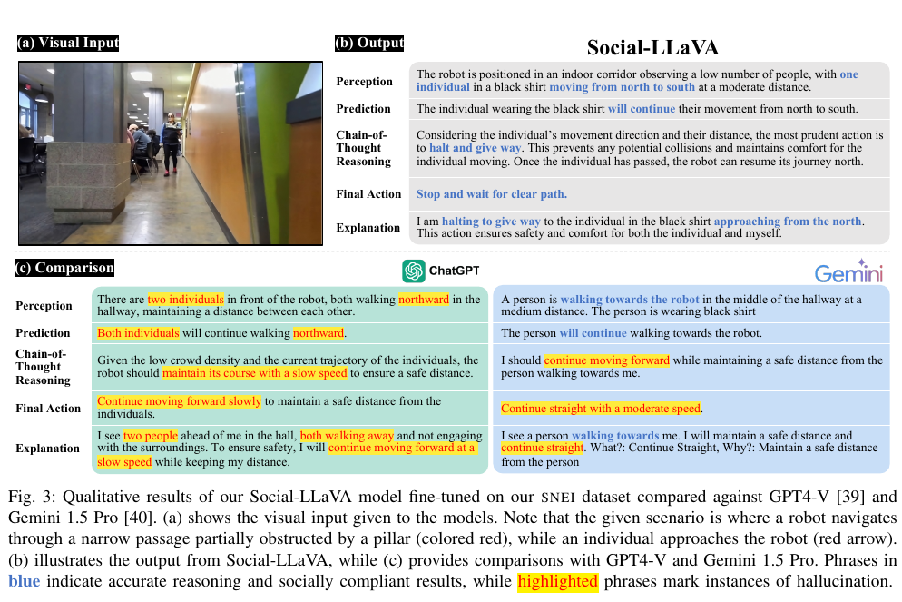
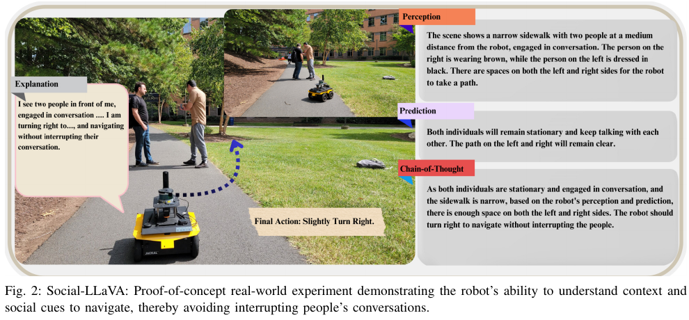

한 장의 로봇 카메라 영상에는 사람이 어디 있는지, 어느 방향으로 걷는지, 로봇이 기다려야 하는지, 왜 그 행동이 예의에 맞는지처럼 서로 다른 질문이 겹쳐 있습니다. 행동 명령 하나만 붙이면 정답은 짧지만, 모델이 사람 수를 잘못 보았는지 미래 움직임을 틀렸는지 이유를 찾기 어렵습니다.

<abbr title="사회적 로봇 주행 장면의 인지·예측·추론·행동·설명을 묻고 답하도록 조정한 시각언어모델">Social-LLaVA</abbr>는 이 과정을 자연어 다섯 단계로 나눕니다. 기반 자료인 <abbr title="설명 가능한 상호작용을 통한 사회적 로봇 주행 시각언어 데이터셋">SNEI</abbr>는 SCAND에서 사람이 로봇과 상호작용하는 2천 장면을 골라 4만 건이 넘는 질의응답을 사람이 작성했어요. 모델은 장면 묘사, 사람의 다음 움직임 예측, 이유 전개, 최종 행동, 설명을 생성합니다.

연구의 중심 증거는 50개 시각 질의응답을 15명이 1–5점으로 채점한 비교입니다. 실물 로봇 그림도 있지만, 대화 중인 두 사람을 방해하지 않도록 세 방향 가운데 하나를 고르는 개념 증명입니다. 저수준 행동은 직진·좌회전·우회전으로 하드코딩됐고, 프레임률·추론 지연·전력·충돌률·성공률은 보고되지 않았어요. 문장을 잘 생성한 모델과 안전한 폐루프 주행 정책은 같은 검증 대상이 아닙니다.

## 한 장면을 다섯 질문으로 풀어 써요

첫 단계는 인지입니다. 사람의 옷, 로봇 기준 위치와 거리, 현재 행동, 주변 혼잡도를 문장으로 씁니다. 둘째는 예측으로 사람이 다음에 어디로 움직일지 추정해요. 셋째는 인지와 예측을 이용해 양보·감속·우회 이유를 전개합니다. 넷째는 “멈추고 길이 빌 때까지 기다린다” 같은 최종 행동이고, 다섯째는 로봇이 무엇을 보았고 왜 그 행동을 골랐는지 설명합니다.

이 분해는 오류 위치를 찾기 좋습니다. 사람이 로봇 쪽으로 오는데 모델이 “같은 방향으로 멀어진다”고 썼다면 최종 행동이 맞아도 예측은 틀렸어요. 반대로 인지와 예측이 맞는데 “계속 직진”을 고르면 사회 규범을 행동으로 연결하는 단계가 실패한 것입니다.

다섯 단계가 독립적인 정답이라고 생각하면 곤란합니다. 인지 문장에서 사람 수를 틀리면 예측과 이유, 최종 행동, 설명이 같은 오류를 되풀이할 수 있어요. 나중 문장이 앞 문장을 논리적으로 따른다고 해서 영상에 근거했다는 뜻은 아닙니다. 단계별 정확도와 단계 사이 일관성을 함께 봐야 합니다.

설명용으로 각 단계가 독립적으로 90% 정확하다고 가정하겠습니다. 다섯 단계가 모두 맞을 확률은 `0.9⁵≈59.0%`입니다. 실제 오류는 독립적이지 않아 한 번의 잘못된 인지가 뒤 단계를 함께 망칠 가능성이 큽니다. 평균 점수가 높아도 완전한 판단 사슬의 성공률은 더 낮을 수 있어요.

## 범주형 주석과 자유문을 함께 둬요

SNEI는 범주형 라벨과 자유문을 함께 제공합니다. 범주형은 환경 종류, 군중 밀도, 실내외, 지형, 로봇 목표·방향·속도·행동 의도, 장애물 종류·거리·위치, 사람·집단·자전거 같은 행위자 종류와 방향을 다룹니다.

범주형 라벨은 집계를 쉽게 합니다. “높은 군중 밀도이면서 사람이 로봇 왼쪽 가까이에 있는 장면”만 골라 모델 오류를 볼 수 있어요. 자유문은 “기둥 때문에 통로가 좁고 맞은편 사람이 다가오므로 멈춰 양보한다”처럼 범주 몇 개로 담기 어려운 관계를 표현합니다.

둘을 같이 쓰면 상호 검사가 가능합니다. 범주형에 사람이 한 명이라고 되어 있는데 자유문이 두 사람을 설명하면 주석 충돌입니다. 최종 행동이 우회인데 로봇 방향 라벨이 직진이면 검수가 필요해요. 공개 데이터의 품질을 평가할 때 이미지-질문-답만 세지 말고 범주와 자유문의 일관성도 검사해야 합니다.

설명용으로 2천 장면에 정확히 4만 질의응답이 있다면 장면당 평균은 `40,000/2,000=20개`입니다. 논문 표현은 4만 건을 넘는다고 했으므로 실제 평균은 20개보다 큽니다. 이 수치는 이미지가 4만 장이라는 뜻이 아니에요. 같은 장면에서 여러 질문과 답이 파생되면 표본 간 상관이 강합니다.

## 원자료의 다양성과 파생 데이터의 다양성은 달라요

SNEI의 2천 장면은 [[2026-10-17_socialnav_scand|실물 원격조종 시연으로 사회적 주행을 배우는 데이터셋]]에서 사람이 수동으로 골랐습니다. SCAND는 캠퍼스 실내외에서 Jackal과 Spot을 조종한 센서·행동 기록입니다. 자연스러운 공공장소를 담는 장점과 특정 지역·플랫폼·시연자에 묶인 한계를 함께 물려받아요.

4만 질의응답은 언어 표본을 늘리지만 물리 장면 수를 늘리지는 않습니다. 같은 영상 프레임에 인지·예측·행동 질문 스무 개를 붙이면 문장 학습은 풍부해져도 새로운 건물, 문화, 센서 높이, 사람 행동이 생기지 않아요. 데이터 규모를 말할 때 장면 수와 질문 수를 나눠야 합니다.

장면 선택도 분포를 바꿉니다. 사람이 로봇과 상호작용하는 장면을 골랐기 때문에 평범한 빈 복도보다 사회 사건의 밀도는 높아집니다. 학습에는 유리하지만 실제 배포에서 사회 사건이 드문 비율을 반영하지 않을 수 있어요. 모델이 모든 프레임에서 사람과 복잡한 상호작용이 있다고 과잉 설명할 가능성도 있습니다.

수동 선택 기준이 엄격할수록 경계 사례가 빠질 수 있습니다. 사람이 멀리 있어 상호작용인지 애매한 장면, 일부만 보이는 사람, 유모차와 자전거, 유리 반사, 카메라 가림은 분류가 어렵습니다. 배포 실패는 이런 애매한 입력에서 생기므로 “명확한 사회 장면”과 “판단하기 어려운 장면”을 별도 층으로 보존하는 편이 좋습니다.

## 분할은 질문이 아니라 원 장면 단위여야 해요

같은 SCAND 장면에서 만든 질문들을 무작위로 훈련과 시험에 나누면 영상이 사실상 양쪽에 나타날 수 있습니다. 훈련에서 옷 색과 사람 위치를 본 뒤 시험에서는 같은 이미지의 행동 질문만 답하는 누출이 생겨요. 질문 문장이 달라도 시각 내용은 같습니다.

설명용으로 한 장면에서 20개 질문을 만들고 각 질문을 80:20으로 무작위 분할한다고 하겠습니다. 정확히 네 개가 시험에 가더라도 나머지 열여섯 개는 같은 이미지를 훈련에서 보여 줍니다. 이 시험은 새로운 장면 일반화보다 같은 장면의 다른 질문 전이를 측정해요.

더 강한 분할은 원 SCAND 궤적 단위입니다. 한 연속 주행의 인접 프레임도 모양이 거의 같으므로 프레임이나 장면 단위만 나누면 누출이 남을 수 있어요. 날짜·장소·궤적·시연자를 묶어 보류하고, 가능하면 로봇 플랫폼까지 분리해야 합니다.

논문 본문의 공개 설명에서는 50개 VQA 비교와 전체 미세조정 데이터 사이의 장면·궤적 분리 절차를 충분히 확인하기 어렵습니다. 따라서 표의 사람 점수를 완전히 보지 못한 새 환경 성능으로 단정하면 안 돼요. 데이터 카드에는 원 이미지 ID, rosbag·궤적 ID, 분할 해시, 중복 검사를 함께 제공하는 것이 좋습니다.

## 문장형 추론은 설명과 증거를 구분해야 해요

모델이 “사람이 북쪽에서 다가오므로 멈춰 양보하겠다”고 쓰면 판단 과정을 읽기 쉽습니다. 하지만 자연스러운 설명이 실제 내부 원인을 충실히 드러낸다는 보장은 없습니다. 최종 행동을 먼저 고른 뒤 그럴듯한 이유를 생성할 수도 있어요.

설명을 검증하려면 문장 일부를 바꾸고 행동이 일관되게 변하는지 봐야 합니다. 사람 이동 방향을 왼쪽에서 오른쪽으로 뒤집거나 기둥 위치를 반대로 바꾼 합성 쌍을 만들 수 있어요. 인지 문장과 최종 행동이 함께 반전되지 않으면 모델이 시각 근거보다 언어 습관을 따를 가능성이 있습니다.

가림 실험도 유용합니다. 사람 영역을 가린 뒤에도 같은 옷과 이동 방향을 설명하면 환각입니다. 배경만 가렸을 때 행동이 크게 바뀌면 장소 단서를 과도하게 쓴 것입니다. 설명 속 명사와 영상 영역을 연결하는 근거 표시가 있으면 검사가 쉬워져요.

또 하나는 자기모순입니다. 예측에서 “사람이 계속 다가온다”고 쓰고 최종 행동에서 “현재 경로를 빠르게 유지한다”고 하면 단계 사이 규칙이 어긋납니다. 자연어 추론을 파싱해 사람 수·방향·거리·행동을 구조화하고 범주형 라벨과 자동 비교할 수 있습니다.

## 50개 VQA와 15명의 사람 채점이 말하는 범위

Social-LLaVA는 LLaVA-v1.5-7B를 SNEI로 미세조정한 개념 증명입니다. LoRA를 사용해 단일 A100 GPU에서 배치 4, 15에포크로 학습했습니다. 저자들은 알고리즘 새로움보다 데이터셋 활용 사례에 초점을 둔다고 밝혔어요.

비교는 Social-LLaVA, GPT-4V, Gemini 1.5 Pro의 자유문 답변을 대상으로 했습니다. GPT-4V와 Gemini에는 과업 설명과 복잡한 예시 세 개를 프롬프트로 제공했습니다. 50개 VQA에 대해 15명의 판정자가 1–5점을 매기고 인지·예측·추론·최종 행동·설명별 평균을 냈어요.

Social-LLaVA 점수는 인지 4.00, 예측 4.06, 추론 4.08, 최종 행동 4.19, 설명 3.95였습니다. GPT-4V는 3.11·3.18·3.41·2.77·3.16, Gemini는 3.45·3.87·3.79·3.46·3.66이었습니다. 이 표는 해당 50개 질의응답에서 사람이 본 문장 품질을 비교합니다.

<figure class="fig"><figcaption>한 질의응답 사례에서 Social-LLaVA는 한 사람이 다가오는 장면과 양보 행동을 연결했고, 비교 모델은 사람 수·방향 또는 직진 행동에서 오류를 냈습니다. 이 사례는 정성 비교이며 50개 전체 분포나 폐루프 주행 성능을 대신하지 않습니다. (출처: Payandeh et al., <a href="https://arxiv.org/pdf/2501.09024">Social-LLaVA: Enhancing Robot Navigation through Human-Language Reasoning in Social Spaces</a>, Fig. 3, <a href="https://creativecommons.org/licenses/by/4.0/">CC BY 4.0</a>, 원문에서 그림 영역 발췌)</figcaption></figure>

표본 50개는 전체 4만 건의 약 `50/40,000=0.125%`입니다. 실제 전체가 4만보다 크므로 비율은 이보다 작아요. 사람이 세밀하게 보는 비용 때문에 작은 표본을 쓸 수 있지만, 장면 종류별 편차와 희귀 오류를 추정하기에는 제한적입니다.

점수 평균만으로 판정자 합의를 알 수도 없습니다. 한 답변에 모두 4점을 준 경우와 절반이 2점, 절반이 5점을 준 경우의 평균은 비슷할 수 있어요. 판정자 간 일치도, 점수 분포, 블라인드 여부, 모델 출력 순서 무작위화를 함께 공개하면 비교가 강해집니다.

## 점수가 높은 문장이 정책 성능은 아니에요

VQA 평가는 정지된 이미지에서 문장을 생성합니다. 주행 정책은 행동 뒤 장면이 바뀌고 새 관측에서 다시 판단해야 합니다. 한 프레임에서 “멈추라”는 답이 맞아도 언제 다시 출발할지, 사람이 방향을 바꾸면 어떻게 갱신할지 정해지지 않아요.

인지 점수 4.00과 최종 행동 4.19는 미터 단위 위치 오차나 충돌 확률이 아닙니다. 사람이 답변을 적절하다고 평가한 척도예요. 언어 평가와 로봇 평가 사이에는 행동 접지, 제어 주기, 동역학, 센서 지연, 안전 감시가 추가됩니다.

설명용으로 모델이 2초마다 고수준 행동을 만들고 로봇이 0.4미터/초로 간다고 하겠습니다. 다음 답변 전에 0.8미터를 이동합니다. 한 프레임의 사람 방향 예측이 틀리면 다음 언어 갱신 전에 통과 간격을 잃을 수 있어요. 논문은 모델의 초당 처리량과 실제 로봇 추론 지연을 보고하지 않았습니다.

정지 이미지에는 속도도 모호합니다. 사람 몸의 자세만 보고 이동 방향을 추정할 수 있지만 방금 멈췄는지 다시 움직일지 알기 어렵습니다. 저자들도 영상 데이터가 필요하다고 보고하며 현재 주석은 이미지로 제한됩니다. 다중 프레임을 쓰면 시간 정보가 생기지만 입력 크기와 지연, 주석 비용이 늘어나요.

## 실물 시연은 행동 접지의 출발점이에요

논문은 야외 통로에서 두 사람이 대화하는 장면을 실물 로봇으로 보였습니다. 모델은 사람들이 정지해 대화하고 양쪽 공간이 비어 있다고 설명한 뒤 약간 오른쪽으로 돌아 대화를 방해하지 않는 행동을 제안했어요. 로봇 사진과 경로, 인지·예측·추론·행동 문장이 함께 제시됩니다.

<figure class="fig"><figcaption>실물 개념 증명은 대화 집단을 방해하지 않는 오른쪽 우회를 보여 줍니다. 저수준 행동은 직진·좌회전·우회전의 하드코딩된 대응이며 반복 수·성공률·충돌률·처리 속도는 보고되지 않았습니다. (출처: Payandeh et al., <a href="https://arxiv.org/pdf/2501.09024">Social-LLaVA: Enhancing Robot Navigation through Human-Language Reasoning in Social Spaces</a>, Fig. 2, <a href="https://creativecommons.org/licenses/by/4.0/">CC BY 4.0</a>, 원문에서 그림 영역 발췌)</figcaption></figure>

저자들은 자연어 고수준 행동을 실제 로봇 행동으로 바꾸는 일이 아직 열린 문제라고 명시합니다. 이 시연에서는 고수준 출력을 직진·좌회전·우회전에 대응시키는 고정 관계를 사용했어요. 연속 선속도·각속도, 장애물 회피, 제동 거리, 재계획을 학습한 정책은 아닙니다.

한 번의 성공 장면은 시스템 연결 가능성을 보여 줍니다. 그러나 같은 장면을 여러 속도·사람 배치·조명·가림에서 반복한 통계는 아닙니다. 사람이 갑자기 대화를 끝내고 걸어 나오거나 반대쪽 통로가 막혔을 때의 행동도 검증되지 않았어요.

설명 문구가 안전 제어를 대체하지도 않습니다. “오른쪽으로 돈다”가 적절해도 오른쪽 잔디 경계나 돌, 다른 보행자를 확인해야 합니다. 고수준 사회 행동과 저수준 기하 충돌 감시를 별도 계층으로 두고, 서로 충돌하면 안전 제약이 우선해야 해요.

## 주석에는 하나의 사회 규범만 있다고 가정하지 않아야 해요

좁은 통로에서 멈춰 양보하는 답과 천천히 뒤로 지나가는 답이 둘 다 적절할 수 있습니다. 사회 주행에는 문화, 역할, 나이, 이동 보조기기, 공간 규칙에 따라 여러 정답이 있어요. 하나의 자유문을 유일한 기준으로 학습하면 합리적인 대안을 오류로 만들 수 있습니다.

복수 주석자가 각 장면에 독립 답을 쓰고 합의와 불일치를 남기면 모호성을 보존할 수 있습니다. 범주형 행동도 단일 라벨 대신 허용 집합이나 선호 분포로 둘 수 있어요. 예를 들어 “정지 0.6, 감속 우회 0.4”처럼 여러 선택이 가능하다는 정보를 모델에 줍니다.

설명용으로 판정자 열 명 가운데 여섯 명이 정지, 네 명이 감속 우회를 골랐다고 하겠습니다. 다수결 정답은 정지지만 우회의 지지가 40%입니다. 우회를 완전 오답으로 처리하면 사회적 다양성을 지웁니다. 모델 평가는 허용 행동 집합과 이유의 타당성을 함께 볼 수 있어요.

문화 분할도 필요합니다. 같은 영상에 오른쪽 통행과 왼쪽 통행 규칙을 조건으로 주고 답변이 바뀌는지 검사할 수 있습니다. 지역 정보 없이 한쪽을 보편 규범으로 설명한다면 학습 자료의 문화 편향을 드러냅니다.

## 설명 가능성은 검증 가능한 연결이어야 해요

좋은 설명은 “안전해서” 같은 일반 문구보다 관측과 행동을 연결합니다. 어느 사람이 어느 방향으로 움직이고, 어떤 통로가 막혔으며, 그래서 어느 쪽으로 얼마 동안 양보하는지 포함해야 해요. 문장 속 객체를 영상 추적 ID와 연결하면 나중에 검증할 수 있습니다.

예측이 바뀌면 행동과 설명도 바뀌어야 합니다. 같은 장면에서 사람이 정지했다고 조건을 바꿨을 때 계속 “다가오므로 정지”라고 쓰면 원인 연결이 약합니다. 반사실 질문을 데이터에 추가하면 설명의 충실도를 검사할 수 있어요.

모델 자신감도 필요합니다. 가림이 심하거나 이동 방향이 모호하면 “판단 불가, 감속 후 재관측” 같은 선택이 있어야 합니다. 모든 장면에 확신하는 긴 설명을 강요하면 환각이 늘어납니다. 안전한 보류는 하나의 유효 행동입니다.

자연어 로그는 사고 분석에 도움이 되지만 개인정보와 보존 정책도 필요합니다. 옷 색과 외모, 위치를 상세히 묘사하는 문장은 원 영상보다 검색하기 쉬운 개인정보가 될 수 있어요. 공개 데이터에서는 식별 불필요한 속성을 줄이고 장면 ID와 원본 접근 권한을 관리해야 합니다.

## 정책으로 발전시키려면 평가 단계를 늘려야 해요

첫 단계는 데이터 감사입니다. 원 SCAND 궤적 기준 중복, 훈련·시험 누출, 범주형-자유문 충돌, 사람 수·방향 오류, 문화적 모호성을 표본 검사합니다. 장면 선택 기준과 주석자 합의 절차도 확인해요.

둘째는 VQA 평가를 넓힙니다. 장소·날짜·궤적을 보류한 시험에서 인지·예측·행동 점수와 판정자 일치도를 계산합니다. 드문 가림, 집단, 자전거, 문, 대기열을 별도 층으로 보고 환각률과 보류 정확도를 측정해요.

셋째는 기록 재생 평가입니다. 연속 영상에서 모델 출력 시점과 다음 프레임의 실제 사람 움직임을 비교하고, 언어 행동을 저수준 계획기에 넣지 않은 채 지연과 형식 실패를 측정합니다. 정지 이미지 점수와 시간 예측 성능을 분리할 수 있어요.

넷째는 시뮬레이션 폐루프입니다. 언어 행동을 안전한 연속 제어기로 접지하고 목표 성공, 사람 충돌, 최소 표면 거리, 멈춤 시간, 교착, 설명-행동 불일치를 봅니다. 텍스트 평가가 높은 체크포인트가 실제 궤적도 좋은지 확인합니다.

다섯째는 독립 충돌 감시 아래 저속 실물 시험입니다. 대화 집단 한 장면에서 시작해 사람 이동·가림·반대편 장애물·여러 집단을 추가합니다. 각 조건을 반복하고 안전 개입 없는 성공률, 최악 지연, 온도와 전력을 기록해야 해요.

Social-LLaVA와 SNEI의 강점은 행동 명령 하나를 인지·예측·이유·행동·설명으로 펼친 데 있습니다. SCAND의 실제 공공장소 장면에 사람이 쓴 언어를 붙여, 일반 시각언어모델이 놓치던 사람 수와 방향, 양보 이유를 학습할 자료를 만들었어요.

그 성과를 자율 정책 검증으로 바꾸어 읽으면 안 됩니다. 15명 판정자의 50개 VQA 점수는 문장 품질 증거이고, 실물 그림은 세 방향을 고정 대응한 한 가지 개념 증명입니다. 분할 누출, 복수 규범, 시간 정보, 행동 접지, 추론 속도, 폐루프 안전을 따로 검증할 때 이 언어 자료가 실제 사회 주행 정책의 근거로 이어질 수 있습니다.

---

<!-- src-block -->
출처 — https://arxiv.org/abs/2501.09024
