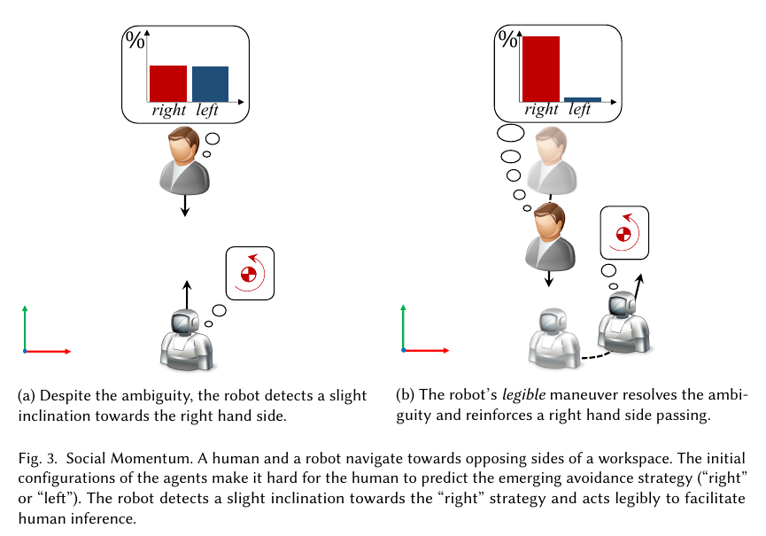
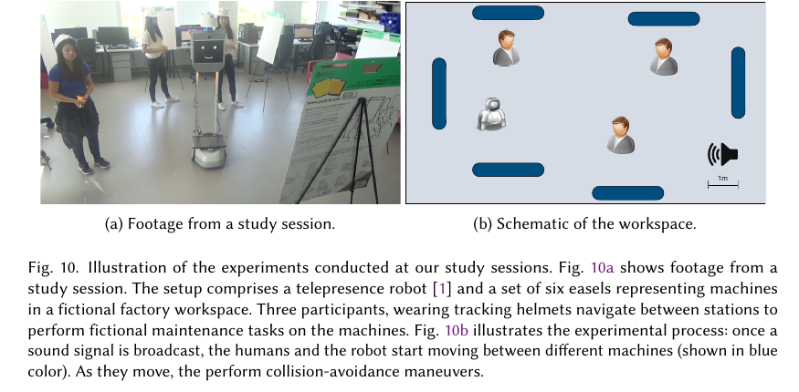

마주 오는 사람과 로봇이 둘 다 같은 쪽으로 피하면 다시 반대쪽으로 움직이는 ‘회피 춤’이 생깁니다. 충돌 직전의 속도만 안전하게 고르는 계획기는 매 순간 옳은 계산을 해도 통과 의도를 일관되게 보여 주지 못할 수 있어요. 사람은 로봇의 현재 위치뿐 아니라 앞으로 어느 쪽으로 지나갈지 읽고 자신의 행동을 조정합니다.

Christoforos Mavrogiannis와 동료들의 <abbr title="사람과 로봇의 좌우 통과 의도를 쌍별 각운동량으로 표현해 일관된 회피를 고르는 계획기">Social Momentum</abbr>은 이 추론을 계획 목적에 넣습니다. 사람과 로봇이 서로를 기준으로 시계 방향으로 회전하는지 반시계 방향으로 회전하는지를 각운동량의 부호로 나타내고, 이미 드러난 통과 쪽을 강화하는 속도 행동을 고릅니다. 목적지 진행과 의도 표현을 가중합해 매 주기 다시 계산해요.

논문은 알고리즘 하나의 성공 사례만 제시하지 않습니다. 시뮬레이션에서 경로 얽힘을 비교하고, 180명 온라인 참가자에게 영상 속 좌우 통과를 예측하게 하며, 105명이 실제 텔레프레즌스 로봇과 함께 걷는 실험을 수행합니다. 세 단계는 서로 다른 질문에 답합니다. 시뮬레이션의 낮은 얽힘, 영상에서 빠른 예측, 실물에서 사람의 부드러운 움직임을 같은 증거로 섞지 않아야 합니다.

## 좌우 통과 의도를 각운동량 부호로 바꿔요

평면에서 사람과 로봇의 위치 중점을 잡고 각 행위자의 상대 위치와 속도를 외적하면 두 행위자 계의 각운동량을 구할 수 있습니다. 평면에 수직인 성분의 부호는 두 행위자가 서로 어느 쪽으로 회전하며 지나가려는지를 나타냅니다. 크기는 상대 거리와 속도 방향에 따라 달라져 통과 쪽이 얼마나 뚜렷한지에 대한 신호가 됩니다.

<figure class="fig"><figcaption>초기 장면에서는 좌우 통과가 모호하지만 로봇이 한쪽 회전 경향을 키우는 행동을 선택하면 사람의 통과 예측이 한쪽으로 모입니다. 경로 모양 자체를 의사소통 수단으로 쓴다는 핵심 도식입니다. (출처: Mavrogiannis et al., Social Momentum: Design and Evaluation of a Framework for Socially Competent Robot Navigation, Fig. 3, <a href="https://chrismavrogiannis.com/pdfs/mavrogiannis2022socialmomentum.pdf">원문 PDF</a>)</figcaption></figure>

두 행위자가 거의 정면으로 같은 선을 따라오면 부호와 크기가 작아 어느 쪽 통과인지 모호합니다. 로봇이 약간 옆으로 회전하면 한 부호의 크기가 커지고, 사람은 그 움직임을 보고 반대 공간을 선택할 수 있어요. 계획기는 이미 생긴 작은 경향을 뒤집기보다 강화하려 합니다.

여러 사람이 있으면 로봇과 각 사람의 쌍별 모멘텀을 계산합니다. 후보 로봇 속도가 모든 반응 대상과 현재 부호를 보존하면 거리 가중 모멘텀 크기를 합산해 점수를 얻어요. 한 사람과라도 부호를 뒤집는 후보는 모멘텀 점수 0을 받습니다. 가까운 사람은 역거리 가중치로 더 크게 반영됩니다.

이 점수만 최대화하면 목적지에서 멀어질 수 있어요. 그래서 계획기는 목적지 진행 점수와 모멘텀 점수를 가중합합니다. 주변 반응 대상이 없으면 진행만 최대화하고, 사람이 앞쪽 반원에 들어오면 두 목표를 절충합니다. 충돌 검사를 통과한 유한한 속도 후보에서 매 주기 하나를 고릅니다.

[[2026-10-17_socialnav_orca|여러 이동체의 상호 충돌 회피를 선형계획으로 푸는 법]]가 충돌 없는 속도 반평면의 교집합에서 선호 속도에 가까운 해를 고른다면, Social Momentum은 통과 쪽의 부호를 유지하며 그 의도를 더 크게 드러내는 후보에 보상을 줍니다. 하나는 순간 속도 기하의 효율, 다른 하나는 관찰자가 읽을 통과 일관성에 더 무게를 둡니다.

## 부호를 유지하는 것이 곧 안전 보장은 아니에요

통과 쪽이 일관되면 사람이 행동을 예상하기 쉬워질 수 있지만, 같은 쪽을 고집하는 것과 충돌하지 않는 것은 다릅니다. 속도 후보는 별도 충돌 검사로 거른 뒤 모멘텀을 평가합니다. 센서가 사람을 놓치거나 충돌 지평이 너무 짧으면 높은 모멘텀 점수의 행동도 위험할 수 있어요.

모든 후보가 적어도 한 사람과 모멘텀 부호를 뒤집는다면 모멘텀 점수는 모두 0이 되고 진행 목적이 선택을 좌우합니다. 군중에서 상충하는 통과 약속이 생길수록 이 경우가 늘 수 있어요. “부호를 절대 뒤집지 않는다”가 아니라 유지 가능한 후보를 우선하고, 불가능하면 효율 목표로 돌아가는 구조입니다.

설명용 가정으로 후보 A의 진행 점수가 0.8, 모멘텀 점수가 0.3이고 후보 B는 0.5와 0.9라고 하겠습니다. 모멘텀 가중치가 0.5면 A는 `0.8+0.5×0.3=0.95`, B는 `0.5+0.5×0.9=0.95`로 같습니다. 가중치를 1로 높이면 A 1.1, B 1.4로 B가 선택돼요. 이 수치는 논문 결과가 아니라 두 목적의 절충을 설명하는 자체 계산입니다.

가중치는 단위 정규화와 함께 읽어야 합니다. 진행 점수가 0에서 1이고 모멘텀 점수가 0에서 100이라면 같은 가중치 1이 전혀 같은 중요도를 뜻하지 않아요. 사람 수가 늘면 쌍별 합이 커질 수도 있습니다. 후보 점수 범위, 사람 수에 따른 정규화, 거리 가중치의 최솟값을 기록해야 재현할 수 있습니다.

가까운 사람의 역거리 가중치는 긴급한 상호작용에 집중하게 하지만 거리 0 근처에서 폭증할 수 있습니다. 구현에는 최소 거리 절단이 필요해요. 멀리 있지만 빠르게 접근하는 사람보다 가까이 정지한 사람이 더 큰 가중치를 받을 수도 있어 상대 도달 시간과 함께 비교할 필요가 있습니다.

## 각운동량은 의도의 원인보다 관찰 가능한 흔적이에요

사람이 오른쪽으로 비키는 이유는 문화 규칙, 장애물, 목표, 옆 사람, 우연한 발걸음일 수 있습니다. Social Momentum은 그 원인을 맞히지 않고 현재 위치와 속도에서 어느 통과 부호가 형성되는지 봅니다. 적은 입력으로 빠르게 계산할 수 있지만 원래 의도와 순간 흔적을 혼동할 수 있어요.

사람이 장애물을 피하려고 잠깐 옆으로 움직인 것을 로봇과의 통과 선호로 해석하면 잘못된 부호를 강화합니다. 사람이 다시 목표 방향으로 돌아올 때 로봇과 통과 약속이 충돌할 수 있어요. 짧은 속도 관측만 쓰는 대신 부호의 지속시간과 신뢰도를 추적할 필요가 있습니다.

정지한 사람의 속도는 잡음에 민감합니다. 설명용으로 10헤르츠 위치 추적에서 좌우 오차가 두 프레임 사이 4센티미터 바뀌면 `0.04/0.1=0.4미터/초`의 가짜 횡속도가 생깁니다. 작은 모멘텀 부호가 프레임마다 뒤집힐 수 있어요. 저속 구간에서 부호를 미정 상태로 두거나 히스테리시스를 적용해야 합니다.

통과 쪽을 좌우로 부르는 기준도 명확해야 합니다. 사람 기준 오른쪽과 로봇 기준 오른쪽은 서로 반대 표현이 될 수 있어요. 논문은 회전 부호를 공통 좌표계의 수직축으로 정의합니다. 지도 좌표의 축 방향, 오른손 규칙, 센서 좌표 변환이 바뀌면 부호가 뒤집힐 수 있으므로 테스트가 필요합니다.

로봇 목표와 사람 목표도 구분해야 합니다. 계획기는 자신의 목표를 알고 진행 점수를 계산하지만 사람 목표는 사용하지 않고 현재 속도를 유지한다고 가정해 짧은 충돌을 검사합니다. 이 단순함은 목표 오라클을 피하지만 코너 회전과 갑작스러운 정지를 예측하지 못합니다.

## 온라인 연구는 영상 속 통과 예측을 측정했어요

시뮬레이션에서 Social Momentum은 사회력과 ORCA 기준보다 낮은 위상 복잡도를 보였습니다. 저자들은 경로가 덜 얽히면 관찰자가 통과 쪽을 더 빨리 읽을 것이라는 가설을 세웠습니다. 이를 확인하려고 온라인 참가자에게 여러 행위자가 움직이는 영상 15개를 무작위 순서로 보여 주고 특정 두 행위자가 좌우 어느 쪽으로 지날지 선택하게 했어요.

참가자는 Reddit과 Facebook 공개 모집으로 모은 180명이었습니다. 총 2,704회 영상 보기 가운데 시작 전이나 종료 후 응답을 제거해 2,647개 응답을 분석했고, 이 중 300개가 오답이었습니다. 영상 길이가 달라 응답 시간을 전체 길이에 대한 비율로 정규화했습니다.

분석에서는 위상 복잡도가 높을수록 올바른 통과 쪽을 답하는 데 걸린 시간이 늘었습니다. 이는 “의도를 빠르고 정확하게 추론할 수 있는가”라는 연구의 가독성 정의를 지지합니다. Social Momentum이 비교 기준보다 낮은 복잡도의 시뮬레이션 경로를 만들었다는 결과와 연결해, 해당 설정에서 더 읽기 쉬운 움직임을 만든다고 해석합니다.

이 연구에서 사람은 로봇 옆을 걷지 않았습니다. 화면 속 원형 행위자의 시뮬레이션을 보고 버튼을 눌렀어요. 빠른 좌우 분류가 실물 로봇의 편안함이나 안전 신뢰를 뜻하지 않습니다. 영상은 충돌 위험과 몸 크기, 소리, 시야 가림을 전달하지 못합니다.

정답이 있는 좌우 문제로 가독성을 좁힌 점도 기억해야 합니다. 사람이 “로봇이 멈출 것”이나 “목표를 바꿀 것”이라고 예상하는 장면은 선택지에 없습니다. 통과 쪽 예측은 사회적 의도의 한 요소이지 전체 행동 이해가 아니에요.

## 실물 연구는 세 명과 로봇이 작업장을 오갔어요

실험실 연구는 16제곱미터 공간에 기계 역할의 이젤 여섯 개를 배치했습니다. 매 세션에서 참가자 세 명이 표식 헬멧을 쓰고 가상의 정비 작업을 수행했으며, Beam Pro 텔레프레즌스 로봇도 신호에 맞춰 비어 있지 않은 다른 작업대로 이동했습니다. 사람과 로봇은 반복해서 가까이 교차했습니다.

<figure class="fig"><figcaption>세 참가자와 실물 텔레프레즌스 로봇이 가상의 정비 작업을 하며 동시에 작업대 사이를 이동했습니다. 오른쪽 배치도는 반복 교차를 유도한 여섯 작업대와 시작 구성을 보여 줍니다. (출처: Mavrogiannis et al., Social Momentum: Design and Evaluation of a Framework for Socially Competent Robot Navigation, Fig. 10, <a href="https://chrismavrogiannis.com/pdfs/mavrogiannis2022socialmomentum.pdf">원문 PDF</a>)</figcaption></figure>

모든 참가자는 Social Momentum, ORCA, 원격 조종 세 조건을 경험했습니다. 조건 순서는 학습과 피로 영향을 줄이도록 바꿨습니다. 원격 조종은 제조사 화면과 키보드를 사용한 같은 연구팀 조작자가 모든 세션을 맡았고, 본 실험 전 여러 예비 세션을 거쳤어요.

35개 세션에 105명이 참여했습니다. 실제 궤적은 천장 모션 캡처 여섯 대가 180헤르츠로 기록했습니다. 로봇과 사람의 최소거리가 1미터보다 작은 구간을 잘라 로봇 궤적 1,033개와 사람 궤적 1,566개를 분석하고, 각 조건 뒤 설문을 받았습니다.

로봇 자체는 ORCA에서 가속과 불필요한 회전, 이동 시간이 가장 낮아 기하적으로 매끈했습니다. Social Momentum은 통과 의도를 과장하는 회전 때문에 로봇 가속과 경로 불규칙성이 더 컸어요. 원격 조종은 에너지 사용이 가장 낮았지만 시간은 가장 오래 걸렸습니다.

사람 궤적에서는 Social Momentum 조건에서 가속과 경로 불규칙성이 낮았습니다. 로봇이 더 크게 의도를 표현한 대가로 사람이 속도를 덜 자주 바꿨다는 해석이 가능합니다. ORCA 주변 사람은 에너지 측정값이 가장 높았고, 원격 조종 주변에서는 가장 낮았습니다.

## 좋은 결과와 기각된 가설을 함께 읽어야 해요

온라인 연구에서는 낮은 위상 복잡도와 빠른 좌우 예측의 관계가 나타났습니다. 그러나 실물 연구에서 Social Momentum의 전체 집단 위상 복잡도는 ORCA보다 평균적으로 낮았어도 차이가 통계적으로 유의하지 않았습니다. 원격 조종 조건은 두 자율 방식보다 유의하게 낮았어요. 실물 집단 복잡도 가설은 기각됐습니다.

이 차이는 실패가 아니라 평가 단계가 무엇을 바꾸는지 보여 줍니다. 시뮬레이션 행위자는 같은 운동 모델과 규칙을 따르지만 실물 로봇은 차동구동 제약이 있고 사람은 정책에 반응합니다. 원격 조종자는 먼 충돌까지 보고 큰 우회를 선택할 수 있지만 자율 계획기는 가까운 상호작용을 순차적으로 처리해요.

설문 요인은 사회적 역량, 지능, 편안함, 예측 가능성, 존재감 절제로 묶였지만 세 조건 사이에 유의한 차이가 없었습니다. 저자들의 표현대로 Social Momentum은 사람 인식에서 원격 조종 기준과 구분되지 않았지만, 이것이 모든 항목에서 가장 좋았다는 뜻은 아닙니다. 차이를 검출하지 못한 결과와 동등성 증명도 같지 않아요.

세 조건 모두 같은 물리 로봇을 썼지만 행동 생성 방식은 달랐습니다. 원격 조종에는 숙련된 한 사람의 장기 시야와 판단이 들어가고, 자율 방식은 지역 센서·계획 규칙에 묶입니다. 원격 조종을 인간 수준의 최대 성능으로 부르기보다 특정 조작자와 인터페이스의 비교 조건으로 보는 편이 정확합니다.

실험 참가자는 대학 모집군이고 평균 나이가 20대 초반이었습니다. 작업은 공장이라는 이야기 아래 3분 동안 이젤 사이를 오가는 과제였어요. 실제 병원, 공항, 공장 근로자의 장기 경험이나 이동 보조기 사용자를 대표하지 않습니다.

## 로봇의 큰 몸짓이 사람 부담을 줄일 수 있어요

Social Momentum에서 로봇 궤적의 가속이 더 높고 사람 궤적의 가속이 더 낮았다는 조합은 중요한 교환을 보여 줍니다. 로봇이 일찍 옆으로 움직여 통과 의도를 크게 나타내면 사람은 작은 조정만으로 대응할 수 있어요. 전체 부담이 줄었는지 보려면 사람과 로봇을 함께 봐야 합니다.

설명용으로 ORCA 조건에서 로봇 가속 비용이 2, 사람 세 명의 비용이 각각 3이라고 하고, Social Momentum에서 로봇 5, 사람 각 1.5라고 하겠습니다. 합은 ORCA가 `2+3×3=11`, Social Momentum이 `5+3×1.5=9.5`입니다. 로봇만 보면 전자가 낫지만 집단 합은 후자가 낮아요. 이는 논문 수치를 재구성한 것이 아니라 부담 분배를 설명하는 자체 가정입니다.

합이 낮아도 공정성이 보장되지는 않습니다. 한 사람에게만 큰 회피를 요구하고 나머지가 편하면 평균은 좋아질 수 있어요. 개인별 최대 추가 이동, 가장 큰 감속, 집단별 분산을 함께 기록해야 합니다. 어린이와 이동 약자에게 부담이 몰리지 않는지도 별도 확인이 필요합니다.

의도 표현을 위한 큰 회전은 사람에게 신호가 되지만 좁은 공간에서는 로봇 몸체의 휩쓸림을 키울 수 있습니다. 중심점 궤적만 안전해도 모서리와 바퀴가 가까워질 수 있어요. 후보 행동의 전체 발자국과 제동 동역학을 충돌 검사에 넣어야 합니다.

또한 속도와 경로 외의 신호가 있으면 필요한 과장 정도가 달라집니다. 방향등, 화면 화살표, 투사 조명, 소리로 통과 쪽을 알릴 수 있다면 로봇의 급한 회전을 줄일 수 있어요. 다만 신호가 보이지 않거나 의미를 모르는 사람을 위해 움직임 자체의 일관성은 남겨야 합니다.

## 여러 사람의 통과 약속은 서로 충돌할 수 있어요

로봇 왼쪽 사람과는 오른쪽 통과를 유지하고, 오른쪽 사람과는 왼쪽 통과를 유지하려 할 때 가능한 속도 후보가 없을 수 있습니다. Social Momentum은 한 쌍이라도 부호가 뒤집히는 후보의 점수를 0으로 만들기 때문에 사람이 늘수록 0점 후보가 많아질 수 있어요.

설명용으로 각 사람과 부호를 유지할 확률이 독립적으로 0.9라고 단순 가정하면 다섯 사람 모두와 유지할 확률은 `0.9^5≈0.59`, 열 사람은 `0.9^10≈0.35`입니다. 실제 관계는 독립이 아니지만 전원 제약이 사람 수에 따라 빠르게 엄격해지는 모습을 보여 줍니다.

모두 0점일 때 진행만 고르면 앞서 표현한 약속을 갑자기 깨뜨릴 수 있습니다. 안전을 우선한 완화 순서가 필요해요. 충돌 시간이 짧은 사람, 움직일 여유가 적은 사람, 부호 신뢰도가 높은 사람부터 제약을 보존하고 나머지는 낮은 벌점으로 바꾸는 방법을 검토할 수 있습니다.

반응 대상이 로봇 앞쪽 ±90도에만 있는 조건도 확인해야 합니다. 옆이나 뒤에서 빠르게 추월하는 사람은 현재 집합에서 빠질 수 있어요. 플랫폼의 회전 방향과 센서 시야, 후진 가능성에 따라 반응 영역을 바꿔야 합니다.

정적인 장애물과 집단 공간도 각운동량 쌍으로 표현되지 않습니다. 벽 때문에 한쪽 통과가 불가능하거나 대화 그룹의 중심을 피해 가야 할 때는 지도 비용과 상위 경로가 별도로 필요해요. Social Momentum은 전체 내비게이션 체계가 아니라 동적 행위자 사이의 지역 행동 선택기입니다.

## 재현은 세 평가 층을 다시 분리해야 해요

첫째는 알고리즘 층입니다. 대칭 정면 교차, 약한 좌우 편향, 세 사람의 상충 제약, 정지 사람, 빠른 측면 접근을 만듭니다. 좌표계를 반사했을 때 선택도 반대로 바뀌는지, 저속 잡음에서 부호가 흔들리지 않는지 검사해요. 가중치 변화에 따른 진행 시간과 부호 전환 횟수를 기록합니다.

둘째는 관찰자 층입니다. 전체 영상뿐 아니라 20%, 40%, 60% 지점에서 끊은 영상을 보여 주고 통과 쪽과 로봇 목표, 정지 여부를 따로 묻습니다. 정확도와 응답 시간, 확신도를 함께 기록해요. 화면 원형 행위자와 실제 로봇 영상 조건을 나누면 몸체와 소리의 영향을 볼 수 있습니다.

셋째는 실물 상호작용 층입니다. 사람의 최소거리, 가속, 추가 경로, 멈춤 횟수와 로봇의 같은 값을 함께 측정합니다. 설문은 예측 가능성, 편안함, 사회적 역량을 분리하고, “차이 없음”을 주장하려면 사전에 정한 동등성 범위와 검정력을 사용해야 해요.

배포 장치에서는 온보드 센서만 사용한 결과를 따로 내야 합니다. 논문 실험의 천장 모션 캡처는 180헤르츠 고정밀 기록에 유리하지만 이동 로봇 카메라와 LiDAR는 가림과 ID 전환을 겪습니다. 위치·속도 오차를 넣은 재생 시험으로 모멘텀 부호의 안정성을 먼저 확인할 수 있습니다.

이 논문의 강점은 통과 의도를 수학적 부호로 단순화한 뒤 시뮬레이션, 영상 관찰, 실물 사람-로봇 상호작용으로 이어지는 검증 사슬을 만든 점입니다. 180명은 화면 속 통과 예측을, 105명은 실제 로봇 옆에서의 사람 궤적과 인식을 평가했습니다. Social Momentum 주변에서 사람 움직임이 더 부드러웠다는 결과는 로봇의 표현적 움직임이 사람 부담을 줄일 수 있다는 근거입니다.

동시에 실물 집단 복잡도 가설은 기각됐고, 설문 요인에는 조건 간 유의한 차이가 없었습니다. 간단한 쌍별 모멘텀은 목표 의미, 정적 장애물, 집단 공간, 모델 밖 사람 행동을 다루지 않습니다. 충돌 감시와 상위 경로, 센서 신뢰도, 부담 공정성을 더하고 세 평가 층을 유지해야 사회적 모멘텀이 읽기 쉬운 시연을 넘어 현장 주행의 기준이 됩니다.

---

<!-- src-block -->
출처 — https://doi.org/10.1145/3495244
