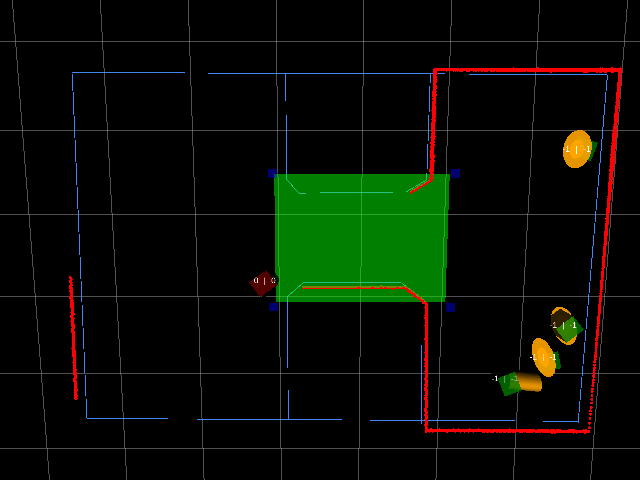
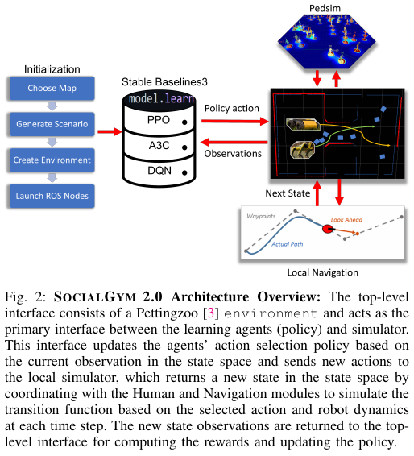
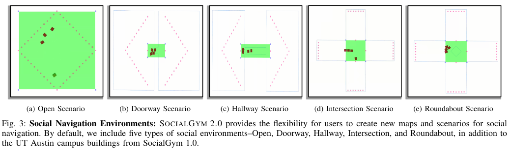

한 대의 로봇이 사람을 피하는 문제와 여러 로봇이 같은 좁은 문을 통과하는 문제는 달라요. 후자에서는 각 로봇이 충돌만 피하면 서로 멈춘 채 양보하는 교착이 생길 수 있어요. SocialGym 2.0은 여러 자율 이동체가 각자 목표를 가지면서 문·복도·교차로·회전교차로의 공통 충돌 구역을 통과하도록 만들어요. 강화학습 정책은 “가라” 또는 “멈춰라” 같은 상위 결정을 내리고, 지역 경로 계획기가 실제 속도와 조향 제약을 처리해요.

이 연구는 사람 반응을 사실적으로 예측하는 모형보다 여러 로봇의 협력과 사회적 순서를 시험하는 기반에 가까워요. 논문 그림의 행위자는 로봇 또는 사람으로 구성할 수 있지만, 주요 정량 평가는 여러 학습 행위자의 미니게임이에요. 이를 실제 사람 참가자 평가나 사람 편안함 검증으로 넓혀 쓰면 안 돼요.

<figure class="fig"><figcaption>공식 데모는 지도, 로봇·사람 행위자, 지역 경로와 충돌 회피가 함께 움직이는 실행 장면을 보여줘요. (출처: ut-amrl/SocialGym2 README 공식 데모 · MIT License)</figcaption></figure>

## 상위 정책과 지역 경로 계획기를 분리해요

맨 위에는 여러 행위자 환경 규격인 <abbr title="여러 학습 행위자가 동시에 관측하고 행동하는 환경을 만드는 파이썬 규격">PettingZoo</abbr>와 Stable Baselines3 연결부가 있어요. 학습 정책은 각 행위자의 관측을 받아 상위 행동을 고르고, ROS 메시지로 지역 시뮬레이션에 전달해요. 사람 이동 모형과 경로 계획기가 다음 상태를 계산해 다시 학습 환경에 돌려줘요.

<figure class="fig"><figcaption>학습 정책은 상위 행동을 정하고, ROS로 연결된 보행 시뮬레이터와 지역 경로 계획기가 각 로봇 동역학에 맞는 다음 상태를 계산해요. (출처: Sprague et al., SocialGym 2.0, Fig. 2 · <a href="https://creativecommons.org/licenses/by/4.0/">CC BY 4.0</a>, 원문에서 그림 영역 발췌)</figcaption></figure>

이 분리는 정책이 바퀴 조향을 매 순간 만들지 않아도 되게 해요. 차동구동, 전방향, 자동차형 로봇처럼 속도·가속도·조향각 제한이 다른 몸체를 지역 경로 계획기가 처리해요. 정책은 협상과 순서에 집중하고, 궤적 최적화는 하위 계층이 맡아요.

그러나 하위 계획기가 강하면 상위 정책이 좋아 보일 수 있어요. 충돌 직전 회피를 모두 지역 계획기가 해결하면 학습 정책은 계속 “가라”만 내도 열린 공간에서는 성공할 수 있어요. 논문은 이를 확인하려고 상위 정책 없이 늘 “GO”를 보내는 Only Local 기준선을 둬요.

설명용으로 상위 정책이 0.5초마다 결정을 내리고 지역 계획기가 20Hz로 제어한다고 가정하면 상위 한 행동 사이에 하위 제어가 10번 실행돼요. 같은 상위 정책도 하위 계획기의 주기와 예측 범위가 다르면 충돌률이 달라져요. 이 수치는 구조를 설명하는 가정이며 논문 측정값이 아니에요.

## 다섯 미니게임은 기하 충돌 지점을 바꿔요

기본 장면은 Open, Hallway, Doorway, Intersection, Roundabout 다섯 가지예요. Open은 벽 제약이 적어 서로 비켜 가기 쉽고, Doorway는 모두가 좁은 한 구간을 공유해 순서가 중요해요. Hallway는 마주 오는 흐름을 만들고, Intersection은 여러 방향의 경로가 한가운데서 교차해요. Roundabout은 순환 방향과 진입 시점을 함께 조정해야 해요.

<figure class="fig"><figcaption>같은 행위자 수라도 공통 충돌 구역의 폭과 연결 구조가 달라지면 필요한 협력 행동이 바뀌어요. (출처: Sprague et al., SocialGym 2.0, Fig. 3 · <a href="https://creativecommons.org/licenses/by/4.0/">CC BY 4.0</a>, 원문에서 그림 영역 발췌)</figcaption></figure>

사용자는 점을 고르고 끌어 벡터 지도와 이동 그래프를 만들 수 있어요. 각 행위자는 그래프의 시작점과 이어진 목표 노드를 따라가요. 장면 이름만 같아도 문 폭, 목표 순서, 몸체 크기, 행위자 수가 다르면 난도가 바뀌므로 설정 파일을 결과와 함께 보존해야 해요.

설명용으로 폭 1.2m 문에 지름 0.5m 로봇 두 대가 나란히 들어가려면 남는 폭은 0.2m예요. 좌우 여유가 각각 0.1m뿐이라 작은 추종 오차에도 막힐 수 있어요. 한 대씩 순서대로 통과하는 정책이 길이는 늘어도 충돌과 교착을 줄일 수 있어요. 문 폭과 몸체는 설명용 가정이에요.

Open에서 좋은 정책이 Doorway에서도 좋은지 보는 것은 기하 일반화 시험이에요. 다만 장면을 훈련 때 이미 봤는지, 행위자 수만 늘렸는지, 지도 자체를 바꿨는지 분리해야 해요. 훈련과 같은 그래프에서 시작 위치만 바꾼 결과를 새 건물 일반화로 부르면 범위가 커져요.

## 관측의 숨은 정보가 부분 관측을 만들어요

논문 구성에서 각 행위자는 자기 상태와 다른 행위자에 대한 지역 관측을 받아요. 각자의 목표는 그 행위자에게만 알려진 설정을 사용할 수 있어요. 다른 로봇 목표 거리 항목을 관측에 넣거나 빼는 구성도 한 줄로 바꿀 수 있다고 설명해요.

상대 목표를 모르면 같은 위치와 속도라도 상대가 어디로 갈지 완전히 알 수 없어요. 과거 관측을 모으는 LSTM 정책이 이 불확실성을 줄일 수 있지만 검출 실패나 센서 가림을 자동 해결하지는 않아요. 입력은 시뮬레이터 상태에서 구성되고, 실제 추적기가 만든 관측이라는 증거는 아니에요.

관측 크기는 행위자 수에 따라 커질 수 있어요. 논문은 PPO와 LSTM-PPO를 비교하며 시간 정보를 담는 복잡한 표현이 많은 행위자에서 도움이 될 수 있다고 분석해요. 그러나 LSTM이 항상 PPO보다 좋았던 것은 아니며, 일부 설정에서 최대 10개 행위자까지 성공하는 일반화를 보여준 정도로 읽어야 해요.

설명용으로 다른 행위자 하나당 7개 값을 쓰고 자신을 제외한 9명을 보면 63개 값이 추가돼요. 훈련이 4명까지였다면 10명 관측은 길이와 상호작용 조합이 크게 달라져요. 채우기·정렬 방식과 기억 상태 초기화를 기록하지 않으면 재현하기 어려워요.

## GO·STOP이 단순해도 협력은 단순하지 않아요

주요 정식화에서 각 행위자의 상위 행동은 이산적이에요. “GO”는 지역 경로 계획기에 진행을 맡기고 “STOP”은 양보를 만들어요. 행동이 두 개라 해도 여러 행위자가 동시에 선택하므로 공동 상태 수는 빠르게 늘어요.

네 행위자가 각각 두 행동을 고르면 한 시점의 공동 조합은 2⁴=16개예요. 열 행위자면 2¹⁰=1024개예요. 설명용 조합 계산이며 모든 조합이 실제로 다른 상태 전이를 만든다는 뜻은 아니에요. 행위자 수 일반화가 어려운 이유를 보여줘요.

Only Local은 모든 단계에서 GO를 보내 하위 충돌 회피만 사용해요. 논문 결과에서는 열린 공간의 적은 행위자에서는 작동할 수 있지만, 다섯 명 이상이거나 기하가 복잡해지면 성공이 크게 떨어져요. 특히 모든 환경에서 평균 충돌률이 높은 기준선으로 보고돼 상위 협상의 필요성을 보여줘요.

STOP을 많이 고르면 충돌은 줄어도 시간 초과와 정체가 늘 수 있어요. 성공률 하나만 보면 오래 기다린 정책이 유리하거나 불리할 수 있으므로 평균 정지 시간, 속도 변화, 충돌, 부분 성공과 전체 성공을 함께 봐야 해요.

## 순서 보상은 지표가 놓치는 행동을 드러내요

SocialGym 2.0은 Any Order와 Enforced Order라는 하위 목표 보상을 둬요. Any Order는 순서와 관계없이 충돌 구역을 통과하면 보상해요. Enforced Order는 무작위로 정한 특정 순서대로 들어가고 나갈 때 보상해 줄 서기 행동을 유도해요.

이 보상은 충돌 없는 최단 경로와 다른 사회적 규칙을 표현해요. 논문은 Intersection, Doorway, Hallway에서 순서 보상의 성공률이 높아도 표준 내비게이션 지표는 나쁠 수 있다고 지적해요. 줄을 지키느라 멈추고 우회한 행동은 이동 시간과 경로 길이만 보면 손해예요.

Enforced Order의 순서는 환경이 정한 규칙이지 실제 사람이 합의한 순서가 아니에요. 임의 순서 학습을 문화적 규범 이해로 확대할 수 없어요. 좁은 문에서 계획된 순서를 수행하는 협력 능력을 시험한 것으로 설명해야 해요.

설명용으로 네 대가 각 2초 간격으로 통과하면 마지막 로봇은 최소 6초 기다려요. 모두 동시에 진입해 한 번 충돌하고 3초 만에 끝난 실행은 시간만 보면 더 빠를 수 있어요. 안전과 순서 준수를 점수에 어떻게 넣는지가 결론을 바꿔요.

## 기준선 표는 장면과 행위자 수를 함께 읽어요

논문은 CADRL, CADRL-LSTM, Enforced Order, Any Order, Only Local 등 여섯 기준 구성을 비교해요. Open, Doorway, Hallway, Intersection, Roundabout에서 행위자 수를 바꾸며 성공률과 사회적 지표를 보고해요. 한 방법이 모든 미니게임에서 일관되게 최고라는 결론은 나오지 않아요.

행위자 수가 2에서 10으로 늘면 모든 방법이 어려워져요. 표 III는 최대 네 행위자로 학습한 정책을 더 많은 행위자에 시험하며 일반화를 비교해요. 일부 LSTM-PPO가 더 많은 행위자에서 나은 경우가 있지만 모든 장면에서 우위는 아니에요.

정량 표를 읽을 때 0이 학습 실패인지, 평가 실행 모두 실패인지, 해당 구성을 지원하지 않은 것인지 확인해야 해요. 평균 성공률은 장면별 편차를 숨겨요. 문 통과와 회전교차로는 충돌 구역 구조가 달라 별도 표를 유지하는 편이 좋아요.

관측·보상 절제 시험도 있어요. 목표 거리, 다른 행위자 목표 거리, 충돌 벌점, 진행 보상 등을 포함하거나 빼며 성공률을 비교해 환경 구성이 결과에 큰 영향을 줌을 보여줘요. 이는 최적 구성을 확정한 표보다 실험 기반이 쉽게 바뀐다는 경고로 읽는 편이 맞아요.

## 학습량과 평가 표본을 분리해 읽어요

기본 실험은 근접 정책 최적화의 단계 묶음을 4096으로 두고 총 125만 단계를 학습해요. 논문은 처음 35회 실행을 세 행위자, 다음 35회를 네 행위자, 이후를 다섯 행위자로 구성했다고 적어요. 쉬운 밀도에서 시작해 더 복잡한 상호작용으로 옮겨 가는 교육 과정이에요. 이 순서는 학습 데이터의 분포를 바꾸므로, 같은 총 단계 수라도 행위자 수를 처음부터 무작위로 섞은 실행과 같다고 볼 수 없어요.

평가에서는 3·4·5·7·10개 행위자 설정마다 정책당 25회씩 실행해요. 표에 나온 성공률 한 칸은 무한히 반복한 기대값이 아니라 제한된 표본이에요. 예를 들어 25회 중 한 번의 성공 여부가 바뀌면 성공률은 4%포인트 움직여요. 이는 논문 표본 수에서 나온 계산이며, 장면·시드별 분산을 함께 보지 않으면 근소한 차이를 순위로 확정하기 어려워요.

훈련 때 최대 다섯 행위자를 썼다는 설명과 별도로, 일반화 표의 설명은 최대 네 행위자로 학습한 정책을 최대 열 행위자까지 시험했다고 밝혀요. 두 실험의 훈련 조건을 한 표처럼 섞지 않아야 해요. 재현할 때는 어떤 정책이 어떤 단계별 학습 설정과 최대 행위자 수를 사용했는지 실행 설정과 함께 남겨야 해요.

## 종료 조건도 정책의 점수에 들어가요

보상은 목표에 도착하지 않은 단계마다 -1, 목표 도착에 100, 충돌에 -10을 주고 이전 위치 대비 목표 진행량을 더해요. 또한 100단계 동안 전체 이동량이 0.5m에 미치지 못하면 교착으로 판단해 실행을 끝내요. 이 값들은 논문 실험 설정이며 보편적인 사회 규범 점수가 아니에요.

교착 종료는 계산 시간을 줄이지만 느리게 양보하는 행동과 완전히 멈춘 행동을 같은 실패로 묶을 수 있어요. 반대로 종료 임계값을 느슨하게 하면 정지 시간이 길어진 정책도 끝까지 기다려 성공할 수 있어요. 그래서 보상만 복사하고 종료 감시를 빼면 표의 성공률을 재현할 수 없어요.

설명용으로 제어 한 단계가 0.1초라고 가정하면 100단계 감시는 10초 구간이에요. 단계가 0.05초면 5초가 돼요. 논문 수치인 100단계를 실제 시간으로 바꾸려면 시뮬레이션 주기를 확인해야 한다는 뜻이며, 이 두 시간값은 설명용 가정이에요.

## 관측 벡터의 좌표계가 바뀌면 학습 문제도 바뀌어요

기본 상태에는 자기 목표까지 거리, 위치, 속도, 방향, 선호 속도가 들어가고 다른 행위자의 위치는 자기 좌표계로 표현할 수 있어요. 여기에 충돌 여부와 성공 여부도 관측 항목으로 붙어요. 위치를 세계 좌표로 넣는 것과 자기 기준 좌표로 넣는 것은 수치 차원은 같아도 일반화 성질이 달라요. 자기 기준 좌표는 지도의 절대 방향이 바뀌어도 상대 배치를 비슷하게 보여줘요.

다른 행위자의 목표 거리는 기본 관측에서 숨겨진 선택지예요. 주석 한 줄을 풀어 넣을 수 있다는 확장성은 실험 통제를 쉽게 하지만, 그 결과를 같은 부분 관측 문제라고 부르면 안 돼요. 상대 목표를 공개한 정책은 상대 의도를 더 많이 받은 조건이에요. 센서가 위치·속도를 놓치는 현실의 검출 실패와 시뮬레이터가 목표를 숨기는 부분 관측도 따로 시험해야 해요.

관측 모듈은 원시 상태를 배열과 이름별 사전으로 함께 만들고, 보상 모듈은 항목별 값을 합산하면서 각 항목을 기록해요. 이 기록 구조는 총보상이 같아도 충돌 벌점과 진행 보상의 조합이 다른 실행을 가려내는 데 유용해요. 재현 기록에는 총보상뿐 아니라 항목별 합, 종료 이유, 행위자별 성공을 함께 남기는 편이 좋아요.

## 계산 자원 한계는 논문이 밝힌 미완성 지점이에요

저자들은 중앙처리장치 자원 제약, 다중 스레드 최적화 부족, 병렬 환경 미지원을 한계로 적어요. 여러 행위자 정책을 병렬로 학습시키는 기반처럼 보여도, 당시 공개 구현이 여러 환경을 동시에 효율적으로 굴렸다는 뜻은 아니에요. 그래픽 처리장치 요구만 확인하고 중앙처리장치 병목을 무시하면 행위자 수를 늘릴 때 학습 속도가 예상보다 크게 떨어질 수 있어요.

연속 행동 공간도 당시 구현의 향후 계획으로 남아 있어요. GO·STOP 결과를 연속 속도 명령을 내는 정책의 성능으로 확대할 수 없어요. 지역 경로 계획기가 중간 동역학을 처리하는 현재 구조와 학습 정책이 속도·조향을 모두 만드는 구조는 탐색 공간과 안전 책임이 달라요.

## 배포는 Docker와 GPU 조건부터 확인해야 해요

공식 README는 Docker와 GPU를 선행 조건으로 적고, snap으로 설치한 Docker·Compose에서 GPU 문제가 있었다며 APT 설치를 권해요. 이는 가벼운 Python 환경만으로 실행되는 도구가 아니며, 화면 출력과 NVIDIA 컨테이너 연결이 배포 실패 지점이 될 수 있음을 뜻해요.

ROS 메시지를 사용하지만 대표 README와 논문에서 현재 지원 ROS 배포판을 명확히 고정하지 않아요. 과거 저장소가 실행됐다는 사실을 ROS 2 Jazzy 호환으로 바꾸어 말하면 안 돼요. 컨테이너의 기반 이미지, ROS 배포판, GPU 구동기, Compose 버전을 실제로 확인해야 해요.

재현은 작은 Open 장면 두 행위자에서 시작해요. 컨테이너가 뜨는지보다 시뮬레이션 시계, 관측 주기, GO·STOP 전달, 지역 경로 계획기 응답, 종료 조건이 맞는지 확인해요. 그 다음 Doorway 네 행위자와 Roundabout으로 넓히고, 시드별 성공·충돌·정지 시간을 저장해요.

[[2026-10-17_socialnav_socnavgym|SocNavGym이 부분 관측과 사회 관계를 상태로 만든 방식]]이 사람·가구·관계의 세밀한 상태와 사회적 보상에 초점을 둔다면, SocialGym 2.0은 여러 로봇의 상위 협상과 실제 동역학을 반영한 지역 경로 계획기의 결합에 초점을 둬요. 둘의 성공률을 바로 비교하기보다 과제·행동 공간·사람 반응·하위 제어를 먼저 맞춰야 해요.

SocialGym 2.0은 여러 로봇이 충돌 구역을 공유할 때 상위 협력이 왜 필요한지 실험하기 좋은 환경이에요. 다섯 미니게임, GO·STOP 상위 행동, 지역 궤적 최적화, 순서 보상, 여러 기준선과 행위자 수 일반화를 한 묶음으로 제공해요. 결과는 다중 로봇 협력 근거이며 실제 사람 편안함 평가, 특정 ROS 2 배포판 호환, GPU 없는 소형 컴퓨터 실행으로 확대하지 않아야 해요.

---
<!-- src-block -->
출처 — https://github.com/ut-amrl/SocialGym2
대표 원문
- Sprague et al., SOCIALGYM 2.0: Simulator for Multi-Agent Social Robot Navigation, AAAI 2024.
- https://arxiv.org/abs/2303.05584
