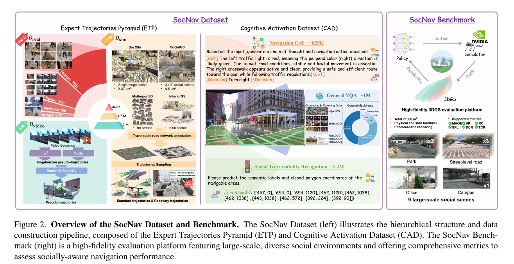
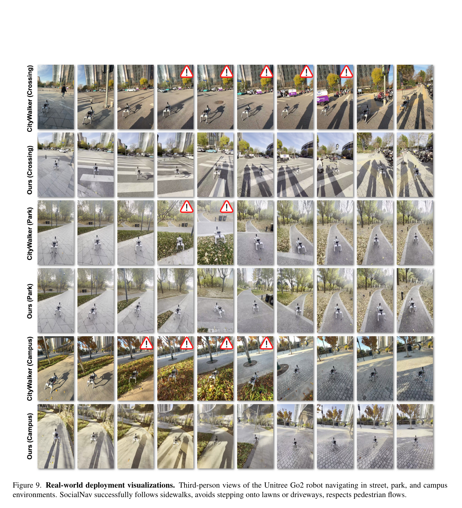

사람이 많은 길에서 “갈 수 있는 곳”과 “지나가도 되는 곳”은 같지 않아요. 계단과 벽은 기하적으로 막혀 있고, 잔디·차도·줄을 선 사람 사이 공간은 물리적으로 열려 있어도 사회 규범이 행동을 제한해요. SocialNav는 장면의 고수준 규범을 해석하는 의미 판단 모듈과 짧은 궤적을 만드는 행동 생성 모듈을 나누고, 서로 다른 출처의 대규모 데이터와 강화학습을 단계적으로 연결해요.

## 700만 샘플은 인지와 행동 자료로 나뉘어요

SocNav Dataset은 700만 개가 넘는 학습 샘플로 구성돼요. 하나의 균일한 로봇 로그가 아니라, 행동을 가르치는 출처별 행동 궤적 피라미드와 사회적 판단을 위한 인지 자료라는 두 축으로 구성돼요. 인터넷 영상, 시뮬레이션, 실제 로봇 주행은 카메라 시점과 행동 품질이 다르므로 같은 방식으로 취급하지 않고 계층을 나눠 사용해요.

행동 자료에는 인터넷 영상에서 복원한 궤적, Isaac Sim의 시뮬레이션 궤적 170만 개, 실제 로봇 궤적이 들어가요. 논문은 시뮬레이션 장면을 위해 3,400개의 실제 장면과 4.5km² 규모를 재구성했다고 보고해요. 인터넷 영상에는 다양한 사람 행동이 있지만 로봇 제어 명령이 없고, 시뮬레이션에는 정확한 상태가 있지만 현실의 질감과 상호작용 차이가 있어요. 실제 로봇 자료는 제어와 관측이 맞지만 규모가 작아요. 피라미드는 이 장단점을 서로 대신 쓰려는 구성으로 읽을 수 있어요.

인지 자료는 사회적으로 통행 가능한 영역, 장면 설명, 행동 선택의 이유를 제공해요. 이때 Qwen2.5-VL-72B를 82만5천 개 <abbr title="판단에 이르는 중간 이유를 문장으로 적은 주석">사고과정 주석</abbr> 생성에 사용해요. 72B 모델은 배포되는 로봇 의미 판단 모듈이 아니라 데이터 주석자예요. 실행 모델의 크기와 데이터 생성기의 크기를 섞으면 시스템 요구 자원을 크게 잘못 해석하게 돼요.

<figure class="fig"><figcaption>행동 궤적 피라미드와 인지 활성화 자료를 나누어 구성하고, 삼차원 재구성 장면의 평가 환경과 연결해요. (출처: Chen et al., SocialNav, Fig. 2 · CC BY 4.0)</figcaption></figure>

700만이라는 총수는 자료의 독립 장면 수와 같지 않아요. 한 영상에서 여러 프레임·목표·질문·미래 행동을 만들면 샘플 수가 늘어나요. 데이터 규모를 평가하려면 고유 장소, 고유 궤적, 시간적으로 겹치지 않는 구간, 주석 종류를 따로 봐야 해요. 훈련과 평가가 같은 원영상이나 같은 3D 장면을 공유하면 겉보기 일반화가 높아질 수 있으므로 장소·영상 원본 단위 분리가 중요해요.

설명용으로 10초 영상 하나를 5Hz로 잘라 50개 관측을 만들고 각 관측에 행동 후보 5개를 붙이면 250개 학습 항목이 나올 수 있어요. 항목 수는 250개지만 독립 장소는 하나예요. 이는 논문의 정확한 샘플 생성식이 아니라, 총 샘플과 장면 다양성을 구분해야 하는 이유를 보여주는 계산이에요.

## 의미 판단 모듈은 Qwen2.5-VL-3B이고 행동 생성 모듈은 궤적을 만들어요

실행 구조의 의미 판단 모듈은 Qwen2.5-VL-3B예요. 영상과 목표를 받아 계단, 차도, 보도, 사람 흐름 같은 의미를 해석하고 사회적으로 통행 가능한 영역과 고수준 행동 정보를 만들어요. 72B 주석 모델이 로봇에 탑재된다는 설명은 틀려요. 3B 의미 판단 모듈도 저전력 보드에서 자동으로 실시간이 되는 크기는 아니며, 논문의 실물 계산 조건을 따로 봐야 해요.

행동 생성 모듈은 조건부 잡음에서 목표 행동 분포로 이어지는 흐름 학습을 이용해 여러 가능한 미래 행동 분포를 표현해요. 의미 판단 모듈의 의미 정보와 로봇 관측을 조건으로 받아 짧은 미래 궤적을 생성해요. 한 방향만 회귀하는 정책보다 여러 통과 방법을 표현할 수 있지만, 생성된 후보가 모두 안전하다는 뜻은 아니에요. 학습 데이터와 보상에서 선호한 행동이 분포에 더 많이 나타나도록 만드는 구조예요.

<figure class="fig"><figcaption>실물 비교는 거리·공원·캠퍼스에서 진행됐고, 정책은 클라우드 NVIDIA A10 <abbr title="영상 처리 등에 쓰는 병렬 연산 장치">GPU</abbr>에서 5Hz보다 빠르게 실행돼요. (출처: Chen et al., SocialNav, Fig. 9 · CC BY 4.0)</figcaption></figure>

계층 분리는 느린 의미 판단과 빠른 동작 생성을 나누는 장점이 있어요. 하지만 의미 판단 모듈 출력이 틀리면 행동 생성 모듈은 잘못된 통행 영역을 조건으로 받아요. 예를 들어 자전거 도로를 보도로 분류하면 부드럽고 충돌 없는 궤적을 만들어도 규범 위반이 돼요. 반대로 의미 판단은 맞지만 저수준 궤적이 로봇 동역학을 벗어나면 실행할 수 없어요. 두 모듈의 정확도를 따로 평가해야 해요.

설명용으로 의미 판단 모듈이 2Hz, 행동 생성 모듈이 10Hz로 돈다고 가정하면 의미 지도 하나를 다섯 번의 행동 갱신이 공유해요. 그 0.5초 사이 사람이 통행 영역으로 들어오면 저수준 모듈이 최신 관측을 쓰더라도 고수준 마스크는 오래될 수 있어요. 실제 주기는 논문 구현과 다를 수 있으며, 이 계산은 계층 사이 출력 만료 시간이 필요하다는 점을 보여줘요.

## 세 단계 학습은 능력을 넣는 순서를 정해요

첫 단계는 출처별 행동 궤적 피라미드와 인지 자료를 이용해 일반 주행 능력과 사회 규범 이해를 넣어요. 둘째 단계는 실제 로봇 자료로 행동 생성 모듈을 미세 조정해 현실의 동역학과 공간 척도에 맞춰요. 이때 시각언어 모델은 고정하고 행동 모듈을 조정해 고수준 지식이 작은 실물 자료에 의해 쉽게 무너지지 않도록 해요.

셋째 단계의 SAFE-GRPO는 확률적 흐름 기반 정책을 사회적 보상으로 강화해요. 보상은 사회 규범, 전문가 행동과의 정렬, 궤적 부드러움, 효율을 함께 계산해요. 논문은 이를 통해 표면적인 행동 복제에서 벗어나 규범에 맞는 행동을 더 자주 만들도록 해요. 그러나 보상 항목과 가중치가 사회 규범의 완전한 정의는 아니에요. 측정 가능한 대리 지표를 최적화해요.

강화학습 단계는 16대 H20 GPU에서 행동 생성 모듈을 훈련해요. 배포 자원과 훈련 자원을 구분해야 해요. 큰 훈련 클러스터가 필요했다는 사실은 매 실행마다 같은 자원이 든다는 뜻이 아니고, 3B 모델이라는 사실도 로봇 내장 컴퓨터에서 충분하다는 뜻이 아니에요. 훈련, 주석 생성, 실물 추론의 하드웨어를 별도 표로 보는 편이 정확해요.

보상 충돌도 검증해야 해요. 효율 보상이 강하면 보행자 가까이 지나는 지름길을 선호할 수 있고, 사회적 거리 보상이 강하면 목표 앞에서 멈출 수 있어요. 설명용으로 두 경로가 각각 10m와 13m이고 긴 경로의 사회적 비용이 0.4 낮다고 해볼게요. 길이 1m당 효율 비용과 사회 비용 가중치에 따라 선택이 바뀌어요. 숫자는 논문 계수를 재현한 값이 아니라 보상 스케일이 행동을 정한다는 예예요.

## 평가 환경은 열린 고리와 닫힌 고리를 함께 봐요

SocialNav는 행동 예측만 비교하지 않고 SocNav Bench에서 닫힌 고리 주행을 평가해요. 삼차원 가우시안으로 장면을 표현하는 방법으로 재구성한 장면에 시뮬레이션 차량과 보행자를 넣고, 모든 방법에 Unitree Go2와 같은 보행 정책을 사용해요. 성공률, 경로 효율, 거리 준수, 사회 규범 준수 등을 비교해요.

논문 초록은 기존 최고 방법보다 성공률 38%, 사회 규범 준수율 46% 향상을 보고해요. 이 표현은 상대 개선인지 퍼센트포인트인지 표의 기준과 함께 읽어야 해요. 본문 표에서는 SocialNav의 거리 준수율 82.5 등 세부 지표를 제시해요. 하나의 종합 숫자보다 어떤 규범 지표에서 이득이 났는지 보는 편이 좋아요.

시뮬레이션 보행자는 로봇을 명시적으로 인지해 반응하지 않지만, 궤적 생성 과정에서 사회적 거리를 유지하고 로봇 경로 침범을 피하도록 구성돼요. 실제 사람과의 상호 협상과 다르게 장면 생성 규칙이 이미 충돌을 줄일 수 있어요. 로봇 행동에 사람이 반응하는 폐루프를 입증한 것으로 확대하면 안 돼요.

평가 장면은 횡단, 공원 같은 규범을 포함하지만 지역마다 보행 규칙이 달라요. 우측 통행, 줄 서기, 잔디 회피, 안내견 역할은 문화·장소·업무에 의존해요. 범용 기반 모델이라는 이름이 모든 규범을 보장하지 않아요. 새로운 지역에서는 사회적 통행 영역과 행동 선택을 사람 평가로 다시 확인해야 해요.

## 실물 결과는 클라우드 A10 조건이에요

실물은 Unitree Go2가 거리, 공원, 캠퍼스 등에서 주행한 사례예요. 논문 표에서 SocialNav는 여러 실제 환경의 20회 시험 기준으로 결과를 비교하고, 전체적으로 높은 성공과 규범 준수를 보고해요. 그러나 계산은 로봇의 Raspberry Pi나 온보드 저전력 장치가 아니라 NVIDIA A10 GPU가 있는 클라우드 서버에서 수행해요. 제어 주기는 5Hz를 넘어요.

5Hz는 한 갱신 간격이 최대 약 0.2초라는 뜻이에요. 설명용으로 사람이 1.5m/s로 횡단하면 한 갱신 사이 0.30m를 이동해요. 여기에 영상 전송, 클라우드 왕복, 추론, 명령 적용 지연이 더해져요. 논문이 5Hz 이상을 유지했다는 결과는 특정 네트워크와 A10 조건의 통합 성능이며, 지연 꼬리와 연결 끊김 안전 행동은 별도 검증 대상이에요.

클라우드 연결이 끊기면 마지막 궤적을 계속 실행할지, 즉시 멈출지, 로컬 회피기로 넘길지 정해야 해요. 마지막 궤적 유지 시간은 제동 거리보다 짧아야 하고, 로컬 계층이 사람을 검출할 수 있어야 해요. 논문의 시연 프레임만으로 이 장애 대응이 검증됐다고 말할 수는 없어요.

실물 시험에서 18/20처럼 성공 횟수가 보고된 조건은 실패 두 건의 원인을 보는 것이 중요해요. 의미 오분류, 목표 실패, 사람 회피, 네트워크, 보행 제어 중 어느 층인지에 따라 수정 방법이 달라져요. 전체 성공률만 보면 범용 기반 모델의 추론과 저수준 베이스의 한계를 구분하기 어려워요.

## 주석자의 추론과 실행 모델의 추론을 따로 검증해요

72B 모델이 만든 사고과정은 사람 정답이 아니에요. 큰 모델도 공간 위치를 틀리거나 사회 규범을 상투적으로 설명할 수 있어요. 3B 의미 판단 모듈이 그 문장을 잘 모방해도 주석 오류까지 배울 수 있어요. 주석 품질은 사람 합의, 통행 영역 겹침, 행동 선택 일치로 표본 검사해야 해요.

사고과정 문장이 그럴듯한지와 최종 궤적이 안전한지도 분리해야 해요. “보행자를 먼저 보낸다”고 설명하면서 실제 궤적은 앞을 가로지를 수 있어요. 설명 텍스트, 사회적 통행 마스크, 선택 행동, 생성 궤적을 같은 장면에서 대조하면 모듈 간 불일치를 찾을 수 있어요.

사회적 통행 영역은 픽셀 분할 정확도만으로 충분하지 않아요. 경계가 20cm 줄어드는 오류가 좁은 보도에서는 사람 경로 침범으로 이어질 수 있어요. 로봇 폭과 위치 오차를 반영해 영역을 수축한 뒤에도 경로가 남는지 봐야 해요. 설명용으로 통행 폭 1.2m에서 로봇 폭 0.6m, 좌우 오차 여유 각 0.2m를 빼면 중심이 움직일 수 있는 폭은 0.2m뿐이에요.

데이터 오염과 평가 중복도 확인 대상이에요. 인터넷 영상이나 3D 재구성 장면이 평가 장소와 시각적으로 겹치면 기억과 일반화를 구분하기 어려워요. 원영상 해시, 장소 메타데이터, 촬영 경로를 기준으로 중복을 검사하고, 완전히 다른 도시·날씨·카메라 높이에서 성능을 나눠야 해요.

## 적용 검증은 네 계층의 실패를 따로 주입해요

첫째는 시각 의미 실패예요. 보도와 차도 표식을 가리거나, 야간·역광·비·공사 표지를 넣어 통행 마스크가 어떻게 바뀌는지 봐요. 둘째는 사람 관측 실패예요. 가림과 검출 누락을 넣어 행동 생성 모듈이 최신 사람 없이 어떤 궤적을 내는지 확인해요.

셋째는 생성 행동 실패예요. 같은 의미 판단 모듈 출력에서 여러 샘플을 생성해 충돌 여유와 규범 준수의 분산을 측정해요. 평균 궤적만 안전해도 드문 샘플이 차도로 나갈 수 있어요. 후보를 평가하는 후단 필터가 있다면 개입률과 거절 이유를 기록해야 해요.

넷째는 시스템 실패예요. 클라우드 지연을 100·300·500ms 추가하고 패킷 손실과 연결 단절을 주입해요. 각 조건에서 입력 영상 나이, 의미 판단 모듈 출력 나이, 궤적 생성 시간, 명령 적용 시각, 안전 계층 개입을 기록해요. 5Hz 평균을 유지해도 연속 두 번 갱신을 놓치면 0.4초 이상 오래된 계획을 쓸 수 있어요.

## 생성 궤적의 다양성과 안정성을 함께 봐요

확률적 행동 생성 모듈이 여러 행동 분포를 표현한다는 장점은 한 장면에서 서로 다른 유효 경로를 만들 수 있다는 뜻이에요. 동시에 같은 입력에서 출력이 흔들릴 가능성도 생겨요. 왼쪽과 오른쪽 우회가 모두 안전한 열린 공간에서는 다양성이 유용하지만, 좁은 복도에서 매 주기 통과 방향이 바뀌면 제어가 진동해요.

같은 관측과 목표를 고정하고 난수만 바꾸어 50개 궤적을 생성하는 시험이 필요해요. 충돌, 사회 규범 위반, 곡률, 목표 진행량의 분포와 서로 다른 경로 계열 수를 기록해요. 유효 후보가 여러 개인지, 위험 후보까지 넓게 생성하는지 구분할 수 있어요. 후단이 최종 후보를 고른다면 선택 점수와 탈락 원인도 함께 저장해야 해요.

연속 프레임 시험에서는 난수 초기값을 고정한 경우와 바꾼 경우를 비교해요. 사람 위치가 2cm 움직였을 뿐인데 선택 경로가 반대로 바뀐다면 장면 경계에 민감한 거예요. 이전 궤적과의 일관성 비용이나 후보 추적이 필요할 수 있지만, 너무 강하면 실제 위험 변화에 늦게 반응해요.

설명용으로 후보 20개 중 18개가 사회 규범을 지키고 2개가 차도를 침범한다고 해볼게요. 평균 준수율은 90%지만 한 번만 샘플링하면 열 번 중 한 번꼴로 위험 후보가 나올 수 있어요. 실제 확률은 모델과 샘플러에 따라 다르며, 이 수치는 평균 품질과 단일 실행 위험을 구분하기 위한 가정이에요. 배포에서는 후보 다중 생성과 결정적 안전 검사를 함께 평가해야 해요.

## 사회 규범 지표의 라벨 품질을 역으로 점검해요

거리 준수율 같은 지표는 사람과 로봇 사이 임계 거리로 계산할 수 있지만, 줄 가로지르기나 보도 선택은 장면 의미 라벨에 의존해요. 라벨이 틀리면 좋은 행동이 위반으로, 나쁜 행동이 준수로 계산돼요. 평가 장면 일부를 여러 사람이 독립 표기하고 합의가 낮은 규범은 지표를 따로 공개해야 해요.

사람 사이에도 답이 갈리는 장면은 하나의 정답 궤적으로 만들기 어려워요. 공원 잔디를 가로질러도 되는지, 멈춘 무리를 어느 쪽으로 지날지, 안내견 역할에서 어느 거리를 둘지는 맥락에 따라 달라요. 분포 라벨이나 복수의 허용 경로를 쓰지 않으면 모델이 정답 하나를 모방하면서 다른 자연스러운 행동을 잃을 수 있어요.

규범 위반을 발견했을 때 데이터·의미 판단 모듈·행동 생성 모듈·보상 중 어디를 고칠지도 구분해야 해요. 의미 판단 모듈 통행 마스크가 맞는데 궤적이 벗어나면 행동 모듈 문제이고, 마스크부터 틀리면 인지 자료와 주석 문제예요. 마스크와 궤적은 맞지만 평가가 위반으로 세면 평가 환경 라벨 문제예요. 중간 출력을 공개한 계층 구조는 이 진단에 유리해요.

[[2026-10-17_socialnav_lisn|LISN이 느린 언어 판단과 빠른 반응 제어를 나눈 방식]]도 고수준 시각언어 판단과 저수준 제어를 분리하지만, 시각언어 모델이 비용지도와 제어기 매개변수를 조절하는 시뮬레이션 체계예요. SocialNav는 3B 의미 판단 모듈과 확률적 행동 생성 모듈을 함께 학습하고 실제 Go2를 클라우드 A10으로 실행해요. 계층 구조는 닮았어도 출력 계약, 훈련 규모, 실물 근거가 달라요.

SocialNav는 대규모 주석 모델과 실행 모델의 역할을 구분해요. 72B는 82만5천 사고과정 주석을 만든 데이터 생성기이고, 실행 의미 판단 모듈은 Qwen2.5-VL-3B예요. 행동 궤적 자료와 인지 자료를 나누고, 모방·실물 미세조정·사회적 강화학습을 순서대로 결합한 구성이 기여예요. 실물 주장은 A10 클라우드와 5Hz 초과 조건에 한정하고, 온보드 이식은 지연·연결 실패·전력 측정을 새로 해야 해요.

---
<!-- src-block -->
출처 — https://arxiv.org/abs/2511.21135
