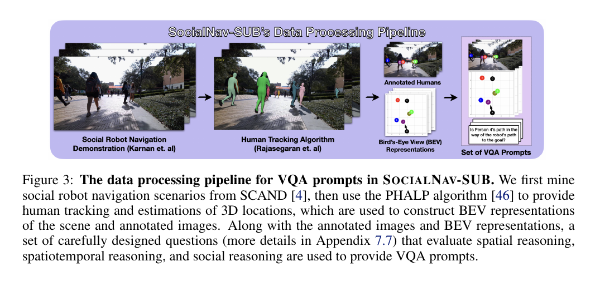
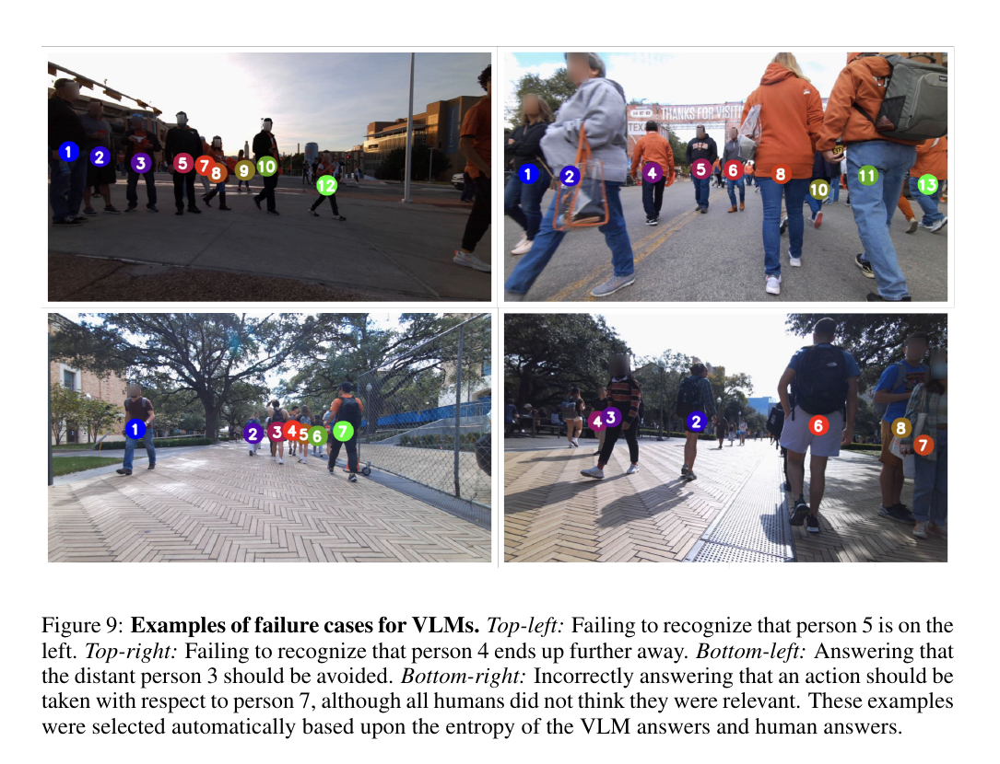

사회적 주행에서 시각언어 모델이 그럴듯한 설명을 한다고 실제 장면을 정확히 이해한 것은 아니에요. 사람 5번이 로봇 왼쪽에 있는지, 누가 경로를 막는지, 로봇과 사람이 서로 반응하는지를 영상에서 구분해야 해요. SocialNav-SUB는 실제 사회적 주행 영상에 번호와 위에서 내려다본 시점을 붙이고, 공간·시간·사회 관계를 객관식 질문으로 나눠 사람 응답 분포와 시각언어 모델의 답을 비교해요.

이 평가 환경은 속도 명령을 내는 제어기가 아니에요. 시각언어 모델이 장면을 이해할 준비가 됐는지 평가하는 <abbr title="영상에 관한 질문에 답하는 과제">VQA</abbr> 자료예요. 부록의 경유 지점 선택 시험도 사람이 고른 후보와 모델 선택을 비교하는 예비 평가이며, 로봇을 폐루프로 주행한 안전 성능이 아니에요.

## SCAND에서 혼잡하고 어려운 60개 장면을 골라요

원자료는 원격조종 로봇이 실제 사람 사이를 주행한 SCAND예요. 저자들은 중간 이상 군중 밀도, 가까운 사람, 동적으로 바뀌는 움직임이 포함된 구간을 찾고 60개의 어려운 장면을 선별해요. 장면당 사람 수는 평균 6.65명, 표준편차 2.80명이에요.

각 표본은 전방 <abbr title="빨강·초록·파랑 채널로 표현한 일반 컬러 영상">RGB</abbr> 연속 장면 2.5초이고 4Hz로 표본화돼요. 시간 간격이 균일하다면 약 10장의 영상이 한 연속 장면을 이뤄요. 한 장면의 순간 위치뿐 아니라 사람이 어느 방향으로 움직였고 로봇 경로와 관계가 어떻게 변했는지 질문할 수 있어요.

60개를 무작위로 뽑지 않고 어려운 조건을 점수화해 고른 선택은 평가 환경 목적에 맞아요. 하지만 실제 운용에서 쉬운 장면이 차지하는 비율이나 전체 SCAND 분포의 평균 성능을 나타내지 않아요. 모델 순위를 가혹 조건 평가로 읽어야 하고 일반 장면 정확도로 확대하면 안 돼요.

설명용으로 60개 장면마다 10장씩 있으면 600 영상 관측 시점이 돼요. 한 사람의 추적 대상이 10장에 반복되므로 600개가 독립 사례는 아니에요. 질문 수가 늘어도 출처 장면 수와 참가자 수를 함께 보고해야 해요.

## 사람 번호와 <abbr title="장면을 위에서 내려다보는 형태로 바꾼 공간 표현">BEV</abbr>가 대상 참고 기준을 고정해요

원본 영상만 시각언어 모델에 주면 “왼쪽 사람”이 프레임마다 바뀌고 작은 사람을 놓칠 수 있어요. 처리 흐름은 <abbr title="연속 영상 속 사람의 위치와 자세를 연결해 추적하는 방법">PHALP</abbr>로 사람을 추적하고 한 카메라를 쓰는 영상에서 카메라 기준 3D 위치·방향을 추정해요. SCAND 이동량 추정으로 미래 사람 위치·방향을 첫 프레임의 로봇 위치로 고정한 좌표계의 위치·방향으로 바꾸고 칼만 평활화를 적용해요.

카메라 내부 보정값·외부 위치 관계로 사람 위치를 전방 영상과 BEV에 투영해요. 각 사람에는 번호와 색깔 원 표시를 붙여 질문이 “사람 5”를 가리킬 수 있게 해요. 시각언어 모델과 사람 참가자는 같은 사람 표기를 더한 전방 영상, BEV, 연속 장면을 받아 비교 조건을 맞춰요.

<figure class="fig"><figcaption>원본 연속 장면에 사람 식별자, 전방 영상 표시점, BEV 좌표를 더해 공간·시공간·사회 질문을 만들어요. (출처: SocialNav-SUB 저자들, Fig. 3)</figcaption></figure>

이 보조 표현은 정답이 아니에요. 한 카메라로 추정한 삼차원 자세와 추적 식별자, 이동량 추정, 카메라 보정이 틀리면 BEV 표시점도 틀려요. 시각언어 모델이 BEV를 정확히 읽었는데 원래 사람이 잘못 투영된 경우 평가 환경 답과 현실이 어긋날 수 있어요. 저자들은 CODa의 레이저 거리 센서 사람 자세 정답 표기로 처리 흐름을 검증하고 학습·추론 조정값을 조정하지만, 모든 SCAND 장면의 정답 3D를 갖는 것은 아니에요.

설명용으로 8m 거리에서 방위 오차 2도가 나면 횡방향 위치 차이는 (8 × tan(2°)), 약 0.28m예요. 사람 두 명이 가까우면 표시점 순서나 경로 교차 판단을 바꿀 수 있어요. 논문 오차 수치가 아니라 작은 각도 오차가 BEV에서 확대되는 관계를 보여줘요.

추적 식별자가 바뀌면 시간에 따른 공간 변화 질문의 전제가 무너져요. 첫 프레임의 사람 3과 마지막 프레임의 사람 3이 다른 실제 사람일 수 있어요. 평가 환경을 재사용할 때 추적 대상 신뢰도, 가림, 식별자 전환 상태 표시값을 함께 제공하거나 낮은 신뢰도 표본을 별도로 평가하는 편이 좋아요.

## 질문을 공간·시공간·사회 추론으로 나눠요

공간 질문은 한 프레임에서 누가 왼쪽·오른쪽·앞·뒤에 있는지, 상대 위치가 어떤지를 물어요. 시공간 질문은 연속 장면에서 로봇과 보행자의 움직임과 변화, 경로 방해 여부를 물어요. 사회 질문은 로봇과 사람이 상호작용하는지, 누구를 고려해야 하는지 같은 판단을 물어요.

세 범주는 난도가 달라요. 공간은 좌표를 정확히 읽어야 하고, 시간에 따른 공간 변화는 식별자를 유지하며 변화를 비교해야 해요. 사회적 추론은 위치와 움직임을 바탕으로 상호작용 의미를 추론해요. 상위 질문이 아래 질문의 답을 필요로 하므로 이유를 순서대로 연결하도록 한 지시문에서는 이전 답을 다음 질문 맥락에 넣어요.

이 방식은 추론을 돕지만 오류 전파도 만들어요. 첫 공간 답에서 사람을 왼쪽이라고 잘못 판단하면 이후 경로 방해와 사회적 상호작용 답까지 같은 오류를 이어갈 수 있어요. 이전 답을 제공하지 않는 조건, 앞 단계 정답을 제공한 조건, 모델 자기 답을 제공하는 조건을 비교해야 해요.

질문은 객관식이라 평가가 명확하지만 보기에 없는 해석을 표현하기 어려워요. 사람들이 여러 답으로 갈리는 사회적 질문도 있어요. 하나의 다수 의견 정답 표기만 정답으로 두면 합리적인 소수 해석을 모두 틀렸다고 세기 때문에, SocialNav-SUB는 사람 응답 분포와의 합의를 사용해요.

## 사람 합의를 확률로 보고 두 지표를 만들어요

윤리 심의 승인을 받은 사람 연구에서 각 시험 상황 질문에 최소 5명의 응답을 모아요. Prolific 참가자가 여러 무작위 시험 상황의 설문에 답해요. 한 질문에 사람 다섯 명이 3대2로 갈리면 모델이 어느 쪽을 고르든 완전히 객관적인 정답이라 보기 어려워요.

사람 응답과의 일치 확률은 모델 답변이 모든 사람 답과 일치하는 비율을 평균해요. 모델이 다수 답을 고르면 높아지지만 사람 의견 차이가 큰 질문에서는 최고점 자체가 낮아요. 사람 사이 합의로 가중한 일치 확률은 사람 합의가 높은 질문의 오류를 더 강하게 벌주고, 의견이 갈린 질문의 벌점을 낮춰요.

설명용으로 다섯 명 중 네 명이 A, 한 명이 B를 고른 질문에서 모델이 A를 고르면 <abbr title="모델의 답과 사람 한 명의 답이 일치할 확률을 사람 응답 전체에서 평균한 지표">PA</abbr> 기여는 0.8이에요. 3대2 질문에서 다수 답을 고르면 0.6이에요. 둘을 똑같은 “정답 1”로 세지 않고 인간 분포를 보존해요. <abbr title="사람들끼리 합의가 높은 질문의 오류에 더 큰 벌점을 주는 일치 지표">CWPA</abbr>의 정확한 정규화 방식은 논문 식을 따라야 하며 이 숫자는 PA 직관 설명이에요.

사람 다수 응답 기준은 질문별 가장 흔한 사람 답을 고르고 전체 PA 0.74, CWPA 1.0을 보여요. 평균 사람은 전체 PA 0.60, CWPA 0.80이에요. 사람 다수 응답 기준의 PA가 1이 아닌 이유는 다수 응답도 소수 사람과는 불일치하기 때문이에요. CWPA와 PA를 같은 척도의 단순 정확도로 읽으면 안 돼요.

## 큰 시각언어 모델도 규칙 비교 기준과 사람 다수 응답 기준보다 낮아요

평가는 GPT-4o, Gemini 2.0·2.5, o4-mini, LLaVa-Next-Video 등 연속 장면 입력을 받는 모델을 포함해요. 질문당 모델을 한 번 호출하고 기본 학습·추론 설정값을 사용해요. 가장 높은 전체 시각언어 모델 PA는 o4-mini의 0.62이고 CWPA는 0.82예요. 규칙 비교 기준은 PA 0.64, CWPA 0.84, 사람 다수 응답 기준은 0.74·1.0이에요.

o4-mini는 평균 사람 PA 0.60을 조금 넘지만 사람 다수 응답 기준과 규칙 비교 기준에는 못 미쳐요. 이유를 연결하는 추론 모델이 크다고 개별 대상 수준 좌표를 안정적으로 읽는 것은 아니라는 결과예요. 사람이 설계한 규칙은 제공된 보행자 위치를 사용하므로 정확한 기하 질문에서 강할 수 있어요.

범주별로 모델은 공간·시공간 추론에서 특히 어려움을 보여요. 사회적 추론에서는 사람 수준에 더 가까워지고 일부 모델은 평균 사람보다 높게 나타나요. 언어 사전 가정으로 사회적 상황을 설명하는 능력과 실제 위치·움직임을 정확히 읽는 능력이 다르다는 신호예요.

폐쇄형 모델의 버전과 서비스 구현은 바뀔 수 있어요. 논문의 1회 질의 결과를 현재 모델의 불변 성능으로 취급하면 안 돼요. 외부 기능 호출 한 시점의 기록, 입력 지시문, 영상 크기 조절, 프레임 순서, 후보 추출 설정을 보존해야 재평가가 가능해요. 기본값이라는 표현만으로는 장기 재현성이 부족해요.

설명용으로 PA 0.62와 0.64의 차이가 0.02라도 질문 수와 상관구조에 따라 통계적으로 뚜렷하지 않을 수 있어요. 같은 장면에서 여러 질문이 나오므로 질문을 독립 표본으로만 보지 않고 장면 전체 수준 표본을 다시 뽑아 불확실성을 추정하는 방법을 고려해야 해요. 논문의 표준 오차와 함께 보는 이유예요.

## 실패 사례는 작은 공간 오류가 사회 판단으로 번짐을 보여줘요

논문 부록은 모델이 사람 5를 왼쪽으로 인식하지 못하고, 이동 방향을 반대로 읽거나, 멀리 있는 사람 3을 피해야 한다고 잘못 답하는 사례를 보여줘요. 행동이 로봇을 사람 7과 1 사이에 두어야 한다는 질문도 틀려요. 사람이 붐비는 장면에서 참고 기준과 움직임을 동시에 유지하기 어려워요.

<figure class="fig"><figcaption>공간 위치와 시간 변화의 작은 오류가 누구를 피해야 하는지와 같은 사회 판단 오류로 이어져요. (출처: SocialNav-SUB 저자들, Fig. 9)</figcaption></figure>

실패 영상은 사람 번호 표시점과 정답 설명을 함께 보여줘요. 모델이 틀린 원인이 원본 영상의 가림인지 BEV 읽기인지 질문이 가리키는 대상 해석인지 분리하려면 입력 구성 요소 제거 실험이 필요해요. 컬러 영상만, 사람 표기를 더한 전방 영상, 위에서 내려다본 시점만, RGB+BEV를 비교하면 어느 표현이 도움을 주거나 혼란을 만드는지 알 수 있어요.

논문도 BEV 효과가 모델마다 다르다고 보고해요. 모든 모델이 보조 기하에서 같은 이득을 얻지 않아요. BEV가 작은 화면으로 축소되거나 번호가 겹치면 오히려 입력을 복잡하게 만들 수 있어요. “구조화 입력을 추가하면 항상 좋아진다”는 결론으로 확대할 수 없어요.

<abbr title="판단에 이르는 중간 이유를 이어 적는 추론 방식">CoT</abbr>는 사회적 추론을 여러 모델에서 개선하지만 공간 한계를 완전히 해결하지 않아요. 설명이 길어져도 좌표를 틀릴 수 있어요. 공개된 추론 문장의 설득력보다 최종 답변과 사람 분포의 일치를 기준으로 평가해야 해요.

## 경유 지점 선택은 장면 이해의 영향을 보는 예비 실험이에요

부록은 영상에 여러 후보 경유 지점을 표시하고, 목표로 진행하면서 사람을 배려하는 점을 모델이 고르게 해요. 맥락 없음, 무작위 맥락, 모델이 답한 장면 맥락, 사람이 제공한 정답 맥락을 제공해 사람 조작자의 선택과 비교해요. 정확한 사람 맥락이 있을 때 여러 모델의 경유 지점 정렬이 좋아져요.

이는 장면 이해가 행동 선택에 유용할 수 있다는 연결 근거예요. 그러나 경유 지점을 실제 로봇 본체 제어기에 보내 사람 사이를 주행한 폐루프 시험은 아니에요. 후보 경유 지점의 실행 가능성, 제동, 센서 지연, 다음 프레임 변화는 평가하지 않아요.

설명용으로 후보 네 개 중 사람 조작자와 같은 하나를 고를 무작위 선택 기준은 균등하면 25%예요. 후보가 같은 방향에 몰리거나 여러 선택이 허용되면 이 기준은 달라져요. 정확한 후보 수·구성별 결과는 논문 표를 따라야 하고, 예시는 선택 정확도의 직관을 위한 값이에요.

실제 제어기로 연결하려면 시각언어 모델의 답의 신뢰도와 응답 기한 초과, 금지 행동 거름장치가 필요해요. 사람 위치 질문 하나가 틀렸을 때 경유 지점을 바로 적용하면 위험해요. 기하 규칙과 충돌 감시기가 시각언어 모델 선택을 검증하고, 거절·정지 상태를 명시해야 해요.

## 센서가 항상 제공하는 참값과 평가 환경 주석을 구분해요

SocialNav-SUB의 풍부한 BEV는 배포 로봇의 센서가 항상 제공하는 참값이 아니에요. PHALP, 이동량 추정, 카메라 보정, 변화 완화로 사후 처리한 표현이에요. 실시간 전체 처리 구성에서 같은 품질과 지연으로 만들 수 있다는 성능을 평가 환경이 입증하지 않아요.

칼만 평활화는 미래 관측을 사용할 수 있어 수집 후 처리 주석을 매끄럽게 만들어요. 온라인 거름장치가 현재 시각에 쓸 수 있는 정보와 다를 수 있어요. 배포 비교에서는 인과적 거르기만 쓴 BEV와 수집이 끝난 뒤 미래 관측까지 써서 보정한 BEV를 나눠 모델 성능 차이를 봐야 해요.

설명용으로 2.5초 연속 장면 전체를 변화 완화에 쓰면 첫 프레임 표시점이 뒤쪽 2초 정보의 영향을 받을 수 있어요. 제어기는 그 미래를 아직 보지 못해요. 실제 변화 완화기 설정에 따라 범위는 달라지지만 평가 환경 입력과 실시간 입력의 정보 경계를 확인해야 해요.

사람 식별자 표시점도 검출기·추적기가 사람을 이미 찾았다는 강한 정보예요. 원시 RGB만 받는 모델과 개별 대상 중심 입력을 받는 모델의 능력을 같은 “시각 이해”로 부르지 않아야 해요. 전자는 검출까지 포함하고 후자는 제공된 대상 관계를 추론해요.

## 재현은 장면 단위 분할과 입력 출처 이력을 보존해요

60개 장면의 프레임이나 질문을 무작위로 훈련·평가로 나누면 같은 장소·사람·연속 프레임이 양쪽에 들어갈 수 있어요. 추가 학습을 한다면 원 SCAND 궤적과 장면 단위로 분리해야 해요. 해당 자료의 평가만 하는 경우에도 모델 입력 지시문 조정에 평가 답변을 사용하지 않도록 해야 해요.

각 표본에는 SCAND 출처 구간, 프레임 시각 표기들, 추적 출력, 보정 버전, 변화 완화 매개변수, 생성된 전방·위에서 내려다본 시점 영상, 질문, 사람 응답 분포를 연결해요. 최종 PNG와 다수 응답만 남기면 주석 오류를 추적하기 어려워요.

재평가는 동일 모델 한 시점의 기록을 확보하지 못할 수 있어요. 최소한 날짜, 외부 기능 호출 모델 식별자, 입력 지시문, 프레임 표현 변환, 응답 출력 해석기, 재시도 행동 정책을 기록하고 각 질문의 원시 응답을 저장해요. 한 번만 질의한 결과에서 일시적 오류와 모델 추론 오류를 구분하려면 작은 반복 부분집합도 유용해요.

[[2026-10-17_socialnav_socialnav-foundation|SocialNav가 사회 규범 추론과 저수준 주행을 나눈 방식]]은 인지 자료와 행동 생성 모듈을 학습해 실제 Go2 궤적을 생성하고, SocialNav-SUB는 기존 실물 연속 장면을 질문으로 바꿔 시각언어 모델 장면 이해를 평가해요. 이름이 비슷해도 하나는 주행 모델, 다른 하나는 VQA 평가 환경이에요.

SocialNav-SUB는 실제 영상의 사회적 장면 이해를 평가하는 자료와 지표를 제시해요. 실제 SCAND의 혼잡 장면에 추적 식별자와 BEV를 붙이고, 공간·시공간·사회적 관계 질문을 분리하며, 다섯 명 이상의 사람 응답 분포를 PA와 CWPA로 평가한 데 있어요. 결과는 최신 시각언어 모델도 정확한 공간·시간 이해에서 규칙과 사람 다수 응답 기준에 뒤진다는 점을 보여줘요. 제어기 안전성을 주장하려면 인과적 센서 처리 흐름과 폐루프 주행을 새로 검증해야 해요.

---
<!-- src-block -->
출처 — https://arxiv.org/abs/2509.08757
