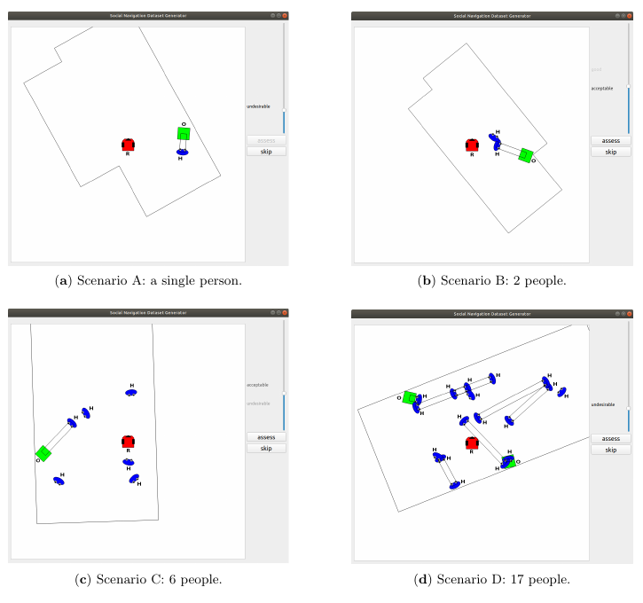

로봇이 사람과 부딪히지 않는 위치에 있어도 대화를 가로막거나 누군가 물건을 쓰는 공간을 차지할 수 있어요. SocNav1은 이런 배치를 사람이 어떻게 받아들이는지 학습하기 위한 정적 장면 자료예요. 로봇·사람·물체·방·상호작용을 기호로 표현하고, 로봇의 존재가 얼마나 적절한지 사람이 점수를 매겨요.

이 자료에서 높은 점수는 더 받아들일 만한 배치를 뜻해요. 카메라 영상에서 사람을 찾는 과제나 로봇의 다음 속도를 고르는 과제와는 입력·출력이 달라요. 그래프를 사용하면 사람 수와 관계가 바뀌는 장면을 다루기 좋지만, 자료 자체가 완성된 내비게이션 정책은 아니에요. 무엇을 점수로 만들었는지부터 읽어야 활용 범위를 정할 수 있어요.

## 로봇의 존재를 묻는 화면이에요

원 논문은 로봇 중심의 합성 장면을 보여 주고 0–100점의 수용 점수를 수집해요. 사람 사이 거리뿐 아니라 상호작용을 방해하는 공간도 고려하도록 안내해요. 사람 충돌과 상호작용 공간 침범을 나쁘게 평가하면서도, 벽에 가까이 있는 로봇의 이동 지능 자체를 채점하지는 않도록 구분해요.

<figure class="fig"><figcaption>원 논문의 네 수집 화면이에요. 기호의 위치와 방향, 사람·물체 사이 관계가 점수 판단의 문맥을 구성해요. (출처: Manso 외, <a href="https://arxiv.org/abs/1909.02993">SocNav1</a>, 그림 1 패널 발췌, <a href="https://creativecommons.org/licenses/by/4.0/">CC BY 4.0</a>, 그림 내용 변경 없음)</figcaption></figure>

이 구분 때문에 점수를 충돌 여유로 읽으면 안 돼요. 벽에 지나치게 가까운 위치라도 사람을 방해하지 않는다는 질문에는 높은 점수가 가능해요. 반대로 물리적으로 넓게 열린 두 사람 사이가 대화 공간이라면 낮게 평가될 수 있어요. 사회 점수와 기하 안전 검사는 서로 다른 질문에 답해요.

설명용으로 방 안에 사람이 없고 로봇이 벽에서 0.1m 떨어져 있다고 가정해요. 사람 방해는 적지만 로봇의 폭과 위치 오차를 고려하면 충돌 위험은 클 수 있어요. 이 예는 자료의 실제 점수가 아니라 두 평가 축이 분리된다는 설명이에요. 사회 점수를 최대화한다고 장애물 검사를 줄일 수는 없어요.

또한 점수는 한 사람의 심리 상태를 측정한 값이 아니에요. 평가자는 화면 전체를 보고 배치를 판단해요. 실제 공간에서 특정 사람이 느낀 놀람이나 이동 불편을 같은 값으로 주장하려면 추가 근거가 필요해요. 이 자료의 출력에 ‘사람의 실제 불편 확률’ 같은 이름을 붙이면 질문보다 강한 의미를 만들게 돼요.

## 5,735개 배치와 9,280개 라벨은 달라요

최종 자료에는 12명이 제공한 라벨 9,280개와 서로 다른 장면 5,735개가 있어요. 첫 생성 묶음에서는 세 명이 5,522개 라벨을, 둘째 묶음에서는 아홉 명이 3,758개 라벨을 만들었어요. 같은 장면을 여러 번 평가한 행이 있기 때문에 사람의 의견과 공간 배치의 수를 구분해야 해요.

둘째 묶음의 라벨을 9,280개라고 적으면 전체 합을 한 부분의 수로 잘못 옮긴 것이에요. 실제 합은 5,522+3,758=9,280이에요. 표본 수를 설명할 때 생성한 후보 장면, 평가된 고유 장면, 라벨 행, 평가자 수를 같은 단어로 부르면 이런 오류가 생겨요. 자료 설명에는 각 수의 분모를 붙여 두는 편이 좋아요.

반복 평가는 단순 중복 파일이 아니에요. 같은 화면에 대해 판단이 얼마나 갈리는지 확인하는 자료가 돼요. 중복 행을 모두 삭제하면 평가자 간 차이를 잃고, 모든 행을 독립 장면으로 세면 공간 다양성을 과장해요. 원본 장면 식별자를 유지한 채 점수 목록과 평가 횟수를 연결해야 두 목적을 함께 다룰 수 있어요.

설명용으로 장면 A가 25점과 75점, 장면 B가 48점과 52점을 받았다고 해볼게요. 두 평균은 모두 50이지만 A의 의견 차이는 훨씬 커요. 모델이 둘 다 50을 내는 것은 평균 회귀로는 자연스러워도 합의 수준까지 표현한 결과는 아니에요. 이 점수들은 원자료 측정값이 아닌 주관 라벨 해석용 가정이에요.

같은 평가자가 비슷한 점수 범위를 반복 사용하는 경우도 있어요. 극단 점수를 자주 쓰는 사람과 가운데 점수에 모으는 사람이 섞이면 전체 오차가 평가자 구성에 영향을 받아요. 장면별 평균과 평가자별 잔차를 같이 보면 모델 문제와 척도 사용 차이를 구분하기 쉬워요. 소수 평가자의 화면 판단을 모든 보행자의 보편 규칙으로 확대하지 않는 이유예요.

## 평균 오차가 같아도 틀린 장면은 달라요

점수 예측을 비교할 때는 전체 오차가 어디서 나왔는지도 봐야 해요. 사람이 없는 방에서는 비슷한 높은 값을 내고, 대화하는 사람 사이에서는 낮은 값을 내는 모델이 있다고 해볼게요. 시험 자료가 빈 방에 치우치면 관계를 무시한 단순 모델도 좋은 평균을 얻을 수 있어요. SocNav1의 질문이 사람과 상호작용의 배치에 있으므로 사람 수와 관계 유무에 따른 오차를 펼쳐 보는 편이 유용해요.

설명용으로 시험 장면 열 개 가운데 아홉 개는 관계가 없고 한 개만 대화 장면이라고 가정해요. 모델 A는 모든 장면에서 10점씩 틀리고, 모델 B는 관계가 없는 아홉 장면에서 0점, 대화 장면에서 100점 틀려요. 평균 절대오차는 둘 다 10점이에요. 그러나 대화 공간을 피하는 데 쓸 모델이라면 같은 성능으로 취급하기 어려워요. 이 수들은 논문 결과가 아닌 평가 집계의 예예요.

최악 장면만 보고 판단하는 것도 충분하지 않아요. 의견이 갈리는 장면의 평균 라벨에서 멀어졌다고 해서 모든 사람이 그 예측을 틀렸다고 생각하는 것은 아니에요. 반복 평가가 있는 장면에서는 원 점수들의 범위와 예측 위치를 같이 보여 주면 해석이 달라져요. 모델이 사람 판단의 다양성을 놓쳤는지, 관계가 있는 특정 장면을 체계적으로 높게 평가하는지 다른 문제로 나눌 수 있어요.

수용 점수의 오차와 경로 선택의 오차도 구분해야 해요. 두 후보가 49점과 51점인 장면에서 예측 순서가 뒤집히는 경우와, 사람이 10점을 준 배치를 90점으로 보는 경우는 운영 영향이 달라요. 전자는 비슷한 두 선택의 순위 문제일 수 있고, 후자는 명확한 방해 장면을 좋은 배치로 읽는 문제일 수 있어요. 점수 차이를 무조건 통행 허가로 바꾸기 전에 어떤 오판을 더 피하려는지 정해야 해요.

같은 장면을 점수 구간별로 묶는 그림도 주의해서 읽어야 해요. 구간마다 몇 개가 있는지 감추면 드문 낮은 점수의 큰 오차가 작은 막대 하나에 묻혀요. 관계 유형과 점수 구간을 함께 살피되 표본이 너무 적은 칸은 확정적인 비교로 쓰지 않는 편이 좋아요. 평균 하나를 더 정교하게 꾸미는 것보다 어떤 배치를 모델이 놓치는지 원 수집 화면으로 돌아가 확인하는 일이 중요해요.

이 검사는 정답을 새로 만드는 절차가 아니에요. 제공된 평정을 유지하면서 평가 질문을 나누는 방법이에요. 원자료 라벨을 모델 출력에 맞춰 고치거나 어려운 장면을 빼면 자료의 주관성을 설명하는 대신 결과를 유리하게 바꾸게 돼요. 장면을 제외해야 할 실제 입력 결함이 있다면 그 이유와 제외 수를 별도 기록해야 비교가 가능해요.

## 좌표를 읽기 전에 기준점을 알아야 해요

사람 위치는 센티미터, 방향은 도 단위로 기록돼요. 수집 화면의 로봇은 중심에 놓이고 축에 정렬돼 있어요. 따라서 파일의 좌표를 아무 변환 없이 실제 지도 좌표라고 취급하면 안 돼요. 로봇 기준 상대 배치를 표현한 자료라는 점이 읽기의 출발점이에요.

예를 들어 로봇의 지도 위치가 바뀌었다고 사람 상대 좌표에 같은 이동을 더하면, 로봇 중심 표현과 지도 표현이 섞여요. 그래프 모델에 상대 좌표를 넣고 후속 계획기에서 그 결과를 지도 위치에 대응시킬 때만 변환해야 해요. 로봇의 회전도 한 번만 적용해야 해요. 같은 방향을 두 번 돌리면 사람은 실제와 다른 쪽에 있는 것으로 나타나요.

설명용으로 상대 위치가 오른쪽 100cm, 앞쪽 200cm인 사람을 생각해요. 미터 기준 계산에는 1m와 2m로 바꿔야 해요. 숫자 100과 200을 미터로 넣으면 장면 전체가 100배 커진 셈이 돼요. 이 계산은 일반적인 단위 경고를 덧붙이기보다 SocNav1의 실제 저장 규약을 확인하기 위한 예예요.

방향각도 위치와 함께 바꿔야 해요. 좌우 반전에서 사람의 위치만 뒤집고 시선 방향을 남기면, 서로 마주 보던 두 사람이 등을 돌리는 장면이 될 수 있어요. 거울 장면이 원래 점수를 유지한다는 가정은 관계가 함께 보존될 때만 의미가 있어요. 변환 함수의 숫자 확인과 원 수집 화면 같은 시각화 대조를 함께 해야 해요.

이 자료를 센서 검출 결과와 연결할 때는 사람 중심의 정의도 맞춰야 해요. 라이다에 보이는 표면점과 기호 사람의 중심은 다를 수 있어요. 검출기가 내는 점이 무엇을 뜻하는지 정하지 않으면, 그래프 입력 형식은 맞아도 학습 때와 다른 배치를 모델에 보여 주게 돼요. 좌표 단위와 점의 의미를 함께 맞춰야 해요.

## 관계선은 최소거리에서 빠지는 정보를 담아요

두 사람의 위치와 로봇까지의 거리가 같아도, 두 사람이 서로 대화 중인지 독립적으로 서 있는지에 따라 로봇이 지나갈 공간의 의미가 달라져요. SocNav1의 관계선은 사람-사람 또는 사람-물체의 상호작용을 표현해요. 사람마다 같은 원형 비용만 두는 방식에서는 이 연결을 표현하기 어려워요.

설명용으로 두 사람이 1.2m 간격으로 마주 서 있고 로봇이 두 사람의 가운데를 지난다고 해볼게요. 각 사람까지의 거리는 0.6m로 같아요. 같은 위치에서 두 사람이 서로 다른 방향을 보고 별개 행동을 한다면 거리 비용은 그대로지만 상호작용 방해의 해석은 달라질 수 있어요. 위치를 고정하고 관계만 바꾸는 비교가 필요한 이유예요.

이런 비교를 <abbr title="다른 조건을 고정하고 특정 요소만 바꿔 그 요소의 영향을 확인하는 비교">반사실 비교</abbr>로 만들 수 있어요. 관계선 유무, 사람 방향, 물체 위치를 한 번에 모두 바꾸면 무엇이 점수를 바꿨는지 알 수 없어요. 한 요소만 바꾼 두 입력을 만들고 모델 출력 차이를 관찰해야 해요. 가상으로 바꾼 관계가 실제로 가능한지도 별도 판단해야 해요.

그래프 구조를 쓴다는 이유만으로 관계를 배웠다고 결론 내릴 수는 없어요. 학습 자료에서 가까운 두 사람에게만 관계선이 있다면 모델은 관계 대신 거리를 사용할 수 있어요. 관계 입력을 지웠을 때와 거리를 유지한 채 관계만 바꿨을 때를 비교하면 어떤 단서에 의존하는지 볼 수 있어요. 노드의 중요도를 색으로 보여 주는 그림만으로 인과를 단정하기는 어려워요.

방의 벽도 같은 역할을 해요. 두 사람 사이를 지나지 않아도 출입구를 막는 위치일 수 있어요. 모델이 방 경계를 받는다는 사실과 출입구의 기능을 이해한다는 것은 같지 않아요. 자료의 벽 선분이 실제 문의 열림·닫힘이나 통행 의도를 모두 설명하는지부터 확인해야 해요.

## 그래프 입력의 순서가 점수를 바꾸면 안 돼요

<abbr title="대상과 연결 관계를 따라 정보를 주고받으며 장면의 출력을 계산하는 신경망">그래프 신경망</abbr>은 가변적인 사람·물체 수를 다루는 표현으로 적합해요. 그러나 데이터를 그래프로 옮기는 코드가 잘못되면 모델 구조의 장점도 사라져요. 사람 목록의 첫 항목을 늘 중요한 사람으로 취급하거나 관계가 가리키는 식별자를 잘못 맞출 수 있어요.

같은 장면에서 사람 배열의 순서를 바꾸고 관계선의 양 끝도 새 순서에 맞춰 연결해 보세요. 점수는 같아야 자연스러워요. 순서만 달라졌는데 출력이 바뀐다면 대상 식별과 배열 위치가 섞였는지 확인해야 해요. 이 시험은 새로운 장면을 만드는 것이 아니라 같은 장면의 저장 표현을 바꾸는 검사예요.

물체가 없는 장면도 중요해요. 빈 목록을 처리하지 못해 임의 물체를 하나 넣는다면 원래 없는 관계가 생겨요. 관계선이 없는 사람을 그래프에서 제거하면 독립적으로 서 있는 보행자를 잃어요. 방 경계를 닫는 마지막 선분을 누락하면 환경의 모양이 바뀌어요. 사람이 적은 장면부터 중간 표현을 그려 보면 이런 오류를 찾기 쉬워요.

설명용으로 사람 6명이 있고 관계선이 세 개라고 가정해요. 단순히 사람 수가 6이라는 특징만 쓰는 모델과 누가 누구와 연결됐는지 쓰는 모델을 비교할 수 있어요. 두 모델의 차이를 확인하려면 같은 사람 수에서 연결 구조가 다른 장면이 필요해요. 사람 수와 관계 수가 함께 늘어나는 시험만으로는 관계 표현의 이득을 분리하기 어려워요.

## 공식 분할과 새로운 검증 질문을 구분해요

공식 파일은 학습 8,168행, 개발 556행, 시험 556행이며, 학습 자료를 반전 증강한 파일은 16,336행이에요. 이 수는 주어진 벤치마크를 재현할 때 사용할 기준이에요. 다른 분할을 만들었다면 같은 자료 이름이라도 같은 평가라고 부르지 않아야 해요.

공식 분할을 재현하는 목적과 새로운 장면 일반화를 엄격히 묻는 목적은 다를 수 있어요. 반복 평가된 같은 배치가 서로 다른 부분에 있는지, 반전본의 원본이 어디에 속하는지를 검사해야 해요. 원 논문이 파일을 제공했다는 사실만으로 사용자가 묻는 모든 누출 조건이 자동으로 충족되지는 않아요. 확인한 분할 규칙을 결과 옆에 남겨야 해요.

반전 증강은 독립된 인간 판단을 두 배 얻는 일이 아니에요. 기존 점수를 보존한 변환본을 학습에 더하는 가정이에요. 좌우 대칭이 깨지는 통행 규칙이나 물체 기능을 연구한다면 이 가정이 맞는지 다시 판단해야 해요. 기하학적으로 거울상이라는 사실이 모든 문화·업무 규범에서 같은 수용성을 뜻하지는 않아요.

## 점수를 경로 비용으로 옮기면 새 설계가 생겨요

수용 점수를 높을수록 좋은 값으로 학습했다면 경로 비용에서는 방향을 뒤집을 수 있어요. 하지만 점수 하나를 뒤집는 계산만으로 경로 선택은 정해지지 않아요. 길이, 시간, 회전, 장애물 여유와 어느 비율로 합칠지 추가 결정이 필요해요. 이 비율은 데이터셋이 정해 준 정답이 아니에요.

설명용으로 짧은 경로 A의 사회 비용 합이 40이고 길이가 5m, 우회 경로 B의 사회 비용 합이 15이고 길이가 8m라고 해볼게요. 길이 가중치가 10이면 총비용은 A가 90, B가 95라 A를 골라요. 가중치가 5이면 A가 65, B가 55라 B를 골라요. 동일한 사회 점수에서도 운영 목적이 행동을 바꾼다는 가정 계산이에요.

경로를 몇 점으로 나눴는지도 결과에 영향을 줄 수 있어요. 같은 길을 10개 점에서 평가한 합과 20개 점에서 평가한 합은 단순 합산이면 달라져요. 거리 간격이나 시간 간격을 곱해 적분에 가깝게 만들지, 가장 나쁜 지점을 따로 제한할지 명시해야 해요. 점수 모델의 성능과 계획기 결합의 성능을 나누어 볼 이유예요.

SocNav1은 속도와 과거 행동을 입력으로 다루는 동적 자료가 아니에요. 같은 위치에서도 빠르게 접근하는 로봇과 멈춰 있는 로봇을 구분하려면 추가 표현이 필요해요. [[2026-10-17_socialnav_socnav2|SocNav2가 움직임과 관계를 불편 점수로 묶은 데이터]]는 이 정적 한계에서 시간 문맥과 목표 효율을 확장한 자료로 읽을 수 있어요.

이 자료의 가치는 사회 규범을 거리 하나로만 정하지 않고 구조화된 배치와 사람 판단으로 연구할 수 있다는 데 있어요. 활용할 때는 반복 라벨, 로봇 중심 좌표, 관계선과 점수 질문을 보존해야 해요. 그 점수를 실제 주행에 넣는 단계에서는 센서 추정과 동적 반응, 기하 안전을 새로 검증해야 해요.

---
<!-- src-block -->
출처 — https://arxiv.org/abs/1909.02993
