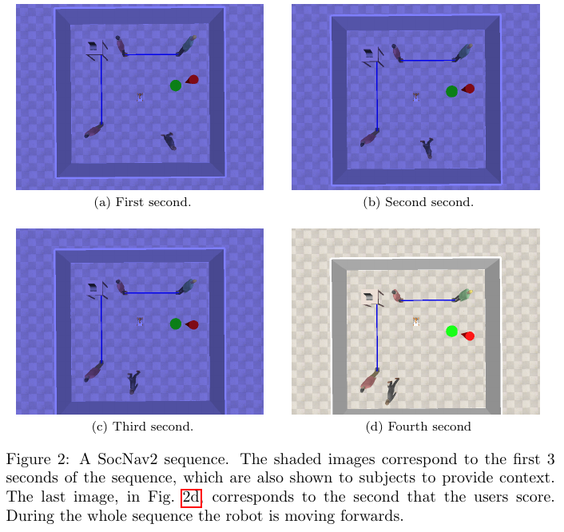

로봇이 사람 옆에 있다는 한 장의 그림만으로는 다가가는 중인지 지나간 뒤인지 알 수 없어요. SocNav2는 움직이는 사람과 로봇의 장면에 사회적 평정을 붙인 자료예요. 같은 위치의 적절함도 이동 방향과 이전 행동에 따라 달라질 수 있다는 질문을 다뤄요.

이 글에서는 원자료가 어떤 순간을 채점했는지, 논문의 모델이 그 시간을 어떻게 압축했는지 살펴봐요. 둘은 같은 문제가 아니에요. 영상 전체를 보여 주었다고 모델이 모든 화면을 입력으로 받은 것은 아니며, 예측한 점수도 다음 속도 명령과는 구분해야 해요.

## 방해와 목표 진행을 따로 물어요

자료의 첫 질문 Q1은 로봇이 사람을 방해하지 않는지를, 둘째 Q2는 사람을 방해하지 않으면서 목표로 효율적으로 움직이는지를 물어요. Q1에서는 목표를 무시하라고 안내해요. 두 질문을 분리하면 사람 곁에 가만히 있는 행동과 사람을 피해 목적지로 가는 행동을 다른 축에서 볼 수 있어요.

설명용으로 사람 앞을 가로막지 않는 구석에 로봇이 계속 멈춰 있다고 가정해요. 주변 방해는 적어도 목적지를 향한 진행은 없어요. 반대로 목적지까지 빠르게 가지만 대화하는 사람 사이를 통과한다면 효율만으로 좋은 행동이라 부르기 어려워요. 이 예는 실제 표본의 점수가 아니라 두 질문이 필요한 이유를 설명한 가정이에요.

Q1과 Q2를 평균 내면 어떤 선택을 했는지 감출 수 있어요. 설명용 점수로 행동 A가 90과 30, 행동 B가 60과 60을 받았다면 평균은 둘 다 60이에요. 사람에게 길을 내준 대기와 적당한 방해를 감수한 진행이 같은 숫자로 합쳐질 수 있어요. 결과를 사용할 쪽에서 질문별 출력을 남겨야 선택의 이유를 설명하기 쉬워요.

두 점수의 차이를 모든 장면에서 순수한 목표 효율이라고 정의하는 것도 조심해야 해요. 사람은 복합 질문을 보고 답하므로 방해와 효율을 늘 같은 비율로 나누어 판단하지 않을 수 있어요. Q2에서 Q1을 빼는 계산은 설계자가 만든 새 지표예요. 자료가 그 차이의 심리적 의미를 별도로 보장한 것은 아니에요.

## 마지막 1초를 평가하는 화면이에요

원자료는 13,406개의 채점 표본을 제공하며, 표본마다 4초 동안의 상태 35개를 담아요. 여섯 명이 평정에 참여했어요. 화면 앞 3초는 어둡게 보여 문맥으로 쓰고 마지막 1초의 행동을 평가하도록 했어요. 따라서 점수의 대상은 영상 전체의 평균적 인상과 구분돼요.

<figure class="fig"><figcaption>앞선 움직임을 보고 마지막 1초를 채점하는 수집 화면이에요. 네 패널과 하위 라벨, 원 그림 설명을 함께 보존했어요. (출처: Bachiller 외, <a href="https://arxiv.org/abs/2102.08863">SocNav2 논문</a>, 그림 2 발췌, <a href="https://creativecommons.org/licenses/by-sa/4.0/">CC BY-SA 4.0</a>, 페이지 여백만 잘랐으며 그림 내용 변경 없음)</figcaption></figure>

이 방식은 방금 전의 이동과 지금의 평가를 연결해요. 로봇이 멈춘 마지막 화면이 같아도, 먼저 양보하고 멈춘 경우와 사람에게 급히 접근한 뒤 멈춘 경우는 다르게 읽힐 수 있어요. 마지막 화면을 정적 자료처럼 떼어 학습하면 그 차이를 설명할 단서를 잃어요. 평정 질문과 입력 시간창을 함께 보존해야 해요.

반대로 앞 3초의 모든 사건을 마지막 점수의 정답으로 간주하면 평가 대상을 넓혀 버려요. 앞부분에서 잠깐 사람이 멀리 있었더라도 마지막 순간 가까이 접근했다면, 이전의 편한 장면이 마지막 행동을 상쇄한다고 가정할 수 없어요. 시간 평균을 만들 때 화면을 보여 준 목적과 채점한 구간을 구분해야 해요.

설명용으로 처음 3초에 90점 수준의 편한 배치, 마지막 1초에 10점 수준의 불편한 배치가 있었다고 가정해요. 시간 가중 평균은 70이지만 마지막 구간의 가정 값은 10이에요. 어느 계산이 맞는지는 숫자의 매끄러움이 아니라 질문에 달려요. 이 수들은 원자료의 평정이나 저자 실험 결과가 아니에요.

수집 화면의 길이를 로봇의 반응 지연으로 읽어서도 안 돼요. 4초는 평가자가 행동을 해석하기 위한 문맥이고, 실제 계획기의 갱신 주기를 정한 값은 아니에요. 실시간 시스템은 더 자주 판단할 수 있지만, 그때 모델에 줄 과거 상태의 간격과 유효성을 맞춰야 해요.

## 35개 상태와 세 시점 그래프를 구분해요

논문의 모델은 35개 상태를 모두 펼쳐 넣지 않아요. 1초 간격의 세 시점을 각각 그래프로 만든 뒤 같은 대상의 시간 연결을 더해요. 마지막 그래프가 평정 대상에 대응해요. 원자료의 저장 밀도와 모델이 사용한 시간 해상도는 이렇게 달라요.

<abbr title="대상과 관계를 따라 정보를 주고받으며 장면의 점수를 계산하는 신경망">그래프 신경망</abbr>이 과거를 본다는 설명만으로는 이 간격을 알 수 없어요. 빠른 접근이나 짧은 양보는 선택한 세 시점 사이에 나타났다 사라질 수 있어요. 반면 모든 상태를 쓰면 입력량과 학습 문제가 달라져요. 원 모델을 재현할 때와 새로운 시간 표현을 시험할 때 결과 이름을 구분해야 해요.

설명용으로 사람이 로봇 앞을 0.4초 동안 빠르게 지나간다고 가정해요. 1초 간격의 두 표본에서는 통과 전과 후만 보일 수 있어요. 가운데 상태를 더 쓰면 횡단을 포착할 가능성은 커지지만, 그 때문에 원 논문의 모델과 같은 입력이라고 말할 수는 없어요. 이 예는 시간 간격에 따른 관측 차이를 설명하며 실제 누락률을 뜻하지 않아요.

시간 연결은 같은 사람이라는 대응을 전제로 해요. 첫 시점의 사람이 둘째 시점에서 다른 사람의 번호로 이어지면 모델은 존재하지 않은 이동을 보게 돼요. 위치가 비슷한 두 사람을 바꾸어 연결하는 오류는 한 화면에서는 눈에 띄지 않아도 시간 그래프에서는 큰 속도 변화처럼 나타날 수 있어요.

가림 뒤에 돌아온 사람을 새 대상으로 처리할지 이전 대상으로 연결할지도 실제 추적기와 연결할 때 생기는 문제예요. 불확실한 연결을 강제로 정답처럼 넣으면 시간 정보를 더했다는 이유로 잘못된 확신이 커질 수 있어요. 연결이 끊긴 입력과 잘못 이어진 입력을 따로 시험하면 어떤 오류가 점수에 더 큰 영향을 주는지 비교할 수 있어요.

이 검사는 원자료의 번호가 틀렸다고 주장하는 것이 아니에요. 합성 장면에서 주어지는 대상 대응을 센서 추적 결과로 바꿀 때 새로 생기는 문제를 분리한 것이에요. 완전한 상태를 받는 점수 모델과 실제 사람을 추적하는 앞단의 성능을 한 결과로 섞지 않는 데 도움이 돼요.

## 로봇 노드는 없고 로봇 기준 표현은 있어요

그래프의 대상 종류는 방, 벽, 목표, 물체, 사람이에요. 로봇을 나타내는 노드는 따로 없어요. 대신 모든 위치·방향 등의 특징이 로봇 기준이고, 방 노드에는 사람 수와 로봇의 속도 명령이 들어가요. 로봇 노드가 없다는 사실을 로봇 상태가 없다고 읽으면 모델 구조를 잘못 이해하게 돼요.

방 노드는 장면의 다른 대상과 양방향으로 연결되고, 상호작용하는 사람과 상대 대상 사이에도 양방향 연결을 둬요. 시간 사이에는 같은 대상을 잇는 연결을 사용해요. 공간적 관계, 장면 전체 문맥, 시간적 대응이 각기 다른 역할을 하므로 하나의 관계선으로 뭉뚱그리면 무엇이 출력에 영향을 주었는지 읽기 어려워요.

이 구조에서 사람의 좌표만 뽑아 쓰는 축약 모델을 만들 수는 있어요. 다만 목표와 방, 상호작용을 지운 모델은 원 논문의 입력을 그대로 쓴 모델이 아니에요. 단순한 입력으로도 비슷한 결과가 나온다면 어떤 자료 조건에서 그런지 묻는 실험이 되고, 원 구조를 재현했다는 주장은 되지 않아요.

위치와 거리는 정규화를 위해 10m를 한 단위로 표현하고, 방향은 사인·코사인으로 나눠요. 이 규약은 실제 센서 출력을 그래프로 옮길 때 중요해요. 설명용으로 2m 거리를 그대로 2로 넣는 것과 정규화해 0.2로 넣는 것은 모델에 다른 장면을 보여 주는 일이에요. 파일 형식이 맞아도 수치의 의미가 틀릴 수 있어요.

방향을 두 성분으로 나누면 각도 경계의 불연속을 줄일 수 있어요. 거의 같은 방향인 179도와 -179도를 숫자 하나로 빼면 358도 차이처럼 보이지만 실제 작은 회전 차이는 2도예요. 사인·코사인은 이 원형 관계를 표현하는 방법이에요. 여기의 각도들은 표현 방식을 풀어 쓴 설명용 예예요.

벽은 선분의 가운데와 접선 방향 등으로 표현해요. 벽 노드가 있다고 로봇 외형과 모든 장애물 충돌 검사가 자동으로 해결되지는 않아요. 점수 회귀는 입력 장면을 평가하는 기능이고, 차체가 들어갈 수 있는지를 계산하는 기하 검사는 별도 기능이에요. 두 결과를 함께 사용할 때 어느 쪽이 통행을 막을 권한을 갖는지 정해야 해요.

## 두 출력이 어떤 입력을 쓰는지 확인해요

목표를 고려하지 않는 Q1과 목표 효율을 묻는 Q2가 같은 그래프를 받는다는 점은 진단할 만해요. 위치와 움직임을 고정하고 목표만 옮겼을 때 두 출력이 어떻게 달라지는지 볼 수 있어요. Q1은 목표를 무시하라는 평정 지침과 맞는지, Q2는 바뀐 진행 방향을 반영하는지 따로 질문할 수 있어요. 이 입력 변경 검사는 원 논문 결과를 옮긴 것이 아닌 활용 단계의 제안이에요.

목표를 사람 뒤로 옮기는 경우와 벽 너머 불가능한 곳으로 옮기는 경우는 구분해야 해요. 후자는 수집 과정에서 나오지 않는 장면일 수 있어요. 불가능한 입력에서 출력이 이상하다고 해서 일상적인 입력에서도 같은 결함이 있다고 결론 내릴 수는 없어요. 가능한 목표 위치를 고른 비교와 범위를 벗어난 입력 시험을 따로 기록해야 해석이 명확해져요.

속도 명령도 마찬가지예요. 방 노드에 들어 있는 명령과 실제로 관측된 변위가 항상 같다고 가정할 수는 없어요. 차체가 막혔거나 명령 뒤의 시간이 짧으면 이동 결과가 다를 수 있어요. 센서로 본 위치 변화와 명령을 구분하지 않으면 모델이 계획 의도에 반응했는지 실제 이동에 반응했는지 설명하기 어려워져요. 입력 항목의 이름만 맞추는 작업보다 각 항목이 어느 순간의 무엇인지 정하는 일이 앞서요.

관계를 지우는 진단에서는 사람 자체를 함께 지우지 않아야 해요. 대화 연결만 제거하는 경우와 두 사람 가운데 하나를 삭제하는 경우는 물리적 혼잡도까지 달라져요. 연결의 효과를 보려면 위치, 속도와 대상 수는 유지한 채 관계만 바꾸는 편이 비교 목적에 맞아요. 실제로는 함께 움직이는 사람들이므로 관계를 끊은 가상 입력이 얼마나 현실적인지도 표시해야 해요.

시간 연결을 살펴볼 때는 세 시점의 순서를 뒤집는 시험을 생각할 수 있어요. 다가오는 동작이 멀어지는 동작으로 바뀌면서 속도 특징도 일관되게 바뀌어야 해요. 연결 순서만 거꾸로 두고 속도를 남기면 모순된 입력을 만들어요. 그 출력 변화가 시간 추론의 결과인지 모순을 만난 반응인지 구분하기 어려워요. 시간 반전은 저장 배열을 뒤집는 한 줄짜리 처리가 아니라 장면의 운동을 다시 정의하는 일이에요.

점수의 작은 변화만 보고 모델이 무감각하다고 판정하는 것도 성급해요. 이미 높은 방해를 보이는 장면에서는 목표나 관계 하나를 바꿔도 출력 범위가 압축될 수 있어요. 낮은 방해와 중간 수준의 장면도 함께 골라야 입력 효과를 살피기 좋아요. 장면을 어떤 기준으로 골랐는지 남기면 유리한 예만 택했다는 의문을 줄일 수 있어요.

이런 진단의 결과는 실제 주행 성공률과 별도로 읽어야 해요. 모델의 질문과 입력 사이 일관성을 확인하는 검사이기 때문이에요. 진단을 잘 통과해도 로봇이 길을 찾지 못할 수 있고, 짧은 경로를 잘 따라가도 두 평정 질문을 구분하지 못할 수 있어요. 그래프 점수의 성질을 먼저 확인하면 후속 계획기에서 생긴 문제를 점수 모델 탓으로 돌리거나 그 반대로 해석할 가능성을 줄일 수 있어요.

## 전후진 증강은 물리적 등가의 가정이에요

원문은 좌우 반전과 180도 회전을 이용한 증강을 설명해요. 회전할 때 로봇의 전진 속도 부호도 바꾸며, 사람이 느끼는 불편이 전진·후진에 따라 달라지지 않는다고 가정해요. 최종 자료는 53,600표본으로 보고돼요. 회전만 언급하고 속도 부호를 빼면 원 변환을 재현할 수 없어요.

좌표계가 반대로 돌아도 세계 안의 이동을 일관되게 나타내려면 위치와 방향, 속도가 함께 맞아야 해요. 설명용으로 로봇 앞의 사람이 오른쪽으로 움직이는 장면을 회전했는데 사람의 위치만 뒤집는다고 해볼게요. 방향과 이동이 남으면 사람이 몸을 향한 쪽과 반대로 움직이는 다른 상황이 생길 수 있어요. 입력 변환은 기하 모양뿐 아니라 운동 의미도 보존해야 해요.

전후진의 불편이 같다는 가정은 실제 장비에서는 다시 물어야 해요. 차체 앞뒤 모양, 소리, 표시등, 센서 가림과 사람이 예상하는 진행 방향이 다를 수 있어요. 합성 화면에서 같은 점수를 주는 변환과, 실물에서 같은 수용성을 얻는다는 주장은 서로 다른 검증을 필요로 해요.

또한 증강본은 새로운 평가자에게서 얻은 독립 의견이 아니에요. 같은 평정이 변환 규칙에 따라 늘어난 것이에요. 원본과 변환본이 서로 다른 평가 부분에 섞이면 장면이 완전히 새롭다는 주장도 약해져요. 변환 이전의 장면 단위를 추적하면 평정 정보의 양과 기하 입력의 수를 나눠 설명할 수 있어요.

13,406에 네 배를 곱한 값은 53,624로 최종 보고 수와 24개 차이가 있어요. 원문이 보고한 최종 수는 그대로 적되, 차이의 이유를 임의로 결측·정제 때문이라고 채우지 않아야 해요. 정확한 파일 목록과 처리 코드를 확인하기 전에는 산술 차이를 발견한 사실까지만 말할 수 있어요.

## 멈춤과 후진을 읽는 시간 범위가 필요해요

수집에는 학습한 제어기와 조이스틱 조작을 함께 사용했고, 드문 후진이나 사람을 보내기 위한 정지도 담으려 했어요. 따라서 목표와의 순간 거리만으로 모든 행동을 채점하면 자료가 담으려는 선택을 놓칠 수 있어요. 잠깐 멀어지는 동작이 이후 통과를 위한 준비일 수 있기 때문이에요.

설명용으로 목표에서 2.0m 떨어진 로봇이 0.3m 뒤로 물러난 뒤 1.0m 전진한다고 해볼게요. 두 움직임의 순진전은 0.7m지만 후진 중 한 순간만 보면 목표와 멀어져요. 반대로 뒤로 물러나기만 하고 다시 움직이지 않으면 같은 해석을 줄 수 없어요. 관측 시간이 행동의 일부만 보이는지 확인해야 해요.

점수 모델에 짧은 미래의 계획을 이미 실행한 상태처럼 넣으면 다른 문제가 생겨요. 사람이 평가한 것은 생성된 움직임의 기록이고, 계획기는 아직 일어나지 않은 후보를 비교해요. 미래 사람 반응을 가정해 점수를 계산한다면 그 가정이 틀렸을 때의 영향을 따로 평가해야 해요. 시간 문맥이 있다는 사실이 미래 상호작용 예측을 보장하지는 않아요.

Q1이 높은 행동만 고르면 계속 대기하는 선택에 머물 수 있고, Q2를 강하게 밀면 장면마다 다른 양보 비용을 하나의 진행률로 누를 수 있어요. 실제 결합에서는 대기한 시간, 목표 진행이 없는 구간, 사람이 길을 바꾼 빈도를 함께 봐야 해요. 무엇을 최적화했는지 점수 이름만으로 설명할 수 없어요.

정적 장면의 관계 점수를 다룬 [[2026-10-17_socialnav_socnav1|사회 규범 비용을 그래프로 학습하는 SocNav1 데이터셋]]과 나란히 읽으면 확장이 분명해져요. SocNav2는 움직임과 목표 질문을 더했지만, 합성 장면의 평정을 실제 사람의 경험과 연결하는 일까지 끝낸 자료는 아니에요. 세 시점 그래프의 범위, 두 질문의 뜻, 전후진 증강 가정을 지켜야 무엇을 배웠고 무엇을 새로 검증해야 하는지 구분할 수 있어요.

---
<!-- src-block -->
출처 — https://danidevai.com/navigation/datasets/socnav2/
