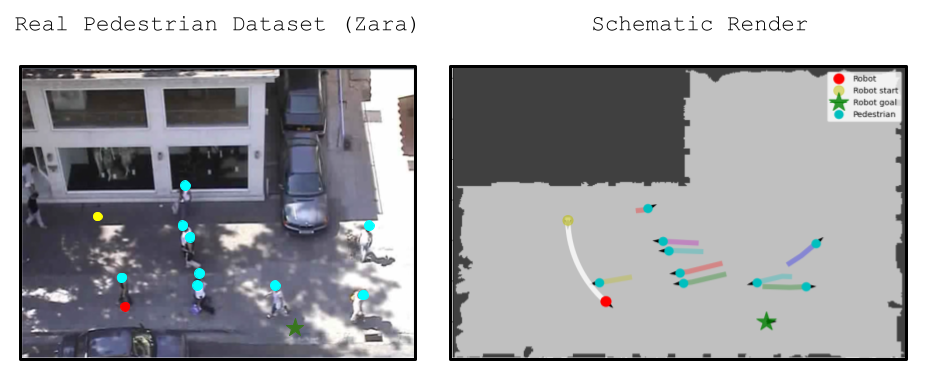

소셜 내비게이션 알고리즘을 비교하려면 같은 지도와 같은 사람 움직임을 반복해서 제공해야 해요. 사람을 임의로 생성하면 매 실행의 난도가 달라지고, 반대로 단순한 직선 보행만 쓰면 실제 장면의 멈춤과 방향 전환이 사라져요. SocNavBench는 UCY와 ETH 보행자 데이터의 기록 궤적을 시뮬레이터에 재생하고, 그 사이를 지나는 로봇의 경로·움직임·사람 근접도를 한 묶음으로 평가해요.

이 선택은 장점과 한계를 함께 만들어요. 기록된 사람이 매번 같은 시각과 속도로 움직이므로 계획기 A와 B를 공정하게 비교하기 좋아요. 그러나 사람은 로봇을 보고 양보하거나 피하지 않아요. SocNavBench의 결과는 실제 궤적을 배경으로 한 로봇의 대응 능력을 말해 주지만, 사람과 로봇이 서로 행동을 바꾸는 상호작용 전체를 검증하지는 않아요.

## 데이터 재생과 시뮬레이터가 맡는 일이 달라요

SocNavBench는 실제 보행자 영상 자체에서 로봇을 운전하지 않아요. 데이터셋에서 추출한 보행자 위치·속도 궤적을 지도 좌표에 놓고, 로봇을 추가한 시뮬레이터 실행을 구성해요. ETH, Univ, Zara, DoubleHotel 지도가 포함되고, 논문과 공식 저장소는 모두 33개 장면을 설명해요.

<figure class="fig"><figcaption>Zara 장면의 실제 보행자 궤적을 도식 지도에 옮겨 로봇 출발점과 목표를 추가해요. (출처: Biswas et al., SocNavBench 공식 README 그림 5.5 · MIT License)</figcaption></figure>

사람은 기록 시점의 속도로 궤적을 따라가요. 로봇이 앞을 막아도 사람 궤적이 바뀌지 않고, 충돌 뒤에도 기록 경로는 계속돼요. 저자들은 이를 숨기지 않고 향후 반응형 보행자 지원 항목으로 구분해요. 따라서 이 환경에서 보수적으로 멈춘 로봇은 사람의 양보를 영원히 기다릴 수 있고, 빈틈을 빨리 통과하는 정책은 실제 상호 양보보다 유리하게 보일 수 있어요.

지도와 궤적만으로 카메라나 라이다 입력이 생기지는 않아요. SocNavBench는 도식 렌더링과 사실적 렌더링을 제공해 센서 입력을 합성해요. 이 영상은 실제 Zara 카메라의 새 관측이 아니라 기록 궤적과 3D 자산에서 생성한 시뮬레이터 관측이에요. 실제 데이터 기반 사람 움직임과 합성 센서를 한 문장으로 묶어 “실제 센서 데이터”라고 부르면 검증 범위를 넓혀 버려요.

설명용으로 사람이 0.8m/s로 횡단하고 로봇이 0.5초 동안 멈춘다고 가정해요. 기록 재생에서는 그 사이 사람이 0.4m 이동해 통로가 열릴 수 있어요. 반응형 사람이라면 로봇이 멈춘 것을 보고 함께 멈추거나 방향을 바꿀 수 있어 결과가 달라져요. 이 수치는 논문 결과가 아니라 재생 모형의 인과 경계를 보이는 가정이에요.

## 33개 실행은 난도를 고정하는 장치예요

각 실행은 사람 수, 밀도, 속도, 이동 방향과 로봇 출발·목표를 정해요. 로봇 시작점과 목표는 최대 속도로 25초 안에 닿을 수 있는 연결 가능한 위치에서 고른다고 설명해요. 이 제한은 끝없이 긴 경로를 배제하지만 실제 계획기가 25초 안에 성공한다는 보장은 아니에요.

선별된 장면은 같은 입력을 모든 알고리즘에 주는 고정 시험 입력이에요. 난수 시드만 맞춘 즉석 생성보다 실패 장면을 다시 열어 보기 쉽고, 렌더링 영상과 궤적 기록을 함께 남겨 수치의 원인을 확인할 수 있어요. 반면 33개가 모든 건물·문화권·군중 행동을 대표하지는 않아요. 지도와 보행 패턴에 대한 과적합도 별도로 살펴야 해요.

로봇은 Pioneer 3-DX에서 영감을 받은 형태가 기본이며 크기와 제어 방식을 바꿀 수 있어요. 속도 명령으로 움직이거나 위치를 갱신하는 방식의 차이는 동역학 난도를 바꿔요. 같은 계획기라도 가속 제한과 회전 지연을 켰을 때 가가속도, 충돌 예상 시간, 목표 도달률이 달라질 수 있어요.

설명용으로 직선거리 8m인 목표를 최고 1m/s 로봇이 향한다고 가정하면 장애물이 없어도 최소 8초가 필요해요. 25초 도달 가능성 조건은 여유 17초를 주지만, 군중 대기와 회전 시간이 이를 쓸 수 있어요. 최고 속도를 0.5m/s로 바꾸면 같은 조건의 최소 시간이 16초가 되므로 실행 제한을 로봇 설정과 함께 기록해야 해요.

## 전체 내비게이션 구성을 조이스틱 API로 평가해요

SocNavBench는 계획기 내부 함수 하나를 호출하는 대신 전체 내비게이션 구성이 조이스틱 형식 명령을 내도록 연결해요. 시뮬레이터는 명령을 적용하고 다음 관측을 반환해요. 계획기가 인지, 추적, 전역 경로, 지역 제어를 함께 포함할 수 있어 실제 구성 경계에 가까워져요.

<figure class="fig"><figcaption>동일 장면을 실행한 뒤 지표 점수, 렌더링 영상, 궤적 기록을 함께 남기는 구조예요. (출처: Biswas et al., SocNavBench 공식 README 그림 1 · MIT License)</figcaption></figure>

실행에는 동기와 비동기 방식이 있어요. 동기 방식은 각 시뮬레이션 시점에서 로봇 명령을 기다린 뒤 다음 상태로 넘어가요. 느린 계획기도 계산이 끝날 때까지 가상 시간이 멈추므로 알고리즘 논리를 비교하기 좋아요. 비동기 방식은 시뮬레이터 시간이 계속 가므로 명령 지연이 행동 결과에 반영돼요.

두 방식의 성공률을 같은 의미로 섞으면 안 돼요. 동기 시험은 300ms 계산도 그 사이 사람이 멈춘 것처럼 처리할 수 있지만, 실제 로봇에서는 사람이 계속 이동해요. 비동기 시험은 호스트 부하와 렌더링기 부하까지 결과에 섞여요. 계획기 품질과 실행 시간 한계를 분리해 보고, 마지막에는 목표 장치에서 시간 한계를 포함한 시험을 해야 해요.

설명용으로 시뮬레이터 시점이 100ms인데 계획기가 평균 70ms, P95 140ms라고 가정해요. 동기 방식에서는 모든 명령이 적용되지만 비동기 방식에서는 일부 명령이 한 시점 늦을 수 있어요. 평균만 보면 시간 한계 초과가 가려지므로 명령 경과 시간과 P95·P99를 같이 기록해야 해요.

## 점수는 하나가 아니라 네 층으로 읽어요

SocNavBench 지표는 경로 품질, 움직임 품질, 사람과의 관계, 종합 결과로 나눠 볼 수 있어요. 경로 길이와 직선 대비 비율, 불규칙도, 목표 통과, 이동 시간은 경로 효율을 보여줘요. 속도, 가속도, 가가속도, 속도 제곱 적분은 움직임의 매끄러움과 움직임에 든 노력을 나타내요.

사람과의 관계에는 가장 가까운 사람 거리와 <abbr title="현재 상대 위치와 속도가 유지될 때 충돌까지 남은 시간">충돌 예상 시간</abbr>이 들어가요. 성공 여부, 충돌, 계획 시간 같은 종합 지표도 별도로 남아요. 최소 거리와 충돌 예상 시간은 각각 10m와 10초를 넘는 값을 평균에서 제외해 가까운 상호작용에 초점을 둬요. 이 잘라내기 규칙은 반드시 보고해야 해요. 멀리 떨어진 안전 실행이 평균에 포함되지 않아 전체 분포처럼 오해할 수 있기 때문이에요.

성공은 목표에 도달했고 사람 충돌이 없어야 해요. 실행이 끝까지 실행됐다는 완료와 성공은 다른 값이에요. 벽에 막히거나 시간 초과가 난 장면, 충돌 뒤 목표에 닿은 장면을 성공으로 세면 결과가 달라져요. 지표 구현의 분모와 제외 조건을 함께 공개해야 해요.

경로가 짧다고 사회적인 것도 아니고, 최소 거리가 크다고 효율적인 것도 아니에요. 모든 지표를 하나의 가중합으로 줄이면 가중치 선택이 결론을 정할 수 있어요. Pareto 관점으로 성공률, 시간, 최소 거리, 가가속도를 나란히 보고 장면별 실패를 다시 보는 편이 안전해요.

설명용으로 계획기 A가 10m를 12초에 가며 최소 거리 0.5m, 계획기 B가 13m를 18초에 가며 1.2m를 유지한다고 가정해요. 거리와 시간에는 A가, 여유 거리에는 B가 좋아요. “최고”를 정하려면 병원 복도인지 물류 통로인지 요구 조건을 먼저 정해야 해요. 이 예는 논문 표를 재현한 값이 아니에요.

## ORCA와 SA-CADRL 비교도 사람 비반응성을 안고 있어요

논문은 ORCA, SA-CADRL, 사람을 고려하지 않는 기준선 등을 공통 환경에서 비교해요. 33개 중 네 후보 알고리즘이 모두 완료한 29개 실행을 중심으로 지표를 비교했다고 밝혀요. 비교 가능한 교집합을 쓰면 같은 장면에서 수치를 볼 수 있지만, 실패한 네 장면이 평균에서 사라지는 선택 편향이 생겨요.

ORCA는 다른 행위자도 서로 피한다는 가정이 있어요. SocNavBench 사람은 기록 궤적을 유지하므로 협력 계수를 조정해 시험해요. 이 조정은 공정한 적용에 필요하지만, 원래 알고리즘 설정과 다른 변형이라는 사실을 남겨야 해요. SA-CADRL도 관측된 사람 위치·속도와 반경을 이용하며 실제 검출기가 누락한 사람을 자동으로 찾는 방법은 아니에요.

사람을 고려하지 않는 기준선은 사람을 고려하지 않는 전역 또는 지역 결정이 어떤 위험을 만드는지 보여주는 기준선이에요. 그러나 다른 구성 요소나 속도 제한이 다르면 사람 고려 여부 외의 차이가 섞여요. 동일 지도, 동역학, 목표 허용값, 제어 주기를 고정해야 인과 비교가 가능해요.

29개 공통 완료 실행 평균과 33개 전체의 실패 개수를 함께 제시하는 것이 좋아요. 전자는 성공한 장면의 품질을, 후자는 포괄 범위를 보여줘요. 한 정책이 어려운 네 장면을 포기해 평균 경로가 좋아지는 현상을 막을 수 있어요.

## 센서와 추적기 실패를 넣으려면 별도 실험이 필요해요

공식 그림의 사람 위치와 속도는 시뮬레이터가 아는 정답이에요. 원시 렌더링을 입력으로 쓸 수 있어도 검출기·추적기가 어떤 오차를 내는지는 SocNavBench가 자동으로 보장하지 않아요. 정답 상태 정책과 센서 상태 정책을 구분하고 연결부에서 누가 ID·속도·반경을 만들었는지 기록해야 해요.

검출 누락 시험에서는 특정 사람을 임의로 완전히 지우는 것과 카메라 가림으로 안 보이게 하는 것을 나눠요. 전자는 계획기 견고성을 빠르게 재지만 실제 영상 오차의 구조를 재현하지 못해요. 후자는 렌더링, 검출기 임계값, 추적기 유지 시간까지 포함하므로 원인 분리가 어렵지만 현실에 가까워요.

속도 오차도 중요해요. 충돌 예상 시간은 상대 속도가 분모에 들어가므로 작은 오차가 접근 시간이 길 때 크게 흔들릴 수 있어요. 상대 거리가 1m이고 접근 속도가 0.5m/s면 단순 TTC는 2초예요. 속도를 0.3m/s로 잘못 추정하면 약 3.33초가 돼 제동 시점이 1.33초 늦어질 수 있어요. 설명용 1차원 계산이며 SocNavBench 결과 수치가 아니에요.

식별자 교환은 위치 집합이 맞아도 이력 기반 정책을 흔들어요. 두 사람이 교차할 때 식별자가 바뀌면 각자의 속도 추세와 의도가 뒤섞여요. 정답 궤적 식별자를 정책에 주는 시험, 잡음이 섞인 추적을 주는 시험, 원시 센서를 주는 시험을 세 층으로 나누면 어느 단계에서 성능이 떨어지는지 찾기 쉬워요.

## 재현성은 장면보다 실행 계약을 더 많이 요구해요

33개 장면 이름만으로 재현이 끝나지 않아요. 저장소 판본, 자료 좌표 변환, 로봇 외곽, 속도와 가속도 제한, 제어 주기, 동기 여부, 렌더링 방식, 지표 임계값을 함께 고정해야 해요. 계획기 자체 모형 점검 지점과 관측 전처리도 결과에 포함돼요.

환경 부하를 확인하려면 화면 없는 방식과 사실적 방식을 같은 계획기로 각각 실행해요. 궤적이 달라지면 시각 관측 때문인지 실행 시간 지연 때문인지 분리해야 해요. 동일 기록 상태를 계획기에 재생해 명령을 비교하면 렌더링 시간을 제거할 수 있어요.

반응형 사람에 대한 외삽을 막는 시험도 필요해요. 기록 재생 결과가 좋은 후보를 [HuNavSim이 로봇에 반응하는 여섯 사람 행동을 만든 방식](https://github.com/robotics-upo/hunav_sim)의 `regular`·`impassive`·`surprised` 조건에 옮겨 보되, 두 시뮬레이터의 좌표·동역학·지표 차이를 맞춰요. 결과가 달라지면 어느 쪽이 틀렸다기보다 사람 모형 가정에 민감하다는 뜻이에요.

## 제외된 값과 실패 장면을 다시 분모에 넣어요

가장 가까운 사람 거리와 충돌 예상 시간을 잘라내는 최대 기준은 관심 구간을 선명하게 만들지만, 평균의 분모를 장면마다 바꿀 수 있어요. 사람과 멀리 떨어져 10초보다 큰 충돌 예상 시간만 나온 실행은 그 지표 평균에서 빠질 수 있어요. 반대로 좁은 장면은 짧은 값이 많이 남아요. 정책별로 포함된 표본 수가 다르면 평균만 나란히 놓아서는 안전 장면이 얼마나 많았는지 알 수 없어요.

지표마다 유효 표본 수, 제외된 값의 수와 전체 실행 수를 함께 적는 편이 좋아요. 최대 기준에 걸린 값을 모두 10초로 두는 방법과 제외하는 방법도 결과가 달라져요. 논문 구현과 같은 규칙을 재현하되, 전체 분포를 볼 때는 최대 기준 초과 비율을 별도 지표로 남겨야 해요.

설명용으로 정책 A의 충돌 예상 시간이 2·3·12초이고 정책 B가 4·5·6초라고 가정해요. 10초 초과를 제외하면 A 평균은 2.5초, B는 5초예요. 그러나 A에는 아주 안전한 한 장면이 있었어요. 최대 기준을 10초로 고정하면 A 평균은 5초가 돼 해석이 달라져요. 이 수치는 논문 표가 아니라 잘라내기 규칙의 영향을 보이는 계산이에요.

공통 완료 29개만 비교하는 표에도 같은 문제가 있어요. 네 후보 모두 끝낸 장면은 알고리즘들이 상대적으로 다루기 쉬운 부분일 수 있어요. 각 정책의 33개 전체 성공·충돌·시간 초과 수를 먼저 보여 주고, 그다음 공통 29개에서 움직임 품질을 비교하면 포괄 범위와 성공 장면의 품질을 함께 볼 수 있어요.

## 원인을 가리는 절제 시험은 한 층씩 바꿔요

첫 시험은 기록 사람 궤적과 로봇 동역학을 고정하고 계획기만 바꿔요. 둘째는 같은 계획기에서 동기와 비동기 실행을 바꿔 계산 지연 영향을 봐요. 셋째는 정답 사람 상태, 잡음이 섞인 추적, 센서 기반 인지 순서로 입력을 바꿔요. 마지막에 반응형 사람 모형으로 옮기면 어느 층에서 성능이 무너졌는지 찾기 쉬워요.

한꺼번에 렌더링 방식, 사람 반응, 제어 주기와 로봇 크기를 바꾸면 실패 원인을 알 수 없어요. 각 실행은 장면 이름, 사람 궤적 판본, 로봇 외곽, 계획기 설정, 계산 시간과 지표 분모를 같은 식별자로 묶어야 해요. 영상은 수치가 놓친 교착과 급회전을 확인하는 근거로 남겨요.

반복 실행에서는 평균만 저장하지 말고 장면별 원자료를 남겨요. 같은 정책이 특정 지도에서 계속 충돌한다면 전체 평균의 작은 차이보다 중요한 설계 결함일 수 있어요. 성공한 실행 하나와 실패한 실행 하나의 궤적·명령·사람 거리를 나란히 보면 임계값 하나가 결론을 바꿨는지도 확인할 수 있어요.

SocNavBench는 실제 보행 궤적을 고정 입력으로 삼고 전체 내비게이션 구성을 동일한 33개 장면에서 비교한다는 점이 선명해요. 강점은 반복 가능한 사람 움직임, 센서 렌더링, 동기·비동기 실행, 다층 지표와 영상·기록을 한 환경에 묶은 데 있어요. 해석의 핵심은 기록된 사람이 로봇에 반응하지 않고, 실제 궤적과 합성 센서가 서로 다른 근거이며, 29개 공통 완료 장면의 평균이 전체 실패율을 대신하지 않는다는 세 가지 경계를 유지하는 일이에요.

---
<!-- src-block -->
출처 — https://github.com/CMU-TBD/SocNavBench
대표 원문
- Biswas et al., SocNavBench: A Grounded Simulation Testing Framework for Evaluating Social Navigation, 2021.
- https://arxiv.org/abs/2103.00047
