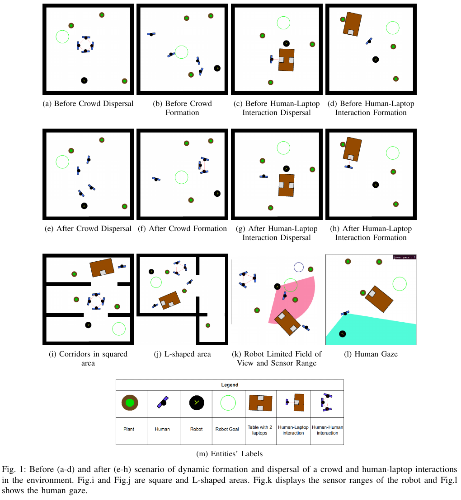
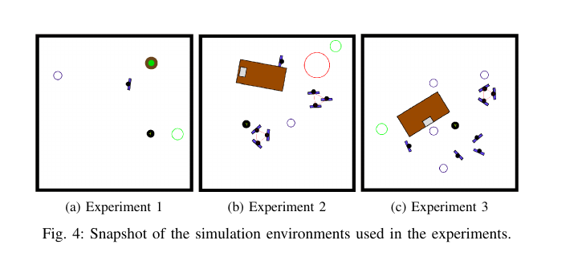

강화학습으로 사회적 내비게이션을 연구하려면 로봇 주변에 사람만 흩어 놓는 것으로 부족해요. 대화 중인 두 사람, 노트북을 사용하는 사람, 움직이다 모이거나 흩어지는 집단은 같은 거리에서도 다른 의미를 만들어요. SocNavGym은 사람·식물·책상·노트북·벽과 관계 정보를 하나의 Gymnasium 환경에 넣고, 관측·행동·보상·평가를 바꿔 가며 학습할 수 있게 해요.

이 환경의 강점은 사회적 장면을 빠르게 반복하는 데 있어요. ROS 연결이나 사실적인 센서 처리보다 강화학습의 상태와 보상 설계에 초점을 둬요. 기본 관측은 시뮬레이터가 알고 있는 개체 상태이며, 실제 카메라나 라이다에서 검출한 값이 아니에요. 부분 관측과 잡음 덧씌우개가 있어도 검출 누락·가림·식별 번호 전환을 모두 재현하는 것은 아니에요.

## 개체와 관계를 따로 표현해요

SocNavGym은 로봇을 제외한 개체를 사람, 식물, 노트북, 책상, 벽으로 구분해요. 사람끼리 대화하는 관계와 사람이 노트북을 사용하는 관계도 별도 인접 목록으로 돌려줘요. 같은 위치 배열을 보더라도 관계 정보가 있으면 로봇이 두 사람 사이를 가르거나 사람과 노트북 사이를 지나가는 행동을 피하도록 학습할 수 있어요.

<figure class="fig"><figcaption>군중과 사람-노트북 관계의 형성·해체, 공간 모양, 제한된 시야와 사람 시선까지 장면 요소로 제공해요. (출처: Kapoor et al., SocNavGym, Fig. 1 · 공개 재사용 라이선스 미확인, 논지 비평용 부분 인용)</figcaption></figure>

동적 집단은 새로 모이거나 흩어질 수 있고, 정적 집단도 둘 수 있어요. 사람은 ORCA 또는 사회적 힘 모형으로 움직이며 로봇을 고려할지 무시할지 설정할 수 있어요. 사람 반응 모형과 정책 관측을 같은 항목으로 보지 않아야 해요. 사람 이동 규칙은 환경 전이를 만들고, 관측은 로봇이 그 전이 중 무엇을 받는지 정해요.

설명용으로 두 사람이 0.8m 간격으로 마주 보고 대화한다고 가정해요. 로봇 반경이 0.25m이고 양쪽에 0.2m 여유를 두려면 필요한 폭은 0.25×2+0.2×2=0.9m예요. 점 위치만 보면 0.8m 틈이 있어 보이지만 몸체와 여유를 합치면 통과하지 않는 편이 맞아요. 논문 실험 수치가 아니라 관계와 반경을 함께 보는 이유를 설명한 계산이에요.

## 관측은 로봇 좌표의 사전 구조화된 상태예요

기본 관측은 `gymnasium.spaces.Dict`예요. 로봇 항목은 여섯 종류를 나타내는 표지, 목표의 상대 x·y, 반경을 합친 9차원 벡터예요. 다른 개체는 종류 표지, 상대 위치, 방향의 사인·코사인, 반경, 상대 선속도·각속도, 사람 시선 여부를 합친 14차원 벡터로 표현해요.

같은 종류의 개체 벡터는 한 줄로 이어 붙여요. 사람 네 명이면 14차원 네 개가 56차원 배열이 돼요. 개체 수가 바뀌면 배열 길이도 바뀌므로 고정 크기 신경망에는 채우기나 집합 처리 구조가 필요해요. 벽은 긴 선 하나가 아니라 설정한 길이로 나눈 조각으로 관측될 수 있어 조각 수가 입력 크기에 영향을 줘요.

모든 위치와 속도는 기본적으로 로봇 좌표예요. 로봇이 회전하면 정지한 사람의 좌표와 상대 속도 표현도 바뀌어요. 세계 좌표 덧씌우개를 쓰면 이 규칙이 달라져요. 학습 때와 평가 때 좌표계를 섞으면 정책이 방향을 반대로 해석할 수 있으므로 관측 설정을 모형 파일과 함께 저장해야 해요.

사람의 목표나 숨은 의도는 기본 필수 입력이 아니에요. 관측되는 것은 현재 위치·방향·속도·반경·시선과 관계예요. 실제 적용에서는 추적기가 이 값을 추정해야 하며, 시뮬레이터 정답 상태를 받는 성능과 같은 것으로 볼 수 없어요.

## 부분 관측은 시야 자르기이며 검출기 자체가 아니에요

`PartialObservations` 덧씌우개는 시야각과 감지 범위 안의 개체만 돌려줘요. 공식 예시는 120도 시야와 1m 범위를 설정하는 방법을 보여줘요. 뒤쪽이나 먼 개체를 숨길 수 있어 완전 관측 정책보다 현실적인 입력을 만들어요.

그러나 범위 안 사람은 정답 위치와 종류로 나타나요. 가구 뒤에 가려진 사람, 밝기 때문에 놓친 사람, 두 사람 식별 번호가 바뀌는 현상이 자동으로 생기지는 않아요. `NoisyObservations`는 지정 개체 값에 평균과 표준편차를 가진 가우시안 잡음을 더하지만, 누락과 잘못된 분류는 다른 오차예요.

설명용으로 4m 앞 사람이 위치 표준편차 0.1m의 잡음을 받고, 범위 경계가 4m라고 가정해요. 같은 실제 사람도 어떤 단계에는 포함되고 다음 단계에는 빠질 수 있어 관측이 깜박여요. 여기에 추적 지속 시간을 두지 않으면 정책이 새 사람으로 오인할 수 있어요. 이 현상은 설정에서 유도한 시험 설계이며 저장소의 측정 결과가 아니에요.

가우시안 잡음은 모든 오차를 대칭적으로 만들어요. 실제 깊이 카메라는 먼 물체에서 오차가 커질 수 있고, 라이다 사람 검출은 다리가 가려질 때 한쪽 방향으로 치우칠 수 있어요. 평균 0인 잡음에서 강한 정책이 이런 조건부 오차에도 강하다고 말할 수 없어요. 거리 구간별 편향, 연속 누락 길이, 식별 번호 전환을 따로 주입해 비교해야 해요.

사람 시선 값도 정답에 가까운 기하 판정이에요. 설정된 시야각 안에 로봇이 있으면 1이 되는 방식은 눈·머리·몸 방향을 영상에서 추정하는 문제를 건너뛰어요. 실제 적용에서 시선이 필요한 정책이라면 정확한 값, 오분류 값, 값 없음 세 조건을 시험해야 해요. 값이 없을 때 0으로 넣으면 “로봇을 보지 않음”과 “측정하지 못함”이 합쳐져요.

부분 관측을 검증할 때 시야각 60·120·360도, 범위 1·3·8m를 바꾸고 성공률만 보지 않아요. 처음 발견한 거리, 제동 시작 시점, 최소 거리, 관측 깜박임 횟수도 기록해요. 시야를 좁혀 성능이 떨어지지 않는다면 정책이 사람 관측을 실제로 쓰는지 의심할 근거가 돼요.

## 행동은 속도 명령으로 정규화돼요

전방향 로봇의 행동은 전진 속도, 측면 속도, 각속도 세 값이에요. 각 값은 -1에서 1 사이로 받고 설정된 최고 속도에 맞춰 변환해요. 차동구동 로봇은 측면 속도를 0으로 둬요. 이산 행동 덧씌우개를 쓰면 연속 속도 대신 정해진 명령 집합을 고를 수 있어요.

정규화된 값이 같아도 최고 속도 설정이 다르면 물리 이동량이 달라져요. 학습 환경에서 최고 1m/s였던 정책을 최고 0.5m/s 로봇에 옮기면 같은 한 단계 행동이 절반만 이동해요. 사람 속도와 시간 간격을 그대로 두면 상대 난도가 두 배가 될 수 있어요.

설명용으로 시간 간격이 0.1초이고 전진 명령 0.8, 최고 속도 1m/s라면 한 단계의 이상적 이동은 0.08m예요. 최고 속도가 0.5m/s면 0.04m예요. 가속 제한과 미끄럼은 이 단순 계산에 포함되지 않아요. SocNavGym의 속도 명령 정책을 실제 구동기로 옮길 때 확인할 경계를 보여줘요.

행동이 충돌 없이 적용된다는 사실은 실제 제어기가 같은 궤적을 낸다는 뜻이 아니에요. 회전 반경, 가속도, 명령 지연, 바퀴 포화가 다르면 좁은 통로에서 결과가 달라져요. 전방향과 차동구동 결과를 같은 표에 넣을 때 로봇 형태와 속도 제한을 함께 적어야 해요.

시간 간격도 학습 문제의 일부예요. 한 단계가 0.05초인 환경과 0.2초인 환경은 같은 200단계 제한에서도 각각 10초와 40초를 뜻해요. 보상이 단계마다 부과되면 실제 시간당 벌점도 네 배 차이 날 수 있어요. 실행 제한, 할인율, 사람 속도, 제어 주기를 함께 바꾸지 않으면 학습 난도와 보상 크기가 예상과 다르게 움직여요.

이산 행동에서는 회전과 전진을 동시에 할 수 있는지 확인해야 해요. 행동 집합이 전진·좌회전·우회전·정지만 제공하면 연속 제어보다 궤적이 계단처럼 보여 가가속도 지표가 나빠질 수 있어요. 두 정책의 신경망만 비교하고 행동 공간이 다르면 알고리즘 차이라고 결론내기 어려워요.

## 보상은 거리 문턱과 사람 의견 기반 점수를 비교해요

환경은 충돌에 벌점, 목표 도달에 보상, 목표 거리 감소에 진행 보상을 주는 전통적 구성을 지원해요. 논문은 사람과의 일정 거리 안에서 벌점을 주는 DSRNN 계열 보상과, 사람 의견으로 학습한 SNGNN-v2 불편 점수를 이용한 보상을 비교해요.

거리 문턱 보상은 계산이 단순하지만 사람의 방향, 속도, 관계를 같은 거리에서 똑같이 다뤄요. 앞에서 다가오는 사람과 등을 보인 채 멀어지는 사람이 0.7m에 있어도 같은 벌점을 줄 수 있어요. SNGNN-v2 점수는 장면 맥락을 더 반영하려 하지만, 그 모형이 학습한 사람 의견의 분포와 새 환경이 다르면 오차가 생겨요.

<figure class="fig"><figcaption>논문은 한 사람 장면에서 정적·동적 군중과 사람-노트북 관계가 있는 장면으로 난도를 높여 보상 설계를 비교해요. (출처: Kapoor et al., SocNavGym, Fig. 4 · 공개 재사용 라이선스 미확인, 논지 비평용 부분 인용)</figcaption></figure>

사례 연구는 Dueling DQN을 두 보상으로 각각 학습해요. 신경망은 512·256·128·64 크기의 다섯 선형 층을 사용하고, 고정 학습률 0.001로 5만 실행, 실행당 최대 200단계를 학습했다고 보고해요. 이 설정은 환경 사용 가능성을 보이는 사례이며 모든 강화학습 알고리즘의 우위를 증명하지 않아요.

자체 보상 함수도 만들 수 있어요. 이전과 현재 개체 관측, 현재 행동을 받아 계산하도록 인터페이스가 열려 있어요. 보상을 바꿀 때 종료 조건과 평가 지표까지 함께 바꾸면 원인 분리가 안 돼요. 동일 장면·행동 공간·종료 조건에서 보상만 바꾸고 여러 시드로 반복해야 해요.

보상 모형의 입력 범위를 벗어나는 장면도 확인해야 해요. 사람-노트북 관계가 학습 자료에 적거나 L자 통로가 드물었다면, 점수는 그 장면에서 그럴듯한 값만 낼 수 있어요. 거리 기반 보상과 사람 의견 기반 보상을 같은 궤적에 계산해 불일치가 큰 프레임을 모으면 검토 대상을 찾기 쉬워요.

설명용으로 진행 보상이 단계당 0.01이고 불편 벌점이 한 번 -0.5라고 가정해요. 100단계 동안 진행하면 누적 진행 보상은 1이어서 한 번의 가까운 통과를 상쇄할 수 있어요. 할인과 종료 보상이 더해지면 관계가 달라져요. 수치는 보상 항의 규모를 함께 공개해야 한다는 예이며 논문 설정을 재현한 값이 아니에요.

## 벽 조각과 채우기는 입력 크기를 바꿔요

벽은 설정된 길이마다 나뉘어 여러 개체처럼 관측돼요. 같은 방도 벽 조각 길이를 절반으로 줄이면 벽 입력 수가 대략 두 배가 될 수 있어요. 신경망이 배열 순서에 민감하면 기하가 같아도 출력이 달라질 수 있어요. 벽 조각 길이와 정렬 순서를 고정하고, 순서를 섞어도 행동이 유지되는지 확인해야 해요.

개체 수를 고정 길이로 채울 때 빈 칸의 의미도 중요해요. 0으로 채운 빈 사람은 로봇 원점에 정지한 반경 0 사람과 수치가 겹칠 수 있어요. 별도 마스크를 주거나 유효 개수를 함께 전달해야 해요. 학습 때 최대 10명이었는데 평가 때 15명이 나오면 잘라낼 다섯 명을 거리순으로 고르는지, 처음 들어온 순서로 고르는지에 따라 위험한 사람이 사라질 수 있어요.

설명용으로 14차원 사람 벡터를 최대 10명까지 채우면 사람 부분은 140차원이에요. 최대 20명으로 늘리면 280차원이 돼 기존 첫 층의 크기가 맞지 않아요. 집합 신경망이나 주의 구조는 가변 수를 다루기 쉽지만, 채움 마스크와 순서 문제까지 자동으로 해결하지는 않아요.

## 평가는 성공률보다 넓은 정보를 돌려줘요

정보 사전에는 사람·물체·벽 충돌, 목표 도달, 시간 초과, 진행 실패, 멈춘 시간, 실행 시간과 경로 길이가 들어가요. 최단 경로 대비 실제 경로 비율, 속도·가속도·가가속도의 최소·평균·최대, 충돌 예상 시간, 사람 최소 거리, 개인 공간 준수도 확인할 수 있어요.

개인 공간 문턱은 0.45m로 구현돼 있지만 문화·장면·접근 방향에 관계없이 보편적인 편안함 경계라고 단정하면 안 돼요. 좁은 엘리베이터와 넓은 로비는 같은 거리의 의미가 달라요. 문턱 아래 시간의 비율을 보고할 때 로봇과 사람 반경이 포함됐는지도 확인해야 해요.

성공률이 높아도 오래 멈추거나 큰 가가속도를 만들 수 있어요. 반대로 넓게 우회한 정책은 편안해 보이지만 통로를 오래 점유할 수 있어요. 성공, 충돌, 시간, 최소 거리, 멈춤, 경로 효율을 나란히 보고 장면별 분포를 보존해야 해요.

충돌 종류를 나누는 이유도 여기에 있어요. 사람 충돌은 사회적 안전과 연결되지만 식물·책상·벽 충돌은 기하 회피 실패를 뜻해요. 모든 충돌을 하나로 합치면 사람에게서 멀리 피하다 벽에 닿는 정책과 사람을 들이받는 정책이 같은 한 건으로 세어져요. 충돌 전 1초의 관측과 행동을 함께 저장하면 보상, 관측, 제어 중 어느 경계가 원인인지 좁힐 수 있어요.

평균 최소 거리는 위험한 꼬리를 숨길 수 있어요. 100회 중 95회가 1m, 5회가 0.05m라면 평균은 약 0.95m지만 다섯 번은 매우 가까워요. 하위 5백분위, 문턱 아래 머문 시간, 충돌 횟수를 함께 공개해야 해요. 이 숫자는 분포 보고의 필요성을 보이는 설명용 가정이에요.

설명용으로 20m 최단 경로를 25m 이동하면 경로 비율은 1.25예요. 두 정책이 모두 성공해도 하나는 1.05, 다른 하나는 1.60이면 효율 차이가 커요. 다만 긴 우회가 사람 집단을 피하기 위한 것이라면 비율 하나만으로 나쁘다고 평가할 수 없어요.

## ROS 환경이 아니라 Gymnasium 상태 실험 환경이에요

공식 설치와 예시는 Python에서 `make`, `reset`, `step`, `render`를 호출하는 Gymnasium 흐름이에요. ROS 주제나 서비스로 센서와 속도 명령을 연결했다는 검증은 대표 저장소에서 제시되지 않아요. ROS 2 Jazzy 로봇에 바로 꽂는 구성으로 설명하면 범위를 넘어요.

실제 적용을 준비하려면 시뮬레이터 관측을 실제 추적기 출력 형식으로 변환하는 경계를 먼저 만들어요. 개체 종류, 식별 번호, 상대 위치·속도, 반경, 시선, 관계 중 실제로 얻을 수 없는 항목을 표시해요. 얻지 못하는 값을 0으로 채우면 “없음”과 “0”이 섞일 수 있으므로 마스크가 필요해요.

[[2026-10-17_socialnav_socnavbench|SocNavBench가 실제 보행 궤적으로 플래너를 재는 방식]]은 실제 기록 궤적을 고정 재생해 전체 내비게이션 묶음을 비교해요. SocNavGym은 개체와 관계를 구성해 강화학습의 관측·행동·보상을 빠르게 바꾸는 환경이에요. 실제 궤적 재현성과 상태 설계 유연성이라는 서로 다른 목적을 구분하면 두 도구를 보완적으로 쓸 수 있어요.

SocNavGym의 고유한 가치는 사람 수를 늘리는 데 있지 않아요. 군중 형성·해체, 사람-노트북 관계, 사람 시선, 부분 관측, 잡음, 좌표계, 맞춤 보상과 세밀한 정보 지표를 한 환경에서 조합해요. 결과를 해석할 때는 이 값들이 시뮬레이터 정답 상태에서 시작하고, 부분 관측은 센서 검출기 전체가 아니며, Gymnasium 성공이 ROS 2 실물 배포를 보장하지 않는다는 경계를 유지해야 해요.

---
<!-- src-block -->
출처 — https://github.com/gnns4hri/SocNavGym
대표 원문
- Kapoor et al., SocNavGym: A Reinforcement Learning Gym for Social Navigation, IEEE RO-MAN 2023.
- https://arxiv.org/abs/2304.14102
