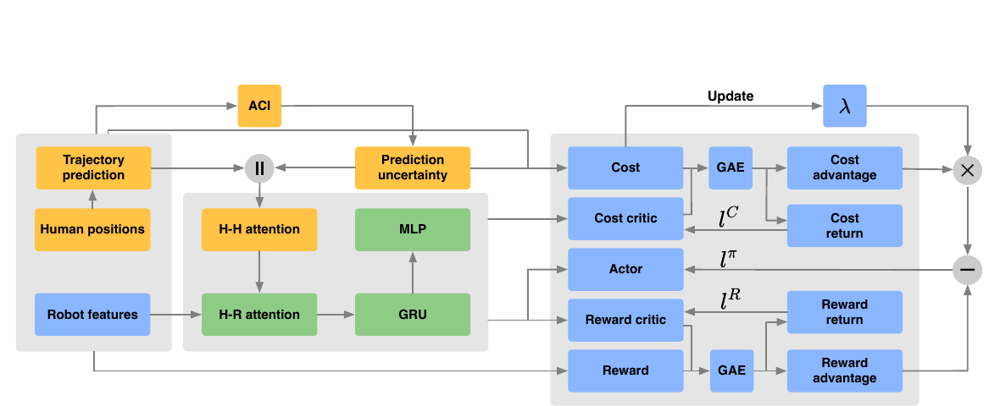

사람 궤적 예측기는 미래 위치 하나를 내놓을 수 있지만, 주행 정책에는 그 점이 얼마나 틀릴 수 있는지도 필요해요. SoNIC은 최근 예측 오차를 이용해 사람 주변의 불확실성 영역을 계속 조정하고, 로봇이 그 영역을 침범한 정도를 강화학습의 비용으로 넣어요. 예측기, 오차 보정, 주행 정책을 하나의 안전 주장으로 섞지 않고 연결하는 구조가 핵심이에요.

## 예측 점 주위에 오차로 조정되는 공간을 만들어요

사람 미래 궤적은 등속도 모형이나 GST 예측기로 만들어요. 각 사람과 미래 시각마다 예측 위치가 있고, 실제 위치가 확인된 뒤 예측 오차를 계산해요. SoNIC은 이 오차의 순서를 이용하는 <abbr title="시간에 따라 달라지는 오차 분포에 맞춰 예측 구간의 크기를 갱신하는 방법">적응형 컨포멀 추론</abbr>으로 다음 불확실성 반경을 조정해요.

논문은 DtACI를 사용해 목표 오류율 (\alpha)를 따라가요. 실험의 (\alpha=0.1)은 예측 오차가 영역 밖으로 나가는 비율을 약 10%로 맞추려는 설정, 즉 약 90% 포함률 목표예요. 최근 오차가 커지면 영역을 늘리고 작아지면 줄여 분포 변화에 적응해요. 고정 공분산보다 온라인 변화에 반응할 수 있어요.

<figure class="fig"><figcaption>예측 오차로 만든 불확실성 점수와 영역을 정책 상태와 비용에 연결해요. (출처: Yao et al., SoNIC, Fig. 2)</figcaption></figure>

컨포멀 영역은 충돌 확률 자체가 아니에요. 예측 오차가 영역 안에 들어오는 빈도에 관한 보정이고, 데이터 교환 가능성이나 온라인 갱신 조건, 선택한 적응 규칙에 기대요. 영역 안에 사람이 있어도 로봇이 같은 곳에 있지 않으면 충돌하지 않고, 사람이 영역 밖에 있어도 로봇과 멀면 충돌하지 않아요. 포함률과 물리 안전률은 서로 다른 사건이에요.

설명용으로 100개의 다음 위치 예측 중 90개가 영역 안에 들어왔다고 해볼게요. 이는 경험적 포함률 90%예요. 그중 로봇 경로와 겹친 영역이 20개라면 실제 주행 위험은 그 20개에서의 상대 위치와 제어에 달려요. 90이라는 숫자를 90% 충돌 회피 보장으로 읽을 수 없는 이유예요. 이 예시는 지표 관계를 설명하기 위한 가정이에요.

## 불확실성은 정책 입력과 비용 제약 두 곳에 들어가요

SoNIC 정책은 사람·사람 관계와 사람·로봇 관계를 주의 집중으로 처리하고 GRU로 시간 정보를 담아요. 각 사람의 관측 상태와 예측뿐 아니라 컨포멀 점수와 불확실성 정보를 상태에 붙여요. 정책은 같은 평균 궤적이라도 최근 오차가 큰 사람과 안정적인 사람을 다르게 볼 수 있어요.

학습에는 행동을 내는 행동망, 목표 도달과 효율을 평가하는 보상 평가망, 안전 비용을 평가하는 비용 평가망이 있어요. PPO의 라그랑주 제약 버전을 사용해 기대 보상을 높이면서 누적 비용이 예산을 넘지 않도록 학습해요. 비용은 단순 충돌 0·1보다 사람 예측 주변의 확장 영역을 얼마나 침범했는지 조밀하게 줘요. 충돌이 드물어도 위험하게 가까워진 경험에서 학습 신호를 얻을 수 있어요.

침범 비용은 반경 선택에 민감해요. 반경이 작으면 정책이 예측 평균 가까이를 지나가도 비용이 거의 없고, 반경이 크면 열린 길도 막힌 것처럼 보여요. 컨포멀 보정은 반경을 오차에 맞추지만, 목표 오류율과 점수 정의, 갱신 속도는 여전히 설계 선택이에요. 비용 예산도 정책이 어느 정도 침범을 허용할지 정해요.

설명용으로 사람 예측 반경이 0.6m이고 로봇 반지름과 추가 여유를 합쳐 0.4m라고 하면 중심 간 요구 거리는 1.0m가 돼요. 최근 오차가 커져 예측 반경이 0.9m가 되면 요구 거리는 1.3m로 늘어요. 좁은 2.2m 통로 중앙에 사람이 있으면 양쪽으로 이 거리를 확보할 수 없어 정책이 정지하거나 큰 비용을 감수할 수 있어요. 숫자는 원리를 보이는 가정이며 논문 장면을 재현한 값은 아니에요.

## 시뮬레이션은 예측기와 사람 행동의 변화도 시험해요

CrowdNav 계열 환경에서 SoNIC은 96.93% 성공률을 보고하고, 논문은 비교 방법보다 성공률이 11.67% 높으며 충돌은 4.5배, 불확실성 영역 침범은 2.8배 적다고 요약해요. 이 수치들은 논문 설정의 학습·평가 분포와 기준 방법에서 나온 상대 결과예요. 다른 센서, 지도, 사람 밀도에 같은 비율이 유지된다는 뜻은 아니에요.

분포 밖 시험에서는 일부 사람을 2m/s로 빠르게 움직이는 빠른 보행 상태로 만들고, ORCA 대신 Social Force 보행자를 사용해요. 예측 오차와 상호작용 규칙이 바뀌는 조건이에요. 고정된 불확실성보다 온라인 오차에 적응하는 방식의 목적을 확인할 수 있어요. 다만 검출기가 사람을 완전히 놓치는 조건과는 달라요. 사람 상태가 관측되고 예측 오차를 계산할 수 있어야 보정도 갱신돼요.

부분적으로 20%의 사람이 빠르게 움직이는 설정은 평균 속도 변화와 꼬리 위험을 함께 만들어요. 결과를 볼 때 전체 충돌률뿐 아니라 빠른 사람과의 충돌률을 따로 나누는 편이 좋아요. 느린 사람 다수가 지표를 지배하면 급한 접근의 취약성이 가려질 수 있어요. 사람별 속도 구간과 예측 지평별 포함률도 함께 필요해요.

컨포멀 갱신 속도는 분포 전환의 길이와 맞아야 해요. 설명용으로 10초 동안 안정적인 보행을 본 뒤 한 사람이 갑자기 2m/s로 달리기 시작했다고 해볼게요. 반경이 커지는 데 2초가 걸리면 그 2초가 가장 위험한 과도 구간이에요. 최종 90% 포함률이 맞더라도 전환 직후의 연속 이탈 길이를 따로 측정해야 해요. 평균 포함률만으로는 시간적으로 몰린 실패를 볼 수 없어요.

## 적응형 포함률은 조건을 갖춘 통계 보장이에요

컨포멀 방법의 장점은 임의의 신경망 신뢰도 대신 실제 예측 오차 순위를 사용해 목표 오류율을 제어한다는 점이에요. 그러나 온라인 환경에서는 오차 분포가 바뀌고 연속 표본이 서로 의존해요. DtACI는 이런 변화에 적응하도록 설계됐지만, 모든 미래 시각과 모든 하위 집단에서 동시에 정확히 90%를 보장한다는 뜻은 아니에요.

예를 들어 전체 1,000개 예측에서 900개가 영역 안에 들어와도, 가림 직후 100개에서는 60개만 들어올 수 있어요. 전체 포함률은 목표에 가까워도 가장 위험한 조건은 과소 보정돼요. 센서 거리, 사람 속도, 가림 여부, 예측 지평으로 나눈 조건부 포함률을 봐야 해요. 하위 집단 표본이 적다면 신뢰 구간과 원자료 수도 함께 제시해야 해요.

시간 지평도 구분해야 해요. 0.5초 뒤 위치는 잘 맞고 3초 뒤 위치는 크게 틀릴 수 있어요. 미래 시각별로 별도 점수나 반경을 사용하더라도, 정책 입력과 비용이 어느 시각의 오차에 가장 민감한지 확인해야 해요. 긴 지평 반경이 지나치게 커져 모든 경로를 막는다면 목표 오류율을 유지한 채 주행 가능성을 잃을 수 있어요.

물리 안전은 예측 포함 외에 로봇 동역학과 제동을 요구해요. 영역이 사람을 포함했어도 정책이 늦게 반응하거나 베이스가 명령을 따라가지 못하면 침범해요. 반대로 영역 밖으로 사람이 나가도 독립 충돌 감시기가 정지시킬 수 있어요. 컨포멀 포함, 정책 비용 준수, 실제 최소 거리, 안전 계층 개입을 별도 지표로 저장해야 각 층의 기여가 보여요.

## 실물 SoNIC은 외부 노트북에서 계산해요

실물 플랫폼은 ROSMASTER X3 메카넘 로봇과 RPLIDAR-A1을 사용해요. ROS 2에서 약 6Hz의 2차원 라이다 관측을 DR-SPAAM으로 사람 검출하고 SORT로 추적해요. GST가 궤적을 예측하고 SoNIC이 행동을 만들어요. 로봇과 계산기는 라우터로 연결되며 정책과 인식은 Nvidia RTX 3070 Mobile이 있는 외부 노트북에서 돌아가요.

<figure class="fig"><figcaption>15×20m보다 큰 야외 테라스에서 장거리 목표 주행을 시험했어요. 인식·예측·정책 계산은 외부 RTX 3070 Mobile 노트북을 사용해요. (출처: Yao et al., SoNIC, Fig. 5)</figcaption></figure>

이 구성은 Raspberry Pi 온보드 실행 성능을 보여주지 않아요. 외부 노트북과 무선 네트워크의 처리량·지연을 포함한 시스템이에요. 6Hz 관측이면 새 라이다 프레임 간격이 약 167ms예요. 그 사이 사람과 로봇은 계속 움직이므로 추적 외삽과 제어 갱신이 오래된 관측을 얼마나 보완하는지 확인해야 해요.

설명용으로 사람이 1.5m/s로 로봇을 가로지르면 167ms 동안 약 0.25m를 이동해요. 네트워크와 처리 지연이 추가 100ms라면 관측 시각부터 명령까지 약 0.40m를 이동할 수 있어요. 논문의 실측 지연이 아니라 6Hz 센서 주기에서 타임스탬프 관리가 중요한 이유를 보이는 계산이에요. 평균 추론 속도만 재고 입력 나이를 빼면 이 차이를 놓쳐요.

실물 행동은 전방향 정책 출력을 베이스의 허용 범위로 제한하고 급격한 변화를 완화한 뒤 적용해요. 따라서 최종 궤적은 학습 정책 출력 그대로가 아니에요. 제한 전·후 명령을 함께 기록해야 정책이 위험한 횡속도를 자주 요구했는지, 후처리가 실제 안전을 얼마나 담당했는지 알 수 있어요. 명령 제한 비율이 높으면 시뮬레이션 행동 공간과 실제 베이스 계약이 맞지 않을 수 있어요.

## 2차원 라이다와 열린 공간이라는 적용 경계가 있어요

실물 장소는 15m×20m보다 큰 야외 테라스이고, 장거리 목표 모드도 시험해요. 열린 공간에서는 벽과 복잡한 정적 장애물보다 사람 회피가 중심이 돼요. 논문도 임의 형태의 정적 장애물과 벽을 다루려면 SLAM·지도 통합이 더 필요하다고 밝혀요. 실내 복도에 그대로 옮기면 사람 불확실성 영역과 벽 사이에서 경로가 없어질 수 있어요.

RPLIDAR-A1 기반 2차원 사람 검출은 스캔 높이에서 보이는 다리 형태에 의존해요. 치마, 카트, 의자, 유리, 서로 겹친 사람은 검출과 추적을 흔들 수 있어요. 검출이 끊기면 컨포멀 점수의 대상 ID도 끊겨요. 새 ID의 초기 불확실성을 작게 시작하면 위험하고, 크게 시작하면 거짓 검출 하나가 넓은 공간을 막을 수 있어요.

검증은 검출 존재 여부와 위치 오차를 따로 주입해야 해요. 위치에 노이즈를 넣는 시험은 컨포멀 반경이 커지는지 볼 수 있지만, 관측을 완전히 지우는 시험은 정책이 사람 없는 장면으로 바뀌는 문제를 보여줘요. 1·2·5프레임 연속 누락, ID 교환, 거짓 사람 생성 조건에서 비용과 행동을 기록해요. DS-RNN처럼 부분 관측을 다루는 정책도 앞단 누락을 자동 복구하지 않는다는 경계와 이어져요.

정적 장애물 통합에서는 두 안전 표현이 충돌할 수 있어요. 사람 영역을 피하려는 경로가 벽 쪽으로 몰리고, 지도 장애물 인플레이션은 반대로 로봇을 사람 쪽으로 밀 수 있어요. 좁은 복도 폭, 사람 위치, 불확실성 반경을 격자로 바꾸며 해 없음·정지·침범을 분류해야 해요. 열린 테라스 성공률만으로 이 조건을 판단할 수 없어요.

## 누적 비용 제약도 매 장면의 무침범을 보장하지 않아요

제약 강화학습은 기대 누적 비용이 예산 안에 들도록 학습해요. 여러 에피소드 평균이 예산을 만족해도 특정 장면에서 큰 비용이 날 수 있어요. 비용 평가망도 근사 함수이므로 보지 못한 상태에서 값을 틀릴 수 있어요. 학습 제약을 런타임의 하드 거리 검사와 같은 것으로 취급하면 안 돼요.

설명용으로 100개 에피소드 중 99개 비용이 0이고 한 에피소드 비용이 50이라면 평균은 0.5예요. 예산이 0.6이면 평균 제약은 만족하지만 한 장면은 매우 큰 침범을 가질 수 있어요. 실제 비용 정의와 집계는 논문 설정을 따라야 하며, 이 숫자는 평균 제약의 꼬리 위험을 설명해요. 최대 비용, 상위 5% 평균, 연속 침범 길이를 함께 봐야 해요.

라그랑주 승수의 학습도 안정성을 확인해야 해요. 비용이 예산을 넘으면 승수가 커져 보상보다 안전 비용을 강하게 누르고, 너무 작으면 반대가 돼요. 승수가 진동하면 정책이 지나치게 보수적인 구간과 공격적인 구간을 번갈아 학습할 수 있어요. 학습 곡선에는 보상과 비용뿐 아니라 승수, 성공률, 침범률을 같은 스텝축에 그리는 편이 좋아요.

배포에서는 학습 비용을 그대로 계산해 감시 지표로 쓸 수 있어요. 정책이 예산을 만족한다고 가정하지 말고 실제 에피소드별 누적 비용과 최대 순간 비용을 기록해요. 훈련 분포와 야외 장면의 차이에서 비용이 늘어나면 재학습보다 먼저 검출·예측·후처리 중 어느 입력이 바뀌었는지 찾을 수 있어요.

## 비교 시험은 보정과 정책의 기여를 분리해요

네 가지 대조가 유용해요. 같은 정책에 고정 반경을 쓰는 조건, 온라인 컨포멀 반경을 쓰는 조건, 실제 사후 오차의 최댓값으로 만든 반경을 쓰는 조건, 불확실성 입력과 비용을 모두 제거한 조건이에요. 같은 사람 궤적에서 비교하면 온라인 보정의 이득과 안전 비용 학습의 이득을 나눌 수 있어요.

각 조건에서 예측 포함률, 영역 면적, 침범 횟수·지속 시간, 충돌, 성공, 주행 시간, 경로 길이, 정지율을 기록해요. 큰 영역으로 포함률만 높이는 방법과 작은 영역에서 실제 위험을 줄이는 정책을 구분할 수 있어요. 사람 속도와 가림 여부별 하위 지표도 필요해요.

## 초기 보정 구간을 운용 상태로 다뤄요

온라인 보정은 최근 오차가 쌓이기 전에는 현재 환경에 맞는 점수 분포를 충분히 알지 못해요. 저장된 학습 분포의 초기값을 쓰더라도 센서 높이, 장소, 사람 속도가 바뀌면 첫 몇 초의 반경이 과소하거나 과대할 수 있어요. 로봇이 출발하자마자 정상 속도로 움직이면 이 초기 구간이 가장 약한 상태가 될 수 있어요.

초기 표본 수가 일정 기준에 도달할 때까지 속도를 제한하거나 더 보수적인 반경을 쓰고, 보정 상태를 명시적으로 표시하는 방법을 시험할 수 있어요. 이는 논문이 제공하는 물리 안전 절차가 아니라 온라인 추정기의 준비 상태를 운용에 드러내는 설계예요. 준비 완료를 단순 시간으로 정하기보다 유효한 사람 ID 수와 오차 표본 수로 판단하는 편이 맞아요.

설명용으로 최근 50개 오차를 기준으로 반경을 갱신한다고 가정하면 6Hz에서 한 사람만 안정적으로 관측될 때 약 8.3초가 필요해요. 여러 사람과 여러 예측 시각을 어떻게 합치는지에 따라 실제 표본 생성 속도는 달라져요. 이 숫자는 논문 설정을 재현한 값이 아니라, 창 크기가 시작 지연으로 이어지는 관계를 보여줘요.

ID가 바뀌었을 때 오차 이력을 새 사람에게 이어 붙일지 초기화할지도 정해야 해요. 이어 붙이면 다른 운동 특성이 섞이고, 초기화하면 가림이 잦은 사람의 반경이 반복해서 초기 상태로 돌아가요. ID 교환 직후 포함률과 정책 행동을 따로 집계하면 어느 처리 방식이 더 위험한지 알 수 있어요.

센서가 한동안 사람을 보지 못한 뒤 다시 찾았을 때도 같은 문제가 생겨요. 마지막 반경을 그대로 유지하는 조건, 시간에 따라 키우는 조건, 새 트랙으로 초기화하는 조건을 비교해요. 재등장 직후 1초의 최소 거리와 영역 밖 오차를 별도 지표로 두면 전체 평균에 숨은 과도 구간을 볼 수 있어요.

[[2026-10-17_socialnav_human-mpc|HuMAN-MPC가 사람 예측과 실행 가능성을 함께 본 방법]]은 매 주기 최적화 문제를 풀어 사람 거리를 하드 제약으로 두고, SoNIC은 학습된 정책에서 예측 영역 침범의 누적 비용을 제한해요. 전자는 해 없음과 계산 시간, 후자는 학습 분포와 기대 비용 꼬리가 주요 위험이에요. 두 방법 모두 예측기가 제공한 사람만 다룬다는 입력 경계는 공유해요.

SoNIC의 기여는 컨포멀 포함률을 안전 보장으로 이름만 바꾼 데 있지 않아요. 예측 오차를 온라인으로 관찰해 공간 불확실성으로 만들고, 그 영역 침범을 조밀한 비용으로 학습한다는 연결에 있어요. 실물 결과는 외부 RTX 노트북, 6Hz 2차원 라이다, 열린 테라스 조건에서 나온 통합 사례예요. 센서 누락, 정적 장애물, 명령 제한, 제동 성능을 별도로 검증해야 통계적 보정과 물리 안전의 경계를 지킬 수 있어요.

---
<!-- src-block -->
출처 — https://arxiv.org/abs/2407.17460
