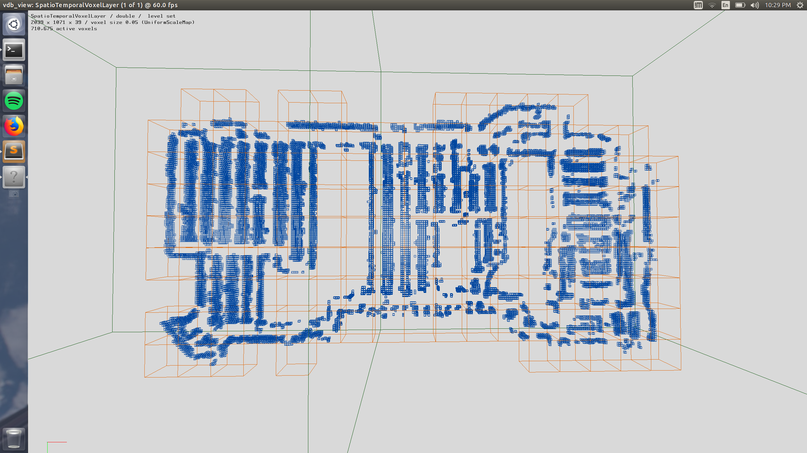
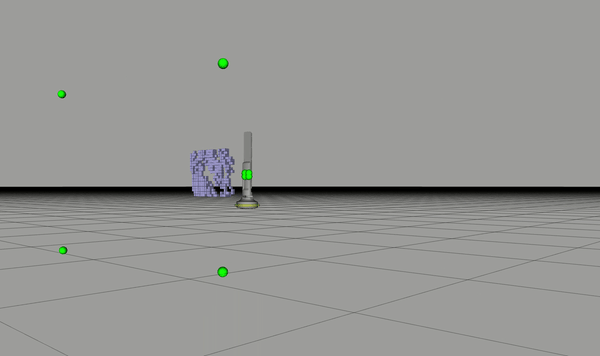

사람이 복도를 지나간 뒤에도 장애물 지도에 흔적이 남으면 로봇은 빈 공간 앞에서 기다릴 수 있어요. 반대로 흔적을 너무 빨리 지우면 잠시 가려진 사람의 위치 정보가 사라집니다. <abbr title="삼차원 공간의 장애물 관측을 작은 칸에 저장하고 시간이 지난 관측을 정해진 규칙으로 지우는 지도 계층">STVL</abbr>은 공간 표현에 관측의 시간을 더해 이 문제를 다루는 자료입니다.

## 공간의 작은 칸에 시간 정보를 함께 둬요

STVL의 공식 저장소는 <abbr title="넓은 삼차원 공간에서 필요한 부분만 효율적으로 저장하고 다루는 자료 구조 라이브러리">OpenVDB</abbr>를 이용한 희소 삼차원 격자를 설명합니다. 공간의 작은 칸인 <abbr title="삼차원 공간을 나눈 작은 부피 단위로, 이 안에 장애물 관측을 기록하는 칸">복셀</abbr>에 관측을 저장하고 시간이 지나면 점유를 감쇠시켜요. 현재 센서 시야 안에 있어야 할 관측이 다시 보이지 않을 때는 감쇠를 가속하는 방식도 사용합니다. 선형·지수·지속 보존 같은 설정은 지도에 무엇을 얼마나 오래 남길지 바꾸는 선택입니다.

<figure class="fig"><figcaption>공식 저장소의 삼차원 지도 예시예요. 작은 장애물 칸과 이를 관리하는 큰 공간 단위를 함께 볼 수 있습니다. 화면의 규모와 메모리 설명은 이 자료의 예시이며 다른 장치의 측정값으로 옮길 수 없습니다. (출처: Steven Macenski, Spatio-Temporal Voxel Layer 공식 저장소, 공간 표현 예시 이미지; 논지 분석에 필요한 부분 인용)</figcaption></figure>

복셀 하나가 사람 한 명을 뜻하지는 않습니다. 한 사람의 몸이 여러 칸으로 나뉘고 선반도 같은 형태의 칸으로 표현될 수 있어요. 이 지도는 공간에 관측이 있는지 다루며, 관측이 사람인지 가구인지와 어떤 의도로 움직이는지를 자동으로 말해 주지 않습니다. 사람을 인지하는 모듈과 공간을 기억하는 계층을 구분해서 읽어야 해요.

## 높이를 보존하면 평면 투영의 질문이 생겨요

삼차원 정보는 바닥 가까운 물체와 위쪽 돌출물을 다른 높이에 저장할 수 있습니다. 그러나 바닥을 이동하는 로봇의 경로 계산에는 어느 높이의 점유를 통과 불가로 볼지 정해야 해요. 낮은 선반 아래를 지날 수 있는 몸체와 높은 적재물을 실은 몸체는 같은 삼차원 지도에서도 다른 경계를 갖습니다. 공간 표현이 풍부해졌다는 사실만으로 몸체와 장애물의 접촉 조건이 정해지지는 않아요.

설명용으로 높이 0.2미터의 물체와 높이 1.2미터의 돌출물을 가정해 볼 수 있습니다. 어떤 높이 범위만 처리하도록 입력을 자르면 두 물체 중 하나가 사라질 수 있어요. 그 범위가 센서 노이즈를 없애는 목적이었더라도 실제 보호해야 할 외곽을 함께 지울 수 있습니다. 이 숫자는 특정 로봇의 외곽이나 안전 기준이 아니라 높이 선택의 영향을 설명하는 입력입니다.

높이 필터를 고를 때는 바닥 제거와 장애물 제거를 따로 확인할 수 있어요. 바닥 점이 줄어 지도가 깨끗해졌지만 낮은 장애물도 줄었다면 목표가 충돌합니다. 로봇의 자세가 기울었을 때 높이 기준이 어느 좌표에 묶이는지도 필요해요. 정지한 한 장면에서 통과한 필터가 경사나 카메라 자세 변화에서도 같은 물리적 범위를 남기는지 시험해야 합니다.

## 격자를 촘촘히 하는 비용은 삼차원으로 늘 수 있어요

작은 칸은 얇은 물체와 좁은 틈의 형상을 더 자세히 나타낼 수 있습니다. 대신 같은 부피를 채우는 데 필요한 칸 수가 늘어요. 희소 저장은 빈 공간의 저장 비용을 줄일 수 있지만, 관측이 촘촘한 부분까지 공짜로 만드는 것은 아닙니다. 입력 점을 읽고 칸에 배치하고 갱신하는 계산도 남아 있어요.

설명용으로 1미터 정육면체를 0.1미터 칸으로 가득 채우면 한 축 10칸, 전체 1,000칸입니다. 칸 크기를 0.05미터로 줄이면 한 축 20칸, 전체 8,000칸이 됩니다. 한 축 해상도를 두 배로 높이면 꽉 찬 부피의 칸 수는 여덟 배예요. 이 계산은 실제 희소 지도의 점유량을 예측한 값이 아니라 격자를 가득 채운 경우의 삼차원 해상도 변화 규모를 보여 주는 모델입니다.

실제 장면에서는 벽과 물체 표면 근처에 관측이 모이므로 위 부피 모델과 다르게 늘 수 있어요. 그래서 해상도를 바꾼 뒤 저장된 칸 수, 갱신시간, 센서 처리 지연을 함께 측정해야 합니다. 파일 크기만 작아졌다고 실시간 갱신도 빨라졌다고 단정할 수는 없어요. 공간 표현의 비용과 데이터 처리의 비용은 서로 다른 측정 항목입니다.

## 시간 감쇠는 사라졌다는 관측과 달라요

시간이 오래됐다는 이유로 관측을 지우는 규칙은 센서가 그 자리에 물체가 없음을 새로 확인한 것과 다릅니다. 사람이 떠났을 수도 있고 가려졌을 수도 있으며, 카메라가 다른 쪽을 보고 있을 수도 있어요. 감쇠는 정보의 오래됨을 관리하는 정책입니다. 물체의 실제 존재 여부를 완벽하게 판정하는 센서는 아니에요.

이 차이는 사람이 기둥 뒤로 들어가는 장면에서 중요합니다. 짧은 보존 시간은 로봇이 통로를 빨리 다시 사용할 수 있게 하지만, 아직 기둥 뒤에 있는 사람의 과거 점유도 지울 수 있어요. 긴 보존 시간은 불확실한 물체를 오래 남기지만 이미 떠난 사람의 흔적 때문에 통로를 막을 수 있습니다. 어느 쪽이 낫다는 판단에는 센서가 다시 볼 가능성과 계획기의 다른 관측 수단이 들어가야 해요.

설명용으로 마지막 관측 뒤 2초에 삭제하는 규칙을 가정해 보겠습니다. 사람이 1초 뒤 떠난 경우에는 최대 1초의 잔상이 남을 수 있고, 3초 동안 가려진 채 머무른 경우에는 다시 보이기 전 1초 동안 정보가 빠질 수 있어요. 이는 단순 시간 규칙을 설명하기 위한 가정이며 STVL의 모든 감쇠 모델이 같은 삭제 시각을 갖는다는 뜻은 아닙니다. 조정값을 실제 존재 확률처럼 읽지 않아야 해요.

## 현재 시야를 이용한 지우기는 기하가 맞아야 해요

현재 카메라가 볼 수 있는 공간을 사용하면 오래된 관측을 더 빨리 정리할 근거를 얻을 수 있습니다. 다만 ‘그 자리가 시야 안에 있다’와 ‘그 자리를 가림 없이 관측했다’는 조건은 다를 수 있어요. 물체가 앞을 가리거나 깊이 측정이 실패해도 관측이 없을 수 있기 때문입니다. 시야를 이용한 감쇠를 실제로 빈 공간을 확인한 절차와 동일하게 취급하면 안 됩니다.

카메라의 시야각이나 장착 방향이 틀리면 지우는 공간도 틀어질 수 있어요. 실제로 보지 못한 옆 공간을 보았다고 계산하면 그곳의 관측을 일찍 지울 수 있습니다. 반대로 시야를 너무 좁게 잡으면 본 공간의 잔상이 오래 남습니다. 화면의 관측 점과 시야 경계를 함께 보는 진단이 필요한 이유입니다.

검증용 기록에서는 고정된 물체, 움직였다가 떠나는 물체, 다른 물체에 가려지는 물체를 나눌 수 있어요. 같은 지우기 설정에서 각각의 잔상 시간과 정보 공백을 비교합니다. 단순히 지도가 빨리 비워지는 설정을 좋은 결과로 고르면 가림 조건의 실패를 놓칠 수 있어요. 지워야 하는 관측과 유지할 가치가 있는 관측을 함께 시험해야 합니다.

## 공식 시간 시연에서 확인할 범위를 정해요

<figure class="fig"><figcaption>공식 시간 감쇠 시연의 7초 프레임이에요. 관측을 칸으로 유지하는 모습을 보여 주며, 이 한 장만으로 삭제 지연이나 사람 추적 정확도를 계산할 수는 없습니다. (출처: Steven Macenski, Spatio-Temporal Voxel Layer 공식 저장소, Temporal 시연 GIF의 정지 프레임; 부분 인용)</figcaption></figure>

[공식 시간 감쇠 시연](https://user-images.githubusercontent.com/14944147/37063574-d0923d24-2167-11e8-850c-18b6aed61634.gif)은 시간에 따라 표현이 바뀌는 모습을 보여 줍니다. 이 영상은 관측과 지도 갱신의 관계를 이해하는 보조 자료예요. 삭제 시간의 정량 비교를 하려면 원 입력의 시각, 감쇠 설정, 지도 갱신 시각과 각 칸의 변화를 함께 기록해야 합니다. 보이는 애니메이션 속도만으로 실물 처리 주기를 추정할 수는 없어요.

시연을 재현했다는 주장에도 단계가 있습니다. 같은 입력과 설정에서 같은 점유 변화가 나왔는지 확인하는 것, 실물 센서의 결측에서도 적절히 동작하는지 확인하는 것, 사람이 있는 주행에서 문제가 줄었는지 확인하는 것은 각각 달라요. 지도 화면 하나가 셋을 모두 증명하지 않습니다. 시간 표현을 이해하는 자료와 적용 성능의 근거를 구별해야 해요.

## 관측을 기억하는 시간과 미래 예측 시간은 별개예요

최근 5초의 관측을 보존한다고 가정해도 앞으로 5초의 사람 위치를 예측한 것은 아닙니다. 보존은 과거 정보가 지도에 남는 기간이고, 예측은 앞으로의 위치를 추정하는 계산이에요. 두 시간을 같은 길이로 설정해도 정보의 방향이 반대입니다. 사람의 이전 이동 흔적을 두껍게 남기면 그 사람이 앞으로 갈 공간과 다른 장애물이 생길 수 있어요.

설명용으로 사람이 초당 1미터로 일정하게 걸으며 3초의 과거 흔적이 모두 남는다고 가정하면, 이동 경로 뒤쪽에 최대 3미터의 흔적이 생길 수 있습니다. 실제 격자 갱신과 지우기 시야에 따라 결과는 달라질 수 있어요. 이 모델은 기억을 늘리면 정보가 무조건 좋아진다는 해석의 반례입니다. 이미 떠난 공간과 앞으로 들어올 공간을 나눠 다뤄야 해요.

사회적 주행에 필요한 미래 점유를 추가하려면 사람 추적과 예측의 별도 출력을 어떤 시각에 비교할지 정해야 합니다. 과거 복셀을 그대로 미래 위험으로 사용하면 시간 의미가 섞여요. 반대로 복셀을 지웠다는 이유로 앞으로도 사람이 나타나지 않을 것이라 결론내릴 수 없습니다. 공간 기억 계층과 행동 예측 계층의 연결을 명시할 필요가 있어요.

## 새 입력이 끊겨도 지도에는 무언가 남을 수 있어요

센서 통신이 멈춘 뒤에도 저장된 장애물이 잠시 보일 수 있습니다. 화면에 점이 있다는 이유로 센서가 정상 작동한다고 판단하면 고장을 늦게 알아챌 수 있어요. 시간이 지나 점들이 사라지는 화면도 공간이 비었다는 관측을 뜻하지 않습니다. 센서 상태와 지도 내용은 다른 신호로 감시해야 해요.

반대로 입력이 계속 오더라도 기준 시각이 오래됐으면 새 데이터처럼 처리하는 문제가 생길 수 있습니다. 지도가 반복 갱신되는 주기만 세면 입력의 신선도를 놓칠 수 있어요. 센서의 관측 시각, 수신 시각, 처리 완료 시각을 나눠 관측 나이를 측정해야 합니다. 시간 감쇠 기능은 그 시각 의미가 맞다는 전제 위에서 해석할 수 있어요.

검증에서는 입력 발행 중단과 과거 프레임 재발행을 따로 만들 수 있습니다. 첫 조건은 통신 공백 처리, 둘째는 오래된 입력 처리의 의미를 시험해요. 갱신된 칸 수와 최종 주행 명령을 함께 비교하면 지도의 변화가 어떤 행동으로 이어졌는지 알 수 있습니다. 이러한 재생 시험은 실물 로봇을 움직이지 않고 확인할 수 있는 단계와 운동 성능 검증을 구분하는 데도 도움이 됩니다.

## 카메라 움직임은 관측 흔적을 늘릴 수 있어요

고정된 선반이 움직인 것처럼 누적되면 장면의 동적 성질보다 좌표 정렬을 먼저 확인할 수 있습니다. 센서 장착 변환이 틀리거나 과거 자세를 현재 관측에 적용하면 같은 물체가 조금씩 다른 위치에 찍혀요. 보존 시간을 줄이면 흔적이 빨리 사라져 덜 어색해 보일 수 있지만, 좌표 오류가 고쳐진 것은 아닙니다. 시간 설정으로 공간 오류를 가리지 않는 것이 중요해요.

설명용으로 정지한 벽이 로봇 회전 때만 여러 겹으로 나타난다면 시각 정렬과 회전 변환을 점검할 근거가 생깁니다. 정지 상태에서도 항상 같은 방향으로 오프셋이 있으면 고정 장착 변환을 확인할 수 있어요. 두 경우 모두 감쇠 모델보다 앞단의 정보가 문제일 수 있습니다. 상태별 증상을 나누면 원인을 좁히기 쉬워요.

입력 점군을 보는 화면과 누적 격자를 보는 화면도 따로 비교할 수 있습니다. 원 점군부터 어긋나면 센서·보정·좌표 문제이고, 원 점군은 맞는데 누적만 밀리면 기록 시각과 갱신 과정을 살펴볼 수 있어요. 단일 화면의 겉모양보다 같은 관측이 여러 단계를 통과하는 모습을 비교하는 편이 구체적입니다. 정상 장면의 그림과 실패 장면의 기록을 함께 남겨야 해요.

## 데이터 줄이기는 얇은 물체 보존과 함께 봐요

밀집 점군을 줄이면 입력 처리량과 갱신 비용을 줄일 수 있습니다. 가까운 물체에서 갑자기 점이 많아지는 상황에도 효과가 있을 수 있어요. 그러나 작은 물체가 몇 점으로만 나타나면 줄이는 과정에서 사라질 수 있습니다. 평균 점 수 감소율만으로 필터의 품질을 판단하기 어렵습니다.

설명용으로 굵은 선반 모서리와 가는 봉을 같은 거리에서 관찰하는 기록을 비교할 수 있어요. 필터 전후 점 수와 남은 복셀 수, 지도에서 통로가 열리는 시각을 측정합니다. 필터가 바뀌었는데 감쇠 시간까지 동시에 바꾸면 어느 단계가 잔상을 줄였는지 알기 어려워요. 한 번에 하나의 축을 바꾸는 비교가 설정의 의미를 보존합니다.

원 점군이 이미 다른 단계에서 줄어든 입력이라면 같은 처리를 겹쳐 적용하는지도 확인해야 합니다. 데이터가 작아진 이득과 보호 대상이 사라진 손실이 함께 생길 수 있어요. 필요한 높이와 거리에서 물체가 남는지 확인한 뒤 계산량을 비교하는 순서가 좋습니다. 예쁜 지도보다 필요한 장애물 정보가 제때 남는지가 목적이에요.

## 큰 지도를 보여 주는 비용은 저장 비용과 달라요

공식 저장소에는 지도 내부 표현과 이를 큰 점군으로 발행해 시각화하는 비용을 구분하는 설명이 있습니다. 내부 자료 구조를 갱신할 수 있어도 모든 칸을 화면으로 보내는 경로가 느릴 수 있어요. 이 차이는 메모리 효율이 좋은 지도를 사용한다고 해서 원격 시각화도 가벼워지는 것은 아님을 보여 줍니다. 내부 처리와 표시 데이터를 별도로 측정해야 해요.

설명용으로 한 화면 갱신에 300,000개 점을 내보내고 초당 5번 표시한다고 가정하면 초당 1,500,000개의 점 자리가 발행됩니다. 실제 바이트 수는 메시지 필드와 압축, 직렬화 방식에 따라 달라요. 이 값은 실제 STVL 실행 기록이 아닌 데이터 규모의 계산입니다. 화면 갱신 주기를 바꿀 때 무엇이 줄어드는지 설명하는 데 쓸 수 있어요.

부하를 비교할 때는 지도 갱신만 하는 조건, 점군 발행을 추가한 조건, 원격 화면 구독까지 붙인 조건을 나눌 수 있습니다. 처리 주기, 입력 지연, 메모리와 전송량을 함께 봐요. 문서의 다른 컴퓨터 측정값을 소형 컴퓨터의 성능으로 옮겨 쓰면 안 됩니다. 센서 수와 점 밀도, 보존 시간, 시각화가 같은 조건인지부터 확인해야 합니다.

## 현재 환경의 연결 방법은 버전 문서와 대조해요

공식 저장소의 브랜치와 설명에는 과거 로봇 소프트웨어 환경의 설치 예시도 남아 있습니다. 오래된 명령이 보인다고 해서 현재 환경에서 그대로 실행할 근거가 되지는 않아요. <abbr title="로봇의 지도 기반 이동을 위한 계획·제어 기능을 제공하는 소프트웨어 묶음">Nav2</abbr>에 연결할 때는 [공식 배포판별 연결 튜토리얼](https://docs.nav2.org/jazzy/tutorials/general_tutorials/navigation2_with_stvl/)의 플러그인 설정과 설치 대상을 함께 확인할 수 있습니다. 자료 조사와 특정 장치에서의 빌드·실행 검증은 다른 단계예요.

설정 예제를 읽을 때도 센서 통로 이름, 높이 범위, 좌표 기준, 보존 시간은 자기 입력에 맞는지 대조해야 합니다. 예제와 같은 숫자를 넣었다고 같은 관측 조건이 만들어지지는 않아요. 색상과 거리 정보를 함께 보는 <abbr title="컬러 영상과 각 화소까지의 거리를 함께 제공하는 카메라 방식">RGB-D</abbr> 카메라의 점군도 장착 위치와 시야가 달라지면 지도에 남는 공간이 달라집니다. 배포판 호환과 관측 의미를 각각 확인해야 해요.

낮은 레이저 센서를 주행과 충돌 감시에 쓰는 구성에서는 이 자료를 읽었다는 이유로 그 센서에 사람 분류 역할을 더할 필요가 없습니다. 삼차원 장애물 기억이 필요한 입력과 사람의 위치·방향을 추정하는 입력이 어떤 정보를 제공하는지부터 구별하면 됩니다. 공간 표현을 바꾼 뒤 인지 성능까지 함께 좋아졌다고 주장하려면 별도의 측정이 필요해요.

## 삭제의 성공과 주행의 성공을 따로 보고해요

지도 계층의 시험에서는 떠난 물체의 잔상 시간, 가려진 물체의 정보 공백, 남아야 하는 얇은 물체의 보존을 볼 수 있습니다. 주행 시험에서는 그 변화로 생긴 대기시간, 우회, 근접과 충돌 감시 개입을 봐야 해요. 지도가 빨리 비워졌는데 사람이 가려진 장면에서 더 가까워졌다면 하나의 개선 점수로 합치기 어렵습니다. 같은 설정의 서로 다른 결과를 함께 적어야 해요.

사람의 불편과 양보 관계는 다시 다른 평가입니다. 복셀을 정확히 지워도 로봇이 대화하는 사람 사이를 가를 수 있고, 안전하게 기다려도 통로를 오래 막을 수 있어요. 시간 감쇠가 답하는 질문은 오래된 공간 관측을 어떻게 관리하느냐입니다. 이 범위를 지키면 사람 인지·행동 예측·주행 정책과 연결할 때 빠진 검증을 더 쉽게 찾을 수 있습니다.

지도 변화가 최종 명령에 미치는 영향은 [[2026-10-17_socialnav_nav2-collision-monitor|Nav2 충돌 감시가 계획기 뒤에서 속도를 제한하는 구조]]의 보호 계층과 함께 검증할 수 있어요. 공간 관측의 갱신과 명령 제한은 서로 다른 단계이므로 두 결과를 같은 시간축에 놓을 필요가 있습니다.

---

<!-- src-block -->

출처 — https://github.com/SteveMacenski/spatio_temporal_voxel_layer/tree/ros2
