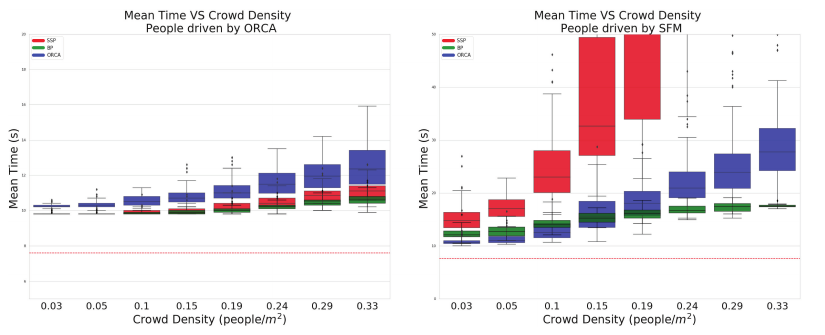

사람이 움직이는 공간에서 경로를 만드는 일은 정적 장애물을 피해 최단경로를 찾는 문제와 다릅니다. 사람도 로봇을 보고 움직임을 바꾸고, 로봇의 감속이나 방향 전환이 사람의 다음 행동에 영향을 주기 때문이에요. Mavrogiannis, Baldini, Wang, Zhao, Trautman, Steinfeld, Oh의 서베이는 이 상호작용을 <abbr title="사람과 로봇이 같은 공간에서 서로의 움직임을 고려하며 이동하는 연구 분야">소셜 내비게이션</abbr>의 출발점으로 두고, 남은 문제를 계획, 행동 설계, 평가의 세 갈래로 정리했어요.

논문은 새 알고리즘 하나를 제안하거나 기존 방법의 승자를 뽑지 않습니다. 서로 다른 분야에 흩어진 연구가 어떤 가정을 공유하고, 그 가정이 어디서 깨지는지를 비판적으로 읽어요. 그래서 이 서베이의 쓸모는 구현 목록보다 연구 질문을 만드는 데 있습니다. 경로가 충돌하지 않는가, 사람에게 어떤 행동을 보여야 하는가, 그 행동이 적절했음을 무엇으로 확인할 것인가를 분리해서 묻습니다.

## 첫 난제는 상호작용을 포함한 계획이에요

로봇이 사람의 미래 궤적을 먼저 예측하고 그 결과를 피해 경로를 만드는 구조는 이해하기 쉬워요. 예측 모듈이 사람의 위치 분포를 내고, 계획 모듈이 그 분포와 겹치지 않는 궤적을 고릅니다. 논문은 이런 구성을 예측과 계획이 분리된 접근으로 묶어요. 모듈을 따로 시험하기 좋고 기존 내비게이션 구조에 붙이기도 쉽습니다.

문제는 사람의 미래가 로봇 행동과 무관하지 않다는 데 있어요. 로봇이 오른쪽으로 비키면 사람도 그 방향을 보고 반대쪽으로 갈 수 있고, 로봇이 멈추면 사람이 먼저 지나갈 수 있습니다. 계획 이전에 사람의 궤적을 하나로 고정하면 로봇이 만들어 낼 반응을 예측에서 지워 버려요. 반대로 사람과 로봇의 미래를 함께 모델링하면 상호작용을 표현할 수 있지만 상태와 행동의 조합이 급격히 늘고, 사람의 의도와 비용함수를 알 수 없다는 문제가 생깁니다.

분리형 접근의 실패는 보수성으로도 나타나요. 여러 사람이 각자 독립적으로 움직인다고 보고 가능한 미래를 넓게 잡으면 로봇의 모든 후보 경로가 위험 영역과 겹칠 수 있습니다. 실제 군중에서는 사람들이 서로 조금씩 비켜 지나가지만, 독립 예측은 이 협력을 표현하지 못해 로봇을 멈추게 해요. 논문은 군중 속 영구 정지 문제를 상호작용 모델의 결핍과 연결합니다.

결합형 접근도 자동 해답은 아니에요. 사람과 로봇이 서로 양보한다는 가정이 강하면 로봇이 지나치게 공격적인 궤적을 선택할 수 있습니다. 보행자가 로봇을 보지 못했거나, 이동 보조기를 쓰거나, 어린이처럼 예측 모델과 다른 행동을 하면 협력 가정이 무너져요. 결합 여부보다 어떤 반응을 가정했고 그 가정이 깨질 때 무엇을 하는지가 더 중요합니다.

## 안전과 효율을 한 숫자로 섞으면 의미가 흐려져요

계획기는 보통 목표 도달, 이동시간, 경로 길이, 충돌 여유, 속도 변화 같은 항을 비용으로 합쳐요. 사회적 계획에서는 개인공간, 흐름 방해, 양보, 의도 전달 같은 항도 들어갑니다. 가중합은 계산하기 편하지만 가중치를 조금 바꿨을 때 행동이 크게 달라질 수 있고, 서로 다른 연구의 점수를 비교하기 어렵습니다.

충돌을 절대 허용하지 않는 제약과 가능한 한 빨리 도착하려는 목적은 성격이 달라요. 둘을 같은 가중합에 놓으면 효율 개선이 안전 여유를 얼마나 깎았는지 알아보기 어렵습니다. 개인공간도 고정 제약으로 두면 좁은 통로를 통과하지 못하고, 약한 비용으로 두면 사람이 비켜 주는 것을 당연하게 여길 수 있어요. 계획 문제는 경로를 찾는 계산뿐 아니라 우선순위와 실패 행동을 정하는 설계 문제입니다.

설명용 상황을 생각해 볼 수 있어요. 로봇 앞 3미터에 두 사람이 나란히 걸어가고 있고 양옆 공간은 좁다고 가정합니다. 빠른 도착만 보면 두 사람 사이 틈을 노리기 쉽고, 개인공간 비용을 크게 두면 로봇은 멈춘 채 통로가 열리기를 기다릴 수 있어요. 추월 의사를 보여 준 뒤 반응을 관찰하거나, 충분히 넓어질 때까지만 저속으로 따르는 행동은 한 번의 거리 비용으로 잘 표현되지 않습니다. 이 예시는 논문 실험 수치가 아니라 목적함수의 한계를 설명하기 위한 가정입니다.

계획 결과에는 이유를 남길 필요가 있어요. 어느 사람 예측이 후보를 막았는지, 어떤 사회 비용이 우회 경로를 골랐는지, 정지는 안전 제약 때문인지 예측 불확실성 때문인지 기록해야 합니다. 같은 정지라도 사람이 갑자기 나타나 멈춘 경우와, 계획기가 모든 미래를 위험하다고 계산해 멈춘 경우의 수정 방법은 달라요.

## 둘째 난제는 로봇이 보여 줄 행동의 근거예요

행동 설계는 경로가 물리적으로 가능한가를 넘어, 사람이 그 움직임을 어떻게 이해하는가를 다룹니다. 로봇이 어느 쪽으로 갈지 일찍 드러내는 움직임, 지나갈 차례를 양보하는 정지, 사람에게 접근하는 방향과 속도, 집단 공간을 존중하는 우회가 여기에 들어가요. 사람은 로봇의 내부 계획을 볼 수 없으므로 몸체 움직임과 외부 신호로 의도를 추론합니다.

논문은 사회 규범을 하나의 보편 규칙집으로 가정하기 어렵다고 봐요. 통행 방향은 지역과 장소에 따라 다를 수 있고, 같은 사람도 공항, 병원, 행사장, 좁은 사무실에서 기대하는 거리가 달라집니다. 사람의 연령, 관계, 주의 상태도 영향을 줘요. 고정된 개인공간 반경이나 항상 오른쪽 통행 같은 규칙은 특정 환경에서는 맞아도 다른 문맥에서는 부적절할 수 있습니다.

몸 움직임만으로 의도를 전하는 방식은 장치가 필요 없지만 모호할 수 있어요. 로봇이 속도를 낮춘 것이 양보인지 센서 오류인지 사람은 알기 어렵습니다. 화면, 조명, 소리, 투사된 경로 같은 명시적 신호는 뜻을 선명하게 만들 수 있지만 사람이 그 신호를 보고 이해해야 해요. 신호를 추가했다는 사실과 신호가 행동을 바꿨다는 사실을 구분해야 합니다.

행동 설계는 사람 모델과도 맞물려요. 사람이 로봇을 항상 협력적인 이동 주체로 여긴다고 가정하면 미세한 방향 변화만으로도 양보 의사가 전달된다고 볼 수 있습니다. 현실에서는 로봇을 정적 장애물처럼 보거나, 멈출 것이라고 믿고 먼저 지나가는 사람도 있어요. 행동 정책은 예상 반응 하나를 전제로 하기보다 반응이 없을 때 속도를 낮추고 다른 신호로 바꾸는 절차를 가져야 합니다.

## 사회적 행동은 관찰 가능한 약속으로 바꿔야 해요

"예의 바르게 이동"처럼 추상적인 목표는 알고리즘과 평가에 바로 넣기 어려워요. 어떤 장면에서 어떤 행동을 기대하는지 관찰 가능한 약속으로 바꿔야 합니다. 마주침에서는 일찍 한쪽으로 방향을 정하고 좌우 전환을 반복하지 않는지, 문에서는 통과 순서를 어떻게 정하는지, 집단 근처에서는 대화 중심을 가르지 않는지처럼 적을 수 있어요.

약속에는 입력 조건도 필요합니다. 사람의 몸 방향을 모르는 센서 구성에서 시선 기반 접근 규칙을 요구하면 구현과 평가가 맞지 않아요. 사람 식별이 자주 끊기는데 장기 관계를 가정한 행동을 점수화해도 원인을 찾기 어렵습니다. 행동 요구사항을 정할 때 필요한 관측, 허용 지연, 신뢰도가 함께 있어야 해요.

사회적 행동을 학습으로 얻더라도 이 문제는 남습니다. 시연이나 보상에서 규범을 배웠다면 데이터가 어느 장소와 사람 집단에서 모였는지 확인해야 하고, 정책이 낯선 문맥에서 무엇을 근거로 행동했는지 살펴야 해요. 충돌률이 낮다는 결과만으로 양보와 통행 규범을 배웠다고 말할 수 없습니다. 학습 정책이 사람을 단순한 이동 장애물로 처리하면서도 성공률은 높을 수 있기 때문입니다.

## 셋째 난제는 평가 환경이 결론을 바꾼다는 점이에요

<figure class="fig"><figcaption>같은 계획기를 써도 보행자 시뮬레이터가 달라지면 성능 순서와 실패 양상이 바뀌어요. 왼쪽은 상호 회피 규칙을 쓰는 군중, 오른쪽은 사회적 힘 모델을 쓰는 군중입니다. (출처: Mavrogiannis et al., Core Challenges of Social Robot Navigation, Figure 1)</figcaption></figure>

논문의 비교 실험은 시뮬레이터가 중립적인 시험장이 아니라는 점을 선명하게 보여 줍니다. 저자들은 단순 사회 계획기, 센서 정보를 쓰지 않는 계획기, 상호 회피 계획기를 두 군중 모델에서 비교했어요. 상호 회피 규칙으로 움직이는 군중에서는 같은 규칙을 쓰는 로봇이 유리할 것 같지만, 단순 계획기들도 좋은 도착시간을 냅니다. 사람 역할의 에이전트가 충돌 책임을 나눠 갖도록 설계돼 있어 로봇의 약점을 대신 메워 주기 때문이에요.

사회적 힘 모델을 쓴 군중에서는 양상이 바뀝니다. 단순 사회 계획기는 군중 밀도가 0.2명/제곱미터를 넘으면 목표에 도달하지 못하고, 센서 없는 계획기는 충돌 비율이 70%를 넘는 조건이 나타나요. 이 수치는 해당 논문의 구현과 설정에서 나온 결과이며 일반 성능 보증이 아닙니다. 비교가 말해 주는 것은 어느 계획기가 항상 우수하다는 결론이 아니라, 군중이 얼마나 협력적으로 반응하는지가 결과를 지배할 수 있다는 사실이에요.

시뮬레이터가 로봇에 맞춰 잘 피해 주면 충돌률이 낮아지고 도착시간도 짧아져요. 이때 알고리즘은 사람 반응을 잘 이끌어 낸 것이 아니라 시험 환경의 협력을 이용했을 수 있습니다. 반대로 사람이 전혀 반응하지 않는 모델은 지나치게 비관적인 결과를 만들 수 있어요. 실물 사람은 로봇을 보고 피하기도 하고, 대화나 휴대전화 때문에 늦게 반응하기도 합니다.

평가 보고서에는 사람 모델, 반응 규칙, 목표 재할당, 군중 밀도, 로봇과 사람의 속도 범위가 필요해요. 성공률만 남기면 다른 연구가 같은 장면을 재현할 수 없습니다. 같은 출발점과 목표를 쓰더라도 군중 모델이 다르면 난도가 달라지므로, 시뮬레이터 이름만 적는 것도 부족해요.

## 지표가 같아도 의미가 같지 않을 수 있어요

도착시간은 빠른 정책을 찾는 데 유용하지만 사람이 얼마나 비켜 줬는지 말하지 않아요. 로봇이 직선으로 밀고 들어가 사람이 크게 우회해도 로봇의 도착시간은 좋아집니다. 최소거리는 가까운 접근을 잡지만, 그 접근이 앞에서 천천히 이뤄졌는지 뒤에서 갑자기 이뤄졌는지 구분하지 못해요. 충돌률은 안전 실패를 세지만 위협감과 흐름 방해를 놓칩니다.

따라서 로봇 지표와 사람 지표를 함께 둬야 해요. 로봇의 성공, 시간, 경로 길이 외에 사람의 경로 편차, 속도 변화, 멈춘 시간, 로봇을 피하려고 한 행동을 기록할 수 있습니다. 사람 참여 평가에서는 편안함, 예측 가능성, 안전감, 방해감을 묻되 질문 문항과 척도, 노출 순서도 공개해야 해요. 사람의 반응을 기록하지 않은 성공은 사회적 성공과 과제 성공을 분리하지 못합니다.

평균 하나로 끝내면 드문 위험도 가려져요. 대부분 부드럽게 통과했지만 한 번 사람 앞에서 급가속했다면 평균 이동시간과 평균 최소거리는 괜찮을 수 있습니다. 최악값, 분포, 실패 사례를 함께 보고, 같은 참가자에게 여러 정책을 보여 줬다면 순서 효과와 학습 효과를 고려해야 해요. 실험자가 정책을 아는 상태에서 행동을 분류하면 관찰 편향도 생길 수 있습니다.

## 세 난제는 따로 풀리지 않아요

계획, 행동 설계, 평가는 편의를 위한 분류이지 독립된 연구가 아니에요. 어떤 행동이 사회적으로 적절한지 정해야 계획 비용을 만들 수 있고, 평가 장면과 지표가 있어야 비용의 가중치를 고칠 수 있습니다. 사람 반응을 모델링한 계획기는 그 반응이 실제로 나타나는지 사람 평가로 확인해야 해요.

예측과 계획을 결합한 정책이 시뮬레이션에서 좋은 결과를 냈더라도, 사람 모델이 정책과 같은 회피 규칙을 쓰면 상호작용 성능을 과대평가할 수 있습니다. 사람에게 의도를 보이는 경로를 설계했더라도 참가자가 그 의도를 읽었는지 묻지 않으면 경로 모양만 평가한 셈이에요. 평가에서 개인공간 침범을 측정하려면 사람 방향과 관계를 추정해야 하므로 센서 성능이 다시 계획과 행동 설계에 영향을 줍니다.

연구 계약은 세 갈래를 한 장면에 묶어야 합니다. 예를 들어 좁은 복도 마주침을 고르면, 계획 가정은 사람의 속도와 반응 후보, 행동 약속은 양보 시점과 방향 고정, 평가는 최소거리·정지시간·좌우 전환·사람의 우회량으로 적을 수 있어요. 관측이 끊기면 어떤 안전 행동으로 내려가는지도 장면 정의에 포함해야 합니다.

## 같은 교차 장면을 세 표현으로 비교해 볼 수 있어요

교차 보행 장면 하나만 놓고도 계획 표현이 만드는 차이를 분석할 수 있습니다. 첫 표현은 사람을 현재 위치에 있는 원형 장애물로 두는 방식이에요. 구현은 간단하지만 사람이 이동하는 방향을 모르므로, 로봇은 가까워진 뒤에야 반응합니다. 최소거리 규칙을 지켜도 늦은 급감속이 생길 수 있어요.

둘째 표현은 현재 속도를 연장한 미래 궤적을 쓰는 방식입니다. 로봇은 충돌 예상 지점 전에 감속하거나 방향을 바꿀 수 있어요. 그러나 예측을 한 번 계산한 뒤 고정하면 로봇이 먼저 방향을 바꾼 것을 사람이 보고 대응하는 효과는 반영되지 않습니다. 사람의 관측이 잠시 끊겨 예측이 오래되면 더 큰 문제가 생겨요.

셋째 표현은 로봇 후보 행동마다 사람의 반응 후보를 다시 계산합니다. 상호작용을 표현하기 좋지만 가능한 조합이 늘고, 반응 모델이 틀렸을 때 계획 전체가 자신 있게 잘못될 수 있어요. 세 번째가 항상 앞선다는 순위보다, 첫 번째는 늦은 반응, 두 번째는 고정된 미래, 세 번째는 사람 모델 오류가 주된 위험이라는 실패 지도를 만들 수 있습니다.

공정한 비교를 하려면 세 방법에 같은 관측 지연과 누락을 넣어야 해요. 완전한 사람 위치를 받는 결합형 계획기와 실제 검출 결과를 받는 원형 장애물 방식을 비교하면 알고리즘 차이와 인지 차이가 섞입니다. 먼저 기록된 동일 궤적을 세 표현에 공급하고, 다음에는 같은 누락과 위치 오차를 주입한 뒤, 마지막으로 실시간 관측을 쓰는 순서가 원인을 나누기 쉽습니다.

평가 항목도 표현별 약점을 겨냥해야 합니다. 원형 장애물 방식에는 최초 감속 시점과 급제동을, 고정 예측에는 예측 갱신 뒤 경로 변경 횟수를, 반응 결합 방식에는 사람 모델이 빗나갔을 때의 안전 여유를 둡니다. 공통 지표인 성공률과 도착시간만으로는 왜 차이가 났는지 알기 어려워요.

## 안전 계층과 사회 계층을 분리해 고장을 관찰해요

사회적 계획이 틀렸을 때도 마지막 충돌 방지는 남아 있어야 합니다. 사회 계층은 사람의 방향과 관계를 이용해 일찍 양보하고 부드럽게 우회할 수 있지만, 관측 누락과 모델 오류에 취약해요. 안전 계층은 의미를 이해하지 못하더라도 가까운 물체와의 충돌을 막는 역할을 맡을 수 있습니다.

두 계층을 분리하면 사회 정책의 실패가 안전 정지로 가려질 수 있어요. 충돌이 없었다는 결과만 보면 후보 정책이 안전했다고 해석하기 쉽지만, 실제로는 마지막 계층이 매번 급정지했을 수 있습니다. 평가에는 사회 계획이 낸 속도 명령과 안전 계층이 수정한 명령을 함께 기록하고, 개입 횟수와 개입 시점을 따로 세어야 해요.

안전 개입이 많다고 무조건 나쁜 정책도 아닙니다. 드문 관측 실패에서만 정지했다면 기대한 방어가 작동한 것이고, 정상 장면에서도 반복 개입했다면 사회 계획과 안전 경계가 맞지 않는 상태예요. 개입 원인을 사람 신규 출현, 추적 소실, 과속 후보, 공간 부족처럼 구분하면 계획·행동·평가 가운데 어디를 고쳐야 하는지 찾을 수 있습니다.

## 이 서베이가 허용하는 결론의 범위

논문은 사회적 내비게이션의 완성된 규칙집이나 단일 평가 표준을 제공하지 않아요. 저자들이 고른 문헌과 계산 관점에서 중요한 난제를 조직한 비판적 서베이입니다. 특정 계획기, 사람 모델, 지표가 모든 환경에 맞는다고 주장하지 않고, 오히려 그런 일반화가 왜 어려운지를 보여 줘요.

그림의 실험도 계획기 우열표로 옮기면 안 됩니다. 상호 회피 군중과 사회적 힘 군중에서 결과가 달라졌다는 사실이 근거이며, 실물 군중이 어느 모델과 같다고 증명한 실험은 아니에요. 0.2명/제곱미터와 70%라는 값은 해당 설정의 실패 지점이지 배치 기준값이 아닙니다.

[[2026-10-17_socialnav_survey-kruse|Kruse 서베이가 사람을 고려한 로봇 내비게이션을 모듈로 나눈 방식]]이 기능의 위치를 보여 줬다면, 이 논문은 기능 사이의 상호작용과 평가 편향을 드러냅니다. 이어서 [[2026-10-17_socialnav_survey-evaluation|Francis 평가 지침이 사회적 주행을 여덟 원칙으로 측정한 방식]]을 읽으면 세 난제를 시나리오 카드와 지표 계약으로 바꾸는 방법을 볼 수 있어요. 이 순서에서는 알고리즘을 고르기 전에 사람 모델과 실패 조건, 평가 문맥을 먼저 쓰게 됩니다.

---

<!-- src-block -->

출처 — https://arxiv.org/abs/2103.05668
