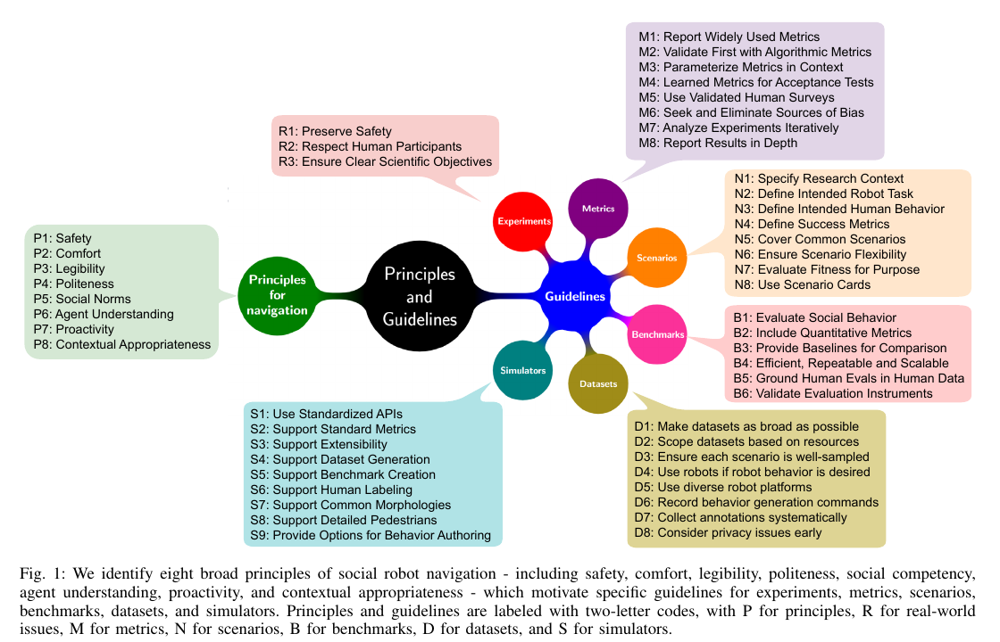

소셜 내비게이션 평가가 어려운 이유는 움직이는 사람을 피해야 해서만이 아니에요. 사람이 로봇의 행동을 적절하다고 받아들이는지까지 포함하기 때문입니다. Francis 등 31명의 저자가 만든 평가 지침은 사회적으로 이동하는 로봇이 지켜야 할 원칙을 여덟 가지로 정의하고, 지표·시나리오·벤치마크·데이터셋·시뮬레이터를 어떻게 보고해야 비교 가능한 증거가 되는지 정리했어요.

이 논문은 하나의 총점이나 단일 공식 벤치마크를 확정하지 않습니다. 어떤 실험이 사회적 주행의 무엇을 평가했는지 분명하게 만들고, 서로 다른 플랫폼과 시뮬레이터의 결과를 비교할 때 빠진 조건을 드러내는 지침에 가까워요. 따라서 여덟 원칙은 체크박스보다 평가 질문의 목록으로 읽는 편이 맞습니다.

## 여덟 원칙은 같은 실패를 다른 각도에서 봐요

<figure class="fig"><figcaption>왼쪽의 여덟 원칙을 기준으로 실험, 지표, 시나리오, 벤치마크, 데이터셋, 시뮬레이터의 보고 지침을 연결한 전체 구조예요. (출처: Francis et al., Principles and Guidelines for Evaluating Social Robot Navigation Algorithms, Figure 1, CC BY 4.0)</figcaption></figure>

여덟 원칙은 안전, 편안함, 읽기 쉬움, 예의, 사회적 역량, 다른 행위자 이해, 선제성, 문맥 적합성입니다. 안전은 충돌과 상해 위험을 다루고, 편안함은 불필요한 긴장과 개인공간 침범을 줄이는가를 봐요. <abbr title="사람이 로봇의 다음 움직임과 목적을 알아보기 쉬운 성질">읽기 쉬움</abbr>은 로봇 행동의 의도를 사람이 예측할 수 있는지 묻습니다.

예의는 로봇이 다른 사람의 목표와 우선권을 존중하는지 봐요. 다섯째 원칙인 사회적 역량은 공간을 함께 쓰는 사회적·정치적·법적 규범을 파악하고 따르는 능력입니다. 원문 본문과 그림 설명은 이 명칭을 쓰지만, 그림 내부에는 ‘Social Norms’라고 적혀 있어요. 통행 방향이나 줄서기 같은 규범 준수는 이 역량을 관찰하는 구체적인 행동으로 볼 수 있습니다. 행위자 이해는 사람의 목표·상태·능력을 얼마나 적절히 파악하는지, 선제성은 문제가 닥친 뒤 반응하는 데 그치지 않고 먼저 조정하는지를 묻습니다. 문맥 적합성은 앞의 판단이 장소, 관계, 문화, 시간에 맞는지 확인해요.

원칙 사이에는 긴장이 있습니다. 안전을 위해 크게 멈춘 행동은 물리적으로 옳지만 뒤따르는 사람에게 의도가 읽히지 않을 수 있어요. 개인공간을 크게 잡으면 편안함은 높아질 수 있지만 좁은 통로에서 진행성이 사라집니다. 선제적으로 방향을 정한 로봇이 지역 통행 관습과 반대쪽을 택하면 문맥 적합성이 낮아요.

## 안전은 충돌 수보다 넓고 편안함과도 달라요

충돌 수는 가장 분명한 안전 지표지만 희귀한 위험을 충분히 설명하지 못해요. 충돌이 없더라도 제동 여유가 거의 없었던 근접 사건, 사람 발 앞에서 반복된 급정지, 센서 지연 때문에 늦게 나온 명령이 있을 수 있습니다. 최소거리, 충돌까지 남은 시간, 제동 가능 거리, 안전 계층 개입을 함께 볼 수 있어요.

편안함은 같은 수치에서 다르게 나타납니다. 사람 앞에서 천천히 0.9미터까지 접근한 경우와 뒤에서 빠르게 0.9미터까지 다가온 경우는 최소거리가 같아요. 사람의 몸 방향, 로봇 상대속도, 접근 방향과 감속 시점을 넣어야 차이를 설명할 수 있습니다. 설문으로 불편을 묻더라도 실제 사람의 회피량과 멈춤을 함께 기록하는 편이 좋아요.

안전과 편안함을 하나의 거리 임계값으로 합치면 실패가 숨습니다. 안전 임계값은 몸체와 제동 성능에 묶이고, 편안함은 관계와 문맥에 따라 변할 수 있어요. 안전은 넘지 말아야 할 경계, 편안함은 그 안에서 비교할 행동 품질로 나누면 설계와 평가가 선명해집니다.

설명용으로 로봇 속도를 초당 0.4미터와 0.8미터 두 조건으로 두고 같은 최소거리를 만든다고 가정할 수 있어요. 빠른 조건은 제동 여유와 사람이 판단할 시간이 줄어듭니다. 이 숫자는 논문 실험값이 아니라 거리 하나로 안전과 편안함을 대신할 수 없음을 설명하기 위한 입력입니다.

## 읽기 쉬움은 경로의 모양만으로 확정할 수 없어요

로봇이 일찍 한쪽으로 방향을 정하면 사람은 어느 쪽으로 지나갈지 예상하기 쉬워요. 반대로 좌우로 작은 수정이 반복되면 최종 경로가 안전해도 사람이 피할 방향을 정하기 어렵습니다. 방향 변경 횟수, 최초 회피 시점, 목표 방향과의 일관성은 읽기 쉬움의 후보 지표가 될 수 있어요.

그러나 궤적이 매끄럽다는 사실이 사람이 뜻을 이해했다는 증거는 아닙니다. 로봇이 멈춘 이유를 사람이 양보로 읽었는지 고장으로 읽었는지, 예상 경로를 맞힐 수 있었는지 확인해야 해요. 짧은 시점에서 진행 방향을 선택하게 하거나, 로봇 행동을 본 뒤 다음 움직임을 표시하게 하는 평가를 붙일 수 있습니다.

명시적 신호도 같은 원칙으로 평가해요. 화면 화살표, 빛, 소리, 투사 경로가 출력됐다는 로그는 장치 동작 증거일 뿐입니다. 사람이 신호를 봤는지, 뜻을 맞혔는지, 행동을 바꿨는지 세 단계를 나눠야 해요. 신호가 너무 늦게 나오면 정확한 표시라도 소용이 없습니다.

읽기 쉬움은 로봇의 의도를 투명하게 만드는 항목이고, 사람 궤적 예측 정확도와는 반대 방향의 질문이에요. 로봇이 사람을 잘 예측하는 것과 사람이 로봇을 잘 예측하는 것을 각각 측정해야 합니다. 하나의 예측 모델 성능으로 두 방향을 모두 통과했다고 말할 수 없어요.

## 예의와 사회적 역량은 성공률에 숨어요

로봇이 목적지에 도착했지만 사람이 크게 비켜 줬다면 과제 성공과 사회적 성공이 다를 수 있습니다. 예의는 다른 행위자의 목표와 부담을 고려하는가를 묻기 때문에 사람의 경로 편차와 양보 횟수를 봐야 해요. 로봇만 빠르게 도착하는 정책은 성공률이 높아도 부담을 사람에게 넘길 수 있습니다.

사회적 역량을 시험하는 규범은 장소와 관계에 따라 달라요. 줄을 가로지르지 않기, 대화 집단 가운데를 지나지 않기, 복도 한쪽을 따르기, 문에서 통과 순서를 조정하기가 예입니다. 규범을 지켰는지 평가하려면 장면에 적용한 규칙을 미리 적고, 사람 배치와 몸 방향을 기록해야 해요.

규범 지표는 단순 거리보다 사건 단위가 유용할 수 있습니다. 집단 중심 침범 여부와 침범 시간, 줄 순서 변경, 사람의 진행 중단, 로봇의 양보 시작 시점을 셀 수 있어요. 문화와 시설 운영 규칙이 다르면 같은 행동의 해석도 달라지므로 평가 문맥을 숨기면 재사용하기 어렵습니다.

예의와 사회적 역량을 한 점수로 합치면 원인도 흐려져요. 정해진 통행 방향을 지켰지만 사람에게 급하게 비키도록 만든 로봇은 규범 항목 일부를 통과해도 예의가 낮을 수 있습니다. 반대로 사람이 먼저 양보해 규범 위반 없이 통과했지만 로봇이 상대 목표를 전혀 고려하지 않았을 수도 있어요.

## 행위자 이해와 선제성은 중간 상태를 요구해요

행위자 이해를 평가하려면 로봇이 사람의 무엇을 추정했는지 볼 수 있어야 합니다. 위치와 속도, 몸 방향, 이동 목표, 집단 관계, 이동 능력은 서로 다른 상태예요. 모든 항목을 완벽히 알아야 한다는 뜻은 아니지만 행동이 의존한 상태와 그 신뢰도를 보고해야 해요.

예를 들어 느리게 걷는 사람을 추월할 때 속도만 쓰면 통과 시점을 계산할 수 있습니다. 몸 방향을 더하면 사람이 로봇을 볼 수 있는 쪽인지 판단할 수 있고, 이동 보조기 사용을 알아야 더 넓은 공간과 긴 반응 시간을 둘 수 있어요. 관측하지 못한 속성을 알고 있다고 가정하면 평가가 실물 조건과 멀어집니다.

선제성은 위험이 임박한 뒤 정지하는 것과 미리 속도를 조절하는 것을 나눠요. 블라인드 코너 전에 속도를 줄이거나, 교차 지점에 먼저 도달할 사람에게 일찍 양보하는 행동이 후보입니다. 최초 감속 시점, 예측 충돌점까지 거리, 급제동 발생 여부를 기록할 수 있어요.

선제성이 과하면 거짓 정지와 긴 대기시간이 늘어납니다. 보이지 않는 사람 가능성만으로 모든 문 앞에서 멈추면 안전해 보여도 이동 기능을 잃어요. 따라서 참위험에서의 조기 반응과 위험이 없을 때의 불필요한 개입을 같이 측정해야 합니다.

## 문맥 적합성은 나머지 원칙의 조건표예요

문맥 적합성은 여덟 번째 독립 점수라기보다 앞선 원칙이 언제 어떻게 적용되는지를 바꾸는 조건에 가까워요. 병원 복도, 붐비는 역, 조용한 전시장, 사무실에서는 적절한 속도와 거리, 신호 방식이 다를 수 있습니다. 어린이와 노인, 동행자와 낯선 사람에게도 같은 접근 규칙을 쓸 수 없어요.

평가에서 문맥은 배경 설명 한 줄로 끝나지 않습니다. 장소의 폭과 시야, 사람 밀도, 소음, 통행 규칙, 로봇 역할, 참가자와 로봇의 관계를 기록해야 해요. 알고리즘이 문맥 정보를 입력으로 받지 않는다면 어느 고정 규칙을 썼는지도 밝혀야 합니다.

문맥 전이를 시험할 때는 한 번에 한 축을 바꾸는 편이 해석하기 쉬워요. 같은 복도에서 사람 밀도만 바꾸거나, 같은 교차 장면에서 로봇 역할만 배송과 안내로 바꾸는 식입니다. 장소와 속도와 사람 수를 모두 바꾸면 성능 차이의 원인을 찾기 어렵습니다.

문맥 적합성을 자동화된 점수 하나로 만들기 어려운 이유도 여기에 있어요. 규범 라벨을 누가 만들었는지, 참가자가 그 규범을 공유하는지, 행동이 목적에 맞았는지 사람이 판단해야 할 수 있습니다. 자동 지표와 사람 평가를 경쟁 관계로 두지 않고 서로 다른 질문에 배치해야 해요.

## 시나리오는 장면 그림보다 상세해야 해요

논문은 시나리오에 연구 문맥, 로봇 과제, 예상 사람 행동, 성공 지표를 명시하라고 권해요. 마주침, 교차, 추월, 문 통과처럼 이름만 같아도 시작 위치와 속도, 우선권, 사람 반응 규칙이 다르면 난도가 달라집니다. 시나리오 카드는 이 조건을 반복 가능한 기록으로 남기는 방법입니다.

카드에는 로봇 시작·목표 자세, 사람 수와 역할, 초기 위치·속도, 정적 장애물, 센서 조건, 종료 조건을 적을 수 있어요. 사람 모델이 로봇에 반응하는지, 기록 궤적을 그대로 재생하는지도 필요합니다. 실물에서는 참가자에게 준 지시와 안전 중단 규칙을 포함해야 해요.

성공 조건은 도착 외에도 시간제한, 충돌 없음, 사람 과도한 회피 없음, 관계 유지 등을 넣을 수 있습니다. 조건이 너무 많으면 한 실패가 어느 원칙 때문인지 알기 어려우므로 원칙별 주지표와 보조지표를 구분해요. 같은 카드를 정책마다 쓰면 비교가 쉬워지고, 다른 연구가 장면을 재현할 수 있습니다.

설명용 카드로 좁은 문 마주침을 잡을 수 있어요. 두 행위자가 문 양쪽에서 시작하고, 한쪽이 먼저 양보해야 하며, 로봇은 문 앞에서 좌우 진동 없이 의도를 보여야 한다고 적습니다. 주지표는 충돌과 통과 성공, 양보 시점이고, 보조지표는 사람의 추가 이동과 정지시간이 될 수 있어요. 이는 논문의 특정 실험 재현이 아니라 카드 작성법을 적용한 예시입니다.

## 지표는 널리 쓰인 값과 원칙 연결을 함께 보고해요

새 지표만 제안하면 다른 연구와 비교하기 어렵고, 널리 쓰인 지표만 쓰면 사회적 원칙을 놓칠 수 있습니다. 성공률, 이동시간, 경로 길이, 최소거리 같은 공통값을 남기면서 각 지표가 어느 원칙을 설명하는지 적는 편이 좋아요. 사람의 부담이나 의도 이해처럼 공통값이 답하지 못하는 질문에는 검증된 설문과 관찰 지표를 더합니다.

지표 계산 조건도 공개해야 해요. 최소거리를 로봇 중심과 사람 중심 사이로 계산했는지 몸체 외곽 사이로 계산했는지, 충돌까지 시간을 어떤 상대속도에서 정의했는지에 따라 값이 달라집니다. 평균만 보고하지 않고 분포와 실패 사례를 남기며, 사람별 반복 측정이면 개인 차이를 처리해야 해요.

총점은 편리하지만 가중치가 결론을 만들 수 있습니다. 안전·편안함·효율을 합친 점수가 같아도 하나는 안전 여유가 작고 다른 하나는 이동시간이 길 수 있어요. 원칙별 결과를 먼저 보여 주고 총점은 사용 목적과 가중치를 공개한 경우에만 보조로 쓰는 편이 낫습니다.

## 데이터셋과 시뮬레이터는 행동의 근거를 제한해요

기록 데이터셋은 같은 사람 궤적에서 여러 알고리즘을 비교하게 해 주지만 로봇 행동이 바뀌었을 때 사람 반응을 새로 만들지 못합니다. 사람만 있는 궤적 자료에서는 로봇에 대한 양보나 불편을 관찰할 수 없어요. 로봇 포함 자료도 특정 플랫폼과 장소, 참가자에 묶입니다.

시뮬레이터는 반복과 규모에 강하지만 사람 모델이 결과를 지배할 수 있습니다. 로봇을 잘 피해 주는 군중에서는 공격적인 정책도 충돌이 적고, 전혀 반응하지 않는 군중에서는 보수 정책만 살아남을 수 있어요. 사람 형태가 보여도 사회적 반응 규칙이 빈약하면 사람 중심 평가가 되지 않습니다.

따라서 시뮬레이터는 표준 지표 출력, 장면 생성, 사람 행동 작성, 상세 보행자 표현을 지원하는지 기록해야 해요. 알고리즘이 받은 관측이 센서 모사인지 정확한 상태인지도 구분합니다. 실물 성능을 주장하려면 인지 오류와 계산 지연이 포함된 별도 검증이 필요해요.

## 평가 파이프라인을 네 단계로 나누면 원인을 찾기 쉬워요

첫 단계는 인지예요. 사람 검출 누락, 위치 오차, 추적 단절, 몸 방향 오차, 처리 지연을 측정합니다. 둘째는 계획기만 떼어 정확한 사람 상태와 오류를 주입한 상태를 번갈아 넣어요. 두 결과 차이는 인지 오류가 계획 결과를 얼마나 깎는지 보여 줍니다.

셋째는 닫힌 고리 시뮬레이션이나 실물 로봇에서 사람과 로봇이 서로 반응하도록 실행해요. 안전 계층의 명령 수정과 사회 계획 명령을 따로 기록합니다. 넷째는 앞 단계를 통과한 정책만 사람 참여 평가로 보내 편안함, 읽기 쉬움, 예의, 문맥 적합성을 봅니다.

단계를 나누면 충돌이 난 이유를 찾을 수 있어요. 검출기가 사람을 놓쳤는지, 예측이 방향을 틀렸는지, 계획 비용이 약했는지, 제어 지연으로 명령이 늦었는지 구분합니다. 사람 설문이 낮아도 경로 진동, 늦은 감속, 신호 오해 가운데 무엇이 원인인지 로그와 연결할 수 있어요.

## 결과표는 평균보다 실패의 모양을 먼저 보여 줘요

두 정책의 평균 성공률이 같아도 실패 분포는 크게 다를 수 있어요. 한 정책은 사람이 적을 때 안정적이지만 문 앞에서 멈추고, 다른 정책은 모든 장면을 통과하되 가끔 매우 가까이 접근할 수 있습니다. 평균값만으로는 어느 정책을 다음 시험에 보낼지 판단하기 어렵습니다. 장면별 분포, 최악 조건, 중단 사유를 함께 보면 선택의 근거가 생겨요.

비교표의 한 행을 정책, 한 열을 지표로만 만들면 문맥이 사라집니다. 정책과 시나리오의 조합을 한 행으로 두고, 센서 조건과 사람 반응 모델, 안전 계층 개입을 별도 열로 남기는 편이 좋아요. 같은 정책 이름이라도 관측 입력과 제어 주기, 몸체 크기가 다르면 같은 실험이라고 보기 어렵기 때문입니다.

설명용 판정 절차를 생각해 볼 수 있어요. 먼저 충돌과 제동 한계를 넘은 실행을 안전 실패로 분리합니다. 다음에는 통과했지만 사람이 크게 우회하거나 로봇의 좌우 수정이 반복된 실행을 사회적 품질 검토 대상으로 모아요. 마지막으로 영상과 로그를 맞춰 사람이 먼저 피했는지, 로봇이 먼저 양보했는지 사건 순서를 확인합니다. 이 절차는 논문의 실험 결과가 아니라 여덟 원칙을 실제 기록에 연결하는 분석 예시입니다.

사람 설문도 평균 점수만 남기지 않는 편이 좋아요. 참가자마다 로봇 경험과 보행 속도, 공간 선호가 달라질 수 있고 같은 사람도 첫 실행과 반복 실행에서 다르게 반응합니다. 참가자 수와 반복 횟수, 질문 문구, 제시 순서를 기록하고 궤적 사건과 연결해야 해석이 가능합니다. 낮은 편안함 점수가 급접근 때문인지 소리 때문인지 알 수 없다면 다음 설계를 고치기 어렵습니다.

[[2026-10-17_socialnav_survey-learning-benchmark|Alyassi 벤치마크가 학습 사회적 주행의 입력 차이를 드러낸 방식]]은 서로 다른 학습 구조를 여섯 장면에서 비교합니다. Francis 등의 지침을 함께 쓰면 그 결과를 현장 순위로 옮기기보다 어떤 원칙, 사람 상태, 시뮬레이터 조건에서 나온 값인지 읽을 수 있어요. 이 논문이 허용하는 결론은 평가 계약을 더 명확히 만들 수 있다는 것이며, 여덟 원칙을 모두 통과하는 단일 표준 정책이 확립됐다는 뜻은 아닙니다.

---

<!-- src-block -->

출처 — https://doi.org/10.1145/3700599
