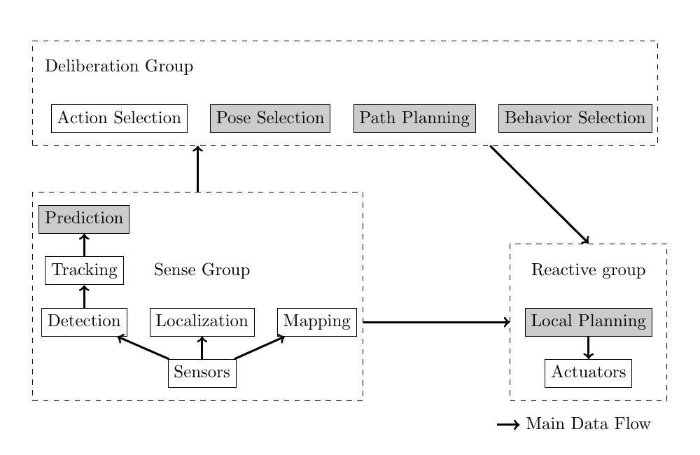

사람이 있는 공간에서는 충돌이 없다는 사실만으로 주행 품질을 설명하기 어려워요. 로봇이 바로 뒤까지 다가오거나 대화 중인 사람 사이를 가로질러도 충돌 수는 0일 수 있기 때문입니다.

Kruse 등의 2013년 서베이가 남긴 고유한 좌표는 간단히 압축할 수 있어요. 사람 때문에 행동이 바뀌는 상호작용을 명시적 신호와 암묵적 조정으로 나누고, 좋은 주행의 목표를 편안함·자연스러움·사회성으로 봅니다. 기능은 감지, 숙고, 반응의 세 묶음에 놓아요. 조사 범위가 2013년 이전이라 최근 학습 정책의 순위나 현대 벤치마크를 말해 주지는 않습니다.

## 세 좌표를 시험 질문으로 바꿔요

이 분류를 실제 설계에 쓰려면 이름보다 관찰 가능한 실패를 적어야 해요. 편안함에는 급접근과 뒤쪽 접근, 자연스러움에는 좌우 진동과 갑작스러운 속도 변화, 사회성에는 집단 사이 통과와 통행 순서 위반 같은 사건을 연결할 수 있습니다. 이 연결은 논문의 표를 옮긴 것이 아니라 분류를 검증 항목으로 바꾼 독자 분석이에요.

명시적 신호는 출력 여부와 이해 여부를 나눠 봅니다. 로봇 화면에 화살표가 켜졌다는 로그는 장치가 동작했다는 증거일 뿐, 사람이 화살표를 봤거나 뜻을 이해했다는 증거는 아니에요. 시선, 보행 방향 변화, 신호 뒤 반응시간을 함께 기록해야 합니다. 암묵적 조정은 로봇이 어느 시점에 감속하고 어느 쪽으로 경로를 정했는지로 관찰할 수 있어요.

세 목표도 하나의 총점으로 합치기 전에 따로 봐야 합니다. 넓게 우회한 로봇은 편안해 보이지만 통로를 오래 막을 수 있고, 매끄러운 최단경로는 사람 활동 공간을 침범할 수 있어요. 먼저 넘지 말아야 할 물리 경계를 두고, 그 안에서 편안함과 읽기 쉬움, 진행성을 비교하는 편이 원인을 찾기 쉽습니다.

## 결정은 출력과 책임 범위로 나눠요

복도에서 한 사람을 만난 장면을 독립적인 설계 예로 두겠습니다. 행동 계층은 통과·대기·양보 가운데 하나를 고르고, 자세 선택은 어느 쪽에서 얼마나 떨어져 설지 정해요. 경로 계층은 장애물과 사람의 예상 이동을 피해 궤적을 만들고, 반응 계층은 새 관측이 들어오면 속도를 즉시 바꿉니다.

각 계층의 출력에는 유효시간이 필요해요. 사람 추적이 갱신됐는데 오래된 경로를 그대로 쓰면 경로는 계산 당시만 안전합니다. 반대로 반응 계층이 매 주기 상위 결정을 무시하면 로봇이 좌우로 흔들릴 수 있어요. 상위 결정의 목표와 하위 계층의 안전 수정, 수정 사유를 함께 기록하면 어느 계층이 행동을 바꿨는지 알 수 있습니다.

같은 장면을 세 번 실행하는 설명용 시험도 만들 수 있어요. 첫 실행은 정확한 사람 상태, 둘째는 위치에 일정 오차, 셋째는 추적을 잠시 끊습니다. 계획 결과만 비교하지 않고 원래 명령과 안전 수정 명령, 최초 감속 시점, 정지 후 회복을 기록해요. 이는 원 논문의 실험을 재현하는 수치가 아니라 모듈 경계를 흔드는 자체 시험입니다.

## 감지·숙고·반응 도식은 완성 구조도가 아니에요

<figure class="fig"><figcaption>감지, 숙고, 반응으로 기능의 위치를 보여 주되 완전한 제어 구조를 규정하지는 않는 도식이에요. (출처: Kruse et al., Human-aware robot navigation: A survey, Figure 6)</figcaption></figure>

도식에서 얻을 수 있는 핵심은 기능의 존재보다 경계 질문입니다. 감지는 관측 시각과 신뢰도를 무엇으로 내보내는지, 숙고는 어떤 가정에서 결정을 유지하는지, 반응은 어느 조건에서 그 결정을 깨뜨릴 수 있는지를 정해야 해요. 데이터 화살표와 제어 권한은 같은 것이 아닙니다.

비상 정지는 장기 경로 계산을 기다리지 않아야 하고, 정지 뒤 재개는 새 관측과 상위 목표를 확인해야 합니다. 사람 검출 결과가 없을 때도 사람이 없다는 뜻인지 센서가 보지 못했다는 뜻인지 구분해야 해요. 이 계약이 없으면 좋은 경로 계획기와 좋은 추적기를 연결해도 전체 시스템의 실패를 설명하기 어렵습니다.

필요한 사회 행동을 먼저 쓰고 필요한 관측을 거꾸로 찾을 수 있어요. 단순 거리 유지에는 위치가 필요하고, 교차 순서에는 속도와 방향, 집단 회피에는 관계 단서가 더 필요합니다. 관측하지 못한 속성을 알고 있다고 가정하지 않는 것이 첫 안전 조건이에요.

## 사람 예측은 한 가지 선으로 끝나지 않아요

선형 예측은 계산이 가볍지만 벽, 문, 목적지, 다른 사람과의 상호작용을 놓쳐요. 불확실성을 넓은 영역으로 표현하면 누락 위험을 줄일 수 있지만, 시간이 조금만 지나도 통로 전체가 위험해져 로봇이 멈출 수 있습니다. 학습한 이동 패턴은 장소 구조를 반영하지만 새로운 배치나 다른 이용자 집단에 그대로 맞는다는 보장이 없어요. 예측기를 선택하는 일은 정확도 표 하나를 고르는 문제가 아니라, 어느 실패를 허용하고 계획기가 불확실성을 어떻게 소비할지 정하는 일입니다.

설명용 가정을 하나 두면 차이가 선명해져요. 사람이 초당 1미터로 2초 동안 같은 방향으로 간다고 두면 선형 예측점은 현재 위치에서 2미터 앞에 놓입니다. 하지만 문 앞에서 회전할 가능성이 크고 방향 오차까지 있다면 한 점이 아니라 여러 후보 영역이 생겨요. 이 값은 논문의 실험 수치가 아니라 예측 표현을 설명하기 위한 가정입니다. 계획기는 점 하나를 확정된 미래로 취급할지, 후보마다 확률을 둘지, 가장 나쁜 경우에 속도를 줄일지 결정해야 합니다.

## 비용지도는 사회 규범을 공간으로 번역해요

사람의 위치 주위에 일정 반경을 칠하면 개인공간을 근사할 수 있어요. 그러나 사람 앞쪽과 뒤쪽의 의미가 같지 않고, 이동 중이면 앞으로 확보해야 할 공간이 더 큽니다. 벽 모퉁이나 문 뒤는 현재 사람이 보이지 않아도 출현 가능성이 있고, 안내받는 사람과 로봇 사이에는 동행 관계를 유지할 공간이 필요할 수 있어요. 사회적 비용지도는 "사람 픽셀"을 장애물로 바꾸는 기능보다, 관측과 관계를 공간 제약으로 번역하는 기능에 가깝습니다.

비용을 더했다고 행동이 보장되는 것도 아니에요. 전역 경로가 집단을 크게 우회해도 국소 계획기가 순간적으로 빈 틈을 택할 수 있고, 사람 예측이 오래된 상태라면 비용이 엉뚱한 위치에 남을 수 있습니다. 각 비용층에는 관측 시각, 신뢰도, 사라지는 조건이 필요해요. 로봇이 멈춘 이유를 나중에 설명하려면 어떤 층이 후보 궤적을 막았는지도 기록해야 합니다.

## 사람의 위치보다 관계가 중요한 장면이 있어요

대화하는 두 사람 사이의 공간을 독립적인 설계 사례로 볼 수 있어요. 각 사람과의 최소거리는 충분해도 가운데를 통과하면 상호작용을 끊을 수 있습니다. 원 여러 개만으로는 이 사건을 표현하기 어려워요.

관계를 읽으려면 위치 외의 관측이 필요해요. 몸이 향한 방향, 이동 속도, 서로를 바라보는지, 일정 시간 같은 대형을 유지했는지가 후보입니다. 관측이 불확실할 때는 집단을 확정하기보다 여러 가설을 두고, 가운데를 통과하는 후보 경로의 비용을 높이는 방식이 가능합니다. 다만 두 사람이 가까이 있다는 이유만으로 항상 대화 집단이라고 판단하면 복도 전체가 막힐 수 있어요. 관계 추정의 오검출과 미검출을 경로 계획 성능과 따로 기록해야 하는 이유입니다.

안내와 동행에서는 관계가 경로의 기준점도 바꿔요. 로봇 혼자 목표에 도착하면 성공인 일반 내비게이션과 달리, 안내받는 사람이 따라오지 못하면 과제가 끝나지 않습니다. 로봇은 상대가 시야 안에 있는지, 간격이 벌어지는지, 갈림길에서 다음 방향을 알아볼 수 있는지를 확인해야 해요. 도착시간을 줄이려고 속도를 올린 행동이 동행자를 놓치게 한다면 효율 지표와 과제 성공 조건이 충돌합니다.

이 때문에 사람을 고려하는 내비게이션에서는 목표 상태를 로봇 자세 하나로 적기 어려워요. "로봇이 좌표에 도착"뿐 아니라 "동행자가 함께 도착", "대화 집단을 갈라놓지 않음", "접근받는 사람이 로봇을 볼 수 있음" 같은 관계 조건이 필요합니다. 이런 조건은 경로가 만들어진 뒤 검사하는 부가 규칙보다 행동·자세 선택 단계의 입력으로 놓는 편이 자연스러워요.

## 반응 계층에는 상위 계획을 깨뜨릴 권한이 필요해요

그림의 반응 묶음은 작게 그려졌지만 안전에서는 무게가 커요. 장기 경로가 안전하게 계산됐더라도 사람이 갑자기 방향을 바꾸거나 센서에 새 장애물이 들어오면 국소 계획이 즉시 감속하거나 정지해야 합니다. 상위 계획을 끝까지 따르는 것이 일관성처럼 보일 수 있어도, 오래된 계획을 고집하면 충돌 위험이 커져요.

반응 계층이 모든 문제를 맡아도 곤란합니다. 가까워질 때마다 멈추는 규칙만 있으면 좁은 복도에서 사람과 로봇이 서로 양보하기를 기다리며 영구 정지할 수 있어요. 국소 반응은 충돌을 막고, 숙고 계층은 어느 쪽으로 비킬지와 언제 다시 움직일지를 정해야 합니다. 두 계층의 시간 범위와 권한을 나누되, 정지 원인과 재개 조건은 공유해야 해요.

예를 들어 추적이 잠시 끊긴 상황을 생각할 수 있습니다. 마지막 관측 위치를 무기한 장애물로 남기면 진행성이 사라지고, 바로 지우면 가려진 사람이 다시 나타날 때 위험해요. 추적 시간, 마지막 속도, 가림을 만든 구조, 새 관측 가능성에 따라 비용을 줄이고 속도를 제한하는 규칙이 필요합니다. 이 예시는 논문 실험의 재현 수치가 아니라, 감지와 반응 사이 계약을 설명하기 위한 상황입니다.

모듈 계약에는 정상 입력뿐 아니라 실패 입력도 들어가야 해요. 검출 결과가 없을 때 "사람이 없음"인지 "관측할 수 없음"인지 구분하고, 예측 결과에는 기준 시각과 유효 시간을 붙이며, 국소 계획은 입력이 오래됐을 때 어떤 안전 행동을 선택하는지 정해야 합니다. Kruse 등의 분류가 현대 소프트웨어에서도 유용한 이유는 특정 알고리즘 이름보다 이 경계 질문을 남겼기 때문입니다.

## 평가는 충돌과 이동시간 밖으로 나가야 해요

평가는 시스템 로그와 사람 반응을 서로 다른 증거로 다뤄야 해요. 성공 여부, 이동시간, 최소거리는 계산할 수 있지만 편안함과 의도 이해를 대신하지 못합니다. 사람 응답도 제동 여유와 충돌 위험을 대신할 수 없어요.

최소거리가 충분했다는 기록은 사람이 편안했다고 증명하지 못합니다. 뒤에서 빠르게 접근한 뒤 바로 옆에서 감속한 로봇과, 일찍 옆으로 이동해 일정한 속도로 지나간 로봇은 같은 최소거리를 가질 수 있어요. 반대로 설문 선호만으로 물리적 안전을 판단할 수도 없습니다. 사람이 위험을 알아차리지 못했거나 짧은 영상만 봤다면 충돌 여유와 제동 가능성을 놓칠 수 있어요.

평가 대상도 분리해야 합니다. 검출기는 사람을 놓치는지, 추적기는 식별이 얼마나 끊기는지, 예측기는 미래 위치의 오차와 불확실성을 얼마나 잘 표현하는지 봐야 해요. 계획기는 같은 관측 아래에서 안전성과 진행성을 비교하고, 전체 시스템은 센서 지연과 제어 주기까지 포함해 봅니다. 사람 참여 평가는 마지막 궤적만 보여 주기보다 로봇을 마주한 사람이 언제 속도를 바꾸고 얼마나 비켜났는지도 기록해야 해요.

## 실패 행렬로 모듈 사이 책임을 확인해요

모듈을 따로 시험한 뒤에는 같은 오류를 서로 다른 위치에 넣어 봐야 해요. 사람 위치가 틀린 경우, 위치는 맞지만 기준 시각이 오래된 경우, 예측 범위가 지나치게 좁은 경우는 화면에서 비슷한 가까운 접근으로 나타날 수 있습니다. 입력과 중간 상태를 저장하지 않으면 결과 영상만으로 원인을 가릴 수 없어요.

행에는 오류 종류를, 열에는 감지·숙고·반응을 둔 실패 행렬을 만들 수 있습니다. 각 칸에는 기대 행동과 관찰값을 적어요. 검출이 끊기면 감지는 상태를 미확인으로 내고, 숙고는 새 추월을 시작하지 않으며, 반응은 속도 제한을 낮추는 식입니다. 이 규칙은 보편 정답이 아니라 시스템이 선언한 계약이며 실제 제동 성능과 센서 주기에서 검증해야 합니다.

오류를 한 번에 여러 개 넣으면 어느 방어가 작동했는지 알기 어려워요. 먼저 위치 편향, 다음에는 시간 지연, 그다음에는 추적 식별자 교환을 따로 시험합니다. 단일 오류를 통과한 뒤 조합 오류로 넘어가야 해요. 성공 횟수와 함께 어떤 방어가 개입했고 정상 상태로 돌아오는 데 몇 주기가 걸렸는지 기록합니다.

사람이 없을 때의 성능도 대조 조건으로 필요해요. 사회 기능을 켠 뒤 빈 복도에서 이동시간과 경로 진동이 크게 늘었다면 사람 관측이 아니라 기본 비용이나 제어 연결에 문제가 있을 수 있습니다. 사람 한 명, 두 명, 집단처럼 복잡도를 늘리면 어느 관측부터 실패가 생겼는지 찾기 쉬워요.

## 시간축을 맞추지 않으면 좋은 모듈도 나쁜 시스템이 돼요

카메라 프레임, 사람 추적, 지도 위치, 속도 명령은 서로 다른 주기로 갱신될 수 있어요. 최신 메시지를 받았다는 사실만으로 같은 시점의 상태가 되지는 않습니다. 각 메시지의 측정 시각과 처리 시각, 계획기가 실제로 사용한 시각을 나눠 기록해야 해요.

설명용으로 카메라는 초당 15회, 제어는 초당 20회, 예측은 초당 5회라고 가정할 수 있습니다. 이 숫자는 배치 기준이 아니라 비동기 흐름을 보여 주는 입력이에요. 제어 주기마다 같은 예측을 네 번 재사용할 수 있고, 그 사이 사람은 계속 움직입니다. 예측의 유효시간을 넘으면 속도를 낮추거나 새 계획을 기다리는 규칙이 필요해요.

좌표계 변환도 시간과 함께 봐야 합니다. 사람 위치가 카메라 기준에서 지도 기준으로 옮겨지는 동안 로봇이 회전했다면 최신 로봇 자세를 잘못 적용할 수 있어요. 화면에는 사람이 옆으로 순간 이동한 것처럼 나타나고 계획기는 급한 회피를 낼 수 있습니다. 원본 관측과 사용한 변환 시각을 남기면 센서 오차와 좌표 오차를 구분할 수 있어요.

## 사람 반응은 로봇 성능표의 숨은 입력이에요

로봇이 지나갈 때 사람이 먼저 비켜 준다면 경로가 좋아 보일 수 있어요. 반대로 사람에게 그대로 걸으라고 지시하면 같은 정책의 충돌과 정지가 늘어날 수 있습니다. 사람을 수동 장애물처럼 두었는지, 로봇에 반응하도록 했는지를 시나리오 조건에 포함해야 해요.

사람의 부담을 수치화하는 독립 예시로 원래 보행 경로에서 벗어난 거리, 속도를 줄인 시간, 멈춘 횟수를 기록할 수 있습니다. 로봇의 도착시간이 짧아도 사람이 크게 우회했다면 효율을 상대에게 떠넘긴 셈일 수 있어요. 반대로 로봇이 오래 기다렸는데 사람 경로가 거의 변하지 않았다면 양보 정책의 비용을 확인할 수 있습니다.

명시적 신호를 쓸 때는 신호가 없던 대조 조건이 필요해요. 신호를 켠 실행에서 사람 반응이 좋아졌더라도 경로와 속도까지 함께 달라졌다면 원인을 분리할 수 없습니다. 같은 궤적에서 신호만 바꾸거나, 같은 신호에서 제시 시점만 바꾸는 식으로 한 축씩 시험해야 합니다.

## 이 분류로 읽을 수 있는 것과 없는 것

논문의 강점은 사람을 고려하는 기능을 "사회적 플래너"라는 한 상자에 몰아넣지 않았다는 데 있어요. 편안함·자연스러움·사회성이라는 목표 축과 감지·숙고·반응이라는 기능 축을 교차하면, 실패가 어느 층에서 생겼는지 질문할 수 있습니다. 사람이 검출되지 않았는지, 움직임을 잘못 예측했는지, 경로 비용이 약했는지, 국소 계획이 상위 결정을 깨뜨렸는지 구분할 수 있어요.

반면 이 서베이만으로 현대 시스템을 선택할 수는 없습니다. 조사된 연구는 센서, 로봇 형태, 사람 수, 환경, 평가 방식이 서로 달라 정량 순위를 만들기 어렵고, 2013년 이후 등장한 학습 정책과 대규모 벤치마크를 다루지 않아요. 개인공간 모델도 문화, 관계, 연령, 이동 보조기 사용 여부에 따라 달라질 수 있으므로 보편 반경으로 고정할 근거가 되지 않습니다.

[[2026-10-17_socialnav_survey-core-challenges|Mavrogiannis 서베이가 소셜 내비게이션의 세 난제를 드러낸 방식]]은 이 고전 분류에서 한 단계 더 나아가 예측과 계획의 결합, 행동 규범, 평가 환경의 편향을 열린 문제로 다룹니다. Kruse 등의 구조는 기능이 들어갈 자리를 찾게 하고, 그 후속 서베이는 그 기능들이 왜 아직 안정적으로 맞물리지 않는지를 설명해요. 둘을 이어 읽으면 사회적 기능을 추가하기 전에 관측, 의사결정, 반응, 평가의 경계를 먼저 적어야 한다는 기준이 남습니다.

---

<!-- src-block -->

출처 — https://www.sciencedirect.com/science/article/pii/S0921889013001048
