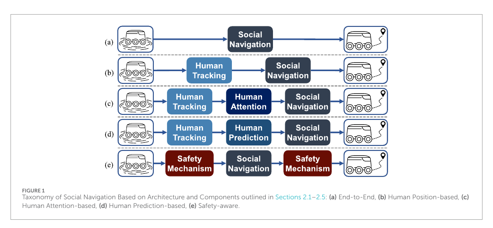

학습 기반 사회적 주행은 모두 비슷한 신경망처럼 보이지만, 정책이 받는 입력부터 크게 달라요. 한쪽은 라이다나 깊이 영상을 받아 속도를 내고, 다른 쪽은 이미 추적된 사람의 위치와 속도를 받습니다. 또 다른 방법은 사람끼리의 관계, 미래 궤적, 안전 제약을 별도 모듈로 넣어요. 결과표의 숫자만 비교하면 이 입력 조건의 차이가 사라집니다.

Alyassi 등의 2025년 논문은 학습 기반 방법을 종단간, 사람 위치 기반, 사람 주의 기반, 사람 예측 기반, 안전 인식의 다섯 부류로 정리하고 여러 주행 장면에서 구현을 비교했어요. 이 글은 그 분류와 비교가 허용하는 결론을 짧게 확인한 뒤, 독립적인 설계 분석으로 벤치마크를 실제 센서와 안전 검증에 연결합니다. 원문 결과가 특정 시뮬레이터와 관측 조건에 묶여 있다는 점이 출발점이에요.

## 다섯 부류의 차이는 신경망 이름보다 입력 계약에 있어요

<figure class="fig"><figcaption>같은 목표 속도 출력이라도 원시 센서, 사람 상태, 관계, 미래 궤적, 안전 모듈 가운데 무엇을 입력으로 요구하는지가 달라요. (출처: Alyassi et al., Social robot navigation: a review and benchmarking of learning-based methods, Figure 1 · CC BY 4.0)</figcaption></figure>

원문의 고유 분류를 압축하면 이렇습니다. 종단간 방식은 센서 관측에서 행동까지의 변환을 함께 학습하고, 사람 위치 기반 방식은 구조화된 사람 상태를 사용해요. 사람 주의 기반 방식은 여러 사람과 관계 가운데 중요한 대상을 가중하고, 사람 예측 기반 방식은 미래 움직임을 계획에 넣습니다. 안전 인식 방식은 위험도나 제약, 정책 전환 같은 장치를 학습 정책에 결합해요.

이 다섯 부류는 서로 완전히 배타적인 상자가 아닙니다. 위치 입력을 쓰면서 주의 모듈과 예측 모듈을 함께 둘 수 있고, 종단간 정책 바깥에 안전 감독기를 붙일 수도 있어요. 그림은 제품 목록보다 어떤 정보와 중간 표현을 믿는지 묻는 독해 도구에 가깝습니다. 벤치마크도 이 차이를 지운 채 단일 순위를 만들기보다 조건별 장단점을 드러내는 데 의미가 있어요.

## 종단간 정책은 앞단의 오차를 숨기는 대신 함께 떠안아요

종단간 정책의 장점은 사람이 몇 명인지, 누가 누구인지와 같은 중간 표상을 반드시 설계하지 않아도 된다는 점이에요. 연속된 거리 스캔이나 영상 특징과 목표를 받아 행동을 출력하도록 학습할 수 있습니다. 사람 검출기가 놓친 대상을 별도 표에서 제거하는 문제도 줄어들 수 있어요.

대신 어떤 시각 단서가 행동을 만들었는지 확인하기 어렵고, 학습에서 보지 못한 센서 노이즈에 대한 반응도 따로 시험해야 합니다. 시뮬레이션의 깨끗한 깊이 영상과 실물의 반사·가림·결측은 같은 입력 배열 모양이어도 분포가 달라요. 정책이 사람과 의자를 구분했는지, 빈 공간의 형태만 외웠는지 출력 속도만으로는 알 수 없습니다.

설명용 고장 주입을 생각해 볼 수 있어요. 거리 스캔의 한 구간을 0.2초 동안 비우고, 다음에는 같은 구간을 최솟값으로 채우며, 마지막에는 측정 지연만 늘립니다. 세 조건은 모두 장애물 정보가 나빠졌지만 의미가 달라요. 결측을 먼 거리로 오해하면 돌진할 수 있고, 최솟값으로 오해하면 멈추며, 지연은 움직이는 사람의 위치를 뒤로 남깁니다. 이는 원문 실험 수치가 아니라 입력 강건성을 분리하는 시험 예시입니다.

종단간이라는 이름도 안전 보증을 뜻하지 않아요. 출력이 속도라면 몸체 제약과 제동 거리, 통신 지연은 여전히 바깥에서 확인해야 합니다. 학습 정책이 낸 명령과 실제로 적용된 명령을 모두 기록해야 안전 감독기의 개입률과 정책 자체 성능을 구분할 수 있어요.

## 사람 위치 기반 정책은 인식기를 벤치마크 밖에 숨기기 쉬워요

사람 위치 기반 정책은 입력 의미가 명확합니다. 로봇 기준의 상대 위치와 속도, 반경, 목표 같은 상태를 사람이 읽을 수 있고, 특정 사람을 제거하거나 오차를 넣어 민감도를 볼 수 있어요. 정책의 결정과 센서 인식 문제를 나누기 쉽다는 장점이 있습니다.

하지만 시뮬레이터가 제공한 정확한 사람 상태를 쓰면 가장 어려운 앞단이 빠집니다. 실물에서는 검출, 거리 추정, 추적, 좌표 변환, 시간 동기화가 이어져야 해요. 한 사람이 잠시 가려졌을 때 같은 식별자로 돌아오는지, 교차하는 두 사람의 식별자가 바뀌는지도 정책 입력을 흔듭니다.

사람 상태 벡터를 만들기 위한 계약에는 최소한 관측 시각, 좌표계, 위치 공분산, 속도 추정 구간, 추적 나이, 마지막 관측 이후 시간을 둘 수 있어요. 정책이 이 값을 모두 쓰지 않더라도 시험 로그에는 남겨야 합니다. 그래야 가까운 접근이 계획기 판단인지 오래된 추적값 때문인지 가릴 수 있어요.

설명용으로 보행자 한 명의 위치를 0.1미터씩 옮기는 시험과 0.5초 동안 추적을 끊는 시험을 비교할 수 있습니다. 위치 오차는 경로 여유를 서서히 바꾸지만 추적 단절은 입력 배열의 사람 수를 갑자기 바꿀 수 있어요. 두 오류를 같은 평균 위치 오차로 합치면 정책의 불연속 반응을 놓칩니다.

## 주의 기반 정책은 중요도를 보여도 이유까지 설명하지는 않아요

사람이 많아지면 모든 쌍의 관계를 같은 비중으로 처리하기 어렵습니다. 주의 모듈은 현재 행동과 관련이 큰 사람이나 관계에 높은 가중치를 둘 수 있어요. 로봇 진행 방향을 가로지르는 사람과 멀어지는 사람을 다르게 취급하는 데 유용합니다.

주의값이 높다는 사실만으로 사회적 판단이 옳다고 말할 수는 없어요. 가까운 사람에게 높은 가중치가 생겼는지, 학습 장면의 배치 편향을 따라 특정 위치만 보는지 확인해야 합니다. 같은 장면을 좌우로 뒤집거나 사람 순서를 바꾸고 출력이 어떻게 변하는지 보는 시험이 필요해요.

관계 입력도 관측 품질에 묶입니다. 두 사람이 나란히 걷는지 대화 중인지 알려면 위치만 아니라 속도 일치, 몸 방향, 거리의 지속성이 필요할 수 있어요. 이 단서가 없는 센서에서 주의층을 추가했다고 집단 이해가 자동으로 생기지는 않습니다. 가중치는 주어진 특징 사이의 선택이지 관측하지 않은 사실을 만들어 내는 장치가 아니에요.

독립 분석으로 세 가지 로그를 함께 남길 수 있습니다. 첫째는 사람별 주의값, 둘째는 사람을 한 명씩 가렸을 때 행동 변화, 셋째는 실제 최근접이나 교차 사건입니다. 주의가 높지만 행동 영향이 거의 없거나, 주의가 낮은 사람이 충돌 위험을 만들면 모델 해석에 빈틈이 있다는 신호예요.

## 예측 기반 정책은 미래를 넣지만 상호작용의 순환을 조심해야 해요

사람의 현재 속도를 그대로 연장하는 것보다 여러 가능한 미래 궤적을 고려하면 일찍 양보하거나 교차 순서를 정할 수 있어요. 문과 교차로처럼 늦게 반응하면 멈춤과 진동이 생기는 장면에서 예측의 가치가 큽니다. 계획기는 예측된 점 하나보다 시간에 따른 점유 확률이나 여러 후보를 받을 수도 있어요.

문제는 사람의 미래가 로봇 행동에 따라 바뀐다는 점입니다. 로봇이 오른쪽으로 비키면 사람은 그대로 갈 수 있고, 로봇이 직진하면 사람이 먼저 피할 수 있어요. 로봇 행동과 무관한 궤적만 예측하면 계획기가 자신의 영향력을 무시합니다. 반대로 사람들이 늘 협조한다고 가정하면 공격적인 행동이 좋은 점수를 받을 수 있어요.

예측 평가와 주행 평가는 따로 기록하는 편이 좋습니다. 평균 위치 오차가 작아도 드문 방향 전환을 놓치면 충돌 위험이 생기고, 예측 오차가 다소 커도 불확실성을 넓게 전달하면 계획기가 안전하게 대응할 수 있어요. 점 예측의 오차와 불확실성 보정, 계획 결과를 한 숫자로 합치면 어느 모듈을 고쳐야 하는지 알기 어렵습니다.

설명용 장면으로 교차 보행자의 세 미래를 둘 수 있어요. 그대로 통과, 속도를 늦춰 로봇 뒤로 통과, 방향을 틀어 로봇 앞을 가로지르는 경우입니다. 계획기가 한 궤적만 받을 때와 세 후보와 확률을 받을 때의 최초 감속 시점, 최소거리, 불필요한 정지를 비교합니다. 이 장면과 수치는 논문의 시험을 재현한 것이 아니라 예측 인터페이스를 확인하는 예시예요.

## 안전 인식은 학습 정책과 독립된 최종 경계를 요구해요

안전 인식 구조는 위험 추정, 보수 정책으로 전환, 제약을 포함한 학습처럼 여러 형태를 가질 수 있어요. 핵심 질문은 위험을 무엇으로 계산하고, 실패 시 어느 행동으로 내려가며, 그 전환을 검증할 수 있는가입니다. 학습 보상에 충돌 벌점을 넣었다는 설명만으로 물리적 안전이 보장되지는 않아요.

실물에서는 학습 정책과 독립된 속도·정지 경계를 두는 편이 안전 검증에 유리합니다. 센서가 모두 정상이고 정책 신뢰도가 높을 때 사회적 회피를 허용하되, 가까운 장애물이나 오래된 관측이 나타나면 감독기가 감속하거나 정지해요. 감독기는 정책의 사회적 판단을 대신하지 않지만 최악의 출력을 제한합니다.

평가할 때 감독기 덕분에 충돌이 없었던 실행을 정책 성공으로 세면 안 됩니다. 원래 명령, 수정 명령, 수정 사유, 개입 지속시간을 남겨야 해요. 개입률이 높다면 전체 시스템은 안전할 수 있어도 정책이 해당 조건을 처리했다고 보기는 어렵습니다.

거짓 개입도 측정해야 합니다. 위험이 없는데 반복해서 멈추면 사람 흐름을 방해하고 목표에 도달하지 못할 수 있어요. 참위험 검출률과 함께 불필요한 감속, 정지 후 회복시간, 제한 상태에서의 경로 진동을 보면 안전성과 진행성의 교환을 확인할 수 있습니다.

## 여섯 장면은 서로 다른 능력을 겨냥해야 해요

원문 벤치마크는 정적 장애물과 문, 복도, 교차, 개방된 군중을 포함한 여섯 시나리오에서 여러 학습 계획기를 비교합니다. 이 구성은 단일 원형 교차 시험보다 넓지만, 결과는 사용한 시뮬레이터와 로봇 운동학, 사람 상태 제공 방식에 묶여요. 성능표를 다른 로봇의 현장 순위로 옮기기보다 장면별 실패 유형을 찾는 자료로 읽어야 합니다.

정적 장애물 장면은 사람 상호작용보다 기본 충돌 회피와 목표 도달을 확인해요. 문 장면은 좁은 통로에서 양보와 교착을, 복도 장면은 마주침과 추월, 측면 여유를 드러냅니다. 교차 장면은 우선순위와 선제 감속을, 개방 군중은 이웃 수 증가와 다방향 상호작용을 시험할 수 있어요.

장면 이름만 같아도 난도는 다릅니다. 문의 폭과 가시거리, 복도의 길이와 시작 위치, 사람의 반응 규칙, 로봇 최고속도에 따라 결과가 바뀌어요. 따라서 시작·목표 자세, 사람 수와 경로, 반응 모델, 센서 가시범위, 종료 조건을 시나리오 카드로 고정해야 합니다.

여섯 장면을 하나의 평균 점수로 합치기 전에 각 장면의 실패를 분리해야 해요. 문에서만 멈춘 정책은 통로 협상 문제가 있고, 개방 군중에서만 가까워지는 정책은 확장성이나 이웃 선택 문제일 수 있습니다. 장면별 성공률, 충돌, 최소거리, 시간, 경로 길이에 개입률과 사람 부담을 더하면 원인을 찾기 쉬워요.

## 공정한 비교는 같은 관측보다 같은 정보량을 묻는 일부터 시작해요

원시 센서를 받는 정책과 정확한 사람 상태를 받는 정책에 같은 배열을 강제로 넣을 수는 없습니다. 대신 어떤 정보가 언제 쓸 수 있는지 표로 만들 수 있어요. 사람 수, 위치, 속도, 반경, 식별자, 목표, 미래 궤적, 지도, 정적 장애물, 로봇 동역학 가운데 각 정책이 무엇을 쓰는지 표시합니다.

추론 시간도 입력 크기와 함께 봐야 해요. 사람이 늘어날 때 처리 시간이 어떻게 변하는지, 제어 주기 안에 결과가 오는지 측정합니다. 평균 추론 시간이 짧아도 긴 꼬리 지연이 제어 명령을 늦출 수 있으므로 상위 백분위와 시간초과 횟수가 필요해요.

학습 비용과 실행 비용도 다릅니다. 큰 계산 자원으로 학습했더라도 실행 모델이 작을 수 있고, 별도 예측 모듈이 전체 지연을 지배할 수도 있어요. 정책 네트워크만 재서 모듈식 방법과 비교하면 불공정합니다. 사람 검출부터 추적, 예측, 계획, 안전 감독까지 한 제어 주기의 끝에서 끝 지연을 재야 해요.

같은 관측을 맞추는 두 번째 비교도 유용합니다. 가능한 정책에는 동일한 노이즈가 포함된 사람 상태를 주고, 종단간 정책에는 같은 장면에서 생성한 센서 관측을 줍니다. 완전히 같은 입력은 아니지만 오류의 원인이 같은 장면에서 나와요. 정확 상태 조건과 센서 조건을 모두 돌리면 알고리즘 차이와 인지 차이를 분리할 수 있습니다.

## 시뮬레이션 성능을 실물 주장으로 옮기려면 다리를 놓아야 해요

시뮬레이션은 같은 장면을 반복하고 위험한 실패를 안전하게 모을 수 있어요. 그러나 사람 모델이 로봇을 얼마나 잘 피하는지, 센서가 가림을 어떻게 만드는지, 제어 지연이 있는지에 따라 쉬운 세계가 될 수 있습니다. 사람 모양의 객체가 많다는 사실만으로 실제 군중 상호작용이 재현되지는 않아요.

첫 다리는 관측 열화 시험입니다. 검출 누락, 위치 오차, 속도 지연, 식별자 교환, 시야 밖 진입을 하나씩 넣어요. 두 번째는 운동 열화로 가속도와 회전 한계, 제어 지연, 바퀴 미끄러짐을 추가합니다. 세 번째는 사람 반응을 비협조적, 반응적, 다양한 선호의 조건으로 바꾸는 것입니다.

실물 시험은 단순한 최종 확인보다 모델 차이를 찾는 단계로 설계해요. 같은 시나리오 카드를 쓰고 센서 입력, 정책 출력, 감독기 수정, 몸체 상태, 사람 궤적을 같은 시간축으로 기록합니다. 시뮬레이션과 실물의 차이가 인지, 계획, 제어 가운데 어디서 커지는지 확인할 수 있어요.

사람 참여 전에 마네킹이나 재생 궤적, 원격 이동 장애물로 안전 경계를 확인할 수 있습니다. 그다음 통제된 한 명, 두 명, 좁은 통로 순으로 늘려요. 학습 정책의 참신함보다 실패를 멈추고 재현할 수 있는 절차가 먼저입니다.

## 벤치마크를 읽는 마지막 질문은 무엇을 아직 모르는가예요

높은 성공률은 해당 장면과 입력 조건에서 목표 도달이 많았다는 뜻입니다. 사람이 편안했는지, 로봇 의도를 이해했는지, 센서 누락에서도 안전했는지까지 자동으로 증명하지 않아요. 실제 사람 대신 군중 모델을 썼다면 사람 설문과 문화적 규범에 대한 결론도 제한됩니다.

[[2026-10-17_socialnav_survey-evaluation|Francis 평가 지침이 사회적 주행을 여덟 원칙으로 측정한 방식]]의 원칙을 함께 쓰면 빈칸이 보입니다. 성공률과 이동시간은 과제 성능을, 최소거리와 충돌은 안전 일부를 말해요. 읽기 쉬움, 예의, 문맥 적합성은 별도 사람 평가와 사건 기록이 필요합니다.

구현 선택은 단일 우승자보다 관측 가능성에서 시작할 수 있어요. 신뢰할 수 있는 사람 추적이 없다면 위치 기반 정책의 시뮬레이션 점수는 곧바로 쓸 수 없고, 계산 자원이 작다면 큰 예측 모듈의 지연을 포함해야 합니다. 센서 조건과 안전 감독기를 먼저 정한 뒤 그 계약을 만족하는 정책을 고르는 순서가 검증하기 쉽습니다.

## 재현 패키지는 가중치 파일보다 조건표가 먼저예요

학습 정책을 다시 비교하려면 모델 가중치만으로는 부족해요. 관측을 어떤 순서와 단위로 정규화했는지, 사람 수가 입력 한도를 넘을 때 누구를 고르는지, 종료 신호를 언제 내는지까지 남겨야 합니다. 무작위 초기화와 장면 생성 씨앗, 학습과 평가 장면의 겹침 여부도 결과를 바꿀 수 있어요.

실행 기록에는 정책 버전, 제어 주기, 입력 시각, 추론 시작과 종료, 원래 명령, 감독기가 적용한 명령을 한 시간축에 둡니다. 영상은 실패를 이해하는 데 좋지만 수치 입력을 복원하지 못하므로 로그를 대신할 수 없어요. 반대로 로그만 있으면 사람이 로봇 신호를 봤는지 확인하기 어렵습니다. 둘을 같은 실행 식별자로 연결해야 해요.

재현에 실패했을 때도 원인을 분류할 수 있습니다. 모델 파일과 전처리가 다르면 구현 재현 문제이고, 같은 구현이 새 장면에서 무너지면 분포 이동 문제예요. 센서 조건에서만 차이가 나면 인지 계약 문제로 좁힐 수 있습니다. 이 구분은 벤치마크 점수를 제품 보증으로 오해하지 않게 해 줍니다.

Alyassi 등의 연구가 허용하는 결론은 학습 기반 방법을 입력과 구조에 따라 비교하고, 여러 어려운 장면에서 장단점을 관찰할 수 있다는 것입니다. 특정 정책이 모든 사회적 상황에서 우월하다거나 시뮬레이션 순위가 실물 배치 성능을 보장한다는 결론은 허용되지 않아요. 벤치마크의 가장 유용한 산출물은 순위표보다 다음 실패를 재현할 조건표입니다.

---

<!-- src-block -->

출처 — https://www.frontiersin.org/journals/robotics-and-ai/articles/10.3389/frobt.2025.1658643/full
