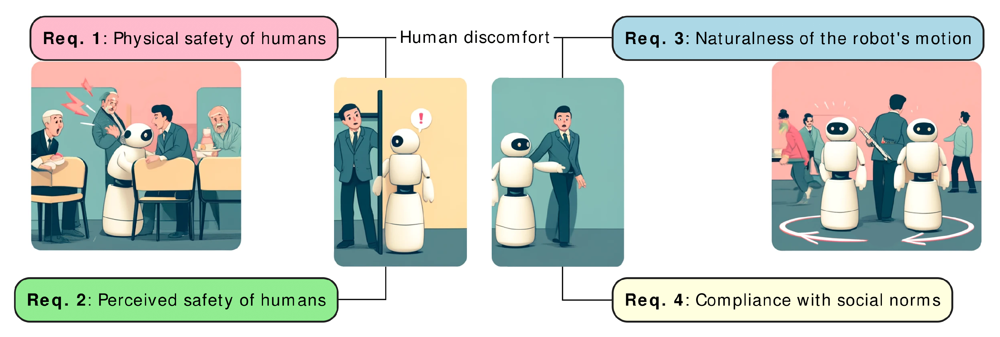

사회적 주행 알고리즘을 만들 때 "사람을 배려한다"는 문장만으로는 구현도 시험도 할 수 없어요. 어느 행동이 불편을 만들었는지, 로봇이 그 행동을 피하려면 무엇을 관측해야 하는지, 결과를 어떤 지표와 사람 응답으로 확인할지를 이어야 합니다. Karwowski, Szynkiewicz, Niewiadomska-Szynkiewicz의 2024년 서베이는 사용자 연구에서 보고된 불편 요인을 <abbr title="시스템이 지켜야 할 관찰 가능하고 시험 가능한 조건">주행 요구사항</abbr>으로 묶고, 인지·계획·평가 방법을 그 요구사항과 연결했어요.

이 접근은 알고리즘 이름에서 출발하지 않습니다. 사람이 로봇 주변에서 언제 위협을 느끼고, 어떤 움직임을 부자연스럽게 보며, 어떤 공간 침범을 규범 위반으로 판단하는지 먼저 살펴요. 그다음 사람 검출과 추적, 궤적 예측, 환경 표현, 경로 계획이 어느 요구사항을 다룰 수 있는지 검토합니다. 마지막에는 데이터셋, 시뮬레이터, 벤치마크, 사용자 연구가 무엇을 검증했는지 묻습니다.

## 불편을 네 요구사항 묶음으로 정리했어요

<figure class="fig"><figcaption>불편을 물리적 안전과 지각된 안전, 움직임의 자연스러움, 사회 규범 준수로 나눈 상위 요구사항이에요. 네 항목은 서로 영향을 주지만 같은 뜻은 아닙니다. (출처: Karwowski et al., Bridging Requirements, Planning, and Evaluation, Figure 3 · CC BY 4.0)</figcaption></figure>

논문의 상위 분류는 사람의 물리적 안전, 사람이 느끼는 안전, 로봇 움직임의 자연스러움, 사회 규범 준수입니다. 물리적 안전은 접촉과 충돌 위험을 막는 조건이에요. 지각된 안전은 실제 충돌이 없더라도 사람이 놀라거나 위협을 느끼지 않도록 하는 조건입니다. 자연스러움은 속도와 궤적이 이해 가능하고 매끄러운지를 다루고, 사회 규범은 개인공간·집단·활동 공간·통행 관습을 다룹니다.

네 묶음은 겹칠 수 있어요. 사람이 로봇을 늦게 발견해 놀랐다면 지각된 안전 문제이고, 급정지로 몸을 피하다 넘어질 뻔했다면 물리적 안전과 연결됩니다. 좌우로 흔들리는 경로는 부자연스러울 뿐 아니라 사람이 피할 방향을 결정하지 못하게 해 위협감을 키울 수 있어요. 겹침이 있다고 한 점수로 합치면 어떤 요구사항이 실패했는지 잃습니다.

그림의 삽화는 개념을 설명하지만 특정 거리나 속도를 정하지 않아요. 상위 요구사항을 배치 기준으로 쓰려면 장면과 로봇 특성에 맞는 관찰값으로 내려야 합니다. "안전하게 지나가기" 대신 최소거리, 멈출 수 있는 여유, 감속 시작 시점, 사람의 회피 행동을 정의해야 해요.

## 물리적 안전과 지각된 안전은 다른 질문이에요

물리적 안전은 로봇과 사람이 접촉하지 않고, 위험한 충돌 가능성을 충분히 낮추는가를 묻습니다. 센서 탐지 범위, 제동거리, 제어 지연, 몸체 돌출부, 사람의 갑작스러운 방향 변화가 모두 관련돼요. 이 항목은 사회적 기능이 실패해도 남아 있어야 하는 안전 경계와 가깝습니다.

지각된 안전은 사람이 상황을 어떻게 받아들이는지 봐요. 로봇이 물리적으로 멈출 수 있어도 빠른 속도로 가까이 다가오면 사람은 불안할 수 있습니다. 뒤쪽이나 시야 밖에서 접근하면 같은 거리에서도 놀랄 가능성이 커요. 로봇이 갑자기 방향을 바꾸거나 좁은 틈을 향해 계속 들어오면 사람이 먼저 크게 피할 수 있습니다.

두 질문을 섞으면 잘못된 결론이 나와요. 충돌이 없었다고 지각된 안전까지 통과했다고 말할 수 없고, 참가자가 안전하다고 답했다고 제동 성능이 충분한 것도 아닙니다. 전자는 센서·제어 로그와 근접 사건을, 후자는 사람의 행동 변화와 설문을 포함해야 해요.

설명용 예시를 두면 차이가 보여요. 로봇 A는 사람 0.8미터 앞에서 급정지하고, 로봇 B는 1.5미터 전부터 속도를 줄여 0.8미터를 유지한다고 가정합니다. 최소거리만 보면 둘은 같지만 감속 시간, 접근 속도, 사람이 반응할 여유는 다릅니다. 숫자는 논문 실험값이 아니라 요구사항을 지표로 내리는 과정을 설명하기 위한 가정이에요.

## 개인공간은 고정된 원 하나가 아니에요

논문은 개인공간 연구를 지각된 안전의 중요한 근거로 다룹니다. 초기 원형 구역 외에도 달걀 모양, 타원, 비대칭, 움직임에 따라 달라지는 형태가 제안됐고, 뒤쪽 접근을 피하는 선호도 보고됐어요. 이 정리는 사람 주변 비용을 한 반경으로 끝내기 어려운 이유를 보여 줍니다.

구현에서는 사람의 위치만으로 원형 비용을 만들기 쉽습니다. 그러나 이동 방향을 알면 앞쪽 공간을 더 길게 잡을 수 있고, 몸 방향을 알면 시야 밖 접근 비용을 높일 수 있어요. 벽이나 가구 때문에 사람이 피할 공간이 좁다면 같은 반경도 다른 압박을 만듭니다. 그룹 관계가 있으면 개인별 원보다 집단 가운데 공간이 중요할 수 있어요.

더 복잡한 모양이 항상 낫지는 않습니다. 방향 추정이 흔들리면 타원이 프레임마다 회전해 경로가 진동할 수 있고, 반경을 크게 잡으면 좁은 복도를 영원히 통과하지 못해요. 비용 모양의 정교함과 입력 신뢰도는 함께 봐야 합니다. 사람이 멈췄을 때 방향을 어떻게 정의하는지도 필요해요.

개인공간 침범을 평가할 때는 시간도 넣는 편이 낫습니다. 순간적으로 경계에 들어간 경우와 오랫동안 가까이 따라간 경우는 부담이 달라요. 침범 횟수, 누적 시간, 접근 방향, 상대속도를 함께 기록하면 반경 하나보다 행동 차이를 잘 설명할 수 있습니다.

## 자연스러운 움직임은 사람 흉내와 같지 않아요

자연스러움은 사람이 예상하기 쉬운 속도와 경로, 부드러운 운동을 포함하지만 로봇이 사람처럼 걸어야 한다는 뜻은 아니에요. 바퀴형 로봇은 제자리 회전이 가능하고 몸체 형태와 제동 특성도 사람과 다릅니다. 사람의 궤적을 그대로 복제하면 로봇 동역학에 맞지 않거나 오히려 의도가 흐려질 수 있어요.

시험 가능한 항목으로는 가속도와 급격한 속도 변화, 좌우 방향 전환 횟수, 경로 곡률 변화, 목표를 향한 일관성이 있습니다. 다만 수치가 작을수록 항상 자연스러운 것은 아니에요. 사람과 충돌할 상황에서 감속하지 않는 매끄러운 경로는 안전하지 않고, 양보를 알리기 위한 분명한 정지는 필요할 수 있습니다.

자연스러움은 문맥과도 연결돼요. 넓은 로비에서 큰 우회는 이상해 보일 수 있지만 좁은 전시장에서는 작품을 보는 사람의 시야를 가리지 않으려는 행동일 수 있습니다. 복도에서 일찍 한쪽으로 붙는 움직임은 통행 의도를 읽기 쉽게 하고, 교차점에서 작은 좌우 흔들림은 사람에게 혼란을 줍니다.

따라서 자연스러움 지표는 안전 제약 아래에서 읽어야 해요. 먼저 충돌과 제동 여유를 통과한 시도에서 속도 변화와 경로 일관성을 비교하고, 사람이 로봇의 진행 방향을 맞힐 수 있었는지 확인할 수 있습니다. 경로 모양만 보고 사람의 이해 가능성을 대신 판단하면 안 됩니다.

## 사회 규범에는 개인보다 큰 공간이 들어가요

사회 규범 요구에는 집단 공간, 활동 공간, 통행 방향 같은 항목이 포함됩니다. 대화 중인 사람들의 가운데를 지나지 않는 행동, 관람객과 작품 사이를 가로막지 않는 행동, 좁은 통로에서 지역의 통행 관습을 따르는 행동이 예예요. 사람 한 명씩의 최소거리만 지켜서는 검출하기 어려운 실패입니다.

활동 공간은 물체와 사람의 관계에서 생겨요. 미술관에서 작품을 보는 사람과 작품 사이, 선반에서 물건을 고르는 사람의 손이 움직일 영역, 줄을 선 사람들 사이가 예가 될 수 있습니다. 공간의 의미를 알려면 사람과 물체의 위치뿐 아니라 무엇을 하고 있는지 추정해야 해요.

집단 공간도 고정 장애물 덩어리와 다릅니다. 사람 둘 사이를 지나지 않아야 할 때가 있지만, 줄을 선 사람들 옆을 통과하는 것은 가능할 수 있어요. 같은 사람 배치라도 몸 방향과 활동이 달라지면 허용 경로가 달라집니다. 집단 검출의 오분류가 계획에 미치는 영향도 따로 평가해야 해요.

통행 규범은 문화와 장소에 따라 바뀔 수 있습니다. 한쪽 통행을 보편 규칙으로 고정하기보다 장소 설정이나 관찰로 선택하고, 사람 흐름이 바뀌면 갱신하는 방식이 필요해요. 규범을 어겼는지 평가하려면 어떤 규범을 가정했는지 먼저 공개해야 합니다.

## 요구사항은 필요한 관측으로 거꾸로 내려가요

요구사항마다 필요한 관측이 다릅니다. 충돌 방지는 사람이나 물체의 위치와 상대속도, 로봇의 제동 가능성이 필요해요. 시야 밖 접근을 피하려면 사람의 몸 방향과 로봇의 상대 위치가 필요하고, 집단 공간을 보존하려면 사람끼리의 관계를 추정해야 합니다. 활동 공간은 물체와 행동 의미까지 요구할 수 있어요.

이 목록은 센서 구매표가 아닙니다. 같은 몸 방향도 영상 자세 추정, 얼굴 방향, 이동 궤적에서 얻을 수 있고 각각 실패 조건이 달라요. 얼굴이 가려져도 몸통 방향은 보일 수 있으며, 멈춘 사람의 이동 방향은 정의하기 어렵습니다. 어느 추정치를 썼는지와 신뢰도가 계획에 어떻게 반영되는지를 적어야 해요.

관측 누락을 "사람 없음"으로 바꾸면 위험합니다. 가림이나 시야 밖 때문에 보이지 않는 상태와 실제로 떠난 상태를 구분해야 해요. 마지막 관측 시각, 예상 이동 영역, 다시 보일 가능성을 이용해 속도를 제한하거나 재관측할 수 있습니다. 반대로 오래된 추적을 계속 유지하면 유령 장애물이 통로를 막습니다.

관측 계약에는 단위와 좌표계도 필요해요. 사람 위치가 카메라 좌표인지 지도 좌표인지, 시간표가 센서 촬영 시각인지 처리 완료 시각인지, 속도가 어느 구간에서 계산됐는지를 남겨야 합니다. 요구사항이 정교해도 입력의 시간과 위치가 맞지 않으면 사회 비용이 엉뚱한 곳에 생겨요.

## 계획기는 요구사항을 제약과 비용으로 번역해요

전통 경로 탐색에 사람 주변 비용층을 더하는 방법은 기존 계획기를 재사용하기 쉬워요. 개인공간, 시야, 가려진 영역을 지도 비용으로 표현하고 경로 길이와 함께 최적화할 수 있습니다. 그러나 관계와 시간 변화가 큰 요구사항은 정적 비용지도만으로 표현하기 어렵습니다.

궤적 최적화는 로봇 동역학과 사람의 예상 움직임을 시간축에서 함께 다룰 수 있어요. 최소거리와 충돌시간, 방향 제약을 넣기 좋지만 예측이 틀리면 최적 궤적도 틀립니다. 여러 행동 정책 중 고르는 방법은 추월, 따르기, 양보, 정지 같은 모드를 표현할 수 있지만 전환 기준과 고착 문제를 시험해야 해요.

요구사항을 모두 강한 제약으로 두면 해가 없어질 수 있습니다. 좁은 문에서 개인공간을 절대 침범하지 않고, 항상 자연스러운 속도를 유지하며, 사람의 활동 공간도 보존하라는 조건은 동시에 만족되지 않을 수 있어요. 물리적 안전은 넘지 말아야 할 경계로, 편안함과 효율은 문맥에 따라 조절할 비용으로 두는 식의 우선순위가 필요합니다.

해가 없을 때 행동도 요구사항입니다. 무기한 정지, 천천히 후퇴, 다른 경로 요청, 사람에게 통과 의사 알림 가운데 무엇을 할지 정해야 해요. 정상 경로만 검증하고 실패 복구를 비워 두면 실제 장면의 가장 어려운 순간을 평가하지 못합니다.

## 평가에서는 요구사항과 지표를 한 줄로 연결해요

평가표의 각 행은 요구사항, 장면, 관측, 행동, 지표로 이어질 수 있습니다. 물리적 안전 행에는 블라인드 코너, 사람 신규 출현, 제동 개입 시각과 최소거리 같은 항목을 둬요. 지각된 안전 행에는 뒤쪽 접근, 감속 시작 시점, 사람의 움찔함이나 경로 변화, 설문을 연결할 수 있습니다.

자연스러움 행에는 교차 보행과 좁은 복도, 좌우 전환 횟수, 가속도 변화, 진행 방향 예측을 둡니다. 사회 규범 행에는 대화 집단과 활동 공간, 집단 침범 시간, 사람이 하던 행동의 중단 여부를 둘 수 있어요. 모든 행에 성공률을 반복해 넣기보다 요구사항이 실패했을 때 바뀌는 관측을 고르는 편이 낫습니다.

시뮬레이션에서는 정확한 사람 상태를 계획기에 준 조건과 센서 오류를 주입한 조건을 분리해야 해요. 기록 데이터는 동일 입력으로 여러 알고리즘을 비교하기 좋지만 로봇 행동에 대한 사람 반응을 만들지 못합니다. 실물 참가자 연구는 반응을 볼 수 있지만 장면 수와 안전 범위가 제한돼요. 세 증거를 같은 주장으로 합치지 않고 서로의 빈칸을 채우게 해야 합니다.

## 요구사항 추적표가 있으면 기능 추가의 이유가 남아요

기능을 구현할 때 요구사항에서 코드와 시험까지 이어지는 추적표를 만들 수 있어요. 첫 열에는 "사람 뒤쪽에서 빠르게 접근하지 않음"처럼 관찰 가능한 요구를 씁니다. 다음 열에는 몸 방향 추정, 상대속도 계산, 접근 비용처럼 필요한 기능을 적고, 마지막에는 뒤쪽 접근 장면과 감속 시점·사람 반응 지표를 연결합니다.

이 표가 없으면 자세 추정기를 추가했는데 어느 행동을 바꾸기 위한 것인지 불명확해질 수 있어요. 몸 방향 정확도가 올라도 계획기가 그 값을 쓰지 않으면 주행은 달라지지 않습니다. 반대로 집단 비용이 잘 작동하지 않을 때 관계 추정 오류인지, 비용 가중치인지, 국소 계획이 비용을 무시한 것인지 나눌 수 없어요.

요구사항 하나가 기능 여러 개에 걸칠 수도 있습니다. 블라인드 코너의 물리적 안전은 지도에서 가려진 구역을 찾는 기능, 최근 사람 추적을 유지하는 기능, 코너 접근 속도를 제한하는 기능, 마지막 충돌감시에 걸쳐 있어요. 어느 하나가 빠졌을 때 남은 계층이 어느 수준까지 방어하는지 시험해야 합니다.

반대로 기능 하나가 요구사항 여러 개를 도울 수 있어요. 사람 몸 방향은 뒤쪽 접근을 피하는 데 쓰이고, 대화 집단 추정과 진행 의도 예측에도 쓰일 수 있습니다. 이때 한 시험의 성공을 다른 요구사항의 성공으로 복사하면 안 돼요. 뒤쪽 접근 장면에서 방향 추정이 맞았다고 집단 인식까지 검증된 것은 아닙니다.

추적표에는 "미검증" 상태가 필요해요. 기능이 구현됐지만 사람 참여 평가가 없거나, 시뮬레이션 정답만 쓴 경우를 완료로 표시하면 증거 범위를 과장하게 됩니다. 구현, 단위 검증, 시뮬레이션, 실물 로봇, 사람 평가를 별도 칸으로 두면 어느 단계의 주장인지 드러납니다.

## 고장 주입은 요구사항의 약한 연결을 찾아요

정상 관측만으로 요구사항을 시험하면 실제 배치에서 생길 연결 실패를 놓칩니다. 사람 위치에 작은 오차를 더하고, 몸 방향을 늦게 갱신하고, 추적 식별을 바꾸고, 일정 시간 관측을 끊는 고장 주입이 필요해요. 같은 장면과 사람 궤적을 유지하면서 입력만 바꾸면 계획기의 민감도를 볼 수 있습니다.

물리적 안전 시험에서는 마지막 안전 계층이 제때 감속했는지와 명령 지연을 봐요. 지각된 안전 시험에서는 오차가 생겼을 때 늦은 급정지와 경로 흔들림이 늘었는지 기록합니다. 사회 규범 시험에서는 집단 식별 전환이 대화 공간 비용을 갑자기 지웠는지 확인할 수 있어요.

고장 크기는 실제 센서 로그에서 정해야 합니다. 임의로 큰 오차를 넣어 정책을 실패시키는 것은 취약성의 존재만 보여 줄 뿐 발생 가능성을 말하지 못해요. 정상 운용에서 관찰된 위치 오차, 누락 길이, 처리 지연의 분포를 먼저 구하고 그 범위 안과 밖을 나눠 시험하는 편이 낫습니다.

결과는 성공·실패 두 값보다 열화 곡선으로 남길 수 있어요. 누락 시간이 늘어날수록 감속 시작이 얼마나 늦어지는지, 몸 방향 오차가 커질수록 집단 침범 시간이 어떻게 바뀌는지 기록합니다. 어느 지점에서 안전 계층이 사회 계획을 대신하기 시작하는지도 표시해요.

설명용으로 추적 누락 0초, 0.5초, 1초의 세 조건을 만든다고 가정할 수 있습니다. 이 값은 논문에서 검증한 기준이 아니라 시험 설계를 보여 주는 예시예요. 실제 값은 센서와 처리 로그에서 정해야 하며, 사람 속도와 로봇 제동거리도 함께 바뀌므로 누락 시간 하나만으로 안전 한계를 선언할 수 없습니다.

## 상충하는 요구사항은 우선순위로 드러내요

사람이 갑자기 좁은 문에 들어오면 자연스러운 속도 유지와 물리적 안전이 충돌할 수 있어요. 이때 급정지가 부자연스럽다는 이유로 감속을 늦출 수는 없습니다. 물리적 안전을 먼저 지키고, 그 범위 안에서 지각된 안전과 자연스러움을 개선하는 계층적 우선순위가 필요합니다.

사회 규범과 진행성도 충돌해요. 대화 집단을 가르지 않고 개인공간을 모두 보존하면 목적지로 갈 경로가 없을 수 있습니다. 로봇은 기다림, 우회, 명시적 요청, 임무 중단 가운데 하나를 골라야 해요. 선택 기준과 최대 대기시간을 숨기면 무기한 정지를 사회적 행동으로 잘못 평가할 수 있습니다.

우선순위는 평가 보고서에도 나타나야 합니다. 안전 개입으로 규범 위반을 피했는지, 규범 비용 때문에 도착이 늦었는지, 진행성을 위해 어느 편안함 비용을 낮췄는지를 기록해요. 단일 총점은 이런 교환을 숨기므로 요구사항별 결과와 상충 사례를 함께 보여 주는 편이 낫습니다.

[[2026-10-17_socialnav_survey-evaluation|Francis 평가 지침이 사회적 주행을 여덟 원칙으로 측정한 방식]]은 이 요구사항을 지표, 시나리오, 벤치마크, 데이터셋, 시뮬레이터 지침으로 더 세분합니다. Karwowski 등의 기여는 알고리즘부터 고르지 않고 사람 불편에서 검증 항목을 끌어냈다는 데 있어요. 다만 논문도 모든 사회 규범의 구체 지침이 확보된 것은 아니며, 문맥에 맞는 목적함수와 포괄적인 제어 시스템은 열린 문제라고 남깁니다.

---

<!-- src-block -->

출처 — https://www.mdpi.com/1424-8220/24/9/2794
