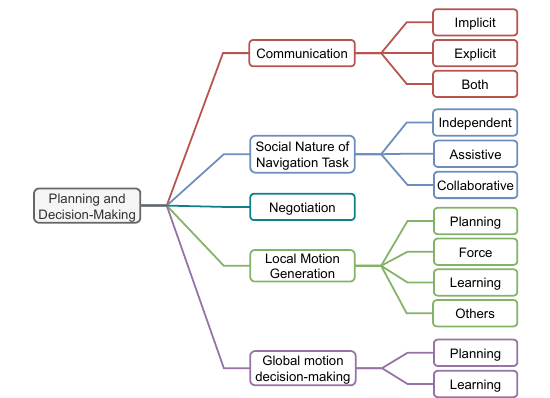

소셜 내비게이션 논문을 "규칙 기반"과 "학습 기반"으로만 나누면 로봇이 누구를 위해 움직이는지, 사람과 어떤 신호를 주고받는지, 무엇을 관측하는지, 어디서 평가했는지가 사라집니다. Singamaneni, Bachiller-Burgos, Manso, Garrell, Sanfeliu, Spalanzani, Alami의 서베이는 지난 10년의 연구 193편을 하나의 서열이 아니라 네 개의 <abbr title="한 연구를 여러 독립 관점에서 동시에 분류하는 체계">다면 분류표</abbr>로 정리했어요.

네 관점은 로봇 종류, 계획과 의사결정, 상황 인식과 판단, 평가와 도구입니다. 한 논문은 각 관점에서 여러 꼬리표를 받을 수 있어요. 예를 들어 바퀴형 안내 로봇 연구는 로봇 종류에서는 지상 이동로봇, 과제에서는 보조 내비게이션, 의사소통에서는 암묵적 신호, 상황 인식에서는 사람 궤적 예측, 평가에서는 실물 사용자 연구로 분류될 수 있습니다. 이 방식은 방법 이름보다 연구 계약을 먼저 읽게 합니다.

## 하나의 분류표로 합치지 않은 이유

로봇 형태와 계획 방법은 같은 층위가 아니에요. 바퀴형인지 비행형인지는 물리적 제약을 말하고, 힘 기반인지 학습 기반인지는 명령을 만드는 방법을 말합니다. 사용자 연구인지 시뮬레이션인지는 증거의 종류예요. 이를 한 나무에 모두 넣으면 한 갈래를 고른 순간 다른 관점을 잃게 됩니다.

저자들은 미리 정한 주제로 논문을 여러 차례 읽고 꼬리표를 붙이는 연역적 주제 분석을 사용했어요. 사회적 내비게이션이 중심 주제가 아니거나 이미 다룬 연구에 작은 증가분만 더한 자료는 제외했습니다. 최종 193편이라는 수는 분야의 모든 연구를 세었다는 뜻이 아니라, 논문의 범위와 제외 기준을 통과한 문헌 집합의 크기예요.

분류표의 가치는 빈칸에서도 나옵니다. 어떤 로봇 형태에는 연구가 몰리고, 어떤 과제나 평가 방식에는 자료가 적은지 볼 수 있어요. 다만 논문 수가 많다는 사실이 성숙도나 우수성을 보장하지는 않습니다. 같은 실험을 잘게 나눈 출판 관행, 접근하기 쉬운 시뮬레이터, 센서 가격도 분포에 영향을 줄 수 있어요.

## 첫 관점은 로봇의 몸이에요

로봇 종류 분류는 지상, 공중, 수중으로 시작합니다. 지상에는 사람을 태우지 않는 이동로봇과 사람을 운송하는 자율주행 차량이 있고, 이동로봇은 바퀴형과 다리형으로 갈립니다. 공중에는 회전익, 기구형, 고정익, 날갯짓형이 들어가요. 조사된 문헌에서 수중 로봇의 사회적 내비게이션 연구는 찾지 못했다고 적습니다.

몸이 달라지면 같은 "개인공간"도 구현이 달라져요. 바닥을 달리는 작은 로봇은 발과 충돌하거나 통로를 막을 수 있고, 큰 운송 장치는 탑승자와 보행자의 안전을 함께 고려해야 합니다. 드론은 위에서 접근할 수 있지만 소음, 하강 기류, 추락 위험, 머리 높이 접근 같은 다른 불편을 만듭니다. 다리형 로봇은 몸체 움직임 자체가 의도로 읽힐 수 있어요.

그래서 다른 몸체에서 얻은 거리 규칙을 그대로 옮기기 어렵습니다. 같은 1미터라도 무게, 높이, 속도, 제동거리, 소음이 다르면 사람이 느끼는 위협이 달라져요. 로봇 종류 꼬리표는 논문을 검색하기 위한 정보이면서 결과를 옮길 수 있는 범위를 제한하는 정보입니다.

설명용 비교를 해 볼 수 있어요. 바퀴형 로봇과 소형 드론이 같은 복도를 통과한다고 가정합니다. 바퀴형 로봇에는 좌우 통행과 발 주변 장애물 감지가 중요하고, 드론에는 높이 선택과 머리 위 통과 금지, 소음이 더 중요할 수 있어요. 둘 다 충돌률이 0이어도 사람 평가의 질문과 안전 제약은 같지 않습니다. 이는 논문의 실험 수치가 아니라 몸체 분류를 설계에 적용한 예시예요.

## 둘째 관점은 계획과 의사결정이에요

<figure class="fig"><figcaption>방법 이름 하나로 묶지 않고 의사소통, 과제의 사회적 성격, 협상, 국소 명령, 전역 결정으로 분해한 분류예요. 가지들은 서로 배타적이지 않습니다. (출처: Singamaneni et al., A survey on socially aware robot navigation, Figure 4)</figcaption></figure>

그림 4는 계획 연구를 의사소통, 과제의 사회적 성격, 협상, 국소 운동 생성, 전역 운동 결정로 나눠요. 의사소통은 몸 움직임이나 시선처럼 상대가 뜻을 추론하는 암묵적 방식, 말·화면·몸짓으로 뜻을 밝히는 명시적 방식, 둘을 함께 쓰는 방식으로 갈립니다. 과제는 로봇이 혼자 사람들 사이를 지나는 독립형, 특정 사람을 돕는 보조형, 사람과 함께 조정하는 협업형으로 나뉩니다.

국소 운동 생성은 궤적·전방 시뮬레이션을 쓰는 계획, 인공 힘을 합치는 방식, 관측에서 명령을 학습하는 방식 등으로 구분돼요. 전역 결정도 기하·형식 계획과 학습 방식으로 나눕니다. 같은 연구가 전역 경로는 그래프 탐색으로 만들고 국소 명령은 학습 정책으로 낼 수 있으므로 꼬리표는 하나만 붙지 않아요.

이 구조로 읽으면 "학습 기반"이라는 표현이 얼마나 넓은지 드러납니다. 센서 영상에서 속도 명령을 바로 내는 정책과, 사람 궤적을 예측한 뒤 전통 계획기가 쓰게 하는 모델은 학습의 위치가 달라요. 전자는 인지와 제어 오류가 한 출력에 섞이고, 후자는 중간 예측을 검사할 수 있지만 모듈 사이 오차가 누적됩니다.

## 과제의 역할을 빼면 성공 조건이 틀어져요

독립형 과제에서 로봇은 목적지에 도착하면 임무를 마칠 수 있어요. 보조형에서는 따라오는 사람이나 탑승자의 상태가 성공 조건에 들어갑니다. 협업형에서는 문이나 좁은 통로를 함께 통과하려면 역할과 순서를 조정해야 해요. 같은 경로 길이와 도착시간으로 세 과제를 평가하면 중요한 실패를 놓칩니다.

사람 따라가기에서는 로봇이 목표 좌표에 먼저 도착해도 사람이 뒤처졌다면 실패예요. 휠체어 보조에서는 탑승자의 편안함과 조작 권한이 포함되고, 사람과 물체를 함께 운반하는 협업에서는 상대가 힘을 내는 방향과 속도를 맞춰야 합니다. 로봇이 사람을 동적 장애물로만 본다는 가정도 과제에 따라 달라져요.

과제 역할은 데이터의 단위도 바꿉니다. 독립형 군중 주행은 사람별 위치와 속도만으로 시작할 수 있지만, 보조형은 누구를 돕는지 식별하고 관계를 유지해야 해요. 협업형은 공동 목표, 신호, 상대의 동의나 준비 상태가 필요할 수 있습니다. 입력 계약 없이 과제 이름만 같게 맞추면 알고리즘 비교가 불공정해져요.

## 의사소통과 협상은 경로의 부가 장식이 아니에요

암묵적 의사소통에서는 로봇의 경로와 속도 자체가 메시지입니다. 일찍 한쪽으로 붙으면 통과 방향을 알릴 수 있고, 충분히 앞에서 멈추면 먼저 지나가라는 뜻으로 읽힐 수 있어요. 그러나 센서 오류로 멈춘 행동과 양보로 멈춘 행동은 외형이 같을 수 있습니다.

명시적 신호는 모호함을 줄일 수 있지만 새 실패를 만들어요. 화면 화살표가 로봇 기준인지 사람 기준인지 헷갈릴 수 있고, 소리는 시끄러운 장소에서 들리지 않으며, 언어는 이용자에 따라 이해가 달라집니다. 따라서 신호가 출력됐는지보다 사람이 뜻을 맞혔는지와 실제 경로 선택이 달라졌는지를 봐야 해요.

협상은 한 번 신호를 보내는 것보다 넓습니다. 로봇이 지나가도 되는지 묻고, 사람의 반응을 읽고, 반응이 없으면 기다리거나 다른 길을 고르는 순환이 필요해요. 계획기가 성공하려면 의사소통 지연과 실패도 상태에 포함해야 합니다. 신호를 한 번 냈다는 이유로 사람이 양보할 것이라고 가정하면 안전 책임을 사람에게 넘기게 됩니다.

## 셋째 관점은 무엇을 알고 있다고 보는가예요

상황 인식 분류는 환경, 행위자, 사회 규범을 나눠요. 환경에는 장소의 의미, 사람과 물체의 관계, 장애물 같은 요소가 들어갑니다. 행위자 쪽에는 궤적 예측, 상호작용과 행동, 의도 등이 포함돼요. 사회 규범에는 사람 사이 거리와 그 밖의 관습이 놓입니다.

이 분류는 알고리즘 입력표로 바꿔 읽을 수 있어요. 위치만 쓰는 방법, 속도와 미래 궤적까지 쓰는 방법, 몸 방향과 집단 관계를 쓰는 방법, 장소 의미와 활동을 쓰는 방법은 필요한 센서와 오류가 다릅니다. 완전한 사람 상태를 시뮬레이터에서 받는 방법과 실제 카메라 추적을 쓰는 방법을 같은 줄에 놓으면 관측 난도가 사라져요.

예를 들어 대화 집단을 피하려면 사람 위치만으로는 부족할 수 있습니다. 서로 바라보는 방향과 일정 시간 유지된 대형이 필요해요. 문 뒤에서 나타날 사람을 대비하려면 현재 검출보다 장소 구조와 가림, 과거 관측이 중요합니다. 식당에서 테이블 사이를 이동할 때는 빈 공간과 사용 중인 활동 공간을 구분해야 해요.

상황 인식 항목마다 신뢰도와 유효 시간이 필요합니다. 0.1초 전 사람 위치와 2초 전 몸 방향을 같은 현재 상태처럼 쓰면 관계 추정이 어긋날 수 있어요. 의도는 관측값이라기보다 가설이므로 여러 후보와 불확실성을 남겨야 합니다. "상황 인식 사용"이라는 꼬리표만으로는 이런 품질 차이를 설명하지 못해요.

## 넷째 관점은 어떤 증거를 만들었는가예요

평가와 도구 분류는 방법과 도구를 나눕니다. 평가 방법에는 질적 판단, 사람의 주관 응답, 계산 가능한 정량 지표가 있고, 도구에는 시뮬레이터, 데이터셋, 연구 실험, 지표와 벤치마크가 들어가요. 한 연구는 시뮬레이션 정량평가와 사용자 설문을 함께 쓸 수 있습니다.

정량 지표는 반복 계산하기 좋지만 평가하려는 사회적 속성과 연결해야 해요. 최소거리는 공간 침범을, 가속도 변화는 움직임 부드러움을, 사람 궤적 편차는 로봇이 만든 부담을 일부 나타냅니다. 어느 하나가 사회적 적절성 전체를 대표하지 않아요. 주관 평가는 사람이 느낀 안전과 편안함을 묻지만 표본 구성과 질문 방식에 영향을 받습니다.

시뮬레이터는 같은 장면을 반복할 수 있지만 사람 모델이 로봇에 반응하는 방식이 결과를 바꿔요. 기록 데이터셋은 실제 움직임을 담지만 로봇이 다른 행동을 했을 때 사람 반응이 어떻게 바뀌는지 시험하기 어렵습니다. 실물 연구는 상호작용을 볼 수 있지만 비용과 안전 제약 때문에 장면 수가 작아질 수 있어요. 도구마다 빠진 축이 있으므로 결과의 범위를 함께 적어야 합니다.

## 네 관점을 실험 카드로 바꾸는 방법

분류표는 문헌 검색에서 끝나지 않고 실험 카드의 네 구역이 될 수 있어요. 첫 구역에는 로봇 몸체와 동역학을 적습니다. 크기, 구동 방식, 속도와 제동 한계, 센서 시야가 포함돼요. 둘째에는 과제와 계획을 적습니다. 독립·보조·협업 중 무엇인지, 전역과 국소 결정을 어디서 만드는지, 사람과 신호를 주고받는지 기록합니다.

셋째에는 관측을 적어요. 사람 위치, 속도, 방향, 집단, 의도, 장소 의미 가운데 실제로 쓰는 항목과 그 출처를 씁니다. 시뮬레이터 정답인지, 센서 추정인지, 사람 실험자가 주석한 값인지 구분해야 해요. 갱신 주기, 지연, 누락 처리도 이 구역에 둡니다.

넷째에는 증거를 적습니다. 시뮬레이션 횟수, 기록 데이터, 실물 로봇 실행, 참가자 평가 중 무엇을 했는지와 지표를 연결해요. 같은 카드 형식을 쓰면 제목이 비슷한 두 방법도 입력 특권과 평가 범위가 다르다는 사실을 빨리 찾을 수 있습니다.

설명용 사례로 복도 추월을 카드에 넣어 볼 수 있어요. 바퀴형 로봇, 독립 과제, 암묵적 경로 신호, 사람 위치·속도 추적, 실물 반복 실행이라는 조건을 적습니다. 여기에 최소 측면거리, 추월 시간, 사람의 속도 변화, 로봇의 좌우 전환을 두면 어떤 관측이 어떤 결과를 만들었는지 연결됩니다. 이 카드는 논문이 제시한 표준 양식이 아니라 네 분류를 재현 가능한 실험 기록으로 옮긴 분석입니다.

## 같은 학습 정책도 네 관점에서 달라 보여요

관측에서 속도 명령을 내는 두 학습 정책을 비교한다고 가정해요. 첫 정책은 2차원 거리 센서의 최근 측정과 목표 방향만 받고, 사람과 물체를 구분하지 않습니다. 둘째 정책은 사람 위치와 속도, 몸 방향을 별도 입력으로 받아요. 둘 다 "종단간 학습"이라고 부를 수 있지만 상황 인식 관점에서는 전혀 다른 계약입니다.

첫 정책은 센서 원자료에서 움직이는 물체를 스스로 구별해야 해요. 사람 검출기가 없어 구성이 단순해 보이지만 어떤 사회 단서를 썼는지 확인하기 어렵고, 센서 배치가 바뀌면 입력 분포가 달라집니다. 둘째 정책은 중간 입력을 검사할 수 있지만 사람 추적기의 누락과 식별 전환을 그대로 물려받아요. 시뮬레이션에서 정확한 사람 상태를 주면 이 비용이 사라집니다.

과제 관점에서도 차이가 납니다. 독립 군중 통과라면 사람을 피하며 목표에 도달하는 것으로 시작할 수 있지만, 동행 과제에서는 특정 사람의 신원과 상대 위치를 유지해야 해요. 같은 네트워크 구조라도 출력 행동과 성공 조건이 바뀝니다. 명시적 의사소통을 더하면 화면이나 소리의 지연과 이해 여부도 입력·평가 계약에 들어가요.

평가 관점에서 첫 정책이 시뮬레이션 성공률만 보고되고 둘째 정책이 실물 참가자 평가를 포함했다면 숫자를 한 표에서 순위화할 수 없습니다. 첫 정책의 장점은 반복성이고 둘째의 장점은 사람 반응을 관찰했다는 점이지만, 환경과 입력이 다르기 때문이에요. 네 관점은 어느 쪽이 우수한지 답하기보다 비교 전에 맞춰야 할 조건을 찾아 줍니다.

## 빠진 꼬리표도 기록해야 재현할 수 있어요

분류를 적용할 때는 있는 기능뿐 아니라 없는 기능도 적는 편이 좋아요. 사람 추적 없음, 집단 추론 없음, 명시적 신호 없음, 실물 평가 없음처럼 부재를 표시하면 독자가 논문의 범위를 오해하지 않습니다. 빈칸은 결함 판정이 아니라 결과가 답하지 않는 질문을 알려 주는 표지예요.

입력 출처도 꼬리표 옆에 둬야 합니다. 사람 위치라는 같은 항목이 시뮬레이터 정답, 외부 모션캡처, 로봇 카메라 추정, 사후 주석 가운데 무엇인지에 따라 난도가 달라요. 속도와 몸 방향을 현재 프레임에서 계산했는지 과거 이력으로 추정했는지, 가려진 사람을 얼마나 오래 유지했는지도 결과에 영향을 줍니다.

실패 처리의 부재는 특히 중요해요. 추적이 사라졌을 때 마지막 위치를 유지하는지, 일반 장애물로 낮추는지, 속도를 줄이는지, 바로 지우는지를 적어야 합니다. 논문이 이 부분을 보고하지 않았다면 추정해서 채우지 않고 "미보고"로 남깁니다. 같은 분류표에 이 열을 추가하면 시뮬레이션 정답을 전제로 한 방법과 센서 실패를 다룬 방법을 구분할 수 있어요.

네 관점에 시간축을 더하는 것도 유용합니다. 사람 검출, 궤적 예측, 전역 결정, 국소 명령, 안전 정지가 서로 다른 주기로 돌 수 있어요. 기능이 있다는 사실만으로 제때 결과를 낸다는 보장은 없습니다. 관측 시각과 명령 시각의 차이, 처리 주기, 오래된 입력의 폐기 기준을 함께 적으면 상황 인식과 계획 사이의 실제 연결을 볼 수 있습니다.

## 분류표가 답하지 않는 질문도 남아요

꼬리표는 연구의 존재를 보여 주지만 구현 품질을 보증하지 않아요. 사람 궤적 예측을 쓴 두 연구도 하나는 완전한 위치를 받고 다른 하나는 가림이 있는 센서를 쓸 수 있습니다. 사용자 연구 두 편도 참가자 수, 장면, 반복 순서, 설문 문항이 다르면 증거 강도가 달라요. 분류는 비교할 항목을 찾게 하지만 비교 결과를 대신하지 않습니다.

193편의 분포를 현재 분야 전체의 정확한 비율로 읽어서도 안 돼요. 검색 기간, 데이터베이스, 포함 기준과 분류자의 판단이 들어간 결과입니다. 저자들도 분류를 연구자, 개발자, 평가자가 문헌을 탐색하는 틀로 제안하지 성능 순위로 제시하지 않아요.

[[2026-10-17_socialnav_survey-requirements|Karwowski 서베이가 불편 요인을 주행 요구사항으로 바꾼 방식]]은 상황 인식과 계획 항목을 사용자 불편의 원인과 연결합니다. Singamaneni 등의 네 관점이 연구의 좌표를 제공한다면, 그 후속 읽기는 각 좌표에서 무엇을 요구사항으로 검증할지 좁혀 줘요. 알고리즘을 고르기 전 네 관점의 빈칸을 채우면 센서 정답을 받은 시뮬레이션 결과를 실물 성능으로 오해하는 일을 줄일 수 있습니다.

---

<!-- src-block -->

출처 — https://arxiv.org/abs/2311.06922
