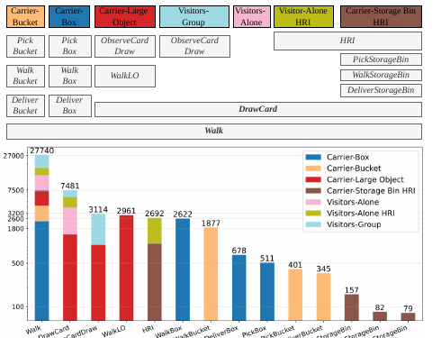

THÖR-MAGNI Act는 기존 THÖR-MAGNI 모션 기록에 사람이 그 순간 수행한 행동을 시간별로 붙인 확장이에요. 원래 모션 자료는 40명의 움직임 3.5시간을 담고, 행동 주석의 근거가 된 1인칭 영상 8.3시간은 시선 추적 안경을 쓴 16명에게서 얻었어요. 두 참여자 수를 합치거나 영상 8.3시간을 40명 모두의 기록으로 읽으면 자료의 범위를 잘못 설명하게 돼요.

Act가 추가한 정보는 사람이 맡은 장기 역할과 짧게 바뀌는 행동을 분리한다는 데 있어요. Carrier-Box 같은 역할은 4분 수집 동안 유지되지만 PickBox, WalkBox, DeliverBox는 초 단위로 전환돼요. 로봇이 다음 몇 초의 이동을 예측하려면 "상자를 나르는 사람"이라는 역할보다 "방금 상자를 집었다"는 행동이 더 가까운 단서가 될 수 있어요.

## 14개 행동은 역할을 더 잘게 나눈 시간표예요

논문은 Walk, DrawCard, ObserveCardDraw, WalkLO, PickBucket, WalkBucket, DeliverBucket, PickBox, WalkBox, DeliverBox, PickStorageBin, WalkStorageBin, DeliverStorageBin, HRI까지 14개 행동을 정의해요. Walk와 DrawCard처럼 여러 역할이 공유하는 행동도 있고, 특정 물체 운반에만 나타나는 행동도 있어요. 같은 Walk라도 앞뒤 행동이 카드 뽑기인지 상자 전달인지에 따라 다음 이동의 목적지가 달라질 수 있어요.

<figure class="fig"><figcaption>위쪽은 역할마다 허용되는 행동을, 아래쪽은 행동 조각 수의 긴 꼬리 분포를 보여줘요. Walk는 27,740개 조각이지만 DeliverStorageBin은 79개뿐이라 전체 평균만으로 드문 행동을 평가하기 어려워요. (출처: Almeida 외, <a href="https://arxiv.org/abs/2412.13729">THÖR-MAGNI Act: Actions for Human Motion Modeling in Robot-Shared Industrial Spaces</a>, 그림 2, CC BY-SA 4.0)</figcaption></figure>

그림의 빈도 차이는 모델 설계보다 먼저 봐야 할 조건이에요. 가장 많은 Walk 27,740개와 DeliverStorageBin 79개의 비는 약 351대 1이에요. 전체 정확도를 높이는 학습은 많은 행동을 우선해도 점수가 좋아질 수 있어요. 그래서 행동마다 같은 비중을 주는 평균 <abbr title="정밀도와 재현율의 조화평균">F1</abbr>, 행동별 재현율, 혼동표를 함께 봐야 드문 집기와 전달이 사라졌는지 알 수 있어요.

14개 이름은 물체와 동작이 결합된 분류 체계예요. PickBucket과 PickBox는 손을 뻗고 몸을 낮추는 초기 움직임이 비슷할 수 있지만, 이후 운반 경로와 물체 크기는 달라져요. 반대로 WalkBucket과 WalkBox를 따로 두면 물체 종류에 특화된 차이를 배울 수 있는 대신, 새 물체를 만났을 때 일반화가 약해질 수 있어요. 행동 분류기를 평가할 때는 정확한 14종 분류와 함께 집기·걷기·전달처럼 동작을 묶은 상위 범주 점수도 유용해요.

## 주석 경계는 손의 접촉 시각과 같지 않아요

연구진은 시선 추적 소프트웨어의 사건 표식을 사용해 1인칭 영상을 사람이 검토했어요. 물체를 향한 첫 시선 고정, 몸을 굽히는 모습, 운반을 시작하는 순간을 보고 행동 전환을 표시했어요. 손이 화면 밖에 있어 전환이 모호하면 관성 센서와 오디오를 보조 단서로 썼고, 적절한 다음 시선 고정에 표식을 놓았어요. 따라서 라벨은 자동 검출 결과가 아니라 여러 단서를 종합한 사람의 판정이에요.

이 절차에서는 물리 접촉과 라벨 경계 사이에 차이가 생길 수 있어요. 상자를 집는 시작을 시선 이동, 몸 숙임, 손 접촉 가운데 어디에 둘지는 연구 질문에 따라 달라져요. 모델 출력이 경계보다 0.2초 늦었다고 해도 동작 전체를 잘못 이해했다고 단정할 수 없어요. 경계에서 떨어진 구간의 분류와 전환 주변의 시각 오차를 나눠 보고해야 해요.

설명용으로 주석 간격을 0.1초라고 두면 0.3초 허용폭은 경계 양쪽 세 칸씩, 경계 칸까지 최대 일곱 칸이에요. 이 일곱 칸을 모두 오답으로 세는 평가와 경계 안에서 같은 전환으로 인정하는 평가는 답하는 질문이 달라요. 전자는 시간 정밀도를, 후자는 행동 순서 인식을 더 강하게 봐요. 이 계산은 원문 실험값이 아니라 경계 평가를 설계하기 위한 예예요.

행동 주석을 새 영상에 적용할 때는 주석자 일치도도 남겨야 해요. 전환이 분명한 Walk 구간보다 Pick과 Deliver의 시작·끝에서 판정 차이가 커질 가능성이 있어요. 일부 영상을 두 사람이 독립 주석하고, 정확히 같은 시각뿐 아니라 0.2초와 0.5초 허용폭에서 일치도를 함께 내면 라벨 자체의 시간 불확실성을 모델 오차와 구분할 수 있어요.

## 논문 실험은 시나리오 2와 3의 1,227개 궤적만 사용해요

논문의 예측 표는 Act 전체를 한꺼번에 평가한 결과가 아니에요. 저자들은 정지 로봇이 있는 시나리오 2와 움직이는 로봇이 있는 시나리오 3을 합쳤어요. 이 부분집합에는 Carrier-Box, Carrier-Bucket, Carrier-Large Object, Visitors-Alone, Visitors-Group 다섯 역할과 열 개 행동, 총 1,227개 궤적이 있어요. StorageBin과 HRI 행동은 이 예측 실험의 열 개 행동에 포함되지 않아요.

각 궤적 조각은 8초이고 서로 겹치지 않아요. 앞 3.2초의 여덟 시점을 관측한 뒤 다음 4.8초의 열두 시점을 예측해요. 한 시점 간격은 0.4초예요. 관측 상태에는 2차원 위치, 속도, 행동이 들어가고, 미래 출력은 속도에서 위치로 변환돼요. 이 구조는 영상에서 행동을 알아내는 실험이 아니라 이미 정렬된 행동과 모션 단서로 미래 궤적을 예측하는 실험이에요.

4분 수집 하나를 빈틈 없이 8초 조각으로 나누면 240÷8=30개예요. 실제 조각 수는 유효 궤적과 시나리오 구성에 따라 달라지지만, 같은 4분 기록에서 나온 조각 30개가 서로 완전히 독립인 것은 아니에요. 배경, 참여자, 맡은 역할이 같기 때문이에요. 논문은 5겹 교차검증의 평균과 표준편차를 보고하지만, 새 적용에서는 같은 참여자의 조각이 학습과 평가 양쪽에 섞였는지 분할 단위를 확인해야 해요.

## 표 I은 행동과 역할이 위치 오차를 얼마나 줄였는지 보여줘요

<abbr title="예측 궤적 전체 시점에서 정답 위치와의 평균 거리를 재는 지표">ADE</abbr>와 <abbr title="예측 마지막 시점에서 정답 위치와의 거리를 재는 지표">FDE</abbr>는 미터 단위예요. 표 I의 기본 모델은 ADE 0.71±0.03m, FDE 1.37±0.05m예요. 역할만 넣으면 0.68±0.03m와 1.30±0.07m, 행동만 넣으면 0.69±0.03m와 1.31±0.07m, 둘 다 넣으면 0.67±0.03m와 1.28±0.07m예요.

가장 좋은 구성과 기본 모델의 차이는 ADE 0.04m, FDE 0.09m예요. 상대값으로는 각각 약 5.6%, 6.6% 감소예요. 표준편차 범위가 일부 겹치므로 이 숫자를 모든 산업 공간에서 유지되는 큰 효과로 확대하면 안 돼요. 같은 시나리오 부분집합, 같은 3.2초 관측과 4.8초 예측, 같은 교차검증 안에서 행동과 역할 단서가 작은 개선을 보였다고 읽는 편이 정확해요.

모델 크기도 함께 볼 수 있어요. 기본 모델은 36.7천 매개변수이고 역할과 행동을 모두 넣은 모델은 38.7천이에요. 약 2천 개, 5.4% 정도 늘어난 셈이에요. 이 비교는 행동 단서의 이득이 거대한 모델 확장만으로 생긴 것은 아니라는 근거가 되지만, 실행 지연과 메모리를 측정한 결과는 아니에요.

## 표 II는 미래 행동을 모를 때의 어려움을 드러내요

공동 학습 실험은 미래 궤적과 미래 행동을 함께 예측해요. 표 II에서 별도의 궤적·행동 모델을 합친 기준선은 ADE 0.71±0.03m, FDE 1.37±0.05m, 행동 정확도 0.85±0.01, F1 0.85±0.01이에요. 행동을 관측 입력에서 뺀 공동 모델은 위치 오차가 0.68±0.04m와 1.29±0.08m로 낮아지지만 행동 정확도와 F1은 0.62±0.02, 0.61±0.02로 크게 떨어져요.

관측 행동을 쓰고 역할은 쓰지 않은 공동 모델은 ADE 0.70±0.03m, FDE 1.33±0.07m, 정확도와 F1 0.83±0.01이에요. 역할과 행동을 함께 쓰면 0.70±0.04m, 1.32±0.08m, 0.85±0.01, 0.85±0.01이에요. 마지막 모델은 46.8천 매개변수이고, 별도 두 모델의 36.7천+42.6천보다 작아요. 다만 위치 오차만 보면 표 I의 행동 조건부 모델 0.67m와 1.28m보다 높아요.

이 차이는 정답 미래 행동을 입력으로 쓴 결과가 아니라 관측 행동에서 미래 행동까지 함께 추정한 결과예요. 실제 로봇은 예측 구간의 행동을 미리 알 수 없으므로 공동 학습 설정이 운영 질문에 더 가까워요. 반면 행동 정확도 0.85는 많은 Walk가 지배하는 긴 꼬리 분포에서 드문 행동 성능을 숨길 수 있어요. 표 II만으로 DeliverStorageBin 같은 희소 행동의 예측력을 판단할 수 없는 이유예요.

논문의 정성 예에서는 상자 집기 장면의 평균 위치 오차와 최종 위치 오차가 0.69/1.00m에서 0.23/0.11m로 줄어요. 한 사례의 큰 개선은 행동 전환이 궤적을 설명할 수 있음을 보여주지만 평균 효과의 크기를 대신하지 않아요. 이 사례와 전체 표를 분리해서 읽어야 선택적으로 잘 나온 장면을 전체 성능으로 오해하지 않아요.

## 공개 저장소는 자료의 정의와 처리 경로를 확인하는 입구예요

논문 각주가 가리키는 공식 저장소는 `tmralmeida/thor-magni-actions`예요. 관련 `thor-magni-tools`에는 궤적 보간과 자료 처리 기능이 설명돼요. 저장소를 쓸 때는 내려받은 개정 번호, 시나리오 폴더, 행동 파일, 원 모션 파일의 대응을 기록해야 해요. 같은 이름의 파일이라도 이후 개정에서 열 순서나 전처리 규칙이 바뀔 수 있어요.

행동과 위치를 결합할 때는 시간축 검사가 먼저예요. 행동 전환 시각이 모션 시각 범위 안에 있는지, 시각이 뒤로 가거나 중복되는지, 보간된 위치가 얼마나 되는지 확인해야 해요. 행동 표식과 모션 표본 사이의 최근접 결합만 쓰면 최대 반 표본 간격의 오차가 생겨요. 경계 주변에서는 그 작은 차이가 PickBox와 WalkBox의 순서를 바꿀 수 있어요.

또 하나의 누출 경로는 미래 행동이에요. 궤적 조각 전체에 "이 조각의 대표 행동"을 붙여 관측 입력으로 쓰면 예측 구간에서 시작된 행동이 앞 3.2초에 스며들 수 있어요. 매 시점 행동을 사용하고 관측 경계 뒤 라벨을 가려야 해요. 보간이나 다수결로 행동을 다시 만들었다면 그 규칙도 학습 전에 고정해야 해요.

원자료 검사는 세 층으로 나눌 수 있어요. 첫째, 행동별 구간의 시작이 끝보다 빠르고 한 사람의 구간이 겹치지 않는지 확인해요. 둘째, 각 행동 이름이 해당 역할에 허용된 목록 안에 있는지 검사해요. 예를 들어 Visitors 역할에 PickStorageBin이 나타나면 파일 결합이나 역할 대응부터 의심할 수 있어요. 셋째, 행동 전환 전후의 위치와 속도가 끊기지 않는지 봐요. 라벨은 바뀌어도 같은 사람의 모션은 이어져야 하므로 좌표가 갑자기 먼 곳으로 이동하면 행동 모델보다 자료 병합을 먼저 고쳐야 해요.

5겹 결과를 재현할 때는 조각 수만 맞추는 것으로 충분하지 않아요. 어느 시나리오와 참여자가 각 겹에 들어갔는지, 무작위 초기값이 무엇인지, 표준화 통계를 학습 겹에서만 구했는지 기록해야 해요. 전체 자료에서 위치와 속도의 평균을 먼저 계산하면 평가 겹의 분포가 학습에 스며들어요. 행동 빈도 가중치도 각 학습 겹에서 다시 계산해야 평가 겹의 정답 분포를 미리 쓰지 않아요.

표 I의 네 행은 입력 단서의 비교이고, 표 II의 네 행은 출력 과제와 모델 공유 방식의 비교예요. 두 표에서 숫자가 비슷하다고 같은 실험으로 합치면 안 돼요. 표 I은 관측 행동을 조건으로 미래 위치를 예측하는 질문에 가깝고, 표 II는 미래 행동까지 함께 맞히는 부담을 더해요. 적용하려는 시스템이 영상에서 행동을 먼저 분류하는지, 모션과 행동을 한 모델에서 함께 추정하는지에 따라 맞는 기준선이 달라져요.

따라서 두 표를 재현할 때는 입력 행동이 사람 주석인지 별도 인식기의 출력인지도 구분해야 해요. 사람 주석을 넣은 위치 오차는 행동 인식 실패가 없는 조건이고, 실제 영상 인식기와 연결하면 경계 지연과 오분류가 궤적 예측에 더해져요.

행동 라벨의 실용성은 평균 위치 오차 외에도 계획 변화로 확인할 수 있어요. 행동 입력을 넣었을 때 로봇이 더 일찍 감속했는지, 불필요한 우회가 늘지는 않았는지, 드문 전달 동작에서 최소 거리가 유지됐는지 봐야 해요. 예측 오차가 몇 센티미터 줄어도 계획기가 같은 경로를 고르면 운영 이득은 작을 수 있어요. 반대로 평균 오차 변화가 작아도 상자를 든 사람이 회전하는 장면에서 충돌 직전 예측이 줄면 가치가 있어요.

## 로봇 적용에서는 행동 예측과 안전 제어를 분리해요

Act의 행동은 다음 이동을 좁히는 문맥 단서예요. PickBox 뒤에는 운반이 이어질 가능성이 높고 DeliverBox 뒤에는 방향 전환이나 빈손 보행이 나올 수 있어요. 계획기는 여러 미래 궤적과 확률을 받아 여유 공간을 조절할 수 있어요. 행동 하나를 확정해 단일 경로로 바꾸면 오분류가 곧 잘못된 회피로 이어져요.

설명용으로 PickBox 0.55, WalkBox 0.35, 나머지 0.10의 확률이 나왔다고 해 볼게요. 계획기는 첫 행동만 고르기보다 두 주요 가설의 점유 영역을 합쳐 볼 수 있어요. 두 가설이 갈라지는 통로에서는 속도를 낮추고, 새 관측으로 확률이 좁아지면 경로를 갱신해요. 이 수치는 논문 결과가 아니라 불확실한 행동 출력을 계획에 연결하는 예예요.

행동 모델이 멈추거나 낯선 행동을 만나도 충돌 회피는 계속 작동해야 해요. 사람의 현재 위치와 속도, 라이다 장애물은 행동 의미가 없어도 안전 계층에 남겨요. Act는 14개 행동 바깥의 상황을 자동으로 안전하게 처리하지 않으며, 다른 작업장·복장·물체·로봇 동작으로 옮기면 행동 분포와 경계 정의를 다시 검증해야 해요.

THÖR-MAGNI Act가 뒷받침하는 주장은 좁고 유용해요. 시나리오 2와 3의 1,227개 궤적에서는 관측 행동과 역할이 4.8초 궤적 예측에 정보를 더했고, 공동 모델은 미래 행동과 궤적을 함께 낼 수 있었어요. 16명의 1인칭 영상으로 만든 수동 주석, 긴 꼬리 행동 빈도, 제한된 시나리오라는 조건을 함께 적을 때 이 결과를 다른 로봇 환경에 옮길 기준이 생겨요.

센서 구성과 원래 다섯 시나리오는 [[2026-10-17_socialnav_thor-magni|정밀 모션캡처로 상호작용을 기록한 THÖR-MAGNI]]에서 이어서 볼 수 있어요. Act는 새 원시 센서를 추가한 자료라기보다 그 기록 위에 시간별 행동 의미를 더한 층이에요. 두 자료의 참여자 수와 기록 시간을 구분하면 모션 범위와 주석 근거를 같은 숫자로 오해하지 않게 돼요.

---

<!-- src-block -->
출처 — https://github.com/tmralmeida/thor-magni-actions
