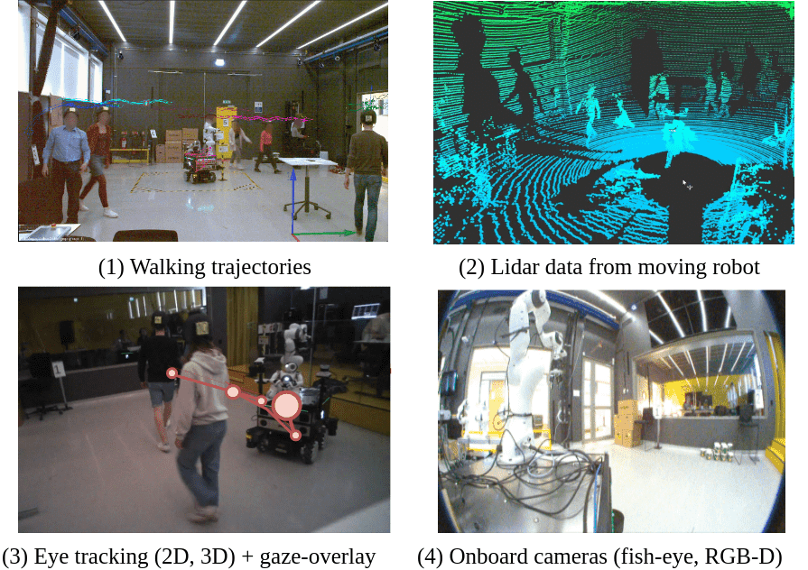

사람 궤적 데이터라고 하면 흔히 시간마다 찍힌 평면 좌표를 떠올려요. 그러나 사람이 로봇을 보았는지, 물건을 들고 있었는지, 누군가와 역할을 나누었는지 모르면 같은 곡선도 다르게 읽힐 수 있어요. THÖR-MAGNI는 이 빈칸을 메우려고 실내 모션캡처 궤적에 시선, 역할, 과업, 로봇 상태와 탑재 센서 기록을 함께 붙인 자료예요. 연구진은 5일 동안 40명이 참여한 약 3.5시간의 움직임을 기록했다고 보고해요. 핵심은 규모 하나보다 서로 다른 관측을 같은 장면과 시간에 맞췄다는 데 있어요.

이 자료를 쓸 때 먼저 구분해야 할 것이 있어요. 모션캡처가 주는 사람 위치는 장면 전체를 내려다보는 기준 좌표계의 고정밀 기록이에요. 이동 로봇의 카메라나 라이다가 그 사람을 매 순간 보았다는 뜻은 아니에요. 따라서 궤적 예측, 상호작용 분석, 시선 연구에는 풍부한 기준값이 되지만, 자연스러운 가림과 좁은 시야 때문에 검출기가 얼마나 자주 사람을 놓치는지 평가하려면 탑재 센서 스트림에서 다시 관측 가능성을 따져야 해요.

## 하나의 좌표열보다 많은 것을 묶은 자료

<abbr title="사람과 로봇이 서로 영향을 주고받는 상황을 연구하는 분야">HRI</abbr> 자료의 어려움은 센서마다 시간이 흐르는 방식과 좌표가 다르다는 점이에요. 천장 카메라 기반 모션캡처는 방 전체의 위치를 안정적으로 주지만, 사람 머리에 쓴 시선 추적기는 눈앞 장면과 시선 방향을 기록해요. 로봇의 3차원 라이다는 로봇 중심에서 본 점군을 만들고, 어안 카메라와 <abbr title="컬러 영상과 각 화소까지의 거리를 함께 얻는 카메라 방식">RGB-D</abbr> 카메라는 또 다른 투영과 시야를 가져요. THÖR-MAGNI는 이 여러 흐름을 <abbr title="로봇의 센서 정보와 제어 명령을 프로그램 사이에서 주고받는 소프트웨어 체계">ROS</abbr> 기록과 사용자 정의 동기화 절차로 연결해요.

<figure class="fig"><figcaption>같은 실내 상호작용을 방 기준 궤적, 로봇 기준 점군, 참여자 시선, 로봇 영상으로 나눠 기록해요. 어느 한 패널도 다른 패널의 관측 실패를 자동으로 설명하지는 않아요. (출처: Schreiter 외, <a href="https://arxiv.org/abs/2403.09285">THÖR-MAGNI: A Large-scale Indoor Motion Capture Recording of Human Movement and Robot Interaction</a>, 그림 1, 공개 크리에이티브 커먼즈 라이선스 미확인)</figcaption></figure>

그림의 첫 패널은 사람과 로봇의 이동 경로를 장면 좌표에서 보여줘요. 두 번째는 움직이는 로봇이 얻은 라이다 점군이라서 가림, 거리, 반사 특성의 영향을 받아요. 세 번째는 시선 영상 위에 추정 지점을 얹고, 네 번째는 로봇 탑재 카메라가 본 장면을 보여줘요. 네 관측을 함께 보면 “사람이 어디로 갔는가”, “로봇은 무엇을 보았는가”, “사람은 무엇을 바라보았는가”를 분리해서 물을 수 있어요. 이 분리가 자료의 가장 큰 효용이에요.

논문은 DARKO 로봇에 Ouster OS0-128 라이다, Azure Kinect RGB-D 카메라 2대, Basler 어안 컬러 카메라 2대, 안전용 2차원 라이다 2대가 있다고 설명해요. Basler 영상은 1700×1536 해상도와 20Hz로 기록되며, 시선 장치는 모델에 따라 장면 영상과 시선 정보를 제공해요. 모션캡처는 방 둘레 카메라와 표식을 이용해 사람과 로봇의 6자유도 자세를 장면 좌표로 복원해요. 이 목록은 “센서가 많으니 현실 전체를 안다”는 선언이 아니에요. 서로 다른 센서가 어떤 질문에 근거를 제공하는지 알려 주는 실험 설계표에 가까워요.

## 시나리오는 배경이 아니라 조건 변수예요

THÖR-MAGNI의 참여자는 빈 방을 아무 목적 없이 걷지 않아요. 연구진은 방문자, 운반자 같은 역할과 목표 지점, 물건 운반, 로봇과의 공동 작업, 통신을 매개하는 로봇 같은 조건을 배치해요. 일부 장면에서는 차동구동 로봇과 전방향 로봇의 이동 방식도 달라져요. 사람은 과업을 수행하면서 다른 사람과 로봇을 만나므로, 궤적에는 개인의 최단 경로만이 아니라 역할과 장면의 제약이 함께 남아요.

이 점은 궤적 예측 모델의 입력을 설계할 때 중요해요. 과거 위치만 받은 모델이 갑자기 사람이 방향을 바꾸는 장면을 틀렸다고 해 볼게요. 위치열만 보면 불규칙한 잡음처럼 보이지만, 목표 지점이나 맡은 역할을 함께 보면 계획된 전환일 수 있어요. 반대로 역할을 정답처럼 넣으면 배포 시 얻을 수 없는 정보에 기대는 문제가 생겨요. 연구용 분석에서는 맥락을 이용해 행동 원인을 가르고, 배포용 모델에서는 로봇이 실제로 추정할 수 있는 단서만 남겨 성능이 얼마나 떨어지는지 비교해야 해요.

시선도 같은 원칙으로 읽어야 해요. 사람이 로봇 쪽을 본 시점은 로봇 인지나 양보 의도를 추론하는 단서가 될 수 있어요. 그러나 시선 한 점이 곧 동의나 통행 우선권을 뜻하지는 않아요. 머리 움직임, 과업, 다른 사람, 표지판 같은 경쟁 대상이 있고 시선 장치의 보정 오차도 있어요. 시선과 경로의 시간 관계를 분석하더라도 “먼저 보았으니 양보했다”는 인과 결론은 별도 실험 없이 내리기 어려워요.

## 설명용 계산: 관측이 맞아도 질문이 다를 수 있어요

아래 계산은 논문 결과가 아니라 자료를 사용할 때의 차이를 보여 주는 설명용 가정이에요. 어떤 사람의 방 기준 위치가 10Hz로 있고, 로봇 카메라는 20Hz로 기록된다고 해 볼게요. 사람 좌표 시각이 12.30초와 12.40초이고 카메라 프레임이 12.35초라면, 등속 보간은 두 위치의 중간을 해당 프레임의 위치로 놓아요. 두 좌표가 각각 (2.0m, 1.0m), (2.2m, 1.0m)이면 보간 위치는 (2.1m, 1.0m)이에요.

그런데 이 계산은 사람의 기준 위치가 프레임 시각에 어디였는지만 말해요. 카메라 영상에서 사람이 보이는지는 말하지 않아요. 로봇과 사람 사이에 0.6m 폭의 상자가 있고 투영선이 상자를 지난다면, 기준 위치는 완전해도 영상 검출은 실패할 수 있어요. 이때 모션캡처 좌표를 카메라 검출 정답으로 쓰려면 시야각, 영상 경계, 깊이 가림을 적용한 “보이는 정답”을 별도로 만들어야 해요.

거리 계산도 좌표계 선택에 민감해요. 설명용으로 사람 A가 (1.2m, 0.4m), 사람 B가 (1.8m, 0.8m)에 있다면 평면 거리는 약 0.72m예요. 이 값만으로 불편함을 판정하면 두 사람이 같은 팀인지, 서로 마주 보는지, 한 명이 물건을 운반하는지 빠져요. THÖR-MAGNI의 역할과 시선은 이 숫자를 해석할 문맥을 주지만, 보편적인 개인 공간 반경을 자동으로 정해 주지는 않아요. [[2026-10-17_socialnav_hall-proxemics|근접학은 개인공간을 고정 반경으로 만들지 않는다]]와 이어 읽으면 거리 하나를 규범으로 고정할 때 생기는 문제를 더 분명히 볼 수 있어요.

## 원문 실험이 보여 주는 것과 보여 주지 않는 것

논문은 수집 체계, 시나리오, 파일 구조, 동기화와 전처리 도구를 제시하고 기존 보행 자료와 궤적 통계를 비교해요. 참여자의 추적 지속 시간, 사람 사이 최소 거리, 이동 속도, 경로 효율 같은 기술 통계가 포함돼요. 이는 장면별 데이터 특성이 다르며 기존 자료와 분포가 같지 않다는 점을 확인하는 데 유용해요. 다만 특정 사회 내비게이션 정책이 사람에게 더 편안하다는 실물 비교 시험은 아니에요.

설문이 포함된 시나리오도 구분해서 읽어야 해요. 논문은 일부 로봇 상호작용 뒤에 작업부하, 로봇 인상, 신뢰와 관련된 질문지를 사용했다고 설명해요. 설문 응답은 해당 시나리오와 참여자의 경험을 나타내며, 궤적만으로 얻을 수 없는 주관 평가를 보완해요. 그렇지만 데이터셋에 설문이 있다는 사실과 새로운 정책이 선호된다는 검증은 달라요. 후속 정책을 평가하려면 정책별 조건을 통제하고 참여자 배정과 통계 계획을 새로 세워야 해요.

또한 수집 공간은 정밀 모션캡처가 가능한 통제된 실내예요. 이 환경은 좌표 품질과 조건 반복에 강점이 있어요. 동시에 야외의 햇빛, 비, 불규칙한 지면, 긴 이동 거리, 공개 공간의 예측하기 어려운 행인을 충분히 대표하지 않아요. 참여자는 실험 역할을 안내받고 정해진 시나리오를 수행해요. 자연스러운 상호작용이 나타날 수 있어도, 아무 안내 없이 공공장소를 지나가는 사람과 동일한 표본이라고 볼 수는 없어요.

## 실제 로봇 배포에서 깨지는 가정

첫째, 전역 기준 위치를 사용할 수 있다는 가정이 깨져요. 배포 로봇은 사람의 정확한 방 좌표를 받지 못하고, 자체 위치 추정과 사람 검출을 조합해야 해요. 로봇 위치가 0.15m 흔들리고 사람 중심 추정이 0.20m 흔들린다면 두 오차가 같은 방향으로 더해질 수도 있어요. 설명용 보수 합은 0.35m예요. 개인 공간 경계가 0.4m 남았다고 판단한 순간에도 실제 여유는 훨씬 작을 수 있어요.

둘째, 사람 식별이 계속 유지된다는 가정이 깨져요. 사람이 선반 뒤로 사라졌다가 반대편에 나타나면 추적기는 새 식별자를 붙일 수 있어요. 모션캡처 기록에서는 같은 표식의 연속 궤적이지만, 로봇 관측에서는 두 개의 짧은 궤적으로 보일 수 있어요. 예측 모델을 완전한 궤적으로 학습하고 끊긴 추적 입력으로만 배포하면, 데이터 품질 차이가 정책 성능 차이로 나타나요.

셋째, 역할과 목표를 안다는 가정이 깨져요. 데이터 파일의 방문자·운반자 라벨은 분석에 유용하지만, 실제 로봇은 처음 만난 사람의 역할을 모를 수 있어요. 역할을 모델 입력으로 쓴다면 추론기에서 그 라벨을 어떻게 얻는지, 오분류 때 경로가 얼마나 달라지는지 검증해야 해요. 사람 목표를 미래 정답에서 가져와 정책에 넣으면 현실에서 얻을 수 없는 정보를 미리 본 셈이 돼요.

넷째, 시선 센서를 모든 사람이 착용한다는 가정이 깨져요. 배포 장소의 행인이 시선 추적 안경을 쓰지는 않아요. 연구 단계에서 시선은 행동 이해와 보조 라벨 생성에 쓰고, 배포 모델은 카메라에서 추정 가능한 머리 방향이나 몸 방향으로 대체할 수 있어요. 이때 대체 신호의 오차와 누락을 따로 평가해야 해요.

다섯째, 로봇 종류와 장면 구성이 달라져요. 넓이, 회전 반경, 최고 속도, 센서 높이가 바뀌면 같은 사람 경로라도 충돌 여유와 시야가 달라져요. 전방향 로봇의 옆걸음 같은 움직임을 차동구동 로봇이 재현할 수 없고, 물류 공간에서 자연스러운 접근 방향이 병원 복도에서는 불편할 수 있어요. 데이터의 로봇 궤적을 행동 명령으로 복제하기 전에 대상 기구의 동역학과 장소 규칙에 맞춰 다시 제약해야 해요.

## 자료를 검증용으로 나누는 방법

한 가지 현실적인 방법은 질문마다 관측 층을 분리하는 거예요. 궤적 예측은 모션캡처 위치와 목표·역할을 사용하되, 배포 입력 조건을 흉내 낸 누락 실험을 함께 둬요. 로봇 인지는 탑재 영상과 라이다만으로 사람을 검출하고, 모션캡처는 평가 기준에만 써요. 상호작용 분석은 시선과 설문을 추가하지만, 정책 안전성은 충돌 여유와 정지 가능성을 별도 지표로 확인해요.

설명용 분할 예를 들어 볼게요. 5일 기록 중 4일을 학습에 쓰고 1일을 평가에 쓰면 같은 날의 거의 같은 장면이 양쪽에 섞이는 것을 줄일 수 있어요. 더 엄격하게는 참여자 단위 분할과 시나리오 단위 분할을 따로 만들어요. 참여자 분할은 처음 보는 사람에게 일반화하는지 묻고, 시나리오 분할은 처음 보는 과업 구성에서도 맥락을 읽는지 물어요. 무작위 프레임 분할은 한 궤적의 앞부분과 뒷부분이 학습과 평가에 나뉘어 성능을 부풀릴 수 있어요.

가림 내성도 인위적으로 점을 지우는 시험과 실제 탑재 센서 누락 시험을 나눠야 해요. 설명용으로 8초 관측 중 2초를 연속으로 제거하면 25% 가림이에요. 같은 비율이라도 0.1초씩 흩어진 누락과 연속 2초 누락은 예측 난도가 달라요. 실제 영상에서 사람이 완전히 가려진 구간을 찾아 두 조건을 비교하면, 모델이 보간에 강한지 재식별에 강한지 구분할 수 있어요.

## 파일을 읽기 전에 세워야 할 질문

여러 모달리티가 있다는 사실만 보고 모든 열을 한 모델에 넣으면 정보 누출이 생기기 쉬워요. 예측 시각 뒤에 계산된 전체 궤적 통계, 실험자가 붙인 역할, 미래 목표 도착 여부는 분석 라벨일 수는 있어도 온라인 입력은 아니에요. 먼저 각 필드가 센서에서 그 시각에 나온 값인지, 수집 뒤 정리된 값인지, 전체 기록을 보고 붙인 값인지 표로 나눠야 해요. 모델 입력은 첫 번째 범주부터 시작하고, 나머지는 평가나 보조학습에 쓸 때 사용 가능 시점을 명시하는 편이 안전해요.

시간 동기화도 파일에 같은 시각 열이 있다고 끝나지 않아요. 카메라 노출 시각, ROS 메시지 도착 시각, 모션캡처 프레임 시각이 서로 다를 수 있어요. 짧은 지연은 느린 보행에서 작아 보이지만, 사람이 급히 방향을 바꾸거나 로봇이 회전하면 영상 투영 위치를 크게 바꿔요. 설명용으로 사람이 초당 1.4m로 움직이고 두 스트림이 0.12초 어긋나면 이동 방향으로 약 0.168m 차이가 생겨요. 이 값을 검출 오차로 잘못 세면 센서 모델과 동기화 문제를 구분하지 못해요.

좌표 변환의 방향도 확인해야 해요. 방 좌표의 사람 위치를 로봇 좌표로 바꿀 때 필요한 것은 해당 시각의 로봇 자세와 올바른 변환 순서예요. 평행이동만 빼고 회전을 빠뜨리면 로봇이 90도 돌아선 순간 앞쪽 사람이 옆쪽에 나타나요. 설명용으로 방 좌표에서 로봇 앞 1m에 있는 점은 로봇이 반시계로 90도 회전하면 숫자 축의 해석이 달라져요. 그림이 그럴듯한지만 보지 말고 알려진 표식 몇 점을 영상과 점군에 투영해 방향과 단위를 확인해야 해요.

평가 표본도 프레임 수로만 세면 안 돼요. 긴 한 번의 기록에서 나온 연속 프레임은 서로 매우 비슷해요. 2만 프레임을 시험했다고 해도 독립된 상호작용이 몇 건인지에 따라 증거의 폭이 달라져요. 날짜, 참여자, 시나리오, 로봇 조건을 묶음 단위로 보고하고, 같은 사람이 양쪽 분할에 들어갔는지 밝혀야 해요. 그래야 모델이 사람의 움직임 습관이나 방 배치를 외운 결과를 새로운 상호작용에 대한 일반화로 오해하지 않아요.

마지막으로 결측 자체를 데이터로 남겨야 해요. 시선 장치가 잠시 끊겼거나 표식이 가려진 구간을 조용히 삭제하면, 남은 구간은 센서가 잘 작동한 쉬운 사례에 치우쳐요. 결측 이유를 장치 중단, 가림, 파일 손상, 품질 필터처럼 나누고 각 비율을 보고하면 후속 사용자가 자신이 필요한 조건과 맞는지 판단할 수 있어요. 결측을 0으로 채울 때도 실제 값 0과 구분하는 마스크가 필요해요.

## 좋은 기준값과 현실 센서 시험을 함께 쓰기

THÖR-MAGNI는 사회 내비게이션을 위한 완제품 정책이 아니라, 행동을 여러 관점에서 해부할 수 있는 측정 기반이에요. 정밀 궤적 덕분에 사람과 로봇 사이 거리나 접근 방향을 안정적으로 계산할 수 있고, 시선과 역할 덕분에 같은 움직임의 문맥을 비교할 수 있어요. 로봇 탑재 센서까지 함께 있어 기준값과 실제 관측 사이의 차이도 연구할 수 있어요.

가장 위험한 사용법은 모션캡처 기준값을 배포 센서 출력처럼 취급하는 거예요. 그러면 검출 누락, 좌표 변환 오차, 추적 식별자 단절, 지연이 모두 사라져요. 반대로 기준값과 센서 관측을 분리하고, 역할·목표 같은 미래 또는 숨은 정보를 입력에서 차단하면 이 자료의 장점이 살아나요. “사람이 실제로 어떻게 움직였는가”와 “로봇이 그 움직임을 얼마나 볼 수 있었는가”를 동시에 물을 수 있기 때문이에요.

후속 연구에서는 세 층의 결과를 함께 보고하는 편이 좋아요. 첫째는 모션캡처 기준 궤적에서의 예측 오차예요. 둘째는 탑재 센서로 검출·추적한 입력에서의 성능 저하예요. 셋째는 계획기가 그 오차를 받은 뒤에도 충돌 회피와 사회적 여유를 지켰는지예요. 이 세 결과가 있어야 정밀 데이터셋의 성능이 실제 로봇 안전으로 이어지는 경로를 확인할 수 있어요.

---

<!-- src-block -->
출처 — https://arxiv.org/abs/2403.09285
