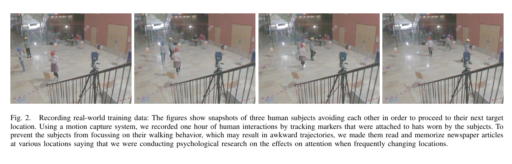
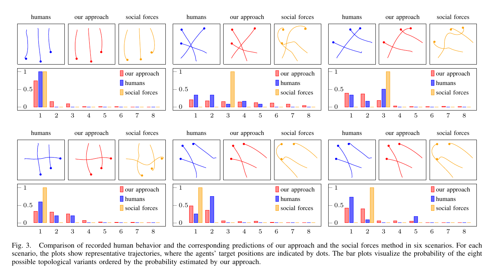

사람의 다음 위치를 한 점으로만 예측하면 좌우 통과처럼 서로 다른 미래가 평균에 섞입니다. 왼쪽으로 비킬 가능성과 오른쪽으로 비킬 가능성이 반반일 때 평균 궤적은 정면 충돌 방향이 될 수도 있어요. 로봇은 어느 한 미래를 일찍 확정하거나, 평균선을 믿고 늦게 반응하게 됩니다.

Markus Kuderer, Henrik Kretzschmar, Christoph Sprunk, Wolfram Burgard의 2012년 논문 「Feature-Based Prediction of Trajectories for Socially Compliant Navigation」는 사람 여러 명의 전체 궤적을 확률 분포로 다룹니다. <abbr title="관측된 행동의 특징 평균은 맞추되 그 밖의 가정을 최소화하도록 가능한 궤적에 확률을 배분하는 학습 원리">최대 엔트로피 특징 학습</abbr>으로 이동 시간, 가속, 속도, 사람 사이 거리, 통과 방향 같은 특징의 가중치를 배워요.

## 한 사람의 다음 점보다 모두의 전체 궤적을 봐요

이 논문의 기본 단위는 사람 한 명의 다음 위치가 아니라 여러 행위자의 공동 궤적입니다. 각 행위자가 시간에 따라 어디에 있는지를 연속 함수로 표현하고, 모든 행위자의 함수를 묶어 하나의 후보로 봅니다. 누가 먼저 가고 어느 쪽으로 비키는지가 다른 후보들은 서로 다른 공동 궤적이에요.

이 관점은 상호작용의 순환을 끊는 데 필요합니다. 사람의 미래는 로봇 행동에 따라 바뀌고, 로봇 행동은 사람 예측에 따라 바뀝니다. 사람 궤적을 먼저 고정한 뒤 로봇만 피하게 하면 로봇이 만든 반응을 예측하지 못해요. 논문은 로봇도 공동 궤적 안에 넣어 함께 일어날 가능성이 높은 조합을 찾습니다.

공동 궤적 공간은 매우 큽니다. 사람 셋이 각각 왼쪽이나 오른쪽으로 통과하는 선택만 가져도 쌍별 관계가 늘어나요. 논문은 서로 지나가는 쪽이 같은 후보들을 하나의 위상 변형으로 묶습니다. 궤적의 세부 곡선이 조금 달라도 A가 B의 왼쪽으로 지나고 C가 A의 오른쪽으로 지나는 관계가 같으면 같은 부류입니다.

이 분할은 평균으로 사라지기 쉬운 통과 결정을 보존합니다. [[2026-10-17_socialnav_unfreezing|완벽한 개인 예측만으로도 군중 앞 로봇은 왜 얼어붙는가]]가 궤적의 공동 의존성을 강조했다면, 이 논문은 관측된 보행 특징을 학습하고 통과 방향별 대표 모드를 최적화합니다.

## 특징은 궤적 모양을 그대로 외우지 않게 해요

녹화 궤적과 생성 궤적의 좌표 차이만 줄이면 훈련 장면을 정밀하게 흉내 낼 수 있지만 새로운 시작점과 목표에 약할 수 있습니다. 논문은 궤적을 몇 가지 의미 있는 특징으로 요약해 일반화를 노립니다. 같은 모양을 복제하기보다 사람이 중요하게 여긴다고 가정한 속성을 맞추는 방식이에요.

첫 특징은 목표까지 걸린 시간입니다. 목표에 빨리 도착하려는 경향을 표현합니다. 둘째는 궤적 전체의 가속 제곱 적분으로, 잦은 속도 변화를 벌점화합니다. 셋째는 속도 제곱 적분이고, 지나치게 빠른 움직임을 비용으로 둬요. 넷째는 다른 행위자와의 거리 및 상대 운동에 관련된 충돌 회피 특징입니다.

다섯째는 어느 쪽으로 통과했는지 나타내는 위상 특징입니다. 지역이나 집단에 따라 왼쪽과 오른쪽 통과 빈도가 다를 수 있고, 일행 사이를 가르지 않는 특징도 넣을 수 있다고 설명합니다. 이 항은 단순 거리 비용만으로 표현하기 어려운 이산 결정을 담습니다.

특징을 고른 순간 모델의 시야도 정해집니다. 시선, 대화 집단, 보행 보조기, 짐, 통행 규칙이 특징에 없으면 학습 데이터에 흔적이 있어도 모델이 의미 있게 구분하지 못할 수 있어요. 최대 엔트로피는 선택한 특징 밖의 편향을 줄이지만 누락된 문맥을 발견해 주지는 않습니다.

## 최대 엔트로피는 한 가지 최적 경로만 남기지 않아요

학습 목표는 생성 궤적 분포의 특징 평균이 시연 데이터의 특징 평균과 같아지게 하는 것입니다. 이 조건을 만족하는 분포는 여러 개일 수 있어요. 최대 엔트로피 원리는 그 가운데 불필요하게 한 후보에 확률을 몰지 않는 분포를 택합니다.

결과 분포에서는 비용이 낮은 공동 궤적일수록 지수적으로 높은 확률을 얻습니다. 특징 가중치는 어떤 속성이 관측된 행동을 잘 설명하는지 정합니다. 이동 시간 가중치가 크면 빠른 궤적을 선호하고, 가속 가중치가 크면 부드러운 궤적을 선호해요. 거리 가중치와 위상 특징은 사람 사이의 회피 방식에 영향을 줍니다.

연속 궤적 전체를 적분해 기대 특징을 정확히 구하기는 어렵습니다. 논문은 각 위상 변형에서 가장 가능성 높은 공동 궤적을 하나씩 구하고, 그 대표 모드의 가중합으로 기대 특징을 근사합니다. 모든 가능한 곡선을 계산하는 대신 좌우 통과 같은 주요 모드마다 대표를 찾는 방식이에요.

궤적은 3차 스플라인으로 표현합니다. 먼저 적은 제어점으로 대략적인 모양을 찾고, 점을 늘려 세밀하게 다듬는 계층 최적화를 사용해요. 최적화 중 통과 방향이 다른 위상 부류로 넘어가지 않는지도 검사합니다. 한 모드를 계산하다가 몰래 다른 쪽 통과로 바뀌면 확률 분포의 항목 자체가 달라지기 때문입니다.

## 설명용 특징 계산으로 가중치 의미를 읽어요

다음은 논문 결과가 아니라 특징 결합을 설명하는 자체 가정입니다. 후보 하나는 6초에 목표에 도착하고 가속 제곱 적분이 2, 최소거리 관련 비용이 4라고 해볼게요. 다른 후보는 7초, 가속 비용 1, 거리 비용 2입니다.

시간·가속·거리 가중치를 각각 `0.5, 1.0, 2.0`으로 두면 첫 후보 비용은 `0.5×6 + 1×2 + 2×4 = 13`, 둘째는 `0.5×7 + 1×1 + 2×2 = 8.5`입니다. 둘째가 1초 느려도 더 부드럽고 거리를 확보해 낮은 비용을 얻어요.

거리 가중치를 0.2로 낮추면 첫째는 `5.8`, 둘째는 `4.9`가 됩니다. 순위 차이가 작아져 측정 잡음이나 다른 특징 하나가 선택을 바꿀 수 있어요. 학습 가중치를 물리 단위가 다른 특징에 그대로 비교하면 안 되고, 특징의 정규화 범위와 함께 읽어야 합니다.

왼쪽 통과 위상 비용을 0, 오른쪽 통과를 0.4로 두는 설명용 항을 더하면 오른쪽 모드의 확률이 상대적으로 낮아집니다. 하지만 이 차이를 문화의 보편 규칙으로 해석할 수는 없어요. 특정 데이터에서 나타난 빈도이고 장소와 흐름이 바뀌면 다시 검증해야 합니다.

비용 차이가 1인 두 후보의 상대 확률은 단순 지수 모형에서 약 `e^-1 ≈ 0.37`배가 됩니다. 비용 1의 의미는 특징 크기와 가중치에 따라 달라요. 확률을 읽으려면 원시 비용뿐 아니라 어떤 후보 집합을 분모에 넣었는지도 알아야 합니다. 계산하지 않은 위상 변형은 확률 0처럼 보이기 때문입니다.

## 훈련 데이터는 세 사람의 반복 교차예요

저자들은 7미터 정사각형 공간에 번호가 붙은 여덟 위치를 두고 세 참가자가 다음 위치로 이동하도록 했습니다. 참가자가 보행 자체에 지나치게 집중하지 않도록 각 위치에서 신문 기사를 읽고 기억하게 했어요. 모션 캡처 표식을 단 모자로 궤적을 기록했습니다.

<figure class="fig"><figcaption>세 참가자가 다음 읽기 지점으로 이동하며 자연스럽게 교차하도록 만든 수집 장면입니다. 한 시간 동안 얻은 사람-사람 보행 데이터이며 로봇 상호작용 데이터는 아닙니다. (출처: Kuderer et al., Feature-Based Prediction of Trajectories for Socially Compliant Navigation, Fig. 2, https://www.cs.cmu.edu/~jeanoh/16-785/papers/kuderer-rss2012-socially.pdf)</figcaption></figure>

한 시간의 상호작용에서 여덟 시나리오가 반복됐고 모두 96회, 시나리오당 12회를 기록했습니다. 이 데이터로 특징 가중치를 학습하고 10겹 교차검증을 수행했습니다. 논문은 같은 데이터 분할에서 사회력 모델과 특징 불일치 크기를 비교해 제안법이 더 낮은 값을 보였다고 보고합니다.

<figure class="fig"><figcaption>파란색 실제 궤적, 빨간색 제안 모델, 주황색 사회력 예측을 나란히 놓았습니다. 막대는 각 시나리오에서 여덟 위상 변형의 확률을 보여 줍니다. (출처: Kuderer et al., Feature-Based Prediction of Trajectories for Socially Compliant Navigation, Fig. 3, https://www.cs.cmu.edu/~jeanoh/16-785/papers/kuderer-rss2012-socially.pdf)</figcaption></figure>

이 비교는 선택한 특징과 해당 데이터에서의 예측 적합도를 보여 줍니다. 참가자 수, 공간 크기, 목표 배치, 반복 과업이 다른 환경에서 같은 우위를 보장하지 않습니다. 특히 훈련 참가자의 목표 위치는 실험 설계로 알고 있었지만 현장 로봇은 보행자의 목표를 센서로 확정할 수 없어요.

## 실물 로봇 실험과 사람 데이터 실험을 구분해야 해요

논문은 학습 데이터 교차검증 외에 사람과 로봇이 서로 지나가는 실물 실험을 제시합니다. 시각 모션 캡처로 사람과 로봇 자세를 추적하고, 로봇은 현재 관측을 공동 예측에 넣어 통과 방향을 갱신했어요. 사람 행동이 초기 예상과 다르면 반대쪽 통과로 판단을 바꾸는 예를 보입니다.

이는 실물 로봇이 모델을 사용해 온라인으로 경로를 바꾼 근거입니다. 그러나 사람 참가자가 로봇을 얼마나 편안하거나 자연스럽게 느꼈는지 묻는 사용자 평가는 아닙니다. 사람처럼 보이는 궤적과 사람이 선호하는 로봇 행동은 관련이 있을 수 있지만 같은 측정은 아니에요.

저자들도 사람은 로봇의 특성에 따라 다른 사람에게 반응할 때와 다르게 움직일 수 있다고 적습니다. 훈련은 사람-사람 보행이고 배포 대상은 사람-로봇 상호작용입니다. 로봇 크기와 소리, 속도, 외형이 달라지면 양보 시점도 달라질 수 있어요.

실물 실험의 자세 입력은 외부 모션 캡처에서 얻었습니다. 일반 서비스 로봇의 온보드 카메라와 낮은 LiDAR가 같은 정확도와 식별자 연속성을 제공한다는 뜻이 아닙니다. 센서 배포에서는 목표 추정, 가림, ID 전환을 포함해 모델 앞단을 따로 평가해야 합니다.

## 좋은 예측은 사회적 결정을 대신하지 않아요

모델이 사람이 왼쪽으로 갈 확률을 정확히 맞혀도 로봇이 어느 쪽으로 양보해야 하는지는 별도 문제입니다. 로봇은 안전, 목표 진행, 통행 규칙, 집단 공간을 함께 고려해야 해요. 예측 분포는 가능한 미래와 그 가능성을 제공하고, 계획기는 그 위에서 행동의 결과를 평가합니다.

확률이 가장 높은 모드만 따라가면 낮은 확률의 위험한 행동을 무시할 수 있습니다. 왼쪽 0.8, 오른쪽 0.2라고 해도 오른쪽 행동이 충돌을 만든다면 기대 비용이나 위험 제한을 써야 해요. 최고 확률 0.8을 안전 확률 0.8로 부를 수도 없습니다. 모델이 후보 집합 밖의 행동을 표현하지 못할 수 있기 때문입니다.

사람 목표와 로봇 목표를 혼동하면 오라클 입력이 생깁니다. 로봇 목표는 계획기가 알고 있지만 사람 목표는 추정값이에요. 실험의 여덟 번호 위치처럼 사람 목표가 주어진 조건과, 현장에서 여러 목표 후보를 갖는 조건을 별도로 보고해야 합니다.

또한 사람처럼 움직인다는 기준만으로 사회적 적절성을 보장할 수 없습니다. 사람이 서로 가까이 스치는 행동을 작은 로봇이 흉내 내면 크기와 제동 능력 차이 때문에 불안할 수 있어요. 예측 모델의 사람 유사성, 로봇의 물리 안전, 사용자의 체감은 다른 평가 축입니다.

## 위상 변형 수는 사람 수와 함께 빠르게 늘어요

두 행위자는 왼쪽과 오른쪽 통과 두 모드를 가질 수 있습니다. 세 행위자에서는 쌍 관계가 세 개이고 단순 조합만 보면 여덟 경우가 생겨요. 네 행위자는 여섯 쌍이라 64개, 다섯 행위자는 열 쌍이라 1,024개까지 늘 수 있습니다. 모든 조합이 기하적으로 가능한 것은 아니지만 전부 최적화하기 어렵다는 점은 남습니다.

이 수치는 설명용 조합 계산입니다. `n`명의 쌍 수를 `n(n-1)/2`로 보고 각 쌍에 두 통과 방향이 있다고 단순화했습니다. 논문의 실제 탐색은 위상 제약과 장면 구조를 활용하지만, 저자도 더 조밀한 환경에서는 모든 위상 변형을 계산하기 어렵다고 한계를 밝힙니다.

현장에서는 가능성이 낮은 모드를 자르는 기준이 필요합니다. 너무 일찍 자르면 사람이 선택한 실제 통과 쪽이 후보에서 사라지고, 너무 늦게 자르면 계산이 제어 주기를 넘어요. 후보 수, 남은 확률 질량, 최적화 시간, 경로 전환 횟수를 함께 기록해야 합니다.

계산 예산을 고정한 상태에서 사람 수가 늘면 각 모드에 쓸 반복 횟수가 줄 수 있습니다. 수렴하지 않은 대표 궤적의 비용을 확률처럼 비교하면 잘못된 순위를 만들어요. 종료 조건과 최적화 잔차도 추론 결과의 일부로 노출하는 편이 안전합니다.

## 현장 입력에서는 네 가정이 먼저 깨져요

첫째, 목표를 모릅니다. 최근 속도 방향을 목표로 쓰면 코너나 문 앞 정지를 놓칩니다. 여러 목표 후보와 정지 모드를 두고 확률을 나누거나, 목표 신뢰도가 낮을 때 예측 지평을 줄여야 해요.

둘째, 식별자가 바뀝니다. A의 과거와 B의 현재가 연결되면 스플라인은 존재하지 않는 급격한 궤적을 학습 입력으로 받습니다. 위치 잡음만 줄이는 필터로는 ID 전환을 고칠 수 없습니다.

셋째, 몸체와 짐이 점 궤적에 빠집니다. 카트와 유모차는 위치 중심이 같아도 회전할 때 차지하는 공간이 달라요. 예측한 중심선 주변에 방향 의존 형상과 센서 오차를 더해야 합니다.

넷째, 장소 규칙이 바뀝니다. 훈련 공간의 좌우 통과 빈도와 혼잡 밀도는 다른 나라, 건물, 시간대에 그대로 적용되지 않습니다. 특징 구조를 재사용하더라도 가중치와 후보 목표는 새 환경에서 검증해야 해요.

## 재현 실험은 예측과 계획을 분리해야 해요

먼저 녹화 궤적만 사용해 예측을 평가합니다. 관측 구간 뒤의 실제 궤적을 숨기고, 위치 오차와 통과 방향 확률, 최저 거리 오차를 측정해요. 이 단계에서는 로봇 정책이 예측에 끼치는 영향을 섞지 않습니다.

다음은 닫힌 고리 시뮬레이션입니다. 예측에 따라 로봇이 움직이고 사람이 그 행동에 반응하도록 합니다. 사람 정책을 협조형, 직진형, 갑작스러운 정지형으로 바꿔 모델 밖 행동에 대한 안전성을 봐요. 예측 정확도가 비슷해도 제어 결과는 다를 수 있습니다.

마지막은 사람 참여 실험입니다. 최소거리와 성공률 외에 사람이 먼저 비킨 거리, 속도 변화, 로봇 의도 이해, 편안함을 기록합니다. 모델이 실제 사람 궤적을 잘 맞혀도 로봇이 부담을 사람에게 넘겼다면 사회적으로 좋은 결과가 아닙니다.

단위 검증에서는 좌우가 대칭인 장면, 한쪽이 명확한 장면, 목표를 잘못 준 장면, ID가 바뀐 장면을 따로 만듭니다. 대칭에서 한 모드에 확률이 과도하게 몰리면 초기값이나 후보 생성 편향을 의심할 수 있어요. 목표 오류에 지나치게 확신하면 다중 목표 표현이 부족합니다.

## 가중치 파일만으로는 모델을 재현할 수 없어요

특징 가중치는 특징 계산식과 단위, 정규화 범위에 묶입니다. 이동 시간을 초로 넣은 모델과 밀리초로 넣은 모델은 같은 행동을 설명해도 가중치 크기가 천 배 달라질 수 있어요. 거리 비용에서 중심 간 거리를 썼는지 외곽 간 거리를 썼는지, 작은 거리를 분모에 넣을 때 최솟값을 잘랐는지도 결과를 바꿉니다.

재현 파일에는 훈련 궤적의 좌표계와 샘플 주기, 스플라인 제어점 수, 특징별 정규화, 학습·검증 분할, 무작위 시드가 함께 있어야 합니다. 위상 후보를 만든 순서와 최적화 종료 기준도 남겨야 해요. 가중치만 복사하면 같은 확률을 얻지 못할 수 있습니다.

온라인 예측에서는 관측 구간과 미래 지평을 기록합니다. 과거 0.5초를 보고 3초를 예측한 결과와 과거 3초를 보고 1초를 예측한 결과는 같은 과제가 아니에요. 누락 프레임을 보간했는지, 새 트랙에 최소 몇 개 관측이 필요한지도 비교 조건에 포함해야 합니다.

확률 보정도 따로 확인할 수 있습니다. 최고 모드에 0.8을 준 사례 열 개 중 실제로 약 여덟 번 그 모드가 나타나는지 빈도표를 만들어요. 통과 방향 정확도는 높아도 0.99처럼 과신하면 계획기가 낮은 확률 위험을 무시할 수 있습니다. 순위 성능과 확률 보정은 다른 검증입니다.

이 논문의 가치에는 두 층이 있습니다. 사람 이동을 순간 반응의 합이 아니라 여러 행위자의 전체 공동 궤적으로 보고, 관측된 특징 평균을 맞추는 확률 모델로 좌우 통과 같은 다중 미래를 보존했습니다. 동시에 실물 로봇에서 사람이 예상과 다르게 행동할 때 통과 판단을 바꾸는 예를 보여 줬어요.

배포에서는 그 성과를 사람 목표와 정확한 자세가 주어진 조건에 묶어 읽어야 합니다. 좋은 궤적 예측은 계획기의 중요한 입력이지만 양보 규칙과 안전 하한을 정하지 않습니다. 후보 밖 행동과 온보드 센서 오류를 감당하는 계층을 두고, 예측 정확도와 사람 체감을 분리해 평가해야 특징 학습이 사회적 주행으로 이어집니다.

---

<!-- src-block -->
출처 — https://www.cs.cmu.edu/~jeanoh/16-785/papers/kuderer-rss2012-socially.pdf
