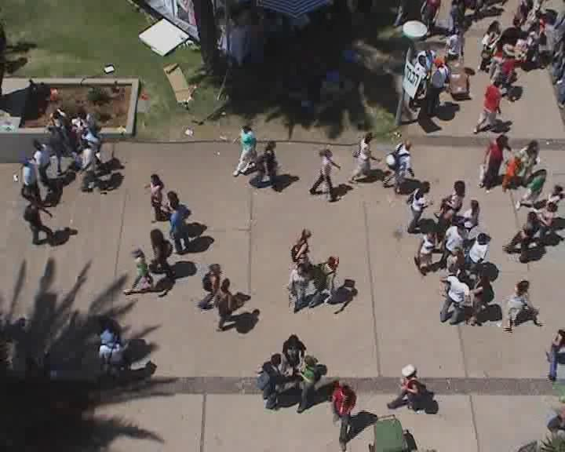
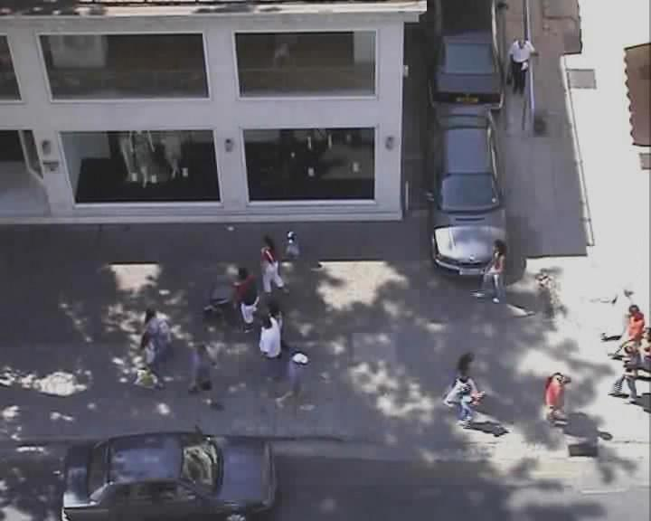

한 사람이 곧게 걷는 장면만으로는 군중 예측기의 차이를 보기 어렵습니다. 마주 오는 사람을 비키고, 대화 집단을 돌아가고, 멈춘 사람 옆을 통과하는 장면이 있어야 상호작용을 읽는지 확인할 수 있어요. <abbr title="키프로스대학교 컴퓨터 그래픽 연구진이 공개한 군중 영상과 보행자 궤적 자료">UCY</abbr> 군중 데이터셋은 이런 실제 보행 장면을 높은 시점의 영상과 궤적으로 남긴 고전 자료입니다.

공식 배포 ZIP에는 성당 앞 광장 장면, 대학 보행 공간, 상가 앞 Zara 장면의 영상과 대표 정지화면, 별도 주석 묶음이 들어 있습니다. 오늘날 궤적 예측 논문은 대개 UNIV, ZARA1, ZARA2 같은 이름으로 일부 장면을 꺼내 ETH 장면과 함께 평가해요. 원본 배포 구조와 후속 벤치마크의 다섯 장면 관행은 같지 않으므로, 어떤 파일을 실제로 썼는지 먼저 밝혀야 합니다.

<figure class="fig"><figcaption>대학 장면에는 이동 방향과 밀도가 다른 보행자가 한 화면에 함께 나타납니다. 좌표 예측에는 좋은 상호작용 자료지만, 고정 카메라가 보는 전역 장면과 로봇의 제한된 시야는 다릅니다. (출처: University of Cyprus Graphics Group, <a href="https://graphics.cs.ucy.ac.cy/research/downloads/crowd-data/">Crowd Data</a>, `students_003.jpg`)</figcaption></figure>

## 이 자료는 예측 점수보다 군중 행동 재현에서 출발했어요

UCY 자료와 연결된 “Crowds by Example” 연구는 실제 영상에서 추적한 보행 사례를 군중 시뮬레이션에 활용했습니다. 규칙 몇 개로 모든 사람을 움직이기보다, 현재 상황과 비슷한 실제 사례를 찾아 그 움직임을 모사하는 접근이에요. 사람의 국소 상황과 실제로 취한 궤적을 짝지었다는 점이 핵심입니다.

이 출발점은 데이터에 남은 행동의 성격을 설명합니다. 사람들은 목적지만 향하지 않고 다른 사람을 피하며, 함께 걷거나 멈추고, 장소의 통로와 장애물에 맞춰 방향을 바꿉니다. 좌표열은 이런 결과를 담지만 왜 그렇게 했는지는 적지 않아요. 대화 중인지, 일행인지, 길을 찾는지 같은 의미 라벨은 별도 추론이 필요합니다.

후속 예측 연구에서는 과거 위치 몇 개로 미래 위치를 맞히는 입력·출력 쌍을 만듭니다. 이때 원 연구의 “비슷한 상황에서 나온 실제 행동”이라는 생각은 이웃 보행자의 상태를 함께 보라는 설계로 이어졌어요. 그러나 한 장면의 기록을 유일한 미래 정답으로 쓰면 같은 상황에서 가능한 여러 회피 방향을 놓칩니다.

[[2026-10-17_socialnav_trajectory-feature-prediction|사람 사이 상호작용으로 다음 궤적을 예측한 방법]]이 공동 보행의 특징을 수치로 분해했다면, UCY는 자연 장면에서 그런 특징이 섞여 나타나는 좌표 자료입니다. 실험실의 정밀한 의도 통제 대신 실제 장소의 복잡성을 얻은 셈이에요.

## 대학과 상가 장면은 같은 분포가 아니에요

대학 장면은 넓은 보행 공간을 여러 방향의 사람이 가로지르고, 화면 일부에는 사람들이 모여 있습니다. Zara 장면은 건물과 도로 가장자리, 주차된 차량, 나무 그림자가 보행 가능한 영역을 제한해요. 카메라의 경사와 높이도 다릅니다.

<figure class="fig"><figcaption>Zara 장면은 대학 장면보다 시점이 비스듬하고 건물·차량·그림자가 보행 공간을 나눕니다. 같은 좌표 모델이라도 영상 보정과 장면 맥락 의존성이 달라져요. (출처: University of Cyprus Graphics Group, <a href="https://graphics.cs.ucy.ac.cy/research/downloads/crowd-data/">Crowd Data</a>, `crowds_zara01.jpg`)</figcaption></figure>

이 차이는 장면 보류 평가가 필요한 이유입니다. 같은 상가의 다른 구간을 훈련과 시험에 나누면 모델이 건물 앞의 흔한 흐름을 기억할 수 있어요. 대학 장면 전체를 보류하면 보행 공간의 폭, 밀도, 카메라 변환이 바뀌었을 때도 상호작용 규칙이 유지되는지 봅니다.

장면별 숫자를 평균하기 전에 표본 수를 확인해야 합니다. 한 장면에 긴 궤적이 많고 다른 장면에 짧은 궤적이 적다면 모든 창을 합친 평균은 큰 장면이 지배해요. 장면별 평균을 다시 평균한 값은 각 장면에 같은 비중을 주지만, 불확실성이 큰 작은 장면도 동일하게 반영합니다. 두 집계 방식과 표본 수를 함께 보고해야 합니다.

설명용으로 A 장면에 오차 0.4미터인 창 900개, B 장면에 오차 0.8미터인 창 100개가 있다고 하겠습니다. 모든 창 평균은 `(900×0.4+100×0.8)/1000=0.44미터`입니다. 장면 평균의 단순 평균은 `(0.4+0.8)/2=0.6미터`예요. 어느 값이 맞다기보다 무엇을 공정하게 비교하려는지 밝혀야 합니다.

## ZIP 안의 파일 이름부터 실험 정의가 시작돼요

공식 배포는 영상, 대표 JPEG, 주석 압축 묶음, 파일 형식 설명을 한 ZIP에 담습니다. `crowds_zara01.avi`, `crowds_zara02.avi`, `students003.avi`, `Arxiepiskopi_flock.avi`처럼 장면별 영상이 있고, Zara·대학·성당 장면의 주석은 각각 묶여 있어요. 이 구조는 “UCY 하나”가 여러 촬영과 주석 세트를 포괄한다는 사실을 보여 줍니다.

후속 저장소에서는 장면 이름을 줄이거나 좌표 파일을 공통 형식으로 변환합니다. `students003`이 `univ`가 되고, `crowds_zara01`이 `zara1`이 될 수 있어요. 변환 결과만 받으면 어느 원본과 연결되는지 잃기 쉽습니다. 원본 파일명, 변환 스크립트, 출력 해시를 함께 보존해야 합니다.

주석 형식도 하나라고 가정하면 안 됩니다. 공식 연구실 소개는 초기 비디오와 VSP 형식, 뒤에 제공된 CSV 표현을 구분합니다. 로더가 지원하는 형식과 실제 받은 파일을 대조해야 해요. 열 순서, 프레임 번호 시작값, 좌표축, 사람 ID가 다르면 조용히 잘못 읽힐 수 있습니다.

파일이 열리는 것만으로 검증은 끝나지 않습니다. 대표 정지화면 위에 좌표를 다시 투영하고, 사람의 발 위치를 따라가는지 봐야 해요. 영상 프레임과 주석 프레임의 오프셋이 한 칸만 나도 빠른 사람의 위치가 눈에 띄게 어긋납니다.

## 높은 시점도 장면마다 기하가 달라요

대학 장면은 조감에 가깝고 Zara 장면은 더 비스듬합니다. 비스듬한 영상에서 사람 머리 중심을 바닥 좌표로 간주하면 카메라에서 가까운 사람과 먼 사람의 오차 방향이 달라져요. 발점이나 바닥 접점을 기준으로 주석했는지 확인해야 합니다.

호모그래피는 바닥이 하나의 평면이라는 가정에서 영상 좌표를 실제 좌표로 바꿉니다. 계단, 턱, 경사로가 있거나 사람이 높은 구조물 위에 있으면 이 가정이 깨집니다. 행렬을 적용한 뒤 평행한 보도 경계가 지도에서도 평행하고, 알려진 길이가 위치에 따라 크게 달라지지 않는지 확인해야 해요.

설명용으로 영상에서 두 사람이 30픽셀 떨어져 있고 그 위치의 환산값이 픽셀당 3센티미터라면 간격은 `30×0.03=0.9미터`입니다. 장면 반대편에서 픽셀당 5센티미터인데 같은 30픽셀을 0.9미터로 읽으면 실제 1.5미터를 0.6미터 작게 봅니다. 사람 간 이웃을 반경으로 고르는 모델은 상호작용 그래프부터 달라져요.

좌표 변환 방향도 점검해야 합니다. 영상에서 오른쪽 이동이 지도 x 증가인지, y 증가인지, 세로축을 뒤집었는지 기록합니다. 배경 위 시각화와 함께 세 점으로 계산한 거리·각도를 손으로 다시 맞춰 보면 전치나 부호 오류를 찾기 쉽습니다.

## 그림자와 가림은 좌표표에서 사라져요

UCY 정지화면에는 나무와 건물 그림자가 강하게 드리워진 구역이 보입니다. 사람끼리 겹치거나 구조물 가장자리를 지나기도 해요. 수작업 궤적표만 읽으면 어떤 점이 쉬운 관측이었고 어떤 점이 가림 속 추정이었는지 알기 어렵습니다.

예측 모델이 깨끗한 좌표를 받으면 영상 검출기의 어려움을 건너뜁니다. 실제 로봇에서는 역광, 그림자, 가림 때문에 사람 위치가 누락되고, 추적 ID가 바뀌며, 지연된 위치가 들어와요. UCY 점수가 좋아도 이 앞단 오류에 견딘다는 뜻은 아닙니다.

강건성 평가는 좌표에 현실적인 오류를 주입해 볼 수 있습니다. 설명용으로 0.4초 간격 관측 여덟 점 중 가운데 두 점을 지우면 0.8초 동안 새 위치가 없습니다. 1.4미터/초로 걷는 사람은 그 사이 `1.4×0.8=1.12미터` 이동할 수 있어요. 직선 보간이 방향 전환을 놓치면 이후 예측의 기준 속도까지 틀어집니다.

ID 전환은 더 심각합니다. 가까이 스친 두 사람의 앞부분과 뒷부분을 서로 이어 버리면 한 궤적이 순간이동하거나 급회전해요. 평균 위치 잡음만 추가하는 시험으로는 이 실패를 재현하지 못합니다. 누락, 지연, 위치 잡음, ID 전환을 따로 주입해야 합니다.

## 군집은 거리 하나로 정해지지 않아요

둘이 가까이 걷는다고 항상 일행은 아닙니다. 좁은 통로에서 잠깐 나란히 된 낯선 사람일 수 있어요. 반대로 일행이 장애물을 사이에 두고 잠시 떨어질 수도 있습니다. UCY 좌표에는 집단 소속의 확정 라벨이 기본 입력으로 붙지 않으므로, 거리와 속도만으로 만든 군집은 추정입니다.

설명용으로 두 사람이 1.0미터 안에 있고 속도 방향 차이가 15도보다 작으면 같은 집단이라고 정한다고 하겠습니다. 교차하는 흐름이 느려지는 구간에서는 낯선 사람도 조건을 잠깐 만족할 수 있어요. 2초 지속 조건을 더하면 오검출은 줄지만, 막 합류한 일행을 늦게 찾습니다.

집단 추정 오류는 예측에 비대칭으로 영향을 줍니다. 낯선 사람을 일행으로 묶으면 모델이 함께 움직일 거라 믿어 충돌 가능성을 과소평가할 수 있어요. 실제 일행을 분리하면 서로 유지하는 간격과 공동 회전을 놓칩니다. 그룹 라벨이 없는 자료에서는 여러 임계값에 대한 민감도를 함께 보고해야 합니다.

대화 중 멈춘 집단은 목적지 예측도 어렵게 합니다. 마지막 속도가 0이라고 계속 정지할 것으로 보는 기준선과, 곧 출발할 것으로 보는 모델 모두 가능한 미래 중 하나예요. 관측 영상의 자세와 시선이 도움이 될 수 있지만 UCY 좌표 전용 설정에서는 그 정보가 빠집니다.

## 한 개의 기록 미래가 여러 타당한 미래를 벌줘요

사람 둘이 정면으로 마주치면 왼쪽이나 오른쪽으로 비킬 수 있습니다. 기록에는 한쪽만 남으므로 다른 쪽으로 안전하게 피한 예측도 큰 좌표 오차를 받아요. 여러 후보를 내고 가장 가까운 하나만 채점하면 다양성을 장려하지만, 후보 수가 많을수록 우연히 정답 근처를 찍을 가능성이 커집니다.

설명용으로 후보 하나가 정답 끝점 반경 0.5미터 안에 들어갈 확률이 독립적으로 0.2라고 하겠습니다. 후보를 다섯 개 내면 하나 이상 들어갈 확률은 `1-(1-0.2)^5≈67.2%`입니다. 후보 수가 다른 모델의 최솟값 오차만 비교하면 공정하지 않아요. 후보 수와 확률 보정, 모든 후보의 충돌 여부를 함께 봐야 합니다.

확률 모델은 기록된 경로에 높은 확률을 주면서 다른 안전한 가능성도 남길 수 있습니다. 그러나 확률이 잘 보정됐는지 확인해야 해요. 90% 신뢰 구역이 실제 미래를 약 90% 포함하는지, 드문 회전에서 과신하지 않는지 장면별로 측정합니다.

로봇 계획기는 후보 중 하나만 따라서는 안 됩니다. 사람 미래의 분포가 로봇 경로와 겹치는 정도, 최악의 충돌 가능성, 새 관측으로 불확실성이 줄어드는 속도를 반영해야 해요. UCY의 열린 고리 좌표 점수는 이 계획 과정 전체를 평가하지 않습니다.

## 다섯 장면 관행은 비교를 돕지만 누수를 감추기도 해요

후속 연구는 ETH의 두 장면과 UCY의 세 장면을 묶어 하나를 시험하고 나머지를 학습하는 방식을 많이 씁니다. 장면별 점수를 남기므로 비교가 쉽고, 한 장소만 본 모델보다 일반화를 요구해요. 이 관행 자체는 유용합니다.

문제는 전처리본마다 포함한 원본 구간과 보간, 샘플 생성 규칙이 다를 수 있다는 점입니다. 같은 `UNIV` 이름이라도 추가 시퀀스를 합쳤는지, 영상이 없는 주석을 포함했는지에 따라 표본이 달라져요. 논문 표의 숫자가 다르면 모델보다 데이터 차이를 먼저 의심해야 합니다.

정규화도 누수 경로가 됩니다. 시험 장면까지 포함해 전체 좌표 평균과 표준편차를 계산하면 시험 분포 정보가 학습에 들어갑니다. 장면별 좌표 원점을 모든 자료에서 미리 맞춘 경우에도 지도 범위가 힌트가 될 수 있어요. 변환 파라미터는 훈련 자료에서 정하거나 물리 단위처럼 사전에 정의된 값만 써야 합니다.

하이퍼파라미터를 다섯 장면에 반복 맞추면 최종 시험 장면도 사실상 개발 자료가 됩니다. 비교표를 위해 같은 벤치마크를 수년간 조정한 결과는 새 장소에서의 성능보다 낙관적일 수 있어요. 별도의 미공개 장소나 시간대를 한 번만 평가하는 외부 검증이 필요합니다.

## 로봇 주행에는 사람 반응과 센서 파이프라인이 더 필요해요

UCY 영상은 사람끼리 자연스럽게 걷는 장면입니다. 이동 로봇이 나타났을 때 사람이 멈추거나 양보 방향을 바꾸는 행동을 통제해 측정한 자료가 아니에요. 로봇의 폭, 속도, 소음, 화면이나 조명 표현에 따른 반응도 알 수 없습니다.

고정 카메라는 장면 밖까지 넓게 보지만 로봇은 모서리 뒤 사람을 늦게 봅니다. 카메라와 LiDAR가 서로 다른 주기로 들어오고, 로봇 자신이 회전하면서 좌표계가 바뀌어요. 세계 좌표의 깨끗한 궤적을 로봇 상대 좌표로 바꾸는 동안 자기 위치 추정 오차도 더해집니다.

설명용으로 로봇 위치가 x축으로 0.15미터, 사람 추적 위치가 반대 방향으로 0.20미터 틀리면 상대거리는 0.35미터까지 작아지거나 커질 수 있습니다. 각 오차의 평균이 작아도 같은 방향으로 겹치면 통과 판단을 바꿔요. 독립 오차라고 가정한 제곱합과 최악 합을 모두 확인해야 합니다.

정책 평가는 기록 재생, 닫힌 고리 시뮬레이션, 실물 사람 평가를 나눠야 합니다. 기록 재생에서는 로봇 행동이 사람 궤적을 바꾸지 않습니다. 시뮬레이션은 상호 반응을 만들 수 있지만 사람 모델의 가정을 물려받아요. 실물 평가는 실제 반응을 보지만 장면 수와 안전 제약이 제한됩니다.

## 재현 가능한 사용 절차

먼저 공식 ZIP의 목록과 해시를 저장하고 필요한 작은 파일만 풉니다. 장면별 영상·정지화면·주석 묶음이 대응하는지 확인하고, 변환 전 원본을 보존해요. 공개 CC 라이선스가 확인되지 않았으므로 연구실의 이용 조건과 인용 요구를 따르고 재배포 범위를 임의로 넓히지 않습니다.

다음으로 좌표를 영상 위에 그립니다. 첫 프레임뿐 아니라 시작·중간·끝, 가림과 교차가 있는 구간을 봐야 해요. 좌표 단위, 축 방향, 프레임 오프셋, ID 연속성, 보행 속도와 가속도의 이상치를 기록합니다.

세 번째로 창 생성과 분할을 고정합니다. 장면과 원 궤적을 먼저 나눈 뒤 창을 만들고, 같은 프레임이 양쪽에 없는지 검사해요. 누락된 점과 보간된 점에는 마스크를 남기며, 장면별 표본 수와 독립 궤적 수를 함께 셉니다.

네 번째로 정답 좌표 조건과 잡음 주입 조건을 분리합니다. 누락 길이, 위치 잡음, 시간 지연, ID 전환을 단계별로 늘려 예측이 언제 무너지는지 봐요. 평균 변위뿐 아니라 최종 오차, 충돌 가능성, 다중 후보의 보정과 다양성을 함께 측정합니다.

마지막으로 로봇 계획과 사람 평가를 별도 단계로 둡니다. 자동 검출·추적을 연결한 로봇 센서 입력에서 예측을 만들고, 독립 충돌 감시 아래 낮은 속도로 교차·추월·집단 통과를 평가해요. 최소거리, 목표 시간, 불필요한 정지, 사람의 추가 우회량과 불편을 함께 기록합니다.

UCY의 가치는 실제 군중이 장소에 맞춰 서로 비키고 모이는 모습을 좌표 예측 문제로 오래 비교하게 만든 데 있습니다. 대학과 상가의 다른 흐름, 정지와 교차, 강한 장면 맥락은 상호작용 모델을 시험하는 좋은 재료예요.

그 자료를 로봇 주행의 증명으로 쓰려면 원본 파일과 후속 전처리를 구분하고, 장면 기하와 분할 누수를 확인하며, 여러 타당한 미래를 점 하나로 벌주지 않아야 합니다. 무엇보다 고정 카메라 좌표와 이동 로봇의 불완전한 센서, 사람끼리의 움직임과 사람의 로봇 반응을 분리해야 해요. 그러면 UCY는 점수표의 익숙한 이름을 넘어 상호작용 예측의 가정을 검사하는 살아 있는 기준이 됩니다.

---

<!-- src-block -->
출처 — https://graphics.cs.ucy.ac.cy/research/downloads/crowd-data/
