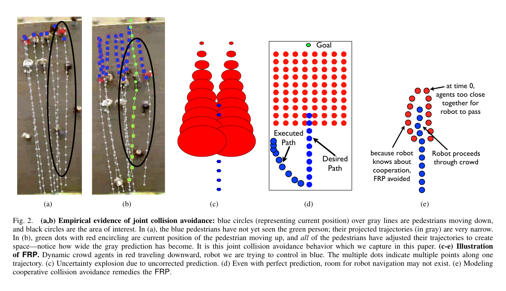
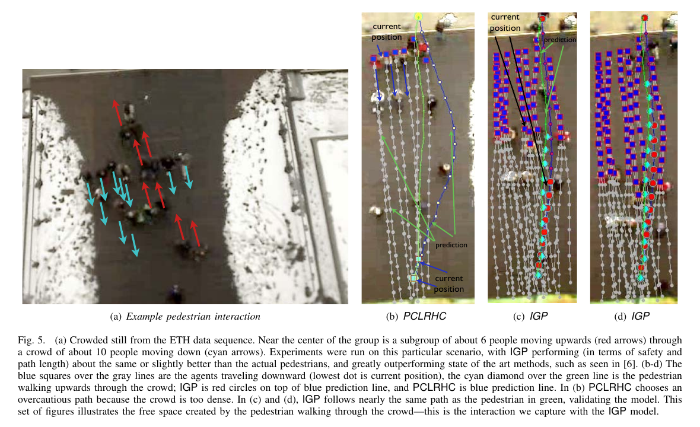

사람이 빽빽한 통로에서 안전 여유를 늘리면 로봇이 더 안전해질 것처럼 보입니다. 그런데 모든 사람의 미래 위치를 따로 예측하고 가능한 영역을 모두 피하려 하면 지나갈 길이 사라질 수 있어요. 사람은 실제로 서로 비키며 틈을 만들지만, 독립 예측은 그 틈이 생긴다는 사실을 표현하지 못합니다. 로봇은 충돌하지 않으려는 계산을 충실히 수행한 끝에 멈추거나 군중 바깥으로 크게 돌아갑니다.

Peter Trautman과 Andreas Krause가 2010년 IROS에서 발표한 「Unfreezing the Robot: Navigation in Dense, Interacting Crowds」는 이 현상을 <abbr title="여러 사람의 불확실한 미래를 각각 피하려다 가능한 경로가 사라져 로봇이 멈추거나 지나치게 우회하는 문제">로봇 동결 문제</abbr>로 다룹니다. 논문의 도발적인 지점은 사람 한 명씩을 더 정확히 예측하는 것만으로 해결되지 않는다고 보인 데 있습니다. 개인 궤적을 완벽히 안다고 해도 사람과 로봇의 상호 회피를 독립 사건으로 놓으면 군중 전체의 가능한 움직임을 잘못 계산할 수 있어요.

## 독립 예측은 열린 틈을 닫힌 위험으로 만들어요

전형적인 예측 플래너는 각 사람의 미래 궤적 분포를 구한 뒤 로봇 경로와 겹칠 확률을 계산합니다. 사람 A, B, C의 분포를 따로 만들고 각 위험을 피하는 경로를 찾는 방식이에요. 사람이 적고 서로 영향을 거의 주지 않을 때는 유용합니다.

밀집 군중에서는 한 사람의 궤적이 다른 사람의 궤적과 독립이지 않습니다. 마주 오는 두 사람은 서로를 보고 옆으로 움직이고, 앞사람이 감속하면 뒤 사람도 속도를 바꿉니다. 군중을 통과하는 사람은 기존 흐름이 잠깐 벌어지는 공간을 사용해요. 로봇도 보행자에게 보이는 이동 주체라면 주변 사람이 반응할 수 있습니다. 개인의 국소 반응을 힘 항으로 계산한 [[2026-10-17_socialnav_social-force|사회력 모델은 국소 반응에서 군중 질서를 만든다]]과 달리, 이 논문은 여러 미래 궤적의 확률 의존성에 초점을 맞춥니다.

독립 모델은 A가 왼쪽으로 갈 가능성과 오른쪽으로 갈 가능성을 모두 넓게 남깁니다. B와 C도 같은 방식으로 넓어집니다. 이 분포들을 한꺼번에 회피하면 실제 공동 움직임에서는 동시에 일어나기 어려운 조합까지 위험으로 셉니다. 불확실성을 정직하게 표현했지만 상관관계를 버린 탓에 합친 위험은 과장돼요.

논문은 예측 오차가 0인 극단을 생각해도 문제가 남을 수 있음을 설명합니다. 각 사람의 원래 경로를 완벽히 알아도, 로봇이 들어왔을 때 사람이 경로를 바꾸는 반응을 모델링하지 않으면 미래는 달라집니다. 관측 대상의 미래가 로봇 행동과 무관하다는 전제가 틀린 것이지 센서 정밀도만의 문제가 아닙니다.

<figure class="fig"><figcaption>독립 궤적을 겹치면 중앙 통과 가능성이 사라질 수 있지만, 공동 모델은 보행자와 이동 주체가 서로 반응하며 만드는 궤적 조합을 남깁니다. (출처: Trautman & Krause, Unfreezing the Robot: Navigation in Dense, Interacting Crowds, Fig. 2, https://las.inf.ethz.ch/files/trautman10unfreezing.pdf; 원 논문 그림 인용, 별도 CC 라이선스 미확인)</figcaption></figure>

## IGP는 사람과 로봇의 궤적을 한 분포로 묶어요

논문이 제안한 IGP는 dependent-output Gaussian process, 곧 출력 사이 의존성을 둔 가우시안 프로세스입니다. 각 행위자의 과거 위치에서 미래 궤적 분포를 만들되, 사람끼리와 사람-로봇 사이의 충돌 회피 가능성을 상호작용 항으로 연결합니다. 로봇 궤적 하나를 먼저 정하고 사람 예측을 장애물처럼 붙이는 대신, 로봇과 모든 사람의 미래 궤적 조합을 함께 다뤄요.

개별 가우시안 프로세스는 한 행위자의 시간에 따른 위치를 부드러운 확률 함수로 표현합니다. 상호작용 항은 두 궤적이 지나치게 가까워지는 조합의 확률을 낮춥니다. 곱해진 공동 분포에서는 누가 어느 쪽으로 비킬지에 따라 여러 봉우리가 생길 수 있어요. 정면 조우에서 왼쪽 통과와 오른쪽 통과가 모두 가능한 장면이 대표적입니다.

여러 봉우리를 하나의 가우시안으로 눌러 담으면 평균 궤적이 오히려 충돌 방향을 가리킬 수 있습니다. 그래서 논문은 중요도 샘플링으로 후보 공동 궤적을 뽑고 상호작용 항에 따라 가중치를 계산합니다. 각 행위자의 독립 분포에서 궤적을 샘플한 뒤, 서로 충돌하지 않는 조합에 더 큰 가중치를 주어 공동 분포를 근사해요.

이 방식은 사람의 목표를 완벽히 읽는 마법이 아닙니다. 과거 관측에서 만든 개별 궤적 분포와 설정한 상호작용 함수가 입력입니다. 보행자가 갑자기 멈추거나 그룹을 기다리고, 로봇을 이동 주체로 인정하지 않으면 분포 밖 행동이 나올 수 있어요. 공동 추론은 독립성 오류를 줄이지만 관측과 모델의 모든 오류를 없애지 않습니다.

## 설명용 확률 예로 독립성의 비용을 봐요

다음은 논문 실험이 아니라 개념을 풀기 위한 설명용 가정입니다. 좁은 통로에서 사람 A가 왼쪽으로 비킬 확률 0.5, 오른쪽으로 비킬 확률 0.5라고 해볼게요. 마주 오는 사람 B도 각각 0.5라고 독립적으로 놓으면 네 조합의 확률은 모두 0.25입니다.

하지만 실제 상호 회피에서 두 사람이 서로 다른 쪽을 골라 통로를 나누는 두 조합만 안정적이라고 가정할 수 있습니다. 독립 모델은 같은 쪽으로 몰리는 두 조합에도 합계 0.5의 확률을 줍니다. 플래너가 네 조합 모두에서 안전한 로봇 경로를 요구하면 중앙 통로를 포기할 수 있어요.

공동 모델이 안정적인 두 조합에 각각 0.45, 불안정한 두 조합에 각각 0.05를 준다고 가정해볼게요. 여전히 어느 쪽으로 비킬지 불확실하지만, 상호작용 때문에 가능한 조합의 구조가 달라졌습니다. 로봇은 가중치가 큰 두 모드에서 공통으로 열리는 공간을 찾거나, 관측이 더 쌓일 때까지 감속할 수 있어요.

확률이 작다고 충돌 조합을 무시해도 된다는 뜻은 아닙니다. 0.05가 실제 안전 요구에 비해 큰지 판단해야 하고, 모델 밖 행동을 위한 제동 계층도 필요합니다. 공동 분포는 진행 가능한 후보를 되살리는 도구이지 충돌 위험을 사회적 협조에 맡기는 허가가 아닙니다.

샘플 수도 계산과 안정성의 타협입니다. 설명용으로 100개 중 안전한 공동 궤적이 4개만 남는다면 선택이 몇 표본에 좌우될 수 있습니다. 1,000개로 늘리면 희귀 모드를 더 볼 수 있지만 처리 시간이 늘어요. 평균 계산 시간뿐 아니라 안전 후보 수의 분산과 샘플 반복에 따른 경로 변화도 측정해야 합니다.

## 원 논문은 오프라인 보행자 영상으로 평가했어요

원 논문은 ETH 대학 건물 출입구를 위에서 촬영한 8분이 넘는 보행자 데이터셋을 사용합니다. 서로 반대 방향으로 움직이는 군중이 교차하는 구간을 골라 IGP와 비교 방법을 평가했어요. 알고리즘에 한 보행자의 시작과 목표를 주고, 실제 사람이 군중을 통과한 장면과 같은 시간대에서 계획 결과를 비교했습니다.

<figure class="fig"><figcaption>비교 방법은 군중 바깥으로 크게 우회하고 IGP는 실제 보행자가 만든 틈과 비슷한 경로를 택합니다. 녹화 데이터의 오프라인 재생 결과이며 로봇이 현장에서 사람과 상호작용한 실험은 아닙니다. (출처: Trautman & Krause, Unfreezing the Robot: Navigation in Dense, Interacting Crowds, Fig. 5, https://las.inf.ethz.ch/files/trautman10unfreezing.pdf; 원 논문 그림 인용, 별도 CC 라이선스 미확인)</figcaption></figure>

평가는 열 번의 구간에서 경로 길이와 가장 가까운 보행자까지의 거리를 픽셀 단위로 기록합니다. 저자들은 영상 좌표를 미터로 바꾸는 오차가 클 수 있어 픽셀을 유지했고, 13픽셀을 안전 기준으로 삼았습니다. 이 값은 영상에서 관찰한 보행자 간 거리와 대략적인 어깨 너비에 대응하는 경험적 기준이에요.

논문은 약 100개 입자가 Matlab에서 약 0.1초에 계산되어 주행에 충분했다고 보고합니다. 약 5,000개를 넘으면 해가 뚜렷하게 좋아지지 않았고 그 수준은 약 5초가 걸렸습니다. 이 수치는 당시 코드와 데이터 조건의 결과입니다. 오늘의 컴퓨터에서 프레임률을 추정하는 기준도 아니고, 추적·좌표 변환·로봇 제어를 포함한 끝단 지연도 아닙니다.

가장 중요한 제한은 실시간 사람-로봇 상호작용을 하지 못했다는 점입니다. 원문은 공동 충돌 회피의 엄밀한 검증에는 살아 있는 상호작용이 필요하지만 당시에는 실행하기 어려웠다고 밝힙니다. 대신 실제 군중 영상에서 한 보행자가 만든 공간을 알고리즘이 예상하는지 오프라인으로 비교했어요. 데이터는 실제 사람이지만 로봇 경로가 사람 행동을 바꾼 것은 아닙니다.

따라서 “실제 군중에서 로봇이 사람과 협력해 통과했다”고 요약하면 검증 범위를 넘습니다. 맞는 표현은 실제 보행자 궤적 데이터에서 공동 예측 모델의 계획 경로를 회고적으로 비교했다는 것입니다. 이후 연구의 실물 결과와 이 2010년 논문의 결과를 섞지 않아야 해요.

## 픽셀 성능을 실물 안전거리로 옮기면 안 돼요

13픽셀은 해당 카메라 위치와 원근, 촬영 구간, 보행자 크기에 묶인 영상 좌표 기준입니다. 다른 카메라에서 13픽셀이 같은 실제 거리를 뜻하지 않습니다. 바닥 평면 보정 없이 픽셀 거리를 미터로 환산하면 화면 위쪽과 아래쪽에서 축척이 달라져요.

로봇 배포에서는 사람과 로봇의 실제 외곽 사이 거리가 필요합니다. 중심점 거리에서 반지름을 빼는지, 발 위치를 쓰는지, 몸통 깊이를 쓰는지 정의해야 해요. 센서 오차와 제동 거리를 더한 안전 하한도 별도로 둡니다. 영상 데이터의 어깨 너비 근사를 로봇 범퍼 여유로 그대로 복사할 근거는 없습니다.

경로 길이도 마찬가지입니다. 영상 픽셀에서 짧은 경로가 차동구동 로봇에게 실행하기 쉬운 경로라는 보장은 없어요. 급격한 곡률, 회전 시간, 최대 감속을 포함하면 물리 이동 시간은 달라집니다. 확률 궤적 계획과 기구학적으로 실행 가능한 제어 사이에 변환 계층이 필요합니다.

설명용 환산 예를 들어볼게요. 한 바닥 위치에서 100픽셀이 2미터로 보인다고 가정하면 13픽셀은 0.26미터입니다. 그러나 다른 위치에서 원근 때문에 100픽셀이 4미터라면 같은 13픽셀은 0.52미터가 됩니다. 단일 비례식을 전체 영상에 적용하면 안전거리가 두 배까지 달라지는 이 가정 사례처럼 큰 오류가 생길 수 있어요. 실제 환산에는 카메라 보정과 바닥 좌표 투영이 필요합니다.

## 공동 회피 가정도 현실에서는 깨질 수 있어요

첫째, 사람이 로봇을 보지 못할 수 있습니다. 뒤에서 접근하거나 휴대전화를 보거나 가림이 있으면 로봇에 반응하지 않습니다. 공동 분포가 사람이 틈을 열 것이라고 예측해도 실제로는 기존 경로를 유지할 수 있어요.

둘째, 사람의 목적은 통과만이 아닙니다. 일행을 기다리고, 문 앞에서 멈추고, 갑자기 방향을 바꿀 수 있습니다. 최근 위치로 만든 부드러운 궤적은 이런 사건을 사전에 알기 어렵습니다. 목표 후보와 정지 모드를 넣더라도 관측되지 않은 의도는 남아요.

셋째, 군중 집단은 모든 구성원이 같은 방식으로 흩어지지 않습니다. 가족이나 대화 집단은 서로 가까이 있으려 하며, 로봇이 사이를 통과하는 것을 막을 수 있어요. 충돌 회피 상호작용만으로 집단의 사회적 경계를 표현하면 물리적으로 가능한 틈을 사회적으로 허용된 틈으로 오인합니다.

넷째, 로봇의 외형과 속도가 사람 반응을 바꿉니다. 작은 저속 로봇, 사람 키의 로봇, 운반 카트형 로봇은 같은 접근에서도 다른 양보를 유발할 수 있어요. 보행자끼리의 궤적에서 배운 상호작용을 사람-로봇 관계로 옮길 때 생기는 분포 차이를 검증해야 합니다.

다섯째, 계산 시간이 길어지면 좋은 공동 분포도 오래된 상태를 사용합니다. 0.1초 계산 자체는 빨라 보여도 관측 수집, 추적, 샘플링, 제어 전달이 이어지면 명령 시점의 사람 위치가 달라집니다. 입자 수를 늘려 분포 근사를 개선하다가 전체 지연 때문에 예측 시작점이 틀릴 수 있어요.

여섯째, 모든 후보가 위험할 때의 행동이 필요합니다. 공동 모델이 틈을 찾지 못하면 로봇이 멈추는 것이 올바른 경우도 있습니다. 동결 문제를 해결한다는 목표 때문에 무조건 전진하면 안전을 해칩니다. 불필요한 정지와 필수 정지를 구분하는 기준이 있어야 해요.

## 동결을 진행률 하나로 판정하면 놓치는 것이 있어요

로봇이 목표에 가까워지지 않는 시간만 재면 교착을 쉽게 찾을 수 있습니다. 하지만 출입문에서 사람을 먼저 보내기 위한 짧은 정지도 동결로 잡힐 수 있어요. 정지 시간과 함께 주변 사람 흐름, 열린 후보 수, 최소 충돌 시간, 제어기의 의도 상태를 기록해야 합니다.

반대로 로봇이 계속 조금씩 움직인다고 동결이 해결된 것도 아닙니다. 군중 바깥으로 긴 우회를 하며 진행률을 유지할 수 있어요. 목표까지의 남은 거리, 실제 이동 거리, 최단 정적 경로 대비 우회율을 함께 보면 과도한 회피를 찾을 수 있습니다.

설명용 평가 계약을 만들면 정지 이유를 세 가지로 나눌 수 있어요. 물리 안전 하한 때문에 멈춘 `safety stop`, 공동 궤적 후보가 부족해 관측을 기다린 `uncertainty wait`, 경로 선택이 반복되어 진전이 없는 `planner freeze`입니다. 같은 속도 0이라도 원인이 다르므로 로그와 복구 행동도 달라야 합니다.

사람 평가도 필요합니다. 로봇이 틈을 잘 찾았더라도 사람이 급히 비키거나 불안해했다면 협력적 주행이라 부르기 어렵습니다. 최소거리와 성공률 외에 사람이 양보한 거리, 걸음 변화, 안전감, 로봇 의도 예측 가능성을 측정해야 해요. 오프라인 궤적 비교는 이 체감 품질을 알려주지 않습니다.

## 저상 센서 시스템에서는 관측 계약이 먼저예요

공동 궤적 모델은 여러 사람의 연속된 식별자와 위치 이력이 필요합니다. 낮은 2D LiDAR가 다리만 보면 교차 순간에 식별자가 바뀔 수 있고, RGB-D는 가림에서 깊이가 끊길 수 있어요. 두 센서의 트랙을 합치더라도 같은 사람이라는 확률과 마지막 관측 시간을 보존해야 합니다.

식별자 전환은 상호작용 학습을 망가뜨립니다. A의 과거 위치 뒤에 B의 현재 위치가 붙으면 존재하지 않는 급가속 궤적이 생겨요. 속도 필터가 이를 완만하게 만들면 오류가 덜 보여도 미래 분포는 여전히 잘못됩니다. 위치 오차뿐 아니라 ID 연속성을 입력 품질 지표로 둬야 합니다.

사람이 한 명 누락되면 공동 분포의 차원만 줄어드는 것이 아닙니다. 남은 사람의 예상 반응도 달라질 수 있어요. 가려진 사람이 군중 흐름을 만드는 핵심 행위자라면 보이는 사람만으로 추정한 열린 틈은 실제로 닫혀 있습니다. 미관측 영역을 일반 장애물 또는 속도 제한 구역으로 다루는 보수적 하위 계층이 필요합니다.

로봇 목표와 사람 목표도 분리해야 합니다. 로봇 목표는 내비게이션 스택이 알고 있지만 사람 목표는 추정값입니다. 사람에게도 확정 목표 좌표를 넣어 시뮬레이션한 결과는 실제 센서 배포보다 유리해요. 목표를 모르는 모드, 여러 목표 후보, 정지 가능성을 포함한 시험을 따로 구성해야 합니다.

## 재현은 세 단계로 나누는 편이 정확해요

첫 단계는 녹화 데이터 재생입니다. 같은 관측 궤적을 독립 모델과 공동 모델에 넣어 경로 길이, 최소거리, 정지 시간, 계산 시간을 비교합니다. 샘플 시드를 여러 개 바꾸어 경로 분산도 기록해요. 이 단계는 원 논문과 가장 가까운 알고리즘 재현입니다.

둘째는 닫힌 고리 시뮬레이션입니다. 로봇 행동에 따라 보행자 정책이 반응하도록 하고, 협조하는 정책과 직진을 유지하는 정책을 섞습니다. 공동 회피 가정이 맞을 때와 깨질 때 안전 하한이 어떻게 달라지는지 확인해요. 녹화 재생에서는 로봇 행동이 사람 궤적을 바꾸지 않으므로 이 차이를 볼 수 없습니다.

셋째는 통제된 사람 참여 평가입니다. 넓은 공간에서 낮은 속도로 시작하고, 정면 조우와 교차, 문 통과처럼 장면을 하나씩 늘립니다. 로봇 성공률과 최소거리뿐 아니라 참가자의 양보와 체감 평가를 수집해요. 실험 승인과 안전 감시, 중단 조건을 갖춘 뒤 진행해야 합니다.

각 단계의 결론도 구분해야 합니다. 녹화 재생 성공은 과거 보행자 틈을 예측하는 능력, 닫힌 고리 시뮬레이션 성공은 정한 행위자 정책과의 상호작용, 사람 평가 성공은 해당 참가자와 장소에서의 수용성을 지지합니다. 앞 단계 하나로 뒤 단계까지 입증했다고 쓰면 안 됩니다.

## 작은 반례가 모델의 과신을 막아요

한 사람만 있는 장면에서는 독립 모델과 공동 모델이 비슷해야 합니다. 큰 차이가 나면 상호작용 항 외의 구현 차이나 샘플링 편향을 의심할 수 있어요. 가장 단순한 기준선이 회귀 테스트가 됩니다.

두 사람이 평행하게 같은 속도로 걷는 장면에서는 불필요한 상호 회피가 생기지 않아야 합니다. 가까이 있다는 이유만으로 분포를 갈라 놓으면 집단과 나란히 이동하는 로봇이 계속 밀려납니다. 거리뿐 아니라 상대 속도와 미래 겹침을 봐야 해요.

한 사람은 비키고 다른 사람은 직진하는 비대칭 장면도 필요합니다. 모든 행위자가 같은 협조 수준을 가진다는 가정을 깨고, 로봇이 직진 사람에게 충분한 책임을 맡는지 확인합니다. 공동성은 전원 대칭과 같은 뜻이 아닙니다.

센서 누락 반례에서는 군중 중앙 한 사람을 몇 프레임 지웁니다. 모델이 갑자기 열린 틈을 만들고 가속하는지 봐요. 마지막 관측 이후 분포를 넓히거나 미지 점유로 남기는 정책이 없다면 미검출이 낙관적인 경로로 바뀔 수 있습니다.

계산 예산 반례에서는 입자 수를 늘리면서 계획 품질과 끝단 지연을 함께 측정합니다. 경로 점수가 조금 좋아져도 명령이 늦어 최소거리가 줄면 배포 성능은 나빠진 것입니다. 원 논문의 100개와 5,000개 수치는 탐색 시작점이지 현재 시스템의 정답이 아니에요.

마지막으로 완전히 막힌 통로를 넣습니다. 사람 반응을 아무리 낙관해도 로봇 외곽이 통과할 수 없는 폭이라면 정지해야 해요. 공동 회피 모델이 물리 불가능한 틈을 확률로 만들어서는 안 됩니다. 지도와 로봇 형상, 독립 충돌 검사가 확률 계획의 경계를 지켜야 합니다.

이 논문이 남긴 핵심 질문은 “사람을 얼마나 정확히 예측했는가”보다 “서로의 행동을 바꾸는 관계를 예측에 넣었는가”에 가깝습니다. 독립 불확실성을 모두 피하면 안전해 보이지만, 밀집 군중에서는 현실에 존재하는 협력적 틈까지 지워 로봇을 얼릴 수 있어요. IGP는 공동 궤적 분포로 그 틈을 되살리는 한 방법을 보였습니다.

다만 2010년의 증거는 실제 보행자 영상에 대한 오프라인 비교입니다. 실물 로봇과 사람이 서로 반응한 결과가 아닙니다. 배포에서는 공동 예측을 진행성 향상 계층으로 사용하고, 사람이 반응하지 않는 경우와 미관측 대상을 견디는 안전 하한을 따로 유지해야 합니다. 그래야 로봇이 불필요하게 얼지 않으면서도, 멈춰야 할 때는 멈출 수 있습니다.

---

<!-- src-block -->
출처 — https://las.inf.ethz.ch/files/trautman10unfreezing.pdf
