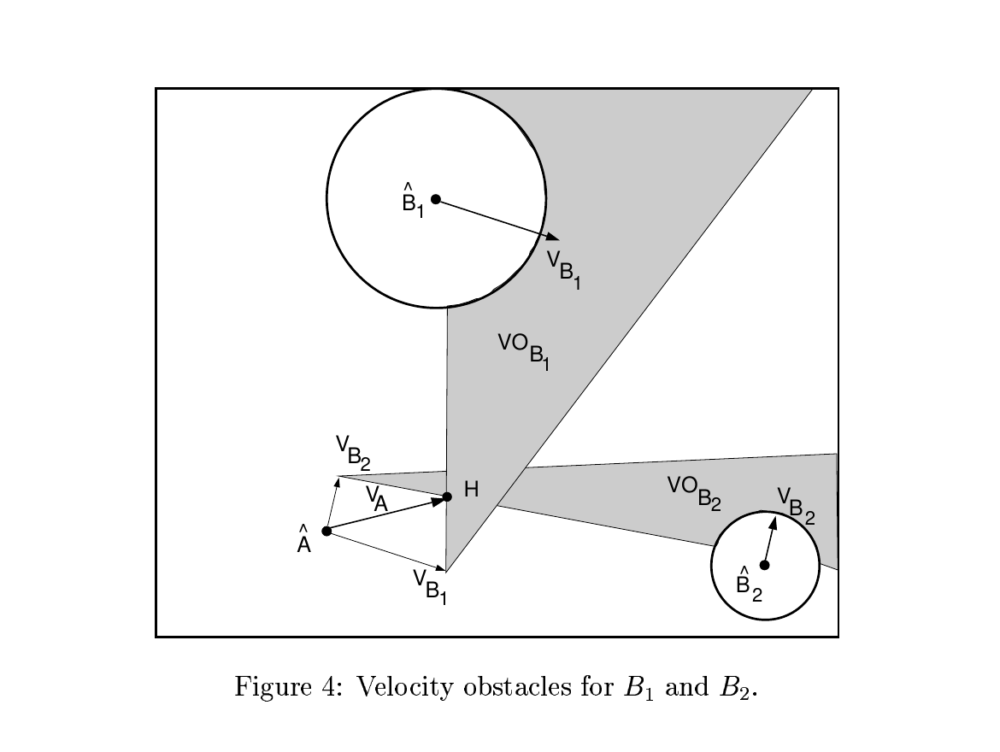
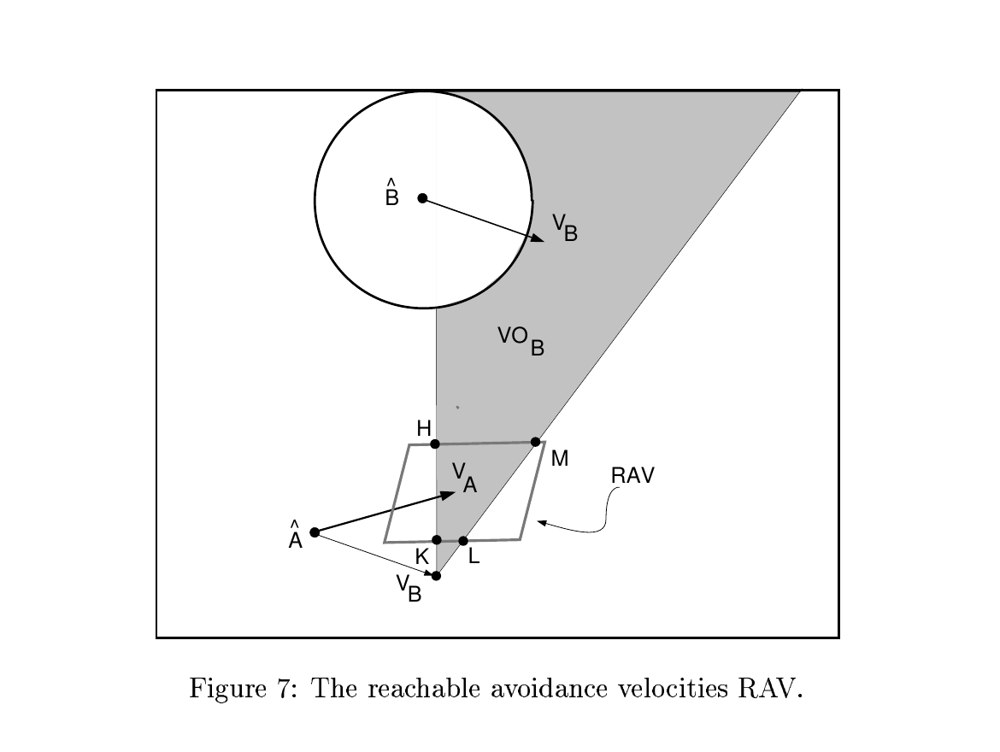

움직이는 장애물을 피할 때 현재 위치만 보면 늦습니다. 지금은 멀어도 서로 마주 달리면 곧 충돌하고, 가까워도 같은 방향과 속도로 움직이면 급히 피할 필요가 없어요. Paolo Fiorini와 Zvi Shiller가 1998년에 발표한 「Motion Planning in Dynamic Environments Using Velocity Obstacles」는 이 차이를 위치가 아닌 속도 공간에서 계산합니다.

<abbr title="현재 상대 위치와 장애물 속도가 유지될 때 앞으로 충돌하게 만드는 로봇 속도의 집합">속도 장애물</abbr>은 선택하면 미래 어느 시점에 충돌하는 로봇 속도를 모은 영역입니다. 플래너는 그 영역 바깥에서 새 속도를 고릅니다. 복잡한 미래 궤적을 매 후보마다 끝까지 적분하기보다, 지금의 상대 운동을 충돌하는 속도와 피하는 속도로 나누는 방식이에요.

## 위치의 충돌 원뿔을 속도 공간으로 옮겨요

원형 로봇 A와 원형 장애물 B를 생각해볼게요. 두 원이 부딪히는 조건은 중심 사이 거리가 두 반지름의 합보다 작아지는 것입니다. 기하 계산에서는 장애물 B를 두 반지름의 합만큼 부풀리고 로봇 A를 점으로 바꿀 수 있어요. A에서 부풀린 B의 양쪽 접선으로 만든 원뿔이 상대 속도의 충돌 방향을 나타냅니다.

장애물이 정지해 있다면 로봇 속도 벡터가 이 원뿔 안을 향할 때 언젠가 부딪힙니다. B가 속도 `vB`로 움직이면 원뿔을 속도 공간에서 `vB`만큼 옮깁니다. 로봇 속도 `vA`가 옮겨진 영역 안에 있으면 상대 속도 `vA - vB`가 충돌 원뿔을 향해요. 이 평행이동이 정적 장애물 회피와 동적 장애물 회피를 같은 그림에 놓습니다.

<figure class="fig"><figcaption>회색 원뿔은 두 장애물 각각과 미래 충돌을 만드는 로봇 속도 집합입니다. 여러 장애물이 있으면 각 회색 영역의 합집합을 피해야 합니다. (출처: Fiorini & Shiller, Motion Planning in Dynamic Environments Using Velocity Obstacles, Fig. 4, https://www.ariel.ac.il/sites/shiller/papers/fiorini98motion.pdf; 원 논문 그림 인용, 별도 CC 라이선스 미확인)</figcaption></figure>

장애물이 둘이면 두 속도 장애물의 합집합을 계산합니다. 후보 속도가 어느 회색 영역에도 들어가지 않으면 현재 등속 가정 아래 충돌하지 않아요. 후보가 한 영역 안에 있으면 해당 장애물과의 예상 충돌 시간을 구해 위험이 가까운 후보부터 제외하거나 큰 벌점을 줄 수 있습니다.

이 표현의 장점은 속도의 크기와 방향을 함께 본다는 데 있습니다. 위치 기반 반경은 장애물이 다가오는지 멀어지는지 구분하지 못합니다. 속도 장애물은 같은 2미터 거리에서도 정면 접근과 평행 이동에 다른 판단을 냅니다. 사람과 로봇이 교차하는 장면에서 최소거리만큼이나 상대 속도가 중요한 이유를 기하로 보여 줘요.

## 피할 수 있는 속도만 남겨야 해요

충돌 영역 바깥이라고 모든 속도를 실행할 수 있는 것은 아닙니다. 로봇은 현재 속도에서 한 제어 주기 안에 도달할 수 있는 가속도 범위가 있고, 바퀴 구조에 따라 옆으로 움직일 수 없을 수 있어요. 논문은 충돌을 피하는 속도 집합과 동역학적으로 도달 가능한 속도 집합을 교차해 실행 가능한 회피 속도를 만듭니다.

<figure class="fig"><figcaption>충돌하지 않는 속도라도 한 주기 안에 도달하지 못하면 후보가 될 수 없습니다. 그림의 RAV가 도달 가능하면서 충돌을 피하는 속도 집합입니다. (출처: Fiorini & Shiller, Motion Planning in Dynamic Environments Using Velocity Obstacles, Fig. 7, https://www.ariel.ac.il/sites/shiller/papers/fiorini98motion.pdf; 원 논문 그림 인용, 별도 CC 라이선스 미확인)</figcaption></figure>

이 교집합이 비어 있으면 이미 늦었을 수 있습니다. 현재 속도와 장애물 운동, 제동 한계 때문에 어느 실행 가능한 속도를 골라도 설정한 시간 안에 충돌해요. 이때 로컬 플래너가 기하적으로 더 좋은 방향을 찾는 것만으로는 해결되지 않습니다. 더 앞에서 감속했어야 하거나, 시간 지평과 전역 경로가 달라져야 합니다.

논문은 짧은 한 단계 회피와 여러 단계의 경로 탐색을 연결합니다. 일정한 시점마다 실행 가능한 회피 기동을 가지로 만들고, 거리나 이동 시간을 줄이는 경로를 탐색해요. 모든 가지를 보면 계산이 커지므로 온라인에서는 휴리스틱 탐색을 쓸 수 있습니다. 이 구성은 속도 장애물이 완전한 전역 플래너라기보다 동적 충돌을 판별하는 핵심 연산이라는 점을 보여 줍니다.

## 시간 지평이 보수성과 근시안을 가릅니다

무한한 미래까지 등속 운동을 가정하면 멀리 있는 장애물도 충돌 영역을 크게 만들 수 있습니다. 실제 장애물은 방향을 바꾸고 로봇도 계속 재계획해요. 논문은 시간 지평을 두어 그 안에서 일어나는 충돌에 집중하는 변형을 설명합니다. 원뿔 끝을 잘라 가까운 시간의 위험만 남기는 셈입니다.

시간 지평이 너무 짧으면 빠른 정면 접근을 늦게 발견합니다. 너무 길면 사람이 앞으로 방향을 바꿀 가능성을 무시한 채 먼 미래 충돌까지 확정해 지나치게 우회할 수 있어요. 하나의 전역 상수보다 장애물 속도, 로봇 제동 거리, 관측 신뢰도에 따라 지평을 조정할 이유가 있습니다.

제어 주기도 함께 봐야 합니다. 10헤르츠 제어에서 2초 지평은 스무 번의 갱신 기회를 포함하지만, 2헤르츠에서는 네 번뿐이에요. 같은 시간 지평이라도 관측과 명령 갱신 횟수가 다릅니다. 지평을 초로만 보고 제어 지연을 빼면 실제 반응 여유를 과대평가할 수 있어요.

사람 궤적의 속도 추정이 불안정할 때 긴 지평은 오차를 멀리 증폭합니다. 속도가 초당 0.2미터만 틀려도 3초 뒤 위치는 단순 외삽에서 0.6미터 달라져요. 시간 지평을 늘릴수록 미래 위치 분포도 넓혀야 합니다. 고전 속도 장애물의 결정적 원뿔만 유지하면 불확실성을 안전 여유로 옮기는 별도 규칙이 필요해요.

## 설명용 기하 계산으로 충돌 여부를 읽기

다음은 논문 결과가 아니라 원리를 풀기 위한 설명용 가정입니다. 로봇 A가 `(0, 0)`에 있고 사람 B가 `(4, 0)`에 있으며, 두 몸체의 안전 반경 합을 0.8미터라고 해볼게요. 사람은 왼쪽으로 초당 0.5미터, 로봇은 오른쪽으로 초당 1.0미터 이동합니다. 상대 접근 속도는 초당 1.5미터입니다.

중심 사이에서 안전 반경을 뺀 여유는 `4.0 - 0.8 = 3.2m`입니다. 등속과 정면 접근을 가정한 충돌 시간은 약 `3.2 / 1.5 = 2.13s`예요. 시간 지평이 3초라면 현재 로봇 속도는 피해야 할 후보입니다. 지평이 1초라면 당장 충돌 영역 밖으로 분류될 수 있지만, 다음 갱신에서 확실히 감속하거나 방향을 바꿀 수 있어야 합니다.

로봇이 속도를 초당 0.2미터로 낮추면 상대 접근 속도는 초당 0.7미터가 되고 같은 단순 계산의 충돌 시간은 약 4.57초로 늘어납니다. 그러나 안전해진 것은 아닙니다. 사람과 로봇이 계속 같은 방향으로 접근하면 충돌이 뒤로 미뤄졌을 뿐이에요. 시간 지평 바깥으로 밀어낸 후보를 영구 안전으로 부르면 안 됩니다.

로봇이 위쪽으로 방향을 틀어 속도 `(0, 0.8)`을 고르면 상대 속도는 `(0.5, 0.8)`처럼 바뀝니다. 이 벡터가 부풀린 장애물의 접선 원뿔 바깥인지 확인해야 해요. 방향만 바꿨다고 안전한 것이 아니라 로봇의 회전 속도와 한 주기 도달 가능성도 만족해야 합니다. 그림 7의 교집합이 필요한 이유입니다.

## 사람을 등속 원으로 보는 가정이 깨지는 장면

첫 번째 실패는 갑작스러운 정지입니다. 앞서 걷던 사람이 휴대전화를 보려고 멈추면 외삽한 속도 원뿔이 즉시 틀립니다. 추적기는 정지를 확인하기까지 몇 프레임이 필요하고, 로봇은 그동안 같은 방향으로 걷는다고 믿을 수 있어요. 추월 후보는 정지 가능성과 제동 거리를 함께 고려해야 합니다.

두 번째 실패는 서로의 반응입니다. 고전 속도 장애물은 장애물이 주어진 속도로 움직이는 수동 대상이라는 전제에 잘 맞습니다. 사람은 로봇을 보고 속도와 방향을 바꿉니다. 로봇과 사람이 모두 상대가 그대로 올 것이라 보고 같은 쪽으로 피했다가, 다음 순간 반대쪽으로 함께 바꾸면 좌우 흔들림이 생길 수 있어요. 이 문제를 상호성 가정으로 다룬 것이 [[2026-10-17_socialnav_rvo|서로 피한다는 가정은 속도 장애물의 흔들림을 어떻게 줄였나]]입니다.

세 번째 실패는 비원형 몸체와 짐입니다. 쇼핑 카트나 유모차는 진행 방향에 따라 점유 모양이 달라집니다. 원으로 크게 감싸면 지나갈 수 있는 틈을 없애고, 작게 감싸면 모서리 충돌을 놓칩니다. 다각형을 쓸 수 있어도 사람의 팔과 짐이 시간에 따라 움직이는 문제는 남습니다.

네 번째 실패는 사회적 규범입니다. 속도 장애물 바깥의 두 후보는 충돌 안전 면에서 모두 가능하지만, 하나는 대화 중인 두 사람 사이를 가르고 다른 하나는 바깥으로 돌아갈 수 있어요. 기하 계산만으로 둘의 사회적 차이를 알 수 없습니다. 사회적 비용은 안전 후보를 만든 뒤 별도로 순위를 매겨야 합니다.

다섯 번째 실패는 가림입니다. 센서가 사람을 보기 전에는 속도 장애물도 없습니다. 코너에서 사람이 나타난 순간 원뿔을 만들면 이미 제동 여유가 부족할 수 있어요. 지도 구조를 이용한 속도 제한과 독립 충돌 감시는 관측된 사람만 다루는 속도 기하를 보완합니다.

## 1998년 검증 범위와 읽어야 할 한계

논문은 점과 원판 형태의 로봇, 정적·이동 장애물, 자동화 차량 시나리오로 방법을 보였습니다. 사람 참여 평가나 서비스 로봇의 편안함 평가는 아닙니다. 사람을 피하는 현대 시스템에 인용할 때는 동적 충돌 회피의 기초로 한정해야 해요.

당시 결과가 온라인 계획 가능성을 보였다고 해서 현재 로봇에서 계산 예산이 자동으로 충족되는 것도 아닙니다. 장애물 수, 후보 속도 수, 탐색 깊이, 기구 제약이 계산량을 바꿉니다. 센서 추적과 좌표 변환의 비용도 논문 속 기하 계산 밖에 있습니다. 목표 보드에서 전체 주기를 측정해야 합니다.

또한 충돌하지 않는다는 판정은 입력 속도와 형상, 등속 가정, 재계획이 제때 수행된다는 조건에 묶입니다. 위치가 오래됐거나 사람 트랙이 바뀌면 올바른 원뿔을 계산해도 현실과 맞지 않아요. 안전 보장은 수식 이름보다 입력 계약과 지연의 최대 허용값에 달려 있습니다.

## 배포 전에는 세 경계를 따로 시험해야 해요

기하 경계는 접선 근처 후보를 시험합니다. 속도 벡터가 원뿔 안, 경계, 바깥에 있을 때 충돌 판정이 연속적으로 바뀌는지 확인해요. 부동소수점 오차로 경계 후보가 프레임마다 안전과 위험을 오가면 작은 여유각이나 히스테리시스가 필요합니다.

동역학 경계는 현재 속도와 최대 감속에서 도달 가능한 후보가 남는지 봅니다. 빈 교집합이 생겼을 때 플래너가 정지 명령, 비상 감속, 전역 재계획 가운데 무엇을 선택하는지 정해야 해요. 빈 집합을 이전 속도 유지로 처리하면 가장 위험한 순간에 회피를 포기합니다.

관측 경계는 지연과 누락을 주입합니다. 사람 속도를 일정 비율로 틀리게 하고, 몇 프레임을 끊고, 식별자를 바꿔 결과를 비교해요. 성공률 외에 충돌 시간 추정 오차, 최소거리, 속도 전환 횟수, 불필요 정지를 기록하면 어느 입력 오류에 민감한지 드러납니다.

## 위치 비용 지도와 속도 장애물은 맡는 일이 달라요

로봇 주행 스택에는 벽과 가구를 표시한 위치 비용 지도가 이미 있는 경우가 많습니다. 이 지도는 어디를 지나면 안 되는지 공간 좌표로 표현해요. 속도 장애물은 같은 위치에서도 어떤 속도를 선택하면 안 되는지 표현합니다. 한쪽을 다른 쪽으로 완전히 바꾸기보다 전역 경로와 지역 속도 선택으로 역할을 나누는 편이 자연스럽습니다.

정적 벽은 위치 지도에 남겨 두는 것이 안정적입니다. 벽 속도를 0이라고 보고 매 주기 속도 장애물을 만들 수도 있지만, 지도 기반 전역 탐색이 이미 제공하는 연결성과 막힌 영역 정보를 잃게 됩니다. 반대로 움직이는 사람을 매 프레임 위치 비용으로만 부풀리면 다가오는 사람과 멀어지는 사람을 같은 장애물로 봅니다. 동적 대상은 속도 공간에서 차이를 살리는 편이 낫습니다.

두 표현을 결합할 때 중복 비용을 확인해야 해요. 같은 사람을 위치 지도에서 큰 원으로 막고 속도 장애물에서도 피하면 회피가 두 번 적용됩니다. 통과할 수 있는 복도가 사라지거나 불필요한 급회전이 생길 수 있어요. 위치 층은 물리 하한, 속도 층은 미래 충돌, 사회 층은 편안함처럼 의미를 나눠야 가중치를 해석할 수 있습니다.

전역 경로가 사람 사이를 일자로 가리키고 지역 제어기가 매번 속도 장애물로 피하는 구성도 흔들림을 만듭니다. 지역 제어기는 사람을 지나친 뒤 원래 선으로 돌아가려 하고, 다음 사람 때문에 다시 벗어나요. 동적 장애물이 오래 머물면 전역 경로도 갱신하거나, 지역 우회를 일정 시간 유지하는 장치가 필요합니다. 속도 선택만 좋아도 전체 경로 계층이 계속 반대 명령을 내리면 움직임은 매끄럽지 않습니다.

사회적 비용을 속도 공간에 넣는 방법도 있습니다. 안전한 후보 가운데 사람 앞을 가로지르는 속도, 너무 빠른 추월, 잦은 좌우 전환에 벌점을 주는 식이에요. 다만 비용이 커도 후보를 허용하는 연속 선호와 절대 선택하면 안 되는 충돌 집합을 분리해야 합니다. 두 종류를 같은 숫자로 더하면 가중치가 바뀌는 순간 충돌 후보가 선택될 수 있어요.

## 계산 검증은 작은 기하 사례에서 시작해요

첫 단위 사례는 정지 장애물입니다. 장애물 속도를 0으로 두었을 때 원뿔이 상대 위치 방향에 놓이고, 바깥으로 향하는 로봇 속도는 안전으로 분류되어야 해요. 로봇과 장애물 위치를 함께 평행이동해도 결과는 같아야 합니다. 좌표 원점에 따라 판정이 달라지면 상대 위치 계산에 오류가 있습니다.

두 번째는 같은 속도 평행 이동입니다. 로봇과 사람이 같은 방향, 같은 속도로 이동하고 간격이 유지된다면 상대 속도는 0입니다. 현재 겹치지 않는 조건에서는 미래 충돌로 판정하면 안 돼요. 이 사례는 절대 속도를 상대 속도로 바꾸는 과정의 부호 오류를 잘 잡아냅니다.

세 번째는 접선 통과입니다. 로봇 궤적이 부풀린 장애물 원에 정확히 닿는 후보를 만들고, 경계 포함 정책을 확인합니다. 수학적으로 접촉을 허용하더라도 실제 시스템은 위치와 반경 오차 때문에 여유를 둬야 해요. 테스트에서는 정확한 경계를 확인하고 배포 설정에서는 별도 안전 여유를 더하는 편이 원인을 분리하기 쉽습니다.

네 번째는 시간 지평 경계입니다. 충돌 시간이 지평보다 아주 짧은 경우, 같은 경우, 아주 긴 경우를 만들어 판정이 한쪽 기준으로 일관되는지 봅니다. 부등호 선택이 구현마다 다르면 경계에서 명령이 번갈아 바뀔 수 있어요. 선택한 규칙과 여유 시간을 기록해야 합니다.

다섯 번째는 도달 가능 집합이 빈 경우입니다. 최대 감속을 적용해도 모든 후보가 충돌 집합 안에 남도록 초기 조건을 만듭니다. 시스템은 이 상황을 정상 후보 탐색 실패로 보고 안전 정지 계층에 넘겨야 해요. 빈 배열, 무한 비용, 이전 명령 재사용 가운데 어떤 코드 경로를 타는지 검증하지 않으면 실물에서만 위험한 기본값이 나타납니다.

마지막은 다중 장애물 순서 불변성입니다. 사람 목록 순서를 바꿔도 합집합과 선택 속도가 같아야 합니다. 순차적으로 후보를 지우는 구현은 처리 순서에 따라 다른 속도를 고를 수 있어요. 센서 추적기가 식별자 순서를 바꾸는 순간 경로가 튄다면 기하보다 자료 구조의 순서 의존성이 원인일 수 있습니다.

속도 장애물의 오래가는 가치는 미래 충돌을 위치 지도에서 속도 선택 문제로 바꾼 데 있습니다. 현재 위치만 보는 반응보다 상대 운동을 명확히 표현하고, 로봇의 도달 가능한 속도와 결합할 수 있어요. 사람 사이를 다니는 로봇에서는 이 기하를 안전 후보 생성기로 쓰고, 상호 반응과 사회 규범, 관측 불확실성을 별도 계층에서 다루는 구성이 알맞습니다.

---

<!-- src-block -->
출처 — https://www.ariel.ac.il/sites/shiller/papers/fiorini98motion.pdf
