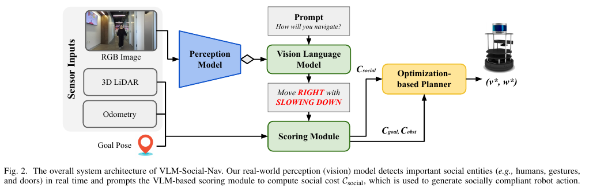
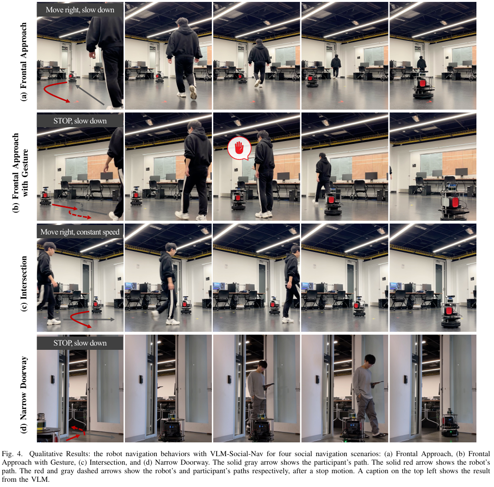

시각언어모델에게 로봇 카메라 영상을 보여 주고 “어떻게 움직일까?”라고 물으면 사람을 오른쪽으로 비켜 가거나 손짓 앞에서 멈추라는 문장을 만들 수 있습니다. 그러나 답변 하나에 몇 초가 걸리고, 문장이 틀릴 수도 있으며, 바퀴의 속도 한계와 장애물 거리를 알지 못합니다. 이 문장을 곧바로 모터 명령으로 쓰면 맥락 이해의 이점보다 지연과 오판 위험이 커져요.

<abbr title="시각언어모델의 방향·속도 제안을 기존 지역 계획기의 사회 비용으로 넣는 주행 시스템">VLM-Social-Nav</abbr>는 언어모델을 저수준 제어기 대신 행동 점수기로 둡니다. RGB 영상에서 사람·손짓·문 같은 단서를 검출하면 시각언어모델에 현재 장면과 행동 후보를 묻고, “오른쪽으로 가며 감속” 같은 답을 속도 차이 비용으로 바꿉니다. 목표 진행과 장애물 회피 비용은 기존 최적화 기반 지역 계획기가 계속 담당해요.

논문은 TurtleBot 2로 정면 접근, 정지 손짓이 있는 정면 접근, 교차, 좁은 문 네 장면을 실물 평가했습니다. 각 방법과 장면에 21회 결과를 모았고, 장면마다 일곱 명이 세 방법을 무작위 순서로 세 번 경험한 5점 설문도 함께 보고했어요. 이 증거는 한 사람과의 통제된 실내 상호작용에 해당합니다. 여러 집단이 뒤섞인 공공 공간, 온보드 저전력 컴퓨터, 장시간 자율주행까지 검증한 결과는 아닙니다.

## 언어 답변은 행동 후보에 붙는 비용이 돼요

기본 지역 계획기는 목표에 가까워지는 비용 `C_goal`과 장애물 비용 `C_obst`를 합쳐 선속도와 각속도 후보를 비교합니다. VLM-Social-Nav는 여기에 사회 비용 `C_social`을 더합니다. 각 항의 가중치가 전체 비용에서 목표 진행, 충돌 회피, 사회 규범 사이의 타협을 정해요.

시각언어모델 답변은 방향을 왼쪽·직진·오른쪽, 속도를 감속·가속·유지·정지 가운데 하나로 제한합니다. 현재 속도에서 언어가 권한 선속도와 각속도를 만들고, 행동 후보가 그 권장값에서 멀수록 사회 비용이 커집니다. 언어 출력이 연속 제어값을 만드는 것이 아니라 후보 행동의 선호 중심을 정하는 셈이에요.

설명용으로 현재 선속도가 0.30미터/초이고 모델이 “감속”을 0.10미터/초 감소로 매핑했다고 하겠습니다. 권장 선속도는 0.20미터/초입니다. 후보 A가 0.22, 후보 B가 0.35라면 선속도 차이는 각각 0.02와 0.15예요. 같은 장애물·목표 비용이라면 A가 사회 비용에서 유리합니다. 감소량과 가중치는 설명용 값이며 논문 설정을 재현한 수치는 아닙니다.

언어 선택지가 적으면 응답 파싱이 안정적이지만 표현할 수 있는 행동도 제한됩니다. “사람 뒤를 0.8미터 간격으로 따라가다가 문을 지나면 왼쪽으로 복귀” 같은 시간적 행동은 한 번의 방향·속도 쌍으로 담기 어렵습니다. 논문도 여러 집단이 있을 때 왼쪽·오른쪽 같은 간단한 지시만으로 충분하지 않을 수 있다고 봅니다.

## RGB 맥락과 LiDAR 안전 역할이 나뉘어요

RGB 영상은 사람이 손을 들었는지, 문이 있는지, 어느 쪽 통행 관습이 필요한지 같은 의미를 제공합니다. 3차원 LiDAR는 장애물 기하를 주고 오도메트리와 목표 자세는 주행 상태를 제공합니다. 영상 맥락은 사회 비용으로, 기하와 목표는 기존 계획 비용으로 들어가요.

<figure class="fig"><figcaption>시각언어모델은 “오른쪽으로 가며 감속” 같은 권장 행동을 만들고, 점수 모듈이 이를 사회 비용으로 바꿉니다. LiDAR 기반 장애물 비용과 목표 비용은 별도 입력으로 계획기에 남아 있어 언어 답변 하나가 모터를 지배하지 않습니다. (출처: Song et al., <a href="https://arxiv.org/pdf/2404.00210">VLM-Social-Nav: Socially Aware Robot Navigation through Scoring using Vision-Language Models</a>, Fig. 2)</figcaption></figure>

이 분리는 유용하지만 절대적인 안전 보장을 뜻하지 않습니다. 장애물 비용이 있어도 센서가 사람을 놓치거나 제동 거리보다 늦게 검출하면 충돌할 수 있어요. 논문 표에서도 VLM-Social-Nav의 충돌률은 네 장면에서 0–14.29%로 0이 아니었습니다. 기존 계획기가 있다는 사실과 검증된 안전 제어 장벽이 있다는 주장은 다릅니다.

영상 검출기는 언어모델 호출 시점을 정합니다. 사람이 없을 때 계속 큰 모델을 부르지 않고, YOLO가 사람·손짓·문 같은 사회 단서를 찾았을 때만 질의해 비용을 줄여요. 그러나 호출 게이트가 사람을 놓치면 언어 계층은 아예 켜지지 않습니다. 반대로 포스터 속 사람을 검출하면 불필요한 질의를 만들 수 있습니다.

설명용으로 실제 사회 장면 100개 가운데 검출기가 90개를 찾고, 그중 언어 답변이 85%에서 적절하다고 가정하겠습니다. 두 단계가 모두 성공할 비율은 `0.90×0.85=76.5%`입니다. 각 모듈의 숫자가 높아 보여도 직렬 파이프라인의 전체 성공 가능성은 낮아질 수 있어요. 이 계산은 논문 결과가 아니라 오류 전파 예시입니다.

## 세 종류 비용의 가중치는 여전히 설계자가 정해요

언어모델이 규칙을 문장으로 표현한다고 해서 수동 조정이 사라지지는 않습니다. 목표·장애물·사회 비용의 가중치, 방향·속도 토큰과 연속값의 대응, 검출 임계값, 호출 유지 시간은 시스템 설계가 정합니다. 사회 비용이 너무 작으면 언어 권장이 무시되고, 너무 크면 잘못된 답변 때문에 목표를 포기할 수 있어요.

설명용 후보 두 개를 비교해 보겠습니다. 오른쪽 감속 행동의 목표 비용이 4, 장애물 비용이 1, 사회 비용이 0이고, 왼쪽 빠른 행동은 각각 2, 1, 3이라고 하겠습니다. 가중치가 모두 1이면 합계는 5 대 6이라 오른쪽을 고릅니다. 사회 가중치를 0.2로 낮추면 왼쪽 합계가 `2+1+0.2×3=3.6`이 되어 선택이 바뀝니다.

반대로 사회 가중치가 지나치게 크면 문 앞에서 영원히 양보할 수 있습니다. 좁은 문에서 상대가 멈춰 로봇에게 먼저 가라는 몸짓을 하지 않으면 둘 다 기다리는 교착이 생길 수 있어요. 시간에 따라 양보 비용을 줄이거나 상대 의사를 다시 확인하는 상태 전이가 필요합니다.

행동 토큰의 매핑도 로봇마다 달라야 합니다. TurtleBot의 “감속”과 대형 배송 로봇의 “감속”은 질량과 제동 거리 때문에 다른 값이어야 해요. 각속도도 바퀴 간격과 최대 가속도에 맞춰야 합니다. 언어 프롬프트를 그대로 옮겨도 물리 행동이 같은 것은 아닙니다.

## 세 초 답변을 실시간이라고 부를 때의 조건

연구팀은 GPT-4V의 평균 추론 시간이 약 3초였고, 선택지 형식을 제한하고 검출 이벤트가 있을 때만 질의해 평균 응답을 2–3초로 만들었다고 보고합니다. 사람과 로봇이 천천히 움직이는 통제 장면에서는 쓸 수 있지만 고주파 지역 제어 주기와는 큰 차이가 있어요.

설명용으로 로봇이 0.28미터/초로 움직이고 답변에 2.5초가 걸린다고 하겠습니다. 답이 오는 동안 `0.28×2.5=0.70미터`를 이동할 수 있습니다. 정면 사람도 1미터/초로 다가오면 상대 거리는 추가로 2.5미터 줄어듭니다. 질의를 보낸 시점의 이미지와 답을 적용하는 시점의 장면이 달라질 수 있어요.

그래서 느린 의미 계층과 빠른 반응 계층을 분리해야 합니다. 언어모델은 “오른쪽 통행, 양보 우선” 같은 모드를 갱신하고, 수십 헤르츠의 지역 계획기와 충돌 감시는 최신 LiDAR로 속도를 계속 조정할 수 있어요. 오래된 언어 답에는 만료 시간을 두고, 사람이 새로 나타나거나 목표가 크게 변하면 폐기해야 합니다.

평균 2–3초만으로 배포 성능을 판단하기도 어렵습니다. 네트워크 지연, 서비스 혼잡, 이미지 크기, 재시도에 따라 꼬리 지연이 길어질 수 있습니다. 95·99백분위, 타임아웃 비율, 연속 실패 횟수를 측정해야 해요. 논문은 Raspberry Pi 같은 저전력 보드에서의 추론 시간·전력·온도를 보고하지 않았습니다.

실험 하드웨어는 TurtleBot 2, Velodyne VLP16, Zed 2i 카메라, Intel i7 CPU와 Nvidia GeForce RTX 2080 GPU를 갖춘 노트북이었습니다. 따라서 이 결과는 Pi 온보드 추론 가능성을 보여 주지 않습니다. GPT-4V 호출과 로컬 검출·계획의 계산 경계를 포함한 전체 지연을 새 플랫폼에서 다시 재야 해요.

## 네 실물 장면은 서로 다른 맥락을 묻습니다

정면 접근에서는 사람과 로봇이 직선 양끝에서 마주 옵니다. 연구 설정은 북미식 규칙에 따라 오른쪽으로 비켜 가는 행동을 기대했습니다. 손짓 조건은 같은 접근에서 사람이 멈추라는 몸짓을 하므로 장면 의미를 읽는 능력을 시험합니다.

교차에서는 서로 수직에 가까운 길을 건너며 로봇이 감속하거나 사람 뒤로 지나가야 합니다. 좁은 문에서는 사람과 로봇이 한 번에 지나가기 어려워 로봇이 문 밖에서 기다리는 행동을 기대했어요. 네 장면은 충돌 회피만으로는 같은 결과를 내기 어려운 상황을 고릅니다.

<figure class="fig"><figcaption>실물 평가는 한 사람과의 네 통제 장면입니다. 상단 문구는 시각언어모델의 행동 제안이고 붉은 선은 로봇, 회색 선은 참가자 경로를 나타냅니다. 공개 공간의 다중 군중 시험으로 넓혀 읽으면 안 됩니다. (출처: Song et al., <a href="https://arxiv.org/pdf/2404.00210">VLM-Social-Nav: Socially Aware Robot Navigation through Scoring using Vision-Language Models</a>, Fig. 4)</figcaption></figure>

비교 대상은 사회 비용 없는 DWA와 SCAND로 학습한 행동복제 정책이었습니다. [[2026-10-17_socialnav_scand|실물 원격조종 시연으로 사회적 주행을 배우는 데이터셋]]에는 여러 공공장소 시연이 있지만, 이 비교에서 사용한 행동복제 구현의 입력 표현과 학습·복구 설계가 결과에 영향을 줍니다. 데이터셋 전체의 한계를 한 숫자로 판단할 수는 없습니다.

각 방법과 장면은 21회 실행됐습니다. 성공은 목표 도달로 정의하되 손짓 장면에서는 손짓에 반응해야 성공이었어요. 충돌률은 사람·환경과 부딪힌 경우뿐 아니라 임박한 충돌을 막기 위해 사람이 개입한 경우도 포함했습니다. 물리 접촉만 센 것보다 보수적인 정의입니다.

VLM-Social-Nav의 성공률은 네 장면 모두 100%였고 충돌률은 정면 14.29%, 손짓 0%, 교차 4.76%, 좁은 문 9.52%였습니다. 21회의 14.29%는 약 3회, 4.76%는 약 1회, 9.52%는 약 2회에 해당합니다. 성공률 100%와 충돌률이 동시에 0보다 큰 것은 개입이나 충돌 뒤에도 목표 도달 여부를 따로 집계했기 때문으로 읽어야 해요.

## 평균 개선율보다 장면별 분모를 봐야 해요

논문은 네 장면 평균에서 성공률이 최소 27.38% 좋아지고 충돌률이 19.05% 줄었다고 요약합니다. 평균은 간편하지만 장면별 난이도를 숨깁니다. 예를 들어 DWA는 손짓 장면 성공률이 0%였고 다른 세 장면은 90.48–100%였습니다. 맥락 단서 하나가 평균 차이를 크게 만들어요.

21회라는 분모에서는 한 번이 약 4.76%포인트입니다. 100%와 95.24% 차이는 사건 하나예요. 장면별 비율을 소수 둘째 자리까지 적어도 표본의 분해능은 한 번 단위입니다. 반복을 다른 사람·날짜·조명·출발 위치로 넓히지 않으면 우연과 설정 적합성을 가르기 어렵습니다.

성공과 충돌을 따로 세면 네 가지 결과가 생깁니다. 목표 도달·무충돌, 목표 도달·개입, 실패·무충돌, 실패·충돌입니다. 좁은 문에서 안전하게 멈췄지만 시간 제한으로 목표에 못 가는 정책은 실패·무충돌이에요. 네 칸의 사건 수를 보여 주면 안전과 임무 성능의 관계가 더 명확해집니다.

설명용으로 21회 중 18회 무충돌 도달, 3회 개입 뒤 도달이라면 성공률은 100%, 충돌·개입률은 14.29%입니다. 같은 성공률이라도 21회 모두 무개입 도달한 정책과는 다릅니다. 실물 배포 승인에는 개입 없는 성공률을 별도 지표로 두는 편이 낫습니다.

## 사용자 연구가 측정한 것과 남은 것

장면마다 일곱 참가자가 미리 정한 경로를 걸은 뒤 세 방법을 무작위 순서로 세 번 경험했습니다. 문항은 “로봇이 나를 피했다”, “길을 막았다”, “안전하고 편안한 거리를 유지했다”, “의도가 분명했다”, “손짓을 따랐다”처럼 장면별로 달랐고 5점 척도를 사용했어요. 부정 문항은 점수를 뒤집어 비교했습니다.

VLM-Social-Nav 평균은 정면 4.31, 손짓 4.28, 교차 4.35, 좁은 문 4.04였습니다. DWA는 각각 3.99, 3.38, 3.57, 3.59였고 행동복제는 2.80, 2.23, 2.80, 2.60이었습니다. 참가자가 몸으로 상호작용한 평가라는 점은 궤적만 본 제3자 평가보다 강한 근거예요.

하지만 “장면마다 일곱 참가자”가 네 장면에서 같은 사람인지 서로 다른 사람인지 원문 문장만으로 확정하기 어렵습니다. 고유 참가자 총수를 28명이라고 계산하면 안 돼요. 또한 문화 배경, 연령, 로봇 경험, 성별 구성은 이 요약된 실험 설명에서 확인되지 않습니다.

같은 참가자가 세 방법을 세 번 경험하면 비교 감도는 높아지지만 학습과 기대 효과가 생깁니다. 무작위 순서는 이를 줄이지만 완전히 없애지 못해요. 처음에는 낯선 로봇을 더 위험하게 느끼고 반복 후 익숙해질 수 있습니다. 반복 번호별 점수와 순서 효과를 따로 분석하면 좋습니다.

좁은 문에서는 DWA가 계획을 찾지 못해 멈추는 모습이 VLM-Social-Nav의 양보 정지와 비슷해 점수 차이가 작았습니다. 같은 정지라도 하나는 사회적 판단이고 다른 하나는 계획 실패일 수 있어요. 설문과 궤적만으로 내부 원인을 알기 어렵기 때문에 정지 이유와 재개 조건을 로그에 남겨야 합니다.

## 프롬프트가 규범을 바꾸지만 책임도 옮겨요

프롬프트에는 일반 보행 예절과 오른쪽으로 통과하라는 규칙이 들어갑니다. 왼쪽 통행 지역에서는 문장을 바꿔 행동 선호를 바꿀 수 있어요. 코드를 다시 학습하지 않고 규칙을 교체할 수 있다는 점이 언어 인터페이스의 장점입니다.

동시에 프롬프트 작성자가 규범을 선택합니다. 복도에서는 오른쪽 통행이 자연스러워도 휠체어 접근 경로, 비상 동선, 행사 안내에 따라 다른 규칙이 우선할 수 있어요. “사람처럼 행동하라”는 모호한 문장보다 장소·역할·예외를 명시하고 충돌하면 어떤 규칙이 우선인지 정해야 합니다.

이미지 한 장의 설명도 충분하지 않을 수 있습니다. 손을 든 사람이 로봇을 멈추라는 것인지 동료에게 인사하는 것인지 시간 맥락이 필요해요. 영상 여러 프레임과 몸 방향, 시선, 음성, 지도 의미를 결합해야 오해를 줄일 수 있습니다. 입력을 늘릴수록 지연과 개인정보 처리 범위도 커집니다.

모델 답변의 문법이 깨질 때도 대비해야 합니다. 정해진 네 속도와 세 방향 밖의 문장을 내거나, 설명만 길게 하고 답을 빠뜨릴 수 있어요. 파서는 허용 토큰만 받아야 하고 실패하면 최신 사회 비용을 오래 유지하지 말고 보수 모드로 전환해야 합니다.

## 배포 검증은 느린 의미와 빠른 안전을 나눠야 해요

첫 단계는 오프라인 이미지 재생입니다. 사람·손짓·문 검출의 정밀도와 재현율, 프롬프트 응답의 형식 성공률, 문화 규칙별 방향 선택을 측정해요. 이 단계에서는 로봇을 움직이지 않고 오류 조합을 찾을 수 있습니다.

둘째는 기록된 센서 로그에서 행동 후보 비용을 재생합니다. 같은 장면에 언어 답이 늦게 도착하거나 누락되었을 때 선택이 어떻게 바뀌는지 봅니다. 0.5·1·2·3·5초 지연과 오래된 응답 폐기를 시험해요.

셋째는 사람 없는 모형 장애물과 정지 버튼 아래 저속 실물 시험입니다. 목표·장애물·사회 가중치를 바꾸며 제동 거리와 계획 주기를 측정합니다. 언어 계층을 끈 상태에서도 장애물 비용과 별도 충돌 감시가 로봇을 멈추는지 확인해야 해요.

넷째는 훈련된 참가자 한 명과 통제 장면을 반복하고, 그다음 여러 사람·부분 가림·상반된 손짓·다른 통행 규칙을 추가합니다. 성공, 물리 접촉, 안전 개입, 최소 표면 거리, 응답 만료, 계획 실패, 사람 우회량을 함께 기록해요.

다섯째는 실제 배포 컴퓨터에서 계산 예산을 측정합니다. 논문 노트북과 GPU 구성의 숫자를 Pi나 다른 저전력 보드에 대입하지 않습니다. 검출 프레임률, 지역 계획 주기, 언어 질의 왕복 시간, 메모리, 온도, 스로틀링, 네트워크 단절을 따로 측정해야 해요.

VLM-Social-Nav의 중요한 선택은 시각언어모델을 운전자로 세우지 않은 것입니다. 언어모델은 현재 장면에서 선호 방향과 속도를 제안하고, 기존 계획기는 목표와 장애물 비용을 함께 비교합니다. 덕분에 손짓과 좁은 문처럼 기하만으로 설명하기 어려운 맥락을 비용 함수에 넣을 수 있어요.

그렇다고 네 장면의 100% 성공률이 범용 사회 주행을 뜻하지는 않습니다. 각 장면 21회, 장면별 일곱 참가자, 한 사람 중심의 실내 설정이며 평균 응답은 2–3초였습니다. 충돌률도 0이 아니고 저전력 온보드 성능은 측정되지 않았어요. 느린 언어 판단의 만료와 빠른 장애물 감시를 분리하고, 사람·문화·하드웨어 범위를 넓혀 다시 검증할 때 이 구조의 장점이 안전하게 이어집니다.

---

<!-- src-block -->
출처 — https://arxiv.org/abs/2404.00210
