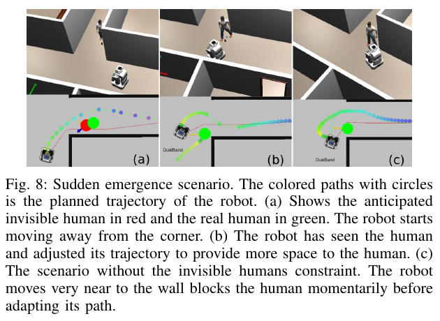
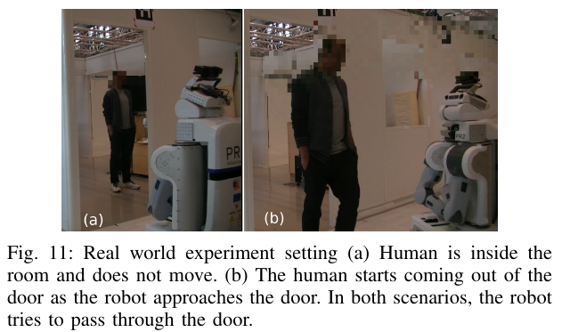

로봇 센서에 사람이 보이지 않는다는 사실은 주변에 사람이 없다는 뜻이 아니에요. 벽 모서리, 문틀, 가구 뒤에서는 사람이 로봇과 같은 지점으로 접근하고 있어도 가려져요. Watch out!은 이 문제를 사람 궤적 예측기의 정확도만 높이는 방식으로 풀지 않고, 현재 지도와 가시 영역의 경계에서 보이지 않는 사람이 나타날 만한 자리를 만들어 계획기에 넣어요.

## 지도 윤곽의 틈을 잠재적인 사람 위치로 바꿔요

방법은 로봇 주변 2차원 지도에서 레이저 스캔과 비슷한 가시 윤곽을 구성하는 데서 시작해요. 논문 설정의 전방 검출 반경은 5m예요. 윤곽선이 벽이나 장애물 때문에 끊기거나 방향이 급하게 바뀌는 지점을 찾아, 그 경계 너머에 <abbr title="현재 센서에는 보이지 않지만 가림 뒤에 있을 수 있다고 가정한 사람">가상 비가시 사람</abbr>을 놓아요. 실제 사람 검출 결과가 아니라 지도 기하가 만든 위험 가설이에요.

가상 사람은 아무 빈 공간에나 놓이지 않아요. 코너와 틈의 기하를 따라 가림 뒤에서 걸어 나올 수 있는 위치와 방향을 구성하고, 로봇 경로와 만날 가능성을 비용으로 전달해요. 이 정보는 CoHAN의 희소 그래프 계획기에 결합돼요. 계획기는 현재 보이는 사람뿐 아니라 가림 경계에서 등장할 수 있는 사람과의 거리도 고려해 속도와 경로를 고르게 돼요.

<figure class="fig"><figcaption>가림 뒤 사람을 미리 배치한 계획기는 코너에 접근하기 전에 더 큰 여유를 만들어요. (출처: Singamaneni et al., 2022, Fig. 8 · CC BY 4.0)</figcaption></figure>

이 접근은 실제 사람의 숨은 목표를 맞히려 하지 않아요. “사람이 이 위치에 있을 수 있다”는 보수적인 후보를 만들고, 사람이 반응할 시간과 멈출 수 있는 거리를 계획 비용에 반영해요. 논문은 사람 반응 시간 0.5초, 평균 보행 속도 1.3m/s, 최대 감속도 2.94m/s²를 사용해요. 이 값들은 위험 위치를 경로에서 얼마나 멀리 둘지 결정하는 기준이에요.

설명용 계산으로 1.3m/s로 걷는 사람이 0.5초 동안 반응하지 않으면 0.65m를 이동해요. 그 뒤 2.94m/s²로 일정하게 감속한다는 단순 가정에서 제동 거리는 (v^2/(2a)), 약 0.287m예요. 반응과 제동만 더해도 약 0.94m예요. 실제 사람은 일정 감속으로 움직이지 않고 방향도 바꾸므로 이 값은 논문 실측을 재현한 결과가 아니라, 반응 시간을 거리로 바꾸는 설명용 계산이에요.

## 보수적인 가정은 문을 막을 수 있어요

코너마다 가상 사람을 두면 안전 여유는 커지지만 좁은 통로에서는 지나갈 길 자체가 사라질 수 있어요. 문 양쪽 모서리에 가상 사람이 놓이고, 각 사람 주위의 회피 영역이 겹치면 계획기는 통과 가능한 해를 찾지 못해요. 논문은 이 정체를 별도 통로 판별과 저속 통과 규칙으로 다뤄요.

좁은 통로로 판별되면 비가시 사람 제약을 끄고 로봇 속도를 0.3m/s 이하로 제한해요. 즉 같은 위험 모델을 모든 기하에 강제하지 않아요. 넓은 코너에서는 가상 사람을 피해 미리 여유를 만들고, 문턱처럼 회피 여유가 없는 곳에서는 낮은 속도로 노출 시간을 관리해요. 안전 비용과 도달 가능성이 충돌하는 지점을 명시적인 모드 전환으로 처리한 선택이에요.

논문의 통로 판별에는 로봇 반지름 0.5m, 사람 반지름 0.3m와 함께 여러 거리 기준이 들어가요. 일반 통로 기준 3m, 양쪽이 비슷한 통로의 기준 2m, 벽에 가까운 통로의 기준 1m 미만 등 지도 기하를 분류하는 값이 사용돼요. (k=10), (alpha=0.2) 같은 조정값도 있어요. 이 수치는 모든 로봇과 건물에 그대로 옮기는 표준이 아니라 논문 시스템의 경험적 설정이에요.

설명용으로 폭 1.8m 문을 생각해 볼게요. 로봇 지름이 1.0m라면 기하학적으로 좌우 여유 합은 0.8m예요. 양쪽에 사람 반지름 0.3m를 그대로 예약하면 남는 폭은 0.2m뿐이라 로봇 지름보다 작아요. 가상 사람 제약을 유지한 최적화가 해를 잃는 이유를 보여주는 단순 계산이에요. 사람의 실제 위치나 논문 문 폭을 재현한 값은 아니에요.

## 보이지 않는 사람 검출과 통로 판별을 따로 봐야 해요

논문은 무작위로 만든 200개 시험에서 가상 비가시 사람 위치의 정확도를 평가해요. 기본 판정에서는 76.85%, 겹친 후보를 참으로 인정하는 판정에서는 89.16%를 보고해요. 같은 결과가 판정 정의에 따라 12.31%포인트 달라져요. 후보가 실제 가림 위험을 얼마나 잘 대표하는지 볼 때 참·거짓의 공간 허용 범위를 함께 공개해야 하는 이유예요.

통로 판별 결과는 62.5%가 올바른 검출이고 23.5%가 놓친 사례예요. 나머지 오류에는 통로가 아닌 곳을 통로로 보는 경우 등이 포함돼요. 이 수치는 가상 사람 배치가 정확하다는 결과와 다른 문제예요. 코너 후보를 잘 찾아도 통로 모드 전환을 놓치면 로봇이 멈출 수 있고, 통로를 과하게 검출하면 넓은 공간에서도 제약을 끄고 저속으로 움직일 수 있어요.

재현 시험에서는 두 혼동 행렬을 분리해야 해요. 첫 표는 “가림 뒤 위험 위치가 있는가”에 대한 참양성·거짓양성·거짓음성이에요. 둘째 표는 “현재 기하가 저속 통로 모드를 요구하는가”에 대한 같은 값이에요. 최종 주행 성공률 하나로 합치면, 가상 사람의 오검출과 모드 전환 실패가 서로 가려져요.

2차원 지도와 센서 높이의 차이도 오검출을 만들어요. 베이스 높이에서는 막혀 있지만 사람 상체는 보이는 구조, 반대로 지도에는 빈 공간인데 의자나 유리 때문에 센서가 가려지는 구조가 있어요. 논문도 복잡한 지도와 2차원 표현의 한계를 지적해요. 지도의 장애물 윤곽이 곧 사람 눈높이의 가시성이라고 가정하면 안 돼요.

이를 시험하려면 같은 평면 지도에 높이만 다른 장애물을 배치해요. 낮은 상자, 테이블 상판, 투명 유리, 열린 문짝처럼 2차원 점유와 사람 가시성이 어긋나는 물체를 따로 두고 가상 사람 후보 수를 기록해요. 후보가 늘어난 경우에는 로봇 정체와 최저 속도까지 함께 봐야 해요. 이 시험은 논문 수치를 재현하는 것이 아니라 적용 조건이 깨지는 지점을 찾는 설계예요.

## 최소 거리 증가는 안전성과 보수성을 함께 보여요

벽 뒤에서 사람이 갑자기 나타나는 시나리오를 각 방법마다 5회 반복했을 때, 평균 최소 거리는 SMB 0.584m, CoHAN 0.922m, 제안 제약 방법 1.247m예요. 제안 방법이 기본 CoHAN보다 평균 0.325m 더 큰 여유를 만들어요. 가림 위치를 미리 비용에 넣는 효과가 실제 거리로 나타난 결과예요.

최소 거리 하나만으로 전체 품질을 판단할 수는 없어요. 경로를 크게 우회하거나 오래 멈춰도 최소 거리는 늘어나요. 논문의 핵심 위험은 갑작스러운 등장과 충돌 여유이므로 최소 거리가 중요한 지표지만, 적용 검증에는 목표 도달 시간, 정지 지속 시간, 통로 통과 성공률, 사람 앞에서 되돌아가는 횟수도 필요해요. 넓은 거리를 만든 원인이 예측인지 단순 정지인지 구분해야 해요.

설명용으로 기본 계획기가 12초에 통과하면서 최소 거리 0.9m, 제약 계획기가 25초에 통과하면서 1.2m를 기록했다고 해볼게요. 후자는 거리 지표에서는 좋아도 통행 방해와 임무 지연이 커요. 반대로 13초에 1.2m라면 같은 거리 증가의 의미가 달라져요. 따라서 거리와 시간을 두 축으로 그려야 보수성의 비용이 보여요.

통계 해석에도 주의가 필요해요. 실물 거리 비교가 방법당 5회라면 한 번의 사람 출발 시각과 보행 속도가 평균에 큰 영향을 줄 수 있어요. 반복 원자료가 없으면 분산과 최악값을 알기 어려워요. 재현에서는 사람 등장 시각, 속도, 문에서의 횡방향 위치를 미리 정한 격자로 반복하고, 각 셀의 최솟값과 실패를 남기는 편이 좋아요.

## 실물 PR2 시험은 모드 전환의 목적을 보여줘요

실물 시험에서는 PR2가 문을 통과하고, 가림 뒤의 사람이 나타나는 상황을 다뤄요. 넓은 코너와 달리 문턱에서는 피할 횡방향 공간이 거의 없어요. 비가시 사람 제약을 계속 적용하면 로봇이 문 앞에서 멈추므로, 통로로 판단한 구간에서 제약을 풀고 속도를 제한해 통과해요.

<figure class="fig"><figcaption>좁은 문에서는 가상 사람 회피 제약 대신 0.3m/s 이하의 속도 제한으로 노출 위험을 줄여요. (출처: Singamaneni et al., 2022, Fig. 11 · CC BY 4.0)</figcaption></figure>

이 전환에는 두 가지 실패 방향이 있어요. 통로인데 일반 코너로 보면 로봇이 멈추고, 일반 코너인데 통로로 보면 가상 사람 제약이 너무 일찍 사라져요. 전자는 가용성 실패, 후자는 안전 여유 감소예요. 분류 임계값을 조정할 때 성공률만 최대화하면 둘 중 하나가 숨으므로 각 비용을 다르게 두어야 해요.

속도 제한도 정지 거리와 제어 주기에 맞춰 검증해야 해요. 설명용으로 0.3m/s에서 전체 지연이 0.3초면 반응 동안 0.09m를 움직여요. 최대 감속을 1.0m/s²로 보수적으로 가정하면 제동 거리는 0.045m라 합계 약 0.135m예요. 센서 사각에서 사람이 드러나는 거리보다 이 값과 로봇·사람 반지름 합이 작아야 제동 여유가 생겨요. 이 수치는 논문 로봇의 측정값이 아니라 현장 검증식을 보이는 설명용 가정이에요.

ROS 통합에서는 지도 갱신 주기와 계획 주기도 중요해요. 문이 열리거나 이동 장애물이 생겼는데 정적 지도 윤곽만 사용하면 가상 사람 후보가 오래된 기하에 남을 수 있어요. 레이저 기반 윤곽과 전역 지도, 지역 비용지도의 시각이 다르면 통로 판정과 경로 최적화가 서로 다른 장면을 볼 수 있어요. 각 입력의 타임스탬프와 프레임을 기록하고 오래된 후보를 폐기하는 규칙이 필요해요.

## 가상 사람은 확률 예측이 아니라 위험 가설이에요

가상 사람 하나를 만들었다고 그 자리에 사람이 있을 확률이 계산된 것은 아니에요. 지도 모서리에서 등장 가능한 대표 위치를 만든 것이고, 후보 수와 배치 규칙은 지도 복잡도에 따라 달라져요. 확률로 해석하려면 후보 생성의 오검출률, 공간별 사람 출현 빈도, 시간대 같은 추가 자료가 필요해요.

후보를 너무 많이 만들면 로봇은 넓은 공간에서도 느려지거나 멈춰요. 후보를 너무 적게 만들면 복잡한 코너에서 위험을 놓쳐요. 이 균형은 지도별로 후보 밀도, 계획 시간, 정지율을 함께 그리면 보여요. 설명용으로 후보가 5개에서 20개로 늘 때 최적화 시간이 네 배가 되는지는 구현에 따라 다르지만, 각 후보가 비용과 제약 평가를 추가한다는 방향은 분명해요. 평균 주기뿐 아니라 최악 주기를 재야 급한 코너에서 명령이 늦는 문제를 찾을 수 있어요.

사람 행동도 논문의 상수에서 벗어날 수 있어요. 어린이처럼 낮고 빠르게 움직이는 사람, 달리는 사람, 휠체어나 카트를 미는 사람은 평균 1.3m/s와 반지름 0.3m 가정에 잘 맞지 않을 수 있어요. 반응 시간 0.5초도 시선과 주의 상태에 따라 달라져요. 배포 설정에서는 단일 평균만 두기보다 속도·반응 시간 범위를 바꿔 정지 거리 여유가 언제 사라지는지 확인해야 해요.

## 지도 오차가 후보 위치에 미치는 영향을 재야 해요

가상 사람 후보는 지도 윤곽에서 나오므로 로봇 위치가 흔들리면 후보도 로봇 기준으로 흔들려요. 벽 모서리가 지도에서 10cm 어긋나고 위치 추정이 다시 15cm 밀리면, 두 오차의 방향에 따라 가림 경계가 수십 cm 이동할 수 있어요. 후보 위치만 보정 없이 계획기에 넣으면 사람이 실제로 나오는 쪽보다 반대쪽 여유를 키울 수도 있어요. 지도 오차와 위치 추정 오차를 위험 반경에 포함하거나, 최소한 민감도 시험으로 여유를 정해야 해요.

설명용으로 모서리 위치의 표준편차를 0.10m, 로봇 위치의 표준편차를 0.15m라고 하고 서로 독립인 단순 가정을 두면 합성 표준편차는 제곱합의 제곱근인 약 0.18m예요. 여기에 사람 검출·제어 지연의 이동 거리가 더해질 수 있어요. 이 값은 논문 환경의 측정치가 아니라, 0.1m 단위 지도 오차를 무시하기 어렵다는 점을 보여주는 계산이에요.

시험은 정확한 지도 하나와 일부러 변형한 지도 여러 개로 반복할 수 있어요. 벽 모서리를 x·y 방향으로 5·10·20cm씩 옮기고, 문 폭을 같은 양만큼 넓히거나 좁혀요. 각 지도에서 후보의 수와 위치, 통로 판정, 계획 성공, 실제 장애물 최소 거리를 기록해요. 작은 지도 변화가 모드 전환을 자주 뒤집으면 임계값 부근에 히스테리시스나 불확실성 여유가 필요해요.

열린 문과 닫힌 문이 바뀌는 환경에서는 정적 지도만으로 부족해요. 문이 닫힌 지도에서 문이 열리면 통로가 계속 막힌 것으로 보이고, 열린 지도에서 문이 닫히면 존재하지 않는 통로를 계획할 수 있어요. 지역 센서 윤곽을 사용하더라도 전역 계획기의 점유 상태와 후보 생성기의 윤곽이 같은 시각을 가리키는지 확인해야 해요. 서로 다른 지도를 보는 경우에는 후보 생성 결과에 지도 버전이나 시각을 붙여 추적하는 편이 안전해요.

## 행동 전환 경계에서 출렁임을 확인해요

문 폭 측정값이 임계값 주변에서 노이즈를 가지면 일반 모드와 통로 모드가 프레임마다 바뀔 수 있어요. 한 프레임에서는 가상 사람 제약 때문에 정지하고 다음 프레임에서는 제약이 꺼져 전진하면 속도 명령이 출렁여요. 통로 진입 기준과 이탈 기준을 다르게 두는 히스테리시스, 최소 유지 시간, 진행 방향 조건으로 이런 전환을 줄일 수 있어요.

설명용으로 판별 폭이 2.00m 기준이고 측정값이 1.96, 2.03, 1.98, 2.04m로 흔들린다고 해볼게요. 단일 임계값만 쓰면 네 번의 관측에서 모드가 세 번 바뀔 수 있어요. 진입을 1.95m 이하, 이탈을 2.05m 이상으로 정하면 이 구간에서는 기존 모드를 유지해요. 구체 임계값은 로봇 폭과 지도 오차로 다시 정해야 하며, 이 예는 전환 논리를 설명하기 위한 값이에요.

모드가 바뀔 때 비용함수만 갑자기 교체하면 경로도 불연속적으로 변할 수 있어요. 전환 전후 후보 경로의 곡률, 속도, 가속도를 로그로 비교하고 제어기가 따라갈 수 있는 범위인지 확인해야 해요. 정지 명령과 전진 명령이 짧게 반복되는 경우에는 목표 도달 성공만으로 문제가 드러나지 않아요. 속도 부호 변화 횟수와 단위 시간당 가속도 변화량을 함께 기록하면 승차감과 기계 부담까지 볼 수 있어요.

## 사람 없는 반복도 반드시 포함해야 해요

가림 위험을 다루는 방법은 사람이 실제로 나타난 시험에 집중하기 쉬워요. 하지만 대부분의 코너에서 사람이 나타나지 않는다면 거짓 가설이 누적시키는 지연이 전체 운용 품질을 결정해요. 사람 없는 코너, 한 명이 등장하는 코너, 두 사람이 연달아 등장하는 코너를 같은 경로에서 섞고, 어떤 조건인지 계획기에는 알려주지 않아야 해요.

사람 없는 100회에서 매번 1초씩 감속하면 충돌 지표에는 나타나지 않지만 총 100초의 지연이 생겨요. 설명용 수치지만 보수성의 누적 비용을 보여줘요. 반대로 감속을 줄이다 한 번의 빠른 등장에 여유를 잃으면 평균 시간은 좋아도 위험 꼬리가 커져요. 사람 출현 빈도별로 시간 손실과 최소 거리 하위 백분위를 함께 제시해야 운용 지점을 고를 수 있어요.

거짓양성 후보가 특정 지도 형태에 몰리는지도 확인해야 해요. 기둥이 많은 곳, 유리벽, 열린 선반, 의자가 밀집한 곳을 구역으로 나누고 단위 이동 거리당 후보 수와 저속 모드 시간을 계산해요. 한 구역에서만 값이 치솟는다면 전체 임계값을 느슨하게 하기보다 해당 지도의 표현이나 높이 정보를 고치는 편이 맞아요. 이는 위험 모델의 보수성을 유지하면서 불필요한 정체를 줄이는 방법이에요.

Watch out!의 기여는 보이지 않는 사람의 정확한 궤적을 맞힌 데 있지 않아요. 지도 윤곽에서 위험 가설을 만들고, 넓은 코너에서는 그 가설을 계획 제약으로 쓰며, 좁은 문에서는 저속 모드로 전환한 시스템 설계에 있어요. 효과를 옮길 때는 가상 사람 검출, 통로 판별, 속도 제한, 지도와 센서 높이 차이를 각각 검증해야 해요. 그래야 더 큰 최소 거리가 실제 예측 개선에서 왔는지, 단순 정지에서 왔는지 구분할 수 있어요.

가림 경계에서 위험 후보를 먼저 만드는 이 방식은 관측된 사람의 미래 궤적을 입력으로 받는 [[2026-10-17_socialnav_human-mpc|HuMAN-MPC가 사람 예측과 실행 가능성을 함께 본 방법]]과 출발점이 달라요. 두 방법을 한 시스템에 넣는다면 가상 사람과 실제 추적 사람을 중복 장애물로 세지 않고, 후보가 실제 검출로 바뀌는 순간의 ID와 비용 전환을 명시해야 해요.

---
<!-- src-block -->
출처 — https://arxiv.org/abs/2211.12216
