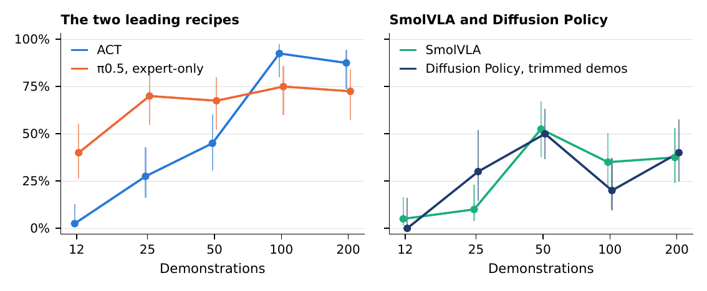

저가 로봇팔에서 모방학습을 시작할 때 가장 먼저 나오는 질문은 시연을 몇 개 모아야 하는지와 어떤 정책을 골라야 하는지예요. 하지만 서로 다른 로봇, 과제, 데이터 규모에서 나온 논문 수치를 한 줄로 놓으면 답이 흐려집니다. Simon Cowling의 연구는 같은 <abbr title="팔 관절 다섯 개와 그리퍼로 구성된 교육·연구용 저가 로봇팔">SO-101</abbr> 한 대와 하나의 공 옮기기 과제에서 시연 수를 12개부터 200개까지 늘려 비교했습니다. 물체 배치는 통제했지만 학습 반복량과 평가 조명까지 같았던 것은 아니어서, 시연 수·학습 레시피·실패 단계를 나눠 읽어야 합니다.

논문은 초록 공을 바구니에 넣되 빨간 공 두 개는 무시하는 과제를 썼습니다. 원격 조작으로 모은 225개 시연 가운데 25개는 보류하고, 남은 자료에서 12·25·50·100·200개가 차례로 포함되는 중첩 묶음을 만들었어요. 주 비교 1,070회와 보조 실험 270회를 합쳐 총 1,340회를 평가했습니다. 성공 여부에 더해 팔의 출발, 집게 사이에 공이 들어왔는지, 그 상태를 유지했는지, 바구니에 놓았는지를 관절과 카메라 기록으로 나눠 봤습니다.

중첩 묶음은 큰 데이터셋 안에 작은 데이터셋이 그대로 포함되는 구성입니다. 12개에서 25개로 늘릴 때 기존 시연을 교체하지 않고 새 시연을 더하므로, 자료를 바꾸면서 난이도까지 달라지는 문제를 줄입니다. 연구자는 25개씩 아홉 차례 모은 자료에서 보류분을 나누고, 학습에 쓸 묶음과 추출 난수를 한 번 고정했습니다. 같은 시연 수의 모든 정책이 같은 자료를 보게 한 통제예요. 다만 12개를 뽑는 조합 자체를 여러 번 바꾼 실험은 아니므로, 모든 작은 시연 묶음에서도 같은 곡선이 나온다는 뜻은 아닙니다.

네 정책을 여섯 레시피로 나눈 것도 비교의 일부입니다. 시작의 정지 구간을 남긴 자료와 잘라 낸 자료를 비교하는 정책이 있었고, 모델 일부에 작은 보정값을 학습하는 방식과 행동 생성부를 넓게 학습하는 방식을 비교하는 정책도 있었습니다. 따라서 여섯 레시피의 차이를 모두 모델 구조의 차이로 읽으면 안 됩니다. 같은 모델도 데이터 전처리와 학습할 가중치의 범위에 따라 다른 결과를 낼 수 있도록 구성한 실험이에요.

## 시연 수는 정책마다 다른 곡선을 만들었어요

<abbr title="시연에서 관절 움직임의 연속 구간을 예측하도록 학습하는 로봇 조작 정책">ACT</abbr>는 적은 자료에서는 거의 동작하지 않았지만, 시연이 늘수록 가파르게 좋아졌습니다. 12개 시연에서는 40회 중 1회, 50개에서는 18회, 100개에서는 37회 성공했어요. 200개에서 35회로 약간 낮아졌지만 통계적으로 100개와의 차이를 확정할 수는 없었습니다. 이 설정에서는 처음부터 학습한 ACT가 약 100개 시연에서 93% 성공률에 닿았다는 뜻입니다.

반대로 <abbr title="시각과 언어 지시를 바탕으로 로봇 행동을 만드는 사전학습 정책">π0.5</abbr>는 행동을 만드는 부분만 학습한 레시피에서 적은 자료에 강했습니다. 12개에서 16/40, 25개에서 28/40으로 ACT보다 앞섰고, 그 뒤에는 50·100·200개에서 각각 27·30·29/40으로 70% 안팎에 머물렀습니다. 12개나 25개 같은 작은 묶음에서는 사전학습 표현의 이점이 분명했지만, 100개 이상에서 ACT가 앞선 차이는 40회 평가만으로 단정할 만큼 크지 않았습니다.

이 곡선을 “100개면 ACT, 25개면 π0.5”라는 규칙으로 옮기면 논문 범위를 벗어납니다. 한 과제와 한 대의 팔에서, 레시피별로 정해 둔 학습 설정을 사용한 결과이기 때문이에요. 더구나 각 레시피 안에서는 데이터 규모가 달라도 학습 스텝 수를 고정했으므로, 200개를 쓴 모델은 12개를 쓴 모델보다 각 프레임을 훨씬 적게 반복해서 봤습니다. 100개와 200개 사이의 정체가 데이터의 한계인지, 학습이 덜 됐기 때문인지는 이 실험만으로 구분할 수 없습니다.

## 같은 표에서 비교할 수 있는 것과 없는 것

이 실험의 비교 조건은 생각보다 촘촘합니다. 같은 데이터 규모에서는 같은 시연 묶음을 썼고, 모든 정책이 같은 열 개 물체 배치를 만났습니다. 성공도 시작 뒤 30초 안에 초록 공이 바구니 안에 있는지로 고정했습니다. 이런 통제가 있어야 “25개 시연에서 두 정책이 얼마나 달랐는가”처럼 같은 행의 수치를 읽을 수 있어요. 정책마다 과제나 물체 위치가 달랐다면 성공률 차이는 데이터 크기와 난이도가 섞여 버립니다.

반면 표의 모든 행이 완벽한 동시 비교는 아닙니다. ACT와 π0.5의 차이는 100개 시연에서 약 18%포인트, 200개에서 15%포인트였지만, 논문은 이 차이를 확정하지 못했다고 적습니다. 조명과 평가 날짜도 완전히 같지 않았습니다. 연구자는 비교에 쓰인 실제 환경을 남겼고, 밝은 조도에서 다시 돌려 조명 변화가 특히 <abbr title="잡음에서 행동 순서를 조금씩 복원해 로봇 명령을 만드는 정책">Diffusion Policy</abbr>의 시작 여부에 미치는 영향도 확인했습니다. 수치가 좋거나 나쁘다는 결론과, 그 수치가 어떤 조건에서 나왔는지를 한 문장에 함께 붙여야 하는 이유입니다.

자료 수와 학습 시간도 한 덩어리로 읽으면 안 됩니다. ACT와 Diffusion Policy는 100,000스텝, <abbr title="작은 시각·언어 모델을 로봇 행동 생성기에 연결한 정책">SmolVLA</abbr>는 20,000스텝, π0.5는 6,000스텝을 사용했습니다. 같은 정책 안에서 스텝과 한 번에 읽는 자료 수를 유지한 채 데이터셋만 늘리면, 개별 프레임이 반복해서 선택되는 횟수가 줄어요. 원문이 계산한 ACT의 데이터 전체 반복 횟수는 12개 시연에서 약 130회, 200개에서 7.8회였습니다. π0.5도 약 31회에서 1.9회로 줄었습니다. 시연 수집에 돈과 시간이 더 들었다는 사실만으로 학습량까지 충분해졌다고 볼 수 없는 이유입니다.

이 수치는 논문이 특정 정책에 유리한 학습 시간을 공정하게 찾아 줬다는 뜻도 아닙니다. 레시피마다 최적의 스텝 수를 다시 탐색하지 않았고, 마지막 학습 상태를 평가했습니다. 따라서 이 실험으로 답할 수 있는 질문은 “정해 둔 레시피에서 자료를 늘렸을 때 어떻게 달라졌는가”예요. 자료량의 효과만 분리하려면 데이터셋을 반복해 보는 횟수를 맞춘 비교를 추가하고, 실무 비용을 비교하려면 학습 시간과 실행 속도도 따로 남겨야 합니다.

## 성공률보다 먼저 실패가 어디서 시작하는지 봐야 해요

같은 성공률 변화도 원인이 다를 수 있습니다. Diffusion Policy는 원래 시연의 시작 부분에 사람이 아직 팔을 움직이지 않는 구간이 남아 있을 때 110회 중 106회가 아예 출발하지 않았습니다. 논문은 같은 시연에서 시작의 정지 구간 중앙값 2.8초를 잘라 17.4%의 프레임을 덜어 낸 묶음도 만들었습니다. 이 자료는 정지 구간을 자른 Diffusion Policy에만 썼습니다. 그 레시피에서는 시작 실패가 150회 중 15회로 줄었고, 성공은 3/110에서 49/150으로 바뀌었습니다.

정지 구간을 다르게 처리한 레시피 사이에 큰 차이가 관찰됐지만, 학습 난수와 평가 날짜까지 완전히 맞춘 비교는 아니었습니다. 또 모든 정책이 정지 구간 때문에 실패한다고 일반화할 수는 없어요. 같은 원본 시연을 쓴 ACT와 π0.5는 세 레시피를 합쳐 610회 모두 출발했습니다. 이 결과는 특정 정책의 시작 실패를 자료의 첫 구간과 함께 진단할 이유를 주지만, 모든 정책의 시연에서 정지 구간을 삭제하라는 근거는 아닙니다.

SmolVLA도 비슷하게 200회 중 94회가 시작하지 못했습니다. 다만 일단 출발한 회차만 따로 보면 50개 이후 성공률은 66%·61%·71%였어요. 전체 성공률의 하락을 잡기 동작의 품질 저하로 읽으면 잘못된 판단이 됩니다. 출발 여부, 목표물 도달, 파지, 배치의 순서로 나눈 기록이 있어야 어느 단계가 바뀌었는지 보입니다.

<figure class="fig"><figcaption>같은 공 옮기기 과제에서도 ACT는 시연 수에 따라 급격히 상승하고, π0.5는 적은 시연에서 먼저 높은 성능에 닿은 뒤 완만해집니다. SmolVLA와 Diffusion Policy의 하락은 단순한 데이터 부족만으로 읽기 어렵습니다. (출처: Simon Cowling, “From 12 to 200 Demonstrations: How ACT, Diffusion Policy, SmolVLA and π0.5 Scale on a Low-Cost Arm”, Fig. 3, CC BY 4.0, https://arxiv.org/abs/2610.37170; PNG 변환)</figcaption></figure>

π0.5의 경우에는 다른 문제가 드러납니다. 행동 생성부를 학습한 레시피의 200회 가운데, 그리퍼가 닫힐 때 공이 집게 사이에 있던 회차는 177회였고 그 상태를 2초 이상 유지한 회차는 135회, 최종 성공은 130회였습니다. 공을 집게 사이에 넣는 데 성공해도 파지를 유지하는 과정에서 실패가 남은 것입니다. 반면 <abbr title="큰 모델의 일부 연결만 적은 수의 추가 값으로 바꾸는 미세조정 방식">LoRA</abbr> 레시피의 성공은 110회 중 4회였습니다. 행동 생성부 전체 학습 레시피에서는 시각·언어 처리부를 고정하고 행동 생성부 전체를 학습했습니다. 이 설정에서는 시연 수와 함께 학습할 가중치의 범위도 결과를 크게 바꿨습니다.

다만 이 레시피를 고르는 과정도 해석에 넣어야 합니다. 연구자는 100개 시연 조건의 예비 평가 열 번에서 좋은 결과를 본 뒤 행동 생성부 학습을 본격 비교에 넣었습니다. 레시피 선택에 평가 과제의 정보가 이미 쓰였으므로, 그 과제를 전혀 보지 않고 고른 설정과 같은 의미의 성능은 아닙니다. 두 학습 방식의 차이는 후속 실험의 유력한 질문이지만, 새로운 과제에서도 같은 폭으로 좋아진다고 약속하는 값은 아니에요.

## 실패 단계의 이름보다 판정 조건을 먼저 고정해요

이 논문의 출발은 팔이 조금이라도 움직였다는 뜻이 아닙니다. 시작 위치에서 관절 하나 이상이 60도 이상 이동해야 출발로 셌습니다. 공 도달도 그리퍼와 공 사이 거리가 가까웠다는 뜻이 아니라, 그리퍼를 닫을 때 손목 카메라에서 공이 집게 사이에 잡혔다는 조건입니다. 이어 그 상태를 2초 이상 유지하면 운반 단계로, 30초 안에 바구니에 넣으면 배치 성공으로 셌습니다. 각 단계는 뒤 단계까지 간 회차를 함께 포함하므로 단계별 숫자를 더하면 전체 회차가 되지는 않습니다.

시간 제한도 판정의 일부입니다. 정책이 행동 묶음을 새로 계산할 때 대기하는 구조였고, 주 비교에는 계산을 미리 겹쳐 수행하는 방식이 쓰이지 않았습니다. 움직임을 시작한 SmolVLA 회차 가운데 약 10%는 처음 20도 움직이기까지 16초 넘게 걸렸어요. 앞의 60도 출발 판정과 구분해 측정한 시작 지연입니다. 30초 제한 안에서는 늦게 출발한 정책이 물체를 옮길 시간도 줄어듭니다. 미출발과 늦은 출발을 구분해야 조작 능력과 실행 지연을 혼동하지 않습니다.

반대로 실패 유형은 각 회차를 나누는 분류입니다. 전체 1,340회에서 성공은 463회, 미출발은 282회, 공을 물지 않은 채 집게를 닫은 위치 실패는 259회, 물고 난 뒤 공을 놓친 파지 실패는 161회였습니다. 나머지는 충돌 127회와 기타 48회였어요. 전체 실패를 하나의 점수로 묶으면 팔이 움직이지 않는 문제와 접촉 뒤 물체를 놓치는 문제가 섞입니다. 다음 시연을 어느 구간에서 모을지 정하려면 성공률 옆에 이런 판정 조건과 실패 분류를 함께 둬야 합니다.

## 열 번의 성공률만으로는 판정을 고정하기 어려워요

로봇팔 평가는 시간이 많이 들기 때문에 열 회 정도만 돌리고 결론을 내리기 쉽습니다. 이 연구는 같은 체크포인트, 즉 저장된 같은 학습 상태를 같은 열 개 물체 배치에서 다시 평가한 열두 쌍을 비교했습니다. 두 평가의 성공 횟수는 열 회 중 평균 두 회 차이 났습니다. 논문은 40회로 이뤄진 한 칸의 전형적인 95% 신뢰구간을 약 ±15%포인트로 제시했습니다. 실제 구간 폭은 성공률에 따라 달라집니다. 따라서 10회 가운데 한두 번의 차이나, 40회 기준 10%포인트 안팎의 차이를 정책의 확실한 우열로 부르기 어렵습니다.

논문은 자료 양의 비교에서 물체 배치와 학습 난수도 분리하려 했습니다. 같은 묶음에서 학습 난수를 달리한 모델을 비교했지만, 계획한 네 개 난수를 모두 채운 것은 ACT와 SmolVLA뿐이었습니다. 다른 레시피에는 더 적은 난수와 중단된 조건이 있어, 정책별 수치를 같은 규모로 반복한 결과로 읽으면 안 됩니다. 조명도 완전히 같지 않았습니다. 주 비교의 카메라 앞 조도는 117–394럭스였고, 시연을 모은 상태에 맞춘 밝은 조건은 508–725럭스였습니다. 특히 Diffusion Policy는 밝은 조도에서 출발이 일부 늘었지만, 정지 구간을 자른 레시피의 차이보다 작았습니다.

성공 여부를 붙이는 작업에도 오류가 있었습니다. 한 작업자가 정책 종류를 아는 상태에서 현장 채점을 했고, 이후 관절 기록과 두 카메라 영상으로 대조하자 27회, 전체의 2.0%에서 판정이나 실패 종류가 바뀌었습니다. 성공으로 셌던 16회는 실패로, 실패로 셌던 6회는 성공으로 수정돼 최종 성공 수가 473회에서 463회가 됐어요. 기록을 남기지 않았다면 이런 차이는 모델 성능으로 굳어졌을 것입니다. 다만 영상의 색으로 공 위치를 판정한 자동 지표도 별도 표본을 뽑아 육안 대조한 것은 아니어서, 보조 지표가 무오류라는 뜻은 아닙니다.

각 평가 회차의 단계별 결과에 시작 시각·조명·물체 배치·학습 상태를 붙여 두면, 성공률이 떨어졌을 때 데이터 수집과 전처리 중 무엇을 고칠지 판단할 수 있어요.

## 지금 작업과 만나는 지점

이 논문은 저가 로봇팔 모방학습에서 시연을 늘리거나, 그 평가 방식을 양팔 조작 실험에 옮길 때 참고할 수 있습니다. 저가 팔에서 시연 수를 늘릴 때 전체 성공률만 비교하지 않고, 시작·도달·파지·배치의 단계별 결과와 촬영 조건을 함께 남기는 방법이 핵심이에요. 바로 시험해 볼 수 있는 범위는 새 정책을 고르는 일이 아니라, 현재 또는 다음 시연 데이터에 시작 정지 구간이 얼마나 있는지 확인하고, 평가 기록을 네 단계로 나누는 일입니다. 그 기록이 있어야 시연을 더 모을지, 정지 구간을 다듬을지, 파지와 접촉 조건을 바꿀지의 판단 근거가 생깁니다.

논문의 강점은 작은 규모의 실제 로봇 실험에서도 비교 조건과 실패 기록을 함께 공개했다는 점입니다. 동시에 한 대의 SO-101, 하나의 공 옮기기 과제, 한 작업자의 시연이라는 좁은 범위를 분명히 적었습니다. 이 결과를 정책 추천표로 가져오기보다, 저가 조작 실험에서 무엇을 기록해야 다음 번 비교가 가능한지 보여 주는 평가 설계로 읽는 편이 맞습니다.

---
<!-- src-block -->
출처 — https://arxiv.org/abs/2610.37170
