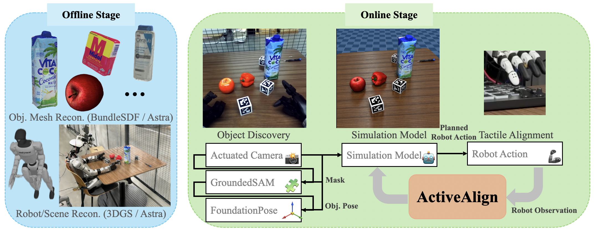
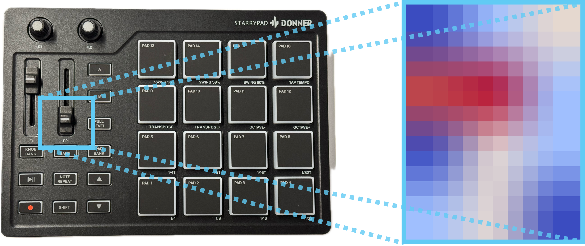

카메라로 본 물체 위치가 로봇 좌표계와 맞아 보인다고 해서, 그 위치에 손끝을 정확히 보낼 수 있는 것은 아닙니다. 카메라가 달린 위치, 관절각으로 계산한 손끝 위치, 깊이 추정, 물체 자세 추정에는 각각 작은 오차가 남습니다. 큰 물체를 집는 작업에서는 그 오차가 눈에 잘 띄지 않을 수 있지만, 작은 버튼을 누르거나 짧은 슬라이더를 움직일 때는 몇 밀리미터가 실패로 이어질 수 있어요.

ActiveAlign은 이 문제를 한 번의 정적 보정으로 끝내지 않습니다. 카메라가 보는 로봇을 여러 자세에서 모아 <abbr title="카메라 좌표와 로봇 기준 좌표 사이의 위치·방향 관계를 맞추는 작업">핸드아이 보정</abbr>을 갱신하고, 물체 근처에서는 손끝 접촉으로 높이 차이를 다시 확인합니다. 논문의 핵심은 시각과 접촉 중 하나를 더 정확한 센서로 선언하는 데 있지 않아요. 오차가 쌓이는 위치에 맞춰 관측 행동을 추가하고, 그 결과를 다음 조작 좌표에 반영하는 순서에 있습니다.

## 한 장면의 그럴듯한 정렬은 좌표 일치를 보장하지 않아요

로봇 조작의 좌표 변환에는 보통 카메라 내부 파라미터, 카메라와 로봇 기준 좌표계 사이의 외부 파라미터, 관절각에서 손끝 자세를 계산하는 기구학 모델이 함께 들어갑니다. 이 가운데 하나만 어긋나도 카메라 화면의 물체 중심은 맞아 보여도 로봇 기준의 목표점은 빗나갈 수 있어요. 머리나 가슴에 달린 카메라는 팔 전체가 아니라 손과 팔 일부만 보는 경우가 많아서, 한 프레임만으로 카메라 자세를 맞출 때 서로 다른 해가 비슷하게 보이는 문제가 더 커집니다.

논문은 기존 로봇 모델과 깊이 관측을 맞추는 방식에서 출발합니다. 배경을 제외한 깊이 영상과 렌더링한 로봇 깊이 영상의 차이가 작아지도록 카메라 위치와 방향을 찾습니다. 그러나 긴 관절 사슬의 작은 기구학 오차, 기어 유격, 가려짐이 함께 있으면 한 장면에서 맞춘 값이 다른 자세에서도 맞는다고 보기 어렵습니다. 물체 자세를 추정하는 단계까지 뒤에 붙으면, 앞 단계의 작은 차이가 마지막 손끝 위치에서 합쳐집니다.

그래서 ActiveAlign-Waving은 손을 여러 자세로 움직여 같은 카메라가 서로 다른 로봇 형상을 보게 합니다. 각 자세의 깊이 영상과 그때의 로봇 자세를 함께 써서 하나의 카메라 파라미터를 찾습니다. 새 카메라를 어디에 둘지 탐색하는 문제라기보다, 조작에 필요한 손끝 부근이 잘 보이도록 자세 표본을 모아 보정 문제의 모호함을 줄이는 방식이에요. 이미 수집한 시연이라면 연속 궤적 안에서 움직임이 적은 구간을 여러 관측으로 사용할 수도 있습니다.

<figure class="fig"><figcaption>오프라인에서 장면과 로봇 모델을 준비하고, 온라인에서 카메라 관측과 로봇 행동을 다시 연결하는 원문 Figure 2입니다. 가운데 순환 경로는 한 번 만든 좌표계를 고정하지 않고 관측으로 시뮬레이션 모델을 갱신하는 구성을 보여 줍니다. (출처: Qiu et al., “ActiveAlign: Aligning Egocentric Manipulation via Active Perception”, Fig. 2, CC BY-NC-SA 4.0, https://arxiv.org/abs/2610.36859; PNG 원본 재배포)</figcaption></figure>

## 여러 자세를 모으면 보정값의 흔들림을 볼 수 있어요

연구진은 공개 조작 데이터셋 세 종류에서 렌더링한 로봇 마스크와 실제 로봇 마스크의 겹침 정도를 비교했습니다. <abbr title="두 영역이 겹치는 비율로 모양의 일치 정도를 나타내는 값">IoU</abbr>가 높을수록 두 마스크가 더 겹칩니다. 고정된 로봇 모델의 카메라 값, 한 장면만 쓰는 최적화, 여러 자세를 쓰는 방법을 나란히 비교했고, 서로 다른 궤적에서 계산한 카메라 중심이 얼마나 흩어지는지도 함께 기록했습니다.

Mobile ALOHA에서는 한 장면 최적화의 IoU가 0.290±0.130, 카메라 중심 분산이 218.0mm였고, 여러 관측을 쓰는 방법은 0.722±0.056과 44.9mm였습니다. Humanoid Everyday G1에서도 한 장면 방법은 0.372±0.178과 85.0mm, 제안 방법은 0.608±0.141과 64.7mm로 보고됐습니다. 이 숫자는 카메라의 절대 위치 오차를 재는 값이 아니라, 로봇 마스크 겹침과 추정한 카메라 중심의 궤적 간 퍼짐입니다. 따라서 이 결과만으로 모든 카메라 장착에서 밀리미터 정확도를 보장한다고 말할 수는 없습니다.

그럼에도 두 지표를 함께 둔 점은 중요합니다. 한 장면에서 겹침이 좋더라도 다른 궤적에서 카메라 중심이 크게 달라지면, 다음 작업의 좌표 변환은 불안정할 수 있습니다. 반대로 중심 퍼짐만 작고 마스크가 맞지 않으면 로봇 형상이나 장면 모델을 충분히 설명하지 못했을 수 있어요. 보정 결과를 숫자 하나로 고정하기보다, 화면 정합과 자세별 반복성을 분리해 확인하는 기준으로 읽는 편이 맞습니다. 물체 형상만으로 카메라 위치를 추적한 [[2026-09-22_객체_단위_SLAM_NodeSLAM이_물체_형상만으로_카메라를_추적한_구조|객체 단위 SLAM NodeSLAM이 물체 형상만으로 카메라를 추적한 구조]]과도 닿아 있지만, 이 연구는 로봇의 움직임 자체를 보정용 관측으로 사용한다는 차이가 있습니다.

## 보정값을 저장할 때 관측 조건도 함께 남겨야 해요

이 접근을 작은 로봇팔에 옮길 때는 카메라 변환값 하나만 파일에 저장하는 방식으로는 부족합니다. 어떤 카메라 장착 위치에서, 어떤 팔 자세들을 사용했고, 각 자세에서 손과 카메라가 얼마나 가려졌으며, 최적화 전후의 화면 정합이 어떻게 달라졌는지를 함께 남겨야 합니다. 팔이 한 자세에 머무르는 장면만 모으면 관측은 많아 보여도 서로 다른 제약을 주지 못할 수 있습니다. 반대로 손끝이 화면 가장자리와 중앙을 모두 지나도록 자세를 나누면, 한 관측이 설명하지 못한 카메라 방향 오차를 다른 관측이 드러낼 수 있어요.

여기서 여러 자세를 모은다는 말은 팔을 크게 흔들라는 명령이 아닙니다. 관절 한두 개만 바뀌고 카메라에 보이는 형상이 거의 같다면 새로운 보정 정보가 적을 수 있습니다. 또한 조작 중인 물체나 작업대가 손을 가려 깊이 마스크가 불안정해질 수도 있습니다. 따라서 기록에는 선택한 팔 자세, 깊이 마스크의 실패 여부, 최적화가 수렴하지 않은 회차, 최종 변환값을 같은 묶음으로 보관하는 편이 좋습니다. 성공한 보정값만 남기면 다음에 화면 정합이 나빠졌을 때 카메라 문제와 관측 표본 문제를 구분하기 어려워집니다.

논문의 공개 데이터셋 결과도 이 점을 보여 줍니다. 저자는 손을 새로 움직일 수 없는 기록 시연에서는 연속 궤적 안에서 움직임이 적은 구간을 여러 상태 관측으로 썼습니다. 이는 과거 시연 영상만 있어도 보정 검토의 재료가 될 수 있다는 뜻이지만, 그 영상에 카메라 내부 파라미터, 관절각의 신뢰도, 깊이 품질이 충분히 들어 있다는 보장은 아닙니다. 기존 데이터에서 보정값을 다시 얻었다면, 결과값과 함께 어느 구간을 썼는지와 어떤 관측을 제외했는지도 남겨야 재현 가능한 비교가 됩니다.

## 마지막 몇 밀리미터는 접촉으로 다시 맞춰요

카메라 보정이 안정돼도 작은 조작에는 남는 오차가 있습니다. ActiveAlign-Touching은 물체 전체를 촘촘히 재구성하지 않습니다. 먼저 시각으로 조작 대상 주변의 관심 지점을 잡고, 그 근처의 작은 평면 영역을 손끝으로 훑습니다. 손끝 센서가 정해 둔 힘 임계값을 넘는 지점을 기록해, 명령한 손끝 위치와 실제 닿은 높이의 대응표를 만듭니다. 논문은 이 대응표를 국소 높이맵으로 부릅니다.

여기서 높이맵은 카메라 화면의 사각형을 정밀하게 자르는 그림이 아닙니다. 손끝이 어느 위치로 갔을 때 어느 높이에서 접촉했는지를 저장한 좌표 보정표예요. 시각 추정이 만든 목표점 주변을 접촉으로 다시 훑기 때문에, 카메라·물체 자세·손끝 제어에서 누적된 차이를 마지막 단계에서 흡수할 수 있습니다. 다만 접촉을 너무 넓은 영역에 쓰면 시간이 오래 걸리고, 너무 좁게 쓰면 실제 목표가 그 영역 밖에 남을 수 있습니다. 관심 지점을 정하는 시각 단계와 훑을 범위를 정하는 제어 단계가 모두 결과에 들어갑니다.

<figure class="fig"><figcaption>원문 Figure 3은 시각으로 고른 관심 영역을 손끝이 훑은 접촉 높이맵으로 바꾸는 과정을 보여 줍니다. 오른쪽 격자는 물체 전체의 사진이 아니라, 목표 주변에서 명령 위치와 접촉 높이를 대응시키는 국소 기록입니다. (출처: Qiu et al., “ActiveAlign: Aligning Egocentric Manipulation via Active Perception”, Fig. 3, CC BY-NC-SA 4.0, https://arxiv.org/abs/2610.36859; PNG 원본 재배포)</figcaption></figure>

## 접촉은 감지 신호가 아니라 좌표 보정 기록이 돼야 해요

접촉 센서를 단순히 물체를 만졌는지 알려 주는 스위치처럼 쓰면, 시각 오차를 어느 정도 고쳤는지 알기 어렵습니다. 이 연구의 높이맵은 손끝이 이동한 명령 위치와 힘이 검출된 높이를 연결합니다. 같은 접촉이라도 명령값보다 일찍 닿았는지 늦게 닿았는지, 어느 방향에서 차이가 반복되는지를 남겨야 다음 경로를 어떻게 고칠지 판단할 수 있어요. 힘 임계값도 접촉 여부를 바꾸므로, 센서값·임계값·손끝 속도·접근 방향을 같은 회차에 붙이는 편이 좋습니다.

특히 서보 제어에서는 손끝이 목표점 근처에 도달했더라도 감속 지연, 기어 유격, 구조물의 휨 때문에 접촉 위치가 달라질 수 있습니다. 카메라 보정값을 다시 구했는데도 같은 방향으로 접촉 차이가 난다면, 원인을 카메라에만 두면 안 됩니다. 반대로 같은 좌표에서 접촉 위치가 계속 달라진다면, 높이맵을 더 촘촘히 만드는 것보다 반복성·접촉 임계값·속도 제어를 먼저 점검해야 할 수 있습니다. 논문은 이 원인을 분리한 실험은 아니지만, 관측 결과를 마지막 조작에 연결하는 기록 구조를 제공합니다.

## 성공 횟수는 접촉 보정의 조건과 함께 읽어야 해요

논문은 세 가지 비파지 조작에서 물체 자세만으로 만든 키포인트 경로와, 접촉 높이맵을 조건으로 하는 동작 원시를 비교했습니다. Midi Slider에서는 20회 중 3회에서 14회, Toggle Switch에서는 2회에서 9회, Light Slider에서는 8회에서 15회로 성공 횟수가 바뀌었습니다. 세 과제 모두에서 제안 조건이 더 많았다는 결과는, 시각 기반 좌표만으로는 마지막 정렬이 충분하지 않을 수 있다는 근거가 됩니다.

하지만 이 표를 촉각이 언제나 시각보다 낫다는 결론으로 읽으면 안 됩니다. 비교는 특정 휴머노이드, 특정 손끝 촉각 센서, 세 종류의 패널에서 이뤄졌고, 각 칸의 분모는 20회입니다. 기준 방법은 추정한 물체 자세를 바탕으로 키포인트를 지나는 모델 기반 계획이며, 접촉 조건은 단순히 센서를 추가한 것이 아니라 관심 영역을 훑어 만든 높이맵을 이후 동작에 반영합니다. 성공 횟수의 차이를 다른 로봇팔, 다른 센서, 넓은 작업공간으로 그대로 옮길 근거는 이 논문에 없습니다.

또한 저자는 카메라 보정 실험에서 실제 관측의 기준 손 자세를 얻기 위해 마커가 붙은 큐브와 수작업 마스크 주석을 사용했습니다. 평가지표의 기준을 마련한 장치와, 배포 단계에서 마커 없이 카메라 파라미터를 갱신하는 방법은 구분해야 합니다. 원문이 제시한 것은 모든 오차를 제거한 좌표계가 아니라, 정적 관측만으로 남는 오차를 행동과 접촉으로 줄이는 절차입니다.

## 지금 작업과 만나는 지점

이 논문은 핸드아이·깊이·자세 추정, 서보·접촉·저수준 제어, 양팔·조작, 사족·시뮬 강화학습·sim-to-real 주제와 만납니다. 카메라와 손끝 좌표를 한 번 고정한 값으로 두지 않고, 여러 자세의 관측으로 갱신한 뒤 접촉이 필요한 작은 영역만 다시 맞춘다는 점이 공통점이에요. 바로 시험해 볼 수 있는 범위는 새 모델을 도입하는 일이 아니라, 보정값을 한 장면으로 저장하지 않고 서로 다른 팔 자세에서 재계산했을 때의 변화를 기록하고, 접촉 작업에서는 명령한 좌표·접촉 검출 좌표·성공 조건을 분리해 남기는 일입니다. 이 기록이 있어야 카메라 보정 오차인지, 손끝 위치 오차인지, 접촉 판정 조건인지 다음 수정 지점을 가릴 수 있습니다.

같은 작업을 날짜가 다른 시연에서 반복한다면, 이전 보정값을 그대로 재사용한 조건과 새 관측으로 갱신한 조건을 분리해 두는 것도 유용합니다. 두 조건의 결과가 달라졌을 때 물체 배치·카메라 장착·조명·접촉 임계값까지 함께 비교해야, 한 번의 성공이나 실패를 보정 방식의 효과로 과장하지 않을 수 있습니다.

ActiveAlign은 작은 조작의 정밀도를 한 종류의 추정기로 해결하지 않습니다. 시각은 관심 영역과 전반적인 좌표 관계를 정하고, 능동적인 자세 변화는 카메라 보정을 안정시키며, 접촉은 마지막 국소 오차를 확인합니다. 적용할 때도 이 세 단계를 한 성능 수치로 합치기보다, 각 단계의 관측 조건과 남은 오차를 따로 기록해야 논문의 범위를 넘지 않습니다.

---
<!-- src-block -->
출처 — https://arxiv.org/abs/2610.36859
