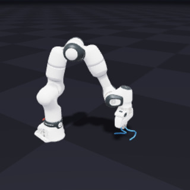
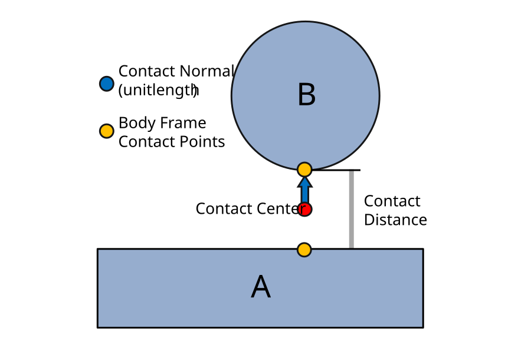

로봇팔로 케이블을 집는 시뮬레이션에서는 관절의 운동과 케이블의 굽힘을 함께 계산해야 해요. 두 계산이 각자 안정적이어도, 집게가 케이블에서 받는 힘을 주고받는 경계가 어긋나면 물체가 미끄러지거나 떨릴 수 있어요.

<abbr title="로봇과 물체의 운동을 계산하며 여러 계산 방식을 조합할 수 있는 공개 물리 엔진">Newton</abbr>의 공식 문서는 이 문제를 하나의 장면에 여러 <abbr title="현재 위치와 속도에서 다음 순간의 운동을 수치로 계산하는 방법">솔버</abbr>를 연결하는 방식으로 다뤄요. 어떤 물체를 누가 갱신하고 접촉 결과를 언제 전달하는지 정하는 일이, 솔버 이름이나 영상의 사실감보다 먼저예요.

## 같은 장면을 공유해도 운동을 갱신하는 주체는 나눠요

Newton은 <abbr title="그래픽 처리 장치에서 물리 계산을 병렬로 실행하도록 돕는 엔비디아의 개발 도구">NVIDIA Warp</abbr> 위에 만든 물리 엔진이에요. 로봇 학습 환경인 <abbr title="가상 로봇을 여러 환경에서 훈련하고 평가하는 엔비디아의 공개 프레임워크">Isaac Lab</abbr>과 연결되는 도구이지만, 물리 엔진과 학습 환경은 맡은 일이 달라요. 물리 엔진은 명령에 따른 운동을 계산하고, 학습 환경은 관측·행동·보상과 반복 실행을 조직해요. 이 둘을 구분해야 시뮬레이터 예제의 성공을 학습 성능이나 실물 성능으로 넓히지 않아요.

[공식 개요](https://newton-physics.github.io/newton/latest/guide/overview.html)는 장면을 구성하는 모델, 시시각각 변하는 상태, 제어 입력, 접촉 정보를 구분해요. 물체의 질량과 관절 구조는 모델에 속하고, 지금의 위치와 속도는 상태에 속해요. 충돌 계산이 접촉 정보를 만들면 솔버가 이 정보와 입력을 받아 다음 상태를 계산해요. 화면에 그리는 단계는 그 뒤에 이어지므로, 보기 좋은 영상만으로 힘 전달을 검증할 수는 없어요.

솔버 결합은 공통 모델에서 각 계산기가 담당하는 물체를 선택하는 방식이에요. 같은 물체의 다음 위치를 두 계산기가 제각각 덮어쓰면 결과가 실행 순서에 좌우될 수 있어요. 따라서 로봇팔을 갱신하는 쪽과 케이블을 갱신하는 쪽을 구분하고, 다른 쪽에서 필요한 정보만 정해진 경로로 넘겨야 해요. 공유하는 것은 장면의 구조이고, 모든 상태를 아무 곳에서나 바꾸는 권한까지 공유하는 것은 아니에요.

## 로봇팔과 케이블을 잇는 공식 예제

[엔비디아의 케이블 조작 튜토리얼](https://docs.nvidia.com/learning/physical-ai/getting-started-with-newton/latest/newton-fundamentals/coupled-manipulation.html)은 <abbr title="관절로 연결된 단단한 로봇 몸체의 운동과 접촉을 계산하는 물리 시뮬레이터">MuJoCo</abbr> 계열 솔버로 로봇팔을, <abbr title="물체를 작은 부분으로 나누고 부분별 위치를 반복해서 고쳐 전체 운동을 구하는 계산 방법">VBD</abbr> 솔버로 케이블을 계산해요. 집게의 몸체는 케이블 쪽 계산에도 나타나도록 연결해요. 케이블은 그 집게와 접촉하고, 로봇팔은 원래 담당 솔버에서 계속 계산돼요.

<figure class="fig" style="max-width:320px;margin-left:auto;margin-right:auto"><figcaption>공식 예제 목록의 케이블 집기 장면이에요. 원본은 320×320 크기의 미리보기이며, 힘의 정확도나 과제 성공률을 보여 주는 측정 자료는 아니에요. (출처: The Newton Developers, example_franka_cable_ik_pick_place, <a href="https://github.com/newton-physics/newton/blob/fd974893d613541a9a72c19dee61cc1215412145/README.md">공식 예제 목록</a>, <a href="https://creativecommons.org/licenses/by/4.0/">CC BY 4.0</a> · 문서 이미지 원본, 변경 없음)</figcaption></figure>

튜토리얼이 제시한 케이블 길이는 0.38m, 분할 수는 19개, 반지름은 0.005m예요. <abbr title="힘을 받으면 굽거나 늘어나면서 모양이 바뀌는 물체">변형체</abbr> 쪽 내부 반복은 20회, 두 솔버를 잇는 바깥 반복은 1회로 설정돼 있어요. 내부 반복은 케이블 자체의 해를 다듬고, 바깥 반복은 계산기 사이의 상호작용을 다뤄요. 숫자가 같거나 한쪽 반복을 늘렸다는 이유로 같은 검증을 한 것으로 볼 수 없어요.

이 수치는 해당 장면을 구성하는 예제 상수예요. 튜토리얼의 실행 절차는 Newton 1.5로 고정한 환경을 안내하므로, 뒤에서 다룰 1.7.0이나 최신 개발 문서에서도 같은 동작을 검증한 값으로 읽으면 안 돼요. 어떤 케이블에서도 안정적이라는 권장값이나, 실물과 일치한다는 실험 결과는 아니에요. 튜토리얼은 목표 자세로 팔을 움직이는 정해진 집기 순서를 사용하므로, 새로운 물체를 보고 행동을 배우는 정책의 성능을 보고한 자료도 아니에요. 예제에서 가져올 수 있는 근거는 장면의 분할 방법과 실행 조건이에요.

## 대리 물체를 놓고 접촉 반응을 되돌려요

공식 문서의 <abbr title="한 계산기가 소유한 물체를 다른 계산기 안에도 대리 물체로 두고 반응을 주고받는 연결 방식">프록시 결합</abbr>은 다른 솔버 안에 대리 물체를 놓는 방법이에요. 케이블 계산에서 집게와 닿았다는 결과를 얻어도, 그 반응이 팔의 운동에 반영되지 않으면 상호작용이 한쪽으로 끊겨요. 대리 물체를 둔 쪽은 접촉 계산을 수행하고, 결합기는 반응을 원래 물체 쪽으로 되돌려요. 되먹임을 전달하는 시점과 완화 정도가 수치적 거동에 영향을 줘요.

문서는 이전 계산의 반응을 이용하는 방식과, 먼저 갱신한 상태를 다음 계산에 넘기는 방식을 구분해요. 대리 물체의 가상 질량도 조정할 수 있어요. 이 값은 케이블이 실제보다 무겁다는 재료 측정값과 구별해야 해요. 물리적으로 맞춰야 할 질량과 계산의 <abbr title="반복해서 계산을 고칠수록 결과의 변화와 남은 오차가 줄어드는 성질">수렴</abbr>을 조절하는 가상 질량을 섞으면, 한 장면에서 잘 버틴 설정이 다른 속도나 다른 물체에서 실패한 이유를 설명하기 어려워져요.

다른 경로인 <abbr title="서로 나눈 계산 결과가 경계에서 같은 제약을 만족하도록 번갈아 고치는 최적화 기반 결합 방법">ADMM 결합</abbr>은 두 계산기 사이에 제약을 두고 양쪽 힘을 맞춰요. 현재 공식 문서에서 지원하는 계산기 사이 관절은 구면·고정·회전 관절로 제한되고, 모든 관절이나 접촉 표현을 자유롭게 연결하는 범용 기능은 아니에요. 두 방식 모두 실험적 기능이며, 프록시가 간단해 보인다는 이유로 정확도가 자동 보장되거나 ADMM이라는 이름만으로 수렴이 보장되지는 않아요.

## 접촉점과 힘 기록을 따로 봐야 해요

[충돌 문서](https://newton-physics.github.io/newton/latest/concepts/collisions.html)는 접촉을 위치·방향·거리의 기하 정보로 나타내요. 접촉 방향은 한 물체에서 다른 물체를 향하고, 접촉점은 각 몸체의 좌표를 기준으로 저장돼요. 두 접촉점 사이의 부호 있는 거리가 음수이면 물체가 겹쳐 들어간 상태를 뜻해요. 접촉점이 검출됐다는 사실과 그 지점에서 어떤 힘이 계산됐는지는 서로 다른 정보예요.

<figure class="fig"><figcaption>Newton 공식 충돌 문서의 접촉 기하 그림이에요. 파란 화살표는 접촉 방향, 노란 점은 몸체별 접촉점, 빨간 점은 시각화용 중간점을 뜻해요. 이 좌표 관계를 확인해야 다른 솔버에서 받은 힘의 방향도 해석할 수 있어요. (출처: The Newton Developers, <a href="https://newton-physics.github.io/newton/latest/concepts/collisions.html#contact-geometry">Collisions, Contact Geometry</a>, <a href="https://creativecommons.org/licenses/by/4.0/">CC BY 4.0</a> · 원본 그림, 변경 없음)</figcaption></figure>

문서의 접촉 그림을 실험 기록에 적용한다면 집게의 위치만 저장해서는 부족해요. 접촉점의 좌표 기준, 힘이 가리키는 방향, 값이 갱신된 시각도 함께 남겨야 해요. 같은 벡터라도 세계 좌표인지 집게 몸체 좌표인지에 따라 해석이 달라져요. 시점이 다른 팔 자세와 케이블 힘을 한 화면에 겹치면, 정상적인 지연을 잘못된 힘 방향으로 오해할 수도 있어요.

[솔버 관측값 문서](https://newton-physics.github.io/newton/latest/concepts/solver_observables.html)는 운동을 진행하는 데 필요한 상태와 진단용 출력을 분리해요. 가속도나 접촉 힘은 필요한 종류를 요청해 별도 저장 공간에 받으며, 솔버별 지원 범위도 달라요. 접촉 힘을 읽을 때는 배열 전체 길이와 이번 계산에서 유효한 접촉 수를 구별해야 해요. 공간이 비었다는 것, 값을 요청하지 않았다는 것, 실제 힘이 0이라는 것은 같은 사건이 아니에요.

## 검증 수치는 반복 횟수와 함께 읽어요

[VBD의 원리와 설정 문서](https://newton-physics.github.io/newton/latest/solvers/vbd.html)는 한 솔버 안에서 <abbr title="힘을 받아도 모양이 바뀌지 않는다고 가정하는 물체">강체</abbr>와 변형체를 함께 계산하는 경로도 설명해요. 따라서 두 솔버를 결합하는 것이 유일한 정답은 아니에요. 기존 로봇 모델을 유지할 필요가 있는지, 특정 관절 기능이 필요한지, 변형체 표현을 어떤 방식으로 쓸 것인지에 따라 비교 대상을 정해야 해요. 기능표에서 지원한다고 적힌 범위와 해당 장면에서 충분히 수렴한 결과도 구분해야 해요.

[변형체 조정 문서](https://newton-physics.github.io/newton/latest/concepts/simulation_tuning_vbd.html)는 반복이 충분하지 않으면 보정이 다음 시점의 운동으로 나타날 수 있다고 설명해요. 다만 이 조정 문서의 주된 범위는 천과 연체 입자계이고, 케이블·막대의 세부 설정은 별도 참조로 보내요. 천에서 확인한 조정값을 케이블의 검증된 상수로 옮길 수 없어요. 공통으로 가져올 수 있는 판단은 반복 수, 시간 간격, 물체 분할 해상도를 함께 기록해야 한다는 점이에요.

시뮬레이션 작업에서는 팔 단독, 케이블 단독, 둘을 연결한 장면을 나누어 비교할 수 있어요. 팔 단독에서는 목표와 실제 관절 위치의 차이를 보고, 케이블 단독에서는 중력 아래 모양과 놓았을 때의 움직임을 봐요. 결합 장면에서는 집기 시작과 놓기 시점에 접촉 힘과 상대 위치가 어떻게 바뀌는지 살펴요. 어느 단계부터 오차가 커지는지 나누면 제어기와 재료 모형과 결합 경계를 한꺼번에 바꾸는 일을 줄일 수 있어요.

비교표에는 과제 성공 여부뿐 아니라 최대 겹침 깊이, 접촉 중 상대 미끄러짐, 놓은 뒤 잔류 진동, 계산 시간을 따로 둘 수 있어요. 기준은 실험을 시작하기 전에 과제에 맞게 정해야 해요. 예를 들어 연결 부위를 끼우는 과제와 케이블을 넓은 상자에 옮기는 과제는 허용하는 위치 오차가 달라요. 원문에 없는 공통 합격 수치를 새로 정답처럼 붙일 필요는 없어요.

## 떨림은 원인을 나눈 뒤 고쳐요

[공식 조정 지침](https://newton-physics.github.io/newton/latest/concepts/simulation_tuning.html)은 초기 겹침, 충돌 형상, 제어 목표, 질량과 <abbr title="물체의 질량이 어느 위치에 퍼져 있는지에 따라 회전하기 어려운 정도">관성</abbr>, 저장 용량 문제를 먼저 분류하도록 안내해요. 여기서 관성이 잘못되면 같은 힘에서도 회전 반응이 달라져요. 마찰이 부족해서 미끄러지는 현상과 손가락이 잘못된 위치를 향해서 미끄러지는 현상은 영상에서 비슷할 수 있어요. <abbr title="두 물체가 겹쳐 들어갈 때 이를 밀어내는 힘이 얼마나 빠르게 커지는지 정하는 값">접촉 강성</abbr>만 키우면 원래 원인을 남긴 채 떨림이 커질 수도 있어요.

실패 기록에서는 증상과 수정 대상을 연결하는 근거를 남기는 편이 좋아요. 집게가 케이블을 지나쳐도 접촉점이 생성되지 않는다면 충돌 형상과 검출 설정을 먼저 확인해요. 접촉점은 생기는데 팔 쪽 반응이 보이지 않으면 힘을 넘기는 경로와 기록 시점을 확인해요. 반응은 있지만 반복 횟수에 따라 결과가 크게 바뀐다면 수렴 민감도를 살펴요. 이 순서는 제안하는 진단 절차이며, 특정 장비에서 수행한 측정 결과를 뜻하지 않아요.

한 조건만 바꾸는 비교도 필요해요. 내부 반복과 결합 반복을 동시에 늘리면 무엇이 개선에 기여했는지 알기 어려워요. 시간 간격을 바꾸면서 제어 갱신 주기까지 달라지면 물리 계산과 제어 지연의 효과가 섞여요. 같은 명령 기록과 초기 상태를 재사용하고, 바뀐 설정 및 실패가 시작된 시각을 묶어 두면 다음 비교에서도 원인을 추적하기 쉬워요.

## 재현성과 실물 일치는 다른 검증이에요

[결정적 실행 문서](https://newton-physics.github.io/newton/latest/concepts/determinism.html)는 그래픽 처리 장치에서 병렬 덧셈 순서가 달라지면 같은 초기 조건의 결과도 조금씩 달라질 수 있다고 설명해요. <abbr title="같은 실행 환경과 입력을 반복했을 때 같은 계산 결과를 얻도록 순서를 고정하는 성질">결정성</abbr>을 얻으려면 충돌 단계와 솔버 단계의 지원을 함께 확인해야 해요. 문서가 설명하는 반복 실행 일치는 같은 그래픽 처리 장치 모델·드라이버·Warp 빌드 같은 조건에 묶여요. 서로 다른 장치에서도 같은 결과가 난다는 보장은 아니에요.

2026년 11월 5일 확인한 최신 개발 문서의 결정성 표에서 결합 솔버는 미지원으로 분류돼요. 연결부에서 접촉을 배분하고 힘을 합산할 때 병렬 처리 순서가 고정되지 않으므로, 하위 솔버가 결정적으로 실행되더라도 결합 전체가 결정적이 되지는 않아요. 반복 결과가 조금 달라도 과제 성공 판정은 같을 수 있고, 반대로 경계에 가까운 집기에서는 작은 차이가 성공 여부를 바꿀 수 있어요. 상태 배열의 일치 여부와 과제 결과의 분산을 따로 남길 이유예요.

실물과 맞추는 일은 그다음 문제예요. 재현 가능한 시뮬레이션도 잘못된 마찰계수나 케이블의 굽힘 특성을 반복해서 계산할 수 있어요. 실물 자료를 비교한다면 케이블 치수와 고정 조건, 집게 표면, 접근 속도, 관측 시각을 맞추고 모양 변화와 미끄러짐 시점을 비교해야 해요. 시뮬레이션 영상에 케이블이 자연스럽게 보인다는 사실은 재료 모형의 정확도를 대신하지 못해요.

## 채택은 필요한 상호작용과 버전에서 시작해요

2026년 11월 5일 확인한 [최신 정식 릴리스는 1.7.0](https://github.com/newton-physics/newton/releases/tag/v1.7.0)이며 공개일은 2026년 10월 14일이에요. 이 릴리스는 진단 출력과 강체·변형체 작업의 확장을 안내해요. 다만 대표 출처인 최신 개발 문서는 정식 릴리스 뒤의 변경도 포함할 수 있어요. 재현할 때는 문서 주소만 저장하기보다 실제 설치 버전과 소스 커밋, 사용한 예제를 함께 고정해야 해요.

[호환성 문서](https://newton-physics.github.io/newton/latest/guide/compatibility.html)는 실험적 기능의 동작과 기본값이 예고 없이 바뀔 수 있다고 명시해요. 개발 문서에서 본 기능이 정식 설치본에 같은 형태로 들어 있다고 가정하면 안 돼요. 설치가 된다는 조건과 특정 솔버 조합이 지원된다는 조건도 다르므로, 작은 장면에서 필요한 관절과 접촉이 실제로 계산되는지부터 확인하는 순서가 타당해요.

채택 판단에서는 먼저 필요한 접촉과 관절을 적고, 한 솔버로 표현할 수 있는지 살펴요. 두 솔버가 필요하다면 물체별 담당 범위와 힘 전달 방향을 정하고, 단독 장면에서 검증한 조건을 결합 장면에 연결해요. 그 뒤 내부 반복·결합 반복·시간 간격을 분리해서 바꾸며 결과와 비용을 비교해요. Newton의 솔버 결합은 계산 방식을 조합할 수 있게 해 주지만, 그 조합의 정확도는 소유 범위와 접촉 기록, 수렴 조건을 명시한 실험으로 판단해야 해요.

---
<!-- src-block -->
출처 — https://newton-physics.github.io/newton/latest/concepts/coupling.html
