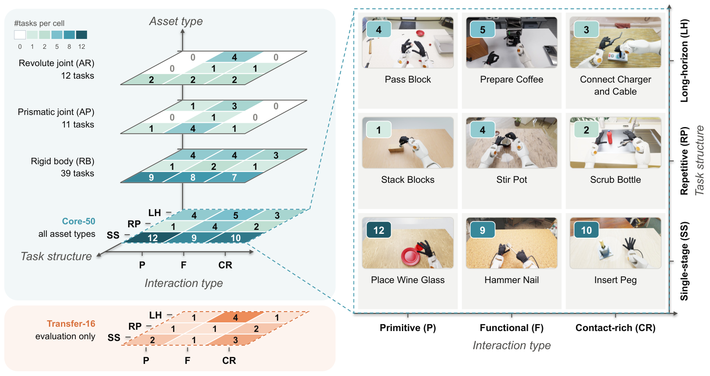
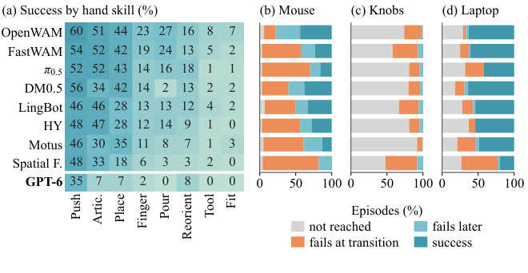

물체를 잡았다고 과제가 끝나지는 않아요. 마우스를 옮기기 전에 버튼을 누르거나, 한 손이 맞춘 손잡이를 다른 손이 움직이는 동안 놓치면 접촉에는 성공해도 작업에는 실패해요.

2026년 10월 19일 공개된 <abbr title="가상 양손 로봇의 시연과 과제별 판정기로 손 조작 능력을 비교하는 시뮬레이션 평가 환경">HandsOn</abbr>은 이런 실패를 단계별로 나누는 평가 환경이에요. 최고 성공률 하나보다, 무엇을 달성한 뒤 어디에서 조건을 잃는지 기록하는 방식이 시뮬레이션 작업에 참고할 만해요.

## 시연이 있는 과제와 새로운 과제를 분리해요

HandsOn은 <abbr title="가상 로봇과 물체를 배치하고 물리 운동과 카메라 영상을 생성하는 엔비디아의 시뮬레이터">Isaac Sim</abbr> 5.1에서 수집한 사람 시연 18,000개와 평가 과제 66개를 함께 제공해요. 사람이 장갑과 손목 추적 장치를 착용하고 가상 팔과 손을 조종한 기록이에요. 시뮬레이션이 만든 영상과 상태를 학습에 쓰므로 합성 데이터에 해당하지만, 사람의 조작이 들어간 시연을 자동 생성한 행동으로 바꾸어 부르면 수집 방법을 오해하게 돼요.

평가는 두 묶음으로 나뉘어요. <abbr title="학습용 시연을 제공하고 같은 과제에서 새 실행으로 조작 성능을 평가하는 50개 과제 묶음">Core-50</abbr>은 시연을 이용한 학습과 실행 평가를 맡아요. <abbr title="해당 과제의 시연을 학습에 넣지 않고 새 물체 관계와 기술 조합을 시험하는 16개 과제 묶음">Transfer-16</abbr>은 새로운 물체 관계, 기술 조합, 변형 물체 조작을 평가해요. 후자는 해당 과제의 학습 시연이 없다는 조건이 중요해요. 같은 성공률 열에 합쳐 놓으면 익힌 과제를 수행하는 능력과 처음 보는 조합에 옮겨 쓰는 능력을 구별하기 어려워져요.

<figure class="fig"><figcaption>원문 그림 3이에요. 왼쪽은 상호작용 종류·과제 구조·물체 종류를 나누고, 오른쪽은 옮기기·도구 사용·정밀 접촉과 실행 길이를 교차해 보여 줘요. 주황 영역은 학습 시연이 없는 평가 과제예요. 물체 종류 표시는 한 과제에 여러 개 붙을 수 있어 각 층의 수를 합쳐 전체 과제 수로 읽으면 안 돼요. (출처: Tianwei Luo 외, HandsOn, <a href="https://arxiv.org/html/2610.26765v1#S3.F3">그림 3</a>, <a href="https://creativecommons.org/licenses/by/4.0/">CC BY 4.0</a> · 원본 PNG, 변경 없음)</figcaption></figure>

과제의 종류도 따로 봐야 해요. 물체를 밀고 옮기는 동작, 도구의 기능을 작동시키는 동작, 좁은 틈에 맞추는 동작은 같은 집기 성공률로 대표하기 어려워요. 논문은 상호작용 종류와 과제 길이, 물체 종류를 함께 분류해요. 케이블을 연결하는 과제와 잔을 놓는 과제가 모두 손을 쓰더라도, 필요한 접촉과 완료 조건은 다르다는 뜻이에요.

플랫폼의 지원 목록과 실험에 사용한 조합도 구분해야 해요. 원문은 여러 팔과 손, <abbr title="접촉과 힘에 따른 물체 운동을 계산하는 엔비디아의 물리 엔진">PhysX</abbr>와 <abbr title="여러 종류의 물체 운동을 계산하고 조합할 수 있는 공개 물리 엔진">Newton</abbr>을 지원한다고 설명해요. 그러나 보고된 시연과 성능 수치는 모두 ROKAE AR5-08 팔과 1세대 Wuji Hand, PhysX 조합에서 나왔어요. 다른 손으로 바꾸거나 물리 엔진을 교체해도 같은 점수가 나온다는 실험은 여기에 포함되지 않아요.

## 영상을 다시 그리는 것과 새로운 상호작용을 만드는 것은 달라요

데이터 수집에서는 손가락 자세와 손목 위치를 가상 로봇이 실행할 명령으로 바꿔요. 이때 <abbr title="사람 손의 움직임을 관절 수와 구조가 다른 로봇 손의 목표 자세로 옮기는 과정">리타기팅</abbr>이 필요해요. 원문은 손바닥 중심의 21개 손 특징점을 손 관절 목표로 옮기고, 팔 쪽은 로봇이 도달할 수 있는 손끝 목표를 계산한다고 설명해요. 관측 영상, 측정 상태, 명령, 언어 지시와 수집 이력을 같은 시점 기준으로 저장해요.

이 기록에서 새 영상을 만드는 과정이 <abbr title="저장한 물체와 로봇의 움직임을 유지하면서 조명이나 재질을 바꾸어 영상을 다시 만드는 과정">재렌더링</abbr>이에요. 테이블 재질, 배경, 천장, 조명과 표면 거칠기를 바꾸어 같은 행동을 다른 모습으로 보여 줘요. 외관을 바꾸되 로봇이 무엇을 하고 정답 행동이 무엇인지는 보존하는 방법이에요. 외관을 뽑는 단위도 한 실행 전체라서, 매 영상 장면마다 재질을 제각각 바꾸는 방식과는 달라요.

그 경계는 질량과 마찰을 바꿀 때 드러나요. 원래 궤적에서 물체가 손에 붙어 움직였더라도 마찰을 낮추면 실제로는 미끄러질 수 있어요. 저장한 상태를 그대로 재생하면서 영상만 바꾸면 그 미끄러짐이 계산되지 않아요. 원문 표 4는 형상과 물리 성질의 변경에 유효한 재실행이 필요하다고 명시해요. 모습이 다양한 학습 자료를 얻었다는 주장과, 다른 물리 조건에서도 행동이 성립한다는 주장은 별도 근거가 필요해요.

카메라를 바꾸는 경우에도 영상만 확인해서는 부족해요. 원문의 한 수집 카메라 설정은 축마다 위치를 ±2mm, 회전을 ±0.3도로 변화시키고 내부 카메라 설정은 유지해요. 카메라 기준으로 표현한 정답 좌표가 있다면 변경한 시점에 맞춰 함께 변환해야 해요. 이 작은 변화가 허용된다는 사실을 임의의 시점 변화에 견디는 성능으로 넓힐 수는 없어요.

데이터의 개수도 같은 원리로 읽어요. 세 카메라의 영상 54,000개는 서로 다른 상호작용 54,000개가 아니에요. 같은 18,000개 궤적을 세 방향에서 본 자료예요. 훈련용과 검증용 분리는 궤적이나 수집 세션을 기준으로 정하고, 다시 그린 영상도 원본의 분리를 물려받아요. 같은 행동을 다른 배경으로 그렸다는 이유로 검증 묶음에 옮기면, 처음 보는 행동에 대한 성능을 확인하기 어려워져요.

## 성공 판정기부터 검증해야 정책을 비교할 수 있어요

HandsOn의 <abbr title="물체 위치와 관절 상태 등을 읽어 과제 완료와 실패를 코드 조건으로 결정하는 검사기">판정기</abbr>는 과제마다 달라요. 뚜껑이 가까이 갔는지, 제대로 들어갔는지, 손을 놓은 뒤에도 유지되는지를 같은 조건으로 취급하지 않아요. 성공에는 과제에서 요구하는 놓기·안정·유지 시간이 포함될 수 있어요. 중간 단계에 도달했다는 기록은 최종 성공을 대신하지 않아요.

과제를 수집에 넣기 전에는 최소 20회의 사람 조작을 검토하고, 성공 표시와 물리 상태 근거의 일치율이 최소 98%인지 확인하는 절차를 둬요. 이 값은 모든 미래 실행의 정답률이 보장된다는 뜻이 아니라, 수집에 진입할 때 적용하는 검토 조건이에요. 수집자와 검토자를 나누고, 판정기가 성공이라고 했는데 물체 상태는 미완료이면 해당 과제를 의심 사례로 격리해요. 학습 모델보다 평가 코드가 잘못된 경우를 먼저 걸러내는 구조예요.

실행 중에는 매 행동 뒤에 성공, 과제 고유 실패, 시간 초과를 확인해요. 모델이 여러 행동을 한 묶음으로 예측했더라도 도중에 종료 조건을 만나면 남은 행동은 버려요. 이미 끝난 과제를 계속 움직여서 실패로 바꾸거나, 실패가 확정된 뒤의 회복을 성공으로 세는 일을 막아요. 반대로 겉보기에는 정체됐다는 이유만으로 임의 종료하지는 않아요.

평가 프로그램의 장애도 정책 실패와 구별해요. 유효하지 않은 행동 출력은 선언한 연결 방식 아래의 정책 실패로 기록하지만, 잘못된 초기화나 시뮬레이터 결함, 프로세스 중단은 별도 기록해요. 실패율에 무엇이 들어갔는지 모르면 낮은 점수가 로봇 제어 문제인지 평가 환경 문제인지 판단할 수 없어요. 수정한 환경에서는 해당 과제를 새로 실행해야 하며, 예전 결과의 이름만 바꿔 새 조건의 점수로 쓰지 않아요.

## 시간 예산을 바꾸면 같은 모델의 순위도 바뀌어요

원문에서 행동 실행은 <abbr title="1초 동안 반복되는 횟수를 나타내는 단위">Hz</abbr>로 30Hz이며, 행동 하나는 시뮬레이션 물리 시간을 정확히 1/30초 진행해요. 물리 엔진이 더 잘게 계산하는 간격은 별도로 기록해요. 학습 모델이 다음 행동을 계산하는 데 걸리는 실제 대기 시간이나 그림을 그리는 시간이 과제의 물리 시간 예산을 다시 정하지는 않아요. 따라서 이 실험은 계산 지연 동안 현실의 물체가 계속 움직이는 상황을 그대로 측정한 결과가 아니에요.

Core-50의 기본 제한 시간은 사람 시연 길이의 <abbr title="자료를 짧은 순서로 놓았을 때 약 75퍼센트가 그 이하인 위치의 값">75백분위</abbr>를 기준으로 정해요. 원문은 보간하지 않은 정렬 위치를 쓰고, 그 길이의 세 배를 실행 예산으로 둬요. 각 과제의 사람 수행 시간이 다르기 때문에 모든 과제에 같은 초 수를 주는 방식과 달라요. 새 과제 묶음 중 변형 물체를 제외한 13개는 관련 기초 과제의 시간을 합산하는 대리 기준을 쓰므로, 실제 복합 과제 시연에서 측정한 75백분위라고 쓰면 틀려요.

그 조건에서 학습한 다중 과제 모델 중 <abbr title="영상으로 상호작용의 진행과 로봇 행동을 함께 다루는 원문 비교 모델">OpenWAM</abbr>의 Core-50 성공률은 29.1%예요. 과제마다 실행 100회를 사용하는 결과이며, 이 값은 사람의 75백분위 시간 세 배 안에서의 완료율이에요. 제한을 사람 기준 한 배 안으로 좁혀 같은 실행 기록을 읽으면 OpenWAM은 8.3%예요. 충분한 시간이 주어져 뒤늦게 완료한 사례가 전체 결과에 얼마나 포함되는지 보여 줘요.

비교 모델 <abbr title="영상과 언어 지시를 받아 로봇 행동을 만드는 원문 비교 정책">π0.5</abbr>는 한 배 기준에서 14.6%, 세 배 기준에서 24.9%예요. 짧은 예산에서는 π0.5가 앞서고 긴 예산에서는 OpenWAM이 앞서요. 이 곡선은 세 배까지 실행한 기록을 앞부분에서 잘라 집계한 결과예요. 더 긴 제한으로 새로 실험했거나, 시간을 계속 주면 언젠가 성공한다고 보여 준 자료는 아니에요.

또 다른 비교 조건에는 범용 모델이 손바닥 자세와 손가락 목표를 고르는 실험이 있지만, 학습한 정책과 입력·호출 예산·시행 수가 달라요. 서로 다른 연결 도구와 정보로 얻은 점수를 모델 이름의 순위로만 읽으면 비교가 무너져요. 시뮬레이션 평가표에서는 모델 이름 옆에 관측, 행동 표현, 한 번에 실행하는 길이, 종료 예산을 함께 두어야 해요.

## 집기 이후에 세 종류의 손실이 나타나요

<figure class="fig" style="max-width:660px;margin-left:auto;margin-right:auto"><figcaption>원문 그림 5예요. 왼쪽은 기술별 성공률이고 오른쪽은 접촉 이후의 세 전환을 나눠요. 회색은 해당 전환에 도달하지 못한 실행, 주황은 전환 중 실패, 연한 파랑은 이후 실패, 진한 파랑은 성공이에요. 왼쪽 범용 모델 조건은 과제당 10회, 학습한 모델은 원칙적으로 100회이며 무효 시행 하나는 제외돼요. 오른쪽 세 패널은 학습한 여덟 모델의 결과예요. (출처: Tianwei Luo 외, HandsOn, <a href="https://arxiv.org/html/2610.26765v1#S5.F5">그림 5</a>, <a href="https://creativecommons.org/licenses/by/4.0/">CC BY 4.0</a> · 원본 PNG, 변경 없음)</figcaption></figure>

첫 번째는 물체를 잡는 접촉이 기능을 너무 일찍 작동시키는 실패예요. 마우스 과제는 마우스를 패드 위로 8cm 옮기기 전에 버튼을 누르면 종료돼요. 여덟 학습 모델의 800회 실행 중 조기 클릭으로 끝난 것은 443회예요. 집기 힘을 더 주는 방법은 이 조건에서 문제를 키울 수 있어요. 물체를 지지하는 접촉과 버튼을 작동시키는 접촉을 나누어야 하는 과제예요.

두 번째는 양손이 같은 시점에 목표를 유지하지 못하는 실패예요. 두 손잡이를 맞추는 과제에서 왼쪽 목표에 도달한 실행은 411회, 오른쪽은 416회였지만 동시에 목표 범위에 들어온 것은 38회였어요. 최종 성공에는 거의 정지한 상태와 놓기 조건도 필요해 성공은 5회였어요. 양쪽의 개별 도달률이 높다는 사실만으로 양손 협응을 확인할 수 없는 이유예요.

세 번째는 한 번 도달한 목표를 계속 밀어 지나치는 실패예요. 노트북 화면 각도 과제에서 OpenWAM은 100회 중 71회 목표 각도에 도달하고, 끝까지 그 각도를 유지한 것은 67회예요. 원문이 비교한 다른 정책은 도달 횟수가 비슷해도 유지 횟수는 훨씬 적었어요. 팔이 목표를 향해 움직이는 능력과 목표에서 움직임을 줄이는 능력은 분리해 기록해야 해요.

이 진단의 분모도 보존해야 해요. 어느 순간 왼쪽이 맞았던 횟수와 어느 순간 오른쪽이 맞았던 횟수를 나누어 조건부 성공 확률을 만들 수는 없어요. 같은 실행에서 올바른 순서로 일어난 사건을 함께 추적해야 해요. 목표 유지율을 비교할 때도 성공 즉시 종료된 실행과 오래 관찰한 실행은 유지가 깨질 기회가 달라요. 원문은 유지 조건과 그 뒤의 관찰 구간을 함께 밝혀야 한다고 설명해요.

## 새 과제와 실물 전이에서 남는 검증 경계

Transfer-16에서는 최종 성공이 거의 나오지 않아 중간 진행률이 모델 차이를 더 잘 드러내요. 진행률은 정해진 단계 중 순서를 지켜 완료한 앞부분의 길이를 세요. OpenWAM의 전체 진행률 12.9%와 최종 성공률 0.4%는 서로 다른 지표예요. 진행률이 가장 높다는 것을 새로운 과제의 열두 퍼센트를 끝냈다는 뜻으로 읽으면 안 돼요.

변형 물체 과제는 평가한 여덟 다중 과제 정책과 범용 모델 모두 성공하지 못했어요. 수건이나 스펀지의 일부를 건드렸다는 사건과 요구된 모양을 완성했다는 판정 사이에는 큰 간격이 남아요. 새 물체에서는 실패 지점이 집기 자체로 앞당겨지기도 하고, 여러 기술을 연결한 과제에서는 이미 끝난 단계를 다시 하거나 다음 단계를 너무 일찍 시작하기도 해요. 단일 과제의 접촉 진단에 단계 순서 기록을 더해야 하는 이유예요.

실물 영상은 별도 경계예요. 논문은 시뮬레이션에서 학습한 모델이 실물에서 움직이는 영상을 제공하지만, 정해진 시행 수에 따른 실물 성공률은 보고하지 않아요. 같은 과제의 가상·실물 조건, 카메라와 행동 좌표, 제어 시간, 초기 상태, 성공 정의를 맞추는 비교 절차는 제안돼 있어요. 그 절차가 적혀 있다는 사실은 대응 실험의 완료를 뜻하지 않아요. 다른 손이나 다른 물리 엔진의 성능까지 확인됐다는 뜻도 아니에요.

촉각 입력을 넣으면 도움이 될 수 있다는 제안도 아직 개선율로 바꿀 수 없어요. 손이 물체를 잡으면 손목 카메라에서 접촉 부위가 가려질 수 있어요. 그러나 접촉 센서를 추가하려면 가상·실물 센서 배치와 접촉 계산을 검증하고, 기존 시각 기반 정책과 같은 판정 조건에서 비교해야 해요. 문제 위치가 접촉이라는 관찰은 센서 추가의 효과 크기를 측정한 실험과 구별해야 해요.

## 시뮬레이션 작업에는 판정과 기록부터 가져와요

HandsOn 방식을 다른 과제에 적용할 때는 환경을 크게 늘리기 전에 완료 조건을 고정하는 편이 타당해요. 예를 들어 뚜껑 조립이라면 접근, 삽입, 손 놓기, 놓은 뒤 유지의 상태를 나누고 어느 사건이 되돌릴 수 없는 실패인지 정해요. 판정기의 성공 표시와 물체 상태를 사람이 대조한 뒤에 모델을 비교해야 해요. 성공한 장면만으로 검사하면 경계 상태와 잘못된 조기 성공을 놓칠 수 있어요.

다음에는 데이터 변화가 행동의 정답을 보존하는지 판단해요. 재질과 조명을 바꾸는 자료는 저장 궤적을 재사용할 수 있지만, 마찰이나 물체 치수를 바꾸었다면 새 물리 조건에서 행동을 다시 실행해 유효성을 확인해요. 원본 궤적과 다시 그린 영상은 같은 학습·검증 분리에 묶어요. 영상 수, 행동 궤적 수, 실제 수집 시간을 따로 적으면 자료가 늘어난 이유도 설명할 수 있어요.

모델 비교에서는 최종 성공률과 함께 목표 최초 도달, 동시 충족, 유지 실패, 종료 원인과 유효 시행 수를 남겨요. 제한 시간을 고정한 결과와 사람 수행 시간 안의 결과도 구분해요. 이 기록이 있으면 실패가 기능의 조기 작동인지, 양손 목표의 시간 불일치인지, 도달 뒤 과도한 운동인지 좁힐 수 있어요. 물리 엔진을 바꾸거나 접촉 센서를 추가하는 판단도 그다음에 근거를 가질 수 있어요.

<!-- src-block -->
출처 — https://arxiv.org/abs/2610.26765
