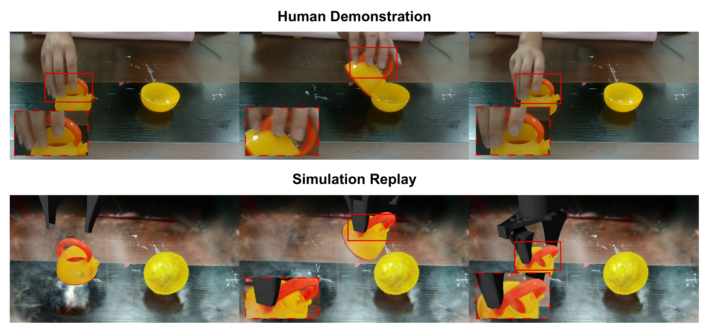
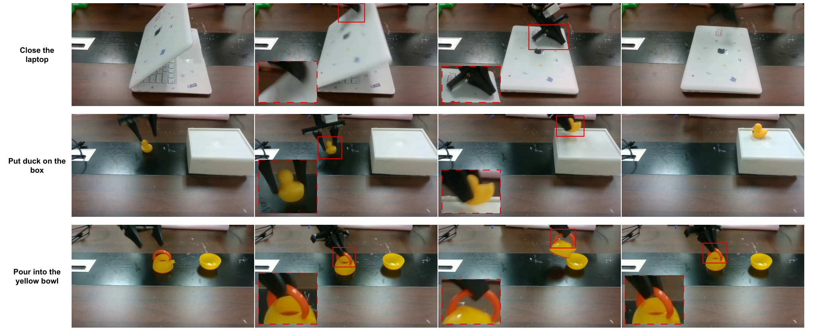

사진처럼 보이는 가상 작업대가 있어도, 그 안에서 로봇이 물체를 잡을 수 있다는 보장은 없어요. 카메라가 복원한 길이와 로봇이 사용하는 길이가 다르거나, 손이 닫히는 위치와 충돌 표면이 어긋나면 보기 좋은 장면에서도 학습용 행동은 틀어져요.

2026년 10월 14일 공개된 <abbr title="실제 작업 공간을 복원하고 로봇 좌표에 맞춰 가상 조작 데이터를 자동 생성하는 연구 방법">AutoRSR</abbr>은 이 연결을 다뤄요. 실제 공간을 가상 환경으로 옮기고, 거기서 만든 자료로 학습한 로봇을 다시 실물에 적용하는 방식이에요. 원문에서 확인할 지점은 복원 영상의 품질, 좌표의 일치, 실행 가능한 행동이라는 서로 다른 조건을 어떻게 묶었는지예요.

## 장면 복원과 로봇 실행 사이에 좌표 계약이 있어요

<abbr title="현실에서 관찰한 물체와 공간을 가상 환경에 만들고 거기서 학습한 행동을 현실 로봇에 옮기는 절차">Real-to-Sim-to-Real</abbr>에서는 원래 공간의 모양을 보존하는 일이 중요해요. 가상의 물체를 임의로 배치하는 방법과 달리, 목표 작업대의 물체 위치와 카메라 시점을 재사용할 수 있어요. 대신 사진으로 복원한 공간과 로봇 관절이 표현하는 공간을 연결해야 해요. 물체가 영상에서 맞게 보여도 로봇 기준 위치가 틀리면 손이 엉뚱한 곳으로 가요.

AutoRSR은 손목 카메라로 공간을 촬영할 때 로봇 상태와 영상의 대응을 함께 기록해요. 같은 순간 카메라가 어디에 있었는지 로봇의 관절 각도에서 계산할 수 있으면, 영상 복원이 추정한 카메라 위치와 짝을 만들 수 있어요. 여러 짝을 이용해 회전, 평행이동, 크기 배율을 맞추는 것이 좌표 정렬이에요. 이 배율은 화면 속 물체뿐 아니라 로봇이 부딪히는 표면에도 똑같이 적용돼야 해요.

이 자동화에는 사전 조건이 있어요. <abbr title="로봇 손목과 그 손목에 고정한 카메라 사이의 위치와 방향 관계를 구하는 보정">핸드아이 보정</abbr>과 로봇 기구 정보가 이미 필요해요. 원문의 자동 정렬은 이 관계와 촬영 중 기록한 상태를 활용해 장면마다 손으로 좌표를 맞추는 단계를 줄여요. 보정이 필요 없다는 뜻으로 읽으면 안 돼요. 손목 카메라의 고정 위치가 바뀌었다면 예전 보정값을 그대로 쓰는 순간 정렬의 출발점이 달라져요.

또한 영상 파일과 로봇 상태를 같은 순간으로 연결해야 해요. 빠르게 움직이는 손목에서 시각 차이가 나면, 복원 알고리즘이 정확하더라도 카메라 대응점이 틀릴 수 있어요. 작업에 가져올 때는 정렬 결과만 저장할 것이 아니라 촬영 시각, 관절 상태, 카메라 보정의 적용 버전도 함께 남기는 편이 좋아요. 이는 원문의 정렬 원리에서 도출되는 점검 순서이며, 이 연구가 모든 시간 동기화 오차를 실험했다는 뜻은 아니에요.

## 외관과 충돌 표면을 분리하되 함께 움직여요

복원에는 <abbr title="색과 투명도와 크기를 가진 작은 입체 조각들을 겹쳐 여러 시점의 영상을 표현하는 방법">3D Gaussian Splatting</abbr>을 사용해요. 주변 배경과 물체 외관을 사진에 가깝게 표현하기 좋지만, 영상 표현만으로 로봇의 접촉을 계산할 수는 없어요. 로봇이 어디에서 멈추거나 물체를 밀어야 하는지는 별도의 <abbr title="물체 표면을 작은 면들의 연결로 나타내 부딪힘을 계산하는 형상">충돌 메시</abbr>가 맡아요. 같은 물체가 보이는 표면과 부딪히는 표면을 함께 가지는 구조예요.

원문은 여러 시점에서 물체 영역을 구분하고, 그 구분을 복원된 공간의 점들로 옮겨요. 같은 물체에 속한 점들을 묶으면 물체만 따로 꺼내고 배경에서 제거할 수 있어요. 이때 얇은 부분이나 경계가 부족하다고 주변 점을 무조건 이어 붙이면 서로 다른 물체가 섞일 수 있어요. 같은 물체로 판정된 이웃 사이에서 표현을 늘리는 방식은 이후 물체별 이동을 가능하게 하는 장치예요.

꺼낸 물체는 외관 자료와 충돌 형상으로 변환돼요. 학습 영상을 만들 때는 외관 표현을 쓰고, 접촉을 검사할 때는 충돌 형상을 써요. 어느 한쪽만 위치나 배율을 바꾸면 영상에는 손이 물체를 잡았는데 계산상으로는 허공을 잡는 상황이 생겨요. 따라서 물체를 옮기는 변환을 두 표현이 공유하는지가 시뮬레이션 자산의 점검 항목이에요.

외관이 좋아졌다는 이유로 얇은 손잡이 안쪽이나 뚜껑 경첩도 정확해졌다고 추정할 수는 없어요. 가려진 표면을 잘못 채우면 충돌 공간이 달라지고, 구멍을 막으면 원래 들어가던 손가락이 지나가지 못해요. 새 작업에서는 로봇이 닿는 영역을 우선 확인할 필요가 있어요. 모든 표면을 같은 정밀도로 복원하는 것보다 작업 결과를 바꾸는 접촉 부위를 찾는 판단이에요.

## 사람 영상의 물체 운동을 로봇이 도달하는 궤적으로 바꿔요

<figure class="fig"><figcaption>원문 그림 3은 노란 그릇으로 따르는 과제의 시연 정렬을 보여 줘요. 물체 운동을 옮길 때 외관, 충돌 형상, 로봇 손의 위치가 같은 좌표 관계를 유지하는지 읽는 자료예요. (출처: Jiawei Zhang 외, AutoRSR, <a href="https://arxiv.org/html/2610.20336v1#S3.F3">그림 3</a> · 원본 PNG, 변경 없음 · arXiv 비독점 배포 라이선스는 재배포 허가가 아니며, 해당 방법을 논평하는 범위에서 그림을 인용)</figcaption></figure>

사람 영상에서 손 위치를 그대로 로봇 손끝으로 복사하기는 어려워요. 사람과 로봇은 손의 모양, 관절 수, 도달 범위가 달라요. AutoRSR은 영상 속 목표 물체를 추적해 공간에서 어떻게 움직였는지 추정하고, 그 물체를 잡을 후보 자세를 만들어요. 영상의 엄지와 검지 사이 위치는 후보를 고르는 단서로 사용해요. 한 카메라로 추정한 사람 손의 깊이를 정확한 실제 거리로 취급하지 않는 점이 중요해요.

선택한 잡기 관계와 물체 운동에서 로봇 손끝 목표를 만들고, <abbr title="원하는 손끝 위치와 방향에 도달하도록 로봇 관절 각도를 계산하는 방법">역기구학</abbr>으로 관절 궤적을 구해요. 관절이 허용 범위를 벗어나지 않는지, 손끝 위치뿐 아니라 방향도 맞는지 전체 구간에서 검사해요. 앞 시점의 해를 다음 시점 계산의 출발점으로 쓰면 연속된 동작을 얻는 데 도움이 돼요. 그래도 목표와 실제 계산 결과 사이에 오차가 남을 수 있어요.

단단한 물체를 쥐고 운반하는 구간에서는 계산으로 얻은 손끝 자세에 물체를 연결해요. 목표 궤적에 적힌 이상적인 손 위치에 계속 붙여 두면 로봇과 물체가 벌어질 수 있기 때문이에요. 놓는 순간에도 실제 도달한 위치를 유지하고, 손이 물러난다고 물체가 계속 따라가거나 원래 목표로 순간 이동하지 않게 해요. 밀기나 관절 물체 운동에서는 별도의 운동 관계를 유지하며 접촉을 확인해요.

여기에는 검증의 경계가 있어요. 운반 중 물체를 손에 연결하는 방식은 일정한 잡기 관계를 보존하지만, 마찰과 접촉력만으로 물체가 버티는지 증명하지는 않아요. 원문도 궤적 필터가 기하학적으로 가능한지를 거르는 검사이며 힘으로 안정되게 잡는 조건이나 동적인 과제 성공을 보장하지 않는다고 설명해요. 이 자료를 사용해 접촉 제어기를 평가하려면 미끄러짐과 외력에 대한 별도 실행이 필요해요.

## 배경 변화와 행동 변화는 서로 다른 자료를 만들어요

가상 자료를 늘릴 때는 물체 배치와 외관을 구분해요. 물체와 받는 그릇의 위치를 각각 바꾸면, 로봇이 새 위치로 접근하고 물체를 새 목적지에 가져가는 행동이 필요해요. AutoRSR은 시연에 담긴 물체 사이 관계를 보존하도록 끝 위치와 중간 궤적을 조정해요. 단순히 공간 원점 주위로 전체 운동을 돌리면 물체가 원치 않는 큰 원을 그릴 수 있으므로, 회전 중심과 이동을 적용하는 기준도 맞춰야 해요.

물체를 내려놓는 과제에는 끝 위치 아래에 지지 표면이 있는지 검사하는 절차가 들어가요. 지지가 확인되지 않으면 물체를 계속 잡게 하거나, 놓기가 필수인 후보를 버려요. 이 조건 없이 궤적만 보간하면 공중에 물체를 놓는 장면도 학습 정답이 될 수 있어요. 작업에 적용할 때는 목표 도달과 놓은 뒤 지지 상태를 서로 다른 검사로 두는 편이 타당해요.

외관 증강은 유효한 동작의 기하와 행동, 시간 순서를 유지하면서 재질과 노출, 색 균형 등을 바꾸는 과정이에요. 여기서 <abbr title="가상 로봇과 물체를 배치하고 운동 계산과 영상 생성을 실행하는 시뮬레이션 플랫폼">Genesis</abbr> 실행 자원과 복원 자산을 재사용해 자료를 만들어요. 손목 카메라 위치는 관절 상태에 따라 다시 계산하고, 고정 시점과 같은 시간 기준으로 영상을 출력해요. 영상과 행동의 대응이 어긋나면 모습이 다양해져도 학습 정답이 틀릴 수 있어요.

색만 바꾼 자료와 새 동작 자료를 같은 개수로 합산하면 다양성을 오해하기 쉬워요. 같은 운반 궤적을 여러 재질로 그린 자료는 시각 변화에 대응하는 데 쓸 수 있지만, 실패 후 새로 잡는 동작을 추가하지는 않아요. 따라서 생성 실행 수, 독립적인 움직임 수, 외관 조합 수를 나누어 기록하는 편이 좋아요. 학습과 검증을 나눌 때도 같은 원본 동작의 외관 변형이 양쪽에 섞이지 않는지 확인할 수 있어요.

## 성공률은 적은 시행 수와 학습 조건을 함께 읽어요

원문 실험은 물 따르기 동작, 장난감 오리를 상자 위에 놓기, 노트북 모형 닫기의 세 과제를 사용해요. <abbr title="영상과 언어 지시를 받아 로봇이 실행할 행동을 예측하는 비교 학습 모델">π0.5</abbr>를 과제별로 추가 학습하고 실물 로봇에서 평가해요. 합성 자료만 사용하는 조건과 사람 원격조종 자료를 사용하는 조건이 비교 대상이에요. 가상 환경에서 높은 점수를 냈다는 결과와 실물 평가 결과를 혼동하지 않아야 해요.

| 실물 평가 과제 | 사람 시연 150개로 학습 | 합성 실행 1,000개로 학습 |
|---|---:|---:|
| 노란 그릇으로 따르기 | 73.3% | 73.3% |
| 오리를 상자 위에 놓기 | 86.7% | 80.0% |
| 노트북 모형 닫기 | 86.7% | 86.7% |

표는 원문 표 1의 해당 열을 옮긴 값이에요. 과제별 평가는 15회라서 한 번의 성공 여부만 달라져도 약 6.7%포인트가 움직여요. 비슷한 수치가 나왔다는 관찰은 가능하지만, 두 데이터 수집 방식이 모든 작업에서 동등하다고 결론 내리기에는 평가 범위가 좁아요. 합성 자료와 사람 자료의 개수도 다르므로 한 샘플의 효율이 같다는 비교는 아니에요.

<figure class="fig"><figcaption>원문 그림 4는 합성 실행 1,000개로 추가 학습한 정책의 실물 실행 장면이에요. 빨간 실선은 목표 영역, 점선은 그 영역을 확대한 부분이에요. 이 장면들은 수행 예시이며 시행 수를 가진 성공률 표를 대신하지 않아요. (출처: Jiawei Zhang 외, AutoRSR, <a href="https://arxiv.org/html/2610.20336v1#S3.F4">그림 4</a> · 원본 PNG, 변경 없음 · arXiv 비독점 배포 라이선스는 재배포 허가가 아니며, 실물 전이 결과를 논평하는 범위에서 그림을 인용)</figcaption></figure>

정렬 오차도 과제 성공과 나누어 해석해야 해요. 원문은 작업대의 열 곳에 보정판을 놓고 꼭짓점 위치를 비교했어요. 정렬 후 평균 위치 오차는 세 장면에서 0.61~0.91cm였어요. 이는 그 작업대와 측정 절차의 결과예요. 작은 구멍에 끼우는 조립이나 얇은 접촉면에서도 충분하다고 판정하는 허용 오차는 과제마다 다시 정해야 해요.

기능을 줄여 비교한 실험에서는 움직임 증강과 외관 증강의 역할이 달라요. 원래 운동만 반복하면 새로운 배치를 다루는 경험이 줄고, 외관 변화가 부족하면 실제 영상 조건에 대응하기 어려워져요. 다만 원문은 외관 증강을 완전히 없앤 실험 대신 강도를 낮춘 조건을 비교해요. 이 결과를 외관 변화가 전혀 필요 없다는 근거로 바꿀 수는 없어요. 자료 개수와 증강 강도, 무엇을 고정했는지를 같이 읽어야 해요.

## 사람의 작업 시간과 기계의 처리 시간을 구분해요

자동 생성의 비용은 사람이 붙어 있어야 하는 시간과 전체 처리 시간을 나누어야 해요. 공간 촬영과 사람 시연, 대상 물체를 지정하는 입력은 남아 있어요. 이후 단계가 자동으로 이어진다는 설명을 사람 입력이 전혀 없다는 의미로 넓히면 수집 조건을 놓쳐요. 또한 최초 카메라 보정이나 장비 준비를 매번 필요한 입력과 구분해야 다른 작업대의 도입 비용을 계산할 수 있어요.

원문 표 8에서 따르기 과제의 사람 시연 150개 수집은 73.38분, 합성 실행 1,000개 생성은 28.23분이에요. 후자는 증강 단계의 처리 시간이고, 장면 촬영과 복원, 메시 생성, 정렬의 준비 시간은 표 7에서 따로 보고해요. 논문의 사람 투입 감소 주장을 전체 과정이 같은 배율로 빨라졌다는 뜻으로 옮기면 안 돼요. 특히 계산 장치 하나를 쓴 실험 조건을 개인 장비의 예상 소요 시간으로 바꾸어 적을 근거는 없어요.

작업 기록에는 준비, 자동 처리, 사람의 수정, 학습, 실물 평가 시간을 구분해 두면 좋아요. 처리 중 사람이 기다리기만 했는지, 실패한 물체 분리를 고치고 다시 시작했는지도 비용을 바꿔요. 같은 작업대를 반복 사용하는 경우와 매번 공간이 바뀌는 경우에는 준비 비용의 비중이 달라져요. 이 구분은 논문의 자동화 범위를 새 작업에 적용할 때 필요한 계산이며, 원문에서 장기간 운영 비용까지 측정했다는 주장은 아니에요.

## 새 작업에서는 대량 생성 전에 접촉과 분포를 확인해요

적용 여부는 먼저 요구 정밀도로 판단해요. 작업의 성공 조건이 물체를 넓은 상자 위에 올리는 것인지, 좁은 구멍에 넣고 힘을 유지하는 것인지에 따라 같은 정렬 오차의 의미가 달라져요. 카메라와 로봇 좌표의 대응을 확인한 뒤, 로봇이 닿는 표면과 잡는 위치가 맞는지 확인해야 해요. 이 단계에서 틀린 자산을 외관 변화로 늘려도 접촉 오류가 사라지지는 않아요.

다음은 변형한 궤적이 실제 행동 정답을 유지하는지 판단해요. 손이 닫힐 때 물체가 있는지, 운반 중 관절 한계를 넘지 않는지, 놓기 전에 받침이 있는지 순서대로 검사할 수 있어요. 힘과 마찰이 성공을 좌우하는 과제라면 기하 검사 뒤에 동적인 실행을 추가해야 해요. 물체를 손끝에 연결한 구간이 어디인지 기록하면, 그 구간에서 미끄러짐을 평가했다고 잘못 해석하는 일을 줄일 수 있어요.

마지막은 자료와 평가의 독립성이에요. 복원에 사용한 작업대와 비슷한 배치에서의 성공, 처음 보는 물체에서의 성공, 접촉 조건을 바꾼 뒤의 성공은 각각 다른 주장에 해당해요. 평가 조건과 시행 수를 정하고 작은 묶음으로 먼저 확인한 뒤, 유효한 궤적만 늘리는 편이 좋아요. AutoRSR에서 가져올 판단 기준은 자동 생성 여부만으로 자료를 승인하지 않고, 좌표 일치와 행동 유효성, 실물 평가의 범위를 차례로 확인하는 순서예요.

<!-- src-block -->
출처 — https://arxiv.org/abs/2610.20336
