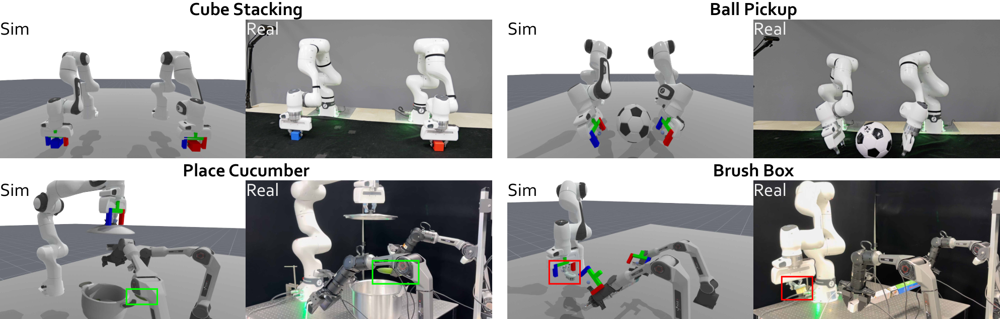
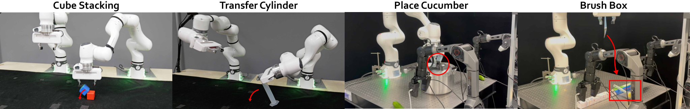

로봇 시뮬레이션에서 검증한 프로그램을 실물에서 다시 실행하면, 학습용 영상은 실제 카메라로 모을 수 있어요. 이때 시뮬레이터의 역할은 영상을 많이 만드는 일에서 실행할 프로그램을 고르는 일로 옮겨가요.

2026년 11월 2일 개정된 <abbr title="실제 여러 로봇팔의 작업 공간을 가상 환경으로 복원하고 프로그램 검증과 실물 실행을 연결하는 연구 시스템">CoEnv</abbr> 논문은 이 구성을 다뤄요. 그 안에서 <abbr title="가상 작업 공간에서 전체 로봇 프로그램을 작성하고 실행 결과를 보고 고쳐 나가는 방법">CoEx</abbr>가 프로그램을 탐색해요. 논문의 출발점은 4월 공개본이지만, 여기서 다루는 제목과 실험은 크게 개정된 두 번째 판을 기준으로 해요. 관찰할 지점은 시뮬레이션 성공이 실물 성공으로 바뀌는 조건과, 실제로 기록한 영상이 학습 결과에 미친 차이예요.

## 시뮬레이터는 학습 자료보다 앞서 프로그램을 걸러요

<abbr title="현실의 물체 배치와 장비를 가상 공간에 대응시켜 행동 결과를 시험할 수 있게 만든 모형">디지털 트윈</abbr>은 겉모양을 복제하는 것만으로 완성되지 않아요. 로봇 관절을 움직였을 때 물체가 어떻게 움직이는지 계산할 수 있어야 하고, 물체 위치와 접촉 여부를 물어볼 수 있어야 해요. CoEnv는 같은 실제 작업대를 복원한 뒤 초기 상태로 되돌리기, 임의 시점에서 보기, 상태 읽기를 프로그램 탐색에 제공해요. 실물에서는 손으로 정리해야 하는 실패 장면도 가상 공간에서는 다시 시작할 수 있어요.

시뮬레이션의 쓰임을 구분하면 학습 결과도 다르게 읽혀요. 가상 공간에서 시연을 생성하는 방식은 가상 카메라 영상과 행동을 학습 자료로 남겨요. 반면 CoEx는 가상 공간에서 목표를 달성하는 프로그램을 찾고, 그 결과를 충돌 검사한 뒤 실물 로봇에서 실행해요. 이후 정책이 배우는 영상은 실제 카메라에서 기록하므로, 학습 자료의 출처가 달라져요.

여기서 <abbr title="카메라 영상과 로봇 상태를 받아 다음 행동을 내놓도록 학습한 함수">정책</abbr>과 프로그램은 다른 산출물이에요. 프로그램은 물체 좌표를 조회하고 이동·회전·잡기 명령을 순서대로 호출해요. 정책은 그 프로그램이 실물에서 남긴 영상과 행동 쌍을 보고 학습해요. 프로그램을 찾는 단계의 가상 상태 조회 기능을 정책도 실제 배포 때 쓸 수 있다고 가정하면, 논문이 구분한 두 단계를 섞게 돼요.

<figure class="fig"><figcaption>원문 그림 4는 네 과제의 가상 실행과 실제 실행을 나란히 보여줘요. 대응하는 배치와 접촉 장면을 확인하는 자료이며, 장면이 비슷하다는 사실만으로 힘과 마찰까지 일치한다고 판정할 수는 없어요. 출처: Li Kang 외, CoEnv v2, 그림 4 · <a href="https://arxiv.org/html/2604.05484v2#S4.F4">원문</a> · <a href="https://creativecommons.org/licenses/by/4.0/">CC BY 4.0</a> · 원본 PNG, 변경 없음</figcaption></figure>

## 복원할 때는 외형과 충돌 표면을 따로 준비해요

입력은 색상과 깊이가 함께 있는 <abbr title="물체의 색상 영상에 카메라에서 물체까지의 거리 정보를 함께 기록한 자료">RGBD</abbr> 관측이에요. 두 팔 구성에는 보정한 카메라 두 대를, 세 팔 구성에는 세 대를 사용해요. 물체별 참고 이미지로 입체 모형을 만들고 실제 치수에 맞춰 크기를 정해요. 그 모형에 충돌 계산용 단순 표면을 붙이고, 물체 종류에 따른 질량과 마찰 속성을 지정해요.

충돌용 모형을 따로 두는 이유는 렌더링과 물리 계산이 요구하는 정보가 다르기 때문이에요. 사진에서 그럴듯한 표면이라도 작은 틈이나 복잡한 삼각형이 많으면 접촉 계산에 불리할 수 있어요. 원문은 충돌 표면을 단순한 볼록 모형으로 준비해요. 이 선택은 계산을 다루기 쉽게 하지만, 실제 접촉면의 홈이나 얇은 가장자리가 사라질 수 있으므로 잡는 지점의 기하를 별도로 살펴야 해요.

여러 카메라가 추정한 물체 위치는 한 장면 좌표로 합쳐요. 위치뿐 아니라 물체가 향하는 방향까지 맞춰야 손가락이 물체의 좁은 쪽을 잡을 수 있어요. 이어 가상 카메라 영상을 실제 촬영 영상과 비교하며 카메라의 위치와 방향을 반복해서 보정해요. 가상 물체가 화면에서는 맞아 보여도 로봇 손끝 기준으로 어긋나면 접촉 시점에서 실패하므로, 영상 대응과 길이 대응을 함께 확인하는 절차예요.

구현은 로봇 조작 시뮬레이션 환경인 <abbr title="로봇이 물체를 다루는 장면과 작업을 구성하고 실행하는 시뮬레이션 도구">ManiSkill</abbr>과 그 기반인 <abbr title="입체 장면의 물리적 접촉과 카메라 영상을 계산하는 시뮬레이션 플랫폼">SAPIEN</abbr>을 사용해요. 따라서 이 실험을 다른 시뮬레이터에서 같은 설정만 입력하면 재현된다고 읽을 수는 없어요. 로봇 모형, 접촉 계산, 제어기, 좌표 변환이 함께 맞아야 프로그램의 이동 명령이 같은 결과를 내요. 원문의 가상 환경은 물체 상태를 읽는 도구이기도 하므로, 영상만 생성하는 환경으로 교체하면 검증 기능도 다시 마련해야 해요.

## 전체 프로그램과 개별 행동의 검증 주기를 구분해요

CoEx는 목표를 작은 작업으로 나누고 각 팔에 역할을 배정해요. 다음으로 전체 실행 논리를 담은 프로그램을 작성해 가상 환경에서 실행해요. 프로그램은 현재 손끝과 물체의 상태를 읽고, 이동·회전·잡기·놓기를 호출할 수 있어요. 하나의 명령에 여러 팔을 지정하면 동기화된 행동을 표현할 수 있으므로, 두 팔이 공의 양쪽에 동시에 닿는 동작도 같은 실행 논리 안에 들어가요.

실패하면 가상 환경을 같은 초기 상태로 되돌리고 프로그램을 고쳐요. 이때 남기는 것은 성공 여부 한 줄에 그치지 않아요. 목표 위치와 실제 도달 위치의 차이, 들어 올린 뒤 물체 높이가 변했는지, 중요한 순간의 영상과 상태를 함께 확인해요. 이동 명령이 끝났어도 관절 범위 때문에 목표에 닿지 못했다면, 다음 잡기 명령을 수정하기 전에 도달 실패부터 판별할 수 있어요.

검사 시점을 지정하는 <abbr title="잡기나 넘겨주기처럼 실패가 커지기 쉬운 순간에 상태와 영상을 저장해 조건 충족 여부를 확인하는 지점">체크포인트</abbr>는 관찰을 남기는 위치예요. 다만 원문 부록의 코드 에이전트는 프로그램 실행 후 저장한 영상을 검토해요. 실행 중 매 순간 새 영상을 보고 모델이 다시 판단하는 구조와는 달라요. 프로그램 내부에서 수치 상태를 조회할 수 있다는 점과, 모델이 실행 후 영상을 보고 코드를 수정한다는 점을 나눠 읽어야 해요.

비교 대상은 같은 가상 환경과 행동 도구를 쓰되, 영상과 언어를 함께 읽는 모델이 매 단계 다음 행동을 고르는 방식이에요. 이 방식은 실행 도중 상황 변화에 반응할 수 있지만 단계마다 판단 비용이 들어요. 전체 프로그램을 남기는 방식은 한 번 찾은 실행 논리를 다른 초기 배치에서 재사용할 수 있어요. 따라서 차이는 한 번의 명령 정확도뿐 아니라, 실패를 어디에서 수정하고 다음 실행에 무엇을 남기는지에 있어요.

여러 팔이 서로를 가리는 문제에는 카메라 시점을 바꾸는 도구가 들어가요. 정면 영상에서 손가락 사이가 안 보이면 위나 옆에서 다시 그려 접촉 영역을 확인해요. 가상 환경의 자유로운 시점 이동은 고정된 실물 카메라에 같은 능력이 있다는 뜻이 아니에요. 탐색 때 더 많은 정보를 쓸 수 있는 것이므로, 이 도구를 제거한 실험과 실물 정책의 입력 조건을 따로 확인해야 해요.

## 실물로 옮길 때는 팔 전체의 이동 경로를 검사해요

가상 환경에서 행동 하나가 끝날 때마다 각 팔의 관절 위치를 기록해요. 실물 제어기에 보낼 때는 기록 지점 사이를 촘촘히 나누는 <abbr title="띄엄띄엄 기록한 목표 사이에 중간값을 채워 연속적으로 움직이게 하는 계산">보간</abbr>을 거쳐요. 끝점 두 개만 안전해도 그 사이를 지나며 다른 팔을 건드릴 수 있으므로, 손끝 위치만 검사해서는 부족해요. 팔꿈치와 연결 부품까지 포함한 경로가 필요해요.

원문은 팔이 이동하는 동안 차지하는 공간인 <abbr title="물체가 출발 위치에서 도착 위치까지 움직이며 지나가는 공간 전체">휩쓸림 부피</abbr>를 계산해 팔 쌍마다 겹침을 확인해요. 겹침이 있으면 그 동작을 버리고 현재 상태에서 다시 계획해요. 이 검사는 시뮬레이션 프로그램이 완료됐다는 조건과 별개로 실물 실행 앞에 놓여 있어요. 가상 작업 성공과 하드웨어 실행 허용을 같은 판정 하나로 합치지 않은 구성이에요.

저자들은 배포한 궤적 100개에서 팔끼리의 충돌이 관찰되지 않았다고 보고해요. 이 결과는 해당 실험에서의 관찰이며, 모든 물체 충돌과 접촉 사고를 막는 보증은 아니에요. 특히 물체를 놓치거나 손가락이 어긋나는 문제는 팔끼리의 충돌 검사만으로 해결되지 않아요. 실제 실행은 관측으로 계속 고치는 제어가 아닌 사전 궤적 재생이어서, 시작 상태의 작은 오차가 접촉에 남을 수 있어요.

## 평균 성공률은 단계별 조건과 함께 읽어요

실험은 두 팔 또는 세 팔이 협력하는 다섯 과제에서 진행됐어요. 두 팔 구성은 같은 종류의 로봇 두 대이고, 세 팔 구성은 다른 종류의 로봇팔을 섞어요. 로봇 받침 위치는 고정하고 물체 배치는 시도마다 바꿨어요. 과제별로 각 방법을 10회 평가했으므로, 한 번의 성공이나 실패가 표의 비율을 크게 움직이는 규모예요.

| 실물 과제 | CoEx 성공 | 단계별 판단 방식 성공 |
| --- | ---: | ---: |
| 블록 쌓기 | 9/10 | 6/10 |
| 공 들어 올리기 | 6/10 | 4/10 |
| 원통 넘겨주기 | 6/10 | 4/10 |
| 냄비에 오이 넣기 | 6/10 | 4/10 |
| 상자 쓸기 | 8/10 | 7/10 |
| 다섯 과제 평균 | 70% | 50% |

수치는 원문 표 1의 최종 성공 기준이에요. 평균 차이는 20퍼센트포인트지만, 전체 프로그램 방식의 인과 효과가 이만큼이라고 확정할 수는 없어요. 두 방법은 반복 구조뿐 아니라 사용하는 기반 모델도 달라요. CoEx에는 코드 에이전트가, 단계별 방식에는 별도의 시각언어 모델이 들어가므로 모델 차이와 실행 구조 차이를 분리한 비교가 아니에요.

중간 단계를 보면 실패의 위치가 더 잘 드러나요. CoEx는 첫 단계를 통과한 40회 중 35회를 끝까지 마쳤고, 비교 방식은 44회 중 25회를 마쳤어요. 첫 단계 성공 수는 비교 방식이 더 많지만, 이후 협동 순서를 유지한 비율은 CoEx가 높아요. 공을 들어 올리는 과제에서는 CoEx의 실패 네 번이 초기 양팔 접촉에서 발생했고, 그 접촉을 만든 여섯 번은 모두 들어 올리기를 마쳤어요. 프로그램의 장기 순서 일관성과 첫 접촉 정확도를 별도 문제로 볼 근거예요.

가상 환경의 관찰 도구도 성능에 영향을 줬어요. 단계별 판단 방식에서 시점 변경 도구를 빼면 평균 성공률이 50%에서 30%로, 체크포인트 검증을 빼면 20%로 내려갔어요. 이 제거 실험은 CoEx 전체 프로그램 방식이 아닌 비교 방식에서 수행됐어요. 따라서 각각의 하락 폭을 CoEx에 그대로 적용할 수는 없지만, 가림 해소와 선행 조건 확인이 서로 다른 실패를 다룬다는 점은 읽을 수 있어요.

## 실물 자료의 효과와 수집 자동화의 범위는 달라요

검증한 프로그램을 반복하면 매번 전체 계획을 새로 만들 필요가 줄어요. 원문 표 2에서 세션당 검증된 실행 수는 블록 쌓기의 경우 CoEx가 17.5회, 비교 방식이 1.5회였어요. 상자 쓸기는 각각 9.5회와 2.5회였어요. 이 비교에서 나오는 약 3.8~11.7배는 검증된 실행 수의 비율이며, 로봇 팔 자체의 이동 속도나 모든 준비 시간을 포함한 현장 생산성 배수가 아니에요.

자료를 어디에서 기록했는지는 정책 학습 실험에서 따로 비교했어요. 저자들은 <abbr title="카메라 영상과 로봇 상태로 다음 조작 행동을 생성하는 사전학습 로봇 정책">π0.5</abbr>를 추가 학습했어요. 학습 자료는 사람이 원격 조작한 20회, 그 자료에 가상 실행 200회를 더한 묶음, 그리고 CoEx 프로그램으로 실물에서 수집한 50회와 200회로 나눴어요. 각 정책은 다시 실물에서 10회씩 평가했어요.

| 정책 학습 자료 | 블록 쌓기 | 상자 쓸기 |
| --- | ---: | ---: |
| 사람 시연 20회 | 4/10 | 2/10 |
| 사람 시연 20회와 가상 실행 200회 | 3/10 | 0/10 |
| CoEx 실물 실행 50회 | 8/10 | 4/10 |
| CoEx 실물 실행 200회 | 10/10 | 7/10 |

원문 표 2의 이 결과는 같은 프로그램도 가상 영상을 학습 자료로 기록했을 때와 실제 카메라로 기록했을 때 다르게 작용했음을 보여줘요. 프로그램은 물체 좌표를 사용하지만 학습한 정책은 영상의 색, 조명, 센서 특성도 입력으로 받아요. 좌표 기반 프로그램이 이동할 수 있다는 사실만으로 가상 영상과 실제 영상의 차이까지 사라지지는 않아요. 다만 자료 수가 다른 사람 시연 묶음과의 비교나 두 과제만의 소규모 결과를 합성 데이터 전반의 무효성으로 넓힐 수는 없어요.

수집 자동화에도 남은 사람이 있어요. 부록에 따르면 실물 수집에서는 초기 배치를 사람이 고르고 실행 사이 장면도 사람이 되돌렸어요. 성공한 실행만 자료에 넣었고, 50회 묶음은 200회 묶음의 일부예요. 따라서 사람 시연 없이 데이터를 모았다는 표현은 조작 행동을 사람이 매번 가르치지 않았다는 범위로 읽어야 해요. 초기화까지 무인으로 이루어졌다거나 실패 복구까지 자동화됐다는 뜻은 아니에요.

## 접촉 오차가 남는 구간을 적용 전에 나눠요

<figure class="fig"><figcaption>원문 그림 8은 왼쪽부터 배치 오차로 블록이 미끄러지는 경우, 두 팔의 인계 위치가 어긋나는 경우, 뚜껑을 불안정하게 잡는 경우, 솔 이동 계획이 실패하는 경우를 보여줘요. 붉은 표시는 저자들이 넣은 원본 주석이에요. 출처: Li Kang 외, CoEnv v2, 그림 8 · <a href="https://arxiv.org/html/2604.05484v2#A5.F8">원문</a> · <a href="https://creativecommons.org/licenses/by/4.0/">CC BY 4.0</a> · 원본 PNG, 변경 없음</figcaption></figure>

원문 부록은 양팔로 공을 잡을 때 각 팔의 2~3밀리미터 위치 오차가 겹쳐 안정적인 접촉을 방해할 수 있다고 설명해요. 블록 쌓기에서는 놓는 위치가 중심에서 벗어나면 손을 연 뒤 블록이 미끄러져요. 뚜껑을 잡았다는 상태도 유지하는 동안 안정적이라는 조건과 같지 않아요. 장면 정렬, 첫 접촉, 접촉 유지, 놓은 뒤 안정성을 서로 다른 검증 지점으로 나눠야 실패 위치가 드러나요.

같은 실패를 조금씩 다른 좌표로 반복하는 정체도 있어요. 단계별 모델은 이미 실패한 잡기 전략을 계속 고집할 수 있고, 코드 에이전트는 기하 제약이 맞지 않는데 목표만 조금 옮기며 수정 횟수를 소진할 수 있어요. 재시도 횟수가 늘었다는 사실보다 접근 방향이나 잡는 면이 바뀌었는지를 기록해야 하는 이유예요. 원문에서 제안한 접촉 시 잔여 오차 보정과 반응형 하위 제어 결합은 개선 방향이며, 이 실험에서 이미 효과가 입증된 해결책으로 제시된 것은 아니에요.

적용 여부를 판단할 때는 먼저 목표 자료가 가상 영상인지 실제 영상인지 정해요. 실제 영상을 원하면서 반복 가능한 작업대를 갖췄다면, 가상 공간에서 프로그램을 찾아 실물 수집으로 잇는 구성이 후보가 돼요. 이어 복원한 장면의 길이와 충돌 표면이 접촉 허용 오차 안에 들어오는지 확인하고, 성공을 선언할 상태 조건을 작성해요. 이 조건을 영상 인상에만 맡기면 프로그램 수정이 실제 실패 원인과 떨어질 수 있어요.

그다음에는 시뮬레이션을 되돌리는 비용과 실물 장면을 되돌리는 비용을 따로 세어야 해요. 프로그램 재사용으로 판단 호출은 줄어도 사람이 물체를 원위치로 놓는 병목은 남을 수 있어요. 마지막으로 접촉 때 새 관측이 필요한 구간과 사전 궤적을 재생해도 되는 구간을 구분해요. CoEnv의 검증 범위는 고정된 받침, 정적인 장면, 미리 준비한 단단한 물체, 최대 세 팔의 중앙집중 조정이므로 움직이는 작업대나 변형 물체에 대한 근거는 추가로 필요해요.

시뮬레이션에서 남길 산출물을 프로그램으로 정하면, 복원 품질의 기준도 달라져요. 학습용 사진의 사실감보다 프로그램이 조회하는 상태와 실제 접촉의 대응이 앞에 와요. 그 프로그램이 실물에서 남기는 영상의 출처, 실패를 거르는 조건, 장면 초기화에 필요한 사람의 일을 따로 기록해야 수집량 증가가 무엇을 줄였는지 판단할 수 있어요.

<!-- src-block -->
출처 — https://arxiv.org/abs/2604.05484v2
