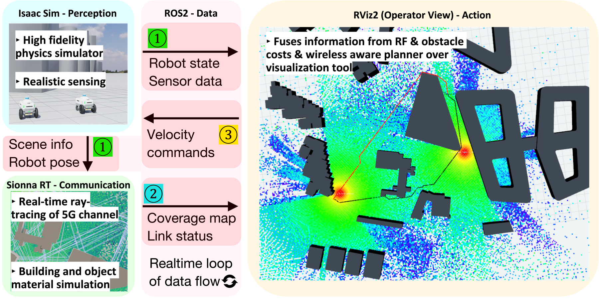
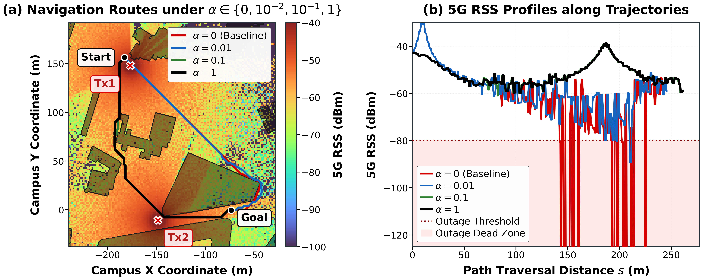

로봇이 서버에서 이동 명령을 받아 움직인다면, 짧은 길이 항상 좋은 길은 아니에요. 건물 뒤로 돌아가는 순간 무선 신호가 약해질 수 있고, 그 신호로 다음 명령을 받아야 하기 때문이에요. 이동이 통신 상태를 바꾸고 통신 상태가 다시 경로를 바꾸는 관계를 시험하려면, 로봇과 전파가 같은 가상 공간을 사용해야 해요.

2026년 10월 6일 공개된 Yi Shen Lim 외의 논문은 로봇 시뮬레이터 <abbr title="로봇의 움직임과 센서가 관측할 장면을 가상 공간에서 계산하는 도구">Isaac Sim</abbr>과 무선 전파 계산 도구 <abbr title="건물과 재질을 따라 전파가 어떻게 전달되는지 계산하는 도구">Sionna</abbr>를 연결해요. 서로 다른 계산기를 상태와 명령의 교환으로 묶는 <abbr title="서로 다른 현상을 계산하는 여러 시뮬레이터가 정보를 주고받으며 함께 실행되는 방식">공동 시뮬레이션</abbr>이에요. 이 논문의 기여는 새로운 이동 정책의 학습보다, 물리 장면과 전파 장면을 맞추고 그 결과를 주행 계획에 되돌려 주는 실행 구조에 있어요.

## 같은 건물이 이동 장애물과 전파 차폐물이 돼요

실제 장소의 형상과 배치를 가상 공간에 대응시킨 <abbr title="실제 장소나 장비의 구조와 상태를 대응시켜 시험할 수 있게 만든 가상 모형">디지털 트윈</abbr>을 만들더라도 두 계산기가 서로 다른 건물을 읽으면 결과를 합치기 어려워요. 로봇 쪽에서는 통과 가능한 공간인데 전파 쪽에서는 벽 안쪽으로 표시될 수 있어요. 화면을 나란히 띄우는 것으로는 이 불일치가 사라지지 않아요. 좌표와 크기, 건물의 배치가 같은 입력에서 나와야 해요.

원문은 공개 지도 서비스인 <abbr title="공동 편집으로 도로와 건물 등의 지리 정보를 제공하는 공개 지도 프로젝트">OpenStreetMap</abbr>의 건물 바닥 윤곽을 가져와요. 입체 모델링 도구 Blender에서 윤곽에 높이를 주고, 싱가포르 공과디자인대학교의 540m × 540m 캠퍼스 장면을 구성해요. 이 형상을 로봇의 물리 장면, 전파 계산 장면, 이동 경로용 격자의 공통 바탕으로 사용해요. 논문에서는 이동로봇 Nova Carter 두 대를 이 공간에서 시뮬레이션해요.

두 장면이 공유하는 것은 형상이지만, 그 형상에 필요한 속성은 달라요. 로봇의 이동에는 충돌할 표면과 통과할 공간이 필요하고, 전파에는 콘크리트·벽돌·금속의 전기적 성질이 필요해요. NVIDIA의 [Sionna 공식 기술 보고서](https://nvlabs.github.io/sionna/rt/tech-report/S1.html)도 장면 물체의 기하와 전파 재질을 구분해요. 따라서 보기 좋은 건물 모형을 가져왔다는 사실만으로 전파 계산에 필요한 재질까지 준비됐다고 볼 수는 없어요.

<figure class="fig"><figcaption>원문 그림 1에서 위쪽 로봇 장면과 아래쪽 전파 장면은 같은 캠퍼스 기하를 사용해요. 오른쪽은 장애물과 전파 세기를 겹쳐 경로를 보는 화면이에요. 출처: Yi Shen Lim 외, 그림 1 · <a href="https://arxiv.org/html/2610.08618v1#S1.F1">원문</a> · <a href="https://creativecommons.org/licenses/by/4.0/">CC BY 4.0</a> · 원본 PNG, 변경 없음</figcaption></figure>

## 전파 지도를 로봇의 위치에서 읽어요

전파가 송신기에서 수신기로 도달하는 경로를 장면 속에서 추적하는 <abbr title="공간에 놓인 표면에서 전파가 반사되는 경로를 따라가 수신 상태를 계산하는 방법">광선 추적</abbr>을 사용해요. 여기서 광선은 화면을 밝히는 빛을 그리기 위한 것이 아니라 무선 신호의 전달을 근사하는 계산 경로예요. 원문 구현은 Sionna의 전파 계산 모듈 2.0.1에서 200만 개의 광선과 최대 다섯 번의 <abbr title="표면에 들어온 각도와 같은 각도로 반대편에 되돌아가는 반사">정반사</abbr>를 설정해요. 건물 모형 48개와 지면을 포함한 장면에서 각 위치의 수신 전력을 계산해요.

기지국 두 곳은 건물 외벽의 높이 2.5m에 놓이고, 로봇의 수신 안테나는 높이 1.5m에 놓여요. <abbr title="기준 전력인 1밀리와트에 견줘 전력의 크기를 로그 눈금으로 나타내는 단위">dBm</abbr>은 음수가 더 작아질수록 약한 전력을 뜻해요. 사용 주파수는 3.425기가헤르츠, 대역폭은 50메가헤르츠이며 기지국의 유효 방사 전력은 18dBm으로 설정돼요. 안테나 높이나 재질을 바꾸면 건물은 그대로여도 전달 경로와 수신값이 달라질 수 있으므로, 이 조건은 배경 설명이 아니라 결과를 해석할 입력이에요.

지도에 담는 값은 <abbr title="수신 안테나에 도착한 무선 신호 전력의 크기">RSS</abbr>예요. 전파 지도는 1.5m 간격의 360 × 360칸이고, 이동 계획 격자는 0.5m 간격이에요. 공통 기하를 쓴다는 말이 두 격자의 해상도까지 같다는 뜻은 아니에요. 전파값을 이동 격자에 대응시킬 때 위치와 축의 방향뿐 아니라, 더 성긴 전파 지도를 어떤 규칙으로 읽을지도 확인해야 해요.

로봇이 움직일 때마다 캠퍼스 전체를 다시 계산하는 구조도 아니에요. 논문에서는 송신기 위치나 기하가 바뀌면 전파 지도를 다시 계산하고, 로봇의 현재 위치에서는 이미 만들어진 지도의 값을 읽어요. 정적인 장면에서 위치만 변하는 경우와, 장애물이 움직여 전파 경로까지 바뀌는 경우의 비용을 구분한 거예요. 로봇 상태를 받는 빈도, 지도를 다시 만드는 조건, 현재 위치를 조회하는 빈도를 하나의 갱신 주기로 적으면 실제 실행 부하를 잘못 읽게 돼요.

## 통신이 약한 칸에 이동 비용을 더해요

두 계산기는 로봇 프로그램 사이에서 메시지를 전달하는 <abbr title="로봇의 센서·위치·명령을 여러 프로그램이 주고받게 하는 소프트웨어 체계">ROS 2</abbr>로 연결돼요. 물리 계산 쪽에서 위치와 자세를 보내고, 전파 계산 쪽에서 수신 전력 지도를 보내요. 계획기는 그 지도를 읽어 경로를 만들고 속도 명령을 로봇 시뮬레이터로 돌려줘요. 계산 결과가 다음 행동에 영향을 주고 그 행동이 다음 관측을 만드는 <abbr title="계산한 결과로 행동을 바꾸고 바뀐 상태를 다시 입력으로 받는 순환 구조">폐루프</abbr>가 형성돼요.

이동 계획에는 로봇 주행 소프트웨어인 <abbr title="지도와 센서 정보를 이용해 이동로봇의 경로와 속도를 정하는 소프트웨어 묶음">Nav2</abbr>의 지도 계층 인터페이스를 이용해요. <abbr title="공간을 작은 칸으로 나누고 각 칸을 지나갈 때의 불리함을 숫자로 적은 지도">비용 지도</abbr>에서 건물과 장애물은 물리 비용을 만들고, 약한 신호는 별도의 무선 비용을 만들어요. 원문의 실제 경로 탐색은 후보 이동의 누적 비용과 목표까지의 추정을 이용하는 <abbr title="이미 이동한 비용과 목표까지 남은 비용의 추정치를 함께 사용해 경로를 찾는 방법">A*</abbr> 기반 맞춤 계획기가 맡아요. 지도가 표준 인터페이스로 전달된다는 사실과, 이 실험의 계획기 구현을 구분할 필요가 있어요.

무선 비용은 수신 전력이 기준보다 부족할 때 커져요. 원문 기준은 −80dBm이고, 그보다 30<abbr title="두 신호 크기의 비율을 로그 눈금으로 표현하는 단위">dB</abbr> 낮아질 때 비용값 254에 도달하도록 설정해요. dB는 전력 자체의 단위인 dBm과 구분해요. 기준 이상에서는 무선 비용이 0이고, 기준보다 약한 영역에서만 부족한 만큼 불리해지는 구조예요. 이 기준은 원문의 통신 조건에서 정한 것이므로 다른 장비의 연결 한계로 그대로 복사할 값은 아니에요.

합친 지도에서는 물리 비용에 무선 비용을 가중해서 더해요. 그 가중치를 나타내는 α가 0이면 무선 상태를 고려하지 않는 비교 경로가 되고, 커지면 신호가 약한 칸을 피할 이유가 강해져요. 이 값은 통신과 이동 시간 사이의 선택을 바꾸는 설정이에요. 통신이 약한 공간을 피하려고 이동 불가능한 건물을 통과해서는 안 되므로, 장애물 처리와 무선 비용 합산의 역할도 따로 확인해야 해요.

## 빠른 전파 계산과 느린 전체 재계획을 나눠 읽어요

초록에는 전파 지도 갱신이 약 16밀리초라고 적혀 있어요. 그러나 이 수치로 로봇이 약 60번씩 매초 새로운 전체 경로를 얻는다고 해석하면 틀려요. 본문은 지도 재계산 다섯 번에서 9.5~29.5밀리초를 보고하고, 별도의 시스템 지연 실험에서는 전체 폐루프 시간을 약 4.73초로 보고해요. 전파 계산이 끝나는 시점과 그 결과로 새 경로가 준비되는 시점 사이에 큰 차이가 있어요.

| 측정 대상 | 원문 보고값 | 읽을 때의 조건 |
| --- | --- | --- |
| 전파 지도 재계산 | 약 16밀리초, 9.5~29.5밀리초 | 송신기 이동이나 기하 변경으로 재계산한 다섯 번 |
| 예열된 광선 추적 계산 핵심부 | 5.53 ± 0.6밀리초 | 최초 실행 준비 시간 118밀리초와 구분 |
| 갱신된 비용 지도까지 | 7.3밀리초 | 상태 수신과 비용 지도 결합을 포함한 정상 실행 구간 |
| 전체 폐루프 | 4.73 ± 0.10초 | 시스템 지연 열 번의 측정, 전역 경로 탐색이 지배 |

지도 재계산 전체와 계산 핵심부는 측정 경계가 달라요. 표의 값들을 한 실행에서 이어지는 단계처럼 단순 합산해서도 안 돼요. 특히 최초 실행 준비 비용을 제외한 수치라면 프로그램을 막 시작했을 때의 응답과도 달라요. 재현할 때는 지도 생성 요청 시각, 지도 전달 시각, 새 경로 발행 시각을 나눠 남겨야 어느 부분이 느린지 알 수 있어요.

물리 상태는 초당 60회 발행되지만 노드들은 서로의 종료를 기다리지 않고 비동기로 실행돼요. 경로가 도착했을 때는 로봇이 계획에 사용된 출발 위치에서 더 이동했을 수 있어요. 전파 지도는 로봇 위치마다 새로 만드는 것이 아니므로, 그 지도의 오래됨은 계산에 사용된 송신기와 장애물 상태가 현재도 맞는지로 확인해야 해요. 새 결과의 도착 빈도와 함께 경로의 출발 위치, 지도에 반영된 장면 상태를 기록하는 편이 지연 원인을 가리는 데 도움이 돼요.

## 우회 비용과 음영 시간의 교환을 비교해요

정량 비교는 정적인 캠퍼스 장면에서 로봇이 초속 3m로 이동하는 조건이에요. 연결이 끊기는 구간에서도 로봇을 멈추지 않도록 해 네 가지 가중치의 경로를 끝까지 비교해요. 이때 원문의 통신 두절 시간은 실제 명령 패킷 손실을 센 시간이 아니라, 수신 전력이 −80dBm 아래였던 시간이에요. 같은 단어를 쓰더라도 측정 정의가 다르면 실제 운용의 중단 시간과 같은 값으로 볼 수 없어요.

무선 가중치가 0인 최단 경로 기준은 이동에 81.2초가 걸리고, 그중 7.9초 동안 기준보다 약한 전파 영역을 지나갔어요. α를 0.01로 올리면 그 시간이 1.3초로 줄고 이동 시간 증가는 1.6%예요. α가 0.1일 때는 87.0초에 도착하며 보고된 음영 시간이 0초가 돼요. 이동 시간이 7.4% 늘어난 대가로, 해당 장면의 기준 미달 구간을 피한 결과예요.

<figure class="fig"><figcaption>원문 그림 2의 왼쪽은 가중치별 경로, 오른쪽은 이동 거리에 따른 수신 전력이에요. 오른쪽 가로축은 시간이 아니라 경로를 따라 이동한 거리예요. −80dBm 아래의 음영과 각 경로의 축·범례를 보존했어요. 출처: Yi Shen Lim 외, 그림 2 · <a href="https://arxiv.org/html/2610.08618v1#S3.F2">원문</a> · <a href="https://creativecommons.org/licenses/by/4.0/">CC BY 4.0</a> · 원본 PNG, 변경 없음</figcaption></figure>

그림에서는 0.1과 1의 경로가 거의 겹쳐요. 무선 비용을 더 높여도 같은 우회로를 고르게 된다면, 가중치를 계속 키우는 일이 이동 품질을 계속 높이는 것은 아니에요. 또한 그림의 수신 전력 곡선은 경로를 따라 어느 지점에서 신호가 떨어졌는지 보여줘요. 곡선의 가로축이 거리이므로, 속도가 바뀌는 실험에서는 낮은 신호 구간의 가로 길이를 시간으로 읽어서는 안 돼요.

## 물리적으로 연결된 장면도 실제 통신망 전체를 담지는 않아요

이 실험의 전파는 같은 장면과 위치에 대해 결정적으로 계산돼요. 로봇 위치는 실제 추정기의 오차가 없는 시뮬레이션 정답값이고, 두 기지국 중 유리한 쪽을 선택하며 기지국 사이 간섭은 포함하지 않아요. 상향과 하향의 전파 상태도 같은 지도를 공유하는 상호적인 채널로 둬요. 이 조건에서는 경로에 따른 수신 전력 차이를 분리하기 좋지만, 실제 망에서 동시에 많은 장비가 통신할 때의 혼잡과 전환 지연까지 검증한 것은 아니에요.

원문 시연에서 이동 경로에 장애물을 넣으면 물리 장애물 비용과 전파 음영이 함께 바뀌어요. 기지국을 옮기거나 추가하는 조작은 전파 지도와 기지국 연결 경계를 바꿔요. 정량 경로 비교는 정적인 장면에서 이뤄지므로, 고정된 건물의 음영을 피한 수치를 움직이는 사람과 차량이 계속 신호를 가리는 환경의 성공률로 넓힐 근거는 부족해요. 동적 장면을 평가하려면 기하가 바뀐 시각과 지도가 갱신된 시각 사이에 생기는 오래된 정보 구간도 비교 조건에 들어가야 해요.

전체 실행에는 그래픽 연산 장치 RTX 5090을 장착한 워크스테이션 한 대를 사용해요. 이 계산 시간을 로봇 안의 저전력 장치에서 가능한 속도로 간주할 수는 없어요. 또한 통신 두절 때도 계속 주행한 비교 설정은 우회 경로의 성질을 보기 위한 것이에요. 실제 서버 명령이 끊긴 로봇이 계속 움직여도 된다는 안전 판단을 제공하지 않으므로, 연결 실패 때의 감속·정지 규칙은 별도로 시험해야 해요.

## 시뮬레이션에 넣을 때는 장면 대응부터 확인해요

적용 순서는 기하 대응, 지도 대응, 갱신 지연, 실패 동작으로 잡을 수 있어요. 먼저 하나의 건물 모서리를 물리 장면과 전파 장면에서 같은 좌표로 확인해요. 다음으로 전파 지도의 몇 칸을 이동 지도에 겹쳐 위치·해상도 변환을 확인해요. 두 화면에서 비슷해 보인다는 판단보다, 같은 지점이 같은 건물의 어느 쪽에 놓이는지를 대조하는 편이 원인 분리에 유리해요.

그다음은 장애물이나 송신기를 바꾼 사건 하나를 기준으로 두 지도의 갱신과 새 경로 발행을 연결해요. 전파 지도만 새것이고 경로가 오래된 상태라면, 계산기가 빠르다는 사실로 제어 입력의 지연을 설명할 수 없어요. 마지막에는 신호 기준 미달, 지도 갱신 실패, 명령 만료를 서로 다른 조건으로 시험해야 해요. 수신 전력이 낮아진 사건과 명령을 실제로 받지 못한 사건을 분리해서 남기면, 물리·전파 모형과 네트워크 구현 중 어디를 고칠지 판단하기 쉬워져요.

이 구성은 서버 연결이 이동 선택을 바꾸는 작업을 가상 공간에서 시험할 때 참고할 수 있어요. 원문이 입증한 것은 공통 장면의 전파 지도를 계획에 돌려주고, 정해진 조건에서 이동 시간과 기준 미달 시간을 교환할 수 있다는 점이에요. 실제 장소로 옮기려면 안테나와 재질의 대응을 측정값으로 확인하고, 시뮬레이션 정답 위치를 실제 위치 추정으로 바꿨을 때의 오차까지 추가해야 해요. 전파 지도 계산 속도, 전체 재계획 지연, 명령이 끊겼을 때의 로봇 동작을 별도 항목으로 남겨야 이 공동 시뮬레이션의 적용 범위를 판단할 수 있어요.

<!-- src-block -->
출처 — https://arxiv.org/abs/2610.08618
