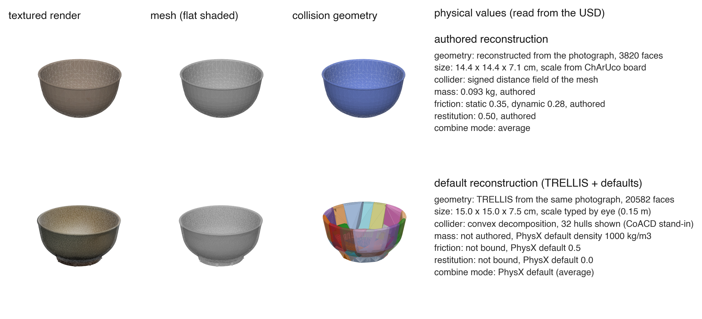
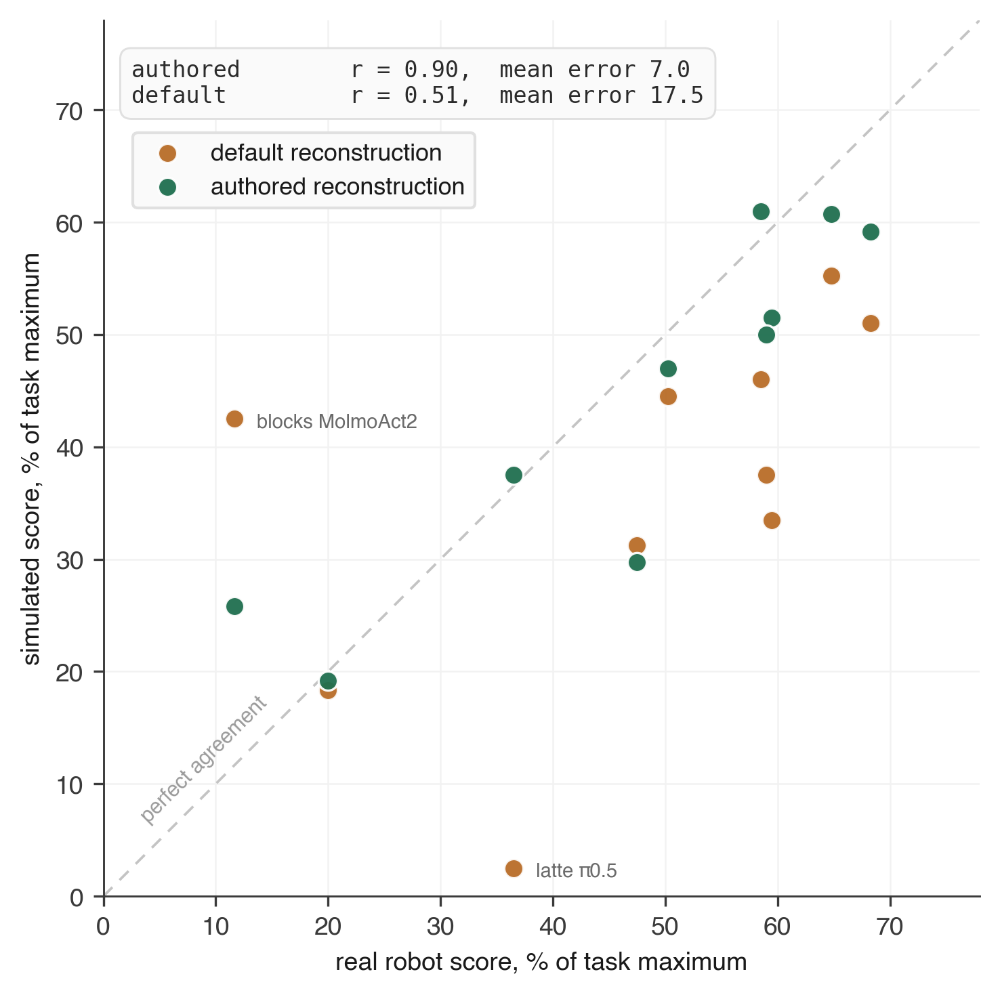

사진에서 그릇처럼 보이는 가상 물체도 로봇 손에는 막힌 덩어리일 수 있어요. 그릇 안쪽에 다른 그릇을 포개는 과제라면, 보이는 표면과 부딪히는 표면의 차이가 평가 결과를 바꿔요.

2026년 9월 30일 공개되고 10월 2일 개정된 Sanya Verma 외의 논문은 같은 양팔 로봇 작업대를 두 방식으로 복원해 비교해요. 로봇의 움직임과 센서 영상을 계산하는 <abbr title="가상 공간에 로봇과 물체를 배치하고 움직임과 카메라 관측을 계산하는 시뮬레이터">Isaac Sim</abbr>에서 같은 행동 모델을 실행하고, 실물 점수와 얼마나 어긋나는지 측정했어요. 더 정교한 복원 묶음은 평균 점수 오차를 줄였지만, 어떤 속성이 개선을 만들었는지와 실패 단계까지 같아졌는지는 별도로 판단해야 해요.

## 실제 성능을 예측하는 복원 품질을 재요

실제 장비와 공간을 대응시킨 가상 모형인 <abbr title="실제 장비와 주변 물체의 구조를 가상 공간에 대응시켜 시험할 수 있게 만든 모형">디지털 트윈</abbr>은 눈으로 닮은 정도만으로 평가하기 어려워요. 로봇의 관측에서 다음 행동을 정하는 <abbr title="현재 영상이나 상태와 작업 지시를 받아 로봇이 실행할 행동을 정하는 모델">정책</abbr>을 넣었을 때, 실물에서 어려운 과제가 가상에서도 어려워야 평가용으로 쓸 수 있어요. 동시에 점수의 절대적인 차이도 작아야 해요. 쉬운 과제와 어려운 과제의 순서만 맞추면서 모든 점수를 과하게 높게 주는 모형은 실제 성능을 낙관하게 만들어요.

이 논문은 새로운 정책을 훈련해 성공률을 높이는 실험과 구별돼요. 정책은 고정하고 물체와 배경을 만드는 방법을 바꿔요. 같은 정책이 가상 공간에서 더 잘하게 만드는 것이 목적이라면, 실제보다 잘 미끄러지지 않는 물체도 유리해 보일 수 있어요. 평가 모형의 목적은 실물 점수를 따라가는 것이므로, 가상 점수가 내려가더라도 실물에 가까워지면 개선이에요.

비교 대상은 저자들이 구성한 속성 지정 복원과 기본 복원이에요. 두 복원 모두 같은 물체 사진과 작업대 영상을 입력으로 받아요. 속성 지정 복원은 물체의 실제 크기를 추정하고, 표면의 모양에 맞는 충돌 표현과 물리 속성을 설정해요. 기본 복원은 공개된 기존 방법을 참고해 저자들이 만든 비교 구현으로, 기존 연구의 모든 실험 조건을 그대로 재현한 것은 아니에요.

## 외형과 충돌 표면을 따로 만들어요

기본 복원에서는 사진 한 장으로 입체 형상을 생성하는 <abbr title="한 장의 물체 사진에서 입체 모양과 표면 색을 생성하는 모델">TRELLIS</abbr>를 사용해요. 물체 크기는 사진 속 외관과 일상적인 크기 감각을 보고 손으로 입력해요. 속성 지정 복원에서는 크기를 아는 인쇄 보정판 <abbr title="체커보드 무늬와 식별 표식을 함께 써서 사진 속 길이와 자세를 추정하는 보정판">ChArUco</abbr>를 물체와 함께 촬영해 크기를 추정해요. 어느 쪽도 한 장의 사진으로 가려진 면의 실제 형상까지 측정했다고 볼 수는 없어요.

물체를 작은 면으로 연결해 나타내는 <abbr title="입체 표면을 꼭짓점과 작은 면들의 연결로 나타내는 형상 표현">메시</abbr>와, 물리 계산에서 접촉 여부를 판정하는 <abbr title="물리 엔진이 다른 물체와 부딪히는지 판단할 때 사용하는 표면이나 부피">충돌 형상</abbr>은 서로 다른 표현이에요. 기본 복원은 오목한 물체를 여러 볼록 덩어리로 나누는 방식으로 충돌을 계산해요. 이 근사가 그릇 속 빈 공간을 메우면 화면에는 구멍이 보이는데 다른 물체는 그 안에 들어가지 못해요. 면의 개수를 늘려 외관을 자세히 만들어도 충돌 형상이 바뀌지 않으면 이 문제가 남아요.

속성 지정 복원은 그릇과 컵 등에는 <abbr title="공간의 각 위치에서 물체 표면까지의 거리와 안팎 구분을 저장하는 형상 표현">부호 거리장</abbr>을 써요. 병과 블록에는 <abbr title="오목한 부분 없이 물체 바깥을 감싸도록 만든 껍질 모양의 형상">볼록 껍질</abbr>을 지정하고 야구공에는 구를 사용하는 등 물체에 따라 충돌 표현을 달리해요. 모든 물체에 가장 복잡한 표현을 적용한 비교가 아니에요. 손이 닿거나 다른 물체가 들어갈 표면을 보존할 수 있는지가 선택 기준이 돼요.

<figure class="fig"><figcaption>원문 그림 1의 그릇 패널이에요. 아래쪽 외관에는 그릇 안쪽이 보이지만 충돌 형상은 그 빈 공간을 메워요. 원문의 이 패널 전체를 사용해 크기와 물리 속성 표시를 보존했어요. 출처: Sanya Verma 외, <a href="https://arxiv.org/html/2610.00731v2#S3.F1">그림 1 그릇 패널</a> · <a href="https://creativecommons.org/licenses/by/4.0/">CC BY 4.0</a> · 원본 PNG, 변경 없음</figcaption></figure>

## 속성을 지정했다는 말은 실측했다는 뜻과 달라요

접촉과 운동을 계산하는 물리 엔진 <abbr title="물체의 접촉과 힘에 따른 운동을 계산하는 엔비디아의 물리 엔진">PhysX</abbr>의 기본값을 쓰면, 비교 구현의 질량은 충돌 부피에 기본 밀도를 적용해 정해져요. 기본 마찰은 0.5이고 부딪힌 뒤 튀는 정도를 정하는 반발계수는 0이에요. 물체가 비어 있는 컵인지 속이 찬 덩어리인지에 따라 같은 겉모양에서도 실제 질량이 다르므로, 일괄적인 기본값은 작업 반응을 어긋나게 할 수 있어요.

속성 지정 복원에서는 영상과 언어를 함께 해석하는 모델이 물체 종류와 질량, 반발계수를 추정해요. 마찰은 모델이 고른 재질 종류에 대응하는 표에서 가져와요. 저울로 물체 질량을 재거나 접촉 실험으로 마찰을 식별한 값이 아니에요. 따라서 이 결과를 정확한 실측 물성이 필수라는 증거로 옮기면 원문의 방법과 달라져요. 실험이 보여 주는 것은 이런 추정과 형상·장면 복원을 합친 구성이 해당 기본 복원보다 실물 점수를 잘 따라갔다는 점이에요.

배경도 함께 달라져요. 사진에서 본 공간을 작은 색 점들의 분포로 표현하는 <abbr title="사진에서 추정한 작은 색 점들을 공간에 배치해 새로운 시점의 장면을 그리는 방법">가우시안 스플래팅</abbr>을 두 복원 모두 사용하지만, 속성 지정 쪽은 입체 점 표현, 기본 쪽은 표면에 놓인 점 표현을 써요. 같은 영상에서 만들고 같은 좌표로 정렬해도 영상의 차이가 남을 수 있어요. 이 때문에 물리 속성만의 효과를 분리한 실험으로 읽을 수 없어요.

배경 촬영 영상에 원래 물체가 남아 있으면 가상 물체와 겹쳐 두 번 보이는 문제도 생겨요. 원문은 두 배경 모두 테이블 위쪽을 잘라내고 물체는 별도로 배치해요. 배경의 테이블 크기와 높이를 실제 작업대에 맞춰 좌표와 배율을 정해요. 물체 크기만 맞추고 배경이나 카메라의 기준이 다르면, 정책이 보는 물체 위치와 손이 도달하는 위치가 함께 어긋날 수 있어요.

## 두 정책과 다섯 과제를 같은 조건에 묶어요

실물 장비는 양팔 로봇 YAM 작업대예요. 영상과 지시에서 행동을 정하는 정책 <abbr title="영상과 작업 지시를 받아 로봇 행동을 생성하는 비교 대상 정책">π0.5</abbr>와 <abbr title="영상과 지시를 바탕으로 로봇 행동을 생성하는 또 다른 비교 대상 정책">MolmoAct2</abbr>를 사용해요. 병을 상자에 넣기, 그릇 쌓기, 블록 쌓기, 컵을 도마 위로 옮기기, 테이블 정리의 다섯 과제를 각각 실행해요. 정책과 과제의 조합은 열 개이고, 조합마다 복원별 20회씩 실행해 총 400회의 가상 시행을 같은 실물 200회와 비교해요.

실물 시행은 외부 평가 기관이 수행하고 채점했어요. 저자 소속 기업이 비용을 부담하고 세 과제를 지정했으며 정책 선택도 협의했어요. 평가 기관은 실물의 방법과 채점, 해석 권한을 유지했다고 원문에 명시돼요. 외부 기관이 실행했다는 사실은 의미가 있지만, 이를 자금이나 과제 선택까지 독립적인 비교로 부르면 안 돼요.

두 복원은 Isaac Sim 6.0.1에서 같은 로봇 모델과 제어기를 사용해요. 제어는 초당 30회, 물리 계산은 초당 240회이며, 카메라 높이는 정책별로 실물 설정에 맞춰요. 추론 한 번에서 내보내는 행동 묶음의 길이와 시행별 최대 단계 수도 고정해요. 비교할 설정이 어긋난 실행은 점수 집계 전에 거르는 구조예요.

설정 검사에서는 카메라 높이가 잘못된 기본 복원 실행 여섯 개를 제외했어요. 점수 파일만 보면 이 차이를 발견할 수 없었다는 점이 중요해요. 다만 검사는 실행 기록에 출력된 항목만 볼 수 있어요. 원문은 시행별 물체 배치 이동량처럼 기록하지 않은 변화는 이 검사로 잡지 못한다고 밝혀요. 검사 통과가 모든 조건의 일치를 보증하지는 않아요.

## 평균 점수와 도달 단계를 함께 비교해요

과제마다 만점이 달라서 원점수를 그대로 평균하면 배점이 큰 과제의 영향이 커져요. 원문은 각 점수를 과제 만점에 대한 백분율로 바꿔 비교해요. 병 넣기에서는 잡아 들어 올리기, 상자 안에 눕혀 넣기, 세워 넣기에 서로 다른 점수를 줘요. 단순한 최종 성공 여부보다 중간 진척을 기록하는 채점이에요.

평균 점수 오차는 열 조합 각각에서 가상 평균과 실물 평균의 차이를 절댓값으로 구한 뒤 평균한 값이에요. 반면 <abbr title="두 값이 함께 커지고 작아지는 경향의 강도를 나타내며 값 자체의 일치를 보증하지 않는 통계량">피어슨 상관계수</abbr>는 쉬운 조합과 어려운 조합이 두 환경에서 함께 움직이는지를 봐요. 모든 가상 점수가 실물보다 일정하게 높아도 상관은 높을 수 있어요. 평가 모형을 고를 때는 상관과 절대 오차를 따로 봐야 해요.

진척 불일치는 실물에서 한 번이라도 도달한 각 채점 단계에 대해, 그 단계 이상을 달성한 시행 비율의 차이를 재요. 실패 단계 불일치는 시행이 어느 단계에서 멈췄는지의 분포를 비교해요. 앞의 값이 줄어도 특정 단계에 실패가 몰리는 방식까지 같아졌다고 단정할 수는 없어요. 평균 점수, 단계 도달률, 멈춘 단계는 같은 시행에서 얻지만 서로 다른 질문에 답해요.

| 지표 | 속성 지정 복원 | 기본 복원 | 두 복원 차이의 95% 구간 |
| --- | ---: | ---: | --- |
| 평균 점수 오차 | 6.97%포인트 | 17.54%포인트 | 5.03~17.11%포인트 감소 |
| 진척 불일치 | 15.90%포인트 | 24.23%포인트 | 1.78~16.74%포인트 감소 |
| 피어슨 상관계수 | 0.90 | 0.51 | −0.08~0.87 증가 |
| 실패 단계 불일치 | 42.00%포인트 | 48.50%포인트 | −3.50~17.00%포인트 감소 |

표는 원문 표 4의 수치예요. 차이의 구간에 0이 들어가지 않는 평균 점수 오차와 진척 불일치는 개선을 구분할 근거가 있어요. 상관계수와 실패 단계 불일치는 차이의 구간이 0을 포함해요. 열 조합이라는 이번 표본만으로는 두 지표에서 복원을 구분할 만큼 근거가 충분하지 않아요. 상관이 0.51에서 0.90으로 올랐다는 숫자만 제목에 쓰면 이 불확실성이 사라져요.

<figure class="fig"><figcaption>원문 그림 3이에요. 점 하나는 정책과 과제의 한 조합이고, 점선은 두 점수가 같은 위치예요. 컵 옮기기에서 기본 복원이 점수를 지나치게 낮게 주는 사례와 블록 쌓기에서 지나치게 높게 주는 사례가 함께 보여요. 출처: Sanya Verma 외, <a href="https://arxiv.org/html/2610.00731v2#S5.F3">그림 3</a> · <a href="https://creativecommons.org/licenses/by/4.0/">CC BY 4.0</a> · 원본 PNG, 변경 없음</figcaption></figure>

## 점수가 가까워졌어도 실패를 놓친 조합이 있어요

MolmoAct2의 블록 쌓기는 속성 지정 복원에서도 남은 반례예요. 실물 평균은 30점 만점에 3.50점이고, 속성 지정 복원은 7.75점, 기본 복원은 12.75점이에요. 실물에서는 20회 중 13회가 0점이었지만 가상에서는 두 복원 모두 0점 시행이 없었어요. 평균이 가까워진 것과 실물의 시작 단계 실패를 재현하는 것은 다른 조건이에요.

저자들은 두 복원에 공통인 제어 반응 차이를 유력한 원인으로 제시해요. 손가락 마찰, 카메라 노출, <abbr title="목표와 실제 상태의 차이에 제어기가 얼마나 강하게 반응할지 정하는 값">제어기 이득</abbr>을 바꾼 개발 실행도 이 차이를 없애지 못했어요. 그러나 원인을 분리해 입증한 실험은 아니므로 제어기가 원인으로 확정됐다고 쓸 수는 없어요. 이 조합을 제외하지 않고 전체 결과에 남긴 점이 평균 개선의 적용 범위를 보여 줘요.

실물과 가상의 채점 주체도 달라요. 실물은 사람이 채점하고 가상은 물체 위치와 손의 접촉 상태에 대한 규칙으로 채점해요. 기울어진 병을 세워진 것으로 보는 경계에서 두 판정이 달라질 수 있어요. 저자들이 가상 30회를 눈으로 대조했을 때 28회가 일치했고 나머지 두 건은 한 단계씩 반대 방향으로 달랐어요. 이 표본 확인만으로 모든 채점 편향이 사라졌다고 볼 수는 없어요.

통계 구간은 기존 관측을 중복을 허용해 다시 뽑는 <abbr title="이미 얻은 관측을 다시 뽑아 계산을 반복하면서 추정값이 얼마나 흔들리는지 살피는 방법">부트스트랩</abbr>으로 구했어요. 조합의 평균 차이 구간에 0이 들어가면 원문은 실물과 일관된 것으로 분류해요. 속성 지정 복원은 열 조합 중 아홉 개, 기본 복원은 다섯 개가 이 조건을 만족해요. 차이를 구분하지 못했다는 조건이지, 허용 오차 안에서 동등하다고 입증한 검사는 아니에요.

## 복원 전체의 개선과 개별 원인을 구분해요

이 비교에서는 형상, 표면 색, 크기, 충돌 표현, 질량과 마찰, 반발계수, 배경이 함께 바뀌어요. 따라서 그릇 안쪽의 충돌 표현이 유력한 설명이더라도 전체 오차 감소를 그 효과 하나로 배분할 수는 없어요. 기본 복원은 사진 한 장을 쓰지만 참고한 기존 방법은 여러 시점을 쓰는 등 비교 조건에도 차이가 있어요. 기존 방법 전체가 속성 지정 복원보다 열등하다는 판정으로 넓히면 실험 범위를 벗어나요.

물체 종류에는 그릇과 상자, 컵처럼 오목한 대상이 포함돼요. 이런 물체는 볼록 근사가 빈 공간을 메울 때 불리해지기 쉬워요. 대상이 대부분 단순한 블록이거나 접촉이 적은 작업이면 개선 폭이 달라질 수 있어요. 이 연구는 한 작업대의 결과이므로 다른 로봇과 공간에서 같은 오차 감소가 나온다고 보장하지 않아요.

가상 시행의 시작 배치는 조합마다 한 실물 시작 장면을 기준으로 만들고, 시행마다 평면에서 최대 1cm 이동시켜요. 실제 배치는 이보다 더 크게 달라져요. 실물과 가상은 시행 하나씩 같은 배치를 대응시킨 것이 아니라 정책과 과제 조합 단위로 묶은 비교예요. 두 복원 사이에는 같은 배치를 써서 상대 비교에 유리하지만, 남은 실물 오차를 전부 복원 품질 탓으로 볼 수 없는 이유예요.

여러 실행 묶음이 설정 검사를 통과했을 때는 시작 시간이 가장 최근인 묶음을 보고값으로 선택했어요. 같은 설정에서도 점수가 달라졌고, 저자들은 작은 평균 차이는 동률로 취급해요. 가장 좋은 실행만 고르지 않았다는 규칙과 통과한 전체 실행 목록을 함께 공개했어요. 재현할 때도 이 선택 규칙을 유지해야 우연히 잘 나온 묶음으로 평가 모형을 고르는 일을 피할 수 있어요.

## 새 시뮬레이션에서는 접촉 표면부터 확인해요

평가용 장면을 만들 때는 먼저 과제가 요구하는 접촉을 목록으로 잡을 수 있어요. 그릇 안에 포개기라면 안쪽 빈 공간, 손잡이를 잡는 작업이라면 손가락이 통과할 구멍이 점검 대상이에요. 외관 영상과 충돌 표면을 같은 카메라로 나란히 확인하고, 크기의 근거가 보정판인지 눈대중인지 기록해요. 이 순서는 이번 논문이 비교한 차이에서 가져온 적용 판단이며, 새 작업에서 성능이 검증된 절차라는 뜻은 아니에요.

다음에는 추정 물성과 측정 물성을 구별해 저장해요. 자동으로 지정한 값이 있더라도 물체 재질의 분류가 틀리거나 충돌 부피가 다르면 질량과 마찰 반응이 어긋날 수 있어요. 실제 접촉에서 미끄러지거나 튀는 정도가 과제 성공을 가른다면 그 속성부터 확인할 이유가 있어요. 변경한 값과 정책 설정을 함께 남겨야 나중에 점수 변화가 어디서 생겼는지 추적할 수 있어요.

정량 평가에서는 실물과 가상에 같은 단계별 채점 기준을 먼저 정하고, 시행 시간과 카메라, 제어 조건을 고정해요. 이후 절대 점수 오차와 단계별 도달 비율을 비교하고, 평균이 비슷해도 0점 실패가 사라진 조합은 따로 확인해요. 상관이 높다는 이유로 작은 점수 차이까지 신뢰하거나, 통계적으로 차이를 못 찾았다는 이유로 실물 평가를 대체하면 안 돼요. 필요한 허용 오차와 실패 유형은 적용할 작업의 위험과 목표에 맞춰 정해야 해요.

원문은 [실행·채점 코드와 자료 연결](https://github.com/Kaedim/yam-sim-harness-oss)을 공개하고 보고에 사용한 코드 상태도 명시해요. 새 작업에서 원인을 좁히려면 기본 복원에서 크기, 충돌 표현, 물리 속성, 배경을 한 번에 하나씩 바꾸는 비교가 후속 단계가 될 수 있어요. 이번 결과가 뒷받침하는 범위는 복원 전체가 특정 작업대의 점수 오차와 진척 불일치를 줄였다는 데 있어요. 개별 속성의 효과와 남은 시작 단계 실패를 분리해 확인해야 평가용 디지털 트윈을 어디까지 믿을지 결정할 수 있어요.

<!-- src-block -->
출처 — https://arxiv.org/abs/2610.00731v2
