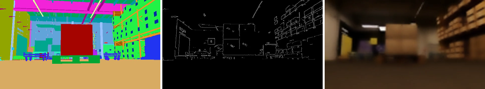
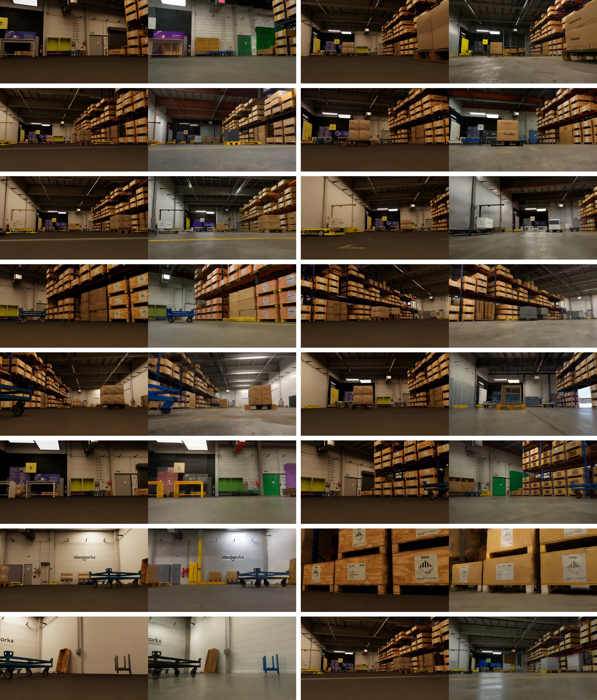

가상 창고에서 비슷하게 움직이는 두 주행 모델도 실물 창고에서는 성공률이 크게 달라질 수 있어요. 시뮬레이션 영상을 실제 카메라 영상에 가까운 모습으로 바꿔 학습한 효과는 가상 평가 점수만으로 드러나지 않을 수 있어요.

2026년 10월 24일 개정된 산업 물류 연구는 <abbr title="가상 장면의 배치와 움직임을 조건으로 받아 영상의 질감과 조명을 바꾸는 엔비디아 생성 모델 도구">Cosmos</abbr>와 <abbr title="가상 환경에서 로봇의 행동을 학습하고 평가하는 엔비디아 시뮬레이션 도구">Isaac Lab</abbr>을 이용해 이 차이를 비교해요. 실제 시설을 가상 공간에 대응시킨 <abbr title="실제 장소나 장비의 배치와 동작을 가상 공간에 대응시켜 실험하는 모형">디지털 트윈</abbr>에서 학습한 <abbr title="현재 관측에서 로봇이 내보낼 행동을 정하는 학습된 규칙">정책</abbr>을 산업용 이동로봇에 올렸어요. 논문의 비교를 따라가면 영상 증강이 실물 전이에 기여한 조건과, 높은 성공률 뒤에도 남은 위험을 함께 볼 수 있어요.

## 영상 증강은 같은 주행에 다른 외관을 붙여요

정책은 카메라 영상에서 바닥과 장애물을 구별하고 속도 명령을 내보내요. 가상 바닥의 질감이나 조명이 실제와 다르면 같은 물체 배치에서도 입력 영상은 달라져요. 학습 때 보지 못한 외관에서 장애물 반응이 어긋나는 것은 <abbr title="가상에서 학습한 행동을 실물에 옮길 때 관측과 운동 조건의 차이로 성능이 달라지는 현상">시뮬레이션-실물 격차</abbr>의 한 부분이에요. 영상의 사실감을 높이는 방법은 이 관측 차이를 줄이려는 시도예요.

이 연구는 가상 주행 한 회의 장면마다 생성 영상 한 벌을 만들어요. 원래 영상과 생성 영상을 절반씩 포함하는 학습 자료를 구성하고, 로봇 상태와 정답 행동은 유지해요. 같은 장면에서 바닥 무늬와 빛의 표현이 달라져도 같은 행동을 배우도록 만드는 방식이에요. 이 대응이 유지돼야 영상 생성에 기존 정답을 재사용할 수 있어요.

사용한 모델은 Cosmos Transfer 2.5예요. 입력 영상에서 물체별 영역을 구분하는 <abbr title="영상의 각 점이 바닥이나 로봇 등 어떤 종류에 속하는지 표시한 정답 지도">의미 분할</abbr>과, 경계를 나타낸 영상, 흐리게 만든 영상을 조건으로 제공해요. 의미 분할은 물체 배치를 붙잡고, 경계와 흐린 영상은 형태와 대략적인 외관을 유지하도록 도와줘요. 생성 모델이 질감과 조명을 바꾸는 동안 장면의 구조를 보존하려는 구성이에요.

<figure class="fig"><figcaption>원문 그림 14의 세 조건 영상이에요. 왼쪽부터 적용 가중치는 1.0, 0.4, 0.1이며, 이 실험에서는 깊이 영상을 조건으로 사용하지 않았어요. 출처: Charbel Abi Hana 외, <a href="https://arxiv.org/html/2610.28432v3#A6.F14">그림 14</a> · <a href="https://creativecommons.org/licenses/by/4.0/">CC BY 4.0</a> · 원본 PNG, 변경 없음</figcaption></figure>

생성 결과는 원본의 각 장면과 하나씩 대응시켜 자료에 다시 넣어요. 부록은 기록 시점이 초당 4회 또는 5회인 장면들을 영상으로 부호화할 때 초당 10장으로 배열했다고 설명해요. 이 10이라는 값은 실제 로봇 제어 주기가 아니에요. 영상 생성의 재생 시간과 물리 실험의 시간 간격을 혼동하면 행동과 관측의 대응을 잘못 해석하게 돼요.

장면의 구조를 유지하도록 조건을 줬다는 설명만으로 모든 생성 결과가 물리적으로 정확하다고 단정할 수는 없어요. 가려진 물체 경계가 달라지거나 작은 장애물이 사라지면 원래 정답을 붙일 근거가 약해져요. 따라서 이 방법을 새 자료에 적용할 때는 원본과 생성본의 물체 위치, 가림 관계, 장면 순서를 먼저 대조할 필요가 있어요. 이 연구의 주행 결과는 해당 조건과 자료 묶음에서 얻은 검증이에요.

## 표현 학습과 행동 보정을 나눠 훈련해요

기반 모델 <abbr title="영상과 경로 및 로봇 상태를 받아 주행 속도를 예측하는 학습 기반 내비게이션 모델">X-Mobility</abbr>는 영상을 압축해 주변 상태를 표현하고 행동을 내보내요. 관측과 행동에서 다음 상태를 예측하는 <abbr title="관측과 행동을 바탕으로 주변 상태가 어떻게 바뀔지 배우는 모델">월드 모델</abbr>을 먼저 시설의 가상 탐색 자료에 맞춰 조정해요. 이어서 경로를 따라 주행한 시연 자료로 행동 예측을 조정해요. 논문에서 기반 모델의 적응은 이 두 단계를 포함해요.

그 위에 <abbr title="기존 주행 정책을 고정한 채 추가 행동 보정량을 시뮬레이션에서 학습하는 방법">COMPASS</abbr>를 붙여요. 이미 학습한 주행 모델의 출력을 고정하고, 시행 결과에 따른 보상으로 행동 보정량을 배우는 <abbr title="행동의 결과로 얻은 보상을 이용해 행동 선택을 개선하는 학습 방법">강화학습</abbr>을 수행해요. 이때 새로 배우는 부분은 기존 행동에 더하는 <abbr title="기존 모델이 정한 행동에 추가해 로봇이나 환경의 차이를 보정하는 행동 값">잔차</abbr>예요. 영상 표현을 익히는 단계와 가상 공간에서 행동을 보정하는 단계가 구분돼요.

비교한 세 모델의 차이도 이 학습 경로로 읽어야 해요. <abbr title="목표 시설 자료를 쓰지 않고 엔비디아의 환경에서 학습한 비교 모델">NVIDIA COMPASS</abbr>는 대상 시설의 자료를 보지 않았어요. <abbr title="대상 시설의 원래 시뮬레이션 자료로 기반 모델을 조정하고 행동 보정을 학습한 모델">IW.COMPASS</abbr>는 대상 시설에서 만든 가상 자료로 기반 모델을 조정해요. <abbr title="대상 시설의 가상 자료에 생성 영상 사본을 절반 섞어 기반 모델을 조정한 비교 모델">IW.CE-COMPASS</abbr>는 여기에 Cosmos 생성 자료를 추가해요.

시설 자료를 사용하는 두 모델의 잔차는 같은 가상 배치에서 처음부터 학습해요. 생성 영상은 기반 모델의 표현과 시연 학습 자료에 들어가며, 실물 로봇을 시행착오로 훈련한 과정은 없어요. 따라서 생성 영상과 시설 적응 전체의 효과를 구별하려면 비교할 두 모델을 먼저 정해야 해요. 목표 시설을 보지 않은 모델과 최종 모델의 차이를 모두 Cosmos 효과로 부르면 시설 자료로 조정한 몫까지 섞이게 돼요.

## 자료의 개수와 독립성을 함께 봐요

연구진은 같은 시설의 가상 배치를 16개 만들고 장애물 밀도와 조명을 바꿨어요. 그중 두 배치는 시험용으로 남겨요. 무작위 탐색 605회와 경로 추종 240회를 기록했으며, 이 수치는 학습·검증·시험을 포함한 전체 자료의 개수예요. 생성 영상을 넣은 쪽은 각 기록에 대응하는 사본을 더하므로 기록 수가 두 배가 돼요.

사본의 수가 늘어난 것과 새로운 주행 경로를 수집한 것은 구별해야 해요. 생성본은 원래 기록과 같은 행동과 상태를 공유하므로 관측 외관의 변화를 더해요. 원래 시설에 없는 통로나 새로운 장애물 움직임을 물리적으로 탐색해 얻은 자료는 아니에요. 원본과 생성본을 서로 다른 시험 분할에 넣으면 같은 행동 기록을 학습과 평가 양쪽에서 보게 될 수 있으므로, 적용할 때도 원래 기록 단위의 묶음을 보존해야 해요.

잔차 학습에는 장애물이 많은 한 배치를 사용해요. 이 배치에는 물체가 36개 놓이고, 로봇이 통과할 수 있는 면적은 빈 시설의 약 절반으로 줄어요. 로봇 폭을 가로막는 장애물이 있는 경로도 포함해 우회와 복구가 필요한 조건을 만들어요. 실물 비교에 쓰는 통로와 장애물 조건을 생각하면, 단순히 빈 바닥 자료를 늘리는 것보다 어떤 실패를 학습에서 마주치게 했는지가 중요한 설정이에요.

<figure class="fig"><figcaption>원문 그림 15의 증강 예시예요. 각 쌍에서 왼쪽은 원래 가상 영상이고 오른쪽은 대응하는 생성 영상이에요. 장면 배치를 유지하며 외관을 바꾸려는 의도를 볼 수 있지만, 정지 예시만으로 전체 자료의 시간적 일관성을 판정할 수는 없어요. 출처: Charbel Abi Hana 외, <a href="https://arxiv.org/html/2610.28432v3#A6.F15">그림 15</a> · CC BY 4.0 · 원본 PNG, 변경 없음</figcaption></figure>

## 가상 성공률이 비슷해도 실물의 순서는 달라져요

실물 평가는 산업용 이동로봇 iw.hub와 실제 연구 시설에서 수행했어요. 비교 조건은 빈 공간 이동, 좁은 통로, 고정 장애물, 움직이는 장애물, 멀고 가려진 목표예요. 각 조건은 약 30회 시행하며, 정지된 장면들은 같은 배치와 시작·목표를 가상 복제 장면에도 구성해요. 움직이는 장애물 조건은 가상 복제 비교에 포함하지 않았어요.

성공은 목표와의 거리가 0.5미터 이내이고, 이동 속도가 초당 0.1미터 미만이며 회전 속도도 초당 0.1<abbr title="원 한 바퀴를 약 6.28로 표시하는 각도의 단위">라디안</abbr> 미만인 상태로 정의해요. 충돌이나 정해진 시간 안에 빠져나오지 못하는 실패도 기록해요. 목표 부근을 지나간 비율과 멈춰서 도착한 성공률은 다른 값이에요. 원문의 판정을 재현하려면 거리뿐 아니라 정지 조건도 함께 유지해야 해요.

다음은 원문 표 6에서 고정 장애물 조건의 성공률을 옮긴 값이에요. 세 모델 모두 같은 종류의 장면에서 비교했지만, 실물의 물체 자세와 시작 방향을 완전히 같은 수치로 맞추지는 못했어요. 가상 쪽은 더 넓게 무작위 변화를 줬다는 설명도 있어요. 따라서 가상·실물의 차이를 시행별로 일치하는 정밀 오차로 읽기에는 제약이 있어요.

| 모델 | 가상 성공률 | 실물 성공률 |
| --- | ---: | ---: |
| NVIDIA COMPASS | 51.3% | 6.7% |
| IW.COMPASS | 72.0% | 54.8% |
| IW.CE-COMPASS | 71.0% | 83.3% |

시설에 맞춘 두 모델은 가상에서 거의 같은 성공률을 보여요. 실물에서는 생성 영상을 포함한 쪽이 더 높은 성공률을 냈어요. 가상 점수만으로 둘 중 하나를 고르면 이 차이를 놓칠 수 있어요. 관측 외관의 차이에 버티는지 확인하려는 실물 시험이 별도로 필요한 이유예요.

전체 개선 수치의 기준도 구분해야 해요. 빈 공간부터 움직이는 장애물까지 네 조건을 평균하면, 목표 시설을 보지 않은 모델의 65.3%가 최종 모델에서 91.7%가 돼요. 원문은 시설 적응 모델에 생성 자료를 추가한 몫을 8.8퍼센트포인트로 보고해요. 고정 장애물 한 조건에서 두 시설 적응 모델의 차이는 28.5퍼센트포인트이므로, 이 값을 전체 조건의 평균 개선으로 옮기면 안 돼요.

원문 표의 값은 반올림돼 있어요. 논문은 전체 개선을 26.3퍼센트포인트로 적는데, 초록에 표시된 두 반올림 값만 빼면 26.4가 나와요. 이 차이를 새 측정처럼 해석할 필요는 없고, 표시 정밀도와 원문 보고값을 구별해 인용하면 돼요. 개별 조건의 시행 수와 실패 유형을 함께 보는 편이 소수점 차이보다 판단에 도움이 돼요.

## 빨라진 도착 시간과 안전 지표는 따로 읽어요

논문은 성공한 시행의 도착 시간과 실패를 고려한 <abbr title="성공한 시행의 평균 도착 시간을 성공 비율로 나눠 실패가 많은 모델에 불이익을 주는 지표">가중 이동 시간</abbr>을 나눠 보고해요. 시설 적응 모델에 생성 자료를 더하면 네 조건 평균의 가중 이동 시간이 63.8초에서 33.9초로 줄어요. 성공률이 함께 올라가므로 이 감소를 모든 시행의 실제 주행 시간이 절반이 됐다는 뜻으로 읽을 수는 없어요. 특히 성공이 드문 모델은 분모가 작아 이 지표가 매우 커져요.

고정 장애물 조건에서 최종 모델의 성공한 시행 도착 시간은 35.0초예요. 기존 운영 주행 시스템의 34.9초와 가깝지만, 성공률은 각각 83.3%와 100%예요. 성공 시행만 고르면 도착 시간 차이는 작아지고 실패의 부담이 사라져요. 가중 이동 시간과 성공률을 함께 남겨야 이 선택 효과를 볼 수 있어요.

충돌 결과에는 다른 순서가 나타나요. 고정 장애물 조건의 시행당 충돌 수는 시설 적응 모델이 0.00, 생성 자료를 더한 모델이 0.24예요. 후자는 더 많은 목표에 도달했지만 같은 조건에서 충돌도 관찰됐어요. 충돌이 발생하면 시행이 끝나는 평가이므로, 이 수치를 목표 도달과 별개로 지속 주행 중 발생한 접촉 횟수처럼 읽어서는 안 돼요.

움직이는 장애물 조건에서도 반응 시간과 복구 시간은 서로 달라요. 최종 모델이 장애물을 보고 감속하거나 방향을 바꾸기까지는 6.21초가 걸렸고, 장애물이 떠난 뒤 정상 주행으로 돌아오는 데는 5.02초가 걸렸어요. 다른 시스템보다 반응은 늦으면서 복구는 빠른 양상이 나타나요. 평균 성공률만 보고 움직이는 장애물에도 전반적으로 빨리 반응한다고 요약하면 원문의 관찰을 잃어요.

로봇에는 안전 레이저 스캐너의 보호 정지 기능도 있어요. 이 기능이 개입한 횟수는 정책의 충돌 수와 따로 기록돼요. 따라서 카메라 입력으로 행동을 고른다는 설명이 실험 시스템의 안전 기능 전체를 뜻하지는 않아요. 이 결과에서 산업 현장 전체의 안전성이나 인증 충족을 추론할 수 없고, 원문도 후속 검증 과제로 안전 요구사항을 남겨요.

## 가려진 목표의 성공에는 경로 계획기가 들어가요

주행 정책은 가까운 주변에서 목표 쪽으로 움직이는 행동을 골라요. 선반 뒤로 돌아 멀리 가야 할 때는 현재 시야에서 목표 방향으로 움직이는 것만으로 통로를 찾기 어려워요. 논문은 시설 지도에서 전체 경로를 정하는 <abbr title="현재 위치에서 먼 목표까지 통로와 장애물을 고려해 전체 이동 경로를 정하는 모듈">전역 계획기</abbr>를 연결하고, 그 경로의 중간 지점을 정책에 차례로 전달해요. 영상 증강과 이 경로 정보의 효과는 별도로 봐야 해요.

멀고 가려진 목표 조건에서 가상 평가의 세 정책은 전역 계획기 없이 모두 성공률 0%였어요. 실물에서 최종 모델은 계획기를 연결해 모든 시험을 성공했어요. 두 결과는 구성요소가 달라서 가상 0%가 영상 증강으로 실물 100%가 됐다고 해석할 수 없어요. 장거리 경로 탐색의 실패를 확인하고 별도 계획 기능을 추가한 실험으로 읽어야 해요.

계획기를 연결한 최종 모델과 기존 운영 시스템의 실물 도착 시간은 각각 37.9초와 35.7초예요. 기존 시스템은 사전 지도와 레이저 거리 센서를 이용하고, 학습 기반의 근거리 정책은 한 대의 색상 카메라를 이용해요. 센서와 사전 정보가 다르므로 이 비교로 특정 알고리즘 하나의 우열을 분리할 수는 없어요. 실제 시스템 조합에서 어느 정도 목표에 접근했는지 보는 기준으로 쓰는 편이 맞아요.

실물 추론은 로봇 안의 계산 모듈에서 수행했어요. 논문 표 5의 최종 모델 입력부터 속도 명령까지 지연은 54밀리초이고, 명령 발행 빈도는 초당 5~8회예요. 지연의 역수로 제어 주기를 대신 계산하면 실제 발행 빈도와 맞지 않아요. 관측 처리와 모델 실행, 명령 발행이 결합된 전체 흐름을 확인해야 하는 수치예요.

## 새 시뮬레이션에서는 비교할 차이를 먼저 고정해요

이 연구를 적용할 때 첫 판단은 바꾸려는 조건이 영상 외관인지 주행 운동인지예요. 바닥 질감과 조명에 약한 모델이라면 원본 행동을 유지한 영상 증강을 시험할 근거가 있어요. 바퀴의 미끄러짐이나 제동 반응이 어긋난다면 운동과 제어 모델을 별도로 확인해야 해요. 논문도 로봇 위치를 곧바로 바꾸는 원래 제어 방식에서 바퀴 구동을 계산하는 방식으로 옮겨 평가했어요.

다음에는 같은 시설의 가상 자료만 쓴 기준 모델을 두고 생성 자료의 효과를 비교해요. 원본과 생성본이 같은 자료 분할에 속하도록 묶고, 행동과 영상의 대응을 확인해요. 가상 평가는 같은 시작 조건으로 수행하되, 실제 시험에서는 가능한 배치 오차와 시행 수를 함께 남겨요. 가상 성공률이 비슷한 경우에도 실물 결과를 확인할 비교 모델을 섣불리 버리면 안 돼요.

평가 항목은 성공률, 성공 시행의 시간, 충돌, 보호 정지, 장애물 반응과 복구를 구분해 정할 수 있어요. 장거리 과제에는 전역 계획기를 붙였는지 표시하고 동일한 구성끼리 비교해요. 생성 자료를 넣은 모델이 목표에 더 많이 도달해도 충돌이나 반응 지연이 허용 범위에 드는지는 별도 판단이 필요해요. 이 순서는 원문에서 확인한 상충 관계를 새 실험에 옮기는 판단 기준이에요.

검증 범위는 한 시설과 한 종류의 실물 이동로봇에 머물러요. 논문에 추가한 전방향 이동 플랫폼은 시뮬레이션에서만 평가했어요. 다른 시설의 조명과 표면, 다른 카메라와 구동계에서도 같은 개선이 나는지는 남은 질문이에요. 새 환경에서는 가상 점수와 실물 실패의 차이를 함께 기록해야 영상 증강을 계속할지, 물리 모델이나 계획 구조를 먼저 고칠지 결정할 수 있어요.

<!-- src-block -->
출처 — https://arxiv.org/abs/2610.28432v3
