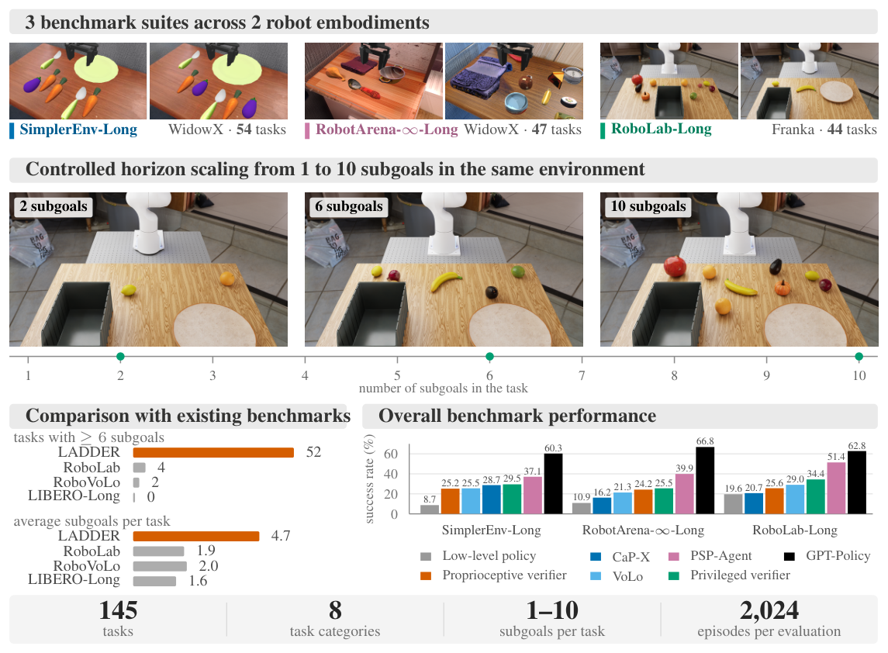
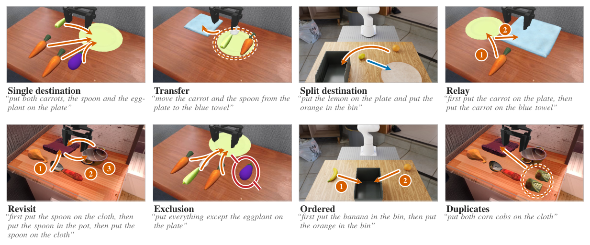

물체 하나를 접시에 옮기는 로봇도 같은 지시 안에서 여러 물체를 차례로 옮기면 실패할 수 있어요. 물체가 작아졌는지, 장면이 낯설어졌는지, 앞에서 한 일을 잊었는지 구분하려면 작업 길이를 다른 난이도와 나눠 평가해야 해요.

2026년 10월 13일 공개된 Petko Petkov 외의 논문은 장기 조작 평가 묶음인 <abbr title="같은 장면 계열에서 옮겨야 할 물체와 순서를 늘려 긴 작업의 실패를 비교하는 로봇 평가 묶음">LADDER</abbr>를 제안해요. 가상 작업대에서 필요한 세부 목표를 1개부터 10개까지 늘리고, 최종 성공뿐 아니라 어느 목표가 남았는지를 기록해요. 길어진 지시를 잘게 나누는 방법이 성능을 높였지만, 정확한 목표를 알려 줘도 로봇이 물체를 옮기는 과정에서 실패가 남았어요.

## 작업 길이는 실행 시간이 아닌 세부 목표 수예요

이 연구에서 세부 목표 하나는 물체를 집어 목적지에 놓는 행동이에요. 당근을 접시에 놓으라는 지시는 목표 하나이고, 당근과 숟가락을 접시에 놓으라는 지시는 목표 둘이에요. 로봇이 수행해야 할 세부 목표 수를 <abbr title="한 지시를 끝내기 위해 차례로 달성해야 하는 세부 목표의 개수">작업 지평</abbr>이라고 불러요. 같은 길이의 시간 동안 움직였다는 뜻과는 달라요.

LADDER는 짧은 과제의 목표를 그대로 포함하면서 추가 목표를 붙이는 계열을 만들어요. 전체 145개 과제 중 138개가 이런 증가 관계에 속해요. 배경과 물체 종류가 전혀 다른 짧은 과제와 긴 과제를 비교하면 길이 때문인지 외관 때문인지 알기 어려워요. 같은 장면 계열을 사용하는 설계는 이 혼동을 줄이려는 장치예요.

다만 모든 시작 상태가 완전히 같다는 뜻은 아니에요. 긴 과제에는 물체가 더 들어가고, 이를 담을 용기도 커져요. 저자들은 물체 크기를 유지하고 로봇이 닿는 공간 안에 배치하며, 정해진 동작을 실행하는 비교 제어기로 모든 목표를 끝낼 수 있는지 확인해요. 이 검사는 원천적으로 도달할 수 없는 배치를 거르지만, 물체 증가에 따른 가림과 접촉 변화까지 없애지는 않아요.

평가에는 <abbr title="실제 로봇 관측과 동작을 닮도록 만든 기존 조작 시뮬레이션 환경">SimplerEnv</abbr>를 확장한 환경, <abbr title="로봇 조작을 여러 가상 장면과 물체에서 비교하는 기존 평가 환경">RobotArena-∞</abbr>를 확장한 환경, <abbr title="사실적인 가상 작업대에서 로봇 조작을 평가하는 기존 시뮬레이션 환경">RoboLab</abbr>을 확장한 환경을 사용해요. 앞의 두 환경은 로봇팔 WidowX, 뒤의 환경은 로봇팔 Franka를 사용해요. 세 환경의 시행을 합쳐 시스템 하나당 가상 실행 2,024회를 비교해요. 특정 시뮬레이터의 속도를 측정하는 연구보다는 평가 과제와 실패 기록을 설계한 연구에 가까워요.

<figure class="fig"><figcaption>원문 그림 1이에요. 가운데는 같은 장면 계열에서 세부 목표가 늘어나는 모습을 보여 줘요. 오른쪽 아래 막대는 환경별 전체 과제 성공률이므로 단일 목표 성공률과 혼동하지 않아야 해요. 출처: Petko Petkov 외, <a href="https://arxiv.org/html/2610.18053v1#S0.F1">그림 1</a> · <a href="https://creativecommons.org/licenses/by/4.0/">CC BY 4.0</a> · 원본 PNG, 변경 없음</figcaption></figure>

## 놓은 위치와 놓은 순서를 따로 판정해요

과제는 한 용기에 모으기, 다른 용기로 옮기기, 목적지를 나눠 정리하기, 중간 지점을 거치기, 이전 목적지로 돌아가기, 특정 물체 제외하기, 정해진 순서 지키기, 겉모양이 같은 여러 물체 처리하기의 여덟 범주예요. 같은 집어 옮기기라도 이미 놓은 물체를 다시 집어야 하는지, 건드리면 안 되는 물체가 있는지에 따라 기억해야 할 조건이 달라져요. 목표 수만 같다고 논리적 어려움까지 같지는 않아요.

시뮬레이터는 각 목표가 충족됐는지 물체 위치와 상태로 검사해요. 이런 참·거짓 검사 규칙을 <abbr title="물체 위치와 접촉 등으로 특정 목표가 완료됐는지 참 또는 거짓을 정하는 규칙">성공 판정식</abbr>이라고 해요. 모든 목표와 순서·제외 조건이 실행 끝에 충족된 시행의 비율이 전체 과제 성공률이에요. 요구한 세부 목표 중 얼마나 달성했는지는 진척률로 따로 기록해요.

둘을 구분해야 하는 이유는 부분 진척이 최종 성공을 보장하지 않기 때문이에요. 물체를 모두 올바른 곳에 놓아도 순서가 틀리면 과제는 실패할 수 있어요. 반대로 앞에서 맞게 놓은 물체를 나중에 밀어 떨어뜨리면 한때 완료했던 목표가 끝에서는 미완료가 돼요. 완료 시점과 마지막 상태를 함께 저장해야 이 두 실패를 나눌 수 있어요.

원문 부록은 전체 목표를 달성했는데 순서나 제외 조건을 어겨 실패한 경우가 비교한 열 시스템의 실패 시행 중 2.5%라고 보고해요. 순서 과제의 실패만 보면 그 비율은 32.3%예요. 진척률만 높이는 변경은 규칙 준수를 악화시켜도 좋아 보일 수 있어요. 따라서 목표 수 증가에 따른 곡선과 과제 범주별 성공률을 함께 읽어야 해요.

<figure class="fig"><figcaption>원문 그림 2예요. 화살표와 번호는 목적지와 순서 제약을 나타내요. 같은 물체를 중간 장소에 놓았다가 옮기는 과제와 처음부터 최종 위치에 두는 과제는 마지막 사진만으로 구별하기 어려워요. 출처: Petko Petkov 외, <a href="https://arxiv.org/html/2610.18053v1#S3.F2">그림 2</a> · <a href="https://creativecommons.org/licenses/by/4.0/">CC BY 4.0</a> · 원본 PNG, 변경 없음</figcaption></figure>

## 지시 분해와 행동 실행의 역할을 나눠요

로봇의 관측과 지시에서 다음 행동을 정하는 <abbr title="카메라 영상과 지시를 받아 로봇이 수행할 움직임을 정하는 모델">정책</abbr>은 짧은 시연을 학습했어도 긴 지시의 모든 조건을 기억하지 못할 수 있어요. LADDER의 기본 비교는 전체 지시를 행동 정책에 한 번에 주는 방식이에요. 평가 대상 과제에 맞춘 추가 학습 없이, 짧은 행동을 조합하는 능력을 확인해요.

상위 <abbr title="전체 지시를 나누고 현재 목표의 완료를 확인해 다음 행동을 지시하는 조정 모듈">조율기</abbr>는 긴 지시를 세부 지시로 나눠 행동 정책에 보내요. 연구는 목표 목록을 만드는 방법, 다음 목표로 넘어갈 시점, 완료 확인, 실패 뒤 재시도라는 네 선택을 구분해요. 영상과 언어를 함께 해석하는 <abbr title="카메라 영상의 내용과 문장 지시를 함께 읽어 답을 만드는 모델">시각언어 모델</abbr>이 목록을 잘 작성해도, 완료 판단이 틀리면 아직 못 옮긴 물체를 남겨 두고 진행할 수 있어요.

일정 시간이 지나면 목표를 바꾸는 비교 방식은 동작 완료를 확인하지 않아요. 로봇 손의 열림 상태로 전환하는 방식은 닫힌 손이 일정 기간 유지된 뒤 열렸는지를 사용해요. 그러나 손을 열었다는 사실은 물체를 올바른 목적지에 놓았다는 증거와 달라요. 여기에 카메라 영상으로 완료를 확인하고 미완료 목표를 재시도하는 구성을 추가해 효과를 비교해요.

별도로 시뮬레이터의 정답 상태와 목표 목록을 읽는 특권 검증기를 둬요. 이 구성은 실물 카메라만으로 구현할 수 있는 일반 시스템과 구별되는 진단 기준이에요. 정확한 성공 판정으로 전환했을 때 얼마나 개선되는지 보면 상태 추정 오류의 몫을 가늠할 수 있어요. 그래도 실패가 남으면 행동 정책의 실행 능력과 재시도 전략을 더 확인해야 해요.

다른 계열은 학습된 행동 정책 대신 집기·놓기 같은 동작 도구를 선택해요. 원문에서 <abbr title="상위 모델이 집기와 놓기 같은 동작 도구를 골라 긴 조작 과제를 수행하는 비교 시스템">GPT-Policy</abbr>와 <abbr title="목표를 나눈 뒤 장면을 보고 집기 동작 도구를 호출하며 결과를 확인하는 비교 시스템">PSP-Agent</abbr>가 이 계열에 속해요. 행동을 실제로 만드는 방식이 달라서, 두 계열의 점수 차이를 조율 모델 하나의 우열로 해석할 수는 없어요.

## 1개 목표의 성공률을 긴 과제에 옮기기 어려워요

단일 목표에서 행동 정책의 성공률은 85.4%예요. 그러나 목표 둘에서는 26.9%, 다섯에서는 0.0%로 내려가요. 로봇 손 상태로 전환하고 시각적으로 완료를 검증하는 구성은 목표 둘에서 58.4%, 다섯에서 8.3%를 기록해요. 이 숫자는 목표 길이별 결과이고, 다음 표는 짧은 과제를 포함한 전체 가상 시행의 결과예요.

| 구성 | 전체 성공률 | 95% 구간 표기 |
| --- | ---: | ---: |
| 전체 지시를 받는 행동 정책 | 11.0% | ±1.4%포인트 |
| 손 상태 전환과 영상 검증·재시도 | 25.0% | ±1.9%포인트 |
| 특권 검증기와 같은 행동 정책 | 29.6% | ±2.0%포인트 |
| 동작 도구를 쓰는 PSP-Agent | 40.1% | ±2.2%포인트 |
| 동작 도구를 쓰는 GPT-Policy | 62.0% | ±2.1%포인트 |

표는 원문 표 3의 전체 행이에요. 구간은 시행 기준 <abbr title="성공과 실패를 센 표본에서 실제 성공 비율의 불확실성을 추정하는 통계 구간">윌슨 신뢰구간</abbr>을 원문 표기대로 옮겼어요. 환경별 시행 수가 다르므로 이 전체 행을 세 환경 성공률의 단순 평균으로 읽으면 안 돼요. 저자들은 시스템 간 차이를 검토할 때 같은 과제를 대응시키는 검사도 사용해요.

영상 검증을 넣은 행동 정책 계열이 특권 검증기와 가까워졌다는 사실은, 완료를 완벽하게 알아도 현재 행동 정책으로 가능한 개선이 제한된다는 근거예요. 그렇다고 모든 로봇 행동 모델의 한계가 이 점수로 고정된 것은 아니에요. 특권 기준은 이번 정책과 재시도 구성의 진단 기준이며, 다른 실행 도구를 쓰는 시스템은 그보다 높은 점수를 얻어요.

도구 선택 계열은 가상 환경에서 정답 깊이 영상과 카메라 보정값을 사용해요. 일반 카메라 영상에서 물체까지의 거리를 추정하는 오류가 줄어든 조건이에요. 따라서 62.0%를 카메라 하나만 달린 실물 로봇이 그대로 낼 수 있는 수치로 옮기면 안 돼요. 실물 실험에서는 보정된 카메라와 영상 기반 깊이 추정을 사용해 조건이 달라져요.

## 계산을 기다리는 동안 가상 시간은 흐르지 않아요

실행 예산은 목표 길이에 맞춰 늘려요. WidowX 환경은 목표 하나당 제어 100단계를 배정하고, 초당 5회 제어하므로 가상 시간 20초에 해당해요. RoboLab 확장 환경은 목표 길이에 따라 900단계에서 4,950단계까지 주며, 초당 15회 제어에서 60초부터 330초까지예요. 시간 예산이 일정한 채 목표만 늘어 성능이 떨어진 실험은 아니에요.

중요한 조건은 상위 모델이 계산하는 동안 시뮬레이션을 멈춘다는 점이에요. 가상 로봇 시간은 행동하는 동안만 누적되고, 서버 응답을 기다리는 시간은 그 예산에서 빠져요. 높은 성공률을 얻기 위해 모델을 자주 부른 시스템이 실제 작업 시간도 짧다고 말할 수 없는 이유예요. 저자들은 장비와 공유 서버 대기열이 달라 실제 경과 시간의 공정한 비교를 하지 않아요.

원문은 성공률과 모델 호출 수를 함께 보고해요. 행동 정책을 고정한 구성에서는 호출을 늘려도 실행 오류가 남아 개선이 제한돼요. 동작 도구 계열의 높은 점수에는 다른 실행 방식과 더 많은 계산의 효과가 함께 들어 있어요. 배포 판단에는 성공률 외에 응답 지연, 호출 예산, 로봇이 기다릴 수 있는 조건을 별도로 확인해야 해요.

빠르게 움직이는 물체나 접촉 중인 작업에는 이 정지 조건이 더 중요해져요. 실물의 물체는 모델 답변을 기다리며 멈추지 않으므로, 가상에서 늦은 판단이 허용된 정책도 실물에서는 관측이 오래될 수 있어요. LADDER는 정적인 작업대의 집어 옮기기에 집중해요. 밀기, 미끄러뜨리기, 관절이 있는 물체의 조작을 검증한 결과로 넓힐 수는 없어요.

## 실패 원인 표에도 관측과 판정의 오차가 남아요

논문은 목표를 못 끝낸 상태를 잡기 실패, 운반 중 낙하, 잘못된 목적지, 나중에 취소된 완료, 시작하지 못한 목표 등으로 나눠요. 물체가 어디에 있었는지와 손의 상태, 목표 전환 사건을 실행 기록에서 조합해요. 같은 미완료라도 아직 시도하지 않은 목표와 여러 번 잡다 놓친 목표는 수정할 부분이 달라요.

시각 검증기의 온라인 판정은 호출 23,145건에서 <abbr title="완료라고 답한 사례 중 실제로 완료된 사례의 비율">정밀도</abbr> 88.6%, <abbr title="실제로 완료된 사례 중 검증기가 완료로 알아본 사례의 비율">재현율</abbr> 61.8%였어요. 두 값은 서로 다른 오류를 보여 줘요. 완료를 놓치면 이미 끝낸 행동을 계속 지시해 예산을 낭비할 수 있어요. 미완료를 완료로 오인하면 해야 할 목표를 건너뛰게 돼요.

다만 부록의 정밀 배치 진단은 판정 자체의 한계도 밝혀요. 기록된 물체 외곽 범위로 다시 검사한 504개 목표 중 시뮬레이터의 배치 판정과 일치한 비율은 73.0%예요. 시뮬레이터와 사후 검사가 사용하는 형상 근사가 달라 불일치가 양방향으로 생겨요. 따라서 목적지에 약간 못 미쳤다는 분류 일부는 로봇 오류와 기하 검사 오차가 섞였을 수 있어요.

실물 검증도 범위가 좁아요. 두 로봇팔에서 일부 방법과 목표 1~5개 과제만 비교했고, 과제·시스템마다 12회씩 실행했어요. 비교한 세 시스템의 순위가 가상과 실물에서 같았다는 결과는 평가 방향을 지지해요. 하지만 모든 방법의 순위나 10개 목표 작업의 실물 성공률까지 확인한 것은 아니에요. 논문은 긴 가상 평가를 실물 전체의 대체물로 확정하지 않아요.

## 시뮬레이션 평가를 구성할 때의 판단 순서

새 평가를 만들 때는 우선 성공을 물체의 마지막 위치만으로 정의해도 되는지 결정할 수 있어요. 순서, 금지 물체 접촉, 중간 경유가 요구되면 그 조건을 사건 기록으로 남겨야 해요. 마지막 화면만 저장하면 올바른 경로를 거쳤는지 되살리기 어려워요. 목표별 완료 시점과 마지막 충족 상태를 따로 보존하는 것이 이 논문에서 가져올 설계 판단이에요.

그다음에는 짧은 과제를 포함하는 긴 과제 계열을 만들고, 로봇 도달 범위와 물체 크기, 카메라 조건을 맞춰요. 물체 수와 용기 크기가 변한 부분은 별도로 기록해요. 알려진 동작으로도 끝낼 수 없는 배치는 정책 비교에서 제외할 근거가 있지만, 검사를 통과했다고 시각적 난이도가 같아졌다고 간주하지는 않아요. 목표 길이와 범주를 나눠 집계해야 변화 원인을 좁힐 수 있어요.

실행 단계에서는 사용 가능한 정보와 시간을 고정해요. 정답 깊이를 읽는 방법과 영상에서 깊이를 추정하는 방법, 계산 중 가상 시간을 멈추는 방법과 계속 흘리는 방법을 같은 조건처럼 섞지 않아요. 비교표에는 전체 성공률, 목표 진척, 모델 호출 수와 실패 유형을 함께 둬요. 특권 정보를 사용한 진단은 실제 배포 후보의 결과와 구분해 남겨요.

마지막으로 평균 점수가 낮아진 목표 길이에서 몇 개의 실행 기록을 확인해요. 완료 오판 때문에 넘어갔다면 상태 확인을, 같은 목표를 재시도하다 끝났다면 행동 실행과 복구 예산을 살필 이유가 있어요. 이미 놓은 물체를 다시 건드렸다면 목표 목록과 현재 장면의 대응이 점검 대상이에요. 이 순서는 이번 평가 설계에서 도출한 적용 기준이며, 새로운 로봇에서 검증된 성능 향상 절차는 아니에요. 긴 작업의 점수와 실패 사건을 연결해 두어야 다음 수정이 지시 분해인지, 상태 확인인지, 물체를 움직이는 동작인지 판단할 수 있어요.

<!-- src-block -->
출처 — https://arxiv.org/abs/2610.18053v1
