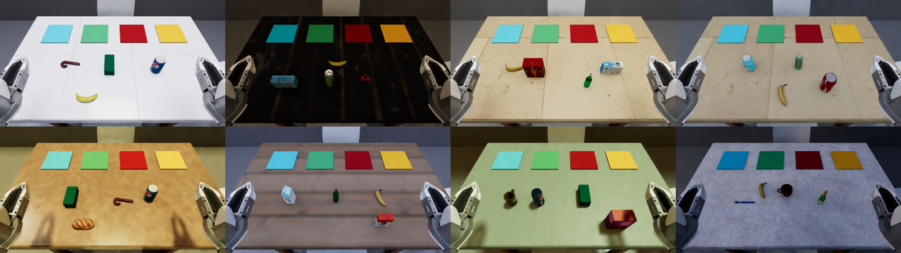
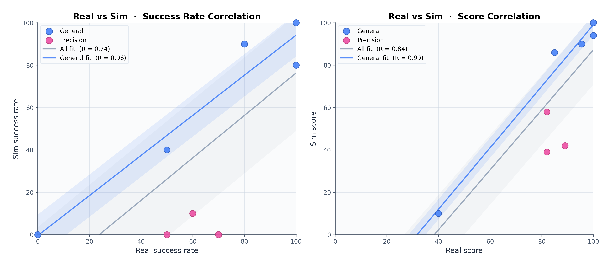

가상 작업대의 배경과 물체 위치를 바꾸며 로봇을 평가해도, 학습할 때 본 조합을 다시 시험하고 있다면 점수가 실제 적응 능력을 과장할 수 있어요. 평가 장면이 낯설다는 조건과 가상 점수가 실물 성능을 예측한다는 조건을 함께 확인해야 해요.

2026년 10월 13일 개정된 논문의 두 번째 판은 시뮬레이션 평가 체계인 <abbr title="학습 장면과 평가 장면을 나누고 가상 결과를 실물 결과와 대조하는 로봇 조작 평가 체계">X2Real</abbr>을 소개해요. 로봇 행동 모델을 가상 환경에서 평가하는 기반인 <abbr title="로봇과 장면과 과제를 조합해 가상 환경에서 행동 모델을 시험하도록 돕는 소프트웨어 기반">Isaac Lab-Arena</abbr> 위에서 과제를 구성해요. 이 연구에서 가져올 판단은 새 장면을 많이 만드는 일과 평가를 믿을 수 있게 만드는 일이 서로 다른 검사를 요구한다는 점이에요.

## 장면을 바꾸는 것과 학습에서 떼어 두는 것을 구분해요

로봇의 관측과 지시에서 다음 행동을 정하는 모델을 <abbr title="카메라 관측과 지시를 받아 로봇의 다음 움직임을 정하는 모델">정책</abbr>이라고 해요. 정책은 물체를 구별하는 데 필요한 단서 대신, 특정 물체가 늘 같은 자리에 있다는 규칙을 배울 수도 있어요. 이런 모델은 익숙한 장면에서 성공해도 배치가 바뀌면 실패해요. 평가가 같은 배치를 반복하면 이 차이를 발견하기 어려워요.

X2Real은 자료 수집을 녹색 배경의 표준 가상 작업대에 모으고, 평가 설정은 그 수집 환경과 구분해요. 여기서 <abbr title="학습과 평가에서 어떤 종류의 장면과 조건이 얼마나 자주 나오는지를 나타내는 범위와 비율">분포</abbr>는 배경 이미지 목록보다 넓은 뜻이에요. 물체 종류, 위치, 지시문, 집게와 카메라 조건도 포함해요. 난수의 시작값만 바꿔 같은 장면을 다시 뽑는 것과, 학습에 없던 조건을 평가용으로 남겨 두는 것은 달라요.

배경이 달라도 집어야 하는 물체와 목적지가 항상 같은 위치라면, 위치를 외운 행동이 높은 점수를 얻을 수 있어요. 반대로 물체만 바뀌고 색과 목적지 관계가 유지된다면 그 관계를 배웠는지 시험할 수 있어요. 그래서 평가를 만들 때는 무엇을 유지하고 무엇을 새롭게 할지 적어야 해요. 무작위라는 말만으로 학습 자료와 평가 자료의 독립성이 성립하지는 않아요.

연구는 장면의 외관, 과제 설정, 로봇 구성을 바꾸는 규칙을 나눠요. 이런 조건 변화 방식을 <abbr title="조명과 물체 위치 같은 가상 환경의 조건을 정해진 범위 안에서 바꿔 특정 장면에만 익숙해지는 것을 줄이는 방법">도메인 무작위화</abbr>라고 해요. 외관에는 조명과 바닥·책상 재질이, 과제 설정에는 물체와 방해물 배치·지시문이 들어가요. 로봇 구성에는 집게 종류, <abbr title="카메라가 공간의 어느 위치를 어떻게 영상에 담는지 맞춰 주는 수치">카메라 보정값</abbr>, 책상 높이가 포함돼요.

<figure class="fig"><figcaption>원문 그림 3은 같은 색 분류 규칙 아래 조명·책상 재질·물체가 바뀌는 예예요. 변형 장면을 생성할 수 있다는 사실과 학습·평가 조합을 따로 관리한다는 사실은 구분해 확인해야 해요. 출처: Lian Ruan 외, <a href="https://arxiv.org/html/2609.27449v2#S2.F3">그림 3</a> · 출처 표시 조건의 <a href="https://creativecommons.org/licenses/by/4.0/">CC BY 4.0</a> · 원본 PNG, 변경 없음</figcaption></figure>

모든 과제에서 세 축을 똑같이 바꾸지는 않아요. 일반화 과제는 세 축을 모두, 다른 추론 과제는 외관과 과제 설정을, 조작 과제는 외관을 바꾸는 구성을 사용해요. 조작의 정밀도를 비교하는데 집게까지 함께 바꾸면 원인을 해석하기 어려워지기 때문이에요. 이 설계는 무작위화를 많이 넣는 것보다 평가하려는 능력과 변화 축을 맞추는 일이 먼저임을 보여 줘요.

## 생성 규칙과 판정 규칙을 따로 재사용해요

기반 시스템인 <abbr title="장면과 로봇과 과제 정의를 조합하고 실행 결과를 기록하는 X2Real의 시뮬레이션 소프트웨어">Mana</abbr>는 장면, 로봇, 과제 정의를 나눠 관리해요. 장면에는 물체와 배치가, 로봇 정의에는 집게·카메라·구동 설정이 들어가요. 과제는 어떤 물체를 어느 곳에 놓아야 하는지와 단계 사이의 선후 관계를 정해요. 같은 색 분류 과제를 다른 물체 묶음과 조합해도 성공 조건을 새로 작성하지 않도록 하는 구조예요.

과제는 <abbr title="되돌아오는 고리 없이 단계들을 연결해 어떤 단계가 먼저 완료돼야 하는지 나타내는 구조">방향성 비순환 그래프</abbr>로 표현해요. 노드는 집기나 놓기 같은 세부 목표이고, 연결은 선행 조건이에요. 평가기는 가상 물체의 상태를 읽어 노드 완료를 검사하고, 정책에는 허용된 관측만 보내요. 평가용 정답 상태가 정책의 입력으로 새어 들어가면 카메라만 사용하는 실물 조건과 비교하기 어려워요.

이 구조에서 최종 성공률과 진척 점수는 다른 질문에 답해요. 성공률은 마지막 요구까지 끝낸 시행의 비율이고, 진척 점수는 실패한 시행에서도 어느 단계까지 왔는지를 보여 줘요. 단계 완료가 기록돼 있으면 마지막 배치에서 막힌 모델과 집기부터 못 한 모델을 나눌 수 있어요. 다만 단계 기록은 어디서 멈췄는지를 알려 줄 뿐, 접촉 때의 물리적 성질이나 시각 인식 중 무엇이 물리적 원인인지를 자동으로 확정하지는 않아요.

장면 생성에는 물체 사이 충돌과 배치 가능성을 검사하는 과정이 있어요. 시뮬레이션용 물체도 눈에 보이는 형상만 준비하지 않고, 충돌 표면·질량·관절과 과제에 필요한 상호작용을 검사해요. 이런 사전 검사는 실행 불가능한 장면이 정책 실패로 집계되는 문제를 줄여요. 그러나 설정 파일 검사를 통과했다는 사실이 실물과 같은 마찰이나 충격 반응을 입증하는 것은 아니에요.

자료 수집과 평가가 같은 기반을 쓰는 것은 관리에 도움이 되지만 공정성을 자동 보장하지는 않아요. 같은 과제 정의를 재사용하되 학습용 물체 목록과 평가용 변형 규칙을 구별해야 해요. 특정 모델의 실패를 보고 장면을 계속 바꾸면 평가 분포도 달라지므로, 이전 점수와 비교할 때 생성 규칙의 버전을 고정할 필요가 있어요. 이는 논문의 분리 설계를 실제 평가 운영에 적용할 때 필요한 관리 기준이에요.

## 실물 대응은 모델 한 개와 여덟 과제에서 확인했어요

가상 점수의 실물 예측력을 검사한 실험은 전체 평가 목록과 구분해 읽어야 해요. 저자들은 기존 실물 평가 환경인 ManipArena의 여덟 과제를 가상으로 복제했어요. 조명·물체·로봇 구성을 맞추고, 실제 시연으로 추가 학습한 행동 모델 Wall-OSS-0.5를 실행해요. 이 대응 실험의 모델 학습에는 가상 자료를 사용하지 않았어요.

여덟 과제 중 다섯은 숟가락을 그릇에 넣기, 색에 맞춰 블록 놓기 같은 일반 조작이고, 셋은 안경을 선반에 놓기, 고리를 막대에 끼우기, 컵 세 개를 삼각형으로 쌓는 정밀 조작이에요. 따라서 이 실험은 한 모델의 과제별 가상·실물 점수가 함께 변하는지를 확인해요. 여러 모델의 실물 순위가 모든 환경에서 보존되는지를 검증한 실험으로 넓혀 읽으면 안 돼요.

저자들은 로봇팔의 제어 설정도 맞춰요. 실제 시연에서 기록한 손끝 목표를 가상 로봇에 시간 순서대로 재생하고, 손끝 위치·방향 오차가 줄어들도록 관절을 움직이는 구동기의 반응 계수를 탐색해요. 평균 오차뿐 아니라 오차가 큰 쪽의 95번째 백분위도 목적에 넣어요. 대부분의 시간에는 잘 맞아도 간헐적으로 크게 벗어나는 움직임을 함께 줄이려는 선택이에요.

이 보정에서 탐색용 궤적, 설정 선택용 궤적, 마지막 평가용 궤적을 나눠요. 그러나 자유 공간에서 손끝 경로가 잘 맞는다고 물체 접촉까지 같아지는 것은 아니에요. 집게의 작은 위치 오차가 안경 다리를 접게 하거나, 미끄러지는 순간이 달라지면 이후 관측은 전혀 달라질 수 있어요. 원문도 궤적 오차를 줄인 계수가 실제 접촉 과제에 가장 좋은 계수라고 보장하지 않아요.

두 환경의 점수가 함께 움직이는 경향은 <abbr title="두 점수가 함께 커지거나 작아지는 정도를 나타내며 같은 숫자가 나오는지까지 보장하지는 않는 통계값">선형 상관계수</abbr>로 나타내요. 다음 표에서는 같은 모델을 실행한 과제 묶음에 따라 이 값이 어떻게 달라지는지 볼 수 있어요.

| 비교한 과제 범위 | 성공률의 선형 상관계수 | 진척 점수의 선형 상관계수 |
| --- | ---: | ---: |
| 일반 조작 다섯 과제 | 0.96 | 0.99 |
| 정밀 조작을 포함한 전체 여덟 과제 | 0.74 | 0.84 |

표는 원문 4.1.2절과 그림 20의 값을 옮겼어요. 상관계수가 높다는 것은 두 점수가 같은 숫자라는 뜻과는 달라요. 0.84를 성공률 84%나 예측 정확도 84%로 읽으면 안 돼요. 논문 초록의 대표값만 보면 이 차이가 사라지므로, 성공률과 진척 점수 중 어느 지표인지 본문의 구분을 따라야 해요.

<figure class="fig"><figcaption>원문 그림 20이에요. 왼쪽은 성공률, 오른쪽은 진척 점수이고, 파란 점은 일반 조작, 분홍 점은 정밀 조작이에요. 분홍 점에서 실물보다 가상 점수가 낮아지는 차이가 보이므로 전체 상관계수만으로 두 환경이 같다고 판단할 수 없어요. 출처: Lian Ruan 외, <a href="https://arxiv.org/html/2609.27449v2#S4.F20">그림 20</a> · <a href="https://creativecommons.org/licenses/by/4.0/">CC BY 4.0</a> · 원본 PNG, 변경 없음</figcaption></figure>

## 같은 성공도 재시도 횟수는 다를 수 있어요

숟가락을 그릇에 넣는 과제의 성공률은 실물 100%, 가상 80%였어요. 저자들이 제시한 실행 예에서는 실물 로봇이 첫 집기에 성공하지만, 가상 로봇은 숟가락을 잡기까지 여러 번 시도해요. 최종 성공 여부만 비슷하면 중간 동작도 비슷하다고 생각하기 쉽지만, 두 환경은 같은 결과에 다른 경로로 도달할 수 있어요. 실제 작업 시간이나 접촉 횟수를 평가하려면 그 지표를 별도로 기록해야 해요.

안경을 선반에 놓는 과제에서는 성공률이 실물 70%, 가상 0%로 벌어져요. 원문은 가상에서 놓기에 실패한 뒤 안경 다리가 접히면, 모델이 학습에서 보지 못한 상태를 만나 복구하지 못한다고 설명해요. 일반 조작에서는 반복 시도가 작은 오차를 흡수할 수 있지만, 한 번의 접촉이 물체 상태를 바꾸는 과제에서는 같은 전략이 통하지 않을 수 있어요. 이 실패는 평가 환경의 오차가 작업 구조에 따라 증폭될 수 있다는 사례예요.

이 관찰만으로 물리 엔진이나 제어기 하나를 원인으로 확정할 수는 없어요. 원문도 시뮬레이터·제어·영상 생성에서 남는 차이를 함께 언급해요. 실패를 줄이려면 관측 영상과 손끝 경로, 접촉 뒤 물체 상태를 같은 시점에 대조할 필요가 있어요. 전체 점수가 낮다는 이유만으로 정책을 재학습하면 환경 오차에 맞춰 행동을 바꾸는 결과가 될 수도 있어요.

특히 전체 상관계수가 높아도 정밀 과제의 절대 성공률은 크게 틀릴 수 있어요. 넓은 능력 비교를 위한 선별 평가와 실제 조립·삽입 작업의 배포 판단은 요구하는 오차 범위가 달라요. 정밀 과제가 목적이라면 일반 과제 다섯 개의 높은 상관관계를 근거로 평가 환경을 승인하기 어려워요. 목적 과제에 가까운 접촉을 따로 대조하는 검사가 필요해요.

## 낯선 장면의 점수는 집계 방식과 함께 읽어요

별도의 가상 정책 비교에서는 같은 작업 시연을 사용해 네 모델을 추가 학습해요. 앞의 실물 대응 검사와는 학습 자료와 목적이 다른 실험이에요. 논문은 학습 조건과 비슷한 <abbr title="학습 자료를 모은 환경과 비슷한 범위의 조건에서 수행하는 평가">분포 내 평가</abbr>와, 바뀐 조건을 사용하는 <abbr title="학습 때의 조건 범위를 벗어나도록 장면 등을 바꿔 수행하는 평가">분포 밖 평가</abbr>를 나눠 보고해요. 낯선 장면에서 점수가 얼마나 떨어지는지 확인하려는 비교예요.

원문 표 1에서 Wall-x-preview의 전체 성공률은 분포 내 53.90%, 분포 밖 34.26%예요. 진척 점수는 각각 67.25와 56.63이에요. 이 값은 전체 시행을 한 통에 합친 성공 비율이 아니라 계층별 평균이에요. 먼저 과제별 결과를 구하고, 세부 능력 범주와 큰 범주를 차례로 같은 비중으로 평균 내므로 과제가 많은 범주가 총점을 독점하지 않아요.

따라서 다른 평가의 총점과 숫자만 맞대면 판단이 틀릴 수 있어요. 같은 실행 기록도 과제별 동일 비중인지 시행별 동일 비중인지에 따라 총점이 달라져요. 성공률과 진척 점수의 차이는 끝까지 완료하지 못한 작업이 많다는 신호로 읽되, 진척 점수를 성공 확률로 치환하지 않아야 해요. 반복 실행 수와 과제 구성, 평균 규칙을 보존해야 다음 버전과 비교할 수 있어요.

분포 밖 설정이 모든 과제에서 점수를 떨어뜨리는 것도 아니에요. 원문은 전체 집계의 하락을 보고하지만, 개별 과제에서는 반대 방향의 변화도 나타나요. 어떤 변형이 실제로 더 어렵게 작용했는지는 과제별 결과로 확인해야 해요. '분포 밖'이라는 이름만으로 난이도의 순서나 실물 환경의 대표성이 정해지지는 않아요.

비교 정책의 학습 반복 수와 행동 표현도 서로 달라요. 행동 표현은 손끝 위치로 움직임을 지시할지 관절값으로 지시할지 같은 차이를 말해요. 원문은 같은 시연 자료와 공통 평가 인터페이스를 사용하면서 각 모델의 고유 학습·행동 표현을 따르므로, 이를 계산량까지 동일한 비교라고 말할 수는 없어요. 이 결과는 정해진 설정에서의 모델 비교예요. 특정 구조의 일반적인 우월성이나 임의의 실물 장비에서 낼 성능을 증명하지 않아요.

## 새 평가에서는 분리 규칙과 접촉 대조부터 정해요

X2Real의 현재 과제는 형태가 잘 변하지 않는 물체와 관절로 연결된 물체의 조작에 집중해요. 천·유체·부드러운 재료의 변화나 촉각 입력까지 같은 신뢰도로 평가했다는 근거는 없어요. 과제 작성에도 사람의 설계와 보조 도구가 들어가므로, 자동 생성 체계를 갖췄다는 사실을 무제한의 검증된 과제 공급으로 해석하기 어려워요. 새로운 과제를 늘릴수록 판정 규칙과 접촉 검사의 책임도 늘어요.

시뮬레이션 평가를 도입할 때는 먼저 무엇을 예측하려는지 정할 수 있어요. 여러 모델을 빠르게 선별하려는지, 정밀 접촉에서 실물 성공률을 추정하려는지에 따라 대조할 과제가 달라져요. 그다음 학습 자료 수집 조건과 평가용 변형 목록을 별도로 남겨요. 배경만 새롭게 할지, 물체와 집게까지 바꿀지 정하고, 각 변화가 검증하려는 능력과 맞는지 확인해요.

실물 대조에는 일반 집기와 실패 뒤 물체 상태가 바뀌는 정밀 접촉을 함께 넣을 이유가 있어요. 같은 명령의 손끝 경로를 맞춘 다음, 접촉 이후의 상태와 재시도 기록을 비교하면 궤적 보정으로 해결되지 않은 오차를 찾을 수 있어요. 성공률, 진척, 완료까지의 시도 수를 구분해 남기고, 정책에 제공한 관측과 평가기만 사용한 정답 정보도 표시해요. 이는 이번 연구의 결과를 바탕으로 도출한 적용 순서이며, 새로운 장비에서 성능 개선을 실측한 절차는 아니에요.

평가 장면을 갱신할 때는 이전 생성 규칙과 고정 비교 묶음을 보존해요. 그래야 정책의 향상과 시험 문제의 변화를 나눌 수 있어요. 최종 승인에는 전체 상관계수 외에 목적 과제의 절대 오차와 실패 뒤 상태 변화를 사용해요. 학습에서 분리한 장면을 잘 푼다는 근거와 실물 접촉을 충실히 재현한다는 근거가 함께 있어야 가상 평가의 쓰임을 정할 수 있어요.

<!-- src-block -->
출처 — https://arxiv.org/abs/2609.27449v2
