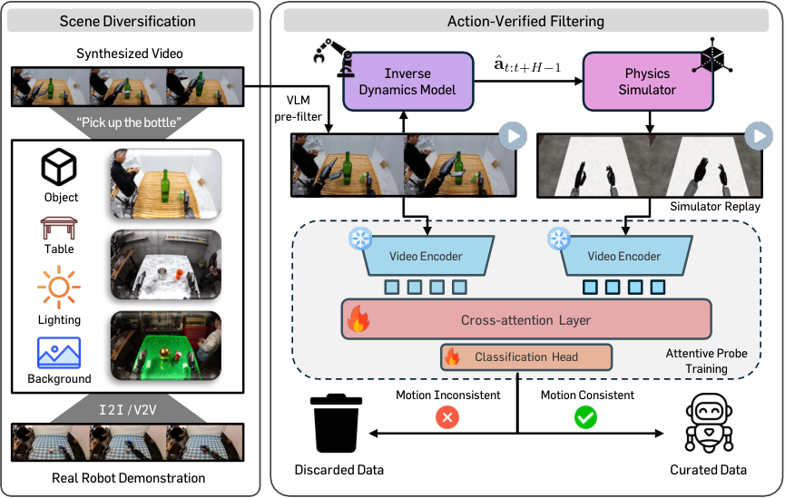
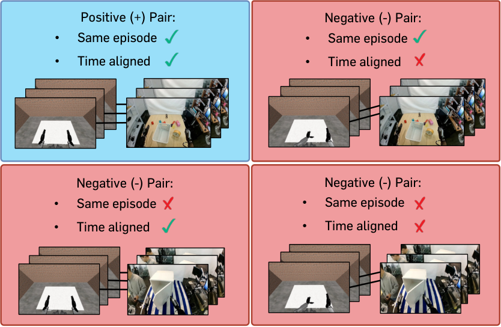

로봇이 병을 들어 올리는 생성 영상이 자연스러워도, 그 영상에 붙은 관절 명령이 같은 움직임을 만드는지는 별개예요. 합성 데이터 정제 기법 RoboCurate는 명령을 시뮬레이터에서 재생한 영상과 생성 영상을 비교해, 영상과 행동이 맞지 않는 학습 자료를 걸러내요.

## 영상의 그럴듯함과 행동의 일치를 나눠요

로봇 학습용 자료는 관측 영상과 그때 실행할 행동이 짝을 이뤄야 해요. 영상 생성 모델로 조작 장면을 늘릴 때는 행동 기록이 함께 생기지 않으므로, 장면 변화를 보고 명령을 추정하는 <abbr title="연속된 장면을 보고 그 사이에 로봇이 어떤 명령을 실행했을지 추정하는 모델">역동역학 모델</abbr>을 사용해요. 이 추정에 오류가 있으면 학습 모델은 병이 위로 움직이는 장면을 보면서도 엉뚱한 방향의 명령을 정답으로 배울 수 있어요. 로봇 손이 자연스럽게 보인다는 판단만으로는 이런 짝의 오류를 찾기 어려워요.

2026년 11월 5일 개정된 논문은 이 문제를 두 검사로 나눠요. <abbr title="영상과 문장을 함께 읽고 장면의 내용이나 조건을 판단하는 모델">시각언어 모델</abbr>은 생성된 팔과 손의 깊이 관계, 공간 방향이 그럴듯한지 먼저 확인해요. 그다음 행동 명령을 실행한 가상 로봇의 움직임이 생성 영상과 맞는지 별도로 판정해요. 앞 검사는 영상 자체의 이상을, 뒤 검사는 영상에 붙인 행동의 이상을 겨냥해요.

이 구분은 합성 자료를 선택하는 기준을 바꿔요. 외관이 선명하고 지시를 잘 따른 영상도 행동 정답으로는 틀릴 수 있고, 배경이 단순한 가상 영상도 명령의 의미를 확인하는 비교 자료가 될 수 있어요. 따라서 생성 화질 점수, 영상과 행동의 일치 점수, 그 자료로 학습한 정책의 작업 성적을 따로 읽어야 해요. 한 점수가 높다는 이유로 나머지까지 검증됐다고 볼 수는 없어요.

<figure class="fig"><figcaption>원문 그림 1. 왼쪽은 장면 다양화, 오른쪽은 행동 재생과 영상 쌍의 일치 판정이에요. 재생 영상에 물체가 없는 점이 검증 범위를 읽는 단서예요. (출처: Seungku Kim 외, RoboCurate, 그림 1, <a href="https://arxiv.org/html/2602.18742v2#S1.F1">원문</a>. arXiv 비독점 배포 라이선스 확인; 구성과 검증 범위를 논평하기 위한 원그림 인용, 변경 없음)</figcaption></figure>

## 물체 없는 시뮬레이터가 명령의 움직임을 보여줘요

재생 환경은 실제 장면 전체를 복원한 디지털 트윈과 달라요. 논문 부록의 세 로봇 환경은 모두 비교할 로봇 움직임에 집중하도록 물체를 제외해요. 휴머노이드 <abbr title="이 연구에서 양팔과 손의 실제 시연 및 가상 조작에 사용한 푸리에사의 로봇">GR-1</abbr>은 <abbr title="가상 로봇팔 조작 환경을 구성하고 실행하는 소프트웨어 모음">robosuite</abbr> 위에 만든 가정 조작 환경을 사용해요. 휴머노이드 ALLEX는 <abbr title="로봇의 움직임과 카메라 영상을 가상 공간에서 계산하는 엔비디아 시뮬레이터">Isaac Sim</abbr>, 양팔 로봇 OpenArm은 <abbr title="가상 로봇을 여러 환경에서 학습하고 평가하도록 구성하는 엔비디아 도구">Isaac Lab</abbr>에서 재생해요. 세 환경의 제어 주기는 모두 초당 20회예요.

ALLEX 재생에서는 목에 붙인 가상 카메라의 위치 관계를 유지하고, 실제 카메라에 맞춘 투영 조건을 사용해요. 로봇 명령은 같아도 카메라가 돌아가면 영상 속 손의 이동 방향이 달라지므로, 관측 조건이 일치 판정에 들어가는 셈이에요. 배경은 기본 바닥과 빈 공간으로 두어 실제 영상의 탁자 질감이나 병 색까지 복원하지 않아요. 환경을 정교하게 꾸미는 비용을 줄이고 행동에 대응하는 로봇 운동을 비교하는 설계예요.

이 구조가 확인하는 것은 명령으로 만들어지는 팔과 손의 운동이에요. 가상 손이 생성 영상과 같은 궤적을 그려도 병을 충분한 힘으로 잡았는지, 손가락 사이에서 미끄러지는지, 실제 탁자와 부딪히는지는 이 재생만으로 확인되지 않아요. 물체가 없는 환경에는 그런 성공 조건을 계산할 대상 자체가 없기 때문이에요. 따라서 여기서 행동 검증을 통과했다는 말은 접촉 작업의 물리적 성공을 보장한다는 뜻으로 넓힐 수 없어요.

시뮬레이션 작업에 옮길 때도 같은 경계를 두는 편이 좋아요. 먼저 명령이 어느 관절과 어느 좌표에 적용되는지, 카메라에서 어떤 움직임으로 보이는지를 검사할 수 있어요. 그 뒤 파지와 운반의 성공을 확인하려면 물체·마찰·충돌 조건이 있는 별도 실행이 필요해요. 두 검사를 분리하면 단위나 관절 순서 오류를 잡는 단계와 접촉 모델을 검증하는 단계를 혼동하지 않게 돼요.

## 판별기는 다른 시점과 다른 시연을 구별하며 배워요

영상 두 개를 비교하는 판별기는 실제 시연으로 학습해요. 실제 로봇 영상과 그 시연의 기록된 행동을 가상 로봇에서 재생한 영상을 묶고, 같은 시연의 같은 시간 구간이면 일치하는 쌍으로 둬요. 틀린 쌍은 같은 시연의 시간을 어긋나게 하거나, 같은 작업 종류 안에서 다른 시연의 재생 영상을 가져와 만들어요. 두 조작을 함께 적용한 쌍도 포함해요.

작업 종류를 같게 유지하는 이유가 있어요. 병 들기와 서랍 열기를 구분하는 것만 배우면 손이 어느 순간 어느 방향으로 움직였는지는 놓칠 수 있어요. 같은 종류의 작업에서도 다른 궤적과 다른 시간 구간을 구별해야, 판별기가 작업 이름보다 운동의 차이를 보도록 유도할 수 있어요. 생성 자료의 행동 정답에는 이미 오류가 있을 수 있으므로, 이 판별기를 가르칠 때는 생성 자료를 제외해요.

두 영상에서 각각 16프레임을 고르게 뽑아 <abbr title="연속 영상에서 물체와 움직임의 특징을 추출하도록 미리 학습한 영상 모델">V-JEPA 2</abbr>에 넣어요. 이 영상 모델의 가중치는 고정하고, 두 특징을 함께 읽어 일치 여부를 판단하는 작은 신경망만 학습해요. 논문에서 말하는 <abbr title="두 영상의 특징 중 비교에 필요한 부분을 골라 움직임이 맞는지 분류하는 작은 신경망">attentive probe</abbr>가 이 부분이에요. 기본 설정은 일치 확률이 0.5보다 큰 자료를 남기며, 그 전에 영상의 물리적 그럴듯함을 5점 중 3점 이상으로 거르는 검사를 둬요. OpenArm 실험에서는 앞 검사의 기준을 4점으로 높였어요.

<figure class="fig"><figcaption>원문 그림 2. 왼쪽 위는 같은 시연의 시간 구간을 맞춘 쌍이고, 나머지는 시간이나 시연을 바꾼 쌍이에요. 물체 외관을 똑같이 만드는 대신 운동 차이를 학습하도록 자료를 구성해요. (출처: Seungku Kim 외, RoboCurate, 그림 2, <a href="https://arxiv.org/html/2602.18742v2#S3.F2">원문</a>. arXiv 비독점 배포 라이선스 확인; 학습 쌍 구성에 관한 논평 목적의 원그림 인용, 변경 없음)</figcaption></figure>

자동으로 정답과 오답 쌍을 만들 수 있다는 장점에도 전제는 남아요. 기록된 실제 행동을 올바른 가상 로봇에 넣을 수 있어야 하고, 영상과 명령의 시간 대응도 맞아야 해요. 이 전제가 깨지면 정상 시연이 틀린 쌍처럼 보일 수 있어요. 적용 전에 시간 동기화와 행동 변환을 확인하는 일은 판별기 성능을 높이는 작업과 구분해야 해요.

## 장면을 늘리는 작업과 거르는 작업을 함께 비교해요

논문은 탁자, 대상 물체, 조명, 배경을 나누어 바꿔요. 시작 이미지를 편집한 뒤 새로운 움직임을 생성하는 방식과, 이미 생성한 영상의 외관을 바꾸면서 움직임을 유지하는 방식을 함께 사용해요. 윤곽선 정보를 조건으로 주고 물체 형태와 로봇 색을 보존하도록 요청해 장면 구조가 크게 흐트러지는 것을 줄여요. 영상 외관을 바꾼 자료에서는 움직임을 보존한다는 전제 아래 기존에 추정한 행동을 다시 사용해요.

여기에도 확인할 문제가 생겨요. 외관 편집이 손가락 모양이나 물체 경계를 바꾸면 사람 눈에는 비슷해도 행동과 관측의 대응은 달라질 수 있어요. 따라서 다양화는 거르기 전에 선택할 후보 범위를 넓히는 과정으로 읽어야 해요. 편집했다는 사실만으로 학습에 유효한 새 시연이 완성됐다고 판정할 수는 없어요. 반대로 거르기만 하면 기존의 좁은 장면 분포 안에서 자료를 고를 뿐이므로, 두 구성 요소를 나눠 비교할 필요가 있어요.

## 성공률은 학습 단계와 분모를 함께 읽어야 해요

시뮬레이션 실험의 기본 정책은 <abbr title="카메라 영상과 작업 지시를 받아 로봇 행동을 출력하는 엔비디아의 로봇 학습 모델">GR00T N1.5</abbr>예요. 실제 시연과 합성 자료로 사전학습한 뒤 가상 조작 과제에 맞춰 추가 학습해요. 비교 방법들은 거르기 전 합성 후보를 1만 개로 맞춰요. 거른 뒤 남은 자료 수까지 동일하게 맞췄다는 뜻은 아니에요. 또한 행동 출력부는 기존 사전학습 가중치를 불러오지 않고 새로 학습해요.

부록의 학습 순서도 결과 해석에 중요해요. 전체 사전학습 6만 갱신 중 앞 5만 갱신에는 합성 자료 전체를 쓰고 마지막 1만 갱신에 정제된 자료로 바꿔요. 실제 자료와 합성 자료의 기본 표집 비율은 1 대 1이에요. 따라서 보고된 결과를 처음부터 끝까지 불량 자료를 제거한 학습의 효과로 설명하면 실험과 달라져요. 후반 학습에서 어떤 자료를 보여주는지가 포함된 비교예요.

아래 수치는 원문 표 1과 표 2의 작업별 평균 성공률이에요. <abbr title="가상 휴머노이드가 물체 재배치와 관절이 있는 물체 조작을 수행하는 24개 탁상 과제 평가 묶음">GR-1 Tabletop</abbr>은 과제당 50회 평가해요. <abbr title="휴머노이드와 손이 달린 양팔 로봇의 여섯 가상 조작 과제를 비교하는 평가 묶음">DexMimicGen</abbr>은 과제당 시연 100개로 추가 학습하고, 세 무작위 초기값에서 각각 과제당 50회 평가해요.

| 사전학습 자료 구성 | 탁상 과제 시연 300개 | 탁상 과제 시연 1,000개 | 양팔 조작 평가 |
| --- | ---: | ---: | ---: |
| 실제 자료만 | 15.4% | 27.9% | 44.6% |
| 실제 자료와 다양화 없는 합성 자료 | 19.5% | 32.1% | 46.4% |
| 실제 자료와 장면 다양화 자료, 거르기 없음 | 22.7% | 34.0% | 49.3% |
| 실제 자료와 장면 다양화 자료, 행동 검사 적용 | 29.3% | 34.6% | 57.6% |

탁상 과제 시연 300개 조건에서 실제 자료만 쓴 경우와 행동 검사까지 쓴 경우의 차이는 13.9퍼센트포인트예요. 초록의 90.3% 향상은 이 차이를 기준 성공률로 나눈 상대 향상률이에요. 성공률이 90.3%가 됐다는 뜻은 아니에요. 같은 평가에서 과제당 시연이 1,000개일 때 다양화 자료에 검사를 추가한 평균 차이는 0.6퍼센트포인트로 작아져요.

과제 묶음 안의 변화도 동일하지 않아요. 시연 1,000개 조건의 관절 물체 조작은 거르기 전 43.0%, 거른 뒤 41.3%예요. 전체 평균이 올라도 모든 작업 종류에서 이득을 보장하지 않는 사례예요. 자료를 제거할 때 특정 동작의 다양성까지 줄었는지, 이미 실제 시연이 충분한 작업에서는 이득이 작아지는지 살펴볼 이유가 있어요. 이 표만으로 어느 요인이 원인인지는 확정할 수 없어요.

## 실물 결과는 네 후보 선택과 부분 성공 점수를 포함해요

실물 ALLEX와 OpenArm 실험은 위 사전학습 비교와 구성이 달라요. 이미 학습된 정책을 실제 자료와 합성 자료를 섞어 추가 학습하고, 생성 단계에서는 서로 다른 잡음으로 영상 후보 네 개를 만들어요. 먼저 그럴듯함 검사를 통과한 후보 중 일치 점수가 가장 높은 영상과 행동 쌍을 골라요. 이 <abbr title="여러 후보를 만든 뒤 정해진 점수가 가장 높은 하나를 선택하는 방법">Best-of-N</abbr> 설정에는 장면 다양화를 넣지 않았어요. 비교 대상의 한 후보 생성보다 생성 비용이 더 든다는 점도 함께 봐야 해요.

ALLEX는 과제당 24회 평가에서 성공에 1점, 부분 성공에 0.5점, 실패에 0점을 줘요. 실제 자료만 쓸 때 세 과제 평균은 13.9%, 네 후보 선택을 쓸 때는 38.9%로 보고해요. 이 값은 완전 성공 횟수만을 센 비율과 구분해야 해요. 새 행동인 캔 따르기의 25.0%도 같은 채점 규칙 아래의 평균이에요. 부분 성공이 섞일 수 있으므로 전체 성공 횟수로 역산하면 안 돼요.

OpenArm은 과제당 32회 평가하고, 작업 공간을 네 구역으로 나누어 구역마다 8회씩 실행해요. 이쪽은 성공 1점과 실패 0점의 이진 판정이며 평균은 21.9%에서 31.3%로 올라요. 두 로봇의 평균을 한 줄에서 비교하더라도 채점 방식과 기본 정책이 다르므로 로봇 간 우열을 뜻하지 않아요. 실제 시연은 각 로봇의 기존 작업에서만 모았고 새 물체나 새 행동의 작업에는 실제 시연을 추가하지 않았다는 조건도 결과와 함께 보존해야 해요.

## 검사 성적을 접촉 보증으로 바꾸면 실패해요

논문은 사람이 살핀 합성 자료 400개에서 영상은 맞지만 행동은 틀린 사례 27개를 찾아 따로 분석해요. 그 사례에서 제안 검사는 70.4%를 제거했고, 영상의 물리적 그럴듯함만 보는 비교 검사는 3.7%를 제거했어요. 이것은 특정 오류 묶음에서 놓치던 행동 불일치를 찾는 근거예요. 모든 합성 자료의 오류 검출률이나, 정상을 잘못 버리는 비율까지 말해 주는 수치는 아니에요.

확률 0.5라는 기준도 그대로 가져다 쓰기 전에 검증해야 해요. 같은 특징 추출기와 로봇으로 얻은 분류 확률은 다른 손, 시점, 속도 분포에서도 같은 신뢰도를 갖는다고 보장되지 않아요. 논문은 기준을 바꾼 실험을 제시하지만 모든 로봇에 공통인 최적 기준을 증명하지는 않아요. 특히 짧은 접촉 변화가 16프레임 표집 사이에 생기거나 손이 가려지면, 전체 움직임이 비슷하다는 판단과 마지막 파지 성립 여부가 갈릴 수 있어요.

실제 시연이 극도로 적을 때는 판별기 학습 쌍을 만드는 것부터 어려워요. 여러 후보를 생성하고 재생하는 비용도 필요해요. 저자들은 실제 시연 의존성과 후보 선택의 비용을 한계로 적고, 장래에는 물리 시뮬레이터 대신 영상 세계모델로 재생하는 확장을 제안해요. 이 확장은 현재 실험에서 검증된 구성과 구분해서 읽어야 해요.

## 적용할 때는 재생 계약부터 고정해요

합성 시연 수집에 이 방식을 적용한다면 먼저 검사 대상을 팔의 움직임 일치로 한정하고, 접촉 성공은 별도 항목으로 두는 순서가 맞아요. 그다음 실제 기록과 재생 사이의 관절 순서, 각도 단위, 절대값과 변화량의 구분, 제어 주기, 카메라 위치를 대조해요. 정상 기록을 넣어도 어긋나는 재생 환경에서는 분류 모델을 바꿔도 행동 정답의 기준이 흔들려요. 실제 기록에서 안정적으로 맞는 쌍이 나온 뒤에 시간과 시연을 바꾼 틀린 쌍을 구성할 수 있어요.

판별 기준을 정할 때는 제거한 수만 세지 않고, 남긴 정상 자료와 버린 정상 자료를 함께 검토해야 해요. 예를 들어 드물지만 유효한 큰 팔 동작이 낮은 점수를 받아 사라진다면, 평균 일치 점수는 높아져도 정책이 배울 동작 범위는 좁아질 수 있어요. 물체별·동작별 유지 비율을 남기고, 가상 환경 안에서 파지·운반·놓기 단계의 실패를 따로 확인하는 편이 이런 편향을 찾는 데 도움이 돼요. 이는 논문의 검증 범위에서 이어지는 적용 판단이며, 새 장비에서 측정된 결과는 아니에요.

마지막 정책 비교에서는 생성 후보 수, 정제 전후 자료 수, 실제 자료와의 표집 비율, 정제 자료를 투입한 학습 시점을 고정해 기록해야 해요. 그래야 자료를 더 생성한 효과와 행동 짝을 고른 효과를 분리할 수 있어요. **RoboCurate의 재생 검사는 학습 정답의 운동 대응을 확인하는 단계로 쓰고, 물체와 접촉하는 작업의 성공은 다음 실행에서 확인하는 것이 타당해요.**

<!-- src-block -->
출처 — https://arxiv.org/abs/2602.18742v2
