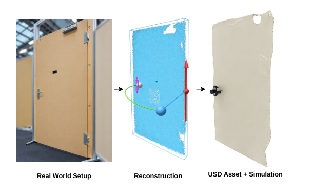
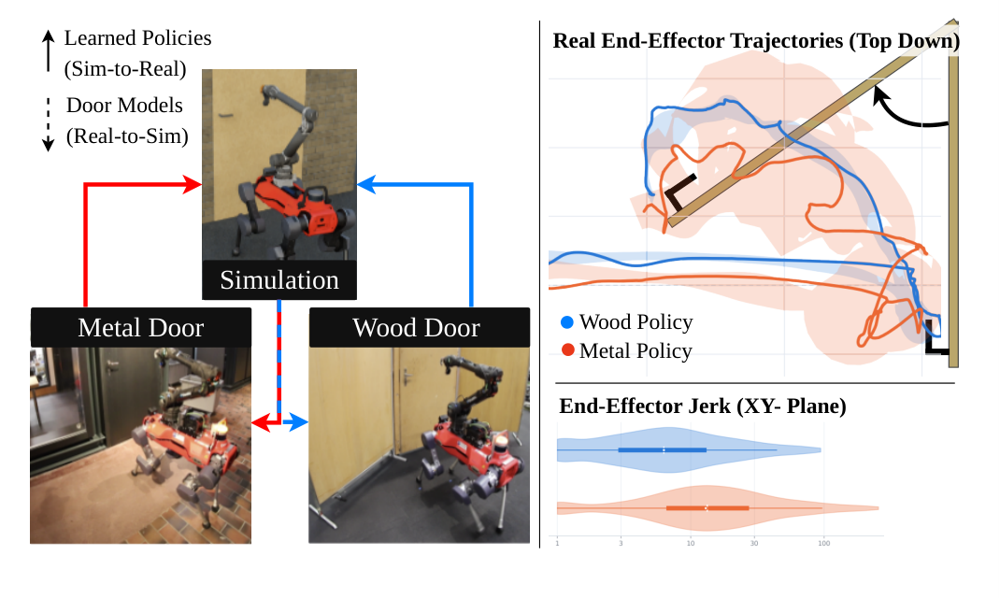

시뮬레이션 속 문이 실제 문과 같은 축으로 열려도, 같은 힘으로 열리지는 않을 수 있어요. <abbr title="실제 물체의 모양이나 움직임을 가상 공간에 대응시켜 실험과 예측에 쓰는 모델">디지털 트윈</abbr> 기법 <abbr title="사람이 물체를 움직이며 잰 힘과 자세로 가상 물체의 움직임과 저항을 맞추는 연구 방법">ForceTwin</abbr>은 사람이 문이나 서랍을 움직일 때의 힘을 측정해 이 차이를 줄여요.

## 모양과 움직임의 축만으로는 저항을 정할 수 없어요

디지털 트윈을 만들 때 문짝의 모양, 손잡이 위치, 회전축을 복원하면 어디로 움직이는지는 알 수 있어요. 그러나 서랍 안의 짐이 얼마나 무거운지, 문 위의 자동 닫힘 장치가 어느 각도에서 세게 당기는지는 겉모습만으로 정하기 어려워요. 같은 모양의 문도 내부 장치의 설정에 따라 필요한 힘이 달라져요. 물체의 형상을 잘 복원했다는 증거와 힘을 잘 재현한다는 증거를 따로 모아야 하는 이유예요.

2026년 9월 18일 공개된 ForceTwin 논문은 이 문제를 <abbr title="입력과 움직임을 측정해 대상의 물리적 특성이나 운동 규칙을 추정하는 과정">시스템 식별</abbr>로 다뤄요. 사람이 힘을 재는 손잡이형 도구로 물체를 잡고 움직이면, 도구의 위치·방향과 접촉 힘을 같은 시간 기준으로 기록해요. 연구진은 이 기록에서 관절 구조와 움직임에 필요한 힘의 모델을 구해 가상 물체에 연결해요. 사람의 동작을 그대로 모방하는 자료 수집과 달리, 움직임을 일으킨 물리 조건을 추정하는 데 기록을 사용해요.

여기서 복원하는 대상은 한 개의 독립된 좌표로 움직이는 단단한 부품이에요. 문처럼 회전하거나 서랍처럼 직선으로 움직이는 부품을 가정하고, 잡은 도구가 미끄러지지 않아야 해요. 도구가 문과 따로 움직이거나 문짝이 크게 휘면, 기록한 궤적이 관절의 움직임을 대표하지 못해요. 복잡한 가구 전체를 한 번에 이해하는 모델로 범위를 넓혀 읽으면 안 돼요.

## 느린 움직임과 빠른 움직임이 서로 다른 값을 드러내요

첫 단계는 도구 궤적에 회전 관절과 직선 관절 후보를 각각 맞추는 일이에요. 연구진은 자료를 잘 설명하면서 불필요하게 복잡하지 않은 후보를 선택한 뒤, 축의 위치와 방향, 각 시점의 관절 상태를 함께 보정해요. 처음 남긴 상태를 좌표의 시작점으로 두고, 처음 지속해서 움직인 방향을 양의 방향으로 정해요. 이 약속이 있어야 뒤에서 구한 힘의 부호와 가상 물체의 열림 방향을 맞출 수 있어요.

센서에 찍힌 힘에는 물체의 저항만 들어 있지 않아요. 손에 든 측정 도구의 무게와 가속에 따른 힘도 함께 섞여요. ForceTwin은 도구 자체의 중력과 <abbr title="물체의 움직이는 속도를 바꾸기 어렵게 만드는 성질로, 회전하는 문에서는 질량이 축에서 얼마나 떨어졌는지도 영향을 주는 값">관성</abbr> 성분을 보정한 뒤, 남은 접촉 힘과 회전시키는 힘을 관절이 허용하는 운동 방향으로 환산해요. 문의 경우 손잡이의 당기는 힘과 회전축까지의 거리가 함께 작용하므로, 힘의 크기 하나만 읽어서는 관절의 부하를 알 수 없어요.

물리 모델의 기본 항은 세 가지예요. 관성은 가속할 때 필요한 힘을, <abbr title="움직이는 방향의 반대로 작용하며 이 모델에서는 속도 크기와 무관한 저항으로 근사하는 마찰">쿨롱 마찰</abbr>은 운동 방향에 맞선 저항을 나타내요. <abbr title="움직이는 속도가 커질수록 저항도 커지는 효과를 나타내는 항">점성 감쇠</abbr>는 속도에 비례하는 저항을 담당해요. 세 계수는 음수가 되지 않도록 제한해 추정하며, 직선 관절에서 관성에 대응하는 값은 유효 질량이에요.

이 값들을 분리하려면 사람이 움직이는 방식도 달라져야 해요. 논문은 느리고 가속이 작은 구간으로 마찰을, 넓은 속도 범위로 감쇠를, 가속이 큰 구간으로 관성을 드러내도록 수집해요. 자동 닫힘 장치를 따라가며 움직이는 구간은 내부 기구의 힘을 확인하는 데 써요. 한 속도로 부드럽게 한 번 여는 기록만 모으면 여러 계수가 비슷한 방식으로 결과를 설명할 수 있어, 자료가 많아도 분리가 어려워요.

관절 상태의 속도와 가속도는 궤적을 매끄럽게 만든 뒤 시간에 따라 변한 양으로 구해요. 이 과정은 작은 위치 흔들림을 큰 가속도 오차로 키울 수 있어요. 연구진은 관절 끝에 가까운 표본, 속도가 거의 없는 표본, 계산된 가속도가 비현실적으로 큰 표본을 제외해요. 따라서 모델이 학습한 범위에는 정지 직전이나 관절 끝에서 벌어지는 모든 현상이 포함되는 것은 아니에요.

## 일정한 마찰로 남는 오차를 상태별 힘으로 학습해요

문을 닫는 내부 장치는 위치에 따라 저항이 달라지고, 열 때와 닫을 때 반응이 비대칭일 수도 있어요. 관성과 두 마찰 계수만으로는 이런 변화를 충분히 표현하기 어려워요. ForceTwin은 기본 물리식이 설명하고 남은 <abbr title="기본 모델의 예측과 측정 사이에 남은 차이">잔차</abbr>를 작은 학습 모델로 맞춰요. 결과적으로 필요한 힘은 가속에 따른 성분, 운동 방향과 속도에 따른 성분, 위치·속도에 따라 달라지는 추가 성분의 합이 돼요.

추가 성분도 아무 형태로나 두지는 않아요. 위치만으로 정해지는 부하와 속도에 따른 감쇠를 구분하고, 후자의 계수는 음수가 되지 않게 만들어요. 물체가 로봇에 가하는 감쇠력은 움직이는 방향을 거스르므로, 이 항이 운동에 에너지를 더해 주는 식으로 학습되는 것을 막아요. 열리는 방향과 닫히는 방향에는 다른 감쇠 출력을 허용해 비대칭을 담아요.

다만 물리식과 학습 모델을 나눴다고 실제 부품의 성질을 유일하게 찾는 것은 아니에요. 일정한 추가 감쇠는 기본 감쇠 계수에 섞일 수 있고, 각도에 따라 변하는 중력 부하는 내부 스프링 부하와 같은 항에 들어갈 수 있어요. 속도와 가속도가 자료 안에서 함께 변하면 관성 추정에도 다른 힘이 섞여요. 논문도 각 계수를 절대적인 물성 정답으로 보기보다, 전체 힘을 예측하는 데 쓰는 유효 계수로 해석해요.

잔차 학습은 자료를 무작위로 75%와 25%로 나눠 학습과 검증에 사용해요. 최대 1,200회 학습하고, 검증 오차가 120회 동안 개선되지 않으면 멈춰 가장 좋았던 <abbr title="학습으로 조정되며 입력에서 예측값을 계산하는 데 쓰이는 모델 내부의 수치">가중치</abbr>를 남겨요. 이 검증은 수집한 움직임 안에서의 예측을 보는 절차예요. 전혀 다른 문이나 관찰하지 않은 각도까지 일반화했다는 시험과는 구분해야 해요.

## 가상 물체로 옮길 때 축과 힘의 부호도 함께 바꿔요

<figure class="fig"><figcaption>원문 그림 2. 측정한 관절 모델을 복원된 문짝과 연결해 가상 물체로 만드는 예예요. 같은 모양을 만드는 단계와 측정한 힘을 연결하는 단계를 구분해야 해요. (출처: Tim Engelbracht 외, ForceTwin, 그림 2, <a href="https://arxiv.org/html/2609.21751v1#S3.F2">원문</a>, <a href="https://creativecommons.org/licenses/by/4.0/"><abbr title="저자와 출처 및 이용 허가를 표시하면 공유와 가공을 허용하는 공개 이용 조건">CC BY 4.0</abbr></a>, 변경 없음)</figcaption></figure>

측정 도구가 사용한 <abbr title="위치와 방향을 나타낼 때 기준으로 삼는 원점과 축의 약속">좌표계</abbr>와 가상 물체의 좌표계는 같지 않을 수 있어요. 연구진은 먼저 회전축과 물체의 위치를 맞추고, 해당 손잡이가 어느 문짝에 붙어 있는지도 연결해요. 가상 관절이 반대 방향을 양수로 쓰거나 시작 각도를 다르게 두면, 관절 범위와 상태별 힘 모델도 그 약속에 맞춰 바꿔야 해요. 겉모양과 축만 맞추고 힘의 부호를 남겨 두면 닫힘 저항이 열림을 돕는 힘으로 들어갈 수 있어요.

실험에서는 같은 기록에서 문짝과 손잡이를 복원해 측정 자료와 형상 자료가 좌표계를 공유해요. 이후 <abbr title="여러 도구가 가상 장면의 물체와 속성을 함께 다루도록 하는 장면 기술 체계">OpenUSD</abbr>의 장면 파일로 내보내요. 다른 곳에서 가져온 물체 자산에도 물리 모델을 연결할 수 있지만, 먼저 좌표를 맞추고 같은 부품을 가리키는지 확인해야 해요. 형상 복원이 필수로 같은 도구에서 이뤄져야 하는 것은 아니지만, 대응 관계가 생략되는 것은 아니에요.

기본 계수와 추가 힘 모델은 시뮬레이터에서 처리하는 방식도 달라요. 관성·마찰·감쇠는 실행 환경이 제공하는 물리 속성에 대응시키고, 상태별 저항은 매 계산 단계에서 관절 힘으로 더해요. 학습 모델을 실행할 수 없는 환경에서는 지원되는 스프링·댐퍼 표현으로 근사할 수 있지만, 이 변환은 추가 오차를 만들어요. 장면 파일을 읽었다는 사실만으로 학습한 힘의 변화까지 재현된다고 판단하면 안 돼요.

이 점은 <abbr title="가상 로봇의 학습 환경과 평가 실험을 구성하는 엔비디아 도구">Isaac Lab</abbr>에서 문 열기 학습을 구성할 때도 중요해요. 논문의 <abbr title="로봇이 관측한 상태에 따라 어떤 행동을 할지 정하는 규칙">정책</abbr> 학습 실험은 훈련 파이프라인에 있던 문 형상을 유지하고, 측정한 <abbr title="가해진 힘과 물체의 움직임이 어떻게 연결되는지 나타내는 운동 규칙">동역학</abbr>과 닫힘 장치를 연결해요. 복원한 모든 형상을 교체해서 결과가 좋아진 실험으로 읽을 수는 없어요. 무엇을 고정하고 무엇을 바꿨는지 알아야 이후의 전이 결과를 물리 모델의 효과와 연결할 수 있어요.

## 닫힘 시간과 목표 진행률은 다른 검증이에요

연구진은 관절축, 관성 값, 전체 닫힘 행동을 따로 검증해요. 관절축은 레이저 스캔에 표시한 12개 축과 대조했고, 관성은 정답을 확보할 수 있는 네 물체에서 비교했어요. 관성의 평균 절대 상대 오차, 즉 실제값에 비해 추정값이 벗어난 비율의 평균은 ForceTwin 29.5%, 영상과 언어로 값을 추정한 비교 방법 53.0%예요. 다만 가벼운 물체일수록 작은 힘이 센서 잡음에 묻히기 쉽고, 가장 작은 물체에서는 비교 방법의 추정이 더 정확했어요.

네 물체 모두에서 ForceTwin의 관성 추정이 실제보다 컸다는 점도 남아요. 논문은 다른 모델 오차가 관성 항에 흡수되는 분해의 한계와 일치한다고 설명해요. 마찰 계수와 학습된 내부 기구 힘에는 같은 방식의 독립 정답을 확보하지 못했어요. 그래서 전체 모델을 가상 문에 적용해, 실제 문을 놓았을 때와 같은 시간에 닫히는지를 별도로 확인해요.

아래는 원문의 자유 닫힘 실험 값이에요. 같은 문을 두 각도에서 놓고, 실제 시간과 두 가상 모델의 시간을 비교해요. 원문의 웹 문서에서는 표 번호를 가리키는 문장과 표의 배치가 일부 엇갈려, 여기서는 표 제목과 행의 수치를 기준으로 읽었어요.

| 문과 시작 각도 | 실제 닫힘 시간 | ForceTwin | 영상·언어 추정 |
| --- | --- | --- | --- |
| 금속 문 45도 | 5.6초 | 5.9초 | 2.1초 |
| 금속 문 90도 | 8.4초 | 8.8초 | 2.5초 |
| 나무 문 45도 | 3.7초 | 5.0초 | 2.0초 |
| 나무 문 90도 | 5.0초 | 6.0초 | 2.4초 |

네 조건의 절대 상대 오차를 같은 비중으로 평균하면 ForceTwin은 16.3%, 비교 방법은 57.7%예요. 금속 문에서는 잘 맞지만 나무 문 45도 조건에는 35.1%의 오차가 남아요. 전체 평균의 개선이 모든 조건에서 정밀한 재현을 뜻하지 않는다는 예예요. 닫힘 시간 하나가 맞아도 궤적 전체의 순간 속도와 접촉 힘이 모두 맞는지까지 확인한 것은 아니에요.

실물 제어 실험은 또 다른 질문을 다뤄요. 사족 로봇 <abbr title="이 연구에서 팔을 장착해 문과 서랍 조작을 평가한 사족 보행 로봇">Spot</abbr>과 로봇팔 <abbr title="이 연구에서 문과 서랍 조작을 평가한 프랑카사의 로봇팔">Franka FR3</abbr>가 손잡이를 이미 잡은 상태에서, 6초 안에 로봇별 목표까지 움직이도록 해요. 같은 제어기에 물리 모델이 미리 계산한 보상 힘을 더하는 조건만 바꿔 비교해요. 손잡이를 찾아 잡기까지 포함한 완전한 작업 성공률 시험은 아니에요.

아홉 물체·로봇 조합을 같은 비중으로 평균한 목표 진행률은 ForceTwin 87.3%, 영상·언어 추정 59.7%, 운동 구조만 쓴 모델 56.9%예요. 이 지표는 목표 거리나 각도까지 얼마나 진행했는지를 나타내며 100%에서 제한해요. 따라서 “100회 중 약 87회 성공”으로 바꾸면 뜻이 달라져요. 목표로 나눈 궤적 추종 오차도 각각 22.2%, 49.8%, 51.5%로 보고해, 얼마나 움직였는지와 움직이는 동안 얼마나 빗나갔는지를 함께 보여줘요.

강한 내부 저항이 있는 오븐과 금속 문에서는 비교 방법이 거의 움직이지 못하는 반면, 측정 모델은 더 멀리 진행해요. 그러나 저항이 약한 서랍과 미닫이문에서는 목표 진행률만 보면 비교 방법이 더 높은 행도 있어요. 물리 모델을 넣으면 모든 평가값이 일괄 개선된다는 결과는 아니에요. 또 Spot의 금속 문 조건은 필요한 힘이 로봇 구동 범위를 벗어나 평가 대상에서 빠져 있어, 아홉 조합의 평균을 열 개 조합으로 확대해서는 안 돼요.

## 문을 통과한 결과에도 학습 비교의 빈칸이 남아요

<figure class="fig"><figcaption>원문 그림 6. 오른쪽은 실제 나무 문에서 두 정책을 비교한 결과예요. 나무 문 모델로 배운 정책은 비교적 매끄럽고 금속 문 모델로 배운 정책은 당겼다가 멈추는 움직임을 보여요. 오른쪽 비교는 다섯 시행을 모은 결과예요. (출처: Tim Engelbracht 외, ForceTwin, 그림 6, <a href="https://arxiv.org/html/2609.21751v1#S4.F6">원문</a>, <a href="https://creativecommons.org/licenses/by/4.0/">CC BY 4.0</a>, 변경 없음)</figcaption></figure>

정책 학습에서는 나무 문과 금속 문의 식별 모델을 각각 연결해, 팔이 달린 사족 로봇 <abbr title="이 연구에서 가상 학습 후 실제 문 통과에 사용한 팔 장착 사족 보행 로봇">ANYmal</abbr>의 전신 문 통과 동작을 배워요. 기존 동작 모방 훈련 절차와 정책 구조는 유지하고, 훈련 중 문 물성을 바꾸던 부분을 식별한 동역학으로 대체해요. 나무 문 정책은 실제 나무 문에서 다섯 번 모두 성공했어요. 금속 문 정책도 나무 문을 열지만, 세게 당긴 뒤 모방 동작의 진행 시점이 따라올 때까지 멈추는 양상을 보여요.

금속 문에서는 금속 문 정책이 성공하고 나무 문 정책은 첫 열기 시도에 실패해요. 이 대조는 모델이 다른 문으로 바뀌었을 때 행동의 매끄러움과 필요한 힘이 달라질 수 있음을 보여줘요. 다만 두 문의 몇 차례 전이는 다양한 환경을 포괄하는 통계적 보장이 아니에요. 특히 식별 모델 훈련과 물성을 넓게 바꾼 훈련을 같은 조건에서 충분히 비교한 결과는 없고, 논문도 그 비교를 후속 과제로 남겨요.

## 식별한 모델을 쓸 수 없는 조건부터 확인해요

ForceTwin의 상태별 추가 힘은 현재 위치와 속도에 의존해요. 같은 위치라도 과거에 어느 방향으로 움직였는지에 따라 반응이 달라지는 <abbr title="현재 위치가 같아도 이전에 움직인 경로에 따라 힘이나 반응이 달라지는 현상">히스테리시스</abbr>, 기구 사이의 헐거움, 정지 상태의 붙잡힘, 잠금장치 상태는 이 표현에 들어 있지 않아요. 문이 안 열리는 이유가 평소의 스프링 저항인지 잠금인지 구분하는 모든 문제를 해결한 것은 아니에요. 특히 큰 저항을 만나면 더 힘을 내도 된다는 일반 규칙을 얻었다고 해석해서는 안 돼요.

측정한 한 물체의 모델이라는 경계도 있어요. 서랍에 짐을 더 넣거나 문 닫힘 장치를 재조정하면 같은 물체라도 물리 조건이 바뀌어요. 관찰하지 않은 각도 범위와 만져 보지 않은 다른 문에 모델을 옮기는 것은 별도 검증이 필요해요. 로봇이 실행 중 잰 힘으로 모델을 계속 고치는 기능도 이 논문이 완성한 범위에 포함되지 않아요.

시뮬레이션 작업에 적용할 때는 먼저 대상이 단일 회전·직선 운동으로 충분히 표현되는지 판단하는 편이 좋아요. 그다음 측정 도구의 보정과 미끄러짐 여부, 속도·가속도를 바꾼 자료의 확보 여부를 확인해요. 이 조건이 부족하면 학습 모델을 복잡하게 만들기 전에 입력 자료가 힘의 원인을 구분할 수 있는지부터 봐야 해요. 수집한 표본 수만으로 식별 품질을 판단하기 어려운 이유예요.

이어 가상 물체의 축·원점·열림 방향과 힘의 부호를 맞추고, 실행 환경이 추가 관절 힘을 매 단계 계산하는지 확인해요. 내보내기 과정에서 스프링·댐퍼로 근사했다면 학습 모델 자체의 오차와 변환 오차를 나눠 기록해야 해요. 정책을 훈련하기 전에는 실제로 관찰한 닫힘 시간과 궤적을 가상 환경에서 대조하고, 이후에는 같은 제어기와 목표 조건에서 추종 성능을 확인하는 순서가 맞아요. 그래야 학습 성적이 나쁠 때 형상, 물리 모델, 변환, 제어 중 어느 단계의 증거가 부족한지 좁힐 수 있어요.

마지막으로 실물 전이를 평가할 때는 목표 진행률, 작업 성공 여부, 움직임의 매끄러움을 따로 남겨야 해요. ForceTwin은 측정한 힘을 가상 자산과 학습에 연결하는 경로를 보여주지만, 개별 물성의 완전한 복원이나 모든 문에 대한 전이를 보증하지 않아요. 문이 같은 축으로 열린다는 확인 뒤에, 어느 상태에서 어떤 저항을 만들고 그 저항을 어느 실험으로 대조했는지를 확인하는 기준을 더해 줘요.

<!-- src-block -->
출처 — https://arxiv.org/abs/2609.21751v1
