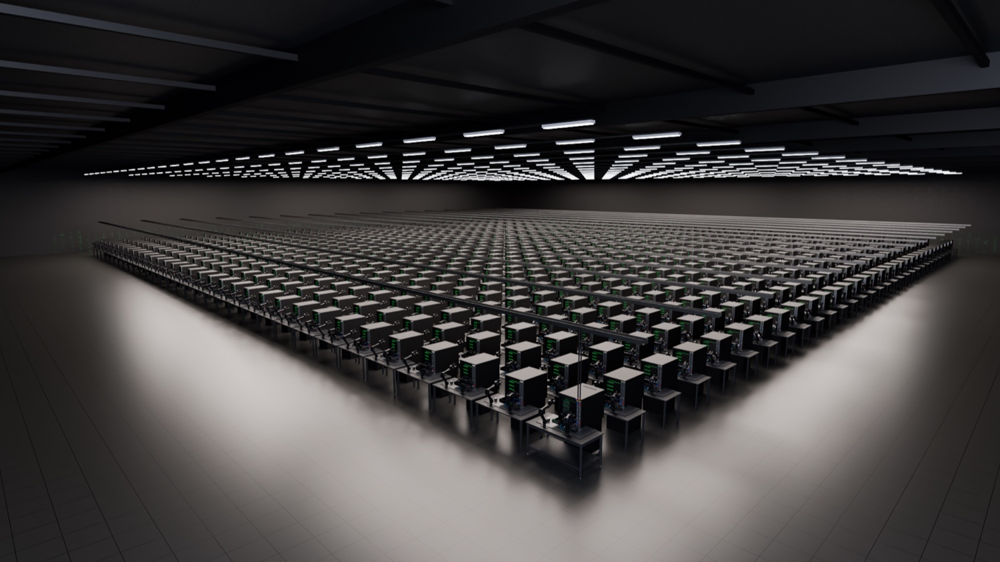
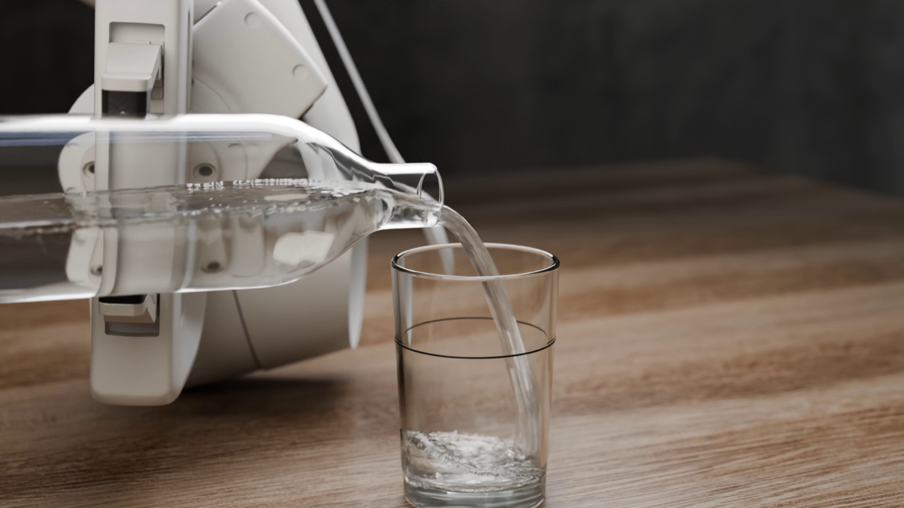

로봇이 물체를 놓친 것과 계산이 깨져 물체가 바닥을 통과한 것은 다른 실패예요. 여러 가상 환경에서 학습할 때 이 둘을 같은 성적으로 합치면, 행동 규칙을 고쳐야 하는지 물리 설정을 고쳐야 하는지 알기 어려워져요.

2026년 11월 12일 공개된 물리 엔진 <abbr title="로봇과 천·케이블·액체를 한 장면에서 계산하고 환경별 계산 이상을 점검하는 시뮬레이션 도구">Alloy</abbr>는 병렬 환경마다 건강 등급을 붙여 이 문제를 다뤄요. 여기서 건강은 로봇의 고장 여부가 아니라 계산 중 발견한 수치적·물리적 이상을 뜻해요. 정상 등급이 실물과의 일치를 보증하지는 않으며, 무효 등급도 언제나 학습한 행동만의 잘못을 뜻하지는 않아요.

## 한 장면의 실패를 환경별로 나눠요

Alloy는 물체의 재질과 형태에 맞춰 운동 계산 방법을 배정해요. 바탕에는 여러 재료의 운동 계산기를 제공하는 <abbr title="단단한 물체와 변형되는 물체의 운동 계산기를 제공하는 공개 물리 계산 기반">Newton</abbr>과, 로봇·단단한 물체를 병렬 계산하는 <abbr title="로봇 관절과 단단한 물체의 접촉을 그래픽 처리 장치에서 병렬로 계산하는 도구">MuJoCo Warp</abbr>가 있어요. 같은 장면을 복제한 환경들은 함께 실행되지만, 계산 상태의 판정은 환경별로 남아요. 논문의 기여 중 하나는 재료 종류를 늘리는 기능과 이 판정을 같은 실행 흐름에 연결한 점이에요.

<figure class="fig"><figcaption>원문 그림 1(d), 같은 작업의 1,024개 가상 환경이에요. 각 환경의 성적을 합치기 전에 계산이 유효했는지도 구별해야 해요. 화면에 장면이 남아 있다는 사실만으로 실행 상태를 알 수는 없어요. (출처: Pranay Gupta·Deepanshu Rohilla, Alloy, <a href="https://arxiv.org/html/2611.16312v1#S0.F1">그림 1(d)</a>, 원본 패널 변경 없음, 논문 비평을 위한 부분 인용. 원문은 <a href="https://info.arxiv.org/help/license/index.html">arXiv 비독점 배포 조건</a>이며 공개 재이용 허가로 표시하지 않음)</figcaption></figure>

[공식 건강 판정 문서](https://alloy.argonrobotics.ai/docs/guides/health/)는 실행 전체를 요약하는 검사와 환경별 상세 기록을 구분해요. 등급은 <abbr title="검사한 이상 조건에 걸리지 않은 상태이며 실제 물리와 일치한다는 보증은 아닌 등급">OK</abbr>, <abbr title="실행은 이어지지만 계산 정확도나 제약에 문제가 발견된 경고 등급">DEGRADED</abbr>, <abbr title="현재 계산을 신뢰할 수 없어 해당 가상 환경을 이전 상태로 되돌리고 멈추는 등급">INVALID</abbr>로 나뉘어요. 상세 기록에는 어떤 조건에 걸렸고 무엇을 바꿔야 하는지도 들어 있어요. 등급만 저장하면 같은 경고가 반복됐는지, 서로 다른 문제였는지는 구별하기 어려워요.

무효 환경은 마지막으로 보존한 양호한 상태에 멈추고, 다른 환경은 계속 진행해요. 이 때문에 고장 난 환경이 화면에서는 오히려 차분하게 보일 수 있어요. 물체가 튀거나 숫자가 사라지는 장면만 찾는 검사는 이 정지를 놓칠 수 있으므로, 움직임 기록과 판정 기록을 함께 읽어야 해요. 이미 멈춘 상태에 명령을 더 보내고 위치 변화가 없다는 이유로 정책이 안정적이라고 채점해서는 안 돼요.

## 학습 성적은 성공 조건과 무효 횟수를 함께 읽어요

<abbr title="관측한 상태를 보고 로봇이 다음에 할 행동을 정하는 학습된 규칙">정책</abbr>의 점수는 환경의 성공 판정에 달려 있어요. [공식 학습 안내](https://alloy.argonrobotics.ai/docs/guides/rl/)에서는 관측값, 행동, 보상, 성공 조건을 별도로 정하고 환경을 여러 개 함께 실행해요. <abbr title="어떤 행동을 더 많이 하도록 학습 중에 주는 점수">보상</abbr>이 커지는 것과 작업을 끝내는 것은 같지 않으므로, 최근 종료된 시행의 성공률을 보라고 안내해요. 무효 환경에서는 시행이 끝나며 해당 횟수를 별도로 확인해야 해요.

여기에는 평가 집계의 선택이 남아요. 무효 시행을 모두 버린 성공률은 계산이 유지된 조건만의 성적이고, 모두 행동 실패로 넣은 성공률은 계산기의 한계까지 정책의 책임으로 묶은 성적이에요. 따라서 전체 시행 수, 성공 수, 작업 실패 수, 계산 무효 수를 나눠 남기는 편이 좋아요. 무효 시행을 제외한 값을 제시한다면 제외 수와 이유도 같이 보여야 독자가 분모를 복원할 수 있어요.

실패 원인이 이어지는 순서도 중요해요. 로봇이 먼저 넘어지고 몸체가 바닥을 깊게 누른 뒤 계산이 무효가 됐다면, 첫 사건은 정책의 균형 실패일 수 있어요. 반대로 초기 장면부터 물체가 겹쳐 있다면 행동을 평가하기 전 환경 구성이 잘못된 것이에요. 마지막 등급 하나로 둘을 같은 종류로 만들기보다, 최초 이상 시각과 그 직전 행동을 보존하는 방식이 원인을 좁히는 데 유리해요.

공식 공개 모델의 수치는 이런 조건과 함께 읽을 수 있어요. 아래 값은 작성자가 재실행한 측정값이 아니라 연구진이 공개한 평가 기록이에요. <abbr title="한 그래픽 처리 장치에서 병렬 계산을 수행하는 데 사용한 엔비디아의 장치 모델">NVIDIA L4</abbr> 한 대에서 학습한 결과이며, 각 과제는 한 학습 실행의 특정 저장본을 평가했어요. 평가 버전은 0.1.0rc2이고, 기능과 한계 설명은 2026년 11월 16일 확인한 공식 문서 기준이에요. 문서에서 갱신된 검사 규칙을 이전 평가에 소급해 적용할 수는 없어요.

| 과제 | 연구진이 보고한 평가 | 성공으로 센 조건 |
| --- | --- | --- |
| 사족보행 | 512회 중 497회 | 넘어지거나 무효가 되지 않고 목표 이동·회전 속도를 추종 |
| 케이블 들기 | 256회 중 245회 | 마지막 순간 케이블 중심선의 모든 점이 높이 3cm 위에 위치 |
| 물 받기 | 128회 중 118회 | 마지막에 물의 75% 이상이 그릇 안에 위치 |

[보행 공개 모델](https://huggingface.co/argonrobotics-ai/alloy-go2-walk)은 평지에서 속도 명령을 따르며, 20초 시행의 마지막 15초 평균으로 추종 오차를 확인해요. 이동 속도 오차와 회전 속도 오차를 각각 제한하고, 두 평가 난수 조건에서 시행을 모았어요. 학습 시간 15.5분은 최초 계산 코드 준비에 든 202초를 제외한 값이에요. 빠른 학습이라는 수치를 설치부터 평가 종료까지의 총시간으로 바꾸어 읽으면 안 돼요.

[케이블 공개 모델](https://huggingface.co/argonrobotics-ai/alloy-cable-lift)은 길이 40cm의 케이블을 12구간으로 표현하고, 집게와 케이블의 시작 배치를 바꿔 평가해요. 약 30분 학습 저장본의 성공률은 95.7%이며, 무효 환경은 없었지만 일시적인 경고 등급은 있었다고 기록돼요. “무효 0회”를 “경고도 0회”로 바꿀 수 없는 사례예요. 케이블을 공중에 올렸다는 판정도 꽂기나 경로 정리까지 완료했다는 뜻은 아니에요.

[물 받기 공개 모델](https://huggingface.co/argonrobotics-ai/alloy-pour)은 위에서 떨어지는 물줄기 아래로 그릇을 움직여 물을 받아요. 병을 잡아 기울이는 로봇팔 과제와는 제어 대상이 달라요. 38.5분 학습 저장본의 성적이며 학습과 다른 난수 조건에서 평가했지만, 독립 학습 실행을 반복한 평균은 아니에요. 새 난수의 평가 시행 수를 늘린 것과 학습 자체를 여러 번 반복한 것은 다른 검증이에요.

## 정상 등급에서도 접촉 오류가 남을 수 있어요

[접촉 겹침 판정의 한계 문서](https://alloy.argonrobotics.ai/docs/known_gaps/health-mujoco-penetration/)는 현재 경고와 과거 최대 겹침 깊이를 나눠 설명해요. 물체가 잠깐 깊게 들어갔다가 떨어지면 마지막 상태의 경고는 사라질 수 있어요. 최대 깊이 기록과 실행 검사를 읽어야 중간의 이상을 찾을 수 있고, 실패 뒤 복원된 위치의 깊이가 실제 실패 순간보다 작을 수도 있어요. 최종 위치만 저장한 재생 영상에는 이 차이가 남지 않아요.

겹침을 언제 실패로 볼지도 모델의 가정에 달려 있어요. 접촉을 조금 눌리는 형태로 표현한 로봇 모델은 가만히 서 있어도 일정 깊이가 생길 수 있어요. 문서는 의도된 부드러운 접촉과 비정상 겹침을 구별하는 설정을 안내하지만, 허용 깊이를 늘리면 물리가 고쳐지는 것은 아니에요. 승인 기준을 완화한 것인지 실제 겹침을 줄인 것인지 실험 기록에서 나눠야 해요.

[얇은 부품 통과 문제](https://alloy.argonrobotics.ai/docs/known_gaps/rigid-tunnelling/)는 더 큰 경계예요. <abbr title="한 계산 순간과 다음 순간 사이에 빠른 물체가 얇은 벽을 지나가 충돌을 놓치는 현상">터널링</abbr>은 물체 위치를 띄엄띄엄 계산할 때 생길 수 있어요. 공식 문서는 정지한 얇은 판을 통과하는 사례를 보고하며, 이상을 표시하는 기능과 통과 자체를 막는 기능을 구분해요. 경고가 생겼다는 사실만으로 접촉이 복구됐다고 볼 수 없어요.

검사 대상에서도 빠지는 조합이 있어요. 두 움직이는 물체의 통과나 일부 복잡한 정지 형상은 현재 같은 방식으로 판정하지 않아요. 그래서 무효 표시가 없다는 사실만으로 빠른 집기와 얇은 커넥터의 접촉을 승인하기 어려워요. 목적 부품의 두께·접근 속도에서 궤적을 확인하고, 계산 시간 간격을 줄였을 때 성공 판정이 유지되는지도 대조해야 해요. 판정기가 본 범위와 과제가 요구하는 범위 사이의 빈칸을 검사하는 절차예요.

## 재료별 제한은 같은 등급 아래에서도 달라요

<figure class="fig"><figcaption>원문 그림 1(a)의 물 붓기 장면이에요. 위 표의 그릇으로 물줄기를 받는 학습 과제와 같은 실험으로 읽으면 안 돼요. 시연 이미지와 평가 과제의 성공 조건을 대조하는 데 필요한 구분이에요. (출처: Pranay Gupta·Deepanshu Rohilla, Alloy, <a href="https://arxiv.org/html/2611.16312v1#S0.F1">그림 1(a)</a>, 원본 패널 변경 없음, 논문 비평을 위한 부분 인용. 원문은 arXiv 비독점 배포 조건이며 공개 재이용 허가로 표시하지 않음)</figcaption></figure>

[액체 안내](https://alloy.argonrobotics.ai/docs/guides/liquids/)는 물을 입자들의 위치로 표현하고, 용기 안에 남은 비율을 확인하는 방법을 보여줘요. 물이 새지 않았는지를 보는 값과 계산 이상 검사는 별도예요. 작은 용기에서는 입자 크기의 영향이 커지고, 문서는 폭 24mm 미만 용기의 신뢰성 문제를 명시해요. 이 제한은 큰 그릇의 물 받기 성공률을 좁은 입구에 붓는 과제로 옮길 때 다시 확인해야 할 조건이에요.

천과 물을 함께 넣었다는 사실도 젖은 천의 물성을 얻었다는 뜻은 아니에요. 공식 액체 안내는 천이 물을 흡수하지 않으며, 천이 자기 표면과 부딪히는 처리를 켠 조합에서 계산이 무효가 될 수 있다고 설명해요. [현재 제한 목록](https://alloy.argonrobotics.ai/docs/keep-in-mind/)에는 액체와 분말 사이의 스며듦도 지원되지 않는다고 나와요. 닦기나 젖은 수건 집기처럼 흡수와 무게 변화가 목적 행동을 결정한다면, 그 물리 현상을 생략한 장면의 점수는 다른 문제를 평가하는 셈이에요.

[천 안내](https://alloy.argonrobotics.ai/docs/guides/cloth/)에서는 천을 작은 점과 면으로 나누고 각 점의 최종 위치를 읽어요. 낮게 처진 끝부분의 높이는 확인할 수 있지만, 그 결과만으로 접기와 집기의 접촉이 맞았다고 판단할 수는 없어요. 서로 다른 천이 통과하거나 얇은 천이 로봇의 집게에서 빠지는 제한이 따로 있어요. 천 두께와 계산 간격을 바꾸는 경우에는 안정성이 좋아졌는지와 원래 의도한 천의 조건이 유지됐는지도 같이 봐야 해요.

[케이블 안내](https://alloy.argonrobotics.ai/docs/guides/cables/)는 고정되지 않은 케이블이 짧은 단단한 조각과 연결부로 된 빠른 모델을 사용할 수 있다고 설명해요. 눈에 보이는 형태가 같아도 모든 케이블이 같은 계산 표현을 쓰지는 않아요. 어느 경로로 배정됐는지 읽고, 과제에서 중요한 굽힘·비틀림이 그 표현에 포함되는지 확인해야 해요. 처짐을 보여 주는 예제에서 성공했다는 사실을 꽉 비트는 작업의 정확도로 확대할 수는 없어요.

## 반복 실행과 관측 입력도 별도로 검증해요

[그래픽 처리 장치의 반복 일치 한계](https://alloy.argonrobotics.ai/docs/known_gaps/determinism-gpu-rigid/)에 따르면 여러 접촉이 생기는 장면은 같은 난수 초기값을 써도 계산 결과가 완전히 같지 않을 수 있어요. 병렬 계산의 작은 차이가 쌓이면 집기처럼 민감한 접촉에서는 최종 위치가 갈라져요. 관련 알림이 있다고 모두 무효 환경은 아니며, 반대로 정상 등급이라고 반복 결과가 같은 것도 아니에요. 반복 일치와 물리 이상은 서로 다른 검사 축이에요.

이 조건에서는 성공률이 조금 바뀌었을 때 행동 규칙의 개선으로 바로 돌리기 어려워요. 같은 정책을 같은 환경에서 반복 평가한 변동과, 학습을 다시 수행했을 때의 변동을 나눠야 해요. 두 후보 정책을 비교할 때도 동일한 시작 조건 묶음을 사용하고, 경고 발생과 성공 여부가 어떤 조건에 몰리는지 살펴야 해요. 난수 번호만 같다는 기록보다 실행 버전·장치·접촉 설정을 함께 보존하는 편이 비교 범위를 분명히 해 줘요.

[카메라 안내](https://alloy.argonrobotics.ai/docs/guides/camera/)는 화면용 이미지, 거리 영상, 물체 구분 영상을 제공하지만 각각의 출력과 지원 범위가 달라요. 여러 환경의 관측에는 환경을 구별하는 배열 축이 붙으므로, 다른 환경의 화면과 행동을 잘못 연결하지 않는지도 확인해야 해요. 멋진 장면을 출력할 수 있는 기능과 그 장면을 학습 입력으로 쓴다는 사실은 별개예요. 공식 학습 안내는 제공되는 간편 학습기가 카메라 환경에서도 상태값으로 학습하는 제한을 밝히므로, 이를 영상 기반 정책 학습 성적으로 소개하면 안 돼요.

## 적용 판단은 실패의 분류를 먼저 정하는 데서 시작해요

Alloy를 검토한다면 먼저 과제에서 필요한 현상을 적는 편이 좋아요. 단단한 물체 운반인지, 천의 접힘인지, 액체의 흡수인지에 따라 지원 여부와 검사해야 할 오류가 달라져요. 다음에는 작은 장면에서 물체의 계산 경로와 초기 겹침을 확인하고, 상태값과 건강 기록을 함께 남기는 평가 구조를 정해요. 필요한 현상이 빠져 있다면 병렬 환경 수를 늘리기 전에 평가 목적을 바꿔야 해요.

학습 전에는 성공 조건과 계산 무효 처리 규칙을 고정해요. 실행 중에는 마지막 등급뿐 아니라 최초 이상 시각, 최대 겹침, 반복된 경고를 보존하고, 실행 뒤에는 무효를 제외하기 전후의 집계를 대조해요. 특정 자세에서만 무효가 많다면 그 자세를 뺀 성공률은 원래 평가 분포의 성적과 달라요. 정책이 만든 위험한 상태와 계산기에서 지원하지 않는 상태가 어디서 겹치는지 확인하는 자료로 사용해야 해요.

논문의 병렬 학습 결과와 공식 문서의 한계는 함께 읽어야 해요. 병렬 환경을 유지하면서 문제가 난 환경을 격리하는 기능은 긴 학습을 운영하는 데 도움이 되지만, 격리한 표본을 어떻게 집계했는지까지 정해 주지는 않아요. 실물 적용을 판단하려면 별도로 재료·접촉·행동의 대응을 대조해야 하며, 공개된 가상 학습 성공률이 그 검사를 대신하지는 않아요. 환경별 건강 판정은 성적표에서 계산 실패를 찾아내는 출발점이고, 정상 환경의 의미를 정하는 일은 목적 과제의 검증에 남아 있어요.

<!-- src-block -->
출처 — https://arxiv.org/abs/2611.16312v1
