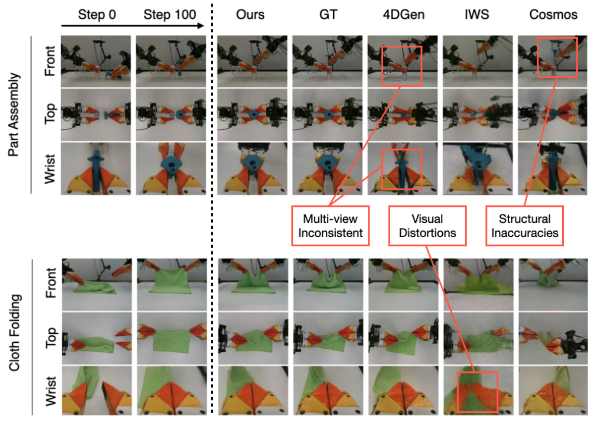
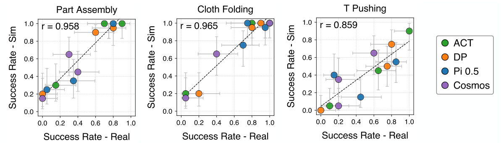

로봇의 미래 영상을 카메라별로 만들면, 같은 순간인데도 앞에서는 잡은 물체가 손목 화면에서는 손 밖에 있을 수 있어요. <abbr title="로봇 행동에 따른 장면 변화를 삼차원 공간에서 예측하고 영상과 촉각으로 바꾸는 학습형 시뮬레이터">3D World Simulator</abbr>는 미래의 공간 상태를 먼저 예측하고, 그 상태에서 여러 시점의 영상과 접촉 신호를 함께 꺼내는 방법이에요.

2026년 11월 3일 공개된 원문은 입자와 공간 격자를 결합해 이 구조를 구현했어요. 영상의 모양, 물체의 위치, 손가락의 촉각을 같은 공간에 놓는 것이 중심 논지예요. 다만 여러 화면이 서로 맞는다는 성질과 실제 물리 현상이 정확하다는 성질은 따로 검증해야 해요.

## 여러 영상이 공유할 장면 상태를 먼저 만들어요

<abbr title="관측과 행동을 받아 이후에 환경이 어떻게 변할지 예측하는 학습 모델">월드 모델</abbr>은 로봇이 행동했을 때 다음에 무엇을 보게 될지 예측해요. 이 예측을 반복하면 실물 로봇을 매번 움직이지 않고도 행동 결과를 비교하거나 학습 자료를 만들 수 있어요. 그런데 출력이 영상뿐이면 카메라를 옮길 때 다른 화면을 어떻게 만들어야 할지, 서로 다른 화면 속 물체가 같은 위치를 가리키는지 확인하기 어려워요. 특히 손목 카메라는 로봇과 함께 움직여 이 문제가 커져요.

이 연구의 입력은 여러 카메라에서 얻은 색과 깊이를 합친 <abbr title="표면에서 관찰한 점들의 삼차원 위치와 색 등을 모아 장면을 나타내는 자료">점군</abbr>이에요. 촉각 자료가 있으면 손가락 표면의 감지 위치도 같은 공간에 놓아요. 각 점은 위치 세 값, 색 세 값, 촉각용 한 값을 담는 일곱 성분의 표현을 사용해요. 모든 점에 접촉 정보가 있다는 뜻은 아니고, 시각과 촉각을 공통 형식으로 다루기 위한 구조예요.

입력 점을 같은 기준에 놓으려면 <abbr title="위치와 방향을 비교할 때 함께 사용하는 원점과 축의 약속">좌표계</abbr>가 맞아야 해요. 연구진은 고정 카메라 세 대와 손목 카메라 두 대의 영상을 처리해 점을 공통 좌표로 옮겨요. 손가락 촉각 위치는 관절 자세와 로봇 형상으로 계산하고, 사람이 정한 작업 영역 밖의 점은 잘라내요. 따라서 이 방법을 새로운 작업대에 적용할 때는 예측 모델보다 카메라 보정과 시간 정렬이 먼저예요. 잘못 합친 입력은 하나의 공간을 공유하더라도 이미 어긋난 공간이에요.

같은 장면을 여러 방향에서 그리면 카메라 사이의 위치 관계를 유지하기 쉬워져요. 앞에서 보이는 천의 접힘과 위에서 보이는 접힘이 동일한 공간 형상에서 나오기 때문이에요. 하지만 공통 형상 자체가 잘못됐으면 여러 카메라가 같은 오류를 일관되게 보여줄 수도 있어요. 일관성 검사가 물리 정확도 검사를 대신하지 못하는 이유예요.

## 격자로 예측하고 입자로 세부 형상을 복원해요

점군은 점 개수와 순서가 매번 달라질 수 있어요. 천이 접혀 가려지면 보이던 점이 사라지고, 물체를 돌리면 새 표면의 점이 나타나요. 점 하나하나를 다음 시점의 같은 점과 연결하려면 가림 속에서도 대응 관계를 찾아야 해요. 연구진은 이 부담을 줄이려고 공간에 고정된 칸을 두고 그 안의 상태를 예측해요.

이 칸을 <abbr title="삼차원 공간을 작은 상자로 나누어 위치마다 정보를 저장하는 격자 칸">복셀</abbr>이라고 해요. 먼저 점이 들어 있는 칸마다 특징을 모으고, 빈 공간의 불필요한 계산을 피하면서 격자를 압축해요. 압축된 <abbr title="관측의 세부 정보를 줄여 모델이 계산하기 편하게 만든 내부 표현">잠재 표현</abbr>은 다음 상태를 예측하는 공통 바탕이 돼요. 공간 칸의 위치가 고정돼 있어 점의 순서를 맞추지 않고도 전후 상태를 비교할 수 있어요.

반대로 영상을 만들 때는 압축된 격자를 점점 촘촘하게 복원해요. 각 단계에서 물체가 차지한 칸을 예측하고, 마지막에는 그 칸을 출발점으로 연속적인 위치의 입자들을 생성해요. 격자만 사용하면 모서리와 얇은 표면이 거칠어질 수 있으므로, 입자가 칸 사이의 세부 위치를 표현하는 역할을 맡아요. 예측하기 쉬운 고정 격자와 표면을 세밀하게 그릴 수 있는 입자를 이어 붙인 구조예요.

시각 입자는 위치 외에 색, 크기, 방향, 불투명도를 가진 <abbr title="공간에 놓인 작은 타원형 색 덩어리를 겹쳐 카메라 영상을 그리는 표현">3차원 가우시안</abbr>으로 바뀌어요. 이 표현으로 카메라 위치를 바꿔 색 영상과 깊이 영상을 그려요. 촉각 입자도 공간상 감지 위치와 함께 복원하므로, 접촉 신호를 별개의 화면 구석에 붙이는 방식보다 물체와 손가락의 위치 관계를 드러내기 좋아요. 다만 생성된 촉각값이 물리식으로 계산한 접촉력의 정답이라는 뜻은 아니에요.

압축과 복원을 배우는 과정은 한 종류의 오차만 줄이지 않아요. 물체가 차지한 공간, 예측 점과 관측 점의 거리, 색과 촉각값, 카메라로 그린 영상과 깊이를 함께 대조해요. 같은 관측에서 점을 두 번 다르게 골랐을 때 내부 표현이 과하게 달라지지 않도록 하는 조건도 있어요. 이렇게 해야 입력 점을 일부 뽑는 방식이 달라졌다는 이유로 다음 움직임까지 바뀌는 현상을 줄일 수 있어요.

## 자기 예측을 다시 입력하며 긴 움직임을 배워요

다음 상태 모델은 최근 상태들의 압축 표현과 로봇 행동을 받아 다음 격자를 예측해요. 네트워크는 공간을 줄였다가 복원하면서, 한 시점 안의 위치 관계와 여러 시점에 걸친 변화를 번갈아 처리해요. 부록의 설정에서 관측 이력은 다섯 프레임이고, 한 번 계산할 때 다음 상태 하나를 출력해요. 미래의 실제 관측을 몰래 가져와 연결하는 구조는 아니에요.

예측한 다음 상태를 다시 입력으로 쓰는 <abbr title="앞에서 예측한 결과를 다음 예측의 입력으로 반복해서 사용하는 방식">자기회귀 예측</abbr>에서는 작은 오차가 누적돼요. 학습 때 실제 과거만 보고 다음 한 장을 맞추면, 실행 때 자기 오류가 섞인 과거를 받았을 때 불안정해질 수 있어요. 연구진은 학습 중에도 예측 결과를 이력에 넣고, 여러 단계 뒤까지 맞추는 길이를 점차 늘려요. 과거 표현에 작은 무작위 흔들림을 더하는 훈련도 함께 사용해요.

이 설계는 긴 움직임의 안정성을 높이려는 방법이지 임의의 길이에 대한 보증은 아니에요. 주요 비교 실험은 200프레임 동안 실제 관측으로 교정하지 않는 <abbr title="시작 관측 이후 실제 장면을 다시 보며 수정하지 않고 주어진 행동에 따라 예측을 이어가는 실행">개루프</abbr> 예측이에요. 이 기간의 평균 오차가 낮다는 사실만으로 수천 번 접촉하거나 장시간 장면을 바꿔도 안정하다고 확대할 수 없어요. 정책을 모델 안에서 실행할 때도 정책이 예측의 결함을 이용하지 않는지 따로 봐야 해요.

공식 프로젝트는 그래픽 처리 장치 <abbr title="이 연구의 대화형 실행 속도를 제시할 때 사용한 엔비디아 그래픽 처리 장치">RTX 5090</abbr>에서 초당 50프레임 이상의 대화형 동작을 제시해요. 원문은 시뮬레이션을 50 Hz, 즉 초당 50회 수준으로 소개해요. 이 수치는 모든 카메라 수와 해상도, 데이터 전처리까지 포함한 전체 학습 환경의 처리량을 보장하지 않아요. 또 원문에서 압축·복원 모델과 상태 예측 모델의 훈련은 각각 약 16시간으로 설명하므로, 빠른 실행과 준비 비용을 나눠 읽어야 해요.

## 여러 화면과 접촉을 함께 비교한 조건이에요

<figure class="fig"><figcaption>원문 그림 3. 같은 작업을 정면·위·손목에서 본 예측을 비교해요. 비교 모델에는 화면 간 불일치와 형상 왜곡을 표시한 부분이 있어요. 왼쪽 진행 장면과 오른쪽 예측 비교를 한 그림으로 보존했어요. (출처: Jimmy Wang 외, 논문 그림 3, <a href="https://arxiv.org/abs/2611.04492v1">원문</a>, <a href="https://creativecommons.org/licenses/by/4.0/"><abbr title="저자와 출처 및 이용 조건을 표시하면 공유와 가공을 허용하는 공개 이용 조건">CC BY 4.0</abbr></a>, 원문 6쪽에서 그림 영역을 잘라 PNG로 변환)</figcaption></figure>

연구진은 <abbr title="두 로봇팔로 사람의 조작 시연을 수집하고 배운 동작을 실행하는 로봇 실험 체계">ALOHA</abbr>와 손가락 촉각 센서를 사용해 여섯 작업을 모았어요. 부품 조립, 천 접기, T자 물체 밀기, 상자 포장, 줄 끼우기, 필기구 삽입을 포함해요. 작업마다 약 200개 실행 기록, 약 두 시간의 자료를 수집했어요. 따라서 실제 로봇 자료 없이 처음부터 물리 세계를 배운 연구로 읽으면 안 돼요.

원문 표 1은 여섯 작업과 200단계에 걸쳐 평균한 결과예요. 영상의 원본 대비 오차, 사람이 느끼는 영상 차이, 깊이, 공간 점의 거리, 촉각값 차이를 따로 측정해요. 아래에는 서로 다른 검증 층을 볼 수 있도록 세 지표만 옮겼어요. 값의 크기를 열끼리 비교하지 않고 같은 열에서 방법들을 비교해야 해요.

| 방법 | 영상 지각 차이, 낮을수록 좋음 | 깊이 상대 오차, 낮을수록 좋음 | 촉각 절대 오차, 낮을수록 좋음 |
| --- | --- | --- | --- |
| <abbr title="영상 기반 세계 예측 도구로, 이 실험에서는 여러 시점과 깊이를 예측하도록 구성한 비교 모델">Cosmos</abbr> | 0.441 | 0.147 | 0.135 |
| <abbr title="삼차원 정보를 고려해 로봇의 여러 시점 영상을 만드는 비교 모델">Robot4DGen</abbr> | 0.340 | 0.172 | 0.128 |
| 3D World Simulator | 0.240 | 0.097 | 0.081 |

영상 지각 차이는 <abbr title="학습된 영상 특징을 비교해 두 영상이 얼마나 다르게 보이는지 재는 지표">LPIPS</abbr>로 계산해요. 깊이 상대 오차는 실제 깊이를 기준으로 예측이 얼마나 벗어났는지를 나타내요. 촉각 절대 오차는 촉각 신호의 수치 차이이며, 접촉력 단위로 바로 읽을 수는 없어요. 세 값이 함께 좋아졌다는 것은 영상 하나의 미관만 개선된 결과보다 넓은 근거지만, 장비가 바뀌어도 같은 오차가 유지된다는 뜻은 아니에요.

비교 모델의 입력과 출력도 원래 배포 설정 그대로인 것은 아니에요. 부록은 Cosmos에 여러 시점 네 개를 한 영상으로 묶고 깊이를 색 공간으로 변환하는 구성을 사용했다고 설명해요. 입자 기반 비교 방법에는 점 추적 자료를 만들어 훈련해요. 따라서 표는 연구진이 마련한 동일 작업의 비교 결과로 읽어야 하고, 특정 제품 전체가 다른 제품보다 열등하다는 결론으로 넓힐 수 없어요.

## 학습하지 않은 물체에서는 형상과 외관이 갈려요

더 넓은 물체 실험은 <abbr title="일상 변형 물체를 여러 방향의 영상과 촉각으로 기록한 연구용 데이터 모음">Deform360</abbr>을 사용해요. 원문은 일상 물체 198개, 상호작용 기록 1,980개, 215시간이 넘는 관측을 제시해요. 이 자료에서는 물체 중심의 깊이만 제공되므로, 작업대 전체를 복원한 앞의 실험과 달리 물체 점들로 모델을 훈련해요. 부록 설정에서도 이 실험의 촉각 감독은 꺼져 있어, 앞의 시각·촉각 검증과 같은 조건으로 묶을 수 없어요.

150단계 예측을 평균한 부록 표 2는 결과의 경계를 잘 보여줘요. 학습 때 본 물체에서는 영상과 형상이 모두 좋지만, 따로 남겨 둔 물체에서는 형상 오차는 더 작아도 영상 지표는 일부 비교 방법보다 나빠요. 예측한 점들과 실제 점들 사이의 가까운 거리를 양방향으로 모은 <abbr title="두 점 모음이 공간에서 얼마나 떨어져 있는지 가까운 점끼리 대응시켜 재는 거리">샴퍼 거리</abbr>는 새 방법 12.1 mm(밀리미터), 비교 모델 <abbr title="입자들의 변화를 예측해 물체 움직임을 표현하는 비교 모델">ParticleFormer</abbr> 13.4 mm예요. 반면 영상 지각 차이는 각각 0.43과 0.31로 순서가 바뀌어요.

연구진은 비교 방법이 미리 맞춘 가우시안 표현의 점들을 이동시키는 반면, 새 방법은 외관까지 생성한다는 차이로 설명해요. 이 결과는 형상에 강한 표현이라도 낯선 물체의 색과 질감은 별도 과제로 남는다는 뜻이에요. 시각 정책의 입력을 만들 목적이라면 공간 오차만 보고 합격시키기 어려워요. 반대로 물체 배치 후보를 고르는 목적이라면 영상이 조금 흐린 것과 형상이 잘못된 것을 같은 실패로 처리할 필요도 없어요.

## 합성 학습 자료와 정책 평가를 구분해요

시뮬레이터를 자료 생성기로 쓰는 실험은 부품 조립, 천 접기, T자 물체 밀기의 세 작업을 다뤄요. 실제 환경과 월드 모델 안에서 작업별 시연 100개씩을 모으고, 서로 다른 네 <abbr title="현재 관측을 받아 로봇이 어떤 행동을 할지 정하는 학습 모델이나 규칙">정책</abbr> 구조로 학습해 평균 성공률을 비교해요. 조립은 손목 영상과 촉각, 천 접기는 정면과 손목 영상, 밀기는 모델 훈련에서 보지 못한 시점을 사용해요. 각 작업이 요구하는 관측이 달라 공통 공간 표현의 쓰임도 달라져요.

원문은 생성 자료만으로 학습한 정책이 실제 자료로 학습한 정책과 비슷한 성능을 보였다고 보고해요. 이때 '생성 자료만'은 정책의 시연 자료를 가리켜요. 그 자료를 만든 월드 모델 자체는 앞서 모은 실제 상호작용으로 훈련됐고, 정책마다 기존 사전학습 모델을 사용하는 조건도 있어요. 실제 수집 비용이 사라졌다는 뜻으로 바꿀 수는 없어요.

또 실제 영상은 색 보정, 자르기, 크기 조정을 거쳐 가상 관측과 맞춰요. 부록은 시연의 기록 주기를 10 Hz로 적고, 100개 중 90개를 훈련에, 10개를 따로 남긴다고 설명해요. 이것은 앞의 초당 50회 실행 속도와 다른 수치예요. 실행 속도, 원자료의 시간 간격, 정책이 행동을 결정하는 주기를 구분해야 움직임이 재현되지 않을 때 원인을 좁힐 수 있어요.

<figure class="fig"><figcaption>원문 그림 7. 가로축은 실물 성공률, 세로축은 가상 성공률이에요. 표시된 상관계수는 부품 조립 0.958, 천 접기 0.965, T자 물체 밀기 0.859예요. 점은 서로 다른 학습 시점의 정책을, 색은 정책 구조를 나타내요. (출처: Jimmy Wang 외, 논문 그림 7, <a href="https://arxiv.org/abs/2611.04492v1">원문</a>, <a href="https://creativecommons.org/licenses/by/4.0/">CC BY 4.0</a>, 원문 9쪽에서 축·범례·오차 막대를 보존해 그림 영역을 잘라 PNG로 변환)</figcaption></figure>

정책 평가 실험은 새 자료로 얼마나 잘 배웠는지와 별개로, 같은 정책을 가상 환경에서 시험했을 때 실물 결과를 얼마나 잘 가늠하는지 물어요. 연구진은 작업마다 시작 배치 20개를 고르고 가상·실물에서 각각 평가해요. 그림의 오차 막대는 20회 시행으로 계산한 성공 비율의 불확실성을 나타내요. 한 점의 시행 수가 적기 때문에 작은 성공률 차이를 확정적인 우열로 읽기 어려워요.

상관계수가 높아도 모든 점이 가로·세로 값이 같은 대각선 위에 놓이는 것은 아니에요. 가상 점수가 전반적으로 높아도 정책 간 순서는 비슷할 수 있어요. 또 같은 정책 구조의 여러 학습 시점이 포함돼 있어, 모든 점을 완전히 독립적인 로봇 종류로 세면 안 돼요. 이 그림은 세 작업에서 정책 후보를 추리는 근거이고, 다른 접촉 과제의 절대 성공률을 보장하는 자료는 아니에요.

성공 판정 규칙도 결과와 함께 가져와야 해요. 부록에서 조립은 플러그 삽입 여부로, 천 접기는 가장자리를 잡았는지와 목표 영역의 겹침으로 판단해요. 밀기도 목표 영역의 겹침이 0.60을 넘는지를 봐요. 이런 영상·상태 중심 판정만으로 과도한 접촉력, 물체 손상, 허용하지 않은 중간 동작까지 검증됐다고 판단할 수는 없어요.

## 장면을 바꿀 때 무엇이 그대로인지 확인해요

모델은 복잡한 상호작용이 사람이 정한 작업 영역 안에서 일어난다고 가정해요. 바깥 배경은 정적인 가우시안 장면으로 두고, 로봇은 관절과 형상의 관계로 움직일 수 있는 별도 표현과 합성해요. 필요한 장면 성분을 분리하도록 추가 학습하면 배경과 로봇 외형을 교체할 수도 있어요. 하지만 다른 팔을 그렸다는 사실만으로 그 팔의 무게, 구동 한계, 접촉 반응까지 새로 검증된 것은 아니에요.

공식 데모도 훈련 자료가 가지 않았던 곳으로 팔을 밀면 천의 모습이 이상해질 수 있다고 안내해요. 이것은 학습된 움직임의 범위를 넘어갔을 때 생기는 실패예요. 천을 새 방식으로 잡거나 접촉이 크게 바뀌는 작업에서는, 보기 좋은 영상이 이어지는지뿐 아니라 물체가 손을 통과하거나 실제로 불가능한 변형을 만드는지 확인해야 해요. 실제 접촉을 계산하는 기존 물리 엔진과 학습 예측을 어디서 결합할지도 작업별 판단으로 남아요.

시뮬레이션 작업에 도입할 때는 먼저 목적을 나누는 편이 좋아요. 카메라를 바꾼 학습 자료가 필요하면 시점 간 일관성과 새 시점의 영상 품질을, 촉각 정책이 목적이면 감지 위치 정렬과 신호 크기 오차를 먼저 확인해요. 정책 순위 평가가 목적이면 실제와 같은 시작 배치와 성공 규칙으로 후보들을 대조해요. 어느 경우든 입력 좌표와 시간 정렬을 확인한 뒤 짧은 예측, 긴 예측, 새로운 행동 순으로 범위를 넓혀야 해요.

마지막으로 모델을 고른 근거와 사용을 멈출 조건을 함께 남겨야 해요. 낯선 물체에서 외관이 무너지면 시각 정책용 자료 생성을 보류하고, 접촉 위치가 어긋나면 촉각 학습에 쓰기 전에 센서 좌표부터 다시 확인해요. 가상 순위가 실물 순위를 유지해도 성공률 차이가 크면 절대 점수 보고에는 별도 보정이 필요해요. 하나의 공간 상태를 공유하는 설계는 검사할 대상을 정리해 주지만, 그 상태가 현실을 얼마나 잘 대변하는지는 영상·형상·촉각·작업 결과로 나눠 입증해야 해요.

<!-- src-block -->
출처 — https://arxiv.org/abs/2611.04492v1
