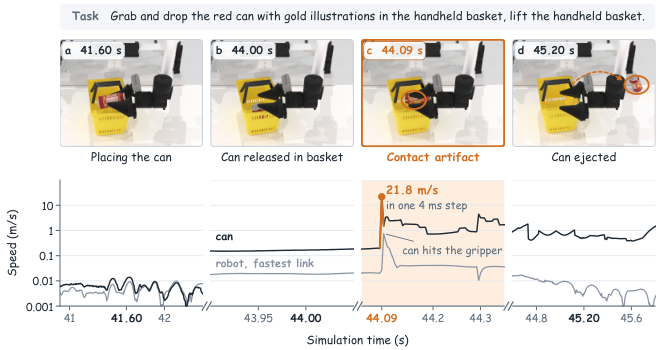
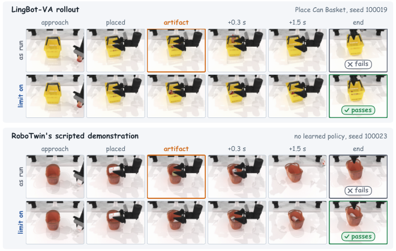

로봇이 캔을 바구니 안에 놓은 뒤 손을 뗐는데, 캔이 갑자기 튀어나가면 평가표에는 조작 실패가 남아요. 이때 행동을 고치기 전에 확인할 것은 캔을 밀어낸 힘이 어디서 왔는지예요.

2026년 10월 30일 공개된 <abbr title="가상 로봇 평가의 물리 상태를 기록하고 같은 행동을 다시 실행해 비정상 접촉의 원인을 추적하는 감사 도구">SimuGuard</abbr> 논문은 이 질문을 물리 계산 한 단계까지 좁혔어요. 대표 사례에서는 떨어져 있는 두 형상을 겹쳤다고 보고한 충돌 계산이 물체를 튀게 했고, 연구진은 거리 계산의 상수 하나를 바꿔 같은 오류가 사라지는지 확인했어요. 학습 모델의 점수와 시뮬레이터의 계산 오류를 분리하려면 최종 영상보다 촘촘한 기록이 필요하다는 연구예요.

## 접촉 오류는 영상 사이의 짧은 순간에 생겨요

<abbr title="관측한 상태와 지시를 받아 로봇이 다음에 할 행동을 정하는 규칙이나 학습 모델">정책</abbr>은 평가 환경에서 물체를 집고 옮기는 명령을 내요. 평가 프로그램은 정해진 완료 조건을 검사해 한 번의 시행을 성공이나 실패로 기록해요. 하지만 물체가 목표 위치를 벗어난 이유까지 자동으로 구별하지는 않아요. 잘못 잡아서 떨어진 경우와 계산 오류로 튀어나간 경우가 같은 실패 수에 들어갈 수 있어요.

논문이 다루는 <abbr title="로봇의 접촉이나 중력으로 설명하기 어려운 운동이 물체 접촉 순간에 생기는 계산상 이상">접촉 아티팩트</abbr>는 접촉을 계기로 시작한 비정상 운동이에요. 여기서는 탐지 규칙이 표시한 후보를 가리키며, 에너지 보존을 완전히 증명하는 판정은 아니에요. 물체가 빨리 움직였다는 사실만으로 오류가 확정되는 것도 아니에요. 떨어지거나, 로봇이 밀고 있는 상자에 실려 움직이는 상황부터 제외해야 해요.

<figure class="fig"><figcaption>원문 그림 1이에요. 캔을 놓은 뒤 손이 떨어져 있는데도 한 계산 단계에서 속도가 크게 올라가요. 그림 아래 시간축은 장면마다 길이가 다른 네 선형 구간이므로, 전체가 같은 시간 간격인 것처럼 읽으면 안 돼요. (출처: Alex Zhou 외, SimuGuard, <a href="https://arxiv.org/html/2610.41857v1#S1.F1">그림 1</a>, <a href="https://creativecommons.org/licenses/by/4.0/">CC BY 4.0</a> · 원본 PNG, 변경 없음)</figcaption></figure>

연구진이 분석한 캔의 질량은 10g이에요. 캔은 한 번의 4밀리초 계산에서 초속 0.2m에서 22m로 빨라졌고, 원문은 운동에너지 증가를 약 2.4줄로 보고해요. 이때 캔과 로봇은 접촉하지 않았고 가장 빠른 로봇 부위도 초속 0.1m보다 느렸어요. 수치는 연구진의 기록이며, 이 글에서 같은 시뮬레이션을 재실행한 측정값은 아니에요.

카메라 영상은 캔이 날아가는 결과를 보여주지만, 한 물리 단계의 충격은 두 영상 사이에 들어갈 수 있어요. 그래서 SimuGuard는 평가 코드의 물리 계산 함수를 감싸고 매 단계의 입력과 출력을 기록해요. 계산 전에는 관절 목표와 힘, 계산 후에는 물체 위치·방향·속도와 접촉 정보를 남겨요. 접촉한 두 물체마다 충격과 겹침 깊이도 보존해, 급격한 속도 변화 직전에 어떤 접촉이 보고됐는지 거슬러 올라가요.

## 빠른 운동을 세 번 걸러 의심 사건을 남겨요

첫 검사는 접촉 직후의 속도 변화를 찾아요. 최근 40밀리초 안에 다른 물체와 닿았고, 속도가 초속 0.5m보다 크며, 4밀리초 한 단계의 속도 변화가 초속 0.35m 이상이면 후보가 돼요. 다른 계산 간격에서는 속도 변화 기준을 그 간격에 맞춰 조정해요. 이어지는 240밀리초 안에 4cm 이상 이동하고, 짧은 자유 비행이나 용기와의 격한 접촉이 있어야 후보를 확인해요.

두 번째 검사는 중력으로 설명되는 낙하를 걸러요. 높은 곳에서 통 안으로 떨어진 물체는 접촉 직후 빨라도 자연스러울 수 있어요. 연구진은 사건 뒤의 최대 속도를 낙하 높이에서 계산한 자유 낙하 속도와 비교하고, 그 비율이 1.5를 넘는 후보를 남겨요. 빠른 움직임을 전부 오류로 세면 정상적인 떨어뜨리기 과제까지 잘못 표시하기 때문이에요.

세 번째 검사는 다른 물체를 거쳐 전달된 로봇 운동을 걸러요. 로봇이 바구니를 밀면 안에 있는 빵도 함께 움직일 수 있어요. SimuGuard는 직전 구간에 로봇과 대상 물체 양쪽에 닿았던 운반체를 찾고, 대상 속도가 그 운반체 속도의 1.5배보다 작으면 후보에서 빼요. 접촉 상대를 하나씩만 보지 않고 운동이 전달되는 중간 물체까지 보는 절차예요.

이 검사는 속도를 비교해 의심 사건을 줄이는 방법이에요. 힘이 이동 경로를 따라 한 일을 모두 계산하지 않으므로, 물리적으로 불가능하다는 자동 증명을 제공하지는 않아요. 논문에서는 로봇 공학자 다섯 명이 출처를 모르는 상태에서 장면을 판정했어요. 캔을 바구니에 놓는 한 과제의 탐지 장면 40개 중 37개를 부자연스럽다고 판정해, 표시한 후보 중 맞은 비율은 92.5%였어요. 다른 과제의 정확도나 놓친 사건의 비율까지 같은 값이라고 해석할 수는 없어요.

## 같은 기록을 재생해야 개입의 효과를 가릴 수 있어요

오류 후보를 찾은 뒤에는 원래 시행을 같은 값으로 재생해야 해요. <abbr title="초기 배치나 무작위 선택을 같은 조건으로 다시 만들 때 사용하는 시작값">시드</abbr>와 행동을 저장하는 것만으로 충분하지 않을 수 있어요. 접촉 중인 장면을 중간 저장 상태에서 복원하면 내부 계산 상태가 달라져 이후 위치가 어긋날 수 있기 때문이에요. 논문은 장면을 처음부터 다시 만들고 첫 물리 단계부터 기록한 명령을 적용해요.

평가 환경이 단계 사이에 몰래 바꾸는 값도 복원 대상이에요. 문 관절을 다시 설정하는 코드나 물리 계산의 이전 해를 갱신하는 코드가 있으면, 명령 기록만으로는 원래 상태가 나오지 않아요. 집게가 실제로 얼마나 벌어졌는지와 별개로, 성공 검사기가 집게에 내린 목표값을 읽는 경우도 있어요. 이 값을 빠뜨리면 궤적이 비슷해도 최종 판정이 달라질 수 있어요.

연구진은 새 프로세스에서 실패 기록 96개를 재생해 추적한 물체의 기록값이 모두 같은지 검사했어요. 이는 시험한 기록과 실행 조건에서 재생이 성립했다는 근거예요. 모든 컴퓨터와 모든 물리 엔진에서 같은 결과를 보장한다는 뜻은 아니에요. 다른 환경에 적용할 때도 먼저 수정 없는 재생을 통과시켜야, 이후에 바꾼 설정이 결과 차이를 만들었다고 해석할 수 있어요.

<figure class="fig"><figcaption>원문 그림 3이에요. 위는 정책, 아래는 평가 환경 자체의 규칙 기반 시연이에요. 의심 사건 0.1초 전부터 겹침을 풀어내는 속도를 제한한 재생과 원래 실행을 비교해요. 개입 전의 상태와 행동은 같지만 개입 뒤에는 물리 설정이 계속 달라지므로, 한 접촉만 제거한 실험으로 읽을 수는 없어요. (출처: Alex Zhou 외, SimuGuard, <a href="https://arxiv.org/html/2610.41857v1#S1.F3">그림 3</a>, <a href="https://creativecommons.org/licenses/by/4.0/">CC BY 4.0</a> · 원본 PNG, 변경 없음)</figcaption></figure>

논문의 재실행은 대상 질량, 접촉 계산 반복 횟수, 겹침을 풀어내는 최대 속도 같은 조건을 하나씩 바꿔요. 처음부터 바꾸는 실험과 최초 의심 사건 직전에 바꾸는 실험을 구분해요. 후자는 개입 전까지 기록과 같은지 검사할 수 있어 원인을 좁히는 데 유리해요. 다만 그 뒤의 접촉도 계속 바뀌므로, 최종 성공을 특정 순간 하나의 효과로 단정하지 않아요.

기록한 명령을 그대로 재생하는 실험과 <abbr title="바뀐 환경의 새 관측을 보고 정책이 다음 행동도 새로 고르는 실행 방식">폐루프</abbr> 평가도 구별해야 해요. 물체가 더는 튀지 않으면 정책이 보는 장면이 달라지고, 다음에 선택하는 행동도 바뀔 수 있어요. 같은 명령의 재생은 물리 변화에 따른 결과를 좁혀 보지만, 고친 환경에서 정책이 실제로 어떻게 반응할지는 새 관측을 주는 평가로 확인해야 해요.

## 허위 접촉의 원인은 작은 형상에 맞지 않는 기준값이었어요

원문이 원인까지 추적한 대상은 <abbr title="여러 양손 조작 과제와 자동 시연·성공 검사를 제공하는 로봇 시뮬레이션 평가 환경">RoboTwin</abbr> 2.0이에요. 그 환경이 쓰는 <abbr title="물체의 충돌과 힘에 따른 운동을 계산하는 엔비디아의 물리 엔진">PhysX</abbr> 5.3.1에서는 캔과 바구니의 충돌 형상이 21mm 떨어져 있는데도 27.5mm 겹쳤다는 접촉을 보고한 사례가 있었어요. 겹침을 한 단계 안에 풀려는 계산이 큰 속도를 만들어 냈어요. 겹침을 해소하는 운동 자체보다 먼저, 없는 겹침을 보고한 거리 계산을 검사해야 하는 상황이에요.

물체의 복잡한 표면은 충돌 계산을 위해 작은 볼록 조각으로 나뉘어요. <abbr title="두 볼록 형상 사이의 거리를 찾기 위해 작은 점·선·삼각형 조합을 반복해서 갱신하는 계산법">GJK</abbr> 거리 계산은 거의 납작한 삼각형을 버리는 기준을 사용해요. 그런데 이 버전의 고정 기준은 형상 크기에 따라 함께 줄어들지 않았어요. 센티미터 크기 조각에서는 유효한 삼각형도 기준보다 작아져, 가장 가까운 점을 찾기 전에 계산이 끝날 수 있었어요.

연구진은 PhysX 5.4.0에서 사용한 더 작은 기준값을 5.3.1에 옮겨 같은 접촉을 검사했어요. 원문 표 2에서는 추적한 허위 접촉 20개가 수정 뒤 모두 사라졌고, 실제로 형상이 겹친 접촉 4개는 유지됐어요. 이것은 단순히 접촉을 덜 보고해 점수를 높였는지 따져보는 비교예요. 다만 표본은 연구진이 추적한 접촉들이며, 가능한 모든 형상에 대한 정확도 증명은 아니에요.

원문은 작은 충돌 형상과 오래된 거리 계산 기준이 함께 필요한 조건이라고 설명해요. 따라서 얇은 벽에서 튄다는 증상만으로 모든 물리 엔진의 원인을 이 상수에 연결하면 안 돼요. 실제로 논문이 추가 조사한 <abbr title="가상 로봇의 물리 운동과 센서 영상을 함께 실행하는 엔비디아의 시뮬레이터">Isaac Sim</abbr> 기반 평가에서는 다른 계산 경로의 허위 접촉도 발견됐어요. 그 사례의 원인은 아직 찾지 못했다고 적혀 있어요.

## 점수 개선에는 새 시행의 조건과 분모가 붙어요

고친 엔진의 폐루프 실험은 용기에 물체를 넣는 다섯 과제에서 정책마다 과제당 20회씩 진행했어요. 원문 표 3의 <abbr title="영상으로 미래 변화와 로봇 행동을 함께 다루며 논문의 주요 평가에 사용된 모델">LingBot-VA</abbr>는 원래 엔진에서 100회 중 89회, 기준값을 고친 엔진에서는 98회 성공했어요. 의심 사건이 있는 시행은 12회에서 0회로 줄었어요. 이는 논문이 시험한 과제와 정책의 결과이며, 실물 로봇 성공률이 98%라는 뜻은 아니에요.

성공 수의 차이와 통계적 확신도 나눠 읽어야 해요. 두 조건에서 모두 채점된 시드 83개만 비교하면, 수정한 쪽만 성공한 것이 8개이고 원래 쪽만 성공한 것은 2개예요. 원문은 이 성공 차이의 통계 검사값을 0.11로 보고하며, 이 표본만으로 유의한 차이라고 하지 않아요. 자동 시연이 실패한 시드를 평가에서 빼는 절차 때문에 엔진 변경은 채점되는 시행의 구성에도 영향을 줘요.

다른 정책 <abbr title="영상과 언어 지시로 다음 로봇 행동을 만드는 논문의 비교 모델">HyVLA</abbr>에서는 성공이 90회에서 94회로 바뀌고 의심 시행은 10회에서 1회로 줄었어요. 남은 한 사례는 빵이 다른 빵에서 튀어나온 것으로, 같은 원인까지 추적하지 않았어요. 수정 뒤 일부 과제의 성공 수가 낮아진 항목도 있어요. 평균 성공률이 올랐다는 사실과 모든 시행이 나아졌다는 주장은 다르므로 과제별 표를 함께 읽어야 해요.

겹침 해소 속도를 제한하는 우회책은 원인 수정과 효과가 달라요. 원문은 제한을 실행 전체에 적용했을 때 어떤 과제의 성공률이 90%에서 50%로 낮아졌지만, 거리 계산을 고친 엔진에서는 같은 과제가 20회 모두 성공했다고 보고해요. 제한은 정상적으로 필요한 접촉 반응까지 바꿀 수 있어요. 튀는 장면을 없앤다는 이유만으로 모든 과제에 같은 제한을 권장할 수 없는 근거예요.

엔진을 바꿀 수 없을 때는 원래 성공률 옆에 가정에 따른 범위를 둘 수 있어요. 의심 표시가 없는 시행은 바뀌지 않는다고 가정하고, 표시된 시행을 모두 실패로 셌을 때와 모두 성공으로 셌을 때의 양끝을 계산해요. 논문의 더 큰 LingBot-VA 감사 기록에서는 보고 성공률 83.1%에 대해 이 범위가 75.8~98.5%예요. 신뢰구간도, 고친 엔진의 실제 성공률을 예측한 구간도 아니에요. 탐지기가 놓친 사건이 있다면 출발 가정부터 깨져요.

의심 시행을 아예 제외한 점수에는 그 시행들의 난도가 나머지와 같다는 가정이 들어가요. 기록된 행동으로 다시 채점한 점수에는 물체 운동이 바뀌어도 정책이 그 행동을 선택했을 것이라는 가정이 들어가요. 두 값 모두 원래 점수를 자동으로 대체할 정답이 아니에요. 어떤 가정으로 분자와 분모를 바꿨는지 남겨야 독자가 점수의 의미를 복원할 수 있어요.

## 시뮬레이션 평가에는 기록과 재생 검사를 먼저 붙여요

이 방법을 적용할 첫 순서는 실패 영상 수집보다 물리 계산 단계의 기록 가능성을 확인하는 일이에요. 물체 상태와 명령만 아니라 단계 사이의 상태 변경, 접촉 깊이, 성공 검사기가 읽는 목표값까지 남겨야 해요. 기록을 켜고 껐을 때 궤적이 같은지도 검사해야 해요. 원문은 이 일치 검사를 수행했지만, 기록 비용은 별도로 발생했어요. 사용한 실행 환경에서 4밀리초 물리 단계마다 실제 계산 시간 7.5~11.6밀리초가 추가됐으므로, 실시간 처리 성능이 그대로라는 뜻은 아니에요.

다음에는 수정 없는 재생이 원래 사건과 판정을 재현하는지 확인해요. 재현이 안 되면 물리 설정을 비교하기 전에 누락된 입력이나 내부 상태부터 찾아야 해요. 재생이 맞은 뒤 반복되는 의심 접촉 하나를 고르고, 형상·간격·보고된 겹침 깊이를 대조해요. 질량을 키워 덜 튀게 만드는 것과 허위 접촉을 없애는 수정은 다른 검증 대상으로 남겨요.

최종 비교에는 같은 과제·정책·종료 조건에서 새 관측을 주는 평가가 필요해요. 원래 성공 수, 의심 사건 수, 제외한 시드 수와 수정 후 결과를 함께 남기고, 공통 시드의 결과도 따로 읽어요. 실물 전이를 판단하려면 여기에 실제 접촉과의 대조가 더 필요해요. SimuGuard의 실험은 시뮬레이터 내부의 잘못된 접촉을 입증했지만, 수정된 모든 접촉이 현실과 일치한다는 검증은 수행하지 않았어요.

로봇이 놓은 물체가 튀었다면 행동 모델을 다시 학습하기 전에, 그 순간의 명령과 접촉 보고가 운동을 설명하는지 확인할 수 있어요. 원인을 찾았을 때는 점수만 고쳐 적지 않고 새 엔진 조건에서 다시 평가해요. 원인을 못 찾았을 때는 의심 시행을 지우지 않고 기록과 가정을 점수 옆에 남겨요. 그래야 다음 개선이 정책을 바꾼 효과인지, 평가 환경을 고친 효과인지 구별할 수 있어요.

<!-- src-block -->
출처 — https://arxiv.org/abs/2610.41857v1
