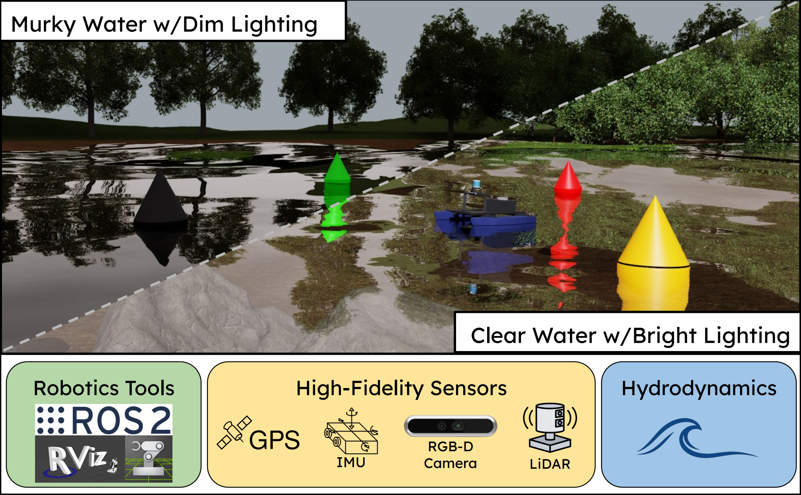
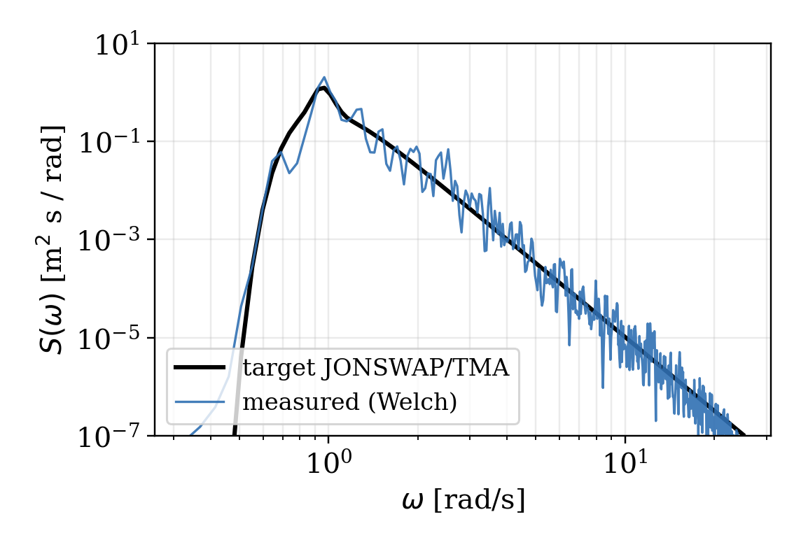

파도가 카메라에 보이는데 선체가 그대로라면, 수상 로봇의 카메라는 실제와 다른 자세에서 물가를 바라봐요. 수상 로봇 시뮬레이터 ASTRA는 화면에 그리는 수면 높이를 선체 부력 계산에도 써서, 파도가 지나갈 때 배의 높이와 기울기가 함께 바뀌도록 만들어요.

## 수면을 그리는 좌표에서 부력까지 계산해요

ASTRA는 물 위를 항해하는 무인 선박을 위한 <abbr title="가상 공간에서 로봇의 움직임과 센서를 계산하는 시뮬레이션 도구">Isaac Sim</abbr> 확장이에요. 실험 대상인 BlueBoat는 좌우에 부력을 받는 두 선체를 둬요. 파도가 두 선체 아래를 같은 높이로 지나면 배가 주로 위아래로 움직이고, 한쪽 수면만 높아지면 좌우에 작용하는 힘이 달라져 배가 기울 수 있어요. 선체에 고정한 카메라와 거리 센서도 같은 자세 변화를 겪어요.

물 위에서 선박이 움직이는 방향은 여섯 개예요. 앞뒤와 좌우, 위아래 이동에 더해, 앞뒤축을 중심으로 좌우로 기우는 <abbr title="배가 옆으로 기울었다 돌아오는 회전">롤</abbr>, 좌우축을 중심으로 앞머리가 들리는 <abbr title="배의 앞머리와 뒷머리가 번갈아 들리는 회전">피치</abbr>, 수직축을 중심으로 배가 좌우로 도는 <abbr title="위에서 봤을 때 배가 진행 방향을 바꾸는 회전">요</abbr>가 있어요. 센서가 맞닥뜨리는 차이는 수평 경로가 같은 두 주행에서도 생겨요. 피치가 바뀌면 전방 카메라가 한 프레임에 담는 물과 하늘의 비율이 달라지고, 롤이 바뀌면 거리 센서가 훑는 평면도 함께 기울어요.

연구진은 다루기 쉬운 크기로 단순화한 선체 겉면을 사용해요. 잔잔한 물에서 배가 평형을 이룰 때 잠긴 부피와 겉면 각 점의 깊이는 미리 계산해 둬요. 시뮬레이터가 움직임을 한 번 계산할 때마다 각 점의 세계 좌표를 구하고, 그 위치의 수면 높이에서 점의 높이를 빼요. 물 밖의 점은 잠김 깊이가 0이고, 많이 잠긴 점의 깊이는 점마다 정한 최대값으로 제한해요. 논문 식 5에서 7은 이렇게 얻은 깊이를 정지 상태와 비교해 현재 잠긴 부피로 바꾸는 규칙이에요.

변환은 기준 깊이보다 덜 잠기는 구간과 더 잠기는 구간에서 기울기가 다른 직선으로 근사해요. 추정 부피는 선체가 물 밖에 있을 때 0부터 전부 잠겼을 때의 부피까지예요. 위로 미는 힘은 추정 부피에 물의 밀도와 중력가속도를 곱해 구해요. 힘을 가하는 위치는 물에 잠긴 점들을 깊이에 따라 가중 평균한 곳이라, 배가 기울거나 한쪽 수면이 올라오면 힘의 크기와 작용점이 같이 바뀌어요.

잔잔한 물에서는 좌우 잠김 차이가 기운 배를 다시 세우는 힘으로 나타나요. 파도가 있을 때는 같은 계산에 시간과 위치별로 달라지는 수면 높이를 넣어 외란을 만들어요. 화면에서 마루가 선체에 닿는 시점과 부력 계산이 쓰는 수면을 한 모델에 묶으면 둘 사이의 어긋남을 줄일 수 있어요. 논문은 선체와 수면, 위치 센서, 떠다니는 물체를 관리하는 구성 요소가 같은 물리 계산 단계에 맞춰 갱신된다고 설명해요.

<figure class="fig"><figcaption>공식 저장소의 연못 장면이에요. 왼쪽 위는 조명이 어둡고 물이 탁한 조건, 오른쪽 아래는 조명이 밝고 물이 맑은 조건이에요. 아래에는 센서와 선체 물리 구성 요소가 표시돼요. 이 그림은 바꿀 수 있는 장면 조건과 시스템 구성을 보여줘요. (출처 — Tsimafei Lazouski 외, <a href="https://github.com/UMich-CURLY/ASTRA/blob/f62aab9add3650ec28ec7b4d6fbd09341fb753e0/imgs/ASTRA_v1.png">ASTRA 공식 저장소</a>, <a href="https://github.com/UMich-CURLY/ASTRA/blob/f62aab9add3650ec28ec7b4d6fbd09341fb753e0/LICENSE">Apache 2.0</a>. 그림 픽셀은 원본과 같고 내려받은 파일의 메타데이터에 라이선스 전문을 담았어요.)</figcaption></figure>

## 바람과 수심은 파도의 주파수 구성을 바꿔요

물 표면은 크기와 시작 시점이 다른 파동을 더해서 만들어요. <abbr title="파도가 얼마나 빠른 주기로 오르내리는지에 따라 수면 변화의 크기를 나타낸 분포">파도 스펙트럼</abbr>을 정하면 어느 주기의 파동이 큰 비중을 차지하는지 정할 수 있어요. ASTRA의 <abbr title="바람이 일정 구간을 불면서 만든 파도의 주기별 에너지를 나타내는 모형">JONSWAP</abbr> 모형에서 바람 속도와 바람이 물 위를 지나온 거리는 에너지가 가장 큰 주파수와 스펙트럼의 크기에 들어가요. <abbr title="물 깊이에 따라 파도 주기별 에너지 분포를 보정하는 방법">TMA</abbr> 보정은 설정한 수심을 그 분포에 반영해요.

논문은 파장 0.1~250m 범위를 덮는 주파수 성분 1,000개를 쓰고 각 성분에 무작위 시작 위상을 줘요. 위상은 각 성분이 마루나 골 중 어느 구간에서 시작할지 정하는 값이에요. 진행 방향을 고려할 때는 설정한 바람 방향을 중심으로 128개 방향에 가중치를 나눠요. 같은 풍향에서도 파도가 어느 정도 다른 방향에서 들어올 수 있게 하는 장치예요. 이렇게 얻은 수면은 시간과 가로·세로 위치로 조회할 수 있고, 선체 표면의 각 점은 자기 위치의 높이를 읽어요.

수면의 전체 높낮이에는 사용자가 조절하는 별도 배율이 있어요. 원문은 바람 속도와 바람이 물을 지나온 거리에서 물리적인 파고를 자동으로 산출하는 기능이 아직 없다고 설명해요. 물 깊이는 에너지 분포에 반영되지만, 파장과 주파수의 관계는 깊은 물을 가정한 식을 사용해요. 따라서 얕은 물에서 파도가 언제 선체에 닿는지까지 맞추려면, 그 위치에서 얻은 관측 자료와 파의 진행을 비교해야 해요.

## 수면이 나오는 시험과 배가 따라가는 시험

연구진은 파도 자체를 확인할 때 배와 별개로 한 지점의 수면 높이를 600초간 기록했어요. <abbr title="길게 기록한 신호를 겹치는 구간으로 잘라 구간별 주파수 분포를 평균하는 방법">웰치 방법</abbr>으로 높이 기록에서 주파수별 에너지를 계산하고, 생성할 때 지정한 분포와 대조했어요. 이때 방향 분산을 껐고, 시험한 세 수면 조건에서 원문은 목표 분포의 봉우리 위치와 전체 모양이 재현됐다고 보고해요. 그림 2의 두 선이 비슷하다는 것은 해당 지점에 도착한 파도가 만들어 낸 높이 변화가 설정한 주파수 분포를 따랐다는 뜻이에요. 진행 방향에 따른 높이 변화는 여러 지점에서 같은 시각에 값을 얻어 비교해야 확인할 수 있어요.

<figure class="fig"><figcaption>원문 그림 2. 검은 선은 생성기에 지정한 스펙트럼, 파란 선은 가상 수면의 시계열에서 추정한 스펙트럼이에요. 높은 주파수에서 파란 선이 검은 선 주변으로 흔들리는 모습도 보존했어요. (출처 — Lazouski 외, <a href="https://arxiv.org/pdf/2611.21789#page=5">ASTRA 그림 2</a>. arXiv 비독점 배포 조건을 확인했으며, 수면 생성 시험의 축과 두 곡선을 논평하는 데 필요한 원그림만 변경 없이 인용했어요.)</figcaption></figure>

배의 반응을 볼 때는 추진기를 끈 상태에서 선체 부근의 수면 높이와 배의 위아래 움직임을 함께 비교했어요. 분석 시점에 에너지가 가장 컸던 주파수에서 두 신호가 얼마나 일관되게 연결되는지 <abbr title="특정 주파수에서 두 신호가 얼마나 일정하게 함께 변하는지 보여 주는 0과 1 사이의 값">코히런스</abbr>로 나타냈어요. <abbr title="특정 주파수에서 파도 높이 변화에 견줘 선체가 얼마나 크게 움직였는지 나타내는 비율">응답 진폭비</abbr>와, 파도에 대한 선체 반응의 늦어짐을 각도로 표시한 <abbr title="같은 주기로 오르내리는 두 신호 중 하나가 한 주기의 얼마만큼 늦는지 나타내는 값">위상 지연</abbr>도 함께 보고했어요.

<abbr title="물결 높이를 대표하는 통계량으로, 이 표에서는 생성한 수면의 높이 기록에서 계산한 값">유의파고</abbr>는 시뮬레이션의 수면 기록에서 구했어요. 선체의 흔들림 크기는 <abbr title="플러스와 마이너스로 오가는 값을 제곱해서 평균한 뒤 제곱근을 구한 대표 크기">제곱평균제곱근</abbr>이에요. 아래 표의 두 파도 조건은 에너지가 가장 큰 주기에 해당하는 설정값을 2.63초로 두었어요.

| 추진기를 끈 시험 조건 | 유의파고 | 상하 움직임의 크기 | 롤과 피치의 크기 |
| --- | ---: | ---: | --- |
| 잔잔한 물 | 0m | 0m | 0도와 0도 |
| 약한 파도 | 0.29m | 0.074m | 3.66도와 3.70도 |
| 강한 파도 | 0.61m | 0.149m | 6.72도와 6.77도 |

약한 파도에서 지배적인 주파수의 코히런스는 0.996, 응답 진폭비는 1.02, 위상 지연은 14도였어요. 강한 조건에서 같은 방식으로 각각 0.992, 1.00, 20도를 보고했어요. 비율 1에 가까운 결과는 해당 주파수 성분의 수면과 배의 상하 진폭이 비슷했다는 뜻이에요. 위상 지연이 남아 있으므로 한 시각의 수면 높이를 배 높이로 그대로 읽을 수는 없어요. 잔잔한 물을 같은 시간 동안 돌린 비교에서는 측정할 만한 상하 움직임이 없었어요.

고요한 수면에서는 선체를 좌우로 각각 8도씩 기울였다 놓는 시험도 했어요. 연구진은 선체 형상에서 구한 복원 강성과 시험용 회전 관성, 회전을 줄이는 세 가지 <abbr title="물의 저항처럼 움직이는 몸체의 속도나 회전을 줄이는 작용">감쇠</abbr> 성분을 합친 값으로 <abbr title="기울어진 배가 반대쪽으로 넘어가며 반복해서 흔들릴지 가늠하는 값">감쇠비</abbr>를 약 1.01로 계산했어요. 이 조건에서는 배가 똑바른 자세를 지나 반대쪽으로 기울기 전에 움직임이 가라앉을 것으로 예상해요. 두 번의 가상 시험에서 관측된 복귀 모양도 그 예상에 맞았어요. 형상에서 계산한 복원력과 가상 선체의 움직임이 일관되는지 확인한 결과예요.

## 실선 로그가 들어간 방향과 가정으로 남은 방향

연구진은 실제 BlueBoat 시험에서 모은 기록 29개에서 추진이 멈춘 뒤 속도가 줄어드는 구간을 골랐어요. 앞뒤로 움직이던 속도가 줄어드는 구간 일곱 개와, 방향을 틀던 회전이 줄어드는 구간 일곱 개에 각각 같은 계수 한 쌍을 맞췄어요. 감쇠를 속도에 비례하는 항과 속도 크기의 제곱에 비례하는 항으로 나타내고, 음의 저항이 생기지 않도록 두 계수가 0 이상이 되게 했어요. 논문의 <abbr title="관측된 값의 변화를 모형이 얼마나 잘 설명하는지 나타내는 지표">결정계수</abbr> 중앙값은 앞뒤 이동에서 0.94, 요에서 0.96이었어요. 앞뒤 이동의 선형 계수는 0에 닿았으므로 시험한 속도 구간에서는 제곱 항이 감속 모양을 주로 설명했어요.

좌우 이동과 위아래 이동, 롤과 피치에는 그 감속 시험에서 계수를 추정할 만큼 충분한 움직임이 발생하지 않았어요. 연구진은 이 방향들의 감쇠값을 수동으로 정했고, 앞서 기울였다 놓는 시험에도 현장 관측으로 맞추지 않은 관성값이 들어갔어요. 모델에는 선체가 가속할 때 주변 물도 함께 움직이며 생기는 <abbr title="배가 주위 물을 함께 밀어내면서 실제보다 더 무거운 물체처럼 반응하는 효과">부가 질량</abbr> 항이 따로 없어요. 한 방향의 움직임이 다른 방향의 감쇠에 주는 영향도 생략했어요. 물결이 심하거나 진행 방향이 자주 바뀌는 조건으로 넓힐 때, 앞뒤 감속과 요의 적합도만으로 오차를 예상하기 어려운 이유예요.

센서 쪽 시험은 또 다른 질문을 다뤄요. <abbr title="센서와 제어 프로그램 사이에서 정해진 형식으로 메시지를 주고받게 하는 로봇 소프트웨어 도구">ROS 2</abbr>로 연결된 기존 위치 추정 모듈은 위성 위치와 <abbr title="배의 가속과 회전을 재는 센서">관성 측정 장치</abbr> 값을 받아요. 별도의 지도를 만드는 모듈은 <abbr title="레이저가 물체에 반사되어 돌아오는 시간을 써서 거리를 재는 센서">LiDAR</abbr> 점들의 위치와 <abbr title="색 영상과 함께 화면 속 물체까지의 거리를 기록하는 카메라">RGB-D 카메라</abbr> 영상, 추정한 선체 자세를 묶어서 물가를 분류해요. 연구진은 두 모듈의 메시지 인터페이스를 바꾸지 않고 시뮬레이터에 연결했어요. 실제 센서 기록을 재생하는 지도 실험에는 가상 센서 시험과 같은 가중치와 설정을 썼어요.

가상 환경에서는 189m를 이동했을 때 시뮬레이터가 알고 있는 위치와 추정 위치의 <abbr title="큰 오차에 더 큰 비중을 두어 거리 오차의 대표 크기를 계산하는 방법">평균제곱근오차</abbr>가 3cm 미만이었어요. 이 수치의 기준은 가상 환경의 위치예요. 실제 연못의 지도에는 정답 라벨이 없어서 시뮬레이션 지도와 실선 기록으로 만든 지도의 구조를 정성적으로 비교했어요. 논문에서 위치 추정은 초당 61.8번, 지도는 초당 2.2번 갱신됐고, 전체 센서와 부력 계산을 켠 장면은 RTX 4090 한 장에서 초당 약 35프레임으로 재생됐어요. 셋은 위치 출력, 지도 출력, 화면 재생에 속하는 별개의 측정값이에요.

## 시험 항목마다 입력과 합격 기준을 정해요

수상 로봇 개발에서 파도 모델을 바꾼다면 한 지점의 수면 높이부터 기록해요. 생성 설정을 고정하고, 파도의 지배적인 주파수와 높이의 분포를 먼저 확인하면 선박이 움직이기 전 단계에서 차이를 찾을 수 있어요. 그다음 추진기를 끄고 선체 인근의 수면 높이와 선체 자세를 같은 시간축에 올려요. 수면의 높낮이는 맞는데 배의 움직임이 달라졌다면, 선체 표면의 샘플 위치와 잠긴 부피 계산, 힘을 적용한 위치를 확인할 근거가 생겨요.

이때 배 옆의 수면 높이 하나만 저장하면 좌우가 서로 다른 힘을 받은 원인을 나중에 확인하기 어려워요. 좌우 선체의 앞뒤에 대응하는 지점의 수면 높이와 작용점도 같이 남기면, 배 전체가 들린 경우와 한쪽만 깊이 잠겼던 경우를 구별할 수 있어요. 측정 시각을 렌더링 화면의 번호로만 저장하면 물리 계산과 화면 갱신 속도가 다를 때 짝이 어긋날 수 있으므로, 수면과 자세 기록은 같은 시뮬레이션 시각으로 맞춰요.

두 신호의 관계를 볼 때는 진폭비와 지연을 함께 보관해요. 센서 출력을 모아 자세를 추정하는 모듈에서는 흔들림의 크기가 비슷해도 입력 사이의 시차에 따라 결과가 달라질 수 있어요. 원문처럼 추진을 멈춘 조건을 먼저 점검하면 부력 쪽 문제를 찾기 쉽고, 추진을 켠 다음 시험에서는 구동 명령에 따라 달라지는 속도와 방향의 오차를 따로 볼 수 있어요.

카메라 인식 시험이라면 무엇을 같은 조건에 둘지도 중요해요. 수면 높이와 선체 자세를 고정한 반복에서 물의 투명도만 바꾸면 외관 변화에 민감한지 볼 수 있어요. 반대로 조명과 물의 외관을 고정한 채 파도 조건을 바꾸면 선체 자세 변화가 영상과 점들의 위치에 미치는 영향을 살펴볼 수 있어요. 시작 자세와 센서 장착 위치, 기록 시각과 출력 주기를 함께 보관하면 물체 분류가 틀어진 순간에 센서 자세가 어떻게 달라졌는지 거슬러 볼 수 있어요.

실제 배의 흔들림을 예측하려면 수면과 선체 자세를 같은 시간 기준으로 기록한 현장 자료가 더 필요해요. 적어도 맞추려는 방향의 움직임이 기록에 나타나야 그 방향의 관성이나 감쇠를 추정할 수 있고, 계수를 맞추는 데 쓴 기록과 평가용 기록을 나눠야 새 파도 조건에서도 유효한지 볼 수 있어요. ASTRA의 가상 실험은 수면 생성과 선체 반응, 센서 연결을 점검할 근거를 줘요. 현장 예측에 쓸 범위는 현장 자료가 뒷받침하는 선체 운동과 물 조건에 맞춰 정하는 편이 타당해요.

<!-- src-block -->
출처 — https://arxiv.org/abs/2611.21789
