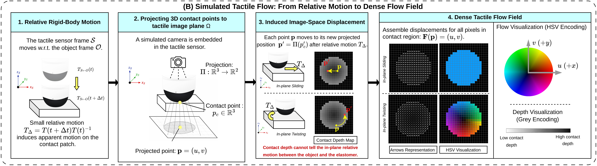
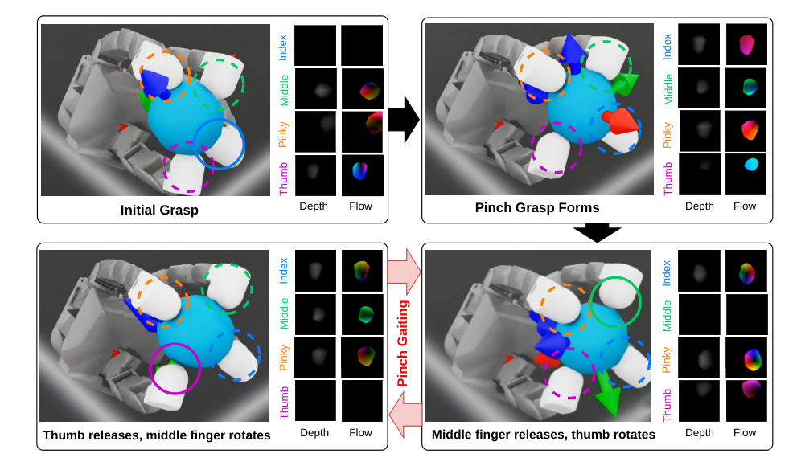

평평한 물체에 손끝을 대고 같은 깊이로 누른 채 물체를 옆으로 밀면 어떻게 될까요? 눌린 자리만 찍은 두 사진은 거의 같을 수 있어요. 물체가 오른쪽으로 움직이면 로봇 손끝도 오른쪽으로 따라가야 하는데, 사진 한 장에는 왼쪽과 오른쪽을 가를 단서가 부족해요. 손가락 여러 개로 물체를 돌릴 때는 어느 손가락이 물체를 받치고 어느 손가락이 표면을 밀고 있는지도 알아야 해요.

2026년 11월에 공개된 <abbr title="가상 로봇의 손끝에서 눌림과 접촉면의 움직임을 함께 계산하는 촉각 시뮬레이터">TactileLab</abbr>은 눌린 자리의 각 점에 작은 화살표를 붙여요. 화살표의 두 성분은 손끝을 기준으로 본 물체 표면이 한 번의 관측 사이에 화면의 가로와 세로로 얼마나 옮겨가는지를 나타내요. 연구진은 이 관측을 **모의 촉각 흐름**이라고 불러요. 물체가 센서를 파고든 깊이와 나란히 놓으면, 같은 자리에서 눌림이 유지되는 동안에도 움직임의 방향을 읽을 수 있어요.

## 접촉한 점을 다음 순간의 손끝 화면에 다시 놓아요

연구진은 로봇 학습 환경 <abbr title="가상 로봇 여러 대가 같은 과제를 병렬로 연습하도록 환경을 구성하는 도구">Isaac Lab</abbr>에서 손끝과 물체를 <abbr title="힘을 받아도 물체 자체의 모양은 유지된다고 보는 모형">강체</abbr>로 다뤘어요. 손끝 내부에는 표면을 바라보는 가상 카메라가 있어요. 실제 촉각 카메라는 물체가 닿아 부드러운 막이 변한 모습을 찍어요. 가상 카메라에서는 물체 표면이 변형 전의 막 표면 안으로 어느 정도 들어왔는지 계산해 눌림을 근사해요. 화면의 각 위치에 이 깊이 하나를 기록하면 접촉 깊이 지도가 돼요.

다음 계산에는 깊이 지도로 구한 접촉 영역만 써요. 센서에 닿은 물체 표면의 점을 공간에서 찾고, 물체와 센서의 상대 운동으로 그 점의 다음 위치를 구해요. 그 위치를 다시 손끝 카메라 화면에 옮겨 이전 위치와의 차이를 재요. 물체가 멈춰 있어도 손끝이 움직이면 차이가 생겨요. 반대로 손끝과 물체가 같은 자세를 유지하며 함께 이동하면 방 안에서 둘 다 빠르게 움직여도 상대 이동은 작아요. 손끝이 읽어야 하는 움직임을 얻으려면 두 시점 모두에서 카메라가 어디를 향했는지 알아야 하는 이유예요.

<figure class="fig"><figcaption>그림 2의 아래 패널. 물체 표면의 한 점에 대해 두 시점의 영상 좌표를 구하면 한 화살표가 나와요. 같은 계산을 접촉 영역에 펼친 것이 오른쪽의 흐름이에요. (출처 — Yijiong Lin 외, <a href="https://arxiv.org/html/2611.07881v1#S2.F2">TactileLab 그림 2</a>, <a href="https://creativecommons.org/licenses/by/4.0/">CC BY 4.0</a>. 원문 패널 파일을 그대로 실었어요.)</figcaption></figure>

가령 넓은 평면이 손끝에 붙어서 옆으로 움직이면 여러 점의 화살표가 비슷한 쪽을 향해요. 같은 평면을 손끝에 댄 채 가운데를 축으로 돌리면 접촉 영역 양쪽의 점이 서로 다른 방향으로 움직여요. 영역 한가운데의 화살표 하나만 보거나 모든 화살표의 평균만 구하면 이 회전을 놓칠 수 있어요. 깊이 한 장, 접촉 중심 한 점, 화면 곳곳에 남긴 화살표가 같은 접촉에서 서로 다른 정보를 주는 사례예요.

화살표가 길어지는 것과 손끝에 큰 힘이 걸리는 것은 구별해야 해요. 이 계산은 화면에서 점이 이동한 거리를 주고, 고무막의 어느 부분에 힘이 얼마나 쌓였는지는 풀지 않아요. 두 물체가 같은 만큼 움직여도 막의 단단함이나 마찰에 따라 실제 변형은 달라져요. 반대로 막이 이미 옆으로 늘어난 상태에서 움직임이 멎으면, 새 영상 사이의 변위는 작아도 막에는 여전히 힘이 걸려 있을 수 있어요. 논문이 얻어낸 값으로 물체를 따라갈 방향을 학습할 수 있지만, 화살표 길이만 읽어서 물체에 가해진 힘을 정할 수는 없어요.

## 모의 손끝으로 배운 동작을 실제 손끝에 연결해요

시뮬레이터는 물체의 자세와 움직임을 이미 알고 있어요. 실제 로봇 손에 달린 카메라에는 그 값이 들어오지 않아요. 그래서 연구진은 행동을 배우는 과정과 카메라 사진을 읽는 과정을 따로 학습시켰어요. 행동을 배우는 동안에는 계산으로 만든 깊이와 흐름을 쓰고, 실물에서 움직일 때는 카메라 사진을 같은 형식의 깊이와 흐름으로 바꿔 넣어요. 센서 표면의 무늬와 조명까지 가상 세계에 똑같이 그릴 필요가 줄어드는 대신, 사진을 바꾸는 과정이 제대로 작동하는지 따로 확인해야 해요.

변환에 쓸 짝지은 자료를 만드는 과정부터 두 종류의 관측이 갈라져요. 연구진은 센서를 물체에서 뗀 위치에서 출발해 정해 둔 위치와 각도로 눌렀어요. 그때 사진 한 장을 찍고, 접촉을 유지한 채 정해진 만큼 더 움직인 뒤 두 번째 사진을 찍었어요. 가상 센서에도 같은 시작 자세와 상대 이동을 주면 두 자세의 깊이와 그 사이의 흐름을 계산할 수 있어요. 실제 사진과 가상의 정답을 묶는 기준은 화면의 색이 얼마나 닮았는지가 아니라, 어떤 자세에서 어떤 동작을 했는지예요.

깊이는 하나의 접촉 상태에 대응해요. 흐름 변환기 <abbr title="실제 손끝 카메라의 영상 두 장을 받아 가상 센서에서 쓸 움직임 지도를 추정하는 모델">TacFlowNet</abbr>에는 순서가 있는 두 장이 필요해요. 모델이 맞히는 정답은 시뮬레이터가 계산한 화살표예요. 실제 막에 찍힌 무늬의 모든 점을 정확히 추적하는 문제가 아니에요. 막을 누르거나 기울이면 무늬의 밝기와 형태도 달라질 수 있지만, 시뮬레이터에서 같은 동작에 대응하는 출력은 접촉한 물체 표면의 상대 이동으로 정해져요. 학습할 때는 가상 접촉 영역 안에서 화살표가 얼마나 어긋나는지도 따로 계산해요. 접촉점이 차지하는 면적이 작을 때 배경의 빈 곳만 잘 맞혀도 좋은 점수를 받는 일을 줄여요.

수집 장치가 정해진 거리를 움직이는 동안의 순간 속도는 일정하다고 볼 수 없어요. 연구진은 시작 사진과 끝 사진을 센서의 한 관측 간격에 해당하는 변화로 취급해 가상 정답을 만들었어요. 실제 운용에서는 연속해서 들어오는 두 장을 변환해요. 여기서 맞춰야 할 조건이 하나 더 생겨요. 같은 속도로 움직여도 두 장 사이의 시간이 달라지면 이동 거리가 달라져요. 카메라 사진을 한 장 건너뛴 입력이나 순서가 뒤집힌 입력은 모양만 보면 여전히 정상적인 두 장이에요. 새 장치에서 두 장을 묶는 시점은 모델의 입력 크기만큼이나 중요한 설정이에요.

## 손가락 네 개 중 어느 것이 물체를 밀고 있나

논문의 손안 회전 과제는 손바닥으로 받치지 않고 손가락으로 물체를 쥔 채 지정된 축을 따라 계속 돌리는 일이에요. 연구진은 관절 16개가 움직이는 두 종류의 손에 각각 네 개의 가상 촉각 손끝을 달았어요. 손마다 관절의 운동 범위와 처음 쥐는 자세가 다르기 때문에 제어기도 손별로 학습했어요. 누르는 깊이와 옆 움직임은 여러 손에서 같은 형식으로 나타낼 수 있지만, 어느 관절을 얼마나 움직여야 하는지는 손의 구조에 달려 있어요.

처음에는 물체의 질량, 마찰, 자세, 바깥에서 가한 힘처럼 시뮬레이터가 아는 값을 교사 제어기에 보여 줘요. 교사는 물체를 목표 방향으로 돌리면서 손아귀에서 멀리 벗어나지 않도록 동작을 배워요. 다음에는 학생 제어기가 실제로 받을 수 있는 관절 위치, 앞선 명령, 손끝 관측으로 교사의 행동에 필요한 정보를 추정해요. 네 손끝의 관측은 손가락별 자리를 정해 한 화면처럼 배열해요. 학생이 잘했는지 판단할 때 교사에게만 보였던 물체 정보가 계속 들어가고 있다면, 실제 손에서도 같은 동작이 나올지 알 수 없어요.

<figure class="fig"><figcaption>그림 7. 마주 보는 손가락이 물체를 지지하는 사이 다른 손가락은 접촉을 풀었다가 새 위치에서 물체를 밀어요. 손의 자세와 깊이 지도를 함께 보면 어느 손끝이 떨어졌는지, 흐름을 보면 접촉 중인 면이 어느 쪽으로 움직였는지 읽을 수 있어요. (출처 — Yijiong Lin 외, <a href="https://arxiv.org/html/2611.07881v1#S7.F7">TactileLab 그림 7</a>, <a href="https://creativecommons.org/licenses/by/4.0/">CC BY 4.0</a>. 원그림을 그대로 실었어요.)</figcaption></figure>

손의 방향도 실험 조건이에요. 손바닥이 위를 보는 자세로만 학습하면 중력이 물체를 밀어내는 방향과 손가락이 받쳐야 할 방향이 매번 비슷해요. 연구진은 손의 방향을 바꾸고, 학습과 평가 중 물체에 예고하지 않은 힘과 회전력을 가했어요. 같은 관절 명령을 내려도 물체가 같은 쪽으로 구른다고 가정하기 어려운 조건이에요. 이때 최근 몇 번의 관절 위치를 기억하는 방법과, 바로 앞 구간의 상대 이동을 손끝에서 읽는 방법의 차이가 드러나요.

그림 5의 학습 곡선은 무작위 초기 조건을 달리한 세 번의 평균과 표준편차를 표시해요. 관절 상태 위주로 보는 제어기는 과거 기록을 대략 10단계에서 15단계까지 늘렸을 때 이득을 얻었어요. 깊이나 흐름을 받은 제어기는 5단계에서 10단계 사이에서도 높은 보상을 얻었어요. 한 번의 흐름 관측 자체가 이미 두 시점 사이의 변화를 담고 있으니, 같은 수의 입력이라도 시간에 관한 단서의 양이 달라요. 이 수치는 손가락 기억을 몇 초로 설정하라는 규격이 아니에요. 관측 한 번이 얼마의 시간을 담는지와 어떤 정보가 들어 있는지부터 봐야 다른 제어 주기의 손과 비교할 수 있어요.

## 떨어뜨리지 않는 손과 잘 돌리는 손은 점수가 달라요

손안 회전 실험에서 연구진은 목표 축으로 돌아간 각도를 누적한 회전 수와 물체를 떨어뜨렸는지를 따로 기록했어요. 손가락이 움직여도 물체가 제자리라면 낙하를 피할 수는 있지만 회전 과제를 수행한 것은 아니에요. 반대로 처음에 빠르게 돌리다가 물체를 놓친 손도 짧은 구간만 보면 잘한 것처럼 보여요. 아래는 원문 표 1에서 같은 관절 관측을 주고 손끝 입력만 달리한 세 조건이에요. 학습할 때와 비슷한 물체와 그 범위를 벗어난 물체를 따로 평가했어요.

| 관절 정보에 더한 관측 | 학습 범위 안 낙하율 | 학습 범위 밖 낙하율 | 범위 밖 평균 회전 수 |
| --- | ---: | ---: | ---: |
| 깊이 | 14.26% | 29.91% | 1.20 |
| 흐름 | 17.45% | 29.82% | 1.19 |
| 깊이와 흐름 | 11.76% | 18.69% | 1.27 |

범위 밖에서 깊이만 본 손과 흐름만 본 손은 낙하율이 0.09%포인트 차이였어요. 둘을 함께 주면 깊이만 줬을 때보다 11.22%포인트 낮아져요. 범위 안에서는 오히려 깊이만 쓴 손이 흐름만 쓴 손보다 덜 떨어뜨렸어요. 흐름이 있다는 이유로 깊이를 뺄 근거는 약해요. 손가락을 새로 댈 때에는 닿은 면의 넓이와 위치가, 이미 닿은 채 물체를 밀 때에는 표면의 움직임이 유용하다는 해석과 맞는 결과예요. 어느 손가락이 어느 순간 어떤 정보에 의존했는지는 이 표만으로 나눠 잴 수 없어요.

학습 범위 밖에서 두 관측을 모두 쓴 손은 낙하까지 평균 25.08초를 기록했고 표준편차는 3.50초였어요. 평균 회전 수 1.27에 대한 표준편차는 0.94회예요. 낙하율의 차이만큼 회전 수 차이도 또렷하다고 읽으면 안 돼요. 낙하 비율은 정해진 시간 전에 떨어뜨린 시행이 얼마나 되는지, 낙하까지의 시간은 얼마나 오래 버텼는지, 회전 수는 버티는 동안 과제를 얼마나 진행했는지에 답해요. 세 숫자를 나란히 두어야 물체를 놓치지 않으려고 움켜쥔 채 멈춘 행동을 가릴 수 있어요.

두 팔로 물체를 따라가는 과제에서는 관측의 우선순위가 달랐어요. 선도 팔이 물체를 옮기고 추종 팔은 움직이는 물체에 대해 목표 접촉 위치와 각도를 유지해요. 평평한 접촉면이 옆으로 움직이면 눌린 모양이 거의 그대로라서 추종 팔이 옆으로 얼마나 빗나갔는지 깊이만으로 알기 어려워요. 그림 6에서 흐름을 쓴 쪽이 깊이만 쓴 쪽보다 잘 따라갔고 두 관측을 합치면 학습이 빨라졌지만 마지막 성능은 흐름만 썼을 때와 비슷했어요. 하나의 접촉을 계속 유지하는 과제와 네 손끝이 차례로 떨어졌다 붙는 과제에 같은 센서 조합을 고를 이유는 없어요.

## 실제 손에서는 30초 뒤의 동작을 모른다

실물 회전 시험에는 네 손끝에 카메라식 센서를 단 대칭형 로봇 손을 썼어요. 학습에서는 캡슐 모양 물체를 썼고, 실물에서는 원통형, 둥근 물체, 상자형을 평가했어요. 방법마다 서로 다른 열 가지 초기 파지 자세에서 시작해 한 번에 최대 600번 명령을 내렸어요. 시간으로는 30초예요. 실물에서 시행을 끝내는 조건에는 낙하뿐 아니라 물체가 끼거나 더 진행하기 어려운 상황도 들어가요. 따라서 앞의 가상 낙하 시간과 실물 종료 시간은 같은 뜻의 지표가 아니에요.

표 4에서 깊이만 쓴 제어기와 깊이·흐름을 함께 쓴 제어기의 평균 종료 시간은 모두 30초였어요. 두 조건의 평균 회전 수는 1.70회와 1.95회였고 표준편차는 각각 0.78회와 0.81회였어요. 종료 시간 열만 보면 둘은 구분되지 않아요. 정해 둔 시간 끝까지 물체를 유지한 조건끼리 비교할 때는 그 사이에 얼마나 돌렸는지가 남아요. 이 결과에서 30초가 지난 뒤 어느 손이 먼저 놓칠지는 계산할 수 없어요.

물체 모양별로 나누면 차이가 더 커져요. 두 관측을 함께 쓴 경우 둥근 물체는 평균 2.43회, 상자형은 1.33회였어요. 상자형의 표준편차는 1.00회에 이르러요. 둥근 모양은 손가락을 굴려 새 접촉점으로 옮기기 쉽지만, 상자는 한 면에서 다음 면으로 넘어갈 때 모서리가 손가락을 가로막을 수 있어요. 모서리에 닿는 순간에는 접촉 면적 자체도 바뀌어요. 논문 그림 13의 자세 변화와 표 5를 함께 보면 물체를 계속 쥐고 있었던 것과 매끄럽게 다음 면으로 넘긴 것은 다른 성과임을 알 수 있어요.

실제 두 팔의 추종 결과도 물체에 따라 달랐어요. 표 3에서 단단한 정육면체를 직선으로 따라갈 때 평균 위치 오차는 0.91밀리미터였고 원 경로에서는 1.42밀리미터였어요. 부드러운 공에선 각각 1.75와 2.87밀리미터, 뇌 모양 발포체에선 4.20과 6.43밀리미터였어요. 같은 경로에서도 결과가 달라졌지만 세 물체는 재료와 형상이 함께 달라요. 이 비교로 오차 증가분 중 얼마가 재료의 변형 탓인지 분리할 수는 없어요. 특히 가장 좋은 직선 결과 하나를 새 물체의 추종 정밀도로 가져오면 이 차이가 사라져요.

## 새 손끝에 적용할 때는 방향과 시간부터 맞춰요

손끝 시뮬레이션을 설계할 때 첫 질문은 과제 도중 겉보기 접촉이 같은 두 순간에 서로 다른 동작이 필요한지예요. 평평한 면이 오른쪽으로 밀릴 때와 왼쪽으로 밀릴 때 손끝이 각각 반대 방향으로 따라가야 한다면, 두 상태의 깊이 지도를 우선 나란히 놓아 볼 수 있어요. 구별이 어려우면 두 시점의 상대 이동을 추가할 이유가 있어요. 반대로 과제의 합격 조건이 깨지기 쉬운 물체에 특정 크기 이상의 힘을 주지 않는 것이라면, 이동 화살표와는 별도로 힘을 검증할 기준이 필요해요.

두 번째는 센서 화면의 좌표와 시간 간격이에요. 점 하나를 옆으로 보내는 경우와 접촉 영역을 중심으로 돌리는 경우를 나눠 보면 화면 축을 뒤집었는지, 회전 중심에서 멀수록 변위가 커지는지 확인하기 쉬워요. 다음에는 물체와 센서를 함께 옮겨 둘 사이의 상대 움직임이 작은 조건을 만들 수 있어요. 여기서 큰 화살표가 나오면 물체의 세계 좌표 이동을 센서 기준 이동으로 잘못 해석했는지부터 살펴볼 만해요. 이런 비교에는 학습을 끝낸 로봇 손이 필요하지 않아요. 센서 관측 한 쌍과 가상 정답만으로 계산 과정의 어느 쪽을 점검할지 좁힐 수 있어요.

마지막은 측정표를 둘로 나누는 일이에요. 한쪽에는 실물 사진 두 장을 가상 흐름으로 바꿨을 때 이동 방향과 회전을 얼마나 잘 복원하는지 적고, 다른 쪽에는 그 신호로 움직인 손이 물체별로 몇 번이나 얼마나 오래 돌렸는지 적어요. 첫 표가 나쁘면 카메라 관측과 가상 정답의 대응을 살펴볼 차례예요. 첫 표가 좋아도 상자 모서리에서만 손이 멈춘다면, 파지 자세와 학습 물체의 모양을 바꿔 같은 실패가 남는지 볼 수 있어요. 손끝 사진 한 쌍의 오차와 손 전체의 실패를 따로 기록해 두면, 다음 실험에서 카메라부터 다시 맞출지 손가락 동작부터 바꿀지 정할 수 있어요.

<!-- src-block -->

출처 — https://arxiv.org/abs/2611.07881
